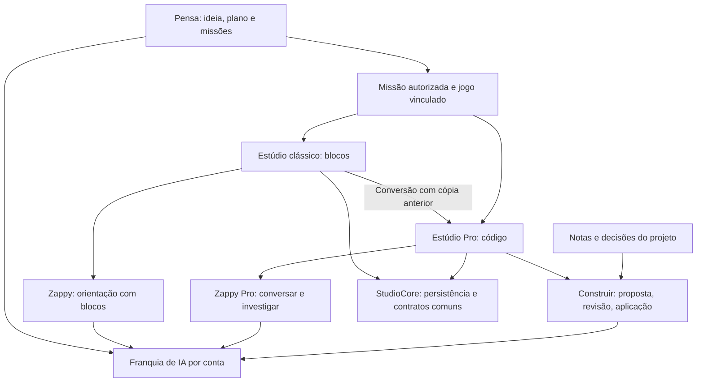

# Auditoria de Pensa, Zappy e Estúdio Pro

> Atualização: os oito achados receberam correções locais. Veja o [relatório das correções e verificações](./pensa-zappy-studio-2026-10-15/qa/fixes/report.md). O texto abaixo preserva o diagnóstico anterior às mudanças.

Data: 15/10/2026. Referência: `b94714927` e árvore de trabalho local.
Escopo: Pensa v2 e compatibilidade com planos antigos; Zappy no Estúdio clássico e Pro; conversão, missões, persistência, propostas de IA, publicação, créditos e integração com a Comunidade Kids.

## Parecer

**A base compartilhada tem boas fronteiras, mas a integração dos fluxos ainda está incompleta.** O código diferencia planejamento, orientação por blocos, orientação por código e construção assistida. Encontrei falhas concretas principalmente na ligação da tela Pro com os serviços da aplicação e na passagem de uma missão do Pensa para código.

Não aprovaria ainda a afirmação “está tudo certo e organizado”. As duas prioridades são conectar a publicação à tela Pro e resolver os guias de blocos que continuam aparecendo depois da conversão. A auditoria não encontrou cruzamento de contas ou perfis nos cenários executados, nem aplicação automática de propostas ao apenas conversar.

Não foram alterados arquivos de produção. As reproduções, relatórios e logs ficam em [pensa-zappy-studio-2026-10-15](./pensa-zappy-studio-2026-10-15/). O PostgreSQL temporário criado exclusivamente para esta análise foi encerrado.

## 1. Como as partes estão organizadas

| Superfície | Responsabilidade efetiva | Contexto e persistência | Avaliação |
|---|---|---|---|
| Zappy no Pensa | Conversar sobre a ideia, preparar o mapa e as missões, ajudar quando a criança trava | Plano, ciclo, capacidades conquistadas e missões; backend próprio do Pensa | Separação adequada; planejamento ainda pressupõe blocos |
| Zappy no Estúdio clássico | Ensinar e explicar a construção com blocos | Projeto, blocos disponíveis, comportamento e missão do Pensa vinculada | Coerente com o modo clássico |
| Zappy Pro — Conversar/Investigar | Explicar código, seleção e erros; investigar sem aplicar alterações | Arquivos selecionados, hashes, diagnóstico, histórico compatível e missão autorizada | Fronteira de leitura bem definida; não recebe as notas locais do projeto |
| Zappy Pro — Construir | Preparar proposta de alteração de trecho, parte ou jogo; revisar e aplicar explicitamente | Revisão de base, proposta persistida, permissões, fonte de IA, decisões e missão | Boas proteções contra alterações tardias ou no projeto errado |
| “Ideias e decisões do projeto” | Guardar notas opcionais, decisões e perguntas respondidas | Metadados do projeto Pro; usados pelo construtor | Não conclui missões do Pensa; a continuidade com a conversa é incompleta |
| Entrada antiga de IA | Compatibilidade com comandos e abas antigos | Redireciona ao tutor autorizado pelo host | Não monta um assistente paralelo no fluxo atual |

O Pensa tem sua própria interface e seus próprios endpoints. Ele compartilha infraestrutura e contratos com o Estúdio, sem simplesmente incorporar o painel do editor. “Zappy” é a identidade comum; os papéis variam conforme o espaço.

O Estúdio clássico e o Pro usam o mesmo `StudioCore`, com armazenamento do mesmo acervo de jogos e ramificações explícitas por tipo de projeto. Essa reutilização faz sentido: converter um jogo preserva sua identidade e sua ligação com o plano. A implementação da conversão também preserva uma cópia anterior.

Referências centrais: [entrada do Pensa](../packages/pensa/src/components/PensaApp.tsx), [StudioCore](../packages/studio/src/studio/StudioCore.tsx), [política por modo](../packages/studio/src/studio/tutorMode.ts), [redirecionamento da IA antiga](../packages/studio/src/studio/legacy-ai.tsx).

## 2. Achados de produto, em ordem de prioridade

### P1 — A publicação Pro não está conectada à tela real da Comunidade Kids

**Confiança: alta. Severidade: alta.** Afeta o fluxo `/estudio/pro/[id]`.

O editor possui suporte a publicação Pro, mas `StudioProEditor` não recebe nem repassa `share`. O `StudioCore` assume `null` quando esse adaptador falta e o botão de compartilhar depende dele. No host clássico, o adaptador inclui explicitamente `createStudioPublicationAdapter()`.

Resultado: o aluno pode trabalhar no Pro, porém a tela não apresenta o caminho de compartilhamento/publicação disponível na implementação comum.

Evidências:

- `packages/member-shell/src/components/studio/studio-pro-editor.tsx:184`: montagem sem `share`.
- `packages/studio/src/studio/StudioCore.tsx:145`: ausência vira `null`.
- `packages/studio/src/components/layout/Topbar.tsx:477`: botão condicionado a `share`.
- `packages/community-kids/src/components/kids/studio-full-client.tsx:481`: configuração presente no clássico.
- Reprodução do host real capturou `share: undefined`.
- Teste de navegador do player/publicação Pro passou, incluindo persistência entre revisões e isolamento do armazenamento do editor. Isso valida o mecanismo interno; não valida a conexão ausente na rota Kids.

Correção recomendada: extrair e compartilhar a configuração de publicação dos hosts; testar abrir um jogo pela rota Kids Pro e publicar a partir dela.

### P1 — A missão do Pensa continua ensinando blocos depois da conversão para Pro

**Confiança: alta. Severidade: alta.** Afeta missões de Estúdio com instruções de blocos abertas em um projeto convertido.

O planejador do Pensa orienta a geração pelo catálogo de blocos e pelo mapa da paleta. Ao abrir a tarefa no Pro, `useStudioTaskSession` elimina os blocos sugeridos, mas repassa o guia inteiro sem adaptação. O Zappy Pro, por sua vez, foi explicitamente configurado para trabalhar com código e evitar instruções de encaixar blocos.

Isso permite uma tela com editor de código e guia pedindo “Arraste o bloco de movimento”. A reprodução confirmou exatamente essa combinação. Também falta um contrato de capacidade Pro no planejamento para orientar as próximas missões de acordo com o editor usado.

Evidências:

- `packages/member-shell/src/server/pensa-journey/planner.ts:42`, `:54`, `:466`.
- `packages/community-kids/src/components/kids/use-studio-task-session.tsx:61`: guia preservado.
- Mesmo arquivo, `:62`: apenas a lista de blocos é removida.
- `packages/studio/src/studio/tutorMode.ts:5`: política de código no Pro.
- Reprodução `GUIDE_EVIDENCE` em [reproductions.log](./pensa-zappy-studio-2026-10-15/qa/reproductions.log).

Correção recomendada: tornar a modalidade de autoria parte explícita do contrato Pensa–Estúdio. Preservar objetivo e critérios da missão, mas adaptar suas instruções ao modo atual. A conversão deve explicar o que muda e invalidar instruções que dependam da paleta.

Não encontrei evidência de que concluir uma missão v2 no Pro esteja sempre impedido: o hook ainda confirma a revisão na nuvem antes da conclusão. O defeito confirmado é a incompatibilidade das instruções.

### P2 — As notas do projeto chegam a “Construir”, mas não a “Conversar/Investigar”

**Confiança: alta. Severidade: média.**

O painel “Ideias e decisões do projeto” guarda briefing e decisões confirmadas. `ProBuilderPanel` compõe esses dados no pedido de construção. Já `buildStudioTutorRequest` não os inclui na conversa, e o contrato de entrada do tutor também não oferece esse contexto.

Exemplo reproduzido: salvar “resgatar sete tartarugas” e “nunca adicionar inimigos”, depois perguntar ao tutor sobre a meta. Nenhum desses dados segue no pedido. O construtor pode conhecê-los enquanto a conversa do mesmo painel não conhece.

Evidências: `packages/studio/src/components/tutor/ProBuilderPanel.tsx:268`; `packages/studio/src/studio/tutor.ts:487`; reprodução `CONTEXT_EVIDENCE`.

Correção recomendada: um resumo versionado e limitado das decisões, compartilhado por conversa, investigação e construção, mantendo separadas a missão oficial do Pensa e as notas livres. A interface já informa corretamente que essas notas não concluem tarefas do Pensa.

### P2 — Voz e visibilidade inicial do saldo desaparecem no Pro

**Confiança: alta. Severidade: média.**

O host clássico configura narração, entrada por voz e créditos iniciais. O host Pro configura somente adaptador, atalhos de ajuda/aula e intervalo entre perguntas.

Consequências verificadas na composição:

- O Pro não recebe os componentes de ouvir a resposta e ditar a pergunta, mesmo que o perfil tenha esses recursos no clássico.
- O indicador de saldo começa ausente, pois `ZappyCredits` retorna `null` sem dados.
- A conversa atualiza saldo ao receber uma resposta; o caminho de construção não atualiza esse mesmo estado. Assim, consumir construção e voltar à conversa pode deixar o indicador desatualizado.

Evidências: `studio-full-client.tsx:564`–`:592`; `studio-pro-client.tsx:119`; `ZappyPanel.tsx:141`, `:386`; `ZappyCredits.tsx:24`.

Correção recomendada: compartilhar os serviços de voz e créditos dos hosts, com atualização de saldo após operações de conversa e construção. O backend continua sendo a autoridade de cobrança; o problema aqui é disponibilidade da interface e clareza sobre consumo.

### P2 — Criar exclusivamente no Pro deixa de registrar a atividade diária do Estúdio

**Confiança: alta. Severidade: média.**

No clássico, o primeiro autosave chama `/api/studio/activity`, que concede a atividade diária e conta para a sequência de dias. O host Pro não passa `onChange`; a busca nas superfícies relevantes encontrou a chamada somente no host clássico.

Resultado: alguém que abre diretamente um projeto Pro e só trabalha ali não percorre esse mecanismo de reconhecimento da atividade. Isso não significa que todo XP da conta esteja quebrado.

Evidências: `packages/community-kids/src/components/kids/studio-full-editor.tsx:112`, `:132`, `:227`; `studio-pro-editor.tsx:184`; `packages/members/src/application/gamification/award-gamification.service.ts:441`.

Correção recomendada: compartilhar a integração de atividade com o host Pro, preservando a regra de uma concessão por dia e evitando recarregar a árvore do editor durante a edição. A ausência de `onError` no mesmo host também merece alinhar a observabilidade.

### P2 — Uma falha no serviço de blocos derruba a conversa Pro

**Confiança: alta. Severidade: média.** Afeta perfis não privilegiados.

A rota de mensagens busca os desbloqueios de blocos e exige sucesso antes de verificar se o projeto é Pro. Mais adiante, o próprio código reconhece que Pro depende de nível/permissão e dispensa a paleta.

Reprodução: sessão ativa, acesso ao Estúdio e nível Pro autorizados, serviço de desbloqueios retornando 503. Resultado: `ZAPPY_UNAVAILABLE`, mesmo sendo pedido de código. Nenhuma reserva de consumo chegou a ocorrer.

Evidência: `packages/member-shell/src/routes/studio-zappy.ts:261`–`:289`; reprodução `UNLOCK_EVIDENCE`.

Correção recomendada: resolver as dependências pelo modo solicitado; manter autenticação, posse e nível, exigindo desbloqueios apenas para orientação por blocos. Este é um caso concreto em que uma dependência do clássico atrapalha o Pro.

### P3 — A saída do editor muda de destino ao entrar no Pro

**Confiança: alta. Severidade: baixa.**

No clássico, sair de uma tarefa leva de volta ao plano do Pensa. No Pro, `onExit` sempre leva a `/estudio`. O botão específico de ajuda da missão ainda leva ao Pensa.

Evidências: `studio-full-client.tsx:644`; `studio-pro-client.tsx:96`; `use-studio-task-session.tsx:81`.

Correção recomendada: preservar a origem da navegação e voltar ao plano quando a edição foi iniciada por uma missão, mantendo a navegação completa necessária para abandonar o isolamento de origem do Pro.

## 3. O que está bem separado

- **Papéis dos assistentes:** prompts e contratos diferenciam planejamento, orientação por blocos e orientação por código. A conversa Pro declara que não executa, aplica ou publica alterações.
- **Contexto por modo:** no Pro, a solicitação elimina blocos/extensões e envia código, seleção e diagnósticos. O histórico incompatível é filtrado para o modelo e identificado separadamente na interface.
- **IA antiga:** as entradas de compatibilidade abrem o tutor autorizado. Não encontrei um quarto assistente ativo atendendo pelo painel antigo.
- **Aplicação de mudanças:** preparar e revisar são etapas separadas de aplicar. Há comparação da revisão de origem, proteção contra troca de projeto/perfil, descarte e reversão. Os cenários de construir uma parte e um jogo passaram no navegador.
- **Missão oficial:** o servidor lê a missão com o cliente autenticado e deriva seu hash; o cliente não pode simplesmente inventar o texto oficial. A checagem de aplicação protege contra plano alterado durante a geração.
- **Persistência:** stores por instância e escopo de armazenamento por perfil, capturado antes de operações assíncronas. A rota Pro reconcilia nuvem e armazenamento local.
- **Equipes:** os testes com PostgreSQL cobriram funções, posse de missão, arte entregue por outra participante, saída da equipe e manutenção da autoria.
- **Créditos:** reservas e acertos têm controles de concorrência e idempotência. Os testes reais do ledger, conta e builder passaram.

As evidências dão confiança nesses limites dentro do que foi executado. Não equivalem a uma certificação de segurança de todo o produto.

## 4. O que é compartilhado de propósito — e pode afetar os outros fluxos

**A franquia de IA é compartilhada por conta.** A leitura soma uso consolidado, reservas do Pensa e reservas de plataforma do Estúdio. Portanto, gastar no Pensa pode reduzir a ajuda disponível no Estúdio, inclusive entre perfis da mesma conta. Isso é comportamento implementado, não vazamento de contexto.

A fonte OpenRouter do responsável pertence ao caminho do Estúdio quando selecionada. O Pensa continua usando sua fonte de plataforma. A interface precisa tornar essa diferença compreensível, especialmente ao alternar entre espaços.

**O banco tornou-se uma dependência conjunta.** A leitura de franquia usada pelo Pensa agora consulta tabelas do Estúdio. As migrações `0116`–`0124` precisam acompanhar esta versão, como já documentado em `packages/members/docs/studio-ai.md:52`. Não foi inspecionado o banco de produção; não há evidência aqui de que as migrações estejam faltando nele.

**A escolha de modelo pode compartilhar fallback**, mas isso não implica compartilhar o mesmo prompt ou histórico. Em `zappy-ai.ts:1419`, o modelo específico do Zappy cai para a configuração do Pensa quando ausente.

## 5. Confusão para quem usa e para quem mantém

A distinção mais clara para o produto é:

- **Pensa:** planejar o jogo e acompanhar suas missões.
- **Estúdio clássico:** construir com blocos, com ajuda do Zappy.
- **Estúdio Pro:** construir com código, com Zappy Pro para conversar, investigar ou preparar alterações.
- **Notas do projeto:** decisões opcionais que acompanham o trabalho, sem criar um segundo mapa de missões.

Hoje essa divisão existe no código, mas sofre com “modo Código”, “profissional”, “Pro” e “Zappy” usados em pontos diferentes. Recomendo manter uma identificação consistente do editor e explicitar o alcance das ações. A inconsistência mais prejudicial é comportamental: as instruções e os recursos mudam de forma incompleta ao atravessar a fronteira clássico–Pro.

Há também dívida de manutenção:

- `AIPanel.tsx` não tem montagem encontrada no código de produção; permanece uma cadeia antiga de provider/adapter e testes. Não recomendo apagar toda a API de IA sem verificar consumidores externos: tipos como `AIProvider` ainda são exportados.
- `PensaApp` mantém o fluxo antigo intencionalmente para planos anteriores. Não deve ser tratado como código morto.
- Os hosts clássico e Pro duplicam composição e já divergiram em publicação, voz, saldo, atividade e saída. Essa é a duplicação com impacto demonstrado.
- A documentação do Zappy ainda enfatiza o tutor de leitura e não descreve integralmente o novo construtor. Atualizar o contrato escrito ajuda a evitar que integrações futuras reproduzam a divergência.

Não fiz uma contagem certificada de todos os exports mortos ou ciclos de dependência do monorepo. O [inventário](./pensa-zappy-studio-2026-10-15/file-inventory.csv) contém 1.949 arquivos TypeScript encontrados pelo escopo de pacotes e nomes; não significa que todos tenham sido lidos manualmente. A leitura aprofundada seguiu os caminhos de execução descritos acima.

## 6. Verificação executada e falhas dos testes

| Verificação | Resultado nesta execução |
|---|---|
| Biome no escopo selecionado | Exit 0; 2.132 arquivos; 2 avisos, sem correções |
| Typecheck Pensa e member-shell | Ambos exit 0 |
| Pensa, testes de `src` | 133 passaram |
| Estúdio, testes de `src` | 9.040 passaram; 1 timeout |
| member-shell, testes Pensa/Estúdio/Zappy | 381 passaram; 2 falharam |
| community-kids, testes relacionados | 174 passaram |
| members, testes relacionados sem banco | 221 passaram |
| PostgreSQL: conta IA, créditos e builder | 20 passaram |
| PostgreSQL: Pensa, equipe e migração, fixture original | 15 passaram; 14 falharam; 1 erro de execução |
| PostgreSQL: jornada Pensa após migrações no banco temporário | 19 passaram |
| Navegador: assistência Zappy Pro | 4 passaram; 1 falhou; repetição do caso: 1 passou e 1 falhou |
| Navegador: publicação/player Pro | 1 passou |
| Reproduções observacionais desta auditoria | 4 passaram, confirmando os comportamentos problemáticos descritos |

**Os testes não ficaram globalmente verdes.** As causas e limites importam:

1. **Fixture de banco do Pensa desatualizada — P2, confiança alta.** `tests/db/pensa-v2-schema.ts` termina em `0111`, mas a leitura comum de saldo já consulta `members.studio_ai_runs`. As falhas acusaram essa relação ausente. Aplicar as migrações reais `0116`–`0119` somente ao banco descartável fez os 19 testes da jornada passarem. O fixture do repositório continua sem correção; o resultado isolado não apaga a falha original.
2. **Ordem dos testes e cache de ambiente.** Os dois testes de reconciliação passam isolados e falham junto com `pensa-ai.test.ts`. `getEnv()` guarda a primeira leitura; o segredo de teste era definido tarde. Definindo-o antes do processo, a mesma dupla passou com 34 testes. Isso aponta para isolamento da suíte, não para um defeito comprovado da autenticação em produção.
3. **Timeout do subprocesso de armazenamento.** Na suíte completa, o teste atingiu 55 segundos apesar de o subprocesso já ter impresso sucesso de Chromium e WebKit. Isolado, passou em cerca de 13 segundos. Não foi observado dado perdido nesse caso; permanece uma falha de execução do conjunto.
4. **Ação “Explicar seleção” intermitente.** No navegador, após clicar no menu do Monaco, o campo do Zappy não apareceu em parte das execuções. A repetição passou uma vez e falhou outra. Ainda não foi isolado se a causa é interação/temporização do teste ou comportamento da UI. Não classifico como bug de produção confirmado nem como cenário aprovado.

Os testes de fixture do Estúdio exercitam os componentes internos. Eles não montam a rota Next autenticada da Comunidade Kids, justamente onde falta o adaptador de publicação. **Mais testes internos não substituem um teste do percurso real Pensa → clássico → conversão → Pro → publicação → retorno ao plano.**

Comandos, horários, logs, artefatos de navegador e limitações: [relatório de verificação](./pensa-zappy-studio-2026-10-15/qa/verification-report.md).

## 7. Ordem recomendada de correção

1. Corrigir publicação na tela Pro e o contrato de missão ao converter para código.
2. Compartilhar a composição dos serviços dos hosts: publicação, voz, saldo, atividade e telemetria, preservando as particularidades de runtime/navegação.
3. Compartilhar o resumo das decisões entre conversa, investigação e construção; retirar a dependência de desbloqueios do pedido Pro.
4. Preservar o retorno ao plano e padronizar a nomenclatura apresentada à criança.
5. Atualizar o fixture de banco, isolar a configuração dos testes e estabilizar a ação do Monaco.
6. Cobrir o percurso completo pela rota real, incluindo trocar perfil, recarregar, aplicar/desfazer, concluir missão e publicar; então revisar a remoção do painel antigo e atualizar documentação.

## Limites

A análise usou o código local, testes, requisições com dependências controladas, PostgreSQL real descartável e fixtures em navegador. Não executou cobrança real de modelos, OAuth real, publicação externa nem uma sessão autenticada completa do site em produção. Não foram validados deploy, migrações de produção, disponibilidade dos provedores ou todos os fluxos do monorepo. O build Next completo também não foi executado.

As prioridades acima são recomendações de correção; nenhuma dessas correções foi aplicada nesta auditoria.
