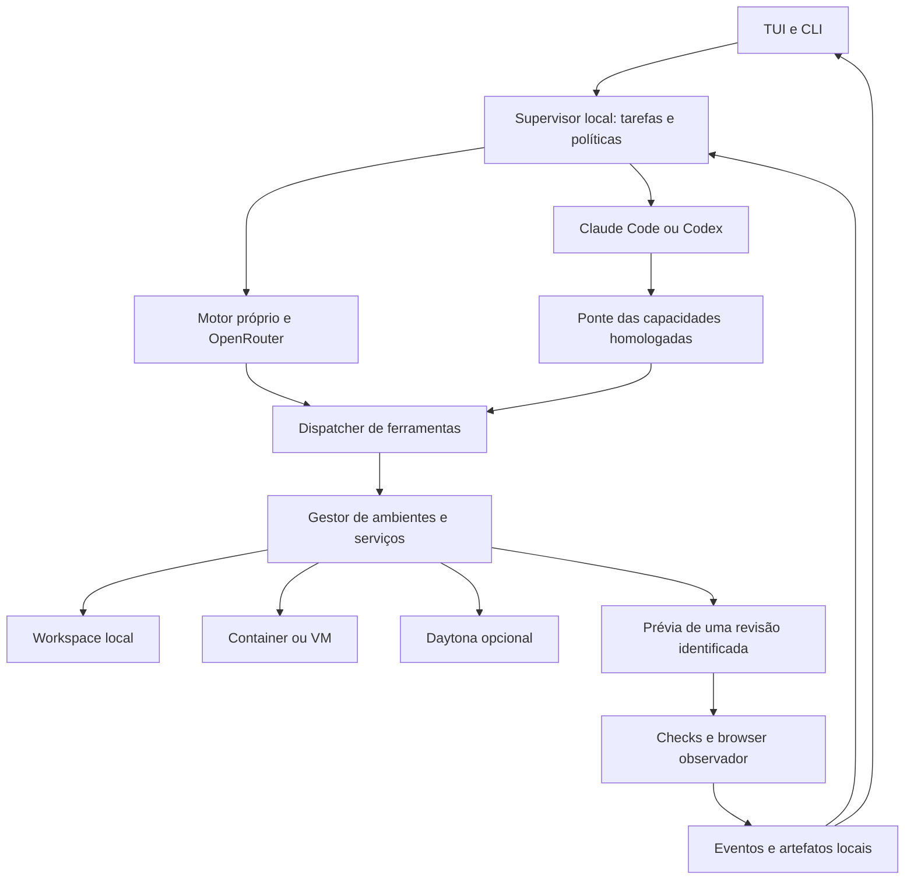

# Sandbox → Sistema Zero TUI: análise e proposta de aproveitamento

Data: 15/10/2026. Escopo: análise, reproduções locais e evolução da proposta; sem implementação do aplicativo.

## 1. Conclusão

O repositório acrescenta uma referência valiosa para transformar uma conversa em um **ambiente executável com prévia**. A melhor adaptação é tornar ambiente, revisão de código, execução e evidência objetos relacionados no runtime do TUI. Isso permite desenvolver, executar, observar falhas, corrigir e verificar o resultado dentro da mesma tarefa.

Não recomendo incorporar o aplicativo web inteiro nem tornar Daytona obrigatório. A proposta local anterior permanece válida. Ela ganha três partes explícitas: **gestor de ambientes**, **gestor de prévias** e **ciclo de verificação e correção**. Templates, perguntas persistentes e contabilidade de recursos complementam essas partes.

Uma distinção central: o código original captura erros da prévia para observabilidade, mas **não implementa um agente que recebe esses erros, corrige e testa novamente**. Esse circuito é uma evolução proposta para o Sistema Zero, não uma funcionalidade pronta encontrada no projeto.

## 2. Revisão, cobertura e limites da evidência

Repositório: [code-with-antonio/sandbox](https://github.com/code-with-antonio/sandbox/tree/ac18750e06d7678ca8a215fc61cb91e1e5709b50). Commit analisado: `ac18750e06d7678ca8a215fc61cb91e1e5709b50`, de 25/09/2026. Clone de leitura, sem instalar dependências ou executar scripts do projeto.

| Medida | Resultado |
|---|---:|
| Arquivos rastreados | 179 |
| Arquivos TS/TSX/JS/MJS/CJS analisados estruturalmente | 142 |
| Linhas nesses arquivos, incluindo comentários | 19.462 |
| Componentes `components/ui` | 61 arquivos / 7.865 linhas |
| Runtime JS preparado para os jogos | 18 arquivos / 5.584 linhas; HTML/CSS adicionais |
| Backend em `lib`/`trigger`, fora do runtime dos jogos | 33 arquivos / 3.371 linhas |
| Arquivos convencionais de testes automatizados encontrados | 0 |
| Arquivos convencionais LICENSE/COPYING/NOTICE encontrados | 0 |

Foi construído um grafo de imports/exports de todos os 142 arquivos, com AST TypeScript, tratamento dos pontos de entrada do framework e dos arquivos de seed carregados dinamicamente. A leitura manual aprofundou execução, ferramentas, sessões, autorização, recursos, preview, cobrança e observabilidade. O inventário não significa validação funcional completa de cada primitivo gráfico ou componente shadcn.

Evidências: [inventário por arquivo](sandbox-tui-file-inventory-2026-10-15.csv), [estrutura, hashes e dependências](sandbox-tui-structure-evidence-2026-10-15.json), [resultados das reproduções](sandbox-tui-repro-evidence-2026-10-15.json), [harness reproduzível](repro-sandbox-tui-2026-10-15.ts). O harness usa funções originais revisadas e adapters de filesystem em memória; não acessa Daytona, modelos, Sentry ou credenciais. As conclusões que dependem do serviço real estão identificadas como análise estática ou condição a homologar.

Não executei build do aplicativo remoto, instalação, chamadas pagas, deploy ou teste integrado de Daytona/Trigger. `trigger/sentry-error-test.ts` é uma tarefa operacional que lança um erro deliberado, não uma suíte automatizada. Não executei essa tarefa.

## 3. O que o projeto realmente faz

É um construtor de pequenos jogos Three.js, com Next.js 16, React 19, AI SDK 7, Anthropic, Trigger.dev, Daytona, Postgres/Drizzle, Clerk e Sentry. As versões declaradas incluem AI SDK `^7.0.84`, Trigger `^4.5.14` e Daytona `^0.207.0`. São dados deste commit, não recomendações de atualização para o monorepo.

O fluxo observado é:

1. Uma ação autenticada cria o jogo e grava a primeira mensagem. O modelo gera um título, com fallback para truncamento do prompt.
2. Server Actions verificam a organização proprietária e abrem a sessão Trigger; tokens de acesso são limitados ao ID daquela sessão.
3. `trigger/chat.ts` hidrata o histórico do banco, mescla a entrada e persiste a conversa antes da execução. A conclusão grava mensagens e cursor na mesma instrução SQL.
4. O início da conversa cria um sandbox Daytona, copia o runtime preparado e só depois grava seu ID no jogo.
5. A aplicação declara seis tools: cinco operações de arquivos e `ask_player`. A rodada permite até 48 passos e recebe o sinal de cancelamento do chat.
6. Uma rota autorizada inicia ou reaproveita um servidor Python estático e gera uma URL assinada para a porta 3000.
7. A UI recarrega o iframe ao concluir a rodada. `report.js`, carregado antes do código do jogo, captura a primeira exceção, rejeição ou falha de recurso. O componente da prévia recebe o diagnóstico e o registra no Sentry.
8. O consumo do modelo é lançado por resposta em um ledger com chave única. A exclusão tenta cancelar o chat, remover ambientes por ID/label, excluir a linha e fazer uma varredura final.

Isso é um fluxo vertical especializado. Não há no conjunto de tools um shell geral para o agente, instalação de dependências, execução de testes, Git, LSP ou navegação automatizada. O jogo executa HTML/CSS/JS sem compilação; bibliotecas vêm de import map/CDN. Portanto, o runtime de jogos não substitui o executor do nosso monorepo TypeScript/Bun.

Fontes: [chat](https://github.com/code-with-antonio/sandbox/blob/ac18750e06d7678ca8a215fc61cb91e1e5709b50/trigger/chat.ts), [tools](https://github.com/code-with-antonio/sandbox/blob/ac18750e06d7678ca8a215fc61cb91e1e5709b50/lib/games/tools.ts), [ambientes](https://github.com/code-with-antonio/sandbox/blob/ac18750e06d7678ca8a215fc61cb91e1e5709b50/lib/daytona/utils.ts), [prévia](https://github.com/code-with-antonio/sandbox/blob/ac18750e06d7678ca8a215fc61cb91e1e5709b50/components/chat-preview.tsx).

## 4. O que aproveitar e como

| Padrão encontrado | Valor | Adaptação recomendada |
|---|---|---|
| Ambiente associado ao projeto, iniciado sob demanda | Preserva arquivos entre interações | `EnvironmentManager` com provider, estado, dono, lease, versão e limites explícitos |
| Seed completo em upload agrupado | Evita gerar infraestrutura repetida e reduz chamadas remotas | Templates versionados com hashes, dependências fixadas, comandos e validações; sincronizar apenas alterações |
| Cache da promessa de sandbox por rodada, removida após falha | Evita buscas redundantes e rejeição permanente em cache | Deduplicar aquisição por ambiente e geração, invalidando ao parar/substituir o recurso |
| Pergunta como tool pendente | Permite decisão humana sem perder a tarefa | `requestInput` persistente, com opções e texto livre, sem confundir esclarecimento com permissão |
| Mensagens e cursor gravados juntos | Evita retomar além do histórico salvo | Eventos próprios sequenciados, projeção de mensagens e recuperação independente da UI |
| Servidor reutilizado depois de health check | Reduz inicializações desnecessárias | Supervisor de serviços com identidade do processo, readiness, portas dinâmicas e proprietário |
| Reporter instalado antes do código da aplicação | Captura falhas que impedem a aplicação de iniciar | Diagnósticos estruturados por revisão; Playwright como observador independente |
| Remoção por labels além do ID salvo | Recupera parte dos recursos órfãos | Reconciliação periódica por instalação/projeto/ambiente, intenções persistidas e exclusão com estado terminal |
| Ledger idempotente por resposta | Ajuda a medir custo e lidar com eventos repetidos | Livro de consumo local para modelo, ambiente e browser, com reserva de orçamento e reconciliação |
| Metadados de duração e operação | Ajuda a investigar lentidão e falhas | Eventos locais estruturados; exportação de telemetria opcional e sanitizada |

O toolkit Three.js cabe, se houver demanda, em um **template de produção de jogos/atividades** integrado ao Studio e ao Molda. Não pertence ao núcleo do TUI, e não deve criar outra engine ou outro editor dentro do terminal. O ganho generalizável é o padrão de template preparado e documentado.

## 5. Limites e problemas que não devemos importar

### 5.1. Ferramentas de arquivo e concorrência

| Achado | Evidência e classificação | Consequência para o TUI |
|---|---|---|
| `replace_text` limita o arquivo original, mas não o resultado | `tools.ts:248–271`; reproduzido: 1 byte vira 128.001 bytes e o próximo `read_file` recusa a leitura | Limites antes e depois da edição; leitura por faixa e orçamento por operação |
| Read-modify-write sem precondição ou serialização | `tools.ts:252–271`; duas edições sobre `A B` retornam sucesso e deixam `A BB` no adapter em memória | Hash-base obrigatório, lock por arquivo/ambiente, escrita atômica e conflito tipado |
| `statFile` converte qualquer exceção em ausência | `tools.ts:490–497`; falha simulada `ECONNRESET` vira `No file at main.js.` | Distinguir not-found, permissão, rede, estado e falha permanente |
| Tools retornam falha de domínio como string normal | `expected` e demais retornos; UI trata `output-available` como `done` | Resultado discriminado `{ok, code, retryable, ...}`; UI e auditoria não devem confundir resposta com sucesso |
| Proteção de `report.js` e `engine/` depende do prompt | Instruções proíbem alterar; `delete_file` aceita ambos no harness | Proteção de infraestrutura no dispatcher e filesystem, fora do controle da geração |
| Cancelamento chega ao modelo, mas os executores de tools não usam seu contexto de abort | `trigger/chat.ts:256` versus `tools.ts`; chamada isolada com sinal já abortado ainda escreve | Propagar deadline/cancelamento e reconciliar operações tardias. O harness não prova o comportamento completo do SDK |
| Confinamento é lexical | `resolveGamePath`, `tools.ts:444–474`; bloqueia `..` para fora, mas não resolve symlinks | Realpath/junctions e barreira do OS. Não foi demonstrado escape real no Daytona; o agente original tampouco tem tool para criar symlink |

O conjunto de caracteres de paths também rejeita espaços e Unicode, aceitável para um template controlado, inadequado como regra universal do TUI. A listagem tem profundidade fixa 5, mas não pagina nem limita bytes totais. IDs de jogo ficam corretamente fechados no contexto do servidor, fora dos argumentos escolhidos pelo modelo: esse padrão deve ser preservado.

### 5.2. Provisionamento, exclusão e recuperação

`createGameSandbox` cria o recurso, semeia os arquivos e atualiza o banco. Persistir o ID por último evita expor um ambiente incompleto; o comentário reconhece que uma queda no meio pode deixá-lo órfão. A rotina de exclusão procura labels, uma boa compensação parcial.

Não há lock/CAS observável em `getGameSandbox`/`createGameSandbox`, nem registro persistente de provisionamento ou coletor periódico neste aplicativo. Chamadas concorrentes ou uma repetição após falha podem criar mais de um recurso. A cache por rodada reduz chamadas dentro daquela instância, mas não coordena processos. É uma análise do protocolo local, sem reproduzir cobrança ou duplicação no serviço remoto.

`endGameChatSession` absorve falhas de cancelamento/fechamento; a ação continua excluindo. A varredura posterior reduz a janela de corrida, mas não prova que uma operação antiga não criará recurso depois dela. Em `deleteGameSandboxes`, o fallback que busca o ID salvo também absorve qualquer erro de fetch; não distingue inexistência de indisponibilidade. No TUI, exclusão precisa de estado `destroying`, bloqueio de novos leases, cancelamento confirmado/reconciliado e coleta de órfãos posterior.

O servidor usa shell Linux, porta fixa e `curl /` para decidir se já está servindo. Isso funciona no ambiente dedicado do tutorial, mas não comprova identidade de processo/revisão e não atende diretamente ao Windows. Nosso gestor deve reconhecer qual processo iniciou e qual revisão está pronta antes de reutilizá-lo.

### 5.3. Prévia e evidências

O contador `previewRevision` é estado React incrementado ao fim da rodada; **não é uma versão persistente dos arquivos**. O servidor lê o diretório mutável, sem commit de vários arquivos ou artefato imutável. Uma prévia não certifica qual árvore foi testada.

`ChatPreview` recebe `game-status` e registra no Sentry. Não envia o erro a `sendMessage`, não cria um resultado de tool para o agente e não dispara testes. Só a primeira falha daquela carga é registrada. Ausência de mensagem também não prova saúde: o agente pode apagar o reporter ou travar o JavaScript antes de responder. O TUI precisa de readiness, timeout de observação e verificação externa.

O iframe não declara `sandbox`; a origem separada ajuda, mas não é uma política completa de execução de conteúdo gerado. O receptor confere `event.source`, o que é positivo; a ponte usa `postMessage('*')` e não vincula as mensagens a um canal/versionamento persistente. Para nossa prévia: origem de conteúdo separada da administração, permissões mínimas adequadas ao tipo de app, IDs de sessão/revisão e schema/limites na recepção. Se a origem for opaca, validar `source` e canal; comparar somente `origin === "null"` seria insuficiente.

**Sanitização de URL insuficiente:** `withoutQuery` remove query/fragmento, mas mantém host, e as mensagens de erro também são enviadas sem essa transformação. A documentação atual de [previews Daytona](https://www.daytona.io/docs/en/preview/) descreve URLs assinadas com token no hostname. O harness confirma que um hostname com token sintético atravessa a função intacto. É risco condicional ao formato efetivo da URL e ao diagnóstico; não foi observada exfiltração real. Guardar caminho relativo e IDs opacos é mais seguro que tentar remover apenas `?token`.

### 5.4. Estado, uso e observabilidade

- Salvar mensagens/cursor juntos e a entrada antes do turno são bons cuidados. Entretanto, a aplicação guarda a conversa inteira em JSONB e depende do runtime Trigger para a durabilidade da execução. Isso não prova transação entre mensagem, arquivo remoto e cobrança.
- O wrapper `withoutContinuationOf` filtra um evento `start` na retomada para compatibilizar o histórico com a UI. Não transportar essa regra para o nosso protocolo: definir identidade/seq de eventos e deduplicação no contrato.
- A cobrança usa `response.id` e chave única, mas falha de gravação é apenas registrada e descartada em `onStepEnd`. Não há recuperação dessa despesa no código observado. A geração do título é outra chamada, fora desse lançamento por passo.
- A checagem de saldo ocorre antes do turno e permite overdraft deliberadamente; 48 passos não são um teto financeiro. O TUI precisa de orçamento hierárquico, reservas, margem para finalizar/persistir trabalho e estimativa separada de custo confirmado.
- IDs/preços de modelos são fixos. A arquitetura OpenRouter + executores oficiais continua preferível para nosso objetivo. A tabela do tutorial não deve virar catálogo ou tabela de preços do produto.
- O cuidado de não registrar conteúdos nas tools não se estende a toda telemetria: `trigger/init.ts:74` adiciona o payload da tarefa ao erro, e o servidor habilita variáveis locais. O conteúdo efetivamente capturado depende do SDK. No TUI, payloads, tokens, prompts e URLs de acesso precisam de sanitização central, com telemetria externa opt-in.

Fontes: [persistência](https://github.com/code-with-antonio/sandbox/blob/ac18750e06d7678ca8a215fc61cb91e1e5709b50/lib/games/chat-store.ts), [UI e estados](https://github.com/code-with-antonio/sandbox/blob/ac18750e06d7678ca8a215fc61cb91e1e5709b50/components/chat-thread.tsx), [ledger](https://github.com/code-with-antonio/sandbox/blob/ac18750e06d7678ca8a215fc61cb91e1e5709b50/lib/billing/ledger.ts), [hooks de telemetria](https://github.com/code-with-antonio/sandbox/blob/ac18750e06d7678ca8a215fc61cb91e1e5709b50/trigger/init.ts).

## 6. Estrutura, código sem uso e duplicação

- **37 componentes UI, 4.692 linhas**, não são alcançados pelos pontos de entrada no grafo de imports observado. São candidatos de scaffold sem uso atual, não prova de código inválido. Não transferir a biblioteca web inteira para OpenTUI. A estimativa é de fonte não necessária ao fluxo atual, não de bundle economizado.
- **Quatro tipos sem consumidores nominais observados:** `NewGame`, `CreditLedgerEntry`, `NewCreditLedgerEntry` e `GameTools`. O último seria útil para tipar a conversa; hoje ela usa tipos genéricos e parsers locais. Exports de um barrel e APIs públicas podem ser intencionais, portanto a conclusão é “sem consumidor interno encontrado”.
- **Seis pares idênticos de skills** em `.agents` e `.claude`. Compatibilidade com ferramentas diferentes explica a duplicação; se adotada aqui, gerar ambas a partir de fonte única. Não duplicar manutenção manual.
- **Nenhum ciclo no grafo estático analisado.** Isso não cobre dependências externas, nomes calculados ou comportamento em runtime.
- **Um `any` explícito**, no exemplo `hello-world`; nenhum `@ts-ignore`/`@ts-expect-error` encontrado pelo scanner. Isso não certifica dados de runtime. `UIMessage[]` armazenado no banco e asserções genéricas da UI ainda exigem schemas/versionamento na adaptação.
- `chat-thread.tsx` tem 729 linhas e combina transporte, retomada, composer, estado das perguntas, parser e apresentação de ferramentas. Extrair esses conceitos para contratos do runtime, deixando renderizadores próprios para o terminal.
- `tools.ts` tem 503 linhas incluindo muitos comentários; o problema de arquitetura não é seu tamanho, mas o acoplamento entre descrições AI SDK, acesso Daytona, paths e Sentry. `instructions/runtime.ts` importa constantes do módulo de infraestrutura Daytona, que importa banco e credenciais. Descrições do ambiente devem ser dados puros fornecidos pelo adapter.
- Arquivos do engine, seeds, configs e tarefas descobertas pelo framework **não foram classificados como mortos por falta de import normal**. O engine é uma API para código futuro gerado pelo agente.

Não foi feita limpeza no clone ou no workspace. Como não há licença convencional no commit observado, o caminho proposto é implementar nossos contratos e aproveitar os padrões; eventual incorporação literal requer esclarecer a licença.

## 7. Arquitetura recomendada: três decisões independentes

| Decisão | Exemplos | Responsabilidade |
|---|---|---|
| `ModelProvider` | OpenRouter, APIs diretas configuradas | Inferência do motor próprio |
| `AgentBackend` | Motor próprio, Claude Code, Codex | Executar uma tarefa com ferramentas e política compatíveis |
| `ExecutionEnvironment` | Workspace local, container/VM, Daytona opcional | Onde arquivos e processos existem, com quais limites |

**Daytona não é um provedor de inteligência artificial.** Sua adoção não altera a escolha OpenRouter/Claude Code/Codex. As combinações são permitidas por capacidades verificadas, não por uma promessa de que qualquer backend funciona em qualquer ambiente.

O diagrama mostra a ponte controlada; ferramentas internas dos clientes oficiais podem operar fora dela. Um cliente local não passa a editar corretamente um sandbox remoto só porque recebeu uma URL: precisa executar no ambiente compatível ou ter uma ponte de ferramentas efetivamente suportada. Não sincronizar duas árvores mutáveis sem protocolo de base/conflito. Não copiar credenciais pessoais para imagens ou snapshots. O primeiro caminho completo será motor próprio + ambiente local; adapters adicionais só entram após homologação.

### 7.1. Gestor de ambientes

Começa como módulo do `agent-runtime`, com contratos no `agent-core`. Adapters remotos ficam em `agent-integrations`; não criar outro pacote de orquestração ou um segundo banco.

Cada ambiente registra: ID interno, provider/ID externo, projeto/tarefa, plataforma, diretório lógico, capabilities, template e versão, revisão-base, política de rede/segredos, limites de CPU/memória/disco/tempo, processos e portas, lease/geração, último uso e política de retenção. IDs externos e URLs não são autoridade suficiente para executar uma ação.

Operações principais: preparar, adquirir, inspecionar, executar, ler/escrever/sincronizar arquivos, obter logs, expor prévia, exportar artefatos, suspender quando suportado e destruir. `snapshot` e `fork` são capabilities opcionais: não supor que stop/start preserva memória nem que todas as classes de sandbox têm clone. A [matriz Daytona](https://www.daytona.io/docs/sandboxes) distingue containers, VMs e outros ambientes.

Estados próprios: `requested → provisioning → ready`; `busy`, `stopping`, `stopped`, `failed`, `destroying`, `destroyed`. O adapter mapeia os estados reais do fornecedor; estados de transição não podem receber chamadas cegas de `start()`.

Persistir intenção de criação antes da API externa; usar identificador de operação e labels por instalação/projeto/ambiente; após falha, reconciliar recursos conhecidos antes de criar novamente. Serializar criação e destruição, bloquear novos leases ao destruir e verificar recursos órfãos periodicamente. Exportar patches/artefatos antes de liberar o recurso. Nenhuma limpeza deve varrer ambientes de outro usuário/projeto apenas por semelhança de nome.

O modo local é conveniente para repositórios confiáveis; worktree e WSL isoladamente não são uma barreira de segurança. Para execução não confiável, exigir o adapter isolado homologado ou recusar a capacidade. Container/VM precisa de permissões, mounts e rede coerentes, sem home inteiro, credenciais gerais ou socket Docker. A presença do software necessário no Windows é pré-requisito detectado, não uma suposição.

### 7.2. Templates preparados para tarefas reais

Um template reúne manifesto, versão/hash, runtimes/dependências fixados, arquivos iniciais, documentação curta, permissões, comandos de instalação/build/dev/check e critério de readiness. O agente recebe um resumo e consulta detalhes sob demanda. Plugins/scripts de templates externos não ganham execução automática só porque constam em um manifesto.

Dois tipos têm finalidades distintas:

- **Perfil de projeto existente:** descobre e descreve o monorepo sem reescrever `package.json`, lockfiles ou arquivos do usuário; reaproveita `scripts/dev.ts` e scripts dos pacotes.
- **Projeto novo/artefato controlado:** inicia uma atividade Studio, miniaplicação ou automação a partir de uma base testada. Aqui se aplica o padrão de seed do Sandbox.

Caches devem depender de SO/arquitetura, versão do runtime, lockfile e template. Reutilizar caches imutáveis, sem compartilhar diretórios mutáveis entre agentes escritores. Warm pool de sandboxes é otimização posterior, justificada por medição de latência e custo ocioso.

### 7.3. Prévias e o ciclo de verificação

Cada `PreviewSession` referencia tarefa, ambiente, processo/artefato, revisão de origem e validade. Separar `starting`, `ready`, `stale`, `failed`, `expired`. Um servidor HTTP respondendo prova disponibilidade, não conclusão da tarefa.

Pipeline proposto:

1. Registrar critérios de aceite e capturar a base, incluindo WIP relevante.
2. Produzir patch em ambiente permitido; verificar precondições e arquivos modificados.
3. Executar checks determinísticos do pacote. Só os checks relevantes precisam rodar.
4. Disponibilizar a revisão identificada; preservar a última prévia validada quando uma candidata falhar. Para dev server mutável, marcar a revisão como em construção e revalidar após mudanças.
5. Observar com Playwright: navegação, console, falhas de rede, comportamento, screenshot e trace quando úteis. Reporter interno é complementar; não pode atestar sozinho o próprio sucesso.
6. Normalizar diagnósticos com `runId`, `attemptId`, `environmentId`, revisão, severidade, origem e referência ao artefato; deduplicar, limitar volume e remover dados de acesso.
7. Entregar ao agente apenas o diagnóstico pertinente e autorizar uma nova tentativa dentro do orçamento. Parar por sucesso, falta de progresso, limite ou decisão necessária. Não criar loop ilimitado de autocorreção.
8. Marcar a tarefa concluída somente com evidência da revisão final. Integrar mudanças e repetir checks afetados se o merge alterar a árvore validada.

Diagnósticos de código gerado, páginas e ferramentas são dados não confiáveis: não podem ampliar permissão nem virar instrução privilegiada. Resultado de uma prévia antiga não valida um patch novo. Um browser na nuvem também não acessa automaticamente `localhost` da máquina do usuário; a topologia e o acesso à porta fazem parte do contrato.

### 7.4. Perguntas, eventos e consumo

`requestInput` terá ID, tarefa, schema, opções/texto livre, obrigatoriedade e resposta persistida antes da retomada. A tarefa ganha `waiting_input`, diferente de `waiting_approval`. Resposta duplicada não inicia duas rodadas; fechar/reabrir a TUI mantém a pergunta e o rascunho. Perguntar apenas quando a decisão realmente estiver ausente; o usuário já definiu local + equipe e a estratégia dos modelos.

Eventos úteis: `environment.ready`, `process.started`, `preview.ready`, `diagnostic.reported`, `validation.completed`, `input.requested`, `input.answered`, `artifact.created`. Guardar saída bruta limitada em artefato e resumo no contexto do modelo, evitando multiplicar logs e históricos inteiros.

Consumo distingue modelo, sandbox, browser e armazenamento. Custos estimados e confirmados ficam separados, com fonte e data da tarifa. Assinatura de cliente oficial não é consumo OpenRouter gratuito; ausência de custo informado deve aparecer como desconhecido/incluído no plano, conforme o backend, e não como zero calculado. Reutilização de ambiente, cache de dependências e suspensão ociosa só são melhorias quando medidas.

## 8. Reaproveitar o que o Sistema Zero já possui

O workspace tem implementação em andamento em `packages/studio-runtime`. Ela é uma referência local mais próxima para algumas necessidades do que copiar o runtime do tutorial:

| Código local observado | Aproveitamento | Limite |
|---|---|---|
| `studio-runtime/src/contracts.ts` | Validação de entrada, caminhos, limites, templates confiáveis | Contrato especializado de build de atividades; não é API de shell geral |
| `studio-runtime/src/index.ts` | Build com timeout, rede desabilitada no sandbox e configuração confiável | Serviço Cloudflare, não daemon local de coding |
| `studio-runtime/src/artifacts.ts` e `core/src/studio/pro-artifact.ts` | Manifesto, hashes, validade, publicação do manifesto por último e entrega controlada | URL temporária não substitui persistência de projeto ou checkpoint |
| `core/src/studio/pro-console.ts` | Ponte de console com tamanho limitado e destinatário definido | Precisa ser normalizada com diagnóstico de runtime/browser e revisão |
| `scripts/dev.ts` | Subir serviços, logs e processos do monorepo | Integrar ownership para não encerrar serviços do usuário |
| `marketing-desktop/main` | Padrões de transporte dos clientes oficiais já mapeados na primeira auditoria | É WIP e tem escopo restrito; não fornece executor de coding pronto |

Não transformar o serviço infantil em executor irrestrito. Reutilizar contratos puros e padrões de artefato; se o TUI precisar compilar uma atividade Studio, chamar a integração autorizada pelo gateway/BFF apropriado. Não distribuir o `INTERNAL_TOKEN` do runtime aos desktops.

O serviço local fixa `@cloudflare/sandbox` 0.10.3. A [documentação atual de ciclo de vida](https://developers.cloudflare.com/sandbox/sdk/api/lifecycle/) identifica a linha 0.x e orienta aplicações novas para outra versão. Essa divergência exige compatibilidade/versionamento explícitos; esta análise não propõe atualizar o serviço existente nem pressupõe que a API nova seja intercambiável.

Os arquivos locais têm mudanças não commitadas de outro trabalho. Foram apenas lidos; não os alterei nem certifiquei seu deploy ou isolamento de produção nesta auditoria.

## 9. Integração com as quatro referências anteriores

| Referência | Papel no produto integrado |
|---|---|
| Nightcode | Interação no terminal, conversa e seleção de execução |
| AI Teammates | Coordenação de especialistas, handoff, memória e subtarefas |
| Browser Automation App | Ações de navegador e coleta de evidências do resultado |
| Sendkit | A mesma capacidade acessível por CLI, MCP e skill, incluindo notificações autorizadas |
| Sandbox | Preparação de ambientes/templates, prévia executável e participação humana persistente |

O vínculo comum será **a tarefa com sua revisão e artefatos**, e não uma ponte de mensagens entre cinco aplicativos independentes. Por exemplo: “corrija o login e valide no navegador” produz um ambiente, um patch, um serviço pronto, uma sessão de teste, diagnósticos, eventual correção e evidências finais. Uma notificação, se solicitada, aponta para essa entrega já validada.

## 10. Alternativas e ordem de entrega

| Alternativa | Vantagem | Limite | Decisão |
|---|---|---|---|
| Gestor local com adapters progressivos | Funciona no fluxo atual e permite isolamento/remoto sem trocar a TUI | Exige contratos e provas de compatibilidade | **Recomendada** |
| Daytona obrigatório desde o início | Ambiente remoto padronizado | Internet, custo, sincronização e restrições dos executores oficiais entram no caminho crítico | Opcional depois do núcleo |
| Usar apenas o Studio Runtime | Reaproveita build/artefatos já existentes | Não executa o monorepo nem substitui shell, Git e serviços | Integração especializada |

Atualizações na proposta integrada:

- **L0:** acrescentar prova de ambiente/processos no Windows, limite real de isolamento, matriz backend × ambiente e empacotamento dos templates. Medir caminhos frios/quentes; validar APIs da versão escolhida. Não exigir conta Daytona para provar o núcleo local.
- **L1:** pergunta persistente, `waiting_input` e eventos de ambiente junto ao supervisor existente.
- **L2:** ambiente local e adapter isolado selecionado para tarefas que exigirem essa barreira; edição protegida e recuperação; gestor de serviços e primeiro template de fixture.
- **L4:** prévias por revisão, diagnóstico normalizado, browser observador e ciclo limitado de corrigir/verificar. Este é o principal incremento funcional.
- **L5:** ambientes separados para escritores; resultado validado no merge, não apenas em cada sandbox.
- **L6/L7:** adapter remoto quando houver caso real, reconciliação/quotas/retenção, integração especializada Studio e otimização medida. Viewer local permanece apoio ao terminal.

### Aceite adicional

1. Provisionamento interrompido não cria recursos indefinidamente; reconciliação encontra os pertencentes à instalação.
2. Destruição bloqueia novos usos; resultado atrasado não ressuscita a tarefa nem o ambiente.
3. Duas edições concorrentes não se sobrescrevem silenciosamente; limite de arquivo vale após alteração.
4. Falha de rede não é apresentada como ausência de arquivo ou operação concluída.
5. Fechar/reabrir o terminal mantém pergunta, resposta e sequência sem repetir efeitos.
6. Prévia expirada renova acesso quando permitido; URLs e tokens não aparecem nos logs/artefatos exportados.
7. Sintaxe inválida, erro de runtime e falha de rede chegam ao agente com revisão e origem; mensagem de página não altera permissões.
8. Correção automática para ao atingir orçamento ou repetir falha sem progresso; a última revisão validada continua identificável.
9. Validar A e modificar para B invalida o resultado anterior; merge recebe validação própria quando necessário.
10. Caminhos Windows, espaços, Unicode, symlink/junction, árvore de processos e ausência de Docker são tratados explicitamente.
11. Falha do provider remoto não apaga o patch/artefato persistido localmente; retomada verifica capacidades e estado antes de continuar.
12. A disponibilidade de três modelos/agentes ou de um sandbox não é evidência de superioridade: medir taxa de conclusão, regressões, custo total e tempo até resultado validado nas tarefas do Sistema Zero.

O benefício esperado é reduzir o trabalho manual entre “o agente escreveu” e “a mudança funciona”. A superioridade sobre o fluxo atual precisa ser demonstrada no benchmark da proposta, não deduzida da quantidade de integrações.
