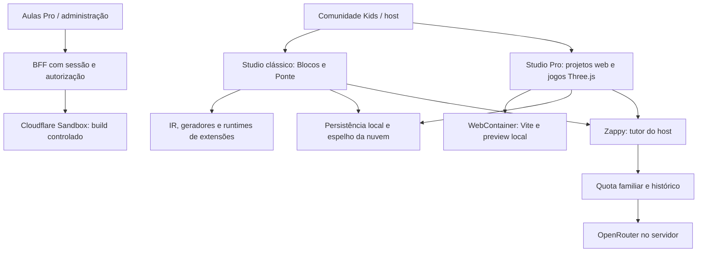

# Estúdio completo, Pro e IA — análise e proposta

> Revisão histórica. A [proposta consolidada v2](studio-pro-proposta-v2-2026-10-15.md) substitui as recomendações deste documento, acrescenta testes em navegador de terminal/Monaco, separação de modos do Zappy, análise ampliada GameDev e implementação em lotes. A conexão externa foi reduzida à conta OpenRouter do responsável. As evidências originais abaixo são mantidas para rastreabilidade.

Data: 15/10/2026. Escopo: análise, sem alteração do código do produto.

**Decisão recomendada**

Evoluir o Pro para um ambiente de criação assistida de jogos 2D e 3D, aproveitando sua infraestrutura atual. Three.js deve ser uma frente central dessa evolução: já existem templates `three-js` e `three-ts`, ambos com Three 0.180.0. A oportunidade é passar da cena inicial para kits jogáveis, assets integrados e uma IA que consegue editar, executar, observar e corrigir o jogo.

Manter OpenRouter como primeiro provedor gerenciado, com franquia familiar na assinatura, controle financeiro interno e limite adicional por chave. Oferecer créditos extras e conexão de provedor do responsável. Tratar uso de assinatura ChatGPT/Codex ou Claude como integrações específicas, sujeitas às condições atuais de cada empresa, sem fazer delas uma dependência do produto.

Aproveitar extensivamente a pasta GameDev em quatro frentes: conhecimento para a IA, componentes de jogo, pipelines de assets e ferramentas de teste. Um catálogo amplo é compatível com carregar poucas instruções em cada tarefa. Copiar centenas de skills para o prompt não equivale a incorporar suas capacidades.

**Escopo e força das evidências**

Foram mapeados os módulos do Studio e examinados em profundidade os caminhos de Pro, templates, execução local/remota, persistência, conversão, exportação, tutor, provedores, cotas e integração Kids/member-shell. O pacote Studio tem aproximadamente 1.365 arquivos TS/TSX entre código e testes; este relatório não afirma uma auditoria linha a linha de todos eles nem certifica a ausência de código morto.

A pasta externa foi inventariada integralmente quanto aos arquivos `SKILL.md`; os kits e referências relevantes foram inspecionados seletivamente em profundidade. Inventário: [CSV com caminhos, tamanhos, hashes e equivalências locais](studio-gamedev-skills-inventory-2026-10-15.csv). Instruções contidas nesses downloads foram tratadas como material de análise, sem executar seus scripts ou seguir comandos de agentes.

Evidências desta sessão:

| Verificação | Resultado | Limite da conclusão |
|---|---:|---|
| Testes selecionados de Studio/Pro/IA | 86 passaram, 0 falharam | Componentes e contratos; parte dos testes usa happy-dom e mocks |
| Testes de studio-runtime | 15 passaram, 0 falharam | O Sandbox do handler é simulado; não valida o ambiente Cloudflare real |
| Testes selecionados de member-shell | 102 passaram, 0 falharam | Quotas, Zappy, busca, loader e integração de runtime |
| Testes selecionados de community-kids | 22 passaram, 0 falharam | Rota, acesso e integração do editor |
| Typecheck de packages/studio | Concluído sem erros | Não abrange o monorepo inteiro nem o código futuro gerado pelo aluno |
| Reprodução PostCSS | Configuração enviada pelo projeto foi executada pelo Vite | Local, com configuração confiável real; não demonstra escape do sandbox |
| Reprodução TypeScript | Build aceitou atribuição de string a variável number | Confirma ausência de verificação semântica no build, não uma falha do tsc do Studio |
| Reprodução da conversão | CSS preservado, arquivo binário referenciado ausente | Inspeção dos artefatos produzidos; não foi um teste visual de navegador |

Total: 225 testes selecionados, em 25 arquivos, com 1.003 asserções. Não foram executados toda a suíte do monorepo, novos testes ponta a ponta em navegador real, testes de carga ou medições em produção. Não foram acessados contratos comerciais, segredos ou configuração efetiva de produção. As referências de fornecedores foram consultadas nesta data.

**1. Estrutura atual e o que vale preservar**

Há decisões boas e trabalho real de robustez:

- Separação entre biblioteca Studio e adaptadores do host, mantendo autenticação e direitos de acesso no servidor.
- IR e geradores para Blocos/Ponte, com caminhos distintos para projetos Pro. A arquitetura reconhece que um projeto Three.js com npm não é apenas mais um arquivo do modo clássico.
- Persistência por namespace, gravações ordenadas, fila persistente de sincronização e espelho de nuvem.
- Operações de árvore Pro com normalização de caminhos e validação de colisões.
- Coordenação do WebContainer, cancelamento de montagens antigas, sincronização sequencial e tratamento de processos de instalação/dev.
- Zappy com contexto sanitizado, referências verificadas contra catálogo do servidor, regras pedagógicas, idempotência e cobrança de quota autoritativa.
- Quota compartilhada pela conta familiar com exclusão transacional para concorrência entre perfis.
- Build remoto com autenticação interna, autorização da aula, templates permitidos, dependências fixadas, limites de entrada/saída, internet desabilitada no sandbox e preview isolado.

Esses componentes merecem evolução incremental. Não há justificativa, nesta análise, para substituir o editor inteiro, abandonar Three.js ou reescrever o IR.

**2. Three.js já existe; a experiência de jogos ainda precisa ser completada**

O catálogo está em `packages/studio/src/components/code/pro-templates/index.ts`, e os IDs compartilhados em `packages/core/src/studio/pro-templates.ts`. Há cinco opções: JavaScript/Vite, TypeScript/Vite, React/TypeScript, Three.js/JavaScript e Three.js/TypeScript. O runtime remoto também reconhece os dois templates Three.js.

Os dois templates Three compartilham atualmente uma cena pequena com cubo, câmera, luz e render loop. Isso prova a disponibilidade do motor, mas não entrega ainda um kit de jogo com personagem, input, objetivo, estados, HUD, assets e testes. No código inicial, a rotação é por frame e não por tempo; também não há tratamento de resize nesse miolo. São melhorias simples para a base ensinada ao aluno.

O maior gargalo para aproveitar os kits baixados é a representação de assets:

- `ProFileNode` guarda apenas `content: string`.
- `normalizeProPath` aceita extensões de código/texto e SVG; não aceita GLB, GLTF, PNG, áudio etc.
- O contrato do compilador remoto também recebe apenas `Record<string, string>` com extensões restritas.
- O preview remoto produz HTML autocontido, bloqueia conexões e não permite simplesmente buscar `/assets.json`, modelos e texturas externos.
- O host Pro não injeta a mesma integração rica de biblioteca pessoal/Pinta/Molda presente no editor completo clássico.

Portanto, Three.js já funciona para cenas e geometria programática, mas importar um kit com modelos, texturas e animações exige uma camada de assets. Aumentar o prompt ou liberar extensões de arquivo isoladamente não resolve o armazenamento, transporte e execução desses recursos.

**Proposta de assets Pro:** manter código em árvore textual e representar binários por referências tipadas e versionadas em `Project.assets`/manifesto compartilhado. Reaproveitar IDs, origem Pinta/Molda, metadados e validações existentes; evoluir o contrato, evitando criar uma segunda biblioteca incompatível. O montador local materializa os bytes no WebContainer; o compilador remoto recebe IDs autorizados e resolve recursos por um canal controlado. Para jogos maiores, publicar artefato versionado com seus assets em origem isolada, em vez de embutir tudo em um HTML gigantesco.

Essa evolução deve incluir importação GLTF com suas dependências, GLB, texturas, áudio, inspeção de animações, validação de tamanho/tipo, hashes, referências estáveis e exportação. Um GLTF textual pode carregar buffers e imagens externos: validar só o JSON não basta. Os caminhos nunca devem permitir que o compilador busque URLs arbitrárias fornecidas pelo projeto.

**3. Achados prioritários**

P1 significa corrigir antes de ampliar automação ou exposição do fluxo; P2 significa melhoria relevante da experiência e operação. Lacunas de produto são identificadas separadamente de defeitos reproduzidos.

| ID | Prioridade e natureza | Achado | Consequência | Ação proposta |
|---|---|---|---|---|
| A01 | P1, reproduzido | Configuração PostCSS do projeto executa no build remoto | O controle de configuração de build é incompleto | Desabilitar autodetecção, fechar superfícies de plugins/configuração e endurecer o ambiente |
| A02 | P1, análise estática | Terminal altera FS, mas não há sincronização de volta para a árvore persistida | Mudanças por shell podem sumir ao reabrir/exportar/sincronizar | Fonte de verdade única e reconciliação FS → projeto, ou comandos de alteração mediados |
| A03 | P1, reproduzido nos artefatos | Conversão para Pro descarta binários, preservando URLs no CSS | Assets referenciados pelo navegador ficam ausentes | Migração de assets completa e verificável, com cópia de segurança do projeto clássico |
| A04 | P1 para IA construtora, lacuna | Quota atual conta interações, não gasto real | Várias chamadas, modelos e tentativas têm custos diferentes | Reserva e liquidação financeira por execução, além do limite de provedor |
| A05 | P1 para kits 3D, lacuna | Pipeline Pro de binários incompleto | Kits Three.js não podem ser incorporados integralmente | Manifesto e transporte de assets compartilhados entre local, remoto e publicação |
| A06 | P2, análise estática | Contexto do tutor corta os primeiros seis arquivos em 4.000 caracteres cada | Diagnósticos podem ignorar justamente o arquivo da mecânica | Seleção por relevância, leitura sob demanda e diagnósticos |
| A07 | P2, reproduzido | Build Vite não verifica tipos | A IA pode apresentar código com erro semântico como validado | Etapa tsc separada e resultado distinto de build/execução |
| A08 | P2, análise estática | Rota Pro não baixa projeto ausente do armazenamento local | Link direto em outro dispositivo retorna à lista | Carregar/reconciliar o projeto autorizado antes de concluir que não existe |
| A09 | P2, análise estática | Import inicial do wrapper Pro não trata rejeição | Falha de chunk pode deixar carregamento sem recuperação | Tratamento de erro/retry no wrapper, antes do editor filho |
| A10 | P2, lacuna | Integrações do host Pro são menores que as do clássico | Pinta/Molda/Pensa/publicação e apoio do host ficam fragmentados | Contrato comum de capacidades e adapters efetivamente passados ao Pro |
| A11 | P2, análise estática | Export Pro usa instruções genéricas de servidor estático | Projeto Vite exportado pode parecer quebrado | README gerado por template com instalação, dev e build corretos |
| A12 | P2, lacuna | Player clássico não consome a árvore Pro como um build publicado | Acrescentar apenas botão de compartilhar não basta | Publicação de artefato Pro imutável, com assets e revisão identificada |

**A01 — evidência e extensão real do problema.** `packages/studio-runtime/src/contracts.ts:43` reserva package/lock/Vite, mas aceita `postcss.config.cjs`. `trustedViteConfig`, no mesmo arquivo, não fixa configuração PostCSS inline. Foi enviado um arquivo contendo apenas `throw new Error("AUDIT_POSTCSS_AUTODISCOVERY_EXECUTED")`; o parser o aceitou e o Vite 8.0.16 executou esse arquivo durante o processamento de CSS. A documentação confirma que uma configuração inline impede essa busca automática. [Vite: css.postcss](https://vite.dev/config/shared-options#css-postcss)

Não foi demonstrado acesso a outro tenant nem saída do sandbox. O defeito é a execução de configuração controlada pelo projeto dentro do compilador, além do que o contrato pretende permitir. Como o Dockerfile torna `/opt/sz-runtime` gravável pelo usuário do processo, também convém tornar dependências/configurações imutáveis. Revisar autodetecção em todos os plugins, permissões, limites de CPU/processos, reutilização e descarte do sandbox; não encerrar a correção apenas bloqueando um nome de arquivo.

**A02 — persistência e terminal.** `useWebContainerSync.ts` escreve alterações da store no FS, com atraso de 150 ms. O terminal abre `jsh`. Não foi encontrado o caminho inverso de leitura/reconciliação. Isso é especialmente relevante para `npm install`, edição pelo shell e qualquer futuro agente de código. A conclusão vem dos caminhos examinados, não de um incidente de perda de dados observado no navegador. Implementar watcher filtrado ou API única de edição, incluindo mudanças em package/lock, exclusão de node_modules/dist e controle de revisão. O aluno e a IA não podem gravar versões concorrentes silenciosamente.

**A03 — conversão.** `convertToPro.ts` usa o mapa de exportação clássico, mas ignora todo conteúdo `Uint8Array`. Uma reprodução gerou `public/fundo` no mapa clássico; na árvore Pro ele estava ausente e `public/style.css` continuava com `background-image:url(fundo)`. O manifesto `sz-assets.js` permanecia, mas não intercepta automaticamente essas URLs CSS. A conversão da store também mantém o mesmo ID e zera IR/blocos/arquivos clássicos. Proponho criar um projeto Pro derivado, preservando o original, apresentar avisos de conversão e validar referências antes de considerar a migração concluída.

**A07 — o significado de validado.** O runtime executa Vite e o inliner. `const count: number = "not a number"` compilou com sucesso na reprodução usando a configuração real. O Vite transpilar esse código é esperado. A correção é acrescentar a etapa de typecheck dos projetos TS e distinguir quatro estados: código compilado, tipos verificados, jogo executado e mecânica testada. A documentação atual do runtime também deve refletir essa distinção.

**4. IA atual: há três caminhos diferentes**

| Caminho | Situação encontrada | Papel adequado |
|---|---|---|
| Zappy do host | Integração real do produto, via servidor/OpenRouter; histórico, quota e políticas | Tutor e explicações contextualizadas |
| AIPanel/AIProvider genérico | Implementação da biblioteca, com provider injetado, chave do usuário ou mock; recurso não ativado no host Pro examinado | Infraestrutura a consolidar, não uma segunda experiência concorrente |
| Pensa | Planejamento/missões e infraestrutura de reservas | Origem de objetivos e etapas para o construtor de jogos |

`StudioProEditor` passa `features={{ professional: true }}` e o tutor. Isso não ativa automaticamente o painel genérico de IA. Além disso, o `ProjectContext` desse painel contém IR/extensões, mas não a árvore Pro; simplesmente ligá-lo não daria compreensão completa do projeto Three.js.

O Zappy é deliberadamente um tutor: algumas respostas determinísticas orientam planejar no Pensa e trabalhar uma mecânica por vez. Não existe nesse caminho um ciclo de ferramentas para editar arquivos, compilar, jogar e corrigir. Esse comportamento faz sentido para ensinar; para construir jogos, é preciso acrescentar uma capacidade explícita.

O contexto do cliente admite até 24 arquivos, com limites próprios. O servidor em `zappy-ai.ts:767` usa somente os seis primeiros, cortados em 4.000 caracteres cada, antes de ajustes adicionais ao orçamento do prompt. Em um template Pro, configurações podem vir antes dos arquivos relevantes. Para um jogo Three.js com input, câmera, entidades e animações separados, a limitação fica especialmente visível.

**Evolução recomendada:** manter uma experiência Zappy com intenções claras: “Explicar”, “Construir comigo” e “Investigar erro”. Compartilhar contexto, política, credenciais e histórico, mas dar ferramentas e limites diferentes a cada intenção. Reaproveitar o plano do Pensa e os assets do Pinta/Molda. Evitar um novo planejador isolado e um segundo chat com comportamento incompatível.

**Contexto do projeto:** fornecer ao agente índice de arquivos, template e versão do motor, arquivo ativo/seleção, diagnóstico, manifesto de assets, objetivo atual e revisão. A IA solicita trechos por `searchProject`/`readFiles`, priorizando dependências e erros relevantes. Documentação por versão, referências de skills e resumo de decisões entram sob demanda. Segredos, credenciais e texto não confiável permanecem separados das instruções do sistema.

O módulo `zappy-ai.ts` reúne busca, ranking, schema, prompt, segurança e chamadas do modelo. Recomendo extrair essas responsabilidades gradualmente para serviços testáveis, mantendo o contrato público e as políticas existentes. Não é necessário trocar todo o fornecedor ou framework para fazer isso.

**5. OpenRouter, créditos familiares e contas externas**

**O que já existe:** quota familiar de interações, com valores padrão documentados de 50/dia e 500/mês, configuráveis. Zappy usa a variante estrita: não é correto descrevê-lo como uma chamada que libera uso quando o banco falha. Há uma função permissiva usada em outros caminhos legados, que precisa ser revista antes de unificar cobrança. O sistema também já tem reservas para Pensa; aproveitar esse mecanismo e seu controle de concorrência, evoluindo-o para valores financeiros.

Não foi encontrada, no fluxo auditado, uma chave OpenRouter por família com limite financeiro, uma carteira de créditos extras ou uma conexão de conta externa operacional no Pro. O modelo padrão do schema de ambiente é `openai/gpt-4o-mini`, com overrides para Pensa/Zappy. Isso não revela qual modelo está configurado em produção.

O Zappy pode fazer duas tentativas para obter JSON válido e uma chamada adicional de reparo de segurança. `completePensaJson` retorna o conteúdo validado, descartando os dados de uso e identificação da geração. Uma interação não representa um custo constante. A quota é consumida antes da resposta; o tratamento de falha não equivale hoje a uma liquidação/reembolso financeiro por execução.

| Opção | Recomendação | Condição |
|---|---|---|
| OpenRouter gerenciado, incluído na assinatura | Base inicial | Ledger interno, limites por família/execução e rastreio de custo real |
| Créditos extras do Sistema Zero | Sim | Compra pelo responsável, saldo e regras explícitos |
| Conta própria OpenRouter | Primeira conexão externa a priorizar | OAuth PKCE, autorização do responsável e armazenamento seguro |
| API própria Anthropic/OpenAI | Opção avançada | Chave de API, capacidade validada e cobrança separada |
| Plano ChatGPT/Codex dentro do SaaS | Explorar como parceria/prova de conceito | Elegibilidade para aplicação paga/remota precisa ser encaminhada à OpenAI |
| Login/limites Claude Code dentro do SaaS | Não assumir disponível | Anthropic exige aprovação prévia para essa oferta por terceiros |

OpenRouter oferece criação de chaves com limite em USD e renovação diária, semanal ou mensal. Isso permite uma chave por família como proteção adicional. Os resets são em UTC, enquanto a quota atual usa calendário de São Paulo; uma assinatura também pode renovar no aniversário da contratação. O ledger do produto deve definir o período comercial sem depender do relógio do provedor. [OpenRouter: criação e limites de chaves](https://openrouter.ai/docs/api/api-reference/api-keys/create-a-new-api-key)

A conexão de saldo próprio do OpenRouter tem fluxo OAuth PKCE documentado. Preferir essa conexão na área do responsável a pedir que a criança cole uma chave. Diferenciar “usar minha conta OpenRouter” de “levar uma chave de outro fornecedor para o OpenRouter”. [OpenRouter: OAuth PKCE](https://openrouter.ai/docs/guides/overview/auth/oauth)

**ChatGPT/Codex:** a documentação atual de Sign in with ChatGPT contempla uso do plano para inferência elegível e integração com Codex app-server. Entretanto, a documentação publicada desse caminho se destina a aplicativos open source e hospedados localmente; aplicações pagas ou remotas são encaminhadas a um formulário de interesse. Para o Sistema Zero, é uma oportunidade concreta a avaliar, não uma função que podemos prometer como acesso geral já autorizado. Login de identidade também não significa, por si só, permissão de consumo do plano. [OpenAI: uso do plano](https://developers.openai.com/siwc/token-sharing-open-source), [Codex app-server](https://developers.openai.com/siwc/token-sharing-open-source/codex-app-server)

**Claude:** a Anthropic informa que terceiros não podem oferecer login claude.ai ou seus limites dentro de produtos, inclusive com Agent SDK, sem aprovação prévia. A alternativa documentada é autenticação por API. Alguns planos Max/Team elegíveis agora incluem créditos de API vinculados ao Console; esses créditos podem ser usados pela API e não são a quota de uso do Claude Code. Portanto, a ideia do usuário pode ser atendida parcialmente por uma conexão de API, sem prometer importar a assinatura do CLI. [Anthropic: Agent SDK](https://code.claude.com/docs/en/agent-sdk/overview), [créditos de API para assinantes elegíveis](https://platform.claude.com/docs/en/about-claude/api-credits-for-subscribers)

Uma integração futura com Codex/Claude executados pelo próprio usuário também pode usar uma ponte de projeto/MCP, com permissões e revisões. Isso é um produto distinto de fazer o servidor do Sistema Zero consumir tokens de sessão do usuário. Não extrair cookies, copiar sessões de CLI ou simular login para contornar a integração oficial.

**Modelo financeiro proposto**

1. Conta familiar recebe uma franquia de uso; o responsável vê saldo, consumo e limites por perfil.
2. Antes de iniciar uma execução, uma transação reserva seu teto estimado. Execuções simultâneas disputam o mesmo saldo familiar.
3. Cada chamada registra modelo, provedor, tokens, custo real, ID da geração, tentativa, execução e perfil. Usar valores inteiros em microdólares ou unidade equivalente, não float para o saldo.
4. Concluir, cancelar ou falhar liquida o que foi realmente gasto e libera a reserva restante. Reconciliação posterior cobre respostas perdidas e atrasos na contabilização.
5. Separar franquia, créditos comprados e concessões de suporte. Política de devolver crédito ao aluno não apaga um custo já cobrado pelo fornecedor.
6. Chave por família, limite global do serviço, concorrência e limite de passos protegem contra erros de orquestração. Limite de chave não substitui reserva transacional.
7. Saldo esgotado pausa o fluxo e oferece opções claras. Nunca trocar silenciosamente da conta externa para o saldo pago da plataforma, ou vice-versa.

OpenRouter retorna informações de uso e custo que devem ser preservadas pelo adaptador. Guardrails podem limitar modelos/provedores; grupos não devem ser confundidos com uma carteira familiar compartilhada. [Uso e custos](https://openrouter.ai/docs/cookbook/administration/usage-accounting), [guardrails](https://openrouter.ai/docs/guides/features/guardrails/overview)

Na interface, “créditos de criação” podem ser mais claros que dólares ou tokens. Por baixo, o custo precisa continuar exato. Não definir quantos jogos uma assinatura suporta sem medir jogos representativos: uma explicação curta, um reparo de Three.js e uma sequência de geração de assets têm perfis de custo muito diferentes.

**Escolha de modelo:** substituir a lista fixa de modelos do painel por catálogo de capacidades no servidor, com rotas de tutor, código e visão. Avaliar uma opção econômica, uma intermediária e uma forte em 30–50 tarefas reais do Studio. Medir jogo funcionando após teste, número de reparos, tempo, aderência pedagógica e custo por resultado aceito. Promover modelos por evidência; não escolher o modelo padrão apenas pelo menor preço por token nem presumir que um alias antigo continua adequado.

**6. Inventário e aproveitamento da pasta GameDev**

Raiz: `C:\Users\tocha\Downloads\06 - Game Dev (MakeCode Arcade)\GameDev`.

São 14 diretórios principais e 373 arquivos chamados `SKILL.md`: 359 conteúdos distintos por SHA-256, 87.265 linhas e 3.587.084 bytes. Há 79 arquivos cujo nome de skill tem equivalente no catálogo local; isso indica sobreposição nominal, não identidade de conteúdo. O rótulo da pasta menciona MakeCode Arcade, mas os kits examinados concentram-se em Three.js, Phaser, Godot/Bevy, LÖVE e processos gerais. Não há evidência de que o conjunto seja um SDK MakeCode pronto para integrar.

| Pacote | SKILL.md | Aproveitamento no Sistema Zero | Adaptação/limite |
|---|---:|---|---|
| ai-game-spritesheets-main | 0 | Prompts, referências e pipeline de normalização de animações | Parte da automação anunciada é de produtos externos, não está no download; MIT na coleção |
| AlterLab_GameForge-main | 34 | Design, arte, áudio, acessibilidade, playtest, escopo | Converter organização de agentes em etapas leves e critérios; MIT |
| awesome-agent-skills-main | 0 | Índice para descoberta e proveniência | Não contém milhares de skills instaladas; é catálogo de links; MIT |
| cc-skills-main | 5 | UI/HUD e algumas práticas de frontend | Conteúdo em grande parte fora do jogo; licenças por componente |
| Claude-Code-Game-Studios-main | 72 | Quick design, especificação de assets, testes, performance e produção | Eliminar cerimônia desnecessária, preservar contratos e evidências; MIT |
| everything-game-dev-code-main | 87 | Mecânicas, core loop, arquitetura, física, input, animação, memória e verificação | Adaptar conhecimento de outros motores para web/Three; MIT |
| godogen-master | 4 | Planejar → gerar → executar → capturar → corrigir | Não importar toolchain Godot/.NET/Bevy nem integrações externas automaticamente; MIT |
| love2d-pocket-bomber-game-main | 2 | Mecânicas de arena, estados, input e apresentação | Lua/LÖVE não roda no runtime Pro atual; sem licença raiz localizada |
| phaserjs-oakwoods-main | 4 | Starter 2D, colisão, animação, hooks de teste e Playwright | Cópias em .claude/.codex; código MIT, arte Oak Woods não vem licenciada junto por consequência |
| skills-main | 140 | Selecionar competências úteis não cobertas localmente | Coleção genérica com sobreposição elevada; sem licença raiz localizada |
| threejs-capacitor-ios-game-main | 3 | Builder Three, contrato GLB/animações e fluxo personagem/cenário | README declara MIT; não inclui app executável nem GLBs; export iOS é frente futura |
| threejs-tactics-game-main | 3 | Câmera isométrica, direções, sprites, turnos, retratos, diálogos e testes | Material de referência; jogo completo anunciado à parte; sem licença raiz localizada |
| vibe-isometric-sprites-main | 3 | Oito direções, consistência de personagem, pivôs e alinhamento | Integrar ao Pinta; não depender automaticamente de fal.ai nem de automação paga ausente |
| vibejam-starter-pack-main | 16 | Quatro starters, incluindo dois jogos Three com código e assets, além de oito skills duplicadas | Migrar CDN/static hosting para templates locais e revisar direitos de código/assets por origem |

“Sem licença raiz localizada” não significa proibição demonstrada, nem autorização de redistribuição. Aproveitar conceitos e contratos e registrar origem; antes de incorporar arquivos literais ou distribuir artes, verificar a licença aplicável. Declarações de README e licenças do código não substituem a licença específica de um pacote de arte.

**7. Aproveitamento profundo dos kits Three.js**

Esta é a frente prioritária de conteúdo para o Pro, junto à correção da infraestrutura de assets.

| Origem concreta | O que existe no download | O que incorporar/adaptar |
|---|---|---|
| Vibe Jam / Forest Census | Código de jogo 3D de contagem/exploração, manifesto e 19 arquivos GLTF; diretório completo com cerca de 7,18 MB | Primeiro kit educacional: cenário, personagem, NPCs, câmera, contagem, tempo, pausa, resultado e reinício |
| Vibe Jam / Toonshooter | Código de arena, manifesto e 74 GLTFs; diretório completo com cerca de 13,08 MB | Movimento, câmera, mira/seleção, obstáculos, pickups, HUD, troca de visuais e estados; adaptar tema e dificuldade à proposta da aula |
| Pirate / animation-index | Contrato de skeleton/animation source, clips, loops, estado padrão e crossfade | Inspetor de animações do Studio/Molda, validação automática de clips e controlador declarativo de personagem |
| Tactics / asset_index e planos | Manifesto de sprites, retratos, planos de HUD/turnos/cutscenes e aprendizados | Kit isométrico próprio com grade, seleção, caminho, ações por turno, câmera, retratos e diálogo; desenvolver implementação que não está incluída |
| threejs-builder / referências | Setup, GLTF, AnimationMixer, câmera, coordenadas, pooling, efeitos e materiais | Skills versionadas, helpers pequenos, exemplos executáveis e checks de comportamento |
| Playwright dos kits | Padrões de canvas/WebGL, screenshots, diffs e redução de flakiness | Ferramentas reais de playtest e captura de evidência no ciclo da IA |
| Sprites/isométricos | Prompts e referências de oito direções e normalização | Sprites 2.5D sobre Three, com pivô no pé, atlas, animações e direção coerente ao girar câmera |

Os tamanhos acima são dos diretórios completos, incluindo documentação e imagens; não são medidas de bundle nem de download necessário ao jogo. A presença de código foi verificada, mas os starters externos não foram executados em navegador nesta auditoria.

**Como transformar os starters em kits do Studio**

1. Extrair os sistemas dos HTMLs grandes para módulos de cena, input, câmera, entidades, animação, HUD, assets e configuração. Preservar o comportamento em um jogo de referência antes de generalizar.
2. Trocar importmaps/CDNs Three 0.160.0 e fontes remotas por dependências/recursos empacotados compatíveis com a versão fixada do Pro. Remover pressupostos de hospedagem Vercel e caminhos `/assets` fixos.
3. Substituir URLs soltas por IDs do manifesto do projeto; integrar assets do Pinta/Molda e catálogo interno. Não transportar todos os 74 modelos se o jogo usa poucos.
4. Introduzir seed e relógio de teste, estado de carregamento verificável, comando de início/reinício e sinais de objetivo. Capturar logs, estado e frames em cenários reproduzíveis.
5. Fazer limpeza de render loop, listeners, geometrias, materiais, texturas e mixers; tratar resize, pausa e perda de contexto. Testar repetição de cenas e reinícios, não só o primeiro carregamento.
6. Oferecer parâmetros editáveis de objetivo, velocidade, câmera, quantidade de entidades e aparência. A IA altera parâmetros quando bastam e só muda código quando a mecânica exige.
7. Transformar resultados em templates pedagógicos: “Exploração e coleta 3D”, “Desafio de observação 3D”, “Arena de desafios” e depois “Estratégia por turnos 2.5D”. Preservar também o template Three vazio para quem quiser começar do zero.

**Cuidados técnicos encontrados nas próprias skills.** Há orientações incompatíveis entre referências, como seleção de animação por substring versus contrato por nome exato. Priorizar o contrato explícito: ele evita escolher `Death_Idle` quando se deseja `Idle`. Uma skill também descreve `Object3D.getWorldDirection()` como -Z; a implementação instalada retorna +Z para Object3D, enquanto câmeras têm convenção distinta. A reprodução com um Object3D sem rotação retornou `[0,0,1]`. Definir no kit uma convenção verificável para eixo vertical, frente do modelo, frente da câmera, escala e pivô, sem copiar essas afirmações literalmente.

Outro ponto: padrões como “criar objeto por frame é vazamento” são simplificações; podem gerar pressão de GC sem necessariamente vazar memória. Pooling e instancing devem ser aplicados onde medições e quantidade de entidades justificarem. O catálogo deve conter instruções revisadas, não reproduzir slogans de performance.

**8. Catálogo de capacidades GameDev: amplo, carregado sob demanda**

Proponho organizar o aproveitamento em cerca de 24 capacidades iniciais, agrupadas por resultado. O número é uma proposta de organização, não a quantidade de arquivos a copiar.

| Família | Capacidades adaptadas | Saída verificável |
|---|---|---|
| Design | Objetivo/core loop; escopo da primeira versão; progressão e balanceamento | Plano pequeno, configurações e critérios de vitória/derrota |
| Base de jogo | Estados/cenas; tempo e pausa; input teclado/mouse/toque | Iniciar, jogar, pausar e reiniciar sem inconsistência |
| Three.js | Cena/câmera; GLTF e coordenadas; animação; picking/colisão | Cena renderizada, personagem orientado e animado, interação correta |
| Mecânicas | Exploração/coleta; plataforma/arena; grade/turnos | Uma mecânica jogável coberta por cenário de teste |
| Arte e áudio | Direção visual; sprites/atlas; oito direções; manifesto 3D; áudio | Assets válidos, consistentes e referenciados pelo jogo |
| Qualidade | Diagnóstico/reparo; teste funcional; teste visual; performance/memória | Evidências de execução e limites registrados |
| Experiência | HUD/acessibilidade; explicação pedagógica; exportação/publicação | Jogo compreensível, operável e compartilhável |

Cada entrada deve ter ID, versão, motor/versão, fase, ferramentas necessárias, schema de entrada/saída, critérios de aceitação, orçamento, origem e licença. A recuperação escolhe poucas capacidades por etapa; o agente pode consultar referências adicionais. Isso permite aproveitar muito mais da coleção ao longo do produto, sem elevar cada pedido a dezenas de milhares de tokens.

Separar três tipos de incorporação:

- **Conhecimento:** instruções curtas revisadas, exemplos e critérios extraídos das skills.
- **Implementação:** templates, módulos de gameplay, controladores de animação e conversores de manifesto.
- **Ferramentas:** inspeção GLB/GLTF, normalização de sprites, atlas, validação, build, captura e playtest.

Para sprites: recortar pelos limites reais do personagem, obter alpha verdadeiro, normalizar escala em relação a uma referência, alinhar base/pivô, manter canvas constante, definir ordem/fps e revisar contact sheet/animação. Para 3D: detectar bounds, escala, materiais, texturas, clips e custo aproximado de geometria; o aluno escolhe o asset e a IA recebe metadados, não megabytes de base64 no prompt.

Os passos executáveis devem ser serviços controlados do Studio. Não depender de um prompt para fazer corretamente recorte, nome de clip, contagem de frames ou medição de bytes. A IA interpreta o objetivo e escolhe operações; ferramentas validam e produzem os artefatos.

Godogen contribui principalmente com o ciclo de observar o jogo real. AlterLab e Game Studios contribuem com revisão de design, arte e testes. Everything Game Dev contribui com padrões menores e critérios. Phaser/Oakwoods e Tiny Swords podem originar uma trilha 2D explícita; não misturar automaticamente APIs Phaser 3 e 4. O conhecimento de Unity/Godot/LÖVE pode ser traduzido para os motores atuais, sem introduzir três novos runtimes no MVP.

**9. Arquitetura proposta para a IA construtora**

```mermaid
flowchart LR
    Goal[Objetivo do aluno / plano Pensa] --> Run[Execução persistida e orçamento reservado]
    Run --> Context[Índice do projeto + assets + skills selecionadas]
    Context --> Agent[Orquestrador com limite de passos]
    Agent --> Patch[Patch sobre uma revisão identificada]
    Patch --> Build[Tipos + build]
    Build --> Test[Playtest + logs + frames]
    Test --> Decision{Critérios atendidos?}
    Decision -->|Não, dentro do orçamento| Agent
    Decision -->|Sim| Review[Preview, alterações e explicação]
    Review --> Save[Aplicar / desfazer / salvar checkpoint]
    Save --> Settle[Liquidar custo e preservar evidências]
```

O orquestrador pertence à aplicação e usa um contrato de provedor que suporta texto, saída estruturada, ferramentas, visão, streaming, cancelamento e metadados de custo conforme a capacidade real de cada integração. A adaptação de OpenRouter, API direta e eventual plano ChatGPT não deve fingir que todas aceitam os mesmos parâmetros.

Ferramentas iniciais: `listProjectFiles`, `searchProject`, `readFiles`, `readDiagnostics`, `listAssets`, `inspectAsset`, `applyPatch`, `buildProject`, `runPlaytest` e `captureFrame`. Escritas passam por validação de caminho, limites, revisão-base e histórico. Não conceder acesso amplo de shell/rede apenas porque uma skill pede. Ferramentas de publicar, comprar assets ou conectar contas permanecem ações explícitas do produto.

Uma execução guarda projeto, perfil, versão-base, objetivo, etapas, chamadas, artefatos, custo e resultado. Patch deve ser atômico e aplicado somente sobre a revisão esperada. Se o aluno editar durante a geração, rebase/revisão de conflito substitui sobrescrita silenciosa. Um único escritor por revisão/projeto simplifica o primeiro lançamento.

Definir teto de chamadas, tokens, tempo e custo; começar com um número pequeno de reparos, ajustado por avaliação. Um build quebrado não autoriza repetir indefinidamente. Cancelamento interrompe o que puder, preserva último checkpoint e liquida custos já incorridos. Recuperação de crash consulta etapas persistidas e IDs idempotentes antes de repetir chamadas pagas.

No preview, a IA precisa de evidência externa ao próprio código que gerou. Hooks de estado ajudam, mas não bastam para validar o jogo: combinar input real, logs, captura visual e critérios observáveis. Um teste que verifica apenas um sinal inventado pelo mesmo agente pode aprovar uma tela vazia. Cenários de vitória/derrota/reinício, colisão, assets ausentes e controles de toque são mais úteis que contagem arbitrária de asserções.

**10. Robustez e desempenho**

Não há dados desta auditoria para afirmar “excelente desempenho” em produção. Há escolhas favoráveis, como carregamento dinâmico, diff de arquivos e build remoto manual em vez de compilação a cada tecla. Também há pontos a medir e melhorar.

| Área | Melhoria | Evidência/medição necessária |
|---|---|---|
| Abertura do Pro | Carregar capacidades/manifesto leve antes do módulo pesado; tratar falha no wrapper | Tempo até editor utilizável e preview, frio/quente, por dispositivo |
| WebContainer | Cache por template/lock, controle de processo, reconciliação de FS | Boot, instalação, HMR, memória e reabertura sem perda |
| Compilador remoto | Deadline de operação inteira, cancelamento, fila e limites por família | Fila, CPU/tempo, falhas e custo por build |
| Sandboxes | Revisar vida útil, diretórios por job, imutabilidade e descarte | Resíduos após timeout, cancelamento e repetição |
| Assets | Referências por hash, carga apenas do necessário, variantes de textura/modelo | Bytes transferidos, decode, GPU e tempo de carregamento |
| Three.js | Resize correto, delta/fixed step conforme mecânica, pooling/instancing medidos, descarte | Frame time p50/p95, draw calls, entidades e memória após vários reinícios |
| IA | Contexto por relevância, cache onde adequado, deadline global e progresso por etapa | Latência p50/p95, tentativas, custo por tarefa aceita |
| Nuvem | Busca por ID no link direto, revisão e resolução de conflito | Troca de dispositivo, offline/reconexão e edição concorrente |

O runtime remoto atual é adequado como base para builds controlados de aulas. Tem limites pequenos e dependências permitidas; não é substituto transparente para todo projeto livre do WebContainer. Um projeto que instala dependências arbitrárias não deve ser enviado ao mesmo compilador como se tivesse as mesmas capacidades.

A documentação do WebContainer exige licença para uso comercial em produção. Verificar o contrato existente e incluir seu custo na decisão entre execução local e remota. Não foi consultado o contrato do Sistema Zero e não se está afirmando irregularidade. [WebContainer: uso comercial](https://webcontainers.io/enterprise)

Para reduzir fragmentação, centralizar catálogo de templates, versões e capacidades, hoje distribuídos entre editor, contratos e imagem do runtime. Preservar IDs já compartilhados. O tamanho elevado de parser/IR/geradores sugere fronteiras de domínio a melhorar, mas arquivos gerados grandes não devem ser quebrados apenas por contagem de linhas; esse trabalho não precisa bloquear a evolução do Pro.

**11. Sequência de implementação proposta**

| Etapa | Entrega | Critério para avançar |
|---|---|---|
| 0 — Integridade e medição | Corrigir A01/A02/A03, recuperação de carga/link direto, distinguir build/typecheck e instrumentar custos | Nenhuma perda nos cenários terminal/reabertura/conversão; configuração não confiável não executa no compilador |
| 1 — Base Pro para jogos | Assets tipados/versionados, adapters Pinta/Molda/Pensa, manifesto de templates e checkpoint | Um jogo Three com modelo/textura/animação abre, salva, reabre, exporta e executa nos ambientes suportados |
| 2 — Kit Three e IA construtora | Adaptar Forest Census como referência, helpers Three, primeiras capacidades e ciclo patch/build/playtest | Aluno consegue pedir uma mecânica, testar, entender mudança, desfazer e retomar |
| 3 — Cobrança de produto e conexões | Ledger, chave por família, franquia/extra e conta OpenRouter do responsável; ledger básico já deve proteger o piloto da etapa 2 | Concorrência, retries, cancelamento e reconciliação não duplicam cobrança nem liberam saldo indevido |
| 4 — Expansão GameDev | Arena, tático 2.5D, animações/atlas, playtest visual avançado e opção Phaser | Cada kit tem jogo de referência, origem registrada e cenários de aceitação |
| 5 — Escala e integrações especiais | Publicação de artefatos, otimização por métricas e avaliação de conexão ChatGPT/Codex/Claude | Capacidade/condições oficiais confirmadas e custo/qualidade superiores ou complementares ao caminho gerenciado |

Algumas frentes podem evoluir juntas, mas a dependência é clara: edição persistente e assets confiáveis precedem autonomia ampla. O ledger mínimo precede qualquer piloto pago de geração com múltiplas chamadas. Não é necessário esperar a importação de toda a coleção para entregar o primeiro kit Three jogável.

**Primeiro piloto recomendado:** desafio de exploração/observação em Three.js, inspirado no Forest Census e com assets autorizados. O aluno escolhe cenário, personagem e objetivo; o Pensa fornece etapas; a IA cria uma pequena mecânica; o Studio executa input, verifica objetivo/reinício e mostra o resultado. Depois acrescentar animação e uma segunda mecânica. Esse piloto exercita o caminho inteiro e é mais representativo que apenas gerar um cubo ou uma página React.

**Critérios de qualidade do piloto:** salvar/reabrir em outra sessão; sincronizar em outro dispositivo; funcionar com os assets empacotados; suportar resize; iniciar/pausar/reiniciar; não acumular listeners/loops; ter orçamento e cancelamento; não sobrescrever edição concorrente; produzir evidência visual e funcional; explicar a alteração em linguagem do aluno. Metas numéricas de tempo/FPS devem ser fixadas após uma baseline nos dispositivos-alvo.

**12. Referências de código para implementação**

- Templates e Three: `packages/studio/src/components/code/pro-templates/index.ts`; `packages/core/src/studio/pro-templates.ts`.
- Representação textual Pro: `packages/studio/src/core/proProject.ts:25`.
- Sync local e terminal: `packages/studio/src/modes/pro/useWebContainerSync.ts`; `packages/studio/src/components/terminal/Terminal.tsx`.
- Conversão: `packages/studio/src/state/convertToPro.ts:51`; `packages/studio/src/state/projectStore.ts:598`; `packages/studio/src/export/fileMap.ts:238`.
- Host Pro: `packages/community-kids/src/components/kids/studio-pro-client.tsx:80`; `packages/member-shell/src/components/studio/studio-pro-editor.tsx:41`.
- Contexto do tutor: `packages/studio/src/studio/tutor.ts:212`; `packages/member-shell/src/server/zappy-ai.ts:767`.
- Chamadas e custo: `packages/member-shell/src/server/zappy-ai.ts:1166`; `packages/member-shell/src/server/pensa-llm.ts:271`; `packages/member-shell/src/server/ai-quota.ts`.
- Reserva existente: `packages/members/src/infrastructure/persistence/drizzle/pensa-reservations.ts`.
- IA genérica: `packages/studio/src/state/aiAdapter.ts`; `packages/studio/src/ai/contracts.ts`; `packages/studio/src/ai/providers/openRouterProvider.ts`.
- Build remoto: `packages/studio-runtime/src/contracts.ts:37`; `packages/studio-runtime/src/index.ts`; `packages/studio-runtime/runtime/inline-preview.mjs`; `packages/studio-runtime/Dockerfile:15`.
- Autorização do build: `packages/community-kids/src/app/api/studio/pro-runtime/build/route.ts`.
- Export e player: `packages/studio/src/export/sourceExport.ts`; `packages/studio/src/preview/renderProject.ts`.

As linhas são referências do snapshot analisado. A entrega desta auditoria consiste neste relatório e no inventário CSV; as melhorias propostas ainda não foram implementadas.
