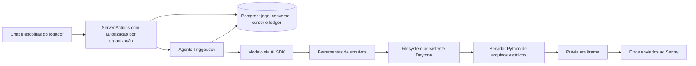

# Sandbox → Studio Pro: análise arquitetural e aproveitamento

Data: 15/10/2026. Escopo: análise do código e proposta de evolução. O Studio foi comparado na branch `feat/studio-pro-completo`, com alterações concorrentes ainda em implementação. Este documento não certifica a entrega dessa branch.

Atualização: o [review 3 de integração](studio-pro-sandbox-adendo-review-2026-10-15.md) confronta o adendo com a entrega local dos lotes 7/8 e o início do lote 9. Para decisões atuais, usar a revisão 3 do adendo; as constatações e contagens abaixo preservam o histórico das duas rodadas anteriores.

## 1. Recomendação

O Sandbox é uma referência útil de **experiência de criação assistida de jogos**, principalmente pela conversa integrada à prévia, perguntas de design e biblioteca de recursos apresentada ao agente. A melhor adaptação é evoluir o Zappy e os kits próprios do Studio sobre a arquitetura atual, contemplando autoria manual, orientação, diagnóstico, mudanças incrementais e criação integral.

A revisão aprofundada mudou a prioridade: primeiro tornar clara a experiência **Zappy Pro**, sem a aba IA concorrente, e a continuidade entre os cinco cenários. Dentro da construção, a oportunidade mais direta continua sendo **jogar a revisão proposta antes de aplicá-la**. O Studio já prepara uma revisão isolada, executa verificações e mostra captura e diferenças; falta oferecer uma prévia interativa dessa mesma revisão.

Outros ganhos são contexto por seleção e revisão, diagnóstico de comportamento esperado, decisões opcionais integradas ao Pensa, catálogo útil para aprender e construir, registro persistente de aplicação, evidências proporcionais ao pedido e, em uma etapa posterior, execução que prossiga sem depender da aba aberta. O briefing não deve ser uma passagem obrigatória para usar o editor ou tirar dúvidas.

Não há justificativa técnica encontrada para substituir autenticação, cobrança, persistência, editor, runtime ou motores do Studio pela pilha do Sandbox. A proposta detalhada está em [Studio Pro — adendo inspirado no Sandbox](studio-pro-sandbox-adendo-2026-10-15.md).

## 2. Método, cobertura e limites

Pasta examinada: `C:\Users\tocha\Downloads\sandbox-main\sandbox-main`. A cópia não contém `.git`. Seu README identifica o projeto como [code-with-antonio/sandbox](https://github.com/code-with-antonio/sandbox).

| Medida | Resultado |
|---|---:|
| Arquivos inventariados, fora dos diretórios excluídos | 166 |
| Arquivos TS/TSX/JS/MJS/CJS examinados estruturalmente | 142 |
| Linhas nesses arquivos, incluindo comentários e última linha vazia | 19.603 |
| Arquivos convencionais de testes encontrados | 0 |
| Arquivos LICENSE/LICENCE/COPYING/NOTICE encontrados | 0 |
| Reproduções locais isoladas executadas | 10 |

Inventariei imports e exports por AST de todos os arquivos de código. Aprofundei a leitura de agentes, ferramentas, autorização, sessões, persistência, cobrança, provisionamento, prévia e ciclo de vida do runtime. Nos módulos visuais, fiz leitura orientada a APIs, alocação, integração e descarte; não houve certificação visual ou funcional de todos os presets e componentes de interface.

Os 142 arquivos de código coincidem, descontadas diferenças LF/CRLF, com os hashes de uma auditoria local anterior do commit `ac18750e06d7678ca8a215fc61cb91e1e5709b50`. Isso identifica a correspondência do código analisado; não equivale a comprovar que todos os arquivos da pasta pertencem ao mesmo checkout Git.

Foram excluídos `.git`, `node_modules`, `.agents`, `.claude` e `reference`. O conteúdo de `reference/` não foi lido, conforme instrução do próprio repositório. Não instalei dependências, executei o aplicativo, migrei banco, chamei modelos, usei credenciais, provisionei serviços ou realizei deploy. `trigger/sentry-error-test.ts` é uma tarefa operacional que provoca erro, não uma suíte de regressão; não foi executada.

As reproduções executam funções originais revisadas com adapters em memória. Os casos de input usam vetores do Three 0.180 já instalado no Studio; não são testes em gamepad físico nem no Three 0.185.1 apontado pelo HTML externo. Os casos de filesystem não certificam o comportamento interno do serviço Daytona.

Evidências reproduzíveis:

- [Inventário, hashes e snapshot dos arquivos do Studio comparados](studio-sandbox-inventory-2026-10-15.json).
- [Resultados das dez reproduções](studio-sandbox-repro-2026-10-15.json).
- [Script da análise e reproduções](analyze-studio-sandbox-2026-10-15.mjs).
- Auditoria anterior reaproveitada somente após conferir os hashes: [Sandbox → TUI](architectural-analysis-sandbox-tui-2026-10-15.md). As recomendações para o TUI não foram transplantadas para o Studio.

## 3. Arquitetura real do projeto externo

O código do jogo vive no filesystem do sandbox. O banco guarda o identificador desse ambiente, histórico e cursor; não guarda revisões versionadas do código. Cada ferramenta modifica diretamente os arquivos servidos. A interface recarrega a prévia ao terminar um turno, inclusive quando ele termina interrompido. Não há etapa de TypeScript, bundling, teste de jogabilidade, revisão de diff ou aplicação transacional nesse caminho.

O runtime é JavaScript de navegador, apoiado em Three carregado por import map/CDN. A biblioteca oferece renderização, input, câmeras, colisões arcade, HUD, efeitos, materiais, iluminação, áudio sintetizado e utilidades de estado. Não é um kit Canvas 2D, nem um editor visual de cenas, nem uma implementação de integração com assets de Pinta/Molda.

O projeto possui boas decisões locais: autorização de propriedade antes de emitir token de sessão; catálogo de modelos separado dos clientes com credenciais; orçamento por tamanho de arquivo; rejeição de caminhos que escapam lexicalmente da pasta; substituição textual que rejeita ambiguidade; persistência conjunta de mensagens e cursor; créditos inteiros com chave única por resposta; logs estruturados por jogo/ferramenta/duração. Essas decisões merecem reconhecimento, mas não fecham os riscos de produção identificados abaixo.

## 4. Comparação com o Studio que está sendo implementado

| Capacidade | Sandbox | Studio observado | Decisão |
|---|---|---|---|
| Conversa ao lado do jogo | Fluxo central | IDE, Zappy e prévia existentes | Aproximar revisão e experimentação dentro do Studio |
| Perguntas sobre o jogo | `ask_player`, sete dimensões | Objetivo textual e integração com tarefa Pensa; sem briefing estruturado no builder examinado | Acrescentar briefing breve e reaproveitável |
| Retomada | Sessão e cursor no Trigger | Job no Members, versão, lease, prazo e recuperação na UI | Preservar; distinguir recuperação de execução autônoma |
| Alteração do código | Escrita direta no sandbox | Revisão separada, hashes anteriores, CAS e inversa | Preservar o contrato do Studio |
| Validação | Instruções ao modelo e registro de erro da prévia | TypeScript, build, Chromium, captura e reparo limitado | Evoluir cobertura e apresentação das evidências |
| Experimentar proposta | Jogo corrente já alterado | Captura e diff antes de aplicar; sem iframe da proposta no painel lido | Expor o artefato candidato de forma isolada |
| Conhecimento do kit | Referência extensa de APIs mantida à mão | `studioProGameGuide`, kits próprios e manifesto do Canvas | Catálogo pequeno, versionado e conferido contra código |
| Assets | Geometria/textura procedural e URLs externas | Manifesto por IDs/hashes; Pinta e Molda | Preservar pipeline de materiais |
| Custo | Saldo antes do turno; admite negativo | Reserva, limites familiares/BYOK e consumo incerto explícito | Preservar ledger e política do Studio |
| Motores | Three no navegador | Canvas, Phaser e Three selecionados por kit | Evitar motor universal e troca de dependências |
| Publicação | URL de prévia temporária | Publicação é lote próprio da proposta | Manter prévia, exportação e publicação distintos |

Evidências principais no Studio, relativas à raiz do monorepo:

- `packages/core/src/studio/pro-builder.ts:4`: três chamadas de modelo, três validações, prazo de cinco minutos, lease e retenção.
- `packages/member-shell/src/server/studio-builder.ts:42`: avanço de uma etapa, checkpoint, orçamento e tratamento de transporte ambíguo; `:199` envia a revisão candidata para validação.
- `packages/member-shell/src/server/studio-builder-tools.ts:38`: ações atuais `inspect` e `propose`; `:83` contexto limitado; `:231` patches com precondições e consolidação contra a base original.
- `packages/members/src/infrastructure/persistence/drizzle/studio-builder.repository.ts:20`: escopo de conta/perfil/projeto; `:235` claim com lease; `:267` verificação de token/versão.
- `packages/studio/src/components/tutor/ProBuilderPanel.tsx:94`: o cliente conduz os avanços; `:157` retoma; `:307` mostra captura; `:378` aplicar/desfazer.
- `packages/studio-runtime/runtime/playtest.mjs:59`: drivers por ID de kit; `:78` smoke de inicialização para outros projetos.
- `packages/core/src/studio/pro-game-knowledge.ts:34`: guia já inclui versão, ressalva sobre arquivos modificados, checks e pipeline de materiais.
- `packages/studio/pro-kits/canvas-survival/studio-kit.json:1`: manifesto já descreve entrada, controlador, ações, objetivo e limites.

Isso é evidência de código presente, não uma repetição da homologação da outra sessão. Os pontos de integração devem ser relidos antes de implementar, pois o worktree é compartilhado e está mudando.

## 5. O que vale aproveitar

### 5.1 Briefing como parte da criação

`lib/games/tools.ts:40` modela uma pergunta por dimensão e duas a quatro opções. `lib/games/instructions/workflow.ts:15` orienta evitar perguntas já respondidas. A boa ideia é transformar uma intenção vaga em escolhas comparáveis e manter essas escolhas durante a conversa.

Para o Studio, sete perguntas obrigatórias seriam atrito. Começar pelo objetivo do Pensa, pelo kit escolhido e pelos controles disponíveis. Perguntar apenas o que muda a implementação; permitir resposta livre ou seguir com uma sugestão identificada. Não fazer uma chamada de IA paga para cada seleção de um formulário.

### 5.2 Recursos pequenos que o agente sabe encontrar

`lib/games/instructions/engine.ts:1` explica o motivo de apresentar a API ao agente: uma função que ele desconhece tende a ser recriada. Os namespaces e exemplos curtos ajudam a compor cenas rapidamente.

No Studio, evoluir o guia existente para informar arquivos, exports, capacidades, exemplos e limitações reais do kit. O catálogo deve ser conferido automaticamente. A referência do Sandbox é mantida à mão e pode divergir do código. A API inteira de Three não precisa ocupar todo prompt.

### 5.3 Acabamento reutilizável

Presets de iluminação, HUD, feedback de dano/coleta, sons curtos, câmera e efeitos são boas referências de produto. Oferecê-los como receitas próprias e específicas por motor. Em Canvas, explorar sprites e efeitos 2D; em Three, materiais, câmera e iluminação; em Phaser, usar os sistemas da própria engine.

Um preset deve declarar custo, compatibilidade e alternativa de movimento reduzido. “Tem ponteiro coarse” não é medida suficiente de potência gráfica. Os materiais existentes de Pinta/Molda têm precedência sobre URLs inventadas ou geração automática paga.

### 5.4 Acompanhamento de trabalho real

O marcador de ferramenta em `components/chat-thread.tsx:437` torna visível o que está acontecendo. Logs em `lib/games/tools.ts:382` medem o trabalho efetivamente executado.

A adaptação deve usar eventos do servidor: consulta concluída, proposta preparada, build aprovado, teste incompatível, consumo pendente. Não mostrar raciocínio interno do modelo, porcentagem fictícia ou sucesso baseado somente em uma resposta da ferramenta.

### 5.5 Separar conversa, execução e disponibilidade da aba

Persistir respostas de perguntas antes de executar o turno seguinte (`trigger/chat.ts:112`) e salvar mensagens/cursor juntos (`lib/games/chat-store.ts:69`) resolve problemas reais de recarga.

O Studio já possui estado durável, mas o próximo avanço é disparado pelo painel. Fechar a aba pode interromper o transporte; não há evidência no fluxo examinado de um dispatcher que execute todas as etapas restantes sozinho. O ganho futuro é um executor de servidor sobre os mesmos jobs, sem criar uma segunda fonte de verdade.

## 6. Problemas e decisões que não devem ser transplantados

Confiança **alta** significa observação direta do código ou reprodução isolada descrita. “Risco condicionado” identifica uma condição que ainda dependeria do serviço/browser real.

| Achado | Evidência no Sandbox | Consequência e tratamento no Studio |
|---|---|---|
| Edição direta sem revisão atômica | `tools.ts:203`, `:271`, `chat-thread.tsx:171` | Interrupção deixa arquivos parciais no jogo corrente. Preservar revisão candidata + CAS + inversa. Alta. |
| Substituições concorrentes perdem alteração | `tools.ts:252–271`; reprodução resultou `A BB`, em vez de `AA BB` | O chamador não oferece precondição de versão nem serialização da escrita. Resultado reproduzido com I/O em memória; não é prova de concorrência do serviço real. |
| Proteções dependem do prompt | Prompt proíbe remover engine/reporter; `tools.ts:330` aceita os dois caminhos | Enforcement deve ficar no servidor e na separação do runtime de teste. Exclusões aceitas no harness. Alta. |
| Limite de tamanho incompleto | `tools.ts:248` valida arquivo anterior, mas `:271` grava a substituição sem limite final | Reprodução criou 128.001 bytes, que a própria ferramenta depois se recusou a ler. Validar tamanho agregado e final em todas as mutações. Alta. |
| Falha operacional vira arquivo ausente | `tools.ts:490` captura qualquer erro de stat e retorna null | Falha de transporte apareceu como “No file”, com log info. Usar códigos discriminados; ausência real difere de indisponibilidade. Alta. |
| “Concluído” não significa ferramenta bem-sucedida | Falhas esperadas retornam string; `chat-thread.tsx:476` interpreta qualquer `output-available` como done | Resultado tipado deve separar sucesso, recusa corrigível e erro operacional. Alta. |
| Reporter não fecha ciclo de correção | `chat-preview.tsx:171–205` registra no Sentry; não envia diagnóstico ao agente | Não atribuir ao projeto um agente que já testa e corrige o jogo. O builder do Studio já faz reparo limitado com diagnósticos do verificador. Alta. |
| Prévia “ready” antes de comprovar boot | `chat-preview.tsx:107`; `readError` ignora resposta saudável; não há timeout de handshake | URL obtida não prova que o jogo abriu. Erro na atualização mantém a versão anterior sem aviso visível de desatualização. Alta. |
| Isolamento do iframe insuficientemente expresso | `chat-preview.tsx:236` não tem atributo sandbox; servidor estático não configura CSP neste código | Preservar origem opaca, CSP e canal validado do Studio. Isso não demonstra fuga da infraestrutura Daytona. Alta sobre configuração local; exploração não testada. |
| Redação de URL não cobre o formato documentado | `chat-preview.tsx:63` retira query/fragment, mas conserva hostname; `:190` conserva mensagem livre | URL assinada pode carregar credencial no hostname. Caso sintético preservou token. Redigir URL completa, mensagem, stack e fonte. Risco de produção, não vazamento observado. |
| Saldo não é teto do turno | `trigger/chat.ts:130`, `:257`, `:274`; `ledger.ts:112` | Até 48 etapas; negativo admitido e falha de débito apenas logada, sem recuperação durável nesse fluxo. Preservar reserva e reconciliação do Studio. Alta. |
| Provisionamento/remoção dependem de recuperação parcial | `daytona/utils.ts:35–50`, `:188`; `actions.ts:250` | Criação antes de gravar ID pode deixar órfão; não há claim persistido para esse provisionamento. Remoção tenta compensar por labels, mas a última varredura é best effort. Não copiar como garantia de lifecycle. Alta para janelas; incidência não medida. |
| Retomada exige adaptação especial do stream | `chat-thread.tsx:425` suprime chunk start da mensagem retomada | O próprio comentário admite divisão visual de uma mensagem até nova recarga. Preferir identidade/eventos estáveis; não copiar o filtro como protocolo do Studio. Alta. |
| Motor não tem descarte agregado | `engine/index.js:97` compõe subsistemas, mas não devolve dispose global; `sound.js:398` deixa listeners | Harness constatou três listeners de áudio restantes. Usar ownership explícito de listeners, áudio, timers, recursos GPU e tarefas pendentes. Alta. |
| Input não agrega fontes independentemente | `input.js:270`, `:280`, `:284` | Desconexão deixa jump ativo; soltar gamepad remove ação ainda mantida pelo teclado. Ambos reproduzidos. Preservar o input agregado do kit próprio. Alta. |
| Pool não impõe capacidade | `models.js:597` chama factory quando esgota | `size:2` resultou em cinco objetos vivos. É reserva inicial, não limite máximo. Não usar como garantia de memória limitada. Alta. |
| Pausa e lifecycle são incompletos | `engine.js:127` ainda renderiza pausado; `:150` retoma ao voltar à aba; `particles.js:213` não guarda unsubscribe no dispose | Pode renderizar sem necessidade, desfazer pausa manual ou conservar callbacks de efeitos descartados. Análise estática; sem ensaio GPU/soak. |
| Armazenamento reporta valor mesmo após falha | `state.js:160` captura erro e retorna valor | Reprodução devolveu 10 após quota excedida. Studio deve manter confirmação real e aviso de falha, já previstos na ponte de progresso. Alta. |

A documentação oficial do Daytona mostra que URLs assinadas incluem o token no hostname. Isso sustenta o risco de redação acima, sem necessidade de usar uma credencial real: [formato e autenticação da prévia](https://www.daytona.io/docs/en/preview/).

Confinamento de caminhos é lexical. `path.posix.resolve` não resolve links simbólicos. Não demonstrei escape por symlink e a ferramenta não oferece criação de symlink; seria incorreto apresentar uma exploração confirmada. Uma eventual adoção de filesystem remoto teria de garantir contenção real em todas as operações.

O código também habilita replay de sessão e captura de variáveis locais no monitoramento. Bloquear corpos HTTP, por si só, não demonstra que todas as formas de conteúdo sensível foram excluídas. Para o Studio infantil, aproveitar métricas estruturadas e whitelist de campos, sem importar automaticamente essa configuração de coleta.

## 7. Coesão, duplicação e manutenção

Há separação razoável entre UI, ações, ferramentas, runtime, cobrança e observabilidade. A complexidade concentra-se na integração de serviços e no componente de conversa. A disponibilidade de Next, Clerk, Neon, Trigger, Daytona, Anthropic e Sentry não torna essa composição necessária ao Studio.

A análise estrutural anterior, cujos 142 hashes foram conferidos, encontrou 37 componentes UI sem caminho de import a partir das entradas examinadas. São candidatos a enxugamento se o aplicativo fosse mantido; não proponho removê-los desta cópia. Os exports do engine não podem ser classificados como mortos só porque o aplicativo principal não os importa: são uma API para jogos gerados e arquivos de seed distribuídos dinamicamente.

As principais fontes de divergência são a referência textual de APIs mantida à mão, comentários que não acompanham o comportamento atual e duplicação de estado entre thread persistida e stream retomado. O Studio deve evitar ampliar esse padrão: contrato tipado, descritores gerados e eventos com identidade estável são investimentos melhores que mais instruções ao modelo.

Não encontrei testes automatizados convencionais nem configuração CI de testes na cópia inventariada. Isso reduz a confiança para reutilização direta, especialmente de física, input, limpeza e concorrência. Não significa que o autor nunca tenha testado manualmente.

Não encontrei licença explícita do aplicativo na cópia fornecida. Reutilização literal de código, textos ou arte deve aguardar uma licença/permissão verificável; a proposta usa padrões e implementação própria. A distinção entre código público e concessão de licença é descrita pela [documentação do GitHub](https://docs.github.com/en/repositories/managing-your-repositorys-settings-and-features/customizing-your-repository/licensing-a-repository).

## 8. Alternativas consideradas

| Alternativa | Benefício | Custo/risco | Parecer |
|---|---|---|---|
| Incorporar a aplicação ou transplantar a pilha completa | Aproxima rapidamente a demonstração original | Duplica identidade, ledger, persistência, runtime e UI; perde integração educacional; falta licença explícita | Não indicada |
| Adotar somente a engine externa | Muitos helpers e presets imediatamente disponíveis | Three-only, divergência de versão, lifecycle/input/pool sem garantias necessárias, duplicação com kits e extensões | Não indicada como base |
| Implementar os padrões úteis nos contratos existentes | Melhora experiência, previsibilidade e manutenção | Exige integração pontual e critérios de aceitação | **Recomendada** |

Trigger.dev pode ser reavaliado se houver uma necessidade operacional que a infraestrutura adotada não cubra. A durabilidade do serviço não elimina a idempotência dos efeitos: a própria documentação distingue deduplicar o disparo de uma tarefa de deduplicar o que acontece dentro dela. [Trigger.dev — idempotência](https://trigger.dev/docs/idempotency).

## 9. Encaminhamento revisado

Priorizar identidade e continuidade dos cinco fluxos; depois revisão jogável, evidências e recuperação da aplicação; em seguida tarefas, catálogo e observabilidade; por fim reconciliação mais avançada e execução fora da aba. Encerrar os critérios abertos da implementação atual continua sendo pré-requisito de entrega. O plano local passou a registrar a revisão funcional do lote 7 encerrada enquanto este adendo era revisto; isso não equivale à homologação de todas as frentes. Nenhuma dessas recomendações substitui QA de dispositivos, integração autenticada, publicação ou estabilidade prolongada.

O adendo mantém a decisão anterior do usuário: **kit próprio do Studio**, com Canvas 2D leve, Phaser e Three quando adequados. A inspiração do Sandbox melhora a forma de descobrir, montar, experimentar e revisar esses recursos.

## 10. Segunda análise: autoria manual, incremental e assistida

Esta rodada aprofundou o caminho completo de pedido → pergunta → ferramenta → persistência → prévia do Sandbox e o comparou com tutor, construtor, aplicação de revisões e painel IA do Studio. O usuário explicitou cinco cenários que precisam coexistir e sugeriu um **Zappy Pro** exclusivo do ambiente Pro, reunindo as funções úteis sem manter uma aba IA separada.

Não executei o aplicativo externo nem simulei respostas de modelos para concluir seu comportamento. As diferenças abaixo são evidências de contratos, instruções e UI. A resposta de um modelo a cada formulação só poderia ser avaliada com ensaios próprios.

### 10.1 O Sandbox favorece construção, inclusive depois do primeiro jogo

| Achado | Evidência concreta | Implicação |
|---|---|---|
| A identidade do agente é construir por conta do usuário | workflow.ts:6–13 define o jogo em execução como entrega e a escrita de fonte como trabalho principal | Bom para delegação integral; não adotar como prompt comum de um tutor |
| Pedidos posteriores continuam entrando na rotina de edição | workflow.ts:48–59 manda interpretar pedidos e alterar o código; :102 exige jogo executável a cada turno | Não contempla, por contrato específico, explicação sem solução pronta ou rascunho pedagógico |
| Todas as ferramentas do agente permanecem disponíveis por jogo | trigger/chat.ts:209 entrega createGameTools(chatId), sem política de escrita por intenção nesse ponto | No Studio, explicar/investigar e preparar mudanças precisam de capacidades distintas, além do prompt |
| O questionário pode impedir redirecionar a conversa | chat-thread.tsx:256 identifica pergunta pendente; :393 desabilita o composer; :610–627 só apresenta escolhas e “Build this” | Adotar perguntas úteis, acrescentando resposta livre, cancelamento e continuidade de consultas independentes |
| A pergunta estruturada é apresentada como compromisso de construção | ask_player recebe dimensões de game design, não “quer uma dica ou uma correção?” | Usar um contrato de esclarecimento que sirva à tarefa atual, sem transformar toda dúvida em briefing |
| O ambiente é provisionado no início da sessão | trigger/chat.ts:93–95 cria sandbox antes de encerrar as escolhas do primeiro jogo | Uma explicação no Studio não deve abrir worker de build nem ambiente remoto por padrão |
| Recarregar a prévia é ligado ao término do turno | chat-thread.tsx:174; game-chat.tsx:38–49 incrementa contador local de revisão | Turno de conversa e revisão de código são identidades diferentes; uma resposta de orientação não precisa reiniciar o jogo |
| O código atual tem precedência sobre a memória do agente | workflow.ts:68–76 manda listar/ler antes de editar; :118–121 limita alterações ao pedido e dependências | **Aproveitar diretamente como princípio**, reforçado por snapshot/hash e testes no Studio |

Os caminhos da tabela são relativos à pasta externa; workflow.ts fica em lib/games/instructions, chat-thread.tsx e game-chat.tsx em components.

Não é uma falha do Sandbox ter foco em geração de jogos. É uma incompatibilidade com parte do produto educacional desejado. O erro seria importar suas premissas como regras universais do Zappy.

### 10.2 Zappy, construtor e aba IA não são a mesma implementação

| Caminho atual do Studio | Evidência | Conclusão |
|---|---|---|
| Tutor Zappy | studio/tutor.ts:185 define adapter de histórico/perguntas/feedback e builder opcional; ZappyPanel.tsx:304 envia pergunta e contexto | Integração existente a preservar |
| Orientação Pro | server/zappy-ai.ts:787–804 instrui tutor somente leitura, referências de arquivos e diagnóstico sustentado | Já atende parte importante da autoria manual; não precisa virar construtor obrigatório |
| Construção Pro | ZappyPanel.tsx:470–506 alterna Conversar/Construir; ProBuilderPanel cria snapshot e job | É a capacidade de preparar alterações, dentro do Zappy; não é AIPanel |
| Aba IA genérica | components/ai/AIPanel.tsx:115–187 lê IR/extensões e guarda mensagens no componente; :320–355 oferece explicar/sugerir/desafio | Sobreposição de funções, contexto insuficiente para árvore Pro e conversa separada |
| Provider genérico | state/aiAdapter.ts:33–66 escolhe provider injetado, chave local ou mock | Não presumir o mesmo histórico, contexto e fluxo de créditos do Zappy |
| Visibilidade da aba | components/layout/bottomTabs.tsx:93–99 depende de config.ai/showAI/mode; studio/config.ts:161 usa ai=false quando ausente | A existência do componente não significa que todos os hosts o exibem |
| Host Pro do produto | member-shell/components/studio/studio-pro-editor.tsx:188–189 envia professional:true e tutor, sem ai | No host Kids examinado, a aba genérica não é habilitada. Não foi demonstrado um bypass de créditos em produção |

Os caminhos abreviados de studio/tutor, components, state e studio/config são relativos a packages/studio/src; server/zappy-ai é relativo a packages/member-shell/src.

**Recomendação:** Zappy normal para blocos e Zappy Pro para código. A mesma identidade, políticas e integrações, com capacidades adequadas ao ambiente. Remover a entrada IA do produto e migrar suas ações úteis. Inventariar consumidores antes de remover os contratos públicos da biblioteca.

Trocar apenas o título de AIPanel produziria dois chats com o mesmo nome. A correção estrutural é concentrar a experiência nos adapters do Zappy e conectar orientação/construção por tarefa e revisão.

### 10.3 Lacunas específicas da alternância entre criança e agente

| Lacuna observada | Evidência no Studio | Melhoria proposta |
|---|---|---|
| Falta seleção/intervalo no contrato do tutor | studio/tutor.ts:49–56 tem arquivo ativo, diagnósticos, instalação e pacotes | Enviar seleção e trechos com linhas originais/hashes, sem duplicar toda a fonte |
| Ranqueamento escolhe arquivo certo, mas recorta seu início | server/zappy-ai.ts:858–871 ordena por contexto e limita conteúdo ao prefixo de 4.000 caracteres | Recorte centrado na seleção/erro, com marca de truncamento. Um erro posterior ao prefixo pode ficar sem fonte relevante |
| Diagnóstico do runtime não identifica revisão no contrato de log/tutor | state/logsStore.ts:29–43; studio/tutor.ts:65 lastError é texto | Acrescentar origem, instância e revisão do sinal; não tratar um erro antigo como reprodução atual |
| Tutor avisa que referência pode estar velha, sem mapear trecho | ZappyPanel.tsx:584–595 compara sourceRevision com updatedAt e navega pelas linhas antigas | Conservar aviso e reencontrar/invalidar intervalo por conteúdo; timestamp não substitui hash |
| Diagnóstico não vira tarefa estruturada compartilhada | ProBuilderPanel.tsx:148 cria objective + payload; core/pro-builder.ts:60–77 não carrega mensagem/diagnóstico de origem | Vincular pedido, escopo e critérios; evitar a criança repetir toda a explicação ao trocar para Construir |
| Desfazer depende do painel montado | ProBuilderPanel.tsx:44, :59, :175–190 guarda/limpa inversa local | Registro de aplicação persistente e limitado, coordenado com documento |
| CAS é global, inclusive para arquivos diferentes | core/pro-revision.ts:185 valida hash de toda a base antes dos patches | Preservar a segurança e oferecer reconciliação com revisão visível; não forçar overwrite |
| Falha de validação não classifica erro prévio | server/studio-builder.ts:214–239 encaminha 422 a repairOrFail | Baseline e escopo de reparo; não “terminar o jogo” quando a tarefa era corrigir uma parte |
| UI recupera último job, sem identidade explícita de tarefa maior | ProBuilderPanel.tsx:64, :157–162; core/pro-builder.ts | Separar tarefa de execução limitada e registrar descarte/aplicação/continuação |

Estas são lacunas para o novo requisito, não alegações de regressões introduzidas pela implementação principal. CAS global e tutor somente leitura são proteções corretas; precisam de continuidade e apresentação adequadas, não de remoção.

Também não foi comprovado que um log antigo cruza projetos no browser atual: o achado é a ausência de identidade de revisão no contrato examinado. Essa distinção importa para não chamar risco de contrato de incidente observado.

### 10.4 Alternativas para reunir os cenários

| Alternativa | Avaliação |
|---|---|
| Um modo fixo de projeto “manual” e outro “feito por IA” | Obriga trocas artificiais, perde continuidade e não representa a autoria mista pedida |
| Um agente com ferramentas de escrita sempre disponíveis que decide sozinho quando editar | Interface simples, mas autorização implícita demais para orientação/diagnóstico; prompt não garante ausência de mutação |
| Um Zappy Pro, com intenção por pedido e capacidades delimitadas no servidor | **Recomendada:** permite fluidez na conversa sem perder revisão, orçamento e controle do documento |

A recomendação admite interpretar linguagem natural e sugerir ações. Ela não exige um seletor técnico por mensagem nem confirmação para toda leitura. A solicitação explícita de construir autoriza preparar a candidata; aplicar é a ação que muda o documento.

### 10.5 O que aproveitar do Sandbox, por cenário

| Cenário | Inspiração útil | Adaptação necessária |
|---|---|---|
| Manual | APIs pequenas e exemplos do kit | Receitas consultáveis e código próprio editável, sem chamar modelo |
| Orientação | Contexto do projeto corrente | Leitura limitada/seleção, linguagem pedagógica e ausência de ferramentas de escrita |
| Diagnóstico | Reporter inicial antes dos módulos | Vincular erros à revisão e alimentar investigação quando solicitada; o reporter externo sozinho apenas registra |
| Incremental | Ler antes de editar e preservar sistemas não pedidos | Snapshot, escopo, patch atômico, baseline e reversão segura |
| Integral | Perguntas relevantes, biblioteca de capacidades, jogo ao lado da conversa | Briefing opcional, orçamento agregado, candidata jogável, critérios e aplicação explícita |

A melhoria mais profunda é combinar a rapidez da composição assistida com a liberdade de autoria do Studio. Não usar o número de gerações ou um jogo pronto a cada mensagem como critério universal de sucesso.

## 11. Verificação desta revisão

Foram executados novamente testes existentes, sem alterar fontes do produto:

| Comando e diretório | Resultado |
|---|---|
| packages/studio: bun test src/state/proRevision.test.ts src/studio/tutor.test.ts src/studio/config.test.ts src/components/tutor/ProBuilderPanel.test.tsx | 28 passaram; 0 falhas; 81 asserções |
| packages/member-shell: bun test tests/studio-zappy.test.ts tests/studio-builder-tools.test.ts | 78 passaram; 0 falhas; 355 asserções |

Os 106 testes selecionados verificam a base existente: contexto/privacidade por modo, integração da rota, autorização, idempotência, patches, CAS, cancelamento, aplicação e proteção de mudanças manuais. Não provam o adendo futuro, qualidade de respostas reais de modelos ou execução do Sandbox.

Evidências: [snapshot de hashes e comandos](studio-sandbox-fluxos-evidence-2026-10-15.json), [log Studio](studio-sandbox-fluxos-studio-tests-2026-10-15.txt), [log servidor](studio-sandbox-fluxos-server-tests-2026-10-15.txt). Mensagens de erro nos logs do servidor pertencem aos testes de indisponibilidade deliberada; a execução terminou com zero falhas.

As dez reproduções do Sandbox permanecem evidências da rodada anterior, com os limites descritos na seção 2; não foram somadas a estes testes como se fossem uma suíte externa. Usei as dependências já instaladas para os testes locais; não instalei novas dependências, acessei contas/serviços de execução, usei credenciais reais ou executei migrações nesta revisão. A documentação oficial de licenças e garantias de fila foi consultada novamente.
