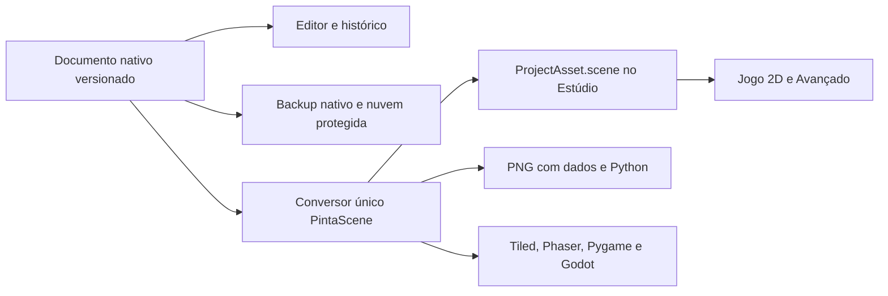

# Revisão arquitetural do Pinta — 18/11/2026

Base inicial examinada: `origin/staging` em `567b93f95`. Um segundo fetch encontrou
novos commits; eles foram integrados por fast-forward até `42b395d93`, sem conflito,
preservando o trabalho local em stash e reaplicando-o. A revisão usa o worktree separado
`pinta-full-review-20261118`. Inclui as implementações anteriores locais incorporadas à
staging e os commits remotos de revisão. Não altera Molda Cenários 3D.

Referência de aceite: [33 critérios da missão](../.compozy/tasks/pinta-full-review-20261118/_prd.md).
A conclusão dos 14 incrementos antigos não encerra essa missão. O resultado por requisito
está na [matriz](../docs/pinta-cenarios/revisao-2026-11-18/cobertura.md), e as provas por
ambiente no [QA](../docs/pinta-cenarios/revisao-2026-11-18/qa.md).

## Estrutura reaproveitada

- `pinta/core/project.ts` mantém o documento autoral; os bitmaps e buffers de células
  continuam no formato nativo, sem substituir o mapa por PNG. `projectConfig.ts` separa
  criação, leitura e versões. Histórico e persistência continuam nos serviços existentes.
- `tiles/` concentra terreno, seleção, geometria, conjuntos e chunks. O editor usa os
  mesmos componentes, tokens e estilos; esta revisão não troca a identidade visual.
- `export/scene.ts` é o conversor para `core/studio/pinta-scene.ts`. Renderização, imagem
  portátil, Estúdio e exportadores consomem esse contrato. A seleção de arte de sprites
  ainda é estática: não transporta todas as animações/versões de recurso exigidas na missão.
- Os blocos novos usam `map-2d` nos dois motores. O caminho legado é preservado byte a
  byte. Código de cenário carrega sob demanda. Uma função canônica transforma objetos de
  conjuntos; o JS portátil usa sua fonte gerada antes da minificação, conferida no CI.
- `pinta.py` e o pacote Pygame compartilham o compositor gerado. O wrapper público agora
  consulta os objetos expandidos da cena, preservando o leitor legado. Godot usa uma
  árvore nativa e namespaces por instância; Tiled converte para seus contratos externos.

## Dados e segurança

Há eixos independentes: nuvem por tipo (4), documento/envelope rico inteiro (4), camadas sem
recursos ricos (3), precisão fracionária (5), cena de execução (1), PNG portátil (1/2) e
versão do projeto do Estúdio. Propriedades tipadas de camadas/grupos exigem formato 4;
frações exigem 5, inclusive em conjuntos, pois o leitor completo 4 também as arredondava.
O leitor real anterior foi executado contra esses documentos e recusou mapa, arquivo e
conjunto 5; os bytes de rich4/layers3/legado1 foram conservados.

O host verifica o formato listado **e o efetivamente baixado**. A memória de formato
mantém a proteção na sessão quando localStorage não aceita escrita. Após reinício, uma
edição de origem desconhecida consulta o formato remoto antes de aceitar o cache local:
restaura o original e conserva a edição cortada em cópia, sem legitimá-la por assinatura
local. Falha de rede impede a publicação e permite nova tentativa. Não há consulta de rede
no autosave local. Backend e reconciliação conservam
revisões, conflitos, cópias e `CREATION_CLIENT_OUTDATED`. Publicar leitores/gravadores e
ensaiar rollback da frota continua sendo uma operação de release, não realizada aqui.

Dependências nativas têm uma descoberta canônica, incluindo propriedades de objetos,
camadas, grupos e peças. Fechamento iterativo suporta ciclos e recusa mais de 225 recursos.
Importação religa IDs de objetos e recursos. Referências exclusivamente lógicas no contrato
de cena ainda não carregam o recurso autoral inteiro ao Estúdio: R05 permanece parcial.

A autoria de aulas passou a aplicar os mesmos limites da entrega: 128×128, oito camadas,
64 peças e o teto de tamanho do Members. Não houve mudança de banco, permissões, licenças
ou isolamento de contas para contornar esses limites.

## Achados corrigidos

A [rodada estruturada](../.compozy/tasks/pinta-full-review-20261118/reviews-001/_meta.md)
registra reproduções, decisões e provas. Os quinze achados iniciais abrangem perda de
marcas sob cota, corrida entre listagem/download, versões de propriedades, fechamento de
dependências, balde de terreno, transformações Wang, recorte e cache de conjuntos,
coordenadas da biblioteca/clipboard, exposição de ferramentas, referências Tiled,
coordenadas negativas, instâncias refletidas, contornos de caminhos e autoria de aulas.

Ensaios posteriores encontraram o wrapper Python incompleto e duas falhas de integração
introduzidas ao compartilhar a geometria: fonte portátil alterada pela minificação e carga
eager excedendo o orçamento inicial. A correção gera fonte estável e carrega o cenário sob
demanda. O orçamento inicial e os tetos absolutos dos motores não foram ampliados.

O recorte de conjunto não aproxima meia peça: recusa camadas de peças desalinhadas que
atravessam o recorte, preservando offsets fracionários de objetos. Tiled recusa imagem que
exigiria cisalhamento não representável; Godot/Pygame conservam a transformação e relatam
a omissão exclusiva do suplemento Tiled. Não há fallback que apague dados para exportar.

## Lacunas de arquitetura e produto

O cache tem orçamento inicial de 32 MiB, ampliável aos chunks visíveis. O documento fica
inteiro em memória e a gravação continua por documento. Portanto chunks de renderização
não comprovam carregamento/salvamento incremental nem memória limitada a 32 MiB. Autoria
continua limitada a oito camadas; importar a Vila com 18 não satisfaz criar livremente 16.

Ainda faltam arrasto de arte com prévia, espalhamento de objetos com afastamento, versões
e animações de recursos de sprite, colisões arbitrárias por forma em todos os consumidores,
automapping de múltiplas camadas e projeções isométrica/hexagonal completas. Essas lacunas
continuam na missão, com estado explícito; não foram resolvidas por opções sem suporte.

Os documentos antigos divergiam sobre schema, tetos, cache, exclusão de mapas em aulas e
escopo profissional. Foram conciliados com o código. Registros históricos permanecem
datados e não são usados como prova atual de ferramentas externas ou dispositivos físicos.

### Bloqueio local independente — issue 026

A auditoria final reproduziu uma perda sem nuvem usando o gravador real de `567b93f95`:
RAM4 já aberta substitui o registro local5 confirmado na mesma chave. Reabrir pelo código
atual perde o offset e não encontra checkpoint nem cópia. A proteção causal 025 protege o
canônico na conta, mas não altera essa autoridade local. A issue 026 permanece aberta,
com reprodutor e critérios de correção transacional. Este PR é draft de revisão, sem
prontidão para release; R02 passou a parcial. O saldo da missão é 19/13/1.

## Estratégia de comprovação

Regressões puras cobrem dados, migração, dependências, geometria e terrenos; testes HTTP
em processo cobrem autoria/entrega. Testes executam os textos completos dos dois motores,
incluindo colisão e áreas. O harness Playwright existente passou a importar/editar/reabrir
a Vila pela interface e executar o pacote Phaser real, em desktop e toque emulado.
CLI de Tiled, Godot e SDL/Pygame tem comprovação separada. Fakes de persistência e
emulação de toque não são prova de conflitos em aparelhos físicos ou staging autenticado.
