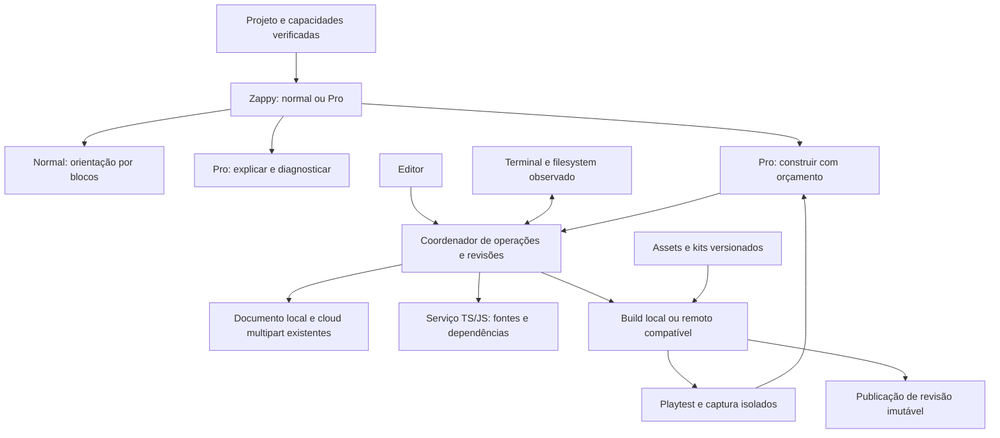

# Studio completo e Pro — proposta consolidada, revisão 2

Data: 15/10/2026. Natureza: análise e proposta; nenhuma alteração de código do produto foi implementada. Esta revisão substitui as recomendações da primeira proposta. A implementação futura será em lotes, mas o escopo descrito aqui é completo.

## 1. Decisões de produto

O Studio tem uma base que deve ser preservada. O Pro já oferece projetos Three.js em JavaScript e TypeScript, com Three 0.180.0. O trabalho é completar a experiência de desenvolvimento de jogos: arquivos e dependências confiáveis, editor que entende o projeto, assets utilizáveis, kits jogáveis, IA contextual, validação real e publicação reproduzível.

Decisões desta revisão:

1. **Modo normal:** Zappy ensina com blocos e com as capacidades disponíveis na paleta. Não recomenda programação textual, comandos npm ou criação de arquivos de código. Isso também deve reger a orientação do tutor quando o projeto clássico expõe a Ponte; a existência dessa visualização não autoriza mudar a pedagogia solicitada.
2. **Modo Pro:** Zappy orienta por código, arquivos, bibliotecas, diagnósticos e terminal. Não recomenda arrastar blocos, selecionar blocos ou procurar mecânicas na paleta. O rótulo “Código” sozinho não identifica o Pro: usar `Project.kind`, modo e capacidades efetivas.
3. **Dependências:** clássico mantém extensões/runtimes injetados; Pro usa imports e dependências npm. Instalar uma biblioteca compatível deve atualizar execução, arquivos persistidos e serviço de linguagem. Não ocultar diagnósticos para simular reconhecimento.
4. **Jogos:** Canvas/SZGameKit para 2D leve, Phaser 3 como opção de template Pro para aproveitar os kits existentes, e Three.js para 3D. Cada motor carrega apenas quando necessário. Não criar um motor universal nem introduzir Godot, Unity, Unreal ou LÖVE no navegador nesta proposta.
5. **IA:** uma experiência Zappy, com capacidades distintas para explicar, diagnosticar e construir no Pro. Pensa continua originando objetivos; Pinta/Molda continuam originando assets. O construtor aplica mudanças em revisão isolada, executa verificações e entrega alterações compreensíveis e reversíveis.
6. **Uso de IA:** franquia familiar incluída na assinatura e conexão opcional à conta OpenRouter do responsável. Integrações com assinaturas Codex/Claude Code, APIs diretas adicionais e carteira própria de recargas ficam fora desta proposta, conforme a simplificação escolhida.
7. **GameDev:** reaproveitar código, assets autorizados, contratos de arte, mecânicas, exemplos e práticas de verificação. As 373 skills não serão carregadas integralmente no navegador nem em cada prompt.
8. **Entrega em lotes:** cada lote encerra com critérios técnicos verificáveis, compatibilidade com os lotes anteriores e possibilidade de reversão. O piloto valida uma parte do escopo; não substitui o restante do plano.

## 2. Evidências e limites da análise

Foram inventariados **3.067 arquivos, 189.692.017 bytes, 2.904 hashes distintos e 373 arquivos SKILL.md** em 14 diretórios da pasta fornecida. Os SKILL.md têm 359 conteúdos distintos. O inventário cobre arquivos ocultos relevantes; exclui diretórios de controle/dependências como `.git` e `node_modules`. Arquivos repetidos, documentação e mídia de apresentação não equivalem a funcionalidades independentes.

Foram examinados código de jogos, manifests, scripts de assets, referências técnicas e os caminhos do Studio relacionados a edição, execução, persistência, IA e host. A análise não afirma leitura linha a linha dos 3.067 arquivos nem execução de todos os jogos externos. Scripts da coleção não foram executados.

Evidência nova desta revisão:

| Verificação | Resultado | Alcance |
|---|---|---|
| Build do playground | Vite 8.0.16, 1.935 módulos, 4,75 s | Build local de teste; não é o build Next/Kids de produção |
| Abrir Three.js/TypeScript | Dev-server disponível no iframe; conexão Vite confirmada | Projeto isolado criado para auditoria |
| Tipos no editor | TS2792: `Cannot find module 'three'` no template inicial | O pacote e `@types/three` estavam instalados no WebContainer |
| Terminal | `npm install mitt@3.0.1 --save-exact --ignore-scripts --no-audit --no-fund` concluiu | Bibliotecas instaladas no ambiente temporário do navegador |
| Persistência da instalação | FS continha mitt e package-lock; package.json aberto no editor continuava só com Three | Divergência observada antes de qualquer instrumentação de edição |
| Arquivo criado pelo shell | `src/terminal-probe.ts` existia no FS, ausente da árvore da interface | Confirma falta de reconciliação FS → projeto |
| Reproduções do Zappy | Prompt Pro recebe regras de blocos; validação aceita sugestões incompatíveis com o modo | Código real de preparação/validação; sem chamada paga a modelo |
| Testes selecionados, execução nova | **98 passaram, 0 falharam, 383 asserções, 5 arquivos** | Terminal, montagem de arquivos, Monaco, contexto e rota/Zappy; parte usa mocks |
| Trace da listagem com galeria | LCP 1.523 ms; CLS 0,1816; 4.343.385 bytes de JS decodificado observado | Reload com cache aquecido, desktop sem throttling; não mede FPS nem Pro em produção |

A primeira auditoria executou outros conjuntos, totalizando 225 testes selecionados, e typecheck do Studio. Esses resultados anteriores permanecem históricos; não foram somados aos 98 como se fossem testes únicos. As reproduções anteriores de PostCSS, conversão de binários e ausência de typecheck no build também permanecem válidas no código examinado.

O trace acima foi feito no **playground com exemplos habilitados**. O host Kids examinado usa `showExamples=false` por padrão. Portanto, não se pode atribuir 4,34 MB de JS de galeria à abertura atual de todo Pro em produção. O resultado informa como evitar que a nova galeria importe a mesma carga. Bytes decodificados também não são bytes transferidos comprimidos.

Artefatos de evidência:

- [Inventário completo de arquivos](studio-gamedev-file-inventory-2026-10-15.csv).
- [Inventário das skills](studio-gamedev-skills-inventory-2026-10-15.csv).
- [Contagens, duplicações e metadados glTF](studio-gamedev-structure-evidence-2026-10-15.json).
- [Análise aprofundada e matriz de reaproveitamento GameDev](studio-gamedev-aproveitamento-v2-2026-10-15.md).
- [Reprodução independente dos modos do Zappy](repro-studio-zappy-modes-2026-10-15.ts) e [resultado](studio-zappy-mode-evidence-2026-10-15.json).
- [Registro do laboratório local](studio-pro-lab-evidence-2026-10-15.json).
- [Auditoria anterior, com detalhes das reproduções iniciais](architectural-analysis-studio-pro-2026-10-15.md).

## 3. Arquitetura existente que deve ser preservada

Há separação útil entre biblioteca Studio, host Kids, BFF e runtime remoto. O Pro tem árvore de arquivos própria; o clássico conserva IR, blocos e geradores. A coordenação do WebContainer já impede que duas instâncias montem e apaguem simultaneamente a mesma raiz.

**Persistência já possui otimizações importantes.** `state/persistence.ts` separa assets e evita regravá-los quando suas referências não mudam. `community-kids/src/lib/studio-cloud.ts` já usa manifesto de partes por hash, compressão, upload das partes ausentes, reaproveitamento local no download e concorrência limitada. Conflitos de revisão e tombstones também existem. Completar a integração Pro sobre esses contratos; não construir um segundo sistema de sincronização ou regravar binários a cada tecla.

**Assets já existem no Studio.** `Project.assets` aceita imagens, áudio, modelos GLB e ambientes HDR, com validações e limites. A lacuna é fazer a árvore/runtime/publicação Pro consumirem esses assets de forma consistente. Hoje há limites em caracteres de data URL: imagem 800 mil, áudio/modelo/ambiente 7 milhões por item e 33 milhões no agregado, aproximadamente 24 MB de bytes antes do overhead. Não aumentar esses limites sem medir memória, persistência e transporte.

**Monaco já descarta models de abas fechadas e de instâncias desmontadas.** Preservar o ciclo de vida. O problema identificado é a visão incompleta do projeto/dependências e os defaults globais, não uma ausência geral de cleanup.

**Console já tem limites:** 500 entradas, texto limitado e contenção de taxa por instância. Alterações adicionais de batching devem ser justificadas por medição.

**Os runtimes atuais já oferecem jogo de verdade.** Há Game2DAdvanced, Game3DAdvanced, World3D, input, estados, sprites, câmera, colisões e exemplos. No 3D há reaproveitamento de recursos e broadphase espacial. Evitar duplicar essas soluções. Exemplos chamados “Profissional” na galeria clássica ainda podem ser IR/blocos: isso não os transforma automaticamente em `kind: 'pro'`.

## 4. Contrato do Zappy por modo

### 4.1 Problemas confirmados

Em `member-shell/src/server/zappy-ai.ts`, a regra `MODO PRO` existe, e `blockReferences` é zerado no Pro. A interface também oculta os botões de blocos. Porém, o mesmo prompt ainda acrescenta instruções para selecionar blocos, apontar um bloco na revisão, usar o catálogo de blocos e seguir receitas de blocos. Ocultar botões não remove essa orientação do texto.

Respostas determinísticas e de indisponibilidade também dizem “selecione um bloco”, independentemente do projeto. A função de rejeição recebe `mode`, mas não valida integralmente `kind`/capacidades. A reprodução aceitou “Arraste o bloco para a área Ao iniciar” em `code` e “Escreva JavaScript no arquivo main.js” em `blocks`.

Há ainda um falso positivo relevante para o Pro: `npm install three` é rejeitado como `unsafe-text`. A inspeção do detector de dados pessoais mostra que a alternativa `insta` não exige fronteira após o termo e alcança `install`. Corrigir esse limite lexical e adicionar casos de comandos legítimos, preservando a proteção de dados pessoais. Não flexibilizar toda a segurança para permitir terminal.

### 4.2 Solução proposta

Resolver um contrato `TutorCapabilities` a partir do projeto e das permissões verificadas pelo servidor. Validar combinações de modo/tipo; `kind=pro` com `mode=blocks` não pode escolher arbitrariamente outro prompt. Para projetos ainda locais, validar o envelope e as capacidades contra a sessão e vincular a resposta à revisão solicitada; não fingir que o servidor possui uma revisão ainda não sincronizada.

| Camada | Normal/clássico | Pro |
|---|---|---|
| Instruções | Blocos disponíveis, áreas e valores | Arquivos, imports, runtime, dependências e diagnósticos |
| Contexto prioritário | IR/comportamento, bloco selecionado, avisos, blocos liberados | Arquivo/seleção ativa, erros, dependências instaladas, tsconfig, engine, assets e revisão |
| Busca de conhecimento | Materiais do modo normal e catálogo permitido | Documentação do motor/pacotes nas versões do projeto e receitas Pro |
| Referências clicáveis | Blocos e ajuda compatível | Arquivo e intervalo, erro ou tarefa compatível |
| Orientação operacional | Editar valores/montagem de blocos | Editar código; instalar biblioteca compatível; executar/testar |
| Construção automática | Fora desta proposta para o modo normal | Capacidade explícita e limitada, separada da explicação |

Separar o prompt comum de segurança/linguagem dos prompts de modo. O Pro não recebe catálogo, receitas, diagnóstico ou perguntas de recuperação de blocos. O normal não recebe ferramentas de patch, npm ou documentação que o encaminhe para código textual.

Aplicar o contrato em **todos os caminhos**: respostas de IA, mensagens prontas, fallback, reparo, sugestões de continuação, ajuda, histórico e referências de fases. Na conversão para Pro, manter o histórico consultável com seu modo de origem, mas não reutilizar instruções antigas como contexto operativo sem identificação/filtragem.

Acrescentar validação estruturada de ações/referências por modo. O texto continua exigindo avaliações e tratamento de respostas incompatíveis; uma regex ou `blockReferences=[]` sozinhos não garantem a semântica. Uma rejeição pode pedir um reparo limitado; persistindo, usar fallback correto para o modo. Registrar taxa de vazamento de modo.

No Pro, os três comportamentos pertencem à mesma experiência:

- **Explicar:** leitura, explicações curtas e referências; não altera arquivos.
- **Investigar erro:** correlaciona tipos, instalação, build e runtime antes de sugerir mudanças.
- **Construir comigo:** executa uma tarefa delimitada, mostra a mudança, verifica e permite desfazer. O modo normal mantém o tutor pedagógico.

O contexto atual corta os seis primeiros arquivos em até 4.000 caracteres por arquivo no servidor. Substituir seleção por ordem por índice + busca/leitura limitada: arquivo ativo, erros, imports envolvidos e objetivo da tarefa têm prioridade. Não mandar node_modules, lock inteiro, mídia base64 ou toda a coleção de skills ao modelo.

## 5. Terminal, dependências e reconhecimento no editor

### 5.1 Diagnóstico

O terminal real abre `jsh` no mesmo WebContainer do preview. O boot é sob demanda, depende de isolamento COOP/COEP e tem controle de posse. A instalação npm foi executada no navegador nesta revisão.

O problema está na integração: `useWebContainerSync.ts` faz **store → FS**, com diff e debounce de 150 ms. Não há reconciliação equivalente **FS → store**. npm altera package.json/package-lock.json no container, mas o editor e a persistência continuam com os dados anteriores. Uma criação pelo shell não aparece na árvore. O risco de perder essas mudanças na remontagem decorre desse fluxo; não foi realizado um teste de perda em conta real.

No Monaco, apenas arquivos abertos são enviados como models; não há indexação do projeto completo nem leitura das declarações instaladas. `workers.ts` usa opções genéricas, sem sincronizar tsconfig e resolução das dependências. Além disso, o Monaco 0.52.2 instalado embute TypeScript **5.4.5**, enquanto o template Pro usa **5.9.3**. Defaults JS são globais e desativam validação sintática/semântica também no Pro para acomodar a Ponte.

Isso explica por que um pacote funciona no dev-server e continua vermelho no editor. Apenas mudar `moduleResolution` ou instalar `@types` não resolve a ausência de um filesystem de linguagem conectado ao projeto.

### 5.2 Coordenador único do projeto

Manter a persistência local como documento durável e introduzir reconciliação no coordenador existente. Editor, terminal e IA são origens de alterações; não podem ser três sincronizadores independentes.

1. Mudanças do editor entram como operações com projeto, revisão-base e origem.
2. O coordenador aplica o diff ao FS e registra o hash escrito por caminho.
3. Watchers observam diretórios de fonte e manifests. Eventos do FS são agrupados; escritas próprias de mesmo hash não geram eco.
4. Criações, alterações, exclusões e renomes externos são reconciliados de volta à árvore, histórico, IndexedDB e sincronização existente.
5. Mudanças simultâneas sobre conteúdo divergente preservam versões e oferecem resolução; não usar “último timestamp vence” silenciosamente.
6. Troca de projeto cancela watchers, operações e processos antigos usando a identidade/epoch da montagem.
7. Antes de fechar, exportar, publicar ou capturar uma revisão para a IA, completar as operações pendentes. Instalação em curso tem estado próprio, sem apresentar um lock parcial como concluído.

`fs.watch` existe na API do WebContainer; eventos sinalizam caminhos alterados e ainda exigem leitura/reconciliação. Observar arquivos/diretórios relevantes, não fazer varredura recorrente de todos os node_modules. Instalações podem criar e substituir diretórios, então reconciliar subscriptions após rename e tratar arquivos que desaparecem entre evento/leitura. [WebContainers: API](https://webcontainers.io/api)

**Persistir:** fontes, package.json, lockfile, configurações permitidas e manifesto de assets. **Regenerar:** node_modules, caches, dist e temporários. Arquivos secretos não entram no projeto compartilhável/contexto; a árvore deve informar de forma clara arquivos que não podem ser persistidos, em vez de omiti-los silenciosamente.

### 5.3 Serviço de linguagem Pro

Criar uma visão de filesystem por projeto/instância para o serviço TS/JS, preservando paths e versões. Ela contém fontes relevantes mesmo com abas fechadas, configurações e a cadeia de declarações das dependências usadas. Models visuais continuam apenas para abas abertas; indexar não exige abrir milhares de models Monaco.

O serviço precisa resolver:

- tsconfig/jsconfig e extends permitidos, imports relativos, aliases, JSX e declarações locais;
- package.json de dependências, `types`/`typings`, `exports`, `typesVersions`, subpaths e declarações transitivas;
- tipos fornecidos pelo próprio pacote; `@types` quando necessário; Vite/client e imports de assets suportados;
- versões consistentes de TypeScript entre linguagem e verificação do projeto.

Para os templates Vite, utilizar configuração coerente de `module` e `moduleResolution: bundler`; outros runtimes devem declarar a sua. A resolução precisa corresponder ao bundler, inclusive exports/subpaths. [TypeScript: moduleResolution](https://www.typescriptlang.org/tsconfig/moduleResolution.html)

Uma integração inicial com extra libs pode servir para templates limitados, mas não encerrar o requisito: defaults globais e o worker padrão têm limitações de isolamento/configuração. O destino é um serviço de linguagem por projeto, em worker, com filesystem virtual incremental e versão TS compatível. Avaliar a implementação no spike do lote 0; manter o Monaco como editor. Não presumir que trocar todo o editor seja necessário.

Fluxo obrigatório: `instalando → reconciliando manifests → indexando tipos → pronto`. Ao atualizar/remover pacote, invalidar apenas o grafo afetado e remover declarações antigas. Cache por versão resolvida/integridade do lock, nunca somente pelo nome. Um teto de indexação deve produzir estado de serviço degradado claro, não centenas de falsos erros.

Biblioteca instalada sem declarações não é igual a biblioteca inexistente. Procurar tipos compatíveis; se não existirem, informar limitação de tipagem e usar inferência JS/JSDoc ou declaração específica revisada quando aplicável. Não gerar `declare module '*'`, não transformar tudo em `any` nem desabilitar validação global para “tirar o vermelho”. Pacotes somente Node, imports inexistentes e APIs usadas incorretamente continuam merecendo erro real.

### 5.4 Instalação e capacidade de execução

O terminal precisa continuar útil para instalar bibliotecas. Complementar com ações estruturadas de instalação para o Zappy e para a UI: nome, versão, dependência normal/dev, estado, resultado e lock. Não tentar interpretar sucesso somente pelo texto do terminal. Serializar instalações contra a montagem e contra outras instalações automáticas; detectar alterações externas realizadas pelo shell.

Não reinstalar por tecla nem reiniciar o servidor ao mudar apenas código. O botão Reiniciar atual roda npm install de propósito; pode manter esse comportamento. Uma otimização futura deve considerar hash de manifest/lock e estado da instalação, sem assumir que projetos do mesmo template têm as mesmas dependências.

**Local e remoto têm capacidades distintas.** O WebContainer aceita um conjunto mais amplo de projetos; o compilador remoto atual usa templates e dependências controlados. Um pacote novo deve ter compatibilidade explícita com local, build remoto e publicação. Para o caminho completo, criar resolução/build controlados por lock e artefatos aprovados; não prometer publicar qualquer npm nem fingir que o build remoto suporta algo que ignora. Mostrar incompatibilidade antes da publicação.

## 6. Assets, integração do host e documentos duráveis

Evoluir `Project.assets` e os manifests existentes com referências versionadas: ID/hash, tipo, tamanho, origem, licença/atribuição, caminho lógico, dimensões, atlas/frames/pivô, ou bounds/escala/orientação/clips no 3D. Código usa IDs/paths estáveis; URLs temporárias são resolvidas pelo runtime. Metadados pequenos vão à IA, bytes ficam fora do prompt.

Montador local materializa arquivos binários necessários no WebContainer. Runtime remoto recebe referências autorizadas e resolve os recursos por transporte controlado. Os artefatos de publicação incluem os assets daquela revisão e cache por hash. Não usar URLs de sessão que expiram dentro de um jogo publicado, nem conceder rede irrestrita ao build para buscar arquivos arbitrários.

Reaproveitar cloud multipart, validação de MIME/assinatura e partição de persistência. Introduzir armazenamento Blob/streaming quando as medições justificarem, mantendo migração/compatibilidade; não é pré-condição para reescrever toda a biblioteca. Decodificação, thumbnail, inspeção GLB e conversão de imagem devem ocorrer fora do caminho de digitação, com limites de tamanho e memória.

Completar no host Pro os adapters de biblioteca pessoal, Pinta, Molda, Pensa, projeto remoto e compartilhamento. Tratar carregamento por link direto em outro dispositivo, conflitos offline, falha de chunk inicial, retry e estado indisponível. Um fallback de erro deve preservar o documento editável.

**Conversão clássico → Pro:** criar projeto derivado com relação de origem e preservar o original. Copiar assets e reescrever referências, inclusive URLs em CSS. Validar todos os caminhos e executar o resultado antes de concluir. A conversão atual ignora Uint8Array enquanto preserva URLs CSS; isso já foi reproduzido nos artefatos.

**Save do jogo:** o clássico já dispõe de storage bridge com limite e escopo por projeto. Adaptar esse contrato ao Pro, com validação de origem/instância/revisão e quotas. Os exemplos externos que chamam localStorage diretamente precisam funcionar também no preview isolado e no player publicado, sem retirar o isolamento do iframe.

**Exportação:** incluir fonte, lock, assets, créditos/licenças e README por template (`npm install`/dev/build conforme contrato). **Publicação:** compilar uma revisão imutável, manter a última versão válida, servir em origem isolada e permitir rollback/despublicação. O player clássico não é automaticamente um player de árvore Pro.

## 7. Jogos 2D e 3D: reaproveitamento completo com carregamento seletivo

A matriz detalhada está no documento GameDev anexo. A revisão encontrou exemplos 2D adicionais em `everything-game-dev-code-main/samples`, especialmente **PirateInvaders, PirateInvadersImagesGen e Tetris2DMutation**. Eles alteram a priorização: há código concreto para Canvas e Phaser, além das skills conceituais.

| Família de kit | Base a aproveitar | Adaptação principal | Entrega prevista |
|---|---|---|---|
| Puzzle de peças e mutações | Tetris2DMutation, Canvas modular | Lifecycle, input unificado, save e regras testáveis | Kit 2D leve de referência |
| Arcade de ondas | PirateInvaders; variante com imagens geradas | Phaser npm, módulos, assets/áudio; leaderboard opcional por adapter | Kit arcade 2D e fixture de arte |
| Plataforma lateral | Oakwoods standalone e cópia no VibeJam | Assets faltantes, parallax, hitbox, animações, câmera e fase | Kit plataforma 2D |
| Arena em grade | PocketBomber, código Lua | Portar regras/estados para Canvas ou Phaser | Kit de grid, colisão e explosão em cadeia |
| Tático em tiles | TinySwords | Atlas, camadas, seleção, turnos, HUD e save | Kit tático/isométrico 2D |
| Exploração 3D | Forest Census + helpers Three | Módulos, assets, personagem/câmera, objetivo e consultas espaciais | Kit Three de exploração/coleta |
| Ação 3D | Toonshooter + modelos/skills | Regras adequadas ao público, alvos lúdicos, pools, câmera e efeitos | Kit Three de ação |
| Tático 3D | Threejs Tactics | Usar orientações/animação/arte como referência; não presumir jogo completo | Evolução após os kits básicos |
| Controle touch/terceira pessoa | Threejs Capacitor iOS | Adaptar input e câmera para web; sem empacotamento nativo | Camada reutilizável de controles |

PirateInvadersImagesGen é variante do mesmo jogo, e Oakwoods aparece duplicado: evitar dois kits quase idênticos no produto. TinySwords e Tactics 3D também não devem ser confundidos.

Contratos compartilhados dos kits: engine e versões, lifecycle/start/pause/dispose, ações de input, resolução/câmera, estados e objetivos, manifesto de assets, save, seed de teste, capacidades local/remoto/publicado, limites de entidades/efeitos, fixture de playtest e evidência visual. Física, scene graph e renderização permanecem específicos de cada motor.

Extrair helpers pequenos e testados dos runtimes atuais quando forem adequados. Não expor como SDK público todo o código privado gerado como strings. O SDK Pro deve ter tipos, exemplos e contrato de compatibilidade; evitar “duas implementações do mesmo recurso” sem motivo explícito.

A galeria mostra gêneros, visual e controles. Motor é detalhe avançado disponível quando útil. A galeria carrega **metadados e thumbnails**, e só busca template, engine e assets ao selecionar. Não instanciar jogos animados em todos os cards.

## 8. Skills adaptadas e ciclo da IA

Converter a coleção em um catálogo curado e versionado, com origem/licença, motor/versões, tarefa, entradas, saída estruturada, verificadores e orçamento. Sugestões de organização:

- Design: objetivo, core loop, progressão, dificuldade, level design, acessibilidade e onboarding.
- Engenharia 2D: Canvas, Phaser, input, sprites, tilemaps, grid, física e estados.
- Engenharia 3D: cena, câmera, personagem, animações, materiais, iluminação e colisões.
- Conteúdo: art bible compacta, spritesheets, atlas, pivô, escala, modelos/clips, áudio, HUD e efeitos.
- Qualidade: build/tipos, diagnóstico, testes de regras, playtest, verificação visual e performance.

Skills nativas de Godot/Unity/Unreal/LÖVE contribuem com conceitos e critérios, não instruções de APIs desses motores no projeto web. Regras baixadas não podem escolher provedores, ler segredos, publicar ou executar shell por conta própria. Configurações, permissões e agentes dos repositórios originais são dados de referência, não política operacional do Studio.

Selecionar poucas skills pertinentes por tarefa e carregar referências sob demanda. Não colocar 87 mil linhas de skills no prompt. Eliminar duplicações sem perder proveniência. Testar cada adaptação em fixtures do Studio: um texto que parece bom não é uma capacidade validada.

Fluxo completo do construtor Pro:

1. Capturar objetivo do Pensa/pedido, engine, capacidades, revisão e orçamento.
2. Selecionar kit, regras e assets existentes. Gerar novo asset apenas se necessário e dentro do orçamento suportado.
3. Produzir plano curto de uma mudança verificável e critérios de resultado.
4. Criar revisão de trabalho isolada; ler arquivos relevantes e aplicar patches atômicos.
5. Resolver dependências, materializar assets, verificar tipos quando aplicável e compilar.
6. Executar playtest: boot, input, objetivo, vitória/derrota e reinício conforme o kit; coletar console e diagnósticos.
7. Capturar frames para verificar enquadramento/escala/HUD. Visão complementa testes; não comprova sozinha a regra do jogo.
8. Corrigir dentro do limite de tempo/custo/tentativas. Nunca entrar em loop aberto.
9. Apresentar diff, resultado e explicação breve. Aplicar à revisão atual somente se a revisão-base ainda coincidir; caso contrário, reconciliar preservando o trabalho do usuário.
10. Persistir histórico, evidências e custo; permitir desfazer. Publicação continua uma ação explícita da interface.

Ferramentas: listar/buscar/ler arquivos, ler diagnósticos, inspecionar dependências/assets, patch, instalação estruturada, build, playtest e captura. Escritas atravessam o mesmo coordenador do terminal/editor. Modelos nunca recebem credenciais ou acesso ao filesystem do servidor do produto.

Execuções têm ID, estado persistido, passos idempotentes, limite total incluindo fila, cancelamento e retomada. Falha de conexão não repete cobrança/patch automaticamente. Texto pode aparecer por streaming; alterações de arquivo entram por operações completas, evitando uma gravação/autosave a cada token.

Reaproveitar componentes e serviços existentes antes de escolher mais um framework. As fronteiras acima são responsabilidades lógicas; não exigem criar um serviço ou package para cada caixa.

O `AIPanel/AIProvider` genérico da biblioteca não deve ser simplesmente ativado como segundo chat: seu contexto atual é orientado a IR/extensões e não representa a árvore Pro inteira. Aproveitar adapters úteis na experiência Zappy e retirar caminhos de produto redundantes somente após identificar consumidores. O host mantém autenticação, credenciais e cobrança; a biblioteca Studio recebe capacidades, não chaves de provedor.

## 9. OpenRouter, franquia e conta opcional do responsável

Manter duas fontes de uso identificadas: **franquia Sistema Zero** e **conta OpenRouter conectada**. Na área do responsável: conectar/desconectar, escolher fonte/política de utilização, consultar consumo e definir limites. A criança não precisa lidar com tokens, credenciais ou provedores.

OpenRouter documenta OAuth com PKCE para criar a conexão. Usar S256, transação de callback de uso único vinculada à sessão do responsável, validade curta e troca no servidor; proteger a chave em repouso e excluir de logs, projetos, prompts e previews. Não pressupor que uma chave de inferência do responsável concede acesso administrativo à conta. [OpenRouter: OAuth PKCE](https://openrouter.ai/docs/guides/overview/auth/oauth)

Para franquia gerenciada, uma chave limitada por família pode funcionar como proteção adicional; criação/administração requer a credencial de gestão da plataforma. O limite da chave não substitui o controle de gasto do produto. [OpenRouter: criação de chaves](https://openrouter.ai/docs/api/api-reference/api-keys/create-a-new-api-key)

O controle atual conta interações; o construtor precisa de **reserva e liquidação de custo**:

1. Reservar saldo familiar atomicamente antes da execução, incluindo margem para reparos limitados.
2. Registrar cada chamada/tentativa com modelo, geração, tokens, custo e fonte de financiamento. Não descartar usage no adapter.
3. Liquidar o custo efetivo e liberar a sobra da reserva; conciliar respostas perdidas e custos tardios com idempotência.
4. Cancelar não implica estornar algo já consumido no provedor. Separar custo do fornecedor de eventual crédito comercial oferecido ao usuário.
5. Definir o período da assinatura no produto, sem confundi-lo com reset UTC da chave externa.
6. Manter limites por execução, família, concorrência, builds e armazenamento também quando o responsável paga a inferência. Conta própria não torna a infraestrutura ilimitada.
7. Revogação, saldo externo insuficiente ou timeout produzem estado recuperável. Só mudar de fonte conforme a política escolhida pelo responsável; nunca cobrar outra fonte silenciosamente.

A conta externa passa pelas mesmas regras de produto, modos, segurança e permissões. Geração de imagens/modelos depende das capacidades reais das integrações Pinta/Molda; conectar OpenRouter não promete automaticamente pagar qualquer ferramenta externa de arte.

Escolher modelos por avaliação: tarefas reais de blocos, imports, câmera, animação, diagnóstico e edição multiarquivo; medir qualidade aceita, violações de modo, reparos, custo total e latência. Manter rotas de tutor/código/visão com modelos permitidos e fallback explícito. Valores de assinatura e franquia devem ser dimensionados com esses dados; esta auditoria não estima margem comercial sem dados de uso.

## 10. Desempenho e robustez verificáveis

### 10.1 Gargalos e cuidados específicos

**Galeria:** `KitGallery.tsx` importa caminhos Blockly/geradores e carrega catálogos com IR dos exemplos. No trace do playground apareceram ~4,34 MB de JS decodificado e deslocamento de layout 0,1816. Adotar catálogo leve e carregamento do artefato na escolha; reservar espaço para conteúdo assíncrono. A origem exata do maior deslocamento exige confirmação com trace do host real; não atribuir todo o resultado a fontes ou a um componente sem medição.

**Editor:** TS worker, Monaco, engine e WebContainer são componentes pesados. Carregar conforme modo/capacidade; indexação incremental fora da main thread; filas agrupadas; cancelar tarefas obsoletas. O build emitiu um ts.worker de ~5,91 MB e editor.api de ~2,27 MB não comprimidos: tamanho emitido não significa download em toda navegação.

**Jogo:** medir frame time, draw calls, triângulos efetivamente desenhados, memória de geometrias/texturas, tempo de carga e alocações. Não usar somente FPS médio. Pausar trabalho desnecessário quando preview não está visível e manter um preview ativo por padrão; retomar com delta limitado sem alterar as regras físicas.

**Assets externos:** os 93 glTF foram inspecionados em metadados. O soldado Toonshooter tem 20.725 triângulos indexados, 18 meshes, 11 materiais, 17 animações e ~2,34 MB de arquivo. “Low poly” não significa custo desprezível. Selecionar clips e materiais necessários, considerar instancing para props, LOD e compressão somente com benchmark do custo de download/decodificação.

**Exemplos:** Forest Census aloca vetores em trechos por frame e faz consultas lineares/raycast; Toonshooter cria recursos de efeitos com frequência, mas há dispose em sua expiração. São candidatos a pools, scratch buffers e consultas espaciais conforme profiling, não evidência automática de vazamento. Recursos compartilhados exigem ownership; destruir um clone não deve destruir a geometria usada por outros.

**Shader/qualidade:** efeitos avançados opcionais, resolução e sombras escaláveis, pixel ratio limitado conforme perfil. Redução de qualidade afeta apresentação, não velocidade do personagem, seed ou regras. Expor controle simples de qualidade e detectar perda de contexto WebGL.

**Build:** limite de fila, CPU, memória, processos, artefato e tempo total. Cache por hash de fontes/configuração confiável/lock/assets/versão do runtime; nenhum cache mutável de outra família. Manter instalações e builds fora da digitação e permitir cancelamento.

### 10.2 Orçamento inicial para validar nos lotes

Os números abaixo são **metas de engenharia propostas**, não resultados comprovados. Fixar no lote 0 um notebook de referência com 4 núcleos, 8 GB e GPU integrada, versão de navegador e viewport; acrescentar dispositivo de menor capacidade. Separar teste frio/quente, rede controlada (por exemplo 10 Mbps/60 ms) e condições locais. Medir editor junto do jogo.

| Dimensão | Meta inicial | Método |
|---|---|---|
| Resposta de digitação | p95 < 50 ms de tecla a pintura | Sessão com jogo ativo e diagnóstico/indexação |
| Interações gerais | INP ≤ 200 ms | Telemetria real e laboratório; não inferir de um reload |
| Layout | CLS ≤ 0,1 | Galeria/editor com fontes e conteúdo assíncrono |
| Jogo de referência | 60 FPS alvo; frame time p95 ≤ 20 ms | Playtest de 60 s com entidades/efeitos especificados |
| Perfil reduzido | 30 FPS alvo; p95 ≤ 35 ms | Mesmo objetivo e regras com qualidade reduzida |
| Sincronização editor → preview | p95 < 1 s após pausa da edição | Pequena alteração, servidor já pronto |
| Tipos após instalação | p95 < 3 s para pacotes de referência | Contar após npm concluir; medir Three/Phaser/mitt |
| Abrir preview aquecido | alvo ≤ 5 s para kit de referência | Lock/deps já disponíveis; medir separado do frio |
| Primeira abertura fria | definir baseline e meta no lote 0 | Separar boot, rede npm, instalação, build e primeiro frame |
| Estabilidade | sem crescimento sustentado de recursos por repetição | 20 ciclos abrir/fechar + sessão de 30 min; baseline após estabilização |

Não impor um único limite de polígonos ou MB a todos os jogos. Cada kit tem orçamento validado por dispositivo: carregamento inicial, entidades, draw calls, textura, áudio e CPU/GPU. Trabalho de qualidade maior deve ocorrer na fila e reportar progresso, sem congelar a edição.

## 11. Pendências de robustez que continuam obrigatórias

| ID | Problema ou requisito | Evidência/prioridade | Conclusão exigida |
|---|---|---|---|
| R01 | Regras do tutor misturadas | Reprodução nova; antes de ampliar o Pro | Política por modo cobre IA, fallback, referências e histórico |
| R02 | Instalações/arquivos do terminal fora do documento | Navegador + leitura de código; integridade | Persistem, reaparecem, exportam e sincronizam |
| R03 | Bibliotecas válidas vermelhas no Monaco | TS2792 reproduzido | Dependências/tipos e fontes fechadas resolvem corretamente |
| R04 | Configuração não confiável no build | PostCSS reproduzido na auditoria anterior | Fechar autodetecção e tornar ambiente/dependências confiáveis imutáveis |
| R05 | Conversão perde binários referenciados | Reprodução anterior nos artefatos | Migração completa, original preservado e referências verificadas |
| R06 | Assets incompletos no Pro | Contratos examinados | Mesmo manifesto funciona local, remoto, exportação e publicação |
| R07 | Custo de IA por interação não representa execução | Fluxo examinado | Reserva, liquidação, reconciliação e limites familiares |
| R08 | Build não prova validade de tipos nem jogabilidade | Typecheck ausente reproduzido | Resultados separados: tipos, build, execução e playtest |
| R09 | Link direto/carga e falha de chunk Pro | Leitura estática anterior | Buscar/reconciliar nuvem e oferecer recuperação |
| R10 | Integrações do host e player Pro incompletos | Contratos examinados | Biblioteca/Pensa/Pinta/Molda/save/publicação conectados |
| R11 | Contexto por ordem ignora arquivos relevantes | Limites examinados | Índice, seleção por relevância e leitura controlada |
| R12 | Ampliação de galeria/skills pode ampliar carga | Trace + análise de imports | Catálogo leve, carregamento seletivo e avaliação por versão |
| R13 | Custo gráfico e lifecycle dos kits | Código/metadados externos; requer profiling | Orçamentos por kit, cleanup e testes de estabilidade |
| R14 | Disparidade local/remoto e npm | Contratos examinados | Compatibilidade explícita, lock e build reproduzível |

A reprodução PostCSS demonstrou execução de configuração do projeto **dentro do build**, não escape de sandbox nem acesso a outra família. A correção deve cobrir a superfície de autodetecção/plugins, permissões e descarte do ambiente. No Vite, configuração PostCSS inline evita busca automática. [Vite: css.postcss](https://vite.dev/config/shared-options#css-postcss)

## 12. Implementação em lotes, cobrindo o escopo inteiro

Os lotes abaixo são unidades de implementação/validação, não cortes de escopo nem pedidos de aprovação entre cada mudança. Manter um backlog rastreável de R01–R14 e da matriz GameDev. A ordem pode acomodar trabalho independente, mas não saltar dependências de integridade, custo e isolamento.

| Lote | Entregáveis | Dependências | Critério de encerramento |
|---|---|---|---|
| **0 — Contratos e baseline** | Contrato de modos/capacidades; revisão/operações; assets/kit; matriz local-remoto; baseline host real; spike do serviço TS e licenças dos primeiros kits | Nenhuma | Contratos versionados, reproduções mínimas preservadas, hardware/cenários fixos e solução TS demonstrada com import válido/erro real |
| **1 — Integridade e build** | Reconciliação terminal↔projeto, package/lock, conflitos, flush, cancelamento/ownership; fechamento PostCSS/configuração e ambiente confiável | 0 | Instalar/criar/renomear/excluir pelo shell sobrevive a reabertura/exportação; concorrência preserva conteúdo; regressões do build controlado cobertas |
| **2 — Editor entende o projeto** | Serviço TS/JS por projeto; arquivos fechados; tipos de dependências/subpaths; tsconfig; invalidation; estados de indexação; alinhamento TS; diagnósticos Pro JS | 0, 1 | Three+@types, Phaser e pacote com tipos próprios reconhecidos; autocomplete/hover funcionam; remoção e erros reais continuam diagnosticados; sem interferência entre instâncias |
| **3 — Zappy coerente** | Prompts, contexto, busca, fallbacks, sugestões e histórico por modo; referências de arquivo; correção do falso positivo install; avaliações | 0; integra 2 para diagnósticos | Casos adversariais não instruem código no normal nem blocos no Pro; esclarece instalação/tipos/build/runtime com contexto correto |
| **4 — Assets e host completos** | Biblioteca Pro; montagem binária local/remota; metadados; migração com cópia; save bridge; links remotos/retry; adapters Pensa/Pinta/Molda | 0, 1 | Mesmo projeto com imagem/áudio/GLB/CSS abre local/remoto, troca perfil/dispositivo e mantém assets/save; falhas são recuperáveis |
| **5 — Uso de IA e conta OpenRouter** | Ledger/reservas, usage real, limites; conexão do responsável; revogação/fonte explícita; telemetria de custo | 0 | Perfis concorrentes, retries, timeout e cancelamento não duplicam cobrança; nenhum segredo chega ao Studio/preview; nenhuma troca financeira silenciosa |
| **6A — Núcleo de jogos 2D** | Contratos/SDK mínimos e templates Canvas+Phaser; puzzle, arcade e plataforma; conversão de referências atuais pertinentes | 1, 2, 4 | Jogos funcionam do início ao reinício com teclado/touch, assets e save; passam orçamentos definidos e testes representativos |
| **6B — Núcleo de jogos 3D** | Helpers Three; assets/animações; exploração e ação; câmera/colisão/input; qualidade/lifecycle | 1, 2, 4 | Jogabilidade, enquadramento, clips, resize, cleanup e perfil reduzido verificados em hardware de referência |
| **7 — Construção assistida Pro** | Catálogo curado de skills, ferramentas, revisões de trabalho, playtest/captura, reparos limitados, diff/desfazer, jobs persistidos | 3, 5 e kits de 6A/6B | Uma tarefa altera jogo, valida e explica; colisão com edição do usuário é tratada; cancelamento/retry não perde trabalho nem excede orçamento |
| **8 — Cobertura ampliada GameDev** | Arena/grid PocketBomber; tático TinySwords; tático 3D; controles touch; pipelines completos sprite/modelo/áudio/HUD; skills de acessibilidade, níveis e balanceamento | 4, 6A, 6B, 7 | Cada família da matriz tem integração validada ou referência adaptada identificada; nenhuma dependência/licença/asset faltante é apresentada como pronta |
| **9 — Publicação, operação e estabilização** | Artefatos Pro imutáveis e player, export correto, rollback, observabilidade, catálogo leve, cenários offline/falhas, regressão e soak completos | 1–8 | Fluxo criar→instalar→editar→IA→testar→salvar→reabrir→exportar/publicar validado por motor e fonte de IA; metas de performance e isolamento atendidas |

O trabalho de performance começa no lote 0 e faz parte do aceite de **todos** os lotes; o lote 9 não é o primeiro momento para descobrir custo de memória ou lentidão. Publicação pode receber fatias antecipadas para validar contratos, mas só é considerada completa após os critérios finais.

Estimativas de prazo e número de pessoas devem ser feitas após os spikes de reconciliação, linguagem e assets. São as três frentes com maior risco de integração; inventar duração agora reduziria a confiabilidade do plano.

## 13. Matriz mínima de aceite do produto completo

| Eixo | Casos obrigatórios |
|---|---|
| Modo pedagógico | Normal pede JS/npm; Pro pede bloco; contexto contraditório; indisponibilidade; mensagem pronta; histórico pré-conversão; sugestões de continuação; ajuda de modo errado |
| Dependências | Pacote com tipos próprios; Three+@types; Phaser; subpath; alias; arquivo fechado; update/remove; npm interrompido; lock inconsistente; pacote Node incompatível; falta real de tipos |
| Diagnóstico | Import válido sem TS2792; tipo errado permanece erro; JS malformado no Pro; tsconfig editado; worker reiniciado; dois projetos com versões diferentes |
| Persistência | Terminal/editor simultâneos; arquivo novo/rename/delete; refresh durante instalação; export; nuvem offline; conflito entre dispositivos; perfil trocado |
| Assets | PNG/atlas/áudio/GLB/HDR suportados; CSS URL; import cancelado; arquivo inválido/grande; asset compartilhado; exclusão em uso; publicação sem URL expirada |
| Runtime | Preview local/remoto, dependência não suportada, HMR, restart, erro de build, timeout/cancelamento, context loss, resize e aba oculta |
| IA construtora | Patch inválido, teste falha, retries esgotados, revisão mudou, prompt em arquivo tentando alterar política, custo limite, retomada e desfazer |
| OpenRouter | Responsável autorizado; sessão inválida; callback repetido; chave revogada; saldo externo insuficiente; múltiplos perfis; fonte definida; reconciliação de uso tardio |
| Jogos | Puzzle, arcade, plataforma, grid, tático 2D, exploração/ação/tático 3D; input, objetivo, vitória/derrota, reinício e save conforme kit |
| Performance | Frio/quente, hardware comum/reduzido, editor com jogo ativo, galeria, import de asset, indexação, 20 ciclos de preview e sessão de 30 min |
| Distribuição | Player isolado, revisão exata, dependências/assets reproduzíveis, créditos de assets, export instalável, rollback e despublicação |

O resultado esperado é um Pro confiável para aprender e construir jogos completos: Zappy usa o modo correto, o terminal altera o projeto que será salvo, o editor entende as bibliotecas, os assets percorrem todo o fluxo e cada jogo publicado corresponde a uma revisão efetivamente verificada. Esta proposta define como comprovar esse resultado; não declara que ele já está implementado.
