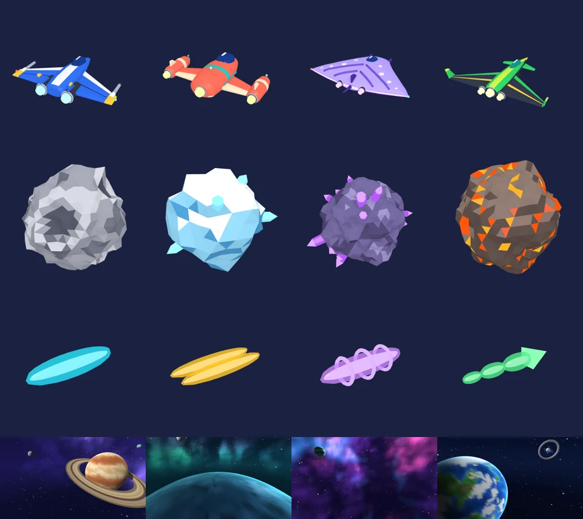

# Arte espacial do Construtor feita no Blender (27/11/2026)

Scripts que geram as peças 3D da **Patrulha Espacial** e, pelos mesmos modelos, a arte 2D da
**Nave Contra Asteroides**. São a base visual dos cursos 3D do Construtor: cada categoria tem
quatro variações, e a criança escolhe a que mais gosta no bloco **Criar o objeto … com o modelo …**
(o seletor do bloco mostra a miniatura de cada uma). Trocar a variação nunca muda o jogo.

Substituem os três GLBs provisórios de `docs/aulas-interativas/construtor/prototipos-base/3d/modelos/`
(primitivas exportadas do exemplo da galeria).



| Categoria | Peças (nome no seletor do bloco) | Caixa comum (`lib_espaco.CAIXAS`) | Tamanho no bloco |
|---|---|---|---|
| nave | `nave-falcao-azul`, `nave-exploradora-coral`, `nave-arraia-lilas`, `nave-cometa-verde` | x ±1,5 · frente ±1,15 · altura -0,34 a 0,46 | 3 |
| asteroide | `asteroide-rocha-lunar`, `asteroide-gelo-azul`, `asteroide-cristal-violeta`, `asteroide-lava-laranja` | cubo ±0,9 | 1,8 |
| laser | `laser-ciano`, `laser-dourado`, `laser-lilas`, `laser-verde` | x e altura ±0,14 · frente ±0,45 | 0,9 |
| cenário | `cenario-orbita`, `cenario-aurora`, `cenario-nebulosa`, `cenario-estacao` | cubo ±90 | 180 |

As três primeiras naves, asteroides, lasers e cenários têm os mesmos nomes das imagens da Nave
Contra Asteroides 2D: é a mesma nave nos dois cursos.

## O que cada peça é

- **Naves** (3,3 a 5,7 mil triângulos): Falcão Azul (caça de asas em flecha, dois motores ciano),
  Exploradora Coral (corpo redondo, cabine-bolha, cápsulas de motor nas pontas das asas), Arraia
  Lilás (asa voadora em forma de raia, manchas e faixas no dorso, fios rosa no bordo de fuga) e
  Cometa Verde (bico de agulha, canards, asas delta com pontas viradas, três motores). Todas com
  cabine de vidro e reflexo, chama acesa nos bocais e luzes de navegação (vermelha à esquerda,
  verde à direita).
- **Asteroides** (0,5 a 1,8 mil): rocha lunar com crateras, gelo facetado com geada e lascas,
  rocha escura com tufos de cristais violeta que brilham e basalto com rachaduras de lava acesa.
  Todos esticados até encher a caixa: o contato fica justo.
- **Lasers**: núcleo claro dentro de uma casca translúcida da cor do laser. Ciano (traço reto),
  dourado (tiro duplo), lilás (plasma com anéis) e verde (ponta de flecha).
- **Cenários** (sem luz, pintados por vértice): Órbita (gigante de faixas com anéis e duas luas),
  Aurora (noite de um planeta gelado com cortinas de aurora), Nebulosa (nuvens rosa, violeta e
  azuis) e Estação (planeta azul com terras e nuvens e uma estação de anel). Compostos para a
  câmera da Patrulha: a faixa onde a nave voa fica calma e escura.

## Preparar

O Blender roda sem tela pelo pacote `bpy` do PyPI:

```sh
uv venv --python 3.13 /tmp/claude-0/blender-venv
uv pip install --python /tmp/claude-0/blender-venv/bin/python bpy==5.3.0
```

## Gerar, conferir e publicar

```sh
cd docs/design/construtor-espaco-blender
ESPACO_OUT=./out /tmp/claude-0/blender-venv/bin/python -B build_all.py                 # as 16
ESPACO_OUT=./out /tmp/claude-0/blender-venv/bin/python -B build_all.py -- laser-verde  # só essa
node previa/previa.mjs out /tmp/previa giro nave-falcao-azul:3        # quatro vistas, luz do Jogo 3D
node previa/previa.mjs out /tmp/previa jogo cenario-orbita nave-falcao-azul asteroide-rocha-lunar laser-ciano
node previa/previa.mjs out /tmp/previa mini nave-falcao-azul:3        # miniatura (a da galeria/)
cd ../../..
ESPACO_OUT=docs/design/construtor-espaco-blender/out bun docs/aulas-interativas-tecnico/qa/publicar-construtor-modelos.ts
```

O publicador solda, deduplica e quantiza cada GLB (como a Ilha do Farol), grava o módulo na
biblioteca de modelos dos cursos (`packages/studio/src/core/course-models/`) e anota em
`modelos.json` o sha, a categoria, a caixa e o tamanho. O gerador da Patrulha lê só o
`modelos.json` e a biblioteca. `relatorio.json` é o que o `build_all.py` mediu (triângulos,
materiais, bytes, caixa).

⚠️ Depois que o curso sair, um modelo substituído CONTINUA na biblioteca: o projeto salvo de uma
criança aponta para o sha antigo. `--remover-antigos` no publicador só antes do lançamento.

## O contrato com o jogo

- No Blender, z é para cima e o **bico aponta para +Y**; o exportador converte para o y para cima
  do three.js e +Y vira **-Z**, a direção em que a nave voa e os tiros saem.
- `createModelFile` encaixa o LADO MAIOR no tamanho do bloco e centraliza a caixa no objeto. Cada
  peça leva dois marcos de 1 mm nos cantos da caixa da categoria (`caixa_da_categoria`): a caixa
  medida é igual nas quatro variações e a troca não muda tamanho, centro nem área de toque. O build
  falha se uma peça passar da caixa.
- A luz do Jogo 3D (ambiente 2,1 + sol 1,7 em (3, 5, 4), sem tone mapping) achata o
  sombreamento: a frente sai com 99% da cor e o lado da sombra com 83%. O desenho vem da cor dos
  materiais e da silhueta. Nada metálico (sem mapa de ambiente o metal fica preto). Partes que
  brilham têm a cor de base escura e a cor na **emissão**: base clara + emissão estoura para um
  amarelo pálido sem tone mapping.
- **Cenários**: material sem luz (`KHR_materials_unlit`, o nó Background do Blender) com a cor
  pintada por vértice (`Cor`); a peça leva `szSemCaixa` no nó (fora da área de toque) e
  `szSemSombra` + `szSemNevoa` no material. A névoa da Patrulha (30 a 75) esconde quem nasce longe;
  sem `szSemNevoa` o céu inteiro sumiria nela. Faces além da cúpula são recortadas (atrás da cúpula
  nada aparece) para a peça caber na caixa.
- O Jogo 3D não carrega Draco nem KTX2 (a política de segurança da prévia recusa WebAssembly); a
  quantização do publicador (`KHR_mesh_quantization`) não precisa de WebAssembly.
- A `previa/` reproduz o motor: mesma luz, mesmo `normalBias` da sombra, mesmo encaixe pelo lado
  maior, a câmera e a névoa da Patrulha. As cores são conferidas ali, não no Cycles.

| Arquivo | O quê |
|---|---|
| `lib_espaco.py` | paleta e materiais, formas (fuselagem por seções, corpo-lente, asa em faixas, deriva, pedra, superelipsoide), raio na superfície, caixa da categoria e exportação |
| `naves.py`, `asteroides.py`, `lasers.py`, `cenarios.py` | as peças de cada categoria |
| `build_all.py` | gera tudo, confere os tetos do carregador do Estúdio e grava `relatorio.json` |
| `previa/` | fotos na luz do Jogo 3D (Chromium + o three.js do Estúdio) |
| `galeria/` | miniaturas das 16 peças (caderno da aula e capas) |
| `modelos.json` | o que o publicador gravou na biblioteca (sha, categoria, caixa) |
