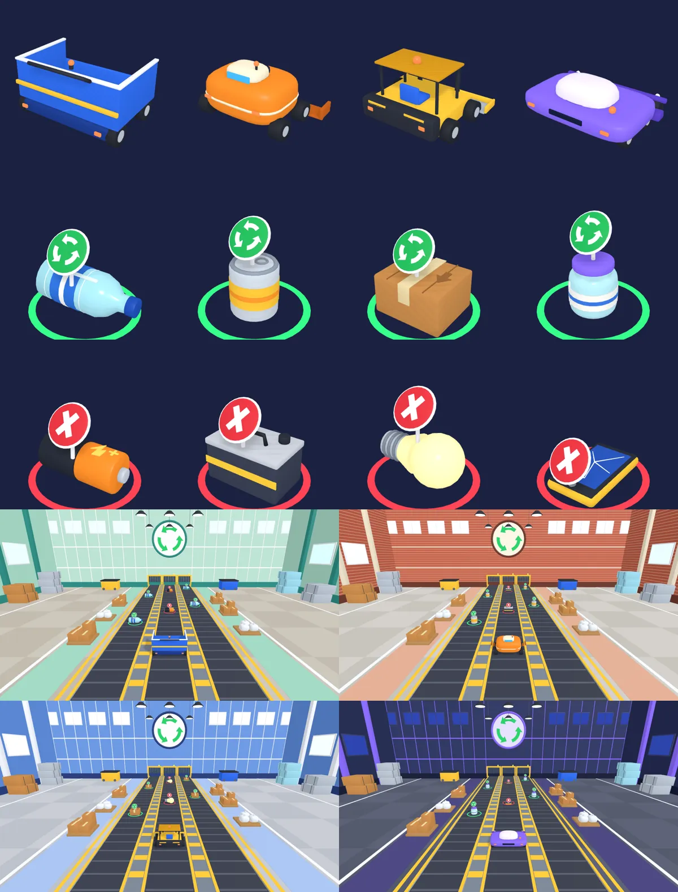

# Arte da Estação de Reciclagem feita no Blender (27/11/2026)

Scripts que geram as peças 3D da missão do Construtor, **A Estação de Reciclagem**, e, pelos
mesmos modelos, a arte 2D da missão (sprites em vetor projetados dos GLB; fundos que são os
próprios galpões vistos de cima, em WebP). Cada categoria tem quatro variações com a mesma caixa: a
criança escolhe a que mais gosta no bloco **Criar o objeto … com o modelo …** (3D) ou na imagem do
sprite (2D), e trocar a variação nunca muda o jogo.

Usa os ajudantes da arte espacial (`../construtor-espaco-blender/lib_espaco.py`: malhas, paleta,
caixa da categoria com os marcos de 1 mm, exportação) por `lib_estacao.py`, que acrescenta as
categorias da missão, as marcas da regra e algumas peças comuns.



| Categoria | Peças (nome no seletor) | Caixa (`lib_estacao`) | Tamanho no bloco |
| --- | --- | --- | --- |
| coletor | `coletor-carrinho-azul`, `coletor-robo-laranja`, `coletor-empilhadeira-amarela`, `coletor-aspirador-lilas` | x ±1,5 · frente ±1,1 · altura ±0,8 | 3 |
| reciclável | `reciclavel-garrafa-pet`, `reciclavel-lata`, `reciclavel-caixa-papelao`, `reciclavel-pote-vidro` | cubo ±0,75 | 1,8 |
| proibido | `proibido-pilha`, `proibido-bateria`, `proibido-lampada`, `proibido-celular` | cubo ±0,75 | 1,8 |
| galpão | `galpao-menta`, `galpao-tijolo`, `galpao-azul`, `galpao-noite` | cubo ±50 | 100 |

## A regra nas cores

O enunciado diz qual peça vale ponto e qual tira vida, e a arte repete isso em duas marcas que
aparecem nas duas câmeras (a do jogo 3D, de trás e de cima, e a vista de cima do 2D): o **aro
aceso** no pé da peça e o **selo redondo** inclinado para a câmera, espetado numa haste. Verde com o
símbolo de reciclar: vale ponto. Vermelho com o X: tira vida. O corpo das peças nunca é verde nem
vermelho, e os coletores também evitam essas duas cores. Os proibidos são objetos que de verdade
vão para o descarte especial (pilha, bateria, lâmpada e celular velho).

## O galpão e a partida

Um modelo só por galpão, com materiais de luz comum marcados `szSemSombra` (recebe as sombras do
coletor e das peças, não faz sombra) e o objeto `szSemCaixa` (não é área de toque). No referencial
do jogo: chão em y = 0; três esteiras com o topo em y = 0,6 e centros em x = −4, 0 e 4, de z = 9
até a parede do fundo (frente em z = −33), onde ficam as três bocas com cortina de tiras; as peças
nascem em z = −34, atrás da cortina. O coletor anda em z = 0, com o centro em y = 1,4; as peças
têm o centro em y = 1,5. A câmera é a da Patrulha: (0, 8, 12) olhando (0, 1, −12). As quatro
variações mudam as cores (paredes, pilares, calçada, janelas) e o tijolo ganha as linhas de
rejunte; a noite tem as luminárias mais fortes. Cerca de 22 mil triângulos e 42 materiais.

O fundo 2D é o mesmo galpão visto de cima por uma câmera ortográfica entre o chão e as luminárias:
a tela de 800 × 480 cobre x de −5,56 a 5,56 e z de −6,67 a 0 (72 px por metro), e as esteiras ficam
em x = 112, 400 e 688. O coletor encostado numa borda da tela fica embaixo da esteira daquele lado.

## Preparar

O Blender roda sem tela pelo pacote `bpy` do PyPI (o mesmo da arte espacial):

```sh
uv venv --python 3.13 /tmp/claude-0/blender-venv
uv pip install --python /tmp/claude-0/blender-venv/bin/python bpy==5.3.0
```

## Gerar, conferir e publicar

```sh
cd docs/design/construtor-estacao-blender
ESTACAO_OUT=./out /tmp/claude-0/blender-venv/bin/python -B build_all.py                  # as 16
ESTACAO_OUT=./out /tmp/claude-0/blender-venv/bin/python -B build_all.py -- galpao-noite  # só essa
node previa/previa.mjs out /tmp/previa giro coletor-robo-laranja:3        # quatro vistas, luz do Jogo 3D
node previa/previa.mjs out /tmp/previa mini reciclavel-lata:1.5           # miniatura
node previa/previa.mjs out /tmp/previa jogo galpao-menta coletor-carrinho-azul reciclavel-garrafa-pet proibido-pilha
node previa/previa.mjs out arte2d fundos2d galpao-menta galpao-tijolo galpao-azul galpao-noite && rm arte2d/*.png
ESTACAO_OUT=./out /tmp/claude-0/blender-venv/bin/python -B svg2d.py       # coletores e peças em vetor
cd ../../..
ESTACAO_OUT=docs/design/construtor-estacao-blender/out bun docs/aulas-interativas-tecnico/qa/publicar-estacao-modelos.ts
```

`build_all.py` confere a caixa de cada categoria e os tetos do carregador do Estúdio e grava
`relatorio.json`. A publicação otimiza cada GLB, grava o módulo da biblioteca de modelos dos cursos
e anota `modelos.json`; o gerador da missão lê só o `modelos.json`, a biblioteca e `arte2d/` (com o
`orcamento.json` do 2D embutido nos projetos, cerca de 80 KB em base64). ⚠️ Depois que o curso
sair, um modelo substituído continua na biblioteca (o projeto salvo de uma criança aponta para o sha
antigo); `--remover-antigos` só antes do lançamento.

`out/` (os GLB do Blender) fica fora do git.
