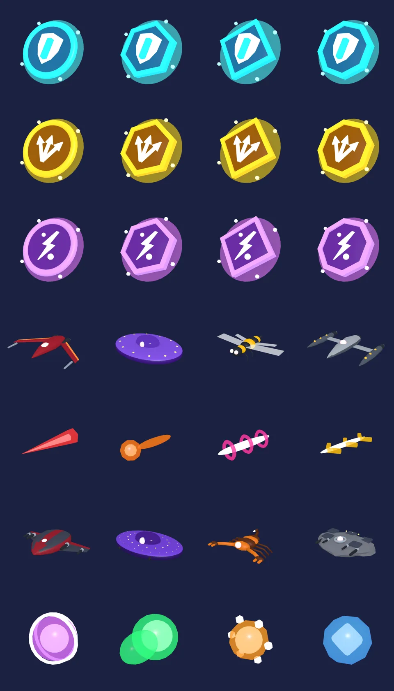
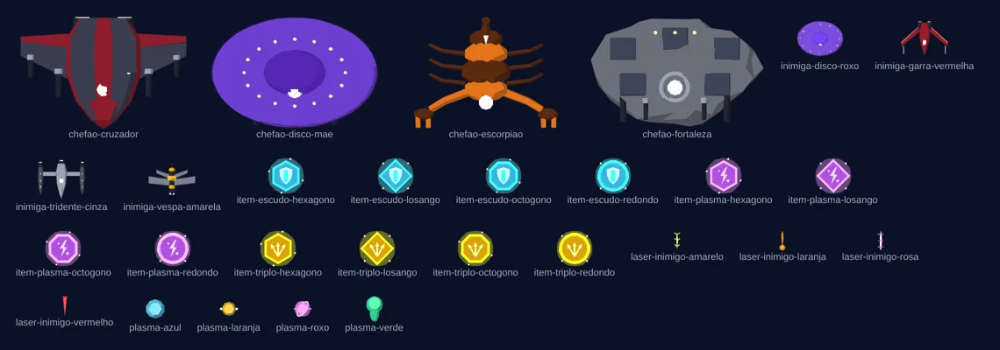

# Arte dos Poderes do Construtor feita no Blender (28/11/2026)

Scripts que geram as peças 3D dos cinco Poderes do posto Construtor (Escudo temporário, Tiro triplo,
Inimigo que atira, Chefão com resistência e Troca de arma) e, pelos mesmos modelos, a arte 2D
(sprites em vetor projetados dos GLB). Os Poderes acrescentam uma mecânica à Nave Contra Asteroides
(2D) e à Patrulha Espacial (3D), então os fundos, as naves da criança, os asteroides e os lasers
são os da arte espacial (`../construtor-espaco-blender`). Cada categoria tem quatro variações com a
mesma caixa: a criança escolhe a que mais gosta no bloco **Criar o objeto … com o modelo …** (3D) ou
na imagem do sprite (2D), e trocar a variação nunca muda o jogo.

`lib_poderes.py` usa os ajudantes de `../construtor-espaco-blender/lib_espaco.py` (malhas, paleta,
caixa da categoria com os marcos de 1 mm, exportação) e acrescenta as categorias, o giro das peças
inimigas e a ficha de pé dos itens.



| Categoria | Poder | Peças (nome no seletor) | Caixa (`lib_poderes`) | Tamanho no bloco | Sprite 2D |
| --- | --- | --- | --- | --- | --- |
| item-escudo | Escudo temporário | `item-escudo-redondo`, `-hexagono`, `-losango`, `-octogono` | cubo ±0,6 | 1,6 | 44 × 44 |
| item-triplo | Tiro triplo | `item-triplo-redondo`, `-hexagono`, `-losango`, `-octogono` | cubo ±0,6 | 1,6 | 44 × 44 |
| item-plasma | Troca de arma | `item-plasma-redondo`, `-hexagono`, `-losango`, `-octogono` | cubo ±0,6 | 1,6 | 44 × 44 |
| inimiga | Inimigo que atira | `inimiga-garra-vermelha`, `inimiga-disco-roxo`, `inimiga-vespa-amarela`, `inimiga-tridente-cinza` | x ±1,5 · frente ±1,15 · altura −0,34 a 0,46 | 3 | 56 × 52 |
| laser-inimigo | Inimigo que atira | `laser-inimigo-vermelho`, `-laranja`, `-rosa`, `-amarelo` | x e altura ±0,14 · frente ±0,45 | 0,9 | 10 × 26 |
| chefao | Chefão com resistência | `chefao-cruzador`, `chefao-disco-mae`, `chefao-escorpiao`, `chefao-fortaleza` | x ±3 · frente ±2 · altura −0,6 a 1 | 6 | 200 × 130 |
| plasma | Troca de arma | `plasma-roxo`, `plasma-verde`, `plasma-laranja`, `plasma-azul` | x e altura ±0,3 · frente ±0,4 | 0,8 | 24 × 32 |

## As regras do desenho

- **Itens:** uma ficha de pé, inclinada 50° para a câmera (legível de trás e de cima no 3D, de
  frente no 2D), com moldura, símbolo e um halo translúcido. A cor e o símbolo dizem o Poder:
  ciano com escudo, âmbar com três setas em leque e roxo com raio. As quatro molduras (redonda,
  hexágono, losango e octógono) são as variações.
- **Inimigos e chefões** vêm do fundo para a nave da criança: o bico aponta para −Y
  (`virar_para_a_nave`), e no 2D eles apontam para baixo. Os quatro chefões têm o núcleo aceso, o
  ponto fraco onde o laser acerta. As cores das inimigas evitam o ciano das naves da criança.
- **Tiros inimigos** (espinho, bola, anel e divisas) têm núcleo aceso e casca translúcida, como os
  lasers da criança, mas em cores quentes: no jogo, o tiro que desce nunca se confunde com o que sobe.
- **Plasma:** maior e mais redondo que o laser (anéis, cometa, estrela e cubo de energia), para a
  criança ver de longe que a arma mudou.



## Gerar, conferir e publicar

O Blender roda sem tela pelo pacote `bpy` do PyPI (o mesmo da arte espacial; ver o README dela).

```sh
cd docs/design/construtor-poderes-blender
PODERES_OUT=./out /tmp/claude-0/blender-venv/bin/python -B build_all.py                      # as 28
PODERES_OUT=./out /tmp/claude-0/blender-venv/bin/python -B build_all.py -- chefao-fortaleza  # só essa
node ../construtor-espaco-blender/previa/previa.mjs out /tmp/previa giro chefao-cruzador:6     # quatro vistas, luz do Jogo 3D
node ../construtor-espaco-blender/previa/previa.mjs out /tmp/previa mini item-escudo-redondo:1.2
PODERES_OUT=./out /tmp/claude-0/blender-venv/bin/python -B svg2d.py                          # os 28 sprites
cd ../../..
PODERES_OUT=docs/design/construtor-poderes-blender/out bun docs/aulas-interativas-tecnico/qa/publicar-poderes-modelos.ts
bunx --no-install biome format --write packages/studio/src/core/course-models/registry.generated.ts
```

`build_all.py` confere a caixa de cada categoria e os tetos do carregador do Estúdio e grava
`relatorio.json`. A publicação otimiza cada GLB, grava o módulo da biblioteca de modelos dos cursos
e anota `modelos.json`. Os geradores dos Poderes leem só o `modelos.json`, a biblioteca e `arte2d/`
(o `orcamento.json` registra o tamanho de cada sprite em base64; os 28 somam cerca de 65 KB, e cada
projeto embute só os do seu Poder). ⚠️ Depois que os cursos saírem, um modelo substituído continua
na biblioteca (o projeto salvo de uma criança aponta para o sha antigo); `--remover-antigos` só
antes do lançamento.

`out/` (os GLB do Blender) fica fora do git.
