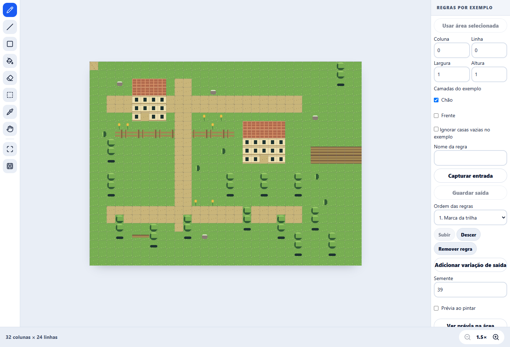

# Regras por exemplo na oficina do Pinta

A galeria privada em `mundo.pinta.json` contém a vila de 32 × 24 casas com duas camadas de peças, a folha capturada e dois exemplos editáveis. O primeiro tem duas variações de saída. A semente guardada é 39. A imagem mostra o painel Avançado depois de importar as regras e religar as duas camadas.



O teste abriu duas janelas reais do Chrome para o mesmo documento IndexedDB. Na primeira, Enter previu a pincelada e Escape cancelou. O clique no canvas seguido de Aplicar criou uma entrada de histórico contendo a casa do chão e a da frente. Desfazer e refazer mudaram ambas. A captura por exemplo, uma segunda saída, a nova ordem e a semente sobreviveram à recarga. Uma gravação concorrente falhou na segunda janela e o editor conservou a edição pendente.

A exportação pela interface produziu `mapa.pinta-regras.json`. A prova substituiu os IDs das camadas do arquivo e mostrou os dois seletores de religação. O botão de confirmação ficou desativado até a escolha de duas camadas distintas compatíveis com a folha. A reimportação passou pela mesma validação de SHA-256 da arte e da semântica dos índices.

A leitura histórica usa o código de um checkout anterior ao lote. Os leitores públicos 0–7 e o leitor regional 8 devolveram zero desenhos com aviso, e os dois sanitizadores recusaram o registro 9. Os testes das autoridades local, regional e causal comparam todos os registros antes e depois da tentativa de gravação de 9 e 99.

Para repetir a prova, inicie o Vite a partir de `packages/pinta` com `node node_modules/vite/bin/vite.js scripts/automapping-browser --config playground/vite.config.ts --host 127.0.0.1 --strictPort --port 5569`. Em outro terminal no mesmo diretório, rode os comandos abaixo com um Chrome instalado e Playwright para Python.

```sh
python scripts/automapping-browser/prove.py --out .cache/automapping/proof
bun scripts/automapping-browser/old-reader.ts CAMINHO_DO_CHECKOUT_ANTERIOR .cache/automapping/proof/mundo.pinta.json
bun test src/tiles/automapping/ src/components/editor/MapAutomappingPanel.test.tsx src/tiles/cellAccess.test.ts
```

Os cenários da suíte também exercitam capturas em chunks negativos, travas herdadas, prioridades e sobreposição parcial, ausência de cascata, seed, tetos de trabalho, alteração das peças e cópia conectada com portas por nome e ID. A ativação do escritor da galeria, da nuvem e da seleção pública de formatos continua sob responsabilidade da integração.
