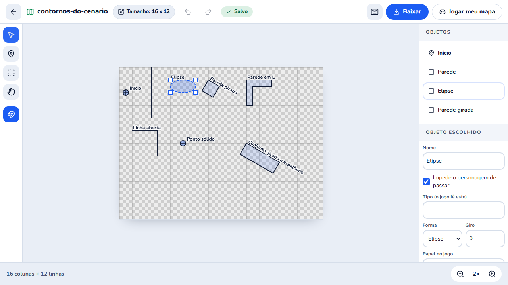

# Colisões autorais — provas locais

Este é um lote funcional da etapa 2b, com [contrato e guia](../../colisoes-autorais.md).
Não conclui a missão, não ativa o gravador de nuvem e não publica o runtime local.
Plataformas de mão única transformadas e homologação autenticada continuam no plano.

## Fluxos e contratos

| Verificação | Resultado |
| --- | --- |
| Pinta completo, com Pygame disponível | 2.106 testes, 23.516 asserções, 178 arquivos; nenhuma falha ou omissão |
| Core: formato de nuvem, imagem e geometria | 41 testes, 1.024 asserções em três arquivos |
| Estúdio: leitura/materialização, importação, sincronia, motores, variantes e blocos Python | 90 testes, 6.644 asserções em 11 arquivos; wrappers isolam suas suítes internas |
| BFF: publicação/revisão, leitores, privacidade e dados inválidos | 85 testes, 566 asserções; revisão pública anterior conservada nas recusas |
| Pinta/Phaser no navegador | Oito casos aprovados; desktop e toque emulado |
| Pinta–Estúdio pela interface real | 11 casos aprovados; JavaScript/Python, contornos, portas, versões, atualização, reabertura e falha transacional |
| Pygame nativo 2.5.7 e 2.5.8 | 16 consultas em PNG 1× e 2×, 16 no pacote portátil, movimento e cinco recusas antes de decodificar imagens |
| Godot 4.7.2 nativo, headless | 16 consultas e movimento contínuo contra parede fina |
| Tiled 1.12.2 nativo | TMX/TSX aberto e regravado como JSON; cena inteira igual, sem avisos e com os 16 resultados conservados |
| Tipos completos do Estúdio e member-shell | Comandos `tsc --noEmit --pretty false` concluídos com código 0 |
| Carga inicial da galeria | Build de produção e 29 asserções aprovados; limites anteriores preservados |

A prova do Tiled foi repetida com uma imagem associada à elipse de colisão.
O exportador agora separa o objeto geométrico autoral da imagem derivada: não
escreve `gid` junto de `ellipse`/`polygon`/`polyline`/`point`. A reimportação do
JSON regravado pelo Tiled recompõe a arte e o contorno no objeto único do Pinta.
O adaptador continua recusando arte cisalhada com relatório explícito.

A regressão offline confirmou a autoridade com capacidade/schema 7: uma gravação
posterior no espelho antigo conserva o documento novo e recupera a edição antiga
como cópia. O [leitor anterior congelado](leitor-anterior.json) recusa o formato 7;
forçar carimbo 6 demonstra a perda que aconteceria sem essa barreira. Apenas quatro
módulos leitores foram congelados; os demais helpers são atuais. Não é uma prova
de cliente implantado ou de autenticação.

O primeiro ensaio completo do Pinta encontrou dois contratos de teste desatualizados:
um fixava o máximo em 6; outro exigia auditoria do novo acesso GDScript às células.
O formato 7 foi fixado explicitamente e a física Godot passou a obter a máscara da
constante canônica, com seu acesso auditado. A repetição completa acima passou.

Os testes de publicação exercitam também PNG 4 sem sua cena: a recusa é 400, sem
trocar a publicação anterior. A preparação Python classifica a falha de dados
como erro de documento; a rota não a apresenta como falha de infraestrutura.
Fixtures de política não são usadas como prova de renderização.

Registros: [Pinta completo](pinta-completo.log), [Core](core.log),
[Estúdio](estudio.log), [publicação](publicacao.log), [recuperação offline](offline.log)
e [integração pela interface](integracao.log). Os relatórios do Tiled distinguem
o [mapa de contornos](tiled.json) do [objeto com imagem e elipse](tiled-arte.json).
O [teste do orçamento inicial](orcamento-inicial.log) executa o build da galeria;
a [checagem de estilo](estilo.log) verificou os 69 arquivos TypeScript alterados.

## Python/Wasm: artefato exato

Distribuição local `ae548eb7fe8a3cd6d5a06859f72d3a0798deed823806b9007899b4859c26da18`,
126 arquivos. O [descritor](distribuicao-python.json) declara os leitores de mundo
e de física. A aprovação/catálogo do servidor de QA é sintética e isolada: não
equivale a ativação em staging ou produção.

No primeiro ciclo com mapas físicos simples, os 15 testes passaram, incluindo os
dois tamanhos, portas da Vila, PyDew Valley e a galeria Pygame. O teste de carga
mediu 56,2 fps nessa rodada. O [registro](python-navegador.log) identifica a execução.

A fixture foi ampliada para um mundo PNG 4 cuja raiz usa cena 1 e cujo destino usa
cena 3. As duas escalas abriram o destino, executaram as 16 consultas, barraram o
movimento e voltaram à raiz pelo registro de portas, sem resolver texto como caminho
de arquivo. Os 14 testes funcionais passaram nesse ciclo ampliado; o teste de carga
falhou a 44,4 fps, abaixo do mínimo de 45. Os dados anteriores não foram apagados
nem apresentados como aprovação desta rodada.

Foram então feitas três repetições predefinidas do mesmo teste de carga, com o
mesmo artefato e sem alterar o limite: 47,5, 43,6 e 46,3 fps, duas aprovações e uma
falha. O benchmark usa Pygame diretamente, sem importar `pinta`; ele mede a carga
gráfica/transporte do runtime, não as consultas novas de colisão. A origem da
variação não está comprovada, e não se declara desempenho estável em hardware de
entrada. O fechamento de desempenho permanece na etapa 8.

Os registros do [mundo ampliado](python-mundo.log) e das
[três repetições](desempenho-repeticoes.log) conservam as falhas. As provas
[1×](python-mundo-1x.json) e [2×](python-mundo-2x.json) identificam o artefato
executado. O [inventário de evidências](verificacao.json) registra os hashes
dos arquivos e a falha de desempenho conhecida.

Uma distribuição anterior deste lote continha o código novo, mas não declarava
a capacidade no builder. O teste recusou a execução antes de carregar o jogo.
A declaração foi acrescentada ao builder e o artefato acima foi recompilado e
qualificado. Uma falha da fixture em 2× também foi corrigida: o teste privado
usava coordenadas 1× ao consultar o compositor já escalado; as consultas públicas
em 1×/2× já passavam. Não houve relaxamento da tolerância ou do teste de movimento.

## Orçamento e limites das provas

No Chrome, com CPU 4× mais lenta simulada, lotes de 16 consultas tiveram p95 de
2,3 ms no perfil desktop e 2,2 ms no perfil com toque, em 100 lotes. O personagem
Phaser parou em `x=28`, encostado na parede em `x=40` com corpo de 12 pixels.
Os [números do navegador](navegador.json) são de uma fixture pequena, não do pior
caso de centenas de conjuntos sobrepostos.

O [peso dos motores](peso-runtime.json) distingue motor com/sem cenário, gzip e
compilação no Bun. O leitor completo soma cerca de 23,6 mil caracteres ao motor;
os jogos sem cenário conservam o motor anterior e os tetos iniciais da galeria
não foram ampliados.

Não houve teste com crianças nem em outro aparelho físico. Toque e CPU reduzida
são simulações nesta máquina. Godot foi exercitado em headless para geometria;
essas consultas não comprovam uma inspeção visual de sua renderização. O ciclo
autenticado, o rollout/rollback, o desempenho máximo, templates/espalhamento e os
demais critérios da missão continuam discriminados no plano principal.
