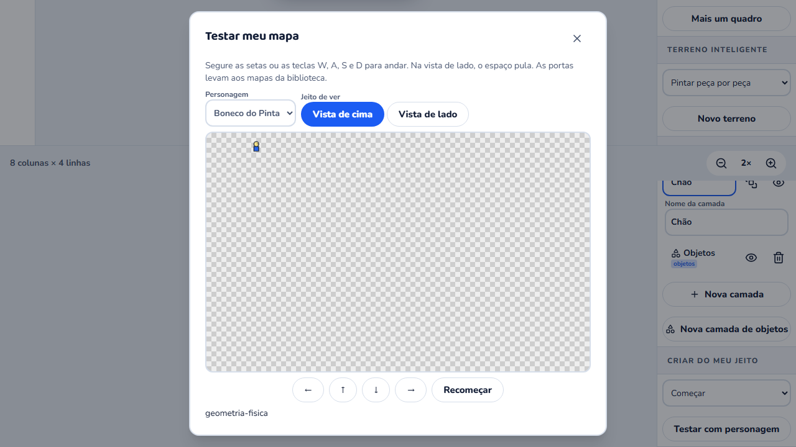

# Corpo inteiro no teste do mapa

O [ensaio antes da correção](editor-antes.log) reproduz dois defeitos: o corpo sobre
a parede era considerado livre, e o personagem atravessava até `x=59,168`, quando
deveria parar próximo de `x=35,2`. A fixture final usa o mesmo obstáculo depois do
ciclo nativo de backup/importação, com coordenadas inteiras. A peça estreita é
resultado da escala do conjunto, não de um campo novo inventado para o teste.

Nos ensaios reais de navegador, o mapa foi importado, fechado e reaberto. Segurar
o controle para a direita parou o boneco em `x=35`, medido pelos pixels azuis do
corpo. Desktop e toque emulado deram o mesmo resultado. A Vila também passou por
edição, desfazer/refazer, reabertura e movimento, nos dois modos de entrada.

## Verificações

| Ensaio | Resultado |
| --- | --- |
| [Pinta completo](pinta-completo.log), com Pygame 2.5.7 disponível | 2.093 testes, 23.426 asserções, 177 arquivos; nenhuma falha ou omissão |
| [Core](core.log), geometria e contrato dos leitores | 28 testes, 194 asserções |
| [Movimento do editor](editor.log), contido na suíte completa | 12 testes, 53 asserções |
| Tipos completos de Pinta e Core | Código de saída zero |
| [Navegador](navegador.log) | Quatro casos aprovados, desktop e toque emulado |
| Perfil de validação | Gerado e conferido; fingerprint em `verificacao.json` |

Os 19 casos de geometria verificam elipse analítica, polígono côncavo, polilinha
aberta, ponto, contato, formas degeneradas, reflexões, giros livres, escala desigual,
offsets fracionários e herdados, visibilidade e barreiras invisíveis. Células de
plataforma continuam distintas de sólidos. Os conjuntos não são recortados pelo
seu tamanho nominal quando camadas filhas possuem deslocamento.

O typecheck de Core encontrou uma inferência excessivamente ampla de `mime` num
teste do lote anterior; o literal foi fixado e os tipos completos passaram. O
[registro anterior](tipos-core-antes.log) e o [resultado final](tipos-core.log) estão
separados. Não houve alteração dos dados produzidos por esse teste.

A recompilação Python reproduziu exatamente a distribuição
`3d5d7d4ec2df4d03f374c9a5a70c264ff7bfc662ac9ee39823cff45d2cf6fdd2`, 126 arquivos,
já exercitada nos 13 casos documentados na integração dos leitores. Esta alteração
não muda aqueles bytes. O perfil da imagem de validação precisa acompanhar os
novos fontes Core; a geração local não comprova reconstrução ou implantação remota.

## Limites e integração

Este é o primeiro lote funcional da etapa 2b. A matemática de formas não equivale
a uma ferramenta autoral de colisão por objeto: campo versionado, controles,
motores JavaScript/Pygame e exportadores ainda precisam desse fechamento, descrito
em [geometria física](../../geometria-fisica.md). A física dos jogos já publicados
não foi substituída por esta correção no teste do editor.

Não se mede desempenho de outros aparelhos. O ensaio usa esta máquina, Chromium,
toque emulado e fixtures sintéticas; não é autenticação, aprovação infantil ou teste
em aparelho físico adicional. O custo de muitas instâncias sobrepostas ainda exige
as medições da etapa 8.

O Biome dos fontes deste lote passou. O comando global `bun run ci` falhou com 158
erros em outras áreas; o relatório não apresentou apontamentos em `packages/pinta`.
Não houve exclusão de verificações para obter sucesso. O CI remoto ainda bloqueia
a homologação autenticada do código novo.

Os [hashes e resultados](verificacao.json) correspondem à base anterior ao merge
do novo contrato 3D de staging; a integração e seus gates são registrados à parte.
