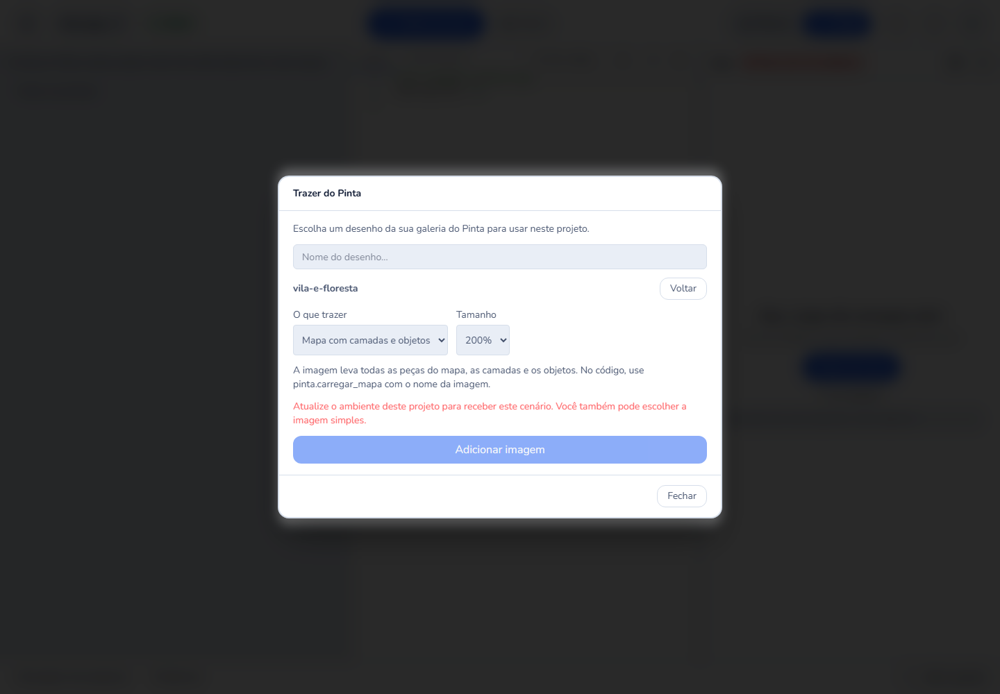

# Compatibilidade dos leitores de cenários

Lote da etapa 2a, em 19/11/2026, sobre staging `613404239`. Conserva componentes, classes,
cores e disposição do Pinta e do Estúdio. Provas de autoridade local usam apenas perfis
sintéticos; os ensaios de publicação usam serviços reais com repositórios em memória,
sem publicar conteúdo em uma conta ou aprovar um artefato de produção.

## Problemas reproduzidos

Uma receita `map` versão 1 pode produzir PNG com dados versão 2. Antes deste lote,
a receita sozinha não informava que o leitor Python completo era necessário. Um runtime
anterior podia ser carregado, e a atualização automática podia substituir o material por
dados que esse runtime não entendia.

O pacote web tinha outra fronteira: conferia a integridade da distribuição, mas permitia
empacotar um mapa que ela não sabia interpretar. O teste novo produziu um pacote onde
deveria haver recusa. A exportação desktop é diferente: inclui o `pinta.py` atual e deve
continuar disponível independentemente da publicação de um runtime na plataforma.

A publicação retirava corretamente a receita e a proveniência privadas, mas também perdia
a exigência do leitor antes de autorizar a revisão pública. Seis casos novos publicaram
com sucesso indevido antes da correção: dados 2/3 nos contextos livre, aula e oficina ao vivo.

## Contrato e preservação

- O produtor acrescenta `output.dataVersion` somente aos PNGs de dados 2/3. PNGs de dados 1
  mantêm o envelope anterior. O identificador e a versão da receita `map` não mudam.
- O contrato estrito recusa versões futuras e combinações incoerentes. A capacidade
  `pinta-map-world-v1` do manifesto confiável confirma o leitor de dados 2/3.
- Prévia, confirmação da importação e resultado final conferem o runtime exato no catálogo
  do host. A escolha de imagem simples já existente permanece disponível, por ação explícita.
- A sincronia conserva o PNG e a programação quando a nova derivação exige um leitor
  indisponível. Não achata o mapa automaticamente nem consome a recusa como uma atualização.
- Para projetos fechados, assets, metadados do runtime e cabeça de revisão vêm da mesma
  transação IndexedDB. A gravação usa o token dessa leitura e confere novamente o catálogo
  dentro da transação condicional. Uma troca de runtime concorrente muda a cabeça e impede
  a gravação baseada na revisão anterior.
- O pacote web confere o leitor no manifesto da distribuição efetivamente verificada,
  antes de baixar seus arquivos. A fonte desktop continua incluindo o leitor atual.
- A publicação captura no servidor a exigência do projeto privado validado, antes da
  projeção de privacidade. Confere-a contra a decisão de autorização de Members. O booleano
  interno não vem do formulário do navegador e não é enviado no projeto público.
- Publicações novas e atualizações recusadas conservam o projeto do autor e a revisão
  pública anterior. Receita, proveniência e referência à biblioteca pessoal continuam
  ausentes da publicação bem-sucedida; os bytes do PNG permanecem iguais.

Cópias históricas sem `dataVersion` conservam sua interpretação anterior. O leitor não
inventa esse campo nem regrava PNGs ao abrir um projeto. Uma nova derivação pelo produtor
atual passa a declarar a versão; sua importação/atualização exige a capacidade correspondente.
O mundo anterior sem o campo também é identificado pela receita explícita `map-world`.
Essa compatibilidade histórica não é uma declaração de que um runtime antigo entende PNG 2.

## Provas no navegador

O [leitor publicado](leitor-publicado.json) é compilado de um checkout instalado separadamente
e congelado em `f44648d9b2c63509f882ef8cb1ce8c66ee554c7d`. O ensaio compara captura atual,
mundo com receita nova e mapa avançado com receita antiga. A aba antiga carrega RAM antes
da atualização. Offline, recebe `ProjectWriteConflict` ao tentar salvar e recusa a nova
cópia; o cliente atual conserva PNG, versão dos dados e programa.

Há um controle adicional para o mapa avançado: ao retirar somente `dataVersion` de uma
cópia destacada, o leitor antigo a aceita como imagem opaca. Esse controle nunca grava
a cópia sem marcador. Assim o ensaio prova a função específica da nova proteção.

Os [oito ensaios de interface](interface.json) montam PintaClient, StudioEditor e o adapter
de member-shell reais. Incluem catálogo anterior sem autorização de execução, recusa de
dados avançados e escolha explícita da imagem simples, além do mundo Python, envio/importação
JavaScript, recursos privados, atualização de dependências e falha transacional.

As provas de renderização Python/Wasm permanecem separadas:
[qualificação real do navegador](../python-no-navegador/README.md).
Autenticação, ativação de catálogo, implantação gradual e aparelhos físicos adicionais
não são comprovados por estas fixtures locais.

## Verificação local

| Verificação | Resultado |
| --- | --- |
| [Pinta completo](pinta-completo.log), pygame-ce 2.5.7 disponível | 2.091 testes, 23.413 asserções, 176 arquivos; sem falhas ou omissões |
| [Estúdio](estudio.log): registro, importação, sincronia, leitura e pacote web | 30 testes, 187 asserções, seis arquivos |
| Casos contidos nos wrappers do Estúdio | Sincronia: 85 casos/402 asserções; importação: 55 casos/352 asserções |
| [Publicação](publicacao.log), com serviços Members e runtime de memória | 61 testes, 448 asserções; inclui novas publicações e atualizações |
| [Contrato Core](core.log) | Nove testes, 91 asserções |
| Tipos completos de Pinta, Estúdio e member-shell | Código de saída 0 nos três |
| Interface Chromium | Oito casos |
| Leitores congelados, instalações independentes | Três casos por baseline, sem falhas |
| Geradores da cena, fontes Python e perfil validador | Conferem com os fontes |

Os casos internos dos wrappers não são somados novamente ao total externo. Os logs de
reprodução anteriores à correção são preservados: [contrato](contrato-antes.log),
[pacote web](web-antes.log) e [publicação](publicacao-antes.log).

A recompilação com Bun 1.4.3 reproduziu os mesmos 125 arquivos da distribuição
`80825161b028772f53d1e132b25d8982028fd1b54fae02fe3492668f9a7ad999`, já exercitada nos 13
ensaios Python/Wasm. Este lote altera as fronteiras de autoria, exportação e publicação;
não troca os bytes daquele interpretador. O [registro de verificação](verificacao.json)
contém os hashes dos fontes e o novo fingerprint do validador confiável, que exige
reconstruir sua imagem. Nada neste relatório comprova essa implantação.

A integração de staging é registrada à parte após o commit do lote, sem incorporar
alterações em andamento da outra sessão.

## Integração com o staging de 19/11

O merge `f367afc68` incorpora `b2d77d8d3`, enviado pela sessão de Cenários 3D,
sem alterações manuais nos seus arquivos. Os 26 fontes do lote de leitores continuam
com os mesmos hashes; o perfil de validação foi regenerado para os contratos Core
resultantes. O fingerprint passa a
`e049128566613ce447fd7580dae5873701aa3a6d70b0eb95f40729230c543493`.

O empacotamento compartilhado agora inclui `raylib/cenario.py`, exigindo qualificar
uma distribuição diferente: `3d5d7d4ec2df4d03f374c9a5a70c264ff7bfc662ac9ee39823cff45d2cf6fdd2`,
126 arquivos. A [comparação dos manifestos](integracao/diferenca-distribuicao.json)
confere 123 arquivos iguais; mudaram o worker, sua representação gzip e o módulo
Raylib acrescentado. Os arquivos do Pygame continuam iguais.

Verificação posterior ao merge: tipos completos do Estúdio, 35 testes focados/223
asserções, 61 de publicação/448 asserções, dois fluxos de interface e geradores
aprovados. A suíte completa do Pinta e os leitores congelados documentados acima
correspondem aos mesmos fontes preservados, não foram contados como novas execuções.

No Python/Wasm, a [primeira execução](integracao/python-inicial.json) passou nos 12
casos funcionais e falhou no benchmark: 44,66 fps, mínimo 45. A [repetição completa](integracao/python-final.json)
passou nos 13 casos, com 45,9 fps. Foram mantidos teste, carga e limite. A oscilação e
a margem pequena ficam explícitas; esta máquina não comprova desempenho de outros
aparelhos nem dispensa a otimização da etapa 8. Vila, Cabana e PyDew foram renderizados
novamente, com pixels, portas, colisões, animação e propriedades no interpretador real.

Os [hashes e gates de integração](integracao/verificacao.json) distinguem as duas
execuções. Nenhum destes resultados ativa o catálogo remoto ou valida autenticação.
O CI remoto `44467116666` ainda recusou a fronteira de Arquipélago, um programa
JavaScript hostil que bloqueia o editor por 30 segundos e o perfil de validação
desatualizado do commit upstream. A regeneração neste lote corrige a última causa;
as demais não foram ocultadas, enfraquecidas ou tratadas como verificadas.
