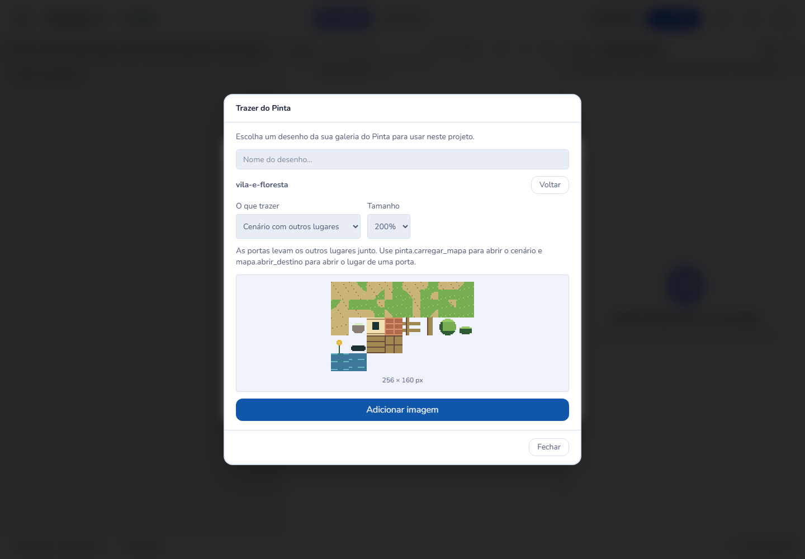

# Mapas ligados no Python/Pygame

Lote da etapa 2a, sobre staging `d25ab3981`, em 19/11/2026. Mantém os componentes, classes,
cores e disposição existentes. Não modifica arquivos do Molda. Conta autenticada e aparelhos
físicos adicionais não fazem parte destes ensaios locais.

## Contrato e decisões

- Seleção `map-world`: receita versão 2; PNG `pinta` versão 3. Receitas anteriores mantêm
  versão 1 e o mesmo identificador. O seletor conserva a escolha anterior ao revisar materiais.
- O PNG contém atlas/cena da raiz e os destinos como PNGs versão 2, sem mundos aninhados.
  O documento `.pinta.json` continua sendo a autoridade autoral. O Estúdio conserva a cena
  canônica na biblioteca e um único PNG derivado no projeto Python.
- O fechamento reutiliza `sceneMapClosure`, IDs e captura atômica por perfil. Uma edição
  somente no destino altera a proveniência e atualiza o material, preservando seu caminho,
  nome, identificador e programação. Criações alheias ficam fora do pacote.
- Orçamentos: 16 mapas, 225 documentos, 2.097.152 células nativas/expandidas; 4 MiB de PNGs
  de destinos e 4 MiB de cache codificado de recursos; 16 MiB de JSON acumulado descomprimido;
  4.096 por dimensão e 4.194.304 pixels por superfície; 16.777.216 pixels para atlas,
  recursos escalados e superfícies temporárias previstas. Cotas do projeto continuam valendo.
- O compositor tem buffers temporários para conjuntos, escala, espelho e giro. A revisão
  reproduziu a aceitação indevida de uma instância de 12.288 × 12.288. Produtor e leitor
  agora recusam dimensões, rotação expandida e soma dos buffers, antes de alocar essas
  superfícies. O limite é conservador e inclui objetos ocultos; não mede o RSS/heap total.
- O registro Python mantém PNGs e metadados, sem cache de superfícies de todos os destinos.
  `abrir_destino` devolve outro `Mapa`. O programa decide quando atravessar a porta e mover
  o personagem. Uma referência de porta não procura arquivos no disco.
- A capacidade `pinta-map-world-v1` pertence ao manifesto do runtime, não ao projeto editável.
  O seletor confere a versão fixada no catálogo do host; versões anteriores mantêm `map`.
  O registro de execução também recusa um mundo em um runtime anterior, inclusive se o
  material vinculado chegou por importação de projeto. Fonte e edição offline continuam disponíveis.

## Ensaios

O teste de compatibilidade compila o código atual e um checkout instalado separadamente,
congelado em `0218a11a330e8da93e70786afb3b0fe48370a562`. Ambos usam o IndexedDB real da mesma
origem, com namespace sintético. O leitor antigo abre o projeto antes da alteração. O atual
acrescenta o mundo; offline, a aba antiga recebe `ProjectWriteConflict` ao tentar gravar.
O leitor antigo também recusa abrir a receita nova. A leitura atual conserva PNG e programa.
Não são mocks do algoritmo de persistência.

A mesma prova foi repetida com outro checkout instalado separadamente, no commit
efetivamente publicado em staging: `f44648d9b2c63509f882ef8cb1ce8c66ee554c7d`. Seus módulos
não foram modificados. Os dois ensaios passaram também com esse leitor: recusa da receita
nova e conflito da aba com RAM antiga. Resultados: [leitor intermediário](compatibilidade-leitor-a.json)
e [leitor publicado](compatibilidade-publicado.json).

Outro ensaio usa a autoridade nativa real do Pinta e Canvas do Chromium. Confere envio do PNG
Python e da cena canônica com a Cabana; editar a Cabana altera ambos, sem mudar o SHA nativo
da raiz. Inspeção e exportação usam a mesma proveniência.

O ensaio de interface monta PintaClient, StudioEditor e o adapter de member-shell reais,
com um perfil sintético e API indisponível. Importa a Vila pela galeria, escolhe o mundo no
projeto Python, edita a Cabana em outra aba e verifica a atualização conservando o programa.
O ambiente de execução Python não é concedido por essa fixture: ela verifica autoria,
importação e sincronia; não simula uma execução autenticada bem-sucedida.



O Chromium prepara o snapshot Python e a exportação de fonte a partir do mesmo projeto.
Os PNGs resultantes têm exatamente os mesmos bytes. O módulo `pinta.py` dessa exportação
é executado pelo Python 3.13.17 com pygame-ce 2.5.7 (a versão fixada na exportação) e
2.5.8/SDL 2.32.10, driver dummy, nesta máquina.
Vila → Cabana → Vila passa em 1× e 2×: 18/2 camadas, 57 colisores na Vila, início escalado,
propriedades e quadros de água com pixels diferentes. A raiz original permanece utilizável.
Portas válidas e inválidas são exercitadas com leitura de arquivos bloqueada após a abertura.
Há 19 verificações de recusa/orçamento e quatro de resolução de destinos, incluindo colisão
entre ID da raiz e nome da Cabana: referência tipada prefere ID; texto legado prefere nome.

O PyDew Valley real passa por 60 quadros: 16 camadas, 349 colisores, 55 cores distintas. O
módulo anterior e suas 46 conferências de lógica pura também passam. A suíte completa do
Pinta e as verificações complementares são registradas nos logs deste diretório; os testes
nativos opcionais são executados à parte com `PYTHON` apontando para o venv com pygame-ce.

| Verificação | Resultado |
| --- | --- |
| Pinta completo, com `PYTHON` em pygame-ce 2.5.7 | 2.090 testes, 23.376 asserções, 176 arquivos, zero falhas ou omissões |
| Estúdio: importação, store, sincronia, materiais, carregamento e registro | 45 testes em oito arquivos; 53 casos isolados da janela de importação dentro do wrapper |
| Core: receitas/identidade e capacidades | 10 testes em dois arquivos e oito testes de capacidades, zero falhas |
| Interface Pinta/Estúdio, JavaScript e Python | Sete ensaios Chromium, zero falhas |
| Captura/compatibilidade por baseline histórico | Dois ensaios Chromium para cada baseline, zero falhas |
| Módulo exportado, pygame-ce 2.5.7 e 2.5.8 | Dois mundos por escala, 19 recusas/orçamentos e quatro verificações de resolução por execução |
| Adaptadores nativos, incluídos também na suíte completa | 18 testes, 5.231 asserções, zero falhas |

Os [logs do Pinta](pinta-completo.log), [Estúdio](estudio-testes.log),
[interface](navegador-integracao.log), [leitor publicado](leitor-publicado.log) e
[Pygame 2.5.7](pygame-mundo-257.log) registram os resultados. Os contadores de testes
complementares não são somados à suíte completa quando representam os mesmos casos.
Os [hashes do código verificado](codigo-verificado.json) identificam os arquivos do lote.

A revisão global encontrou 18 relatórios JSON anteriores do Pinta fora da formatação do
Biome. Foram reformatados e comparados por SHA do JSON desserializado: os valores ficaram
[idênticos](relatorios-preservados.json). Não foram reformatadas as referências de programas
das aulas protegidas: o teste delas exige a igualdade literal com o programa gerado.

## Reprodução

No checkout congelado separado, executar `bun install --frozen-lockfile`. Para o ensaio
com navegador, indicar `PINTA_STUDIO_BASELINE` com seu caminho absoluto; o harness confere
o commit exato e a ausência de alterações rastreadas. Depois, em `packages/studio`:

```powershell
node node_modules/@playwright/test/cli.js test --config playwright.pinta-world.config.ts
node node_modules/@playwright/test/cli.js test --config playwright.pinta-integration.config.ts
```

Para repetir contra a versão publicada, apontar `PINTA_STUDIO_BASELINE` ao checkout de
`f44648d9b2c63509f882ef8cb1ce8c66ee554c7d` e definir `PINTA_STUDIO_BASELINE_REVISION` com
esse hash. O harness admite somente os dois commits documentados.

O primeiro ensaio grava a fonte exportada em `.cache/pinta-world-proof-results/**/source`.
Executar o teste nativo usando essa pasta como último argumento:

```powershell
python -I scripts/python/test-pinta-world.py ../../.tmp/pinta-python-world-e2e <pasta-source-exportada>
python -I scripts/python/test-pinta-module.py
python -I scripts/python/test-pinta-module.py --sem-pygame
```

## Limites de comprovação

O CI de staging `44447868641`, no commit-base, falhou em `ci`, `arquipelago` e
`studio-e2e-chromium-2`. Não foi contornado nem usado como prova de rollout. O novo perfil
de validação e o novo `pinta.py` exigem rebuild/qualificação dos artefatos correspondentes;
push da aplicação não equivale à ativação de um runtime Python novo. A escrita de nuvem
do formato novo continua dependendo da etapa 0b. O ciclo autenticado, geometria física
completa, etapas 3–8 e homologação final permanecem no plano principal.
