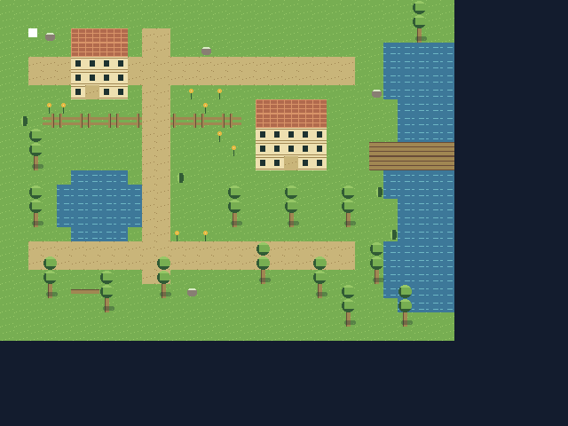
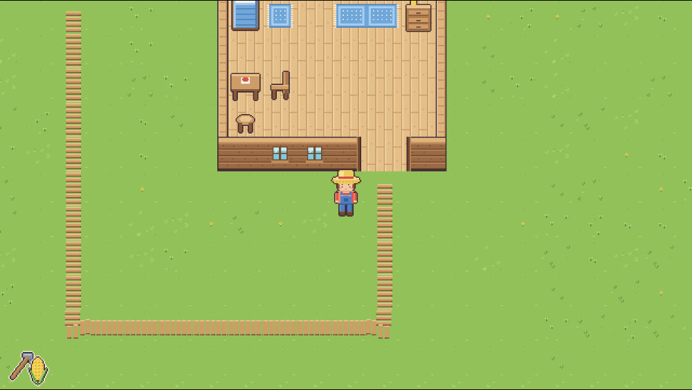

# Mundos do Pinta no Python do navegador

Qualificação local da etapa 2a, em 19/11/2026, nesta máquina Windows. Não é publicação
de um runtime nem homologação autenticada em staging. Não altera a interface do Pinta.

## Defeito reproduzido e correção

O primeiro ensaio real falhou em `Mapa.__init__` → `_imagem_em_memoria`:
`RuntimeError: can't access resource on platform`. O atlas era válido no pygame-ce nativo.
O mesmo PNG abriu por caminho no worker, mas falhou com `BytesIO`, inclusive com `namehint`.
O [registro da reprodução](reproducao-rwops.log) contém somente dados sintéticos.

A causa está no [RWops do pygame-ce 2.5.7](https://github.com/pygame-community/pygame-ce/blob/2.5.7/src_c/rwobject.c#L715-L757):
o ramo Emscripten resolve caminho ou atributo `name`; não usa os callbacks de arquivos Python
do ramo nativo. Acrescentar uma extensão ao nome não resolve essa diferença.

`_imagem_em_memoria` continua decodificando exatamente os bytes capturados. No Emscripten,
grava-os em um diretório temporário privado do MEMFS, usa um nome fixo interno e remove o
diretório ao terminar, inclusive quando SDL recusa o PNG. O mapa e o texto das portas não
escolhem esse caminho. O ramo nativo continua usando `BytesIO`. Artes embutidas passam pelo
mesmo adaptador; não há segundo decodificador nem cópia persistente no projeto.

Os testes nativos conferem igualdade de pixels, caminho absoluto interno, remoção após
sucesso e remoção após falha. O worker real também confere ausência de arquivos temporários
após abrir raiz/destino e após recusar uma imagem corrompida.

## Identificação e ensaios

O servidor existente verifica todos os arquivos e representações HTTP da distribuição antes
de abrir a porta. Os fornecedores permanecem fixados por SHA. A nova fixture usa o produtor
real `deriveLoadedPintaImage`, a cena autoral `vilaEFloresta` e o provider/worker de produção.
O programa Python de homologação controla as portas; esses comportamentos não foram
acrescentados ao editor de cenários.

Distribuição corrigida: `80825161b028772f53d1e132b25d8982028fd1b54fae02fe3492668f9a7ad999`.
Python 3.14.2, Pyodide 314.0.7, pygame-ce 2.5.7, SDL 2.32.10. Bun 1.4.3 foi instalado
somente em `.tmp/qa-bun-143`; a instalação global e o lockfile do projeto não mudaram.

Mundos 1× e 2× verificam 18 camadas, 57 colisores, propriedades, início escalado, pixels da
animação, render real no canvas e ida/volta com Enter: Vila → Cabana (duas camadas) → Vila.
Uma porta com caminho externo é recusada. A fixture é somente de qualificação local e não
concede autoridade ao catálogo de produção.

A [regressão inicial](regressao-inicial.log) passou pelos dois mundos, atualização parcial
de tela, nove jogos da galeria (incluindo PyDew Valley) e carga de renderização: 13 ensaios.
O teste de carga mediu 47,1 fps médios na parte estável, nesta máquina e sem emulação de CPU;
isso não representa outros aparelhos. O [ensaio final](navegador-final.log) também passou
nos 13 casos, em 36,8 s; nele a carga mediu 53,6 fps. A variação entre execuções reforça
o limite desta medição local.

| Verificação final | Resultado |
| --- | --- |
| Python/Pygame no Chrome 157.0.8103.79 | 13 casos, sem falhas ou omissões |
| Tipos do Estúdio completo | Código de saída 0 |
| Exportação desktop, contrato pygame e canvas SDL | 10 testes, 54 asserções |
| Geradores da cena e das fontes Python | Conferem com os fontes |
| pygame-ce nativo 2.5.7 e 2.5.8 | Mundos e módulo legado passam |

[Identificação e hashes](verificacao.json), [resultados](ensaios.json),
[manifesto da distribuição](distribuicao.json), [runtime 1×](runtime-1x.json) e
[runtime 2×](runtime-2x.json) registram as autoridades usadas. O fingerprint do container
validador permaneceu igual; este lote muda o artefato Python e sua exportação desktop.






Os [ensaios nativos 2.5.7](pygame-257.log) e [2.5.8](pygame-258.log) passaram em Python
3.13.17, driver dummy: duas escalas, 19 recusas/orçamentos, quatro casos de resolução de
destinos e duas conferências do adaptador de imagem. São evidências distintas do navegador.

## Reprodução

Na raiz, com Bun 1.4.3 no caminho do comando:

```powershell
bun packages/studio/scripts/build-python-runtime.ts
$env:PYTHON_PROBE_DISTRIBUTION_DIRECTORY = '<diretório devolvido pelo build>'
$env:PYTHON_PROBE_DISTRIBUTION_SHA256 = '<SHA devolvido pelo build>'
$env:PYTHON_PROBE_PORT = '5299'
bun experiments/studio-python-runtime/server.ts
```

Em outro terminal, em `packages/studio`:

```powershell
$env:PYTHON_PROBE_PORT = '5299'
$env:PYTHON_PROBE_OUTPUT_DIR = '.cache/pinta-python-browser-final'
node node_modules/@playwright/test/cli.js test --config=playwright.python-pygame.config.ts
```

Apenas esses comandos locais não publicam nem ativam uma release. O ciclo autenticado,
o rollout de leitores/gravadores e a compatibilidade com runtimes anteriores continuam sendo
critérios próprios do plano principal.
