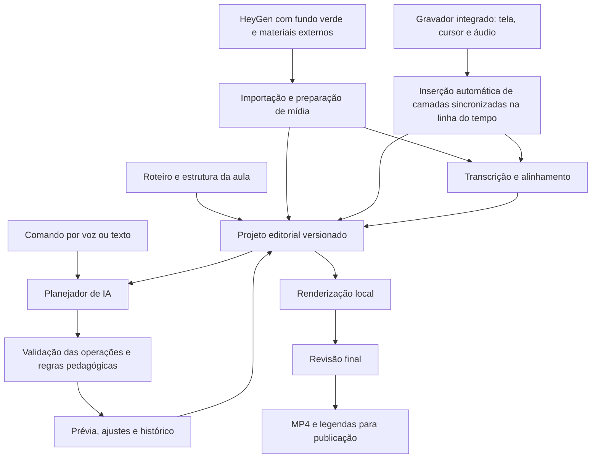

**Proposta de editor de aulas com IA para o Sistema Zero — 14 de outubro de 2026**

**Status em 14/10/2026: em standby por decisão do usuário.** O Sistema Zero continuará usando o Camtasia na produção das aulas, enquanto outras prioridades recebem atenção. A pesquisa e a proposta ficam preservadas para uma eventual retomada; nenhuma etapa de implementação foi iniciada.

Documento de pesquisa e proposta para decisão, revisado em 14/10/2026. As capacidades de terceiros abaixo foram verificadas em documentação pública; a arquitetura, os prazos e as metas são propostas, ainda sem validação em um protótipo. Não foram realizados testes com os arquivos audiovisuais reais das aulas. O [relatório de revisão](2026-10-14-editor-aulas-ia-revisao.md) registra lacunas encontradas, ajustes e provas ainda pendentes.

**Escopo confirmado pelo usuário:** o aplicativo deve substituir o Camtasia no fluxo de gravação e edição das aulas. A captura integrada é obrigatória: ao encerrar a gravação, tela, cursor editável e áudios habilitados entram automaticamente sincronizados na linha do tempo. Avatar do HeyGen, vídeos de ilustração e demais materiais de apoio são produzidos externamente e importados. Geração desses materiais e integração com a API do HeyGen ficam fora do escopo. A IA atua na organização, sincronização e edição dos materiais.

**Confirmação adicional:** o avatar chega com fundo verde, removido na edição. Chroma key, ajuste de bordas e redução do verde residual no personagem são requisitos obrigatórios da primeira versão operacional.

**1. Recomendação e problema que vamos resolver**

A arquitetura tem fundamentos técnicos para construir um editor especializado no fluxo do Sistema Zero: vídeos curtos, avatar do HeyGen, demonstração de atividades, programação em blocos, cursor destacado, zoom, balões, setas e exemplos visuais sincronizados com o roteiro. Superar o Camtasia nesse fluxo é a hipótese do produto; qualidade, desempenho e economia de tempo ainda precisam ser demonstrados. Uma substituição geral do Camtasia, cobrindo toda a variedade de formatos, efeitos e ambientes, seria um produto consideravelmente maior.

Recomendo desenvolver por etapas um gravador e editor próprio orientado ao roteiro, com processamento local, captura de tela e cursor separados e uma camada de comandos de IA. Após os ensaios de escolha de tecnologia em M0, a primeira demonstração integrada, M1, deve começar pela captura própria chegando à linha do tempo com o cursor editável; em seguida, os marcos posteriores completam a edição e o piloto. A decisão de expandir vem da redução medida do trabalho de edição e da conservação da qualidade pedagógica. Uma ferramenta que apenas edite gravações feitas em outro programa não atende à substituição solicitada.

O objetivo comercial é liberar aulas mais rápido. Economizar licenças é um benefício secundário: construir e manter software custa mais que uma licença individual. O diferencial defensável é conhecer as aulas, os personagens, os projetos e as ações do Sistema Zero.

**2. Dimensionamento com os dados informados**

O usuário informou vídeos de 1 a 4 minutos, média aproximada de 3 minutos; cerca de 3 horas de edição por vídeo; pelo menos 10 vídeos por semana. A produção inclui avatar do HeyGen com áudio, gravação de tela no Camtasia, edição do movimento do mouse e elementos de explicação visual.

Isso representa aproximadamente 30 horas semanais de edição para 30 minutos de vídeo final. Usando 52 semanas divididas por 12 meses, o volume médio é 43,3 vídeos e 130 horas de edição por mês. É uma anualização da rotina informada, não uma medição que considere férias ou sazonalidade.

| Cenário | Trabalho por vídeo | Horas liberadas por semana | Horas liberadas por mês |
| --- | ---: | ---: | ---: |
| Situação atual | 180 min | — | — |
| Redução de 50% | 90 min | 15 h | 65 h |
| Redução de 70% | 54 min | 21 h | 91 h |
| Redução de 80% | 36 min | 24 h | 104 h |

Metas propostas: comprovar pelo menos 50% de redução no piloto, preservando a qualidade, e buscar 70–80% após amadurecer os modelos de aula. Esses modelos são configurações e regras editoriais aprovadas, sem pressupor treinamento de um modelo de IA próprio. Os percentuais não são uma previsão garantida. O benefício inicial pode ser capacidade liberada do fundador/editor, sem redução imediata de desembolso.

As três horas são uma estimativa informada, ainda sem cronometragem por tarefa. Antes de projetar o retorno, medir o tempo de sincronização, cortes, chroma key, efeitos, revisão e exportação. A geração externa dos materiais fica fora da comparação em ambos os processos. Qualquer tempo adicional de preparação ou gravação exigido pelo novo fluxo entra na conta: transferir trabalho para antes da edição não representa economia líquida.

**3. O que a pesquisa de mercado muda na decisão**

O Camtasia continua sendo uma referência relevante justamente nos recursos usados aqui: captura, ampliação e edição do cursor, zoom e anotações. A TechSmith também já oferece edição por transcrição e recursos de IA; portanto, o concorrente a superar é o produto atual. Há inclusive um plugin para ChatGPT que transforma capturas de tela em um storyboard e vídeo editável. Esse fluxo documentado é diferente de sincronizar uma gravação dinâmica de programação com um avatar já produzido. [Recursos do Camtasia](https://www.techsmith.com/camtasia/features/), [plugin para ChatGPT](https://support.techsmith.com/hc/en-us/articles/45974433690637-Camtasia-Plugin-for-ChatGPT).

O Descript merece um teste antes de construir: oferece Underlord, API e MCP para solicitar importações e edições por instrução. A página informa acesso à API para assinantes pagos, com consumo dos minutos e créditos do próprio Descript. Isso não elimina seu custo ao conectar Claude ou Codex. A documentação ainda classifica a API como beta e distingue publicação com URL de MP4 de exportação local direta. Sua adequação a cursor separado, gestos de programação e sincronização pedagógica precisa ser demonstrada. [API do Descript](https://www.descript.com/api), [limitações documentadas](https://help.descript.com/hc/en-us/articles/43370311322509-Descript-Zapier-Integration).

Com o escopo confirmado, ferramentas prontas só são candidatas à substituição completa se também comprovarem captura integrada, inserção automática na linha do tempo e cursor separado editável. As demais continuam úteis como referências de edição por IA, sem cumprir sozinhas o requisito do produto.

| Caminho | Vantagem | Limitação para o Sistema Zero | Decisão proposta |
| --- | --- | --- | --- |
| Ferramenta pronta + templates e automações | Ganho mais rápido, menor investimento inicial | Pode continuar exigindo ajuste manual de tela, avatar e cursor | Usar como comparação no piloto |
| Editor próprio especializado, aproveitando componentes existentes | Conhece roteiro, eventos do Sistema Zero e padrões didáticos | Exige engenharia de mídia, captura e manutenção | Caminho recomendado se o piloto comprovar retorno |
| Produto com equivalência geral ao Camtasia | Controle amplo de recursos e distribuição | Escopo e custo muito maiores; concorre com o trabalho pedagógico | Não é a primeira etapa proposta |

Kdenlive é uma alternativa madura para edição, baseada em MLT, e pode ser uma opção para avaliar um assistente externo. Adaptar profundamente sua interface implica outra base tecnológica e obrigações de licença na distribuição. OpenCut merece acompanhamento, mas seu repositório principal informa uma reescrita do núcleo e aponta a versão clássica: funcionalidades de roadmap não devem sustentar o prazo do Sistema Zero. [Kdenlive](https://docs.kdenlive.org/en/getting_started/introduction.html), [OpenCut](https://github.com/OpenCut-app/OpenCut).

A revisão acrescentou o Cap como referência prioritária de captura. Seu Studio Mode documenta gravação local, edição posterior e controles baseados em metadados do cursor. Isso é mais próximo do requisito de captura do que avaliar apenas editores de vídeo. Ainda falta comprovar composição de avatar com chroma key, anotações e montagem arbitrária das aulas. Não houve teste do Cap nesta pesquisa. [Studio Mode do Cap](https://cap.so/docs/recording/studio-mode).

Reaproveitar o código do Cap exige escolher os componentes: a licença consultada identifica as famílias cap-camera* e scap-* como MIT e o restante, salvo componentes de terceiros, como AGPLv3. Portanto, captura, editor completo e serviço hospedado não podem ser tratados como um pacote uniformemente permissivo. A decisão depende da distribuição pretendida e da licença de cada dependência. [Licença do Cap](https://github.com/CapSoftware/Cap/blob/main/LICENSE).

**4. A ideia do produto: o roteiro passa a organizar a montagem**

Nome provisório para discussão: Zero Vídeo. A interface teria a aula dividida em cenas e passos, com o roteiro ao lado, uma prévia central, biblioteca visual e linha do tempo para ajuste fino. O editor continuaria podendo arrastar, cortar, corrigir um zoom e mudar uma seta manualmente.

Cada cena ligaria cinco referências: trecho da fala realmente gravada; intenção descrita no roteiro; ação observada na tela; alvo visual; recursos de apoio. O vínculo seria semântico — por exemplo, “quando a professora disser Ligar a reação ao toque” — e depois resolvido em tempos exatos. Assim, cortar um trecho anterior não deixaria as setas deslocadas.

O fluxo proposto seria:

1. Selecionar aula e parte; importar roteiro, vídeo do HeyGen e materiais de apoio já produzidos externamente.
2. Clicar em Gravar tela no próprio aplicativo, escolher a fonte de captura e os áudios desejados e realizar a demonstração.
3. Ao parar, receber a gravação automaticamente na biblioteca do projeto e na linha do tempo, com tela, cursor e áudio sincronizados e editáveis.
4. Identificar a fala real, os passos, as ações e os materiais disponíveis e preparar a primeira montagem com o padrão visual da aula.
5. Mostrar as ambiguidades relevantes: ação ausente, frase diferente, alvo não identificado ou tempo insuficiente.
6. Refinar por voz, texto ou controles visuais, com prévia e desfazer.
7. Revisar o vídeo final e publicar na parte correta da aula.

Importar gravações antigas continua possível, com as limitações dos dados disponíveis em cada arquivo. Essa compatibilidade é complementar ao gravador integrado.

Exemplo de comando: “Sincronize esta parte com o roteiro. Quando ela falar do bloco, aproxime a tela, aumente o mouse e mostre uma seta. Preserve o arrasto completo. Tire o avatar durante a demonstração se ele cobrir o campo.”

O sistema deveria devolver ações concretas e uma prévia. “Deixe melhor” pode produzir sugestões; comandos específicos devem resultar em mudanças reproduzíveis. Aprovar um conjunto de alterações deve ser simples, sem exigir confirmação de cada corte.

“Aqui”, “esse bloco” e “depois dessa fala” devem ser resolvidos usando a seleção atual, o quadro em exibição e a cena ativa. Se houver duas ocorrências possíveis, mostrar os trechos para escolher. O padrão é atuar na parte selecionada; uma edição em toda a aula exige intenção explícita no comando. Um comando gera um grupo identificável de alterações, que pode ser desfeito por inteiro.

**5. Como sincronizar HeyGen, roteiro e tela**

Essa é a principal capacidade a provar. Um roteiro informa o que deveria acontecer, mas não fornece sozinho os tempos reais nem comprova que a demonstração foi gravada corretamente.

| Informação | Como obter | Para que serve |
| --- | --- | --- |
| Fala efetiva e tempos das palavras | Transcrição e alinhamento do áudio do HeyGen | Localizar as frases que acionam a edição |
| Intenção da cena | Roteiro estruturado | Distinguir explicação, demonstração, teste e tempo de observar |
| Movimento e cliques | Captura própria do cursor | Preservar o gesto e destacar o alvo |
| Alterações do programa | Eventos do Sistema Zero | Reconhecer criar, arrastar, conectar e alterar blocos |
| Estado visual | Quadros selecionados, texto da tela e regiões | Conferir alvo, resultado e oclusões |

A transcrição deve ser confrontada com o roteiro, sem substituir automaticamente uma palavra falada por outra que só aparece no texto. Vocabulário próprio — Debinha, Zappy e nomes dos blocos — entra em um glossário. As instruções “Na tela” e os textos internos de orientação não viram fala ou legenda por acidente.

O roteiro importado precisa ser convertido para um modelo editorial explícito: identificador da cena, fala, locutor, ação esperada, alvo, materiais e intervalos protegidos. Essa conversão é revisável. Tempos de transcrição são estimativas: o limite de uma palavra deve ser conferido no áudio antes de um corte fino, especialmente em nomes próprios e falas rápidas. Uma frase repetida é identificada também pela cena e pela ocorrência, não apenas pelo texto.

A sincronização trabalha por trechos com limites e ordem conhecidos. A narração orienta a duração, enquanto gestos e resultados impõem restrições que ela não pode apagar. A IA propõe associações; o motor resolve tempos e verifica dependências. A primeira versão usa marcadores de passos, seleção humana e reconhecimento assistido. Entendimento visual irrestrito de qualquer gravação permanece uma evolução condicionada a avaliações.

O alinhamento preservaria ordem e dependências. “Arraste o bloco para cá” precisa mostrar o destino, o início do movimento e a conexão. A edição pode remover uma espera anterior, segurar uma tela estática ou deslocar a cena. Não deve acelerar arbitrariamente o gesto para fazê-lo caber na locução.

Se a explicação durar mais que a ação, manter o estado correto visível pode resolver. Se a ação precisar de mais tempo, inserir uma pausa natural entre falas ou apontar a necessidade de uma nova versão daquele trecho do avatar são opções. Nesse segundo caso, o usuário produz a correção externamente e substitui o arquivo importado. Em jogo ou animação contínua, congelar um quadro pode prejudicar a demonstração e deve ser tratado separadamente. O vídeo e o áudio do avatar permanecem vinculados para conservar a sincronia labial.

Uma pausa inserida entre falas pode usar apenas a tela demonstrada, ocultando temporariamente o avatar. Não congelar automaticamente o rosto em uma posição de fala nem esticar a locução para preencher espaço. O ponto de retorno do avatar e a transição precisam de prévia. Alterar a velocidade da narração ou retirar passos protegidos exige uma decisão editorial explícita.

O motor precisa aceitar que alguns casos não têm solução automática satisfatória. Se falta o clique ou foi demonstrado o bloco errado, a solução é localizar o problema e pedir uma pequena regravação, indicando exatamente o trecho. Inventar uma ação visual ou ocultar o erro criaria uma aula incorreta.

Para novas gravações, proponho um modo guiado: reproduzir a narração do HeyGen em fones, mostrar o passo atual e permitir repetir apenas aquele passo. A gravação guarda marcadores de cena. Isso tende a reduzir a divergência antes da edição; a eficácia precisa ser medida. O áudio da narração reproduzida não pode ser capturado novamente e duplicado na mixagem.

Fones reduzem vazamento acústico no microfone, mas não impedem que a captura do áudio do sistema grave a própria narração. O modo guiado deve excluir a reprodução do editor da captura, ou gravar sem áudio do sistema quando ele não for necessário. Se for necessário preservar o som do jogo, validar a seleção/exclusão de processos no Windows utilizado. A Microsoft documenta captura por processo e exclusão de árvore de processos, com requisitos de versão que precisam ser conferidos. [Captura de áudio por processo](https://learn.microsoft.com/en-us/samples/microsoft/windows-classic-samples/applicationloopbackaudio-sample/).

**6. O diferencial que o próprio repositório permite**

O Sistema Zero já possui conteúdo mais estruturado do que um roteiro livre. A documentação distingue falas, indicações visuais, inserções de personagens e pontos de corte. O contrato de autoria contém vídeos planejados por bloco da aula. Isso oferece referências para montar e publicar cada parte sem reconstruir sua organização.

Há também eventos de Blockly no editor educacional: o código já trata começo e fim de arrasto e alterações de blocos. Minha proposta é adicionar, em um modo de gravação para adultos, um registro editorial desses eventos, com o alvo, sua posição e o relógio da captura. Essa instrumentação ainda precisa ser construída; os eventos existentes não constituem um gravador pronto. [Autoria de aulas](../../packages/core/src/learning/authoring.ts), [eventos do editor](../../packages/studio/src/components/blocks/BlocklyPanel.tsx).

Em vez de a IA precisar deduzir visualmente que um bloco foi conectado, ela pode receber esse fato do aplicativo e conferir a imagem. Isso ajuda a posicionar zoom e balão, preservar o arrasto e sinalizar quando o resultado esperado não apareceu.

O registro deve ser restrito à sessão editorial, com identificadores persistidos próprios da gravação; IDs efêmeros de blocos e coordenadas de tela isoladas são insuficientes. Jogos em canvas e ferramentas externas exigirão adaptações específicas ou análise visual. Não há motivo para registrar sessões dos alunos para produzir essas aulas.

Essa instrumentação é uma melhoria opcional de precisão. O gravador e o editor devem funcionar também sem eventos do Blockly, usando cursor, marcadores e ajustes manuais. Quando ativada, a coleta precisa de sessão identificada, associação de relógios entre navegador e gravador, posições dos alvos e indicação de lacunas. Eventos ausentes ou atrasados não podem deslocar a gravação silenciosamente. Começar com três eventos úteis ao piloto, em vez de instrumentar toda a plataforma.

**7. Gravação integrada e cursor editável: requisitos obrigatórios**

Pela rotina informada, o cursor não pode ficar para uma fase distante. A nova captura precisa guardar a tela sem o cursor embutido e uma trilha separada de posições, cliques, estados de arrasto, aparência e ponto ativo do ponteiro. Tela e eventos precisam compartilhar uma referência de tempo.

No projeto proposto, a camada de cursor seria representada por esses dados e pela imagem do ponteiro, redesenhado durante a prévia e a exportação. Ela não precisa ser um segundo vídeo rasterizado. Essa representação permite modificar tamanho, aparência e trajetória com precisão. Trata-se da arquitetura proposta para nosso aplicativo, sem pressupor como o formato interno do Camtasia implementa cada detalhe.

O fluxo do gravador precisa cobrir seleção da tela ou janela, início, pausa, retomada e encerramento. A área de captura e suas transformações devem ficar registradas. Os controles de pausa precisam afetar de forma coerente o relógio de vídeo, cursor e áudio, evitando deslocamento após retomar.

Os dados são gravados durante a captura em fragmentos recuperáveis e metadados persistidos, não somente ao apertar Parar. A finalização consolida os arquivos e publica a gravação no projeto. Estados explícitos — gravando, pausado, finalizando, pronto e recuperável — evitam apresentar como pronta uma captura ainda incompleta. O desenho inicial busca limitar uma perda por interrupção ao fragmento em andamento; tamanho e recuperação serão verificados no protótipo.

Ao encerrar, o aplicativo salva os originais e cria um grupo de gravação na posição de inserção da linha do tempo. Esse grupo contém:

- Tela: o vídeo capturado sem o cursor incorporado.
- Cursor: posições, aparência, cliques e arrastos sincronizados com a captura.
- Áudio: trilhas de sistema e microfone, quando habilitadas, com referências de sincronização.

O grupo pode ser expandido para ajustar as camadas. Por padrão, cortes, deslocamentos e mudanças de duração permanecem vinculados entre elas. Ajustar tamanho ou trajetória do cursor não altera o vídeo original. Salvar e reabrir o projeto deve preservar essa capacidade; nenhum passo de exportar e importar manualmente pode ser necessário para começar a editar uma nova gravação.

O Windows fornece APIs de captura que permitem excluir o cursor e expõem tempos de quadro utilizáveis para sincronização. Elas são uma base técnica; não entregam prontas a trilha editável, a gravação de áudio, a correção de escala de monitores ou a recuperação de falhas. [Controle da captura do cursor](https://learn.microsoft.com/en-us/uwp/api/windows.graphics.capture.graphicscapturesession.iscursorcaptureenabled), [captura e relógio dos quadros](https://learn.microsoft.com/en-us/windows/uwp/audio-video-camera/screen-capture).

A coleta precisa registrar visibilidade, imagem, ponto ativo e posição do cursor, além dos cliques. Coordenadas de desktop, janela, área capturada e vídeo precisam de transformações explícitas, inclusive com monitores em escalas diferentes. A informação global de cursor do Windows oferece estado, identificador e posição na tela; isso é diferente de obter uma trilha já pronta para edição. [CURSORINFO](https://learn.microsoft.com/en-us/windows/win32/api/winuser/ns-winuser-cursorinfo).

Caso particular a testar: um jogo pode desenhar seu próprio ponteiro dentro do canvas. Esse desenho faz parte da imagem da aplicação e não deve ser presumido removível pelo controle do cursor do sistema. Para aplicações do Sistema Zero, pode haver modo de gravação que suprima esse desenho e forneça seus dados; para conteúdo externo, identificar a limitação. É proibido renderizar um segundo cursor por cima sem detectar o conflito.

No editor, seriam possíveis tamanho, cor, destaque de clique, suavização do caminho e zoom acompanhando a região importante. A transformação aplicada à tela deve ser a mesma aplicada ao cursor e às anotações. Suavização não pode deslocar o clique nem alterar o ponto onde um bloco foi solto.

Suavização, alteração de trajetória e destaque visual são propriedades distintas. O modo inicial preserva os pontos de clique, início e fim de arrasto e a relação com o objeto arrastado. Uma alteração manual do caminho deve indicar esses pontos protegidos; mudar a trajetória do ponteiro não muda a ação que já está gravada na tela. O grupo da tela recebe zoom; avatar e legendas podem permanecer fixos no quadro final.

Uma gravação MP4 com o mouse já desenhado não recupera automaticamente esse nível de edição. É possível acrescentar destaques, mas apagar e reconstruir o cursor pode deixar artefatos. TREC é um formato próprio do Camtasia; a documentação informa edição no Camtasia Editor. Não proponho depender de importação fiel de TREC ou de conversão integral de projetos. [Arquivos TREC e TSCPROJ](https://support.techsmith.com/hc/en-us/articles/203730028-Working-with-Camtasia-Editor-TSCPROJ-and-TREC-Files).

A primeira demonstração do produto deve gravar pelo próprio aplicativo e editar a camada de cursor já na linha do tempo. Deve incluir escala de 125–150%, mudança de janela, pausa e retomada, continuidade do movimento e reabertura do projeto. Materiais antigos podem ajudar na avaliação de montagem, mas a substituição não pode ser aprovada com base apenas em arquivos capturados pelo Camtasia.

**8. Recursos previstos e prioridade**

“Primeira versão” abaixo significa a versão operacional após os protótipos, não a primeira semana de trabalho.

| Recurso usado ou necessário | Primeira versão operacional | Evolução posterior |
| --- | --- | --- |
| Captura de tela e cursor | Windows, uma fonte, cursor separado, relógio comum e inserção automática na linha do tempo | Mais fontes, sistemas e configurações |
| Cortes e montagem | Dividir, aparar, mover, duplicar, agrupar, fechar espaços, cortes por frase e desfazer | Montagens mais complexas e múltiplas variantes |
| HeyGen e fundo verde | Importar, remover fundo por chroma key, corrigir bordas e verde residual, manter vínculo labial | Substituir uma versão importada e realinhar as cenas afetadas |
| Roteiro | Cenas, falas, ações, alvos e intervalos protegidos | Recalcular a montagem após revisões do roteiro |
| Zoom e movimento de câmera | Aproximação/afastamento com animação suave e área segura | Rastreamento mais amplo de elementos móveis |
| Cursor | Ampliar, destacar clique, suavizar, ajustar caminho | Bibliotecas e controles avançados |
| Setas, balões e destaques | Modelos do Sistema Zero ancorados em alvos | Modelos mais variados e animação avançada |
| Analogias e exemplos | Importação e biblioteca de imagens, vídeos e animações produzidos externamente | Busca, reutilização e substituição inteligente dos arquivos |
| Avatares e personagens | Composição, entrada, saída e prioridade de fala | Automação adicional de cenas e expressões |
| Comando por voz | Apertar para falar, transcrever e executar intenção | Conversação contínua se trouxer ganho medido |
| Áudio | Volume, fades, trilhas separadas e sincronização | Tratamento sofisticado quando necessário |
| Legendas | Revisão, SRT/VTT e exportação opcional no vídeo | Mais idiomas e versões |
| Segurança do projeto | Autosave, recuperação, fontes preservadas, histórico | Colaboração simultânea |
| Entrega | MP4 1080p, miniatura e legendas; envio pelo fluxo administrativo atual | Publicação integrada, 4K de saída e exportações adicionais |

A meta de equivalência inicial é cobrir integralmente o fluxo usado pelo Sistema Zero. Multicâmera sofisticada, correção de cor avançada, dezenas de transições e um LMS dentro do editor não entram como condição para reduzir as três horas atuais.

Chroma key precisa de seleção da cor, tolerância, suavização das bordas, correção do verde residual e recorte/máscara simples. Presets por avatar reduzem repetição. Testar cabelo, mãos em movimento, roupas, contorno e diferentes fundos da aula. O critério é equivalência visual à edição atual, sem apagar partes do personagem. FFmpeg fornece filtros de chroma key e despill; a existência desses filtros não garante a qualidade da composição sem ajuste. [Chroma key e despill](https://ffmpeg.org/ffmpeg-filters.html#chromakey).

A edição manual mínima também inclui ordem de camadas, seleção múltipla, bloqueio de trilhas, volume/silenciamento, alinhamento entre clipes, recorte, posição, escala, opacidade, transições simples e keyframes para zoom e movimento. Isso precisa ser testado como fluxo contínuo, não como uma coleção de botões. A IA chama as mesmas operações usadas pela interface; o editor deve conseguir concluir uma aula com a IA indisponível.

**9. Aplicação concreta a um roteiro existente**

O roteiro de “Cadê Todo Mundo”, parte 3, contém a inserção A1P3-D01. A professora termina uma explicação; Debinha pergunta “E como eu faço essa ligação?”; a retomada deve eliminar “Por isso,” e começar em “eu clico”. O clique que liga a reação só aparece depois da saída da Debinha. Isso está documentado no material editorial. [Roteiro](../aulas-interativas/aulas/cade-todo-mundo-aula-1.roteiro.md), [orientação do corte](../aulas-interativas/edicao-cade-aula-1-reacoes.md).

Um comando útil seria: “Aplique a inserção A1P3-D01 seguindo o roteiro. Preserve a pergunta inteira, corte apenas Por isso, e mostre o clique depois que a Debinha sair.”

O software encontraria as frases na mídia real, identificaria a região do clique, organizaria a entrada e saída do personagem, faria o corte e apresentaria a prévia contextual. A validação verificaria primeira sílaba preservada, ausência de sobreposição de vozes, estado da reação ainda desligado durante a pergunta e gesto visível na retomada.

Outro caso é A1P4-R02: o teste precisa funcionar na tela antes de “Agora sim!”. Encontrar a frase não basta; a ordem dos acontecimentos é parte da qualidade. Esses exemplos são bons candidatos ao piloto, junto com vídeos atuais com o avatar principal do HeyGen. Não é necessário incluir personagens adicionais em todas as aulas.

**10. Qualidade pedagógica incorporada ao editor**

A IA deve seguir regras explícitas de edição do Sistema Zero, inicialmente curadas pela equipe:

- Preservar instrução, ação e resultado na ordem correta.
- Mostrar o destino antes do arrasto e manter o gesto reconhecível.
- Distinguir silêncio de erro, pausa de demonstração e tempo para observar.
- Manter legíveis nomes, números e campos usados naquele passo.
- Evitar avatar, legenda, seta e balão cobrindo o mesmo alvo.
- Não empilhar vozes nem interromper uma palavra no ponto de corte.
- Usar analogias e memes aprovados, na duração e função indicadas.
- Conservar passos de teste, verificação e envio quando fazem parte da atividade.

Essas regras geram verificações automáticas e uma fila curta de pontos para revisão. Não substituem a avaliação humana de clareza. A equipe deve comparar a aula inteira, além dos trechos isolados: um vídeo pode passar em sincronização técnica e continuar rápido demais para a criança.

Correções recorrentes podem virar preferências versionadas — duração de balões, tamanho de cursor, posição do avatar — sem começar por treinamento de um modelo próprio. Primeiro convém saber quais decisões realmente se repetem.

**11. Usar contas pessoais de ChatGPT, Codex e Claude**

A ideia tem caminhos oficiais possíveis, mas são diferentes entre fornecedores. Uma conta pessoal não é uma licença universal para qualquer API ou serviço de mídia.

| Integração | Caminho a avaliar | Condição que afeta o produto |
| --- | --- | --- |
| Codex com conta ChatGPT | Cliente oficial local, por app-server, conectado às ferramentas do editor | Conta elegível, limites do plano e autenticação oficial |
| Sign in with ChatGPT no aplicativo | Fluxo documentado de uso do plano | Escopo OSS/local; produto pago ou hospedado exige verificar acesso comercial |
| Claude com assinatura pessoal | Claude Code oficial, sem modificação, usando as ferramentas do editor por MCP | Login do próprio usuário no cliente oficial e condições da Anthropic |
| Chat embutido usando APIs | Chave de API da pessoa ou organização | Cobrança própria, separada da assinatura de chat |
| Transcrição | Motor local ou serviço específico | Disponibilidade e custos independentes do planejador de edição |

O Codex app-server documenta login gerenciado com ChatGPT, sessões, eventos e leitura de limites. É um candidato concreto para o piloto local, permitindo que o modelo acione operações delimitadas do editor. A prova deve testar a conta efetivamente usada pelo Sistema Zero. [Codex app-server](https://learn.chatgpt.com/docs/app-server).

O Sign in with ChatGPT também documenta uso de plano em solicitações elegíveis para aplicativos open source e locais. Não dá acesso automático às conversas existentes. O caminho de parceiros comerciais tem solicitação de acesso; um produto fechado/comercial não deve pressupor aprovação. [Uso do plano](https://developers.openai.com/siwc/token-sharing-open-source), [acesso comercial](https://developers.openai.com/siwc/request-client-id).

Esse fluxo de compartilhamento do plano tem limitações: a documentação não o oferece como entrada de áudio/vídeo ou API de transcrição. Portanto, comandos falados precisam ser transcritos localmente ou por serviço próprio; o planejador recebe texto e, quando suportado, imagens selecionadas. Isso não impede comandos de voz. [Limitações do fluxo](https://developers.openai.com/siwc/token-sharing-open-source/preview-limitations).

A Anthropic permite oferecer o binário oficial do Claude Code sem modificá-lo, preservando a autenticação do usuário e observando suas condições comerciais. Ao mesmo tempo, proíbe oferecer um login Claude.ai próprio ou intermediar tokens pessoais para abastecer outro aplicativo. Para uma integração própria via Agent SDK/API, deve-se usar o caminho de autenticação permitido, normalmente API ou provedor. [Condições do Claude Code](https://code.claude.com/docs/en/legal-and-compliance), [Agent SDK](https://code.claude.com/docs/en/agent-sdk/overview).

MCP seria a ponte de ferramentas: localizar uma fala, propor corte, inserir um recurso, produzir prévia e desfazer. O Claude Code documenta esse tipo de conexão. Não devemos usar automação de cliques na interface do chat nem capturar cookies. [MCP no Claude Code](https://code.claude.com/docs/en/mcp).

Recomendação: um único provedor no primeiro protótipo, com preferência pelo cliente oficial local já disponível; adaptadores independentes para os demais. Mostrar a conta ativa e os limites disponíveis. Ao atingir a cota, salvar, aguardar ou oferecer API com orçamento explícito. A edição manual e a renderização local continuam funcionando. Cada pessoa usa sua própria autenticação; não há rodízio automático de contas para escapar das cotas. Sessões podem exigir novo login.

Login bem-sucedido não comprova toda a integração. O teste inclui uma operação real do editor, renovação de sessão, interrupção, falta de cota e recuperação. O caminho inicial proposto é um cliente oficial com MCP local. Integração direta com Sign in with ChatGPT permanece uma opção separada, condicionada à elegibilidade; não confundir seus limites com os do login gerenciado do Codex.

O cliente de IA executa em uma instância/configuração dedicada, com acesso mínimo. Expor ferramentas de edição por MCP não remove automaticamente as ferramentas de shell e arquivos de um agente. A prova deve demonstrar a restrição efetiva de acesso aos originais e ao restante do computador, mantendo as formas de autenticação exigidas pelo fornecedor. Se uma combinação não permitir delimitar esse acesso, não é a integração escolhida para produção. A aplicação valida as operações fora do modelo e mantém os originais protegidos; só instruções em um prompt não satisfazem esse requisito.

**12. Arquitetura técnica proposta**

Aplicativo desktop inicialmente para Windows, sujeito a confirmar o computador de edição. Essa escolha facilita arquivos locais, captura com cursor, processos de mídia e integração com clientes oficiais. Uma aplicação apenas web reduziria instalação, mas complicaria a captura global do mouse e a dependência de upload. O editor seria separado da experiência dos alunos.

Contrato inicial proposto: uma versão de Windows x64 validada na máquina de edição; saída SDR 1920×1080 a 30 fps e áudio a 48 kHz. Isso não limita automaticamente a resolução de captura: preservar a resolução nativa necessária aos zooms e testar os brutos reais, inclusive 1440p/4K se forem usados. Exportar em 4K é uma decisão separada. Suporte a outros sistemas e captura de múltiplas fontes simultâneas ficam posteriores.

Começar com MP4/H.264/AAC, PNG/JPEG e WAV/MP3; levantar os demais formatos usados antes de fixar essa lista. A extensão do arquivo não comprova o codec. A importação inspeciona codec, fps, orientação, duração, cor e áudio, produzindo cópias de trabalho quando necessário. HEVC, vídeos com transparência, GIF e Lottie só entram como suportados depois de testar decodificação, prévia e exportação. Vídeo com fps variável requer mapeamento explícito de tempos. Fontes e cores devem acompanhar o projeto.

Componentes propostos:

- Interface React/TypeScript, aproveitando o conhecimento já presente no projeto; Electron é um candidato para empacotamento, sujeito a teste de desempenho.
- Módulo nativo de captura para Windows, separado internamente por responsabilidade e integrado à interface do editor, com sincronização explícita entre quadros, cursor e áudio e criação automática das camadas na linha do tempo.
- Preparação de mídia com chroma key ajustável e cache de derivados que preserve tempos e qualidade; áudio do avatar segue vinculado ao vídeo.
- Projeto editorial em formato próprio documentado, com mídia original referenciada por identificador, cenas, trilhas, transformações, alvos, palavras e histórico.
- Transcrição local como opção inicial. Faster-whisper suporta processamento local e tempos por palavra; precisão em português e termos das aulas precisa de avaliação. Alinhamento não equivale a garantir bons pontos de corte. [Faster-whisper](https://github.com/SYSTRAN/faster-whisper).
- Motor de composição para prévia e exportação, com FFmpeg no processamento de arquivos, proxies, áudio e empacotamento. A composição aprovada deve ter o mesmo significado no preview e no arquivo final. [Filtros do FFmpeg](https://ffmpeg.org/ffmpeg-filters.html).
- Camada de ferramentas para a IA com operações de domínio, sem executar código ou comandos de shell arbitrários produzidos pelo modelo.
- Integração posterior: adaptador de publicação que se comunica com o servidor administrativo autenticado; credenciais de Vimeo ficam no servidor. A primeira entrega utiliza exportação e o fluxo administrativo atual.

Remotion é um candidato forte para composição por causa da proximidade com React. O Editor Starter pode acelerar interface e linha do tempo, mas não inclui tudo: animação por keyframes, transições, gestão de projetos e autosave exigem trabalho adicional. Não é um Camtasia pronto. [Limitações do Starter](https://www.remotion.dev/docs/editor-starter/features-not-included).

A escolha tem custo: o Starter está listado a US$600. A licença gratuita tem condições para pessoas e empresas de até três integrantes; organizações maiores precisam de licença adequada. Para automação/editor, a tabela informa US$0,01 por render, mínimo US$100/mês. O número relevante é o tamanho da organização conforme a licença, não apenas quantos desenvolvedores mexem no código. [Compra do Starter](https://www.remotion.dev/docs/editor-starter/buy), [licença e preços](https://www.remotion.dev/docs/license/pricing).

Antes de fixar o motor, comparar uma composição representativa — tela, cursor, avatar recortado, seta e legenda — em no máximo dois caminhos: composição própria com Remotion e aproveitamento de um núcleo de gravação/edição existente, como os componentes adequados do Cap. Comparar precisão, desempenho, esforço de integração e licença. React/Electron/Remotion é a hipótese inicial, não uma decisão aprovada apenas por familiaridade da equipe. Adotar um núcleo existente pode favorecer outra tecnologia de interface.

FFmpeg é candidato para preparar mídia, áudio e codificação. Usá-lo sozinho não fornece uma linha do tempo interativa pronta. O pacote distribuído precisa fixar versões, bibliotecas incluídas e obrigações de licença. [Licenciamento do FFmpeg](https://www.ffmpeg.org/legal.html).

Não construir dois compositores independentes para a mesma cena. Prévia e exportação usam o mesmo modelo de tempo, transformações e parâmetros. Para chroma key, avaliar um intermediário local com transparência/máscara, derivado do original e compartilhado pela prévia e pelo render. Sua chave de cache inclui arquivo original, parâmetros, versão do processamento e resolução; mudar o recorte invalida o derivado. Se o processamento ocorrer ao vivo, conferir a equivalência por quadros. A documentação do Remotion mostra requisitos específicos para preservar transparência na exportação; compartilhar componentes React, por si só, não prova equivalência. [Transparência no Remotion](https://www.remotion.dev/docs/transparent-videos).

Fila de trabalhos local para proxies, transcrição e render, com progresso, cancelamento, limites de concorrência e recuperação. A captura tem prioridade: suspender ou limitar tarefas que prejudiquem seu ritmo. A prévia pode usar resolução reduzida; a exportação utiliza originais e derivados de qualidade final. Não enviar a gravação completa repetidamente ao modelo para cada ajuste; usar transcrição, eventos e quadros relevantes e registrar quando um trecho visual não foi analisado.

**13. Confiabilidade: onde um editor costuma dar trabalho**

Uma demonstração em que a IA produz um comando correto não comprova um editor utilizável. O projeto precisa sobreviver a arquivos grandes, falhas e correções sucessivas.

O formato editorial guardaria os tempos originais e a transformação aplicada a cada trecho. Cortar uma cena recalcula a apresentação sem perder a origem de palavras, cliques e anotações. Tempos de vídeo usam quadros ou bases racionais; áudio mantém precisão de amostras. Isso evita acumular erros por arredondamento.

O contrato do projeto deve distinguir: ativo original, segmento de captura, clipe na montagem, grupo vinculado, cena do roteiro, alvo visual e versão de análise. A trilha do cursor referencia o segmento original. Pausas, cortes, repetição e mudança de velocidade atualizam um mapa explícito entre tempo da fonte e tempo da montagem. Reutilizar o mesmo trecho em duas cenas não mistura suas anotações. Metadados mantêm coordenadas da fonte; zoom e recorte são transformações reproduzíveis.

O diário de operações registra intenção, revisão, mudanças e referências aos ativos. A IA devolve uma proposta completa e validada, vinculada à revisão em que foi calculada. Aplicar e desfazer são operações atômicas do aplicativo. Fluxos interrompidos não são interpretados como plano concluído. Preservar uma versão de schema, cópia de segurança antes de migração e capacidade de abrir um projeto anterior sem sobrescrevê-lo silenciosamente.

Uma edição da IA seria uma transação com revisão esperada, identificador de operação e lista validada de mudanças. Resposta interrompida por cota ou falha de rede não pode deixar meia edição aplicada. Se alguém alterou o projeto desde a proposta, a mudança é reavaliada. O repositório já usa ideias de revisão e idempotência na autoria, mas o histórico audiovisual terá sua própria implementação.

O piloto técnico precisa cobrir vídeo com taxa variável de quadros, 29,97/30/60 fps, fontes diferentes, conversão de coordenadas e escala de monitor, arrasto com zoom, cortes perto de sílabas e mixagem sem duplicar áudio. Cortes exatos podem exigir recodificação; simplesmente copiar um trecho comprimido não garante corte no quadro desejado.

Autosave, arquivos originais preservados, reconexão de mídia movida, cancelamento de render, falta de espaço e recuperação após fechar inesperadamente são parte do produto. Uma cópia portátil inclui projeto, fontes e dependências visuais, não apenas caminhos de arquivos da máquina original.

Distinguir salvar a montagem de proteger a gravação em andamento: são mecanismos diferentes. Testar interrupção durante captura, durante aplicação de comando e durante render. O aplicativo deve identificar o último estado consistente e os fragmentos recuperáveis. Não prometer perda zero por falha de energia antes de verificar o formato e a política de persistência.

Entrega desktop inclui instalador, dependências de mídia empacotadas, compatibilidade de GPU/CPU, diagnóstico sem segredos, atualização reversível e teste em uma máquina limpa compatível. Assinatura de código e distribuição precisam ser definidas antes de adoção regular. Credenciais e dados de desenvolvimento não podem ser requisitos ocultos para editar uma aula.

Os modelos recebem apenas o contexto necessário, como roteiro, transcrição e quadros selecionados. Conteúdo importado é dado, não instrução com autoridade para apagar arquivos ou publicar. Segredos ficam no armazenamento apropriado do sistema operacional ou no cliente oficial; não em projetos compartilhados ou logs.

Aplicação local não implica IA offline: transcrição local, render e edição manual podem funcionar sem rede; planejamento com ChatGPT/Claude depende do provedor. Para integração desktop, dados externos e interface não recebem acesso irrestrito ao sistema. Se Electron for escolhido, aplicar isolamento de contexto e uma ponte de operações delimitadas. [Segurança no Electron](https://www.electronjs.org/docs/latest/tutorial/security).

**14. Integração com o Sistema Zero e reaproveitamento**

Já existem vídeos planejados por bloco, controle de rascunho, upload para Vimeo e consumo de transcrições para o Zappy. Isso reduz o trabalho de integração do fim do fluxo; não substitui o motor de edição. [Contrato de autoria](../../packages/core/src/learning/authoring.ts), [Vimeo](../../packages/admin/src/server/vimeo.ts), [sincronização de conhecimento](../../packages/admin/src/server/zappy-knowledge.ts).

O editor pode receber aula, seção, blockId, roteiro e revisão. Depois da revisão final, produz MP4, miniatura, SRT/VTT e manifesto da versão. Na primeira entrega operacional, esses arquivos podem seguir o fluxo administrativo existente. Publicação direta será uma integração posterior: o servidor abre o envio e associa o vídeo ao bloco correto, preservando a política de acesso. Autenticação do aplicativo, retomada de envio, controle de revisão e atualização de legendas no Vimeo precisam de trabalho específico; não se resumem a chamar uma função existente.

A transcrição final corrigida é candidata a alimentar o Zappy. Ela deve representar a fala publicada e excluir instruções internas de edição. Também deve ser vinculada à versão do vídeo para não manter conhecimento derivado de uma montagem anterior.

Vimeo e Zappy não são dependências para gravar, editar ou exportar. Adiar a automação de publicação mantém o esforço concentrado no gargalo informado, sem alterar o destino final das aulas. A revisão humana final continua obrigatória mesmo quando o envio for integrado.

O pacote chamado studio atualmente é o ambiente educacional de programação. A proposta é criar um aplicativo editorial separado e integrar um modo explícito de gravação no ambiente existente. Não transformar a interface dos alunos em editor de vídeo.

Para portabilidade, considerar futuramente OpenTimelineIO para partes da montagem. Ele descreve decisões de edição e referências de mídia; não é um renderizador nem garante a transferência de efeitos próprios ou compatibilidade com Camtasia. [OpenTimelineIO](https://opentimelineio.readthedocs.io/en/latest/).

**15. Materiais produzidos externamente e custos de IA para edição**

Por decisão explícita do usuário, o avatar do HeyGen, os vídeos de ilustração e outros materiais de apoio são produzidos externamente. O aplicativo deve importá-los, organizá-los e permitir sua edição na linha do tempo. Integração com a API do HeyGen e geração de novos materiais por serviços externos não integram o escopo nem o roadmap proposto.

O fluxo deve aceitar arrastar arquivos para a biblioteca ou diretamente para a linha do tempo. Uma nova versão de um arquivo pode substituir a anterior preservando posicionamento e efeitos quando compatíveis; mudanças de duração ou fala exigem realinhamento e revisão das cenas afetadas. Setas, balões, zoom, destaques e efeitos de cursor continuam sendo recursos nativos de edição.

Para transcrição, há opção local e serviços por minuto. Como referência, a tabela OpenAI lista estimativas de US$0,003/min para gpt-4o-mini-transcribe e US$0,006/min para gpt-4o-transcribe. Transcrever 130 minutos uma vez, equivalente aproximado ao vídeo final mensal, daria US$0,39–0,78; com 650 minutos de bruto, US$1,95–3,90. Esses valores cobrem apenas transcrição, não alinhamento adicional, planejamento, análise de quadros ou renderização. [Tabela de preços OpenAI](https://developers.openai.com/api/docs/pricing).

O custo total recorrente do aplicativo soma manutenção, licenças do motor, armazenamento e backup, processamento e eventuais APIs de transcrição e planejamento. A produção externa de materiais pertence ao orçamento editorial já separado deste aplicativo. Inferência pelas assinaturas pessoais continua limitada pela cota e pode competir com outros usos dessas contas. Transcrição local elimina a cobrança desse fornecedor por minuto, mas consome hardware e tempo.

Para o piloto, proponho um limite inicial de gasto externo de US$20–100 em IA de edição, como orçamento de experimentação, não previsão de consumo nem valor que inclua licenças ou a produção externa dos materiais. Registrar custo e tempo por vídeo desde a primeira amostra.

**16. Plano de execução com decisões intermediárias**

As faixas abaixo são estimativas de planejamento com baixa confiança antes de analisar brutos e hardware. Elas contemplam chroma key, editor manual, recuperação e distribuição desktop, que estavam pouco detalhados na versão anterior. Não são orçamento de fornecedor nem previsão de velocidade do Codex. Trabalho editorial da equipe precisa ser contabilizado separadamente.

Os marcos são cumulativos, com condições de saída:

| Marco | Entrega verificável | Condição para avançar |
| --- | --- | --- |
| M0 — escolher o caminho | Amostras, máquina de referência, formatos, licenças e ensaios mínimos de captura, recorte do avatar e acesso à IA | Um caminho viável para cada requisito obrigatório; lacunas e esforço reestimados |
| M1 — gravação editável | Gravar no aplicativo, inserir camadas na linha do tempo, ajustar cursor, cortar, compor o avatar, salvar/reabrir e exportar | Sincronização, chroma key e recuperação demonstrados; ainda sem prometer produtividade |
| M2 — editor manual completo para as aulas | Recursos essenciais, biblioteca, animações, áudio, histórico e projetos portáteis | Uma parte de aula concluída sem Camtasia e sem depender de IA |
| M3 — edição inteligente | Comandos por texto/voz, alinhamento por roteiro e cenas, operações validadas, prévia e desfazer | Comandos reais resolvidos, ambiguidade tratada e custo/latência registrados |
| M4 — piloto operacional | Instalador, desempenho, diagnóstico e lote de produção acompanhado | Critérios da seção 18 atendidos, qualidade aprovada e ganho de tempo medido |

O núcleo manual é uma etapa técnica necessária, não o resultado final solicitado. A aceitação do produto exige também edição inteligente e redução de trabalho. Integrações de publicação e instrumentação ampla do Blockly não bloqueiam M1–M4.

| Frente de trabalho | Esforço preliminar |
| --- | ---: |
| Amostras, medição inicial, decisões e ensaios M0 | 40–60 h |
| Captura nativa, cursor, áudio e persistência da gravação | 120–240 h |
| Modelo editorial, mídia, chroma key, prévia e render | 140–240 h |
| Interface de edição manual e recursos visuais essenciais | 180–300 h |
| IA, comandos de voz, transcrição e alinhamento assistido | 160–280 h |
| Empacotamento, desempenho, recuperação e piloto | 120–220 h |
| Total antes da reserva | 760–1.340 h |

Com reserva de 25%, a faixa calculada é 950–1.675 horas, arredondada para planejamento a **950–1.700 horas**. O reaproveitamento de componentes pode reduzir o esforço; integrar núcleos incompatíveis ou refazer captura/render pode ampliá-lo. Reestimar ao concluir M0 e M1, em vez de transformar a faixa em compromisso.

Como cenários explícitos de capacidade: uma pessoa com 120 horas produtivas mensais corresponde a cerca de 8–15 meses; duas pessoas com capacidade conjunta de 220 horas produtivas mensais correspondem a aproximadamente 5–8 meses. Isso pressupõe competências adequadas em desktop/mídia e interface/IA; dependências sequenciais e disponibilidade editorial podem ampliar o calendário. IA de programação pode ajudar, mas o ganho deve ser medido no próprio projeto.

A R$100–200 por hora, apenas como hipótese para converter esforço em dinheiro, a faixa arredondada representa **R$95 mil–340 mil**, além de serviços e participação editorial. Não é uma cotação de mercado. Desenvolvimento interno não exige desembolsar esse valor inteiro, mas tem custo de oportunidade.

O primeiro lote de trabalho proposto é M0, limitado a 40–60 horas: equivale a R$4 mil–12 mil sob as mesmas hipóteses. Ele entrega uma decisão e ensaios pequenos, não um editor pronto nem comprovação de economia de 50%. Se os requisitos não forem demonstrados no limite, registrar o bloqueio e o próximo experimento necessário antes de ampliar o investimento. A construção de M1 depende dessa evidência.

Qualquer solução pronta considerada suficiente precisa cumprir gravação integrada, cursor editável, chroma key, edição dos materiais e ganho de produtividade. Um assistente externo isolado não encerra a substituição solicitada.

Após estabilização, reservar inicialmente 8–24 horas mensais de manutenção como hipótese a revisar com o uso, além de serviços e licenças. Novas funcionalidades e mudanças amplas de fornecedores exigem orçamento separado. A produção externa de materiais e o tempo de avaliação editorial permanecem rubricas próprias.

**17. Retorno econômico: cenário explícito, sem prometer economia fictícia**

Fórmula: benefício mensal líquido = vídeos por mês × horas poupadas por vídeo × valor da hora − custo incremental mensal de operação e manutenção. Prazo simples de retorno = investimento / benefício líquido positivo.

Exemplo ilustrativo: 43,3 vídeos/mês; hora liberada avaliada em R$100; custo incremental de R$1.500/mês; investimento de R$100 mil. O custo incremental é uma hipótese para mostrar a conta, não o orçamento operacional apurado. Pode ser maior conforme motor, suporte e APIs.

| Redução comprovada | Benefício líquido mensal no exemplo | Retorno de R$100 mil | Retorno de R$200 mil | Retorno de R$340 mil |
| --- | ---: | ---: | ---: | ---: |
| 50% | R$5.000 | 20 meses | 40 meses | 68 meses |
| 70% | R$7.600 | 13,2 meses | 26,3 meses | 44,7 meses |
| 80% | R$8.900 | 11,2 meses | 22,5 meses | 38,2 meses |

O exemplo de R$100 mil cobre a parte inferior da faixa de investimento, não todo o projeto em qualquer cenário. R$1.500/mês pode ser insuficiente: só 24 horas de manutenção a R$100/h já custariam R$2.400, antes das licenças e serviços. Apurar esse valor com o caminho técnico escolhido, considerando ferramentas que serão substituídas e evitando contar a mesma manutenção duas vezes. Uma piora dos custos ou da economia de tempo pode tornar a construção integral pouco atraente.

Se a hora vale menos, o desenvolvimento custa mais ou a manutenção cresce, o prazo aumenta. Se a capacidade liberada permite publicar mais aulas com valor comercial demonstrável, há benefício adicional, mas ele não foi incluído. A conta também não considera financiamento, tributos ou desconto temporal. Deve servir para decidir quanto investir no próximo estágio, sem fingir precisão financeira.

**18. Como comprovar ganho sem perder qualidade**

Primeiro, cronometrar um lote normal de dez vídeos no fluxo atual, classificando complexidade. Reservar três amostras para calibrar o protótipo e avaliar pelo menos dez vídeos novos sem ajustar as regras para cada resultado já conhecido. Os tipos devem incluir apresentação de jogo, arrasto, edição de campo, avatar com fundo verde, analogia, pausa e correção difícil. O lote operacional usa captura própria e materiais externos; vídeos antigos podem complementar os testes, sem substituir essa prova.

Medir trabalho ativo e tempo total de entrega separadamente. Incluir preparação adicional, captura, importação, sincronização, chroma key, efeitos, revisão, correções, exportação e passagem para publicação. Comparar lotes de complexidade semelhante, documentar diferenças e limitar a conclusão ao conjunto observado. Dez vídeos não estabelecem estatisticamente confiabilidade geral.

Critérios propostos, ainda não medidos:

| Dimensão | Critério e método |
| --- | --- |
| Produtividade | Redução mediana de pelo menos 50% e redução de pelo menos 50% no total de horas do lote comparável; registrar todos os casos e o pior tempo, sem descartar falhas |
| Pedagogia | Revisão da aula inteira: passos, ordem, ritmo, legibilidade e resultados; nenhum passo obrigatório omitido ou sílaba truncada nos vídeos aprovados |
| Captura e cursor | Alvo técnico de erro temporal de no máximo um quadro na taxa final, cerca de 33 ms a 30 fps, nos eventos de teste; posição correta nos alvos e arrastos, antes/depois de zoom e recorte |
| Áudio e vídeo | Alvo de até um quadro de desvio adicional nos marcadores de teste; verificar início, meio e fim, inclusive após pausas. Não alterar a sincronia labial original do avatar |
| Sincronização pedagógica | Janelas e ordem definidas por cena, preservando duração dos gestos; não aplicar um limite único em milissegundos entre toda palavra e todo clique |
| Chroma key | Avatar comparável ao recorte atual, sem verde visível nas áreas aprovadas nem perda indevida de cabelo, mãos e roupa; inspeção sobre fundos claros e escuros e em movimento |
| Projeto e edição | Gravação entra automaticamente na linha do tempo; cursor continua editável após salvar/reabrir; cortes, grupos e desfazer mantêm vínculos corretos |
| Recuperação | Interromper captura, aplicação de comando e render em testes controlados; recuperar o último estado consistente e informar qualquer fragmento perdido |
| Autonomia operacional | Dez vídeos consecutivos com captura própria, materiais importados, edição inteligente e exportação, sem Camtasia como dependência ou bloqueio de entrega |
| Coerência visual | Comparar quadros de referência de prévia e exportação, com critérios para variação de compressão; mesmas posições, fontes, tempos, transparência e recorte |

O critério anterior de 150–250 ms foi retirado como medida de sincronismo técnico: essa diferença corresponde a vários quadros e pode ser perceptível no cursor. As metas de um quadro são critérios de engenharia propostos, não desempenho já obtido. Validar com cenas diagnósticas, marcadores de áudio/imagem e uma referência de captura independente quando possível; não usar apenas os próprios metadados reconstruídos como prova de precisão.

Além dos vídeos finais de 1–4 minutos, testar uma captura contínua de pelo menos 15 minutos, pausas sucessivas, troca de janela, cursor fora da área, monitor com escala diferente, falta de espaço e arquivo externo movido. Determinar o limite suportado de gravação a partir do bruto real, não da duração final da aula. Se um caso necessário falhar, ampliar o trabalho antes de declarar substituição.

Definir a máquina de referência em M0. Metas iniciais para discussão: prévia a 30 fps com proxies em cena representativa, busca em trecho já preparado em até 500 ms e render em até três vezes a duração do vídeo. Medir CPU, GPU, memória, espaço e variação entre execuções. São metas condicionadas ao hardware e ao motor; renegociar explicitamente se forem inviáveis. Medir também latência dos comandos simples e não permitir que transcrição/render em segundo plano degrade a captura.

Para a IA, manter um conjunto de aproximadamente 30 comandos: cortes por frase, zoom, cursor, balão, chroma key, desfazer, referência ambígua e tentativa de alterar passo protegido. Comparar operações esperadas, não apenas o texto da resposta. Registrar aceitação sem ajuste, correção necessária, falhas, custo e tempo final de revisão. Não impor uma taxa de acerto sem primeiro estabelecer a dificuldade dos casos.

Publicação mantém revisão final humana. O piloto pode usar o fluxo administrativo atual para envio; automatizar esse envio não é condição para demonstrar a qualidade do gravador e do editor.

**19. Riscos principais e respostas de projeto**

| Risco | Resposta proposta |
| --- | --- |
| Sincronização parece boa em frases, mas corta o aprendizado | Proteger gestos; avaliar cenas completas; usar roteiro e eventos |
| Captura de cursor falha no computador real | Ensaios em M0 e validação integrada em M1; testar escala de monitor, janela e relógios |
| Avatar perde contorno ou conserva fundo verde | Chroma key obrigatório, presets e teste sobre o material real antes de escolher o compositor |
| Áudio guia entra novamente na gravação | Validar exclusão do processo do editor ou desabilitar captura do sistema quando dispensável |
| Biblioteca/engine não atende ou custa demais | Comparação técnica e de licença antes de fixar dependência |
| IA produz edição inválida ou ambígua | Operações tipadas, validação, contexto de origem, prévia e desfazer |
| Cotas ou termos de autenticação mudam | Adaptadores independentes; edição manual e exportação sem IA |
| Projeto fica preso a um fornecedor | Originais preservados, formato documentado e exportações comuns |
| Nova versão de um material externo desorganiza a edição | Substituição de mídia com preservação dos ajustes compatíveis e realinhamento explícito |
| Recursos visuais existentes não podem ser reutilizados | Verificar origem/licença; formar biblioteca própria aprovada |
| Protótipo impressiona, mas exige correção excessiva | Contabilizar toda revisão no tempo de produção e testar casos novos |

**20. Decisão recomendada e lacunas que permanecem**

Há justificativa concreta para investigar e prototipar: pelo menos 30 horas semanais de edição e um formato recorrente no qual roteiro, cursor e ações do próprio Sistema Zero podem orientar a montagem. A recomendação é um editor especializado com IA, desenvolvido por etapas e comparado com soluções prontas desde o começo.

A prova de substituição deve produzir aulas completas, capturando a tela no próprio aplicativo, inserindo a gravação automaticamente na linha do tempo e preservando o cursor editável. O avatar com fundo verde e os materiais de apoio chegam por importação. O primeiro lote de trabalho M0 apenas verifica os caminhos técnicos; a substituição só é demonstrada no piloto M4, incluindo edição inteligente, qualidade e tempo medido.

Permanecem a confirmar: hardware e versão do sistema usados na edição; resolução, codecs e fps dos arquivos; amostra real do avatar com fundo verde; duração dos brutos e disponibilidade dos projetos; origem/licença dos recursos visuais; número de pessoas na organização para licenciamento; contas e planos de IA elegíveis; intenção de uso apenas interno ou futura venda do software. Fundo verde e geração externa já estão confirmados e não são questões reabertas.

Essas lacunas não impedem esta proposta. Elas condicionam o orçamento detalhado e os critérios da primeira implementação. Nenhuma compra, login em provedor, alteração de código do produto ou publicação foi realizada para esta pesquisa.
