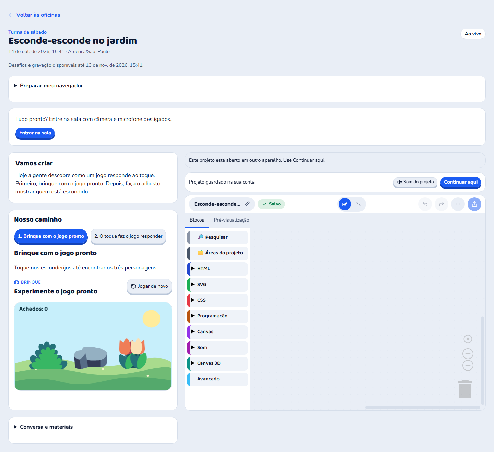
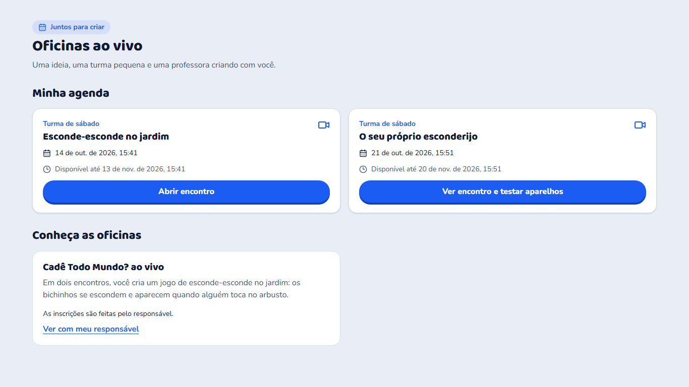
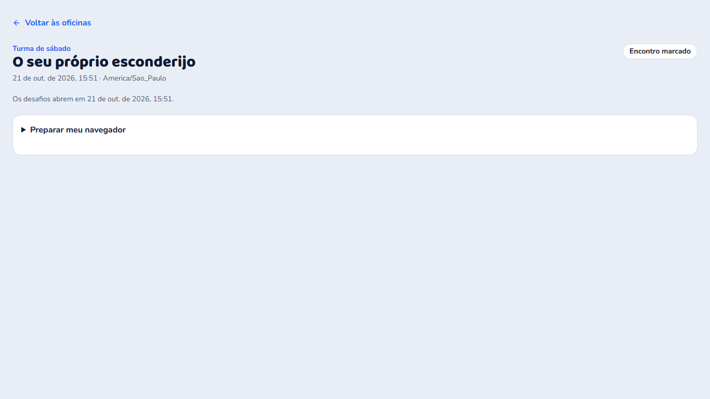
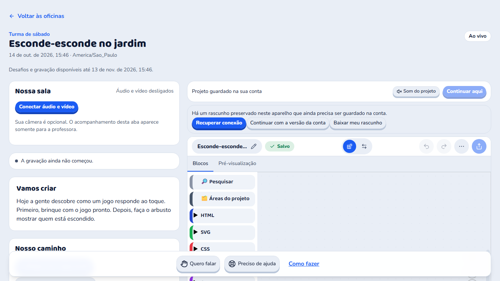
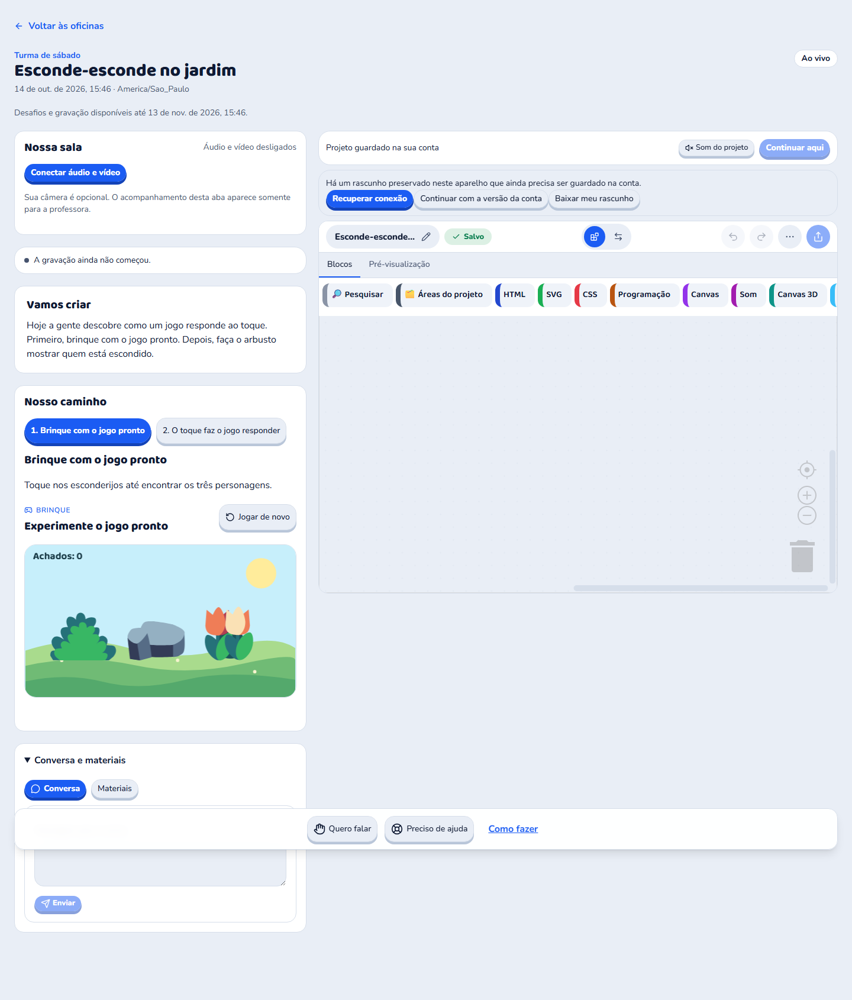
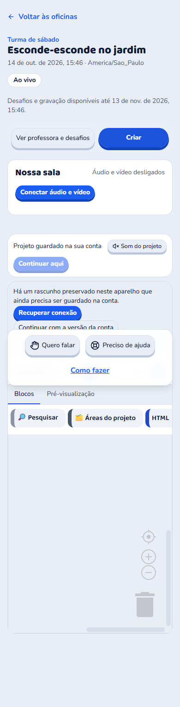
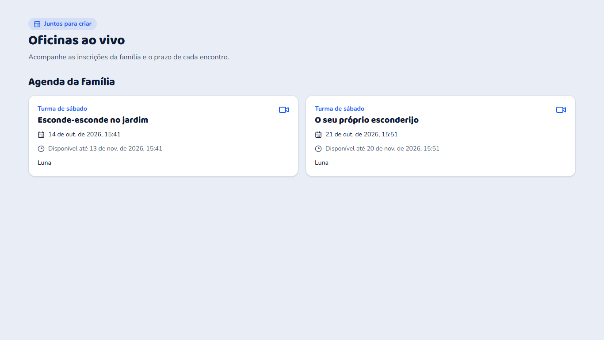

# Oficinas ao vivo: full review (14/10/2026)

Revisão do módulo entregue nos commits `5a1cc0b17` a `63b67ee3d` (staging). Escopo: funcionamento, fluxos, design e
experiência da criança, mais o lado da professora, do admin e dos pais.

## Como foi feita

- **Leitura do código em quatro frentes:**
  - jornada da criança;
  - servidor e BFF;
  - Admin, condução e área dos pais;
  - mídia e gravação.
- **Conferência visual com as telas de verdade.** Esta era a etapa que o registro da implementação deixou pendente: "a
  comparação renderizada... permanece pendente".
  - Montei um ensaio que roda o **serviço real das oficinas** (members) sobre um Postgres descartável, com dados de
    mentira.
  - As telas são os **componentes reais** do member-shell, com o CSS e as fontes do Kids.
  - Fotografei com o Playwright em 1440, 1366, 768 e 390 px.
  - O ensaio fica em `packages/members/tmp/oficinas-visual/` e `packages/community-kids/tmp/oficinas-visual/` (fora do
    git).
- **O que não deu para testar:**
  - Cloudflare Realtime, TURN, o gravador e o supervisor reais. Os achados de mídia vêm da leitura do código.
  - Com `LIVE_MEDIA_READY=false`, que é o padrão de hoje, nenhuma professora consegue **começar** um encontro (o servidor
    responde "A transmissão precisa concluir a verificação operacional antes de iniciar uma turma."). Isso está certo
    enquanto o ensaio operacional não acontece, mas significa que o módulo ainda não funciona de ponta a ponta em
    staging.

## Resumo

A base é cuidadosa onde mais importa:
- O servidor decide tudo: a professora atribuída e a equipe são conferidas em cada ação, e a posse do perfil é confirmada
  no Auth.
- Nada liga a câmera ou o microfone sozinho.
- O compartilhamento só aceita a aba da plataforma.
- O gravador só recebe a professora.
- A falha do fundo da câmera nunca mostra a imagem crua.
- A ajuda da professora tem aceite, época e "Parar ajuda".

O que falta é a outra metade, e ela decide se a criança vai gostar da experiência:
- **Três defeitos travam o piloto:**
  - quem chega à sala pelo menu fica sem câmera e sem jogo;
  - na primeira abertura, a edição do projeto fica travada atrás de um aviso falso de "rascunho";
  - qualquer soluço de rede corta o som da professora, e a sala não volta sozinha.
- **Dois riscos do servidor pedem atenção antes de abrir para famílias:**
  - a trava da turma pode parar o members inteiro, inclusive os cursos gravados (S1);
  - o atendimento em modo "escrita" entra na sala com o nome da criança (S4).
- **As telas funcionam, mas ainda não têm a cara da plataforma.** A sala parece um formulário: a professora não está no
  centro, os controles estão espalhados em quatro lugares e a criança lê termos técnicos. O Estúdio fica no modo estreito
  e com a paleta inteira, sem curadoria.

## Críticos (travam o piloto)

### C1. Quem chega pelo menu fica sem câmera e sem jogo (Kids e Admin)

**Arquivos:** `community-kids/next.config.ts:107,171,188,200` e `admin/next.config.ts:71,116-125`.

**O defeito:**
- As rotas da sala liberam câmera, microfone e o R2 da prévia isolada **só para a própria rota**:
  - Kids: `/oficinas/aulas/:id` e `/criar/oficinas/:id`;
  - Admin: `/admin/professor/ao-vivo/:id`.
- O navegador aplica esses cabeçalhos só ao **primeiro documento carregado**.
- Todos os caminhos até a sala são `<Link>`, que trocam de página sem recarregar:
  - o menu;
  - "Abrir encontro";
  - "Continuar meu projeto";
  - "Preparar sala" e "Preparar encontro".
- Por isso o documento continua com `camera=()` e um `frame-src` sem o R2.

**O efeito:**
- **Criança:** "Testar câmera" e "Ligar câmera" falham com "Permission denied", em inglês. O jogo pronto, o "Executar" e
  a capa mostram "Este conteúdo está bloqueado".
- **Professora:** fica sem microfone e sem câmera. A aula fica muda e a gravação sai sem voz.
- **Por que passou despercebido:** só funciona quando a página é aberta do zero (F5), e é assim que os testes fazem.
- **Por que o microfone da criança funciona hoje:** a fala para a equipe liberou `microphone=(self)` na política geral
  do Kids. Essa é exatamente a armadilha que o CLAUDE.md do Kids registra.

**Correção:**
- Entrar na sala por navegação completa (`<a href>` ou `window.location.assign`, como o modo Pro já faz). A alternativa é
  levar câmera e R2 para a política geral.
- Um e2e que chega à sala **clicando**, e não abrindo a URL direto.

### C2. Na primeira abertura, o projeto mostra "rascunho preservado" e trava a edição

**Arquivo:** `member-shell/src/components/live/live-workspace.tsx:276,393-396` (e as outras comparações por
`JSON.stringify`).

**A causa:**
- O Postgres guarda o projeto em `jsonb`, que **reordena as chaves**.
- O código compara o projeto do Estúdio com o do servidor por `JSON.stringify`, que depende da ordem das chaves.
- Medido no ensaio, num navegador zerado e na primeira visita:

  ```
  servidor: id, ir, mode, name, files, assets, createdAt, ...
  local:    formatVersion, projectTools, id, name, createdAt, ...
  ```

  O conteúdo é o mesmo; só muda a ordem.

**O efeito:**
- A comparação sempre acusa diferença. O código guarda um "rascunho" e bloqueia a escrita (`writingBlocked`).
- A criança vê: "Há um rascunho preservado neste aparelho que ainda precisa ser guardado na conta." com três botões de
  adulto: "Recuperar conexão", "Continuar com a versão da conta" e "Baixar meu rascunho".
- Isso acontece com **toda criança, toda vez** que o projeto abre pela primeira vez num aparelho.
- **Por que passou despercebido:** os testes usam um repositório em memória, que não reordena as chaves.

**Correção:**
- Comparar pela forma canônica (`canonicalJson`, que o core já tem) em todas as comparações de projeto da sala.
- Um teste com o repositório Drizzle, ou com chaves embaralhadas.



### C3. Um soluço de rede corta o som da professora, e a sala não reconecta sozinha

**Arquivos:** `member-shell/src/lib/live/media-transport.ts:155-166,204-212` e `live-media-panel.tsx:117,181-193`.

**O que derruba toda a mídia:**
- o WebRTC passa um instante por `disconnected` (costuma se recuperar sozinho);
- uma consulta da sala fica 8 s sem resposta;
- a professora fica 15 s sem batimento;
- uma única assinatura é recusada.

**O que acontece depois:**
- **Criança:** deixa de ouvir a professora. Só volta se encontrar de novo "Conectar áudio e vídeo".
- **Professora:** religa microfone, câmera e a aba da demonstração, o que abre o seletor do navegador de novo.
- **Gravador:** recria a máquina.

**A especificação pede:** "Reconectando…", com a recepção voltando sozinha.

**Correção:**
- Tolerar `disconnected` por cerca de 10 s, ou fazer ICE restart.
- Reconectar só a recepção, com espera crescente.
- Isolar o erro de cada publicação.
- Esperar 2 ou 3 falhas da consulta antes de desmontar a mídia.

## Altos

### Criança

| # | Defeito | Onde | Efeito |
| --- | --- | --- | --- |
| A1 | **Publicar no Mural com capa falha** | `live-workspace.tsx:336` | A capa é lida com `fetch(dataUrl)`, que a CSP bloqueia. A criança vê "Failed to fetch". É o mesmo bug de 28/06 (CLAUDE.md do member-shell). Correção: `dataUrlBase64ToBlob`. |
| A2 | **O Estúdio congela em qualquer soluço ao guardar** | `live-workspace.tsx:487-505,559-573,819-889` | Uma falha de envio ou de renovação deixa o editor só de leitura, com as três escolhas de adulto. Correção: tentar de novo com espera crescente enquanto a edição valer. Recuperação só em conflito real. |
| A3 | **Estúdio sem curadoria** | `live-workspace.tsx:939` | Não recebe lista de blocos, nível, modos nem extensões. A criança de 8 anos numa oficina de esconde-esconde vê HTML, SVG, CSS, Canvas 3D e os modos Ponte e Código, e pode instalar qualquer extensão. A sala ignora a jornada. As aulas gravadas fazem essa curadoria pelo bloco do Estúdio. Correção: o roteiro da oficina ganha a mesma configuração do bloco do Estúdio (blocos visíveis, modos, extensões). |
| A4 | **"Ver com meu responsável" leva a criança ao login dos pais** | `live-catalog.tsx:196-201` | Sessão de criança não entra na área dos pais. Além disso, "Conheça as oficinas" oferece a oficina em que ela já está. |

### Professora e admin

| # | Defeito | Onde |
| --- | --- | --- |
| A5 | **Encontro que não aconteceu não tem saída.** Não existe cancelar nem reagendar. "Agendar reposição" só aparece em `ended`/`cancelled`, e o encerramento automático só fecha `lobby`/`live`. Se a professora adoece, o encontro fica `scheduled` para sempre. | `live-classroom.tsx:682-686`, `live.service.ts:1210-1214`, `live.repository.ts:213-218` |
| A6 | **Não existe escolha de professora.** A turma sempre nasce com quem a criou, e staff não pode criar turma. Um admin que não é a professora recebe 404 ao "Preparar encontro" e não consegue publicar a gravação. | `workshops-admin.tsx:628,638`, `live.service.ts:501-502,1121` |
| A7 | **Comandos falham quando a sala está movimentada.** Todo comando leva a versão da sala, e cada mão levantada ou entrada muda essa versão. "Abaixar todas as mãos", "Silenciar todos agora" e "Receber" falham com "A sala mudou. Atualize e tente novamente." justo quando há mais mãos. | `live-classroom.tsx:165-197`, `live.service.ts:873` |
| A8 | **Criança retirada não volta mais.** O cartão `removed` não tem ação. O aviso "Encerrar a participação de X?" não diz que é definitivo. | `live-participants.tsx:55-64,149-161` |

### Mídia e gravação

| # | Defeito | Onde |
| --- | --- | --- |
| A9 | **Silenciar ou trocar o modo de fala pode desconectar crianças.** Vários `reconcile` em paralelo colidem e aposentam conexões. Confiança: provável (caminho confirmado na leitura, corrida não reproduzida). | `cloudflare-sfu.provider.ts:339,419-447`, `live.service.ts:914-919` |
| A10 | **O gravador não tem estado final.** Se ele cair no meio da aula: o painel segue dizendo "Gravando"; toda ajuda é recusada até o fim, porque aceitar ajuda exige confirmar a pausa do gravador; a criança lê "A gravação está sendo preparada" para sempre. Um trabalho que não finaliza repete a cada 5 s para sempre. | `own-recording.provider.ts:46-70`, `live-workspace.service.ts:434`, `composition-root.ts:504-509` |
| A11 | **No Safari, "Desfocar fundo" provavelmente envia o cômodo sem desfoque.** O worker usa `ctx.filter`, que o Safari não suporta por padrão. Confiança: provável. | `media-camera-effects.worker.ts:31-34` |

## Design: tela por tela (olhar de diretor de arte)

Regra geral: a especificação pede que a oficina "pareça uma área da plataforma", reaproveitando faixas, cabeçalhos,
cartões, estados vazios e o Zappy. Hoje as telas usam peças genéricas (`rounded-2xl border bg-card`, links pintados de
botão, textos soltos) e ficam com cara de formulário.

### Lista de oficinas (`/oficinas`)



**O que a foto mostra:**
- **Hierarquia:** o encontro que está acontecendo AGORA e o da semana que vem são cartões idênticos. Não há "Hoje", "Ao
  vivo agora" nem destaque da próxima oficina.
- **Informação que falta:**
  - quem é a professora;
  - quanto tempo dura;
  - o dia da semana (a criança pensa em "sábado", não em "14 de out. de 2026, 15:39").
- **Texto de adulto:** "Disponível até 13 de nov. de 2026, 15:39" para quem tem 8 anos.
- **Sem imagem:** as oficinas não têm capa; o programa nem tem esse campo.
- **Mistura:** encontros vencidos aparecem junto com os próximos.

**Direção proposta:**
- **Cabeçalho:** `KidsPageHeader`, como as outras páginas.
- **Herói "Sua próxima oficina", com:**
  - a data amigável ("Sábado, às 15h", "Hoje, às 15h" ou "Faltam 3 dias");
  - a professora com rosto;
  - a pílula "Ao vivo agora" pulsando quando for o caso;
  - um botão grande "Entrar na oficina".
- **Duas faixas:** "Próximos encontros" e "Já aconteceram", com "Rever e continuar até sábado, 13/11".
- **Cartões com capa ilustrada** e selo de estado.
- **"Conheça as oficinas"** só com as oficinas que a criança ainda não faz, e um convite que não leva ao login dos pais
  ("Peça para um adulto da sua casa").
- **Estado vazio com o Zappy.**

### Encontro marcado (antes do dia)



A página é praticamente vazia: o título, "Os desafios abrem em 21 de out. de 2026, 15:51" e um "Preparar meu
navegador" fechado. É o melhor momento para criar expectativa, e a tela não diz nada sobre o que vai acontecer.

**Direção proposta:**
- A contagem regressiva grande.
- "O que vamos criar", com a descrição e uma imagem.
- A professora.
- Um checklist curto: "Teste seu computador", "Separe um fone" e "Peça para um adulto preparar o acesso".
- O Zappy dando as boas-vindas.

### A sala (durante o encontro)



**O que a foto mostra:**
- **A professora não está no centro.** A especificação diz que "a transmissão ocupa o lugar principal da explicação". Na
  tela, ela é um cartão pequeno, "Nossa sala", com o botão "Conectar áudio e vídeo". Depois de admitida, a criança
  ainda precisa achar esse botão para ouvir a professora: são três passos (entrar, esperar ser recebida, conectar).
- **Controles em quatro lugares:**
  - microfone e câmera no cartão "Nossa sala";
  - "Quero falar" e "Preciso de ajuda" numa barra flutuante;
  - "Como fazer" como link;
  - Conversa e Materiais num `<details>` fechado no fim da coluna, sem contador de mensagens novas.

  A barra flutuante cobre o conteúdo (na foto, os passos de "Nosso caminho"). No celular ela fica atrás das abas.
- **Ruído de adulto na tela da criança:**
  - "· America/Sao_Paulo";
  - "Desafios e gravação disponíveis até…";
  - "A gravação ainda não começou." (estado da professora);
  - "Projeto guardado na sua conta" com "Continuar aqui" e "Som do projeto" empilhados em duas barras acima do Estúdio,
    comendo cerca de 150 px.
- **O Estúdio fica no modo estreito em 1366 e 1440.** A coluna tem cerca de 790 a 880 px, então blocos e jogo nunca
  aparecem lado a lado, e não há "Expandir".
- **Estados ilegíveis:** "Ao vivo" é uma pílula branca igual a qualquer outra.
- **O pedido de ajuda da professora** aparece em letra pequena na barra do Estúdio e expira em 60 s.



**Direção proposta:** a mesma linguagem da aula gravada (o console v2 das experiências).
- **Palco da professora no alto da coluna da esquerda,** grande, com a moldura escura de "tela", o nome dela e a pílula
  "Ao vivo" vermelha. A recepção do som liga sozinha quando a criança é admitida.
- **Uma barra de controles só,** fixa e integrada ao rodapé da aula, com estados escritos:
  - Microfone ("Desligado" / "A professora vai chamar sua vez");
  - Câmera;
  - Quero falar;
  - Preciso de ajuda;
  - Conversa, com o número de mensagens novas;
  - Materiais.

  Conversa e Materiais abrem num painel lateral, um de cada vez.
- **"Nossa etapa agora"** como no rodapé "o que falta para seguir", com "Ir para a etapa da turma".
- **Estúdio:** ocupa a coluna da direita com "Expandir", sem as barras empilhadas. "Guardado" e "Som do projeto" vão
  para a barra do próprio Estúdio.
- **O pedido de ajuda vira um diálogo do Zappy,** com a frase da especificação: "A professora Ana quer ajudar neste
  projeto. Enquanto ela mexe, você acompanha. Você pode parar a ajuda quando quiser."
- **Fim do encontro:** uma tela de encerramento com o projeto guardado, "Publicar no Mural" e quando é o próximo
  encontro.
- **Cabeçalho:** sem fuso nem prazo. O prazo vai para um "i" ou para o fim da página.

**No celular,** a troca "Ver professora e desafios" e "Criar" é boa e mantém tudo montado. Falta só tirar a barra de
trás das abas.



### Área dos pais (`/pais/oficinas`)



**O que a foto mostra:**
- Usa o mesmo catálogo da criança, com "Juntos para criar", e não as peças da área dos pais (`parent-ui`).
- O nome "Luna" aparece solto, sem rótulo.
- Não há caminho de preparação: testar o computador, preparar o acesso da criança, "Ir para a área da criança".
- "Confirmar participante" vincula a vaga para sempre, sem confirmação.

**Direção proposta:**
- Página no molde de "Acompanhamento".
- Por criança: os próximos encontros e um passo a passo de três itens antes do primeiro dia.
- Confirmação ao escolher a criança.

## Médios

### Criança

- **Recarregar a página (F5) conta como "outro aparelho".** A criança perde a vez e lê "Use “Continuar aqui” para trocar
  de dispositivo." O `deviceId` existe só enquanto a página está aberta (`client.ts:158-166`).
- **Quem espera na página antes da liberação não recebe os desafios até recarregar.** O servidor omite o plano quando o
  cliente informa a mesma `planRevision` que veio com `plan:null` (`classroom-state.ts:71-80`, `live.service.ts:632`).
- **Não aparece "Aguardando a professora".** O cartão "Entrar na sala" surge sem aviso e a admissão não é anunciada.
- **Microfone e câmera travados sem explicação.** Faltam "Seu microfone está desligado" e "A professora vai chamar sua
  vez", e nada avisa "É a sua vez!" (`live-media-panel.tsx:119-122,346-363`).
- **Os colegas aparecem todos como "Participante"** ("Ouvir Participante"), porque a publicação de mídia não tem nome.
- **A câmera vai direto para a turma,** sem a prévia "Só você está vendo" e sem lembrar o fundo escolhido.
- **Erros em inglês na tela:** "Failed to fetch", "Permission denied", "Could not start video source", "getDisplayMedia
  is not a function". O `liveRequest` e os erros de aparelho não são traduzidos.
- **Erros do servidor com "aula"** ("A aula ainda não começou.") chegam crus. O guarda de vocabulário não varre o
  members.
- **Botões abaixo de 44 px:**
  - 32 px: "Entrar na sala", "Continuar aqui", "Conectar áudio e vídeo", "Sim, pode ajudar", "Parar ajuda".
  - 28 px: "Som do projeto", "Enviar", os testes de aparelho.
- **"Mostrar esta aba à professora" aparece em Firefox, Safari e celular,** que não conseguem.
- **Baixar um material com erro tira a criança da sala:** é um link comum, e num 403 a página vira um JSON.
- **O fim do encontro deixa a tela confusa:**
  - os controles continuam ali, desabilitados;
  - a gravação aparece duas vezes, com "Gravação aguardando publicação.";
  - não há "Sair da oficina".
- **"Oficina" já quer dizer outra coisa em Criar,** onde o Estúdio, o Pinta e o Molda são as "oficinas". Agora a mesma
  página tem "Criações das oficinas ao vivo".

### Professora e admin

- **A agenda da professora não tem "Hoje", "Próximos" e "Encerrados".** Está ordenada pelo id da turma e sem o estado da
  gravação.
- **Não dá para receber crianças na recepção** antes de "Começar encontro". Falta "Receber todos".
- **A gravação some da vista** ao reabrir a página. Faltam tentar de novo, substituir o arquivo e uma fila de revisão.
- **Formulários abrem no fim da página,** sem rolar nem levar o foco: "Nova turma", "Editar roteiro" e "Inscrições".
- **Trabalho de autoria se perde:**
  - publicar durante a edição invalida o rascunho;
  - remover encontro, etapa e atividade não pedem confirmação.
- **Turma nova não aceita inscrição** até "Abrir inscrições", e o aviso não diz isso.
- **Datas, roteiro e status da turma não podem ser corrigidos pela tela** depois de criados.
- **A lista de inscrições não mostra a família.**
- **A visão da turma está abaixo da especificação:**
  - os cartões não mostram microfone, câmera nem compartilhamento;
  - as telas das crianças ficam em outra grade;
  - não há "Adicionar material" durante o encontro;
  - não há presença.
- **Fora do padrão do console:** `window.confirm` em vez de `useConfirm`, texto infantil no teste de aparelhos da
  professora, fuso sempre igual ao do computador.

### Mídia

- **Assinaturas trocadas nunca são liberadas.** O SDP cresce até o teto de 256 kB numa aula longa. Confiança: provável;
  medir em 90 min.
- **Carga alta no members:** cada autorização recarrega a turma inteira, cerca de 60 cargas por segundo numa turma de 9.
  Medir.
- **Espera de 5 s pelos candidatos ICE:** em rede sem UDP a coleta costuma passar disso.
- **O replay remonta o vídeo a cada ~4min45s:** sai da tela cheia e recarrega.
- **A voz das crianças pode vazar para o replay** pelo microfone da professora sem fone. O runbook deve exigir fone.
- **Cada pausa ou troca de fonte recria a máquina do gravador** e perde segundos de explicação.

## Servidor e BFF

Nenhum destes achados repete os das auditorias anteriores (`.audits/*live*.md`); as correções delas continuam valendo.

| # | Gravidade | Defeito | Onde |
| --- | --- | --- | --- |
| S1 | Alto | **A trava da turma pode parar o members inteiro.** Cada commit, renew, cursor e salvamento de etapa trava a linha da turma e, ainda segurando essa conexão, abre outra no pool para recarregar a turma (2 a 4 vezes). Com 8 crianças voltando juntas depois de uma queda de Wi-Fi, as 10 conexões do pool ficam presas, e o members para inteiro, **inclusive os cursos gravados**, até o timeout de 30 s. Confiança: provável. | `live-workspace.repository.ts:91-113`, `live-workspace.service.ts:293,339`, `live-learning.service.ts:85-89,100,154` |
| S2 | Alto | **As consultas recarregam a turma inteira o tempo todo.** Cada leitura traz o roteiro completo (até 2 MB por aula), o chat e as matrículas. A sala é consultada a cada 3 s, o batimento a cada 5 s (regravando o JSON da ocorrência inteira), o projeto a cada 1 s e as publicações de mídia a cada 3 s, uma vez por pessoa. Somando, uma turma de 9 dá cerca de 60 cargas completas e ~360 consultas por segundo, no mesmo banco dos cursos. A contagem está confirmada no código; o impacto é provável. | `live.service.ts:624`, `live-workspace.tsx:462`, `cloudflare-sfu.provider.ts:115` |
| S3 | Alto | **Gravação sem nenhum trecho fica em reconciliação para sempre** (complementa A10). Recepção aberta e encerrada, aula cancelada com "Encerrar" ou aula só com tela: a cada 5 s, para sempre, há cargas, chamada ao gravador, nova versão da ocorrência e log de erro. Isso atrasa também a varredura de prazos, que roda no mesmo laço. | `own-recording.provider.ts:56,81-92`, `recording-job.ts:87-90,314-326` |
| S4 | Alto (segurança infantil) | **O suporte em modo "escrita" entra na sala como se fosse a criança.** O BFF só barra o modo somente leitura. O atendente que abre `/oficinas` entra com o nome da criança, pode ligar a PRÓPRIA câmera e microfone para as outras 8 crianças e toma o lugar do aparelho dela. A fala para a equipe recusa qualquer sessão de suporte; a sala não. | `member-shell/src/routes/live.ts:27` |
| S5 | Médio | **A criança não entra na recepção antes do horário.** A professora pode abrir a sala 15 min antes, mas o acesso da criança só começa no horário; até lá ela recebe "acesso negado" e a sala vem vazia. | `live.service.ts:344,522,889` |
| S6 | Médio | **Só a primeira professora da lista é gravada.** Uma substituta conduz e o replay sai vazio. | `own-recording.provider.ts:287` |
| S7 | Médio | **Uma professora (staff) estende o acesso comercial da família por até 366 dias** ao agendar uma reposição. Isso também prolonga o Mural e a cota de perfis. O ideal é só admin, ou limitar ao fim da reposição mais uma folga. | `live.routes.ts:272`, `live.service.ts:1226-1230` |
| S8 | Médio | **Sem assinatura do Estúdio, a criança perde até a LEITURA do próprio projeto** quando o prazo vence, e a professora também não consegue revisar. Ver e exportar deveriam ficar livres; só editar depende do acesso. | `live-workspace.service.ts:222,242` |
| S9 | Baixo | A sala da criança expõe os ids de perfil dos colegas (`messages[].authorId`). Qualquer staff vê nomes e contas de todas as turmas, mesmo sem estar atribuído. `enroll` não é idempotente (duplo clique cria duas vagas). | |

**Lacunas do lado do servidor:**
- **Override de admin:** um admin não atribuído não consegue moderar, encerrar a sala nem retirar um replay com
  urgência.
- **Consentimento dos pais para câmera e microfone da criança na sala** (LGPD, art. 14). A fala para a equipe relê a
  escolha dos pais a cada pedido; a sala não pergunta nada aos pais.
- **"Estender 10 min":** a mídia corta exatamente no horário de término.
- **Retenção do chat e da participação:** esses dados ficam guardados até a conta ser excluída.
- **Perfil arquivado continua ocupando a vaga,** e os pais não conseguem corrigir uma criança escolhida errada.

## Lacunas para a criança ter a melhor experiência

- A professora com rosto e nome em toda a jornada (catálogo, encontro marcado, sala, cursor "Professora Ana").
- O painel "Turma" (quem está aqui, com avatar) e "Mostrar meu projeto" para a turma.
- O teste de microfone com medidor de volume e o teste de fone.
- A entrada na recepção antes do horário: a professora pode abrir 15 min antes, mas a liberação da criança começa no
  horário, então as admissões ocupam o começo do encontro.
- Depois do prazo, sem assinatura, o projeto fica invisível: não dá nem para ver ou jogar o que ela fez.
- O resumo para a família depois do encontro.

## Proposta de lotes

1. **Funcionar de verdade, sem decisão de design:**
   - C1 (navegação completa até a sala) e C2 (comparação canônica);
   - A1 (capa do Mural), A2 (guardar com nova tentativa) e A4;
   - F5 sem virar "outro aparelho", o plano para quem chegou cedo, e erros em português;
   - criança retirada pode voltar;
   - "Cancelar encontro";
   - comandos sem conflito de versão.
   Inclui também S4 (o suporte não entra na sala como a criança).
2. **Mídia e servidor aguentando uma turma de verdade:**
   - C3, A9, A10 e S3 (reconexão, reconcile serializado, gravação com estado final);
   - S1 e S2 (trava sem segunda conexão, consultas leves);
   - o ensaio com 8 aparelhos previsto no runbook, medindo a carga no members.
3. **Redesenho visual.** Primeiro uma maquete descartável com os componentes reais, lado a lado com a aula gravada
   (como foi feito com o console v2), para aprovação. Depois a implementação: catálogo, encontro marcado, sala, fim do
   encontro e área dos pais. Inclui a curadoria do Estúdio (A3), que precisa de campo novo no roteiro.
4. **Professora e admin:** escolher professoras, agenda por dia, recepção, gravação, formulários e confirmações.
