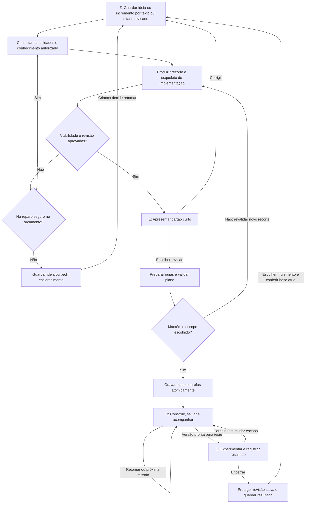

# Pensa: da ideia da criança ao primeiro jogo e às próximas versões

> Histórico: substituído pela [especificação funcional de 16/10/2026](2026-10-16-pensa-reestruturacao-spec.md). Este documento registra decisões anteriores e não define o contrato vigente.

**Proposta de produto e arquitetura — terceira revisão consolidada de 14 de outubro de 2026**

Direção confirmada: **a criança constrói; Zappy planeja, orienta e ajuda quando ela trava**.

Requisitos da experiência: **método ZERO explícito, entrada livre por voz ou texto e escuta opcional na voz própria do Zappy pela ElevenLabs**.

Identidade visual: **seguir o sistema visual da Comunidade Kids**, com os tokens, tipografia, componentes e navegação compartilhados. A simplificação do fluxo acontece dentro dessa identidade.

Infraestrutura de IA: **OpenRouter obrigatório para planejamento, revisão, ajuda e transcrição**. A síntese da voz própria do Zappy permanece na integração ElevenLabs solicitada. Modelos podem variar dentro dessas integrações; o Pensa não cria acessos diretos alternativos aos provedores de modelos.

Condição de viabilidade: **o primeiro jogo e cada incremento executável devem caber nas ferramentas e recursos efetivamente liberados para aquele perfil naquele momento, considerando posto, conquistas e acesso**. A ideia pode ir além disso; a proposta apresentada como construível agora não pode.

Base pedagógica: **o Zappy do Pensa consulta a base oficial da plataforma e das aulas, reaproveitando o serviço de conhecimento do Zappy do Estúdio**, para orientar a criação com métodos e linguagem coerentes com o que é ensinado. Acesso a conteúdo, progresso de estudo e permissão para usar um recurso são informações distintas.

Documentos de apoio: [pesquisa e diagnóstico do código](2026-10-14-pensa-pesquisa.md), [inventário das skills](2026-10-14-pensa-skills-inventario.csv) e [revisão de coerência e cobertura dos fluxos](2026-10-14-pensa-revisao.md). Esta é uma proposta para avaliação e implementação futura. Não altera o aplicativo e não representa resultado de teste com crianças. As regras e transições abaixo são requisitos propostos, salvo quando identificadas como comportamento atual do código.

## 1. Recomendação

Transformar o Pensa em um espaço de construção acompanhada: a criança conta o jogo que imagina, reconhece sua ideia numa proposta curta, começa uma primeira versão jogável e recebe ajuda para continuar. O planejamento detalhado existe nos bastidores; a interface destaca **o que estou criando, o que posso fazer agora e o que quero experimentar depois**.

O botão de áudio faz sentido como uma das entradas. A mudança decisiva, porém, é permitir uma narrativa livre e dar ao Zappy responsabilidade por organizar e propor. Hoje, a entrevista em cinco decisões e a aprovação sucessiva de documentos continuam existindo mesmo que a criança passe a responder falando. Trocar o teclado pelo microfone resolveria apenas parte da fricção.

O Zappy deve conseguir dizer: “Entendi estas partes da sua ideia. Para começar, proponho este jogo pequeno. Guardei estas outras partes para depois”. A criança pode aceitar, corrigir ou explicar o que mais importa. Propostas da IA precisam aparecer como propostas, sem serem registradas como decisões que a criança já tomou.

O resultado desejado é uma criança que consegue começar, percebe algo seu no jogo, entende mudanças importantes e consegue retomá-lo. Um plano bonito, muitas tarefas concluídas ou um jogo gerado pela IA não demonstram esses resultados.

**Critério transversal de utilidade:** a criança consegue reconhecer a proposta, agir no editor, perceber uma resposta do jogo, pedir uma ajuda que mude sua situação e continuar com autoria. A simplificação deve alcançar os guias dentro das ferramentas e o acompanhamento, além da conversa inicial. Cada tela precisa tornar visível o próximo passo e manter correção e ajuda acessíveis. A seção 3.9 transforma esse critério em requisitos observáveis.

### Decisões centrais

| Tema | Direção recomendada |
| --- | --- |
| Entrada | Falar ou escrever livremente, com acesso equivalente às duas opções. |
| Escuta | Botão “Ouvir o Zappy” nas respostas e orientações, opcional, com texto sempre disponível. |
| Método ZERO | Zerar a bagunça → Enxergar o jogo → Realizar por partes → Observar e melhorar; um ciclo por versão. |
| Conversa | Perguntar quando uma dúvida muda a proposta; aproveitar tudo o que já foi dito. |
| Primeira entrega | Um cartão curto com a primeira versão jogável e a essência da ideia preservada. |
| Construção | A criança opera Estúdio, Pinta e, quando pertinente, Molda. |
| Viabilidade atual | A proposta e todas as suas dependências usam somente capacidades confirmadas do perfil; recursos futuros ficam fora do escopo executável. |
| Conhecimento pedagógico | Consultar aulas liberadas, ajuda oficial e manuais pertinentes; aproveitar métodos ensinados e validar referências, sem presumir domínio nem desbloquear recursos. |
| Organização | Uma missão em destaque, caminho curto da versão atual e ideias guardadas. |
| Evolução | Novas versões escolhidas depois de experimentar; planejamento detalhado conforme necessário. |
| IA | Workflow controlado via OpenRouter, poucas funções especializadas, catálogo oficial e verificações de contrato. |
| Visual | Identidade da Comunidade Kids, herdando paleta do perfil, fontes, componentes e controles do host. |
| Aprendizagem | Ajuda contextual, escolhas significativas e testes do que a criança construiu. |
| Sucesso | Primeiro jogo reconhecível e testado, com evidência honesta sobre o que foi observado. |

Entre as alternativas analisadas, recomendo esse fluxo. A entrevista atual com áudio é mais barata de alterar, mas mantém a carga de planejamento. A criação automática do jogo pode produzir uma demonstração rápida, mas contraria o papel escolhido para a criança. A [pesquisa anexa](2026-10-14-pensa-pesquisa.md) detalha a comparação e seus limites.

## 2. O que aproveitar e o que mudar

O código já oferece uma base importante: projetos e ciclos, tarefas com dependências, referências aos resultados, revisões, catálogo de blocos conquistados, filtros de acesso e guias dentro dos editores. Esses mecanismos devem continuar sustentando a experiência.

As mudanças principais são de contrato e de experiência:

1. **Substituir a entrevista obrigatória.** O prompt exige cinco decisões em ordem e reconfirma informações antecipadas. O novo fluxo extrai a narrativa inteira e só esclarece ambiguidades relevantes.
2. **Tirar os documentos do caminho obrigatório.** Carta da Ideia, game design, direção visual, tarefas e auditoria são estruturas internas. A criança não precisa aprovar cada uma para construir.
3. **Permitir diferentes tipos de jogo.** Vitória e derrota não devem ser obrigatórias para exploração, criação livre ou brinquedos interativos.
4. **Planejar a versão atual.** Evitar inventário visual completo e dezenas de tarefas para uma ideia que ainda vai mudar.
5. **Permitir reutilização e arte provisória.** Um asset necessário pode já existir. Personalizá-lo pode ser uma escolha posterior, sem impedir o primeiro teste.
6. **Separar plano pronto de jogo pronto.** Hoje `stage='done'` encerra o planejamento. O produto precisa representar construção e teste separadamente.
7. **Manter o Zappy disponível durante a execução.** A conversa atual se concentra em Z. A ajuda deve acompanhar a missão, a ferramenta e a revisão em curso.

As constatações acima vêm do workspace, não de observação da produção. A faixa documentada também precisa ser reconciliada: Pensa menciona 8–13 anos, enquanto o prompt de segurança menciona 7–12. Esta proposta usa **8–13 como referência de desenho** e adapta a ajuda à leitura e experiência da criança.

## 3. A experiência da criança

### O método ZERO continua visível

O ZERO organiza a jornada inteira, da ideia à experimentação. Os nomes abaixo são uma adaptação proposta para o Pensa, sem alterar automaticamente o método nos demais materiais da plataforma.

| Etapa | Significado proposto | O que a criança faz | O que Zappy organiza |
| --- | --- | --- | --- |
| **Z — Zerar a bagunça** | Colocar a ideia para fora e encontrar o que importa. | Conta livremente, por voz ou texto, e corrige o que foi entendido errado. | Intenção, detalhes essenciais, sugestões e dúvidas realmente necessárias. |
| **E — Enxergar o jogo** | Reconhecer uma primeira versão possível. | Vê ou ouve a proposta e escolhe o que quer construir primeiro. | Experiência central, escopo, viabilidade e ideias guardadas. |
| **R — Realizar por partes** | Construir uma pequena versão com apoio. | Faz missões no Estúdio, Pinta ou Molda, com ajuda quando precisa. | Dependências, instruções, retomada e revisões localizadas. |
| **O — Observar e melhorar** | Experimentar o resultado e decidir seu próximo passo. | Joga, observa, ajusta, escolhe um incremento ou encerra a versão. | Evidências, problemas encontrados e possibilidades de evolução. |

Z e E preservam a associação já usada no Pensa. R amplia “Roteirizar” para incluir a realização; O amplia a organização para observação e melhoria. Roteirização, auditoria e organização continuam acontecendo internamente antes e durante a construção.

Na interface, mostrar um mapa compacto **Z · E · R · O**, com a etapa ativa e uma descrição cotidiana: “R — Vamos construir”. Esse mapa serve para orientação e retomada. Não exige quatro formulários, quatro conversas ou quatro aprovações documentais. Uma etapa pode acontecer com uma única ação, e a criança pode voltar para corrigir uma escolha.

Cada versão percorre o ciclo. Depois de O, uma correção pode voltar diretamente a R. Uma ideia nova inicia outro ZERO com a memória do projeto: Z organiza apenas o incremento; E mostra o que muda; R constrói; O experimenta. Não repetir perguntas cujas respostas permanecem válidas.

**Implicação técnica:** as novas letras representam momentos da experiência, não uma simples troca dos rótulos do campo `stage`. Hoje R ainda gera o plano e O o audita, antes da construção. Derivar a etapa visível dos estados de planejamento e execução, com mapeamento versionado. Um plano legado em `done`, sem evidência de execução, chega a R com “Vamos ver onde você parou”, e só oferece uma missão depois da reconciliação; não recebe um O concluído automaticamente.

### 3.1. Chegar e contar

Na primeira visita sem projetos, destacar “Conte o jogo que você está imaginando”, com campo de texto e botão “Falar”. Evitar exigir título, gênero, dimensão e formulário antes da ideia. Um nome provisório pode ser sugerido e alterado depois.

Para quem volta, destacar “Continuar [nome do jogo]”, com o último resultado confirmado e a próxima ação, além de acesso a “Meus jogos” e “Nova ideia”. Identificar o projeto no botão; não abrir automaticamente o último arquivo nem escolher apenas pela escrita mais recente de um job. Uma preparação interrompida volta ao estado real da operação, uma ideia incompleta volta à conversa e uma versão encerrada oferece jogar ou escolher o próximo passo. Com vários projetos, a criança pode selecionar outro sem perder o atual. A lista inclui um acesso secundário a planos arquivados, separado das ideias futuras de cada jogo.

Criar um rascunho com identidade de projeto/ciclo no primeiro envio ou pedido de geração/transcrição, antes da operação paga e dentro dos limites da conta. Abrir a tela ou tocar em “Nova ideia” não cria projetos vazios persistidos. Reenvio após falha usa a mesma identidade. Salvar o texto enviado e as decisões de forma incremental. Texto ainda não enviado não vira decisão; avisar sobre uma saída que possa perdê-lo. Trocar de perfil encerra gravação/reprodução e limpa buffers privados da tela. Ideia incompleta pode ser guardada e retomada sem gerar um plano.

Mensagem inicial possível:

> “Conte o jogo que está na sua cabeça. Pode falar ou escrever do seu jeito.”

Se a criança escolher “Me dá uma ideia”, oferecer duas ou três sementes abertas que ela pode misturar. Se pedir ajuda para contar, usar um único convite contextual, como “O que você imagina fazendo nesse jogo?”. Não exibir várias perguntas antes da fala livre. A criança pode contar uma história longa, mandar uma frase, descrever só um personagem ou dizer que ainda não sabe.

No áudio:

- Um toque inicia e outro encerra. Não exigir manter o botão pressionado.
- Mostrar claramente que está gravando, com tempo e opção de cancelar.
- Ao parar, transcrever e mostrar o texto editável, com “Enviar ideia” e “Gravar de novo”. O envio é uma ação clara da criança.
- Permitir ouvir a própria gravação enquanto ela ainda estiver no buffer local da revisão; não exigir que a criança leia tudo para enviar. Descartar esse buffer ao enviar/cancelar ou trocar de perfil, sem confundi-lo com a voz sintetizada do Zappy.
- Preservar a fala transcrita; a síntese do Zappy aparece depois, separada. Não apresentar uma reescrita criativa como transcrição literal.
- Deixar corrigir nomes inventados e trechos mal reconhecidos. Não inferir sentimentos, personalidade ou capacidade intelectual a partir da voz.
- Se não houver permissão, conexão ou áudio compreensível, preservar o que foi digitado e oferecer texto imediatamente.

Um novo trecho de ditado é acrescentado ao rascunho em ordem identificada; não substitui automaticamente texto que a criança editou durante a transcrição. Se houver edição concorrente, mostrar o trecho recebido para inserir ou descartar. Cancelar a gravação descarta seu áudio sem apagar o texto anterior. Uma transcrição tardia de outro perfil/projeto é ignorada.

Para o piloto, experimentar gravações de até 90 segundos, com aviso amigável e possibilidade de continuar em outro trecho. É um parâmetro a testar, não uma regra pedagógica. O limite atual de 2.000 caracteres deve ser revisto em conjunto para não cortar a transcrição silenciosamente. Não encerrar a gravação porque a criança fez uma pausa para pensar.

O primeiro lançamento não precisa de conversa de voz em tempo real. Ditado revisável resolve a entrada descrita com estados mais claros e recuperação de erros. A saída já inclui leitura opcional na voz do Zappy no piloto: são duas capacidades separadas, falar a ideia e ouvir a orientação.

O mesmo campo de conversa aceita ditado para corrigir a proposta, pedir ajuda e contar o que aconteceu no teste. A entrada por voz não termina na primeira mensagem. Cada envio mantém revisão e confirmação explícitas; fala não dispara edição do jogo, navegação ou aceite automaticamente. Quem lê com dificuldade pode ouvir o entendimento curto do Zappy e corrigir a intenção pela conversa, sem precisar certificar cada palavra transcrita. “Não era isso” permanece acessível depois de enviar.

### 3.2. Entender sem transformar tudo em perguntas

O Zappy organiza internamente quatro grupos:

| Grupo | Exemplo | Como tratar |
| --- | --- | --- |
| A criança disse | “O dragão salva os ovos.” | Preservar como origem da ideia. |
| Zappy sugere | “Começar em uma ilha, usando as setas.” | Mostrar como sugestão corrigível. |
| Ainda está aberto | Não está claro se o dragão é controlado ou acompanhado. | Perguntar apenas se isso muda o primeiro jogo. |
| Fica para depois | Outras ilhas, construção de castelos, multiplayer. | Guardar com a intenção original e limites conhecidos. |

Identificar uma a três características que dão identidade ao projeto: personagem, fantasia de ação, relação entre personagens ou regra incomum. A IA não pode decidir que tudo isso é descartável só porque um coletor de moedas seria fácil.

A regra de conversa proposta é **zero ou uma pergunta de esclarecimento antes da primeira proposta, na maioria dos casos**. Isso é uma hipótese de experiência, não uma proibição de perguntar novamente quando necessário. Se uma ambiguidade impedir um recorte fiel, perguntar sobre ela. Se um detalhe puder ser sugerido de forma reversível, apresentar a sugestão no cartão.

“Você falou em cuidar dos dragões e também em lutar. Qual dessas partes precisa aparecer primeiro?” é uma pergunta útil. “Qual será o controle?” pode ser desnecessária quando há uma opção familiar, disponível e fácil de mudar.

### 3.3. Devolver uma proposta que a criança consegue avaliar

Exibir uma proposta principal, com no máximo uma alternativa quando houver uma escolha importante. Evitar três projetos completos para comparar.

O cartão inicial deve mostrar:

- **Seu jogo:** uma ou duas frases com personagem e ação principal.
- **Na primeira versão:** o que poderá ser feito e percebido ao jogar.
- **Guardado para depois:** poucas ideias da criança, sem promessa de viabilidade já confirmada.
- **Começar:** a primeira ação concreta, com a ferramenta que será aberta.

Dar destaque a “Vamos fazer”, com “Quero mudar” e “Explique melhor” como ações secundárias visíveis. “Ouvir a proposta” identifica exatamente o conteúdo narrado. Alterar personagem, ação principal ou algo marcado como essencial requer nova concordância; pequenos ajustes de redação não devem criar aprovações repetidas. Não tratar o clique principal como prova suficiente de compreensão ou satisfação.

Antes desse cartão, o servidor já deve ter validado um esqueleto de implementação: mecânicas, recursos, assets de origem conhecida, dependências e critério do primeiro resultado. O detalhamento posterior transforma esse esqueleto em guias; não decide pela primeira vez se o jogo é possível.

“Vamos fazer” aceita uma revisão específica do escopo e inicia a preparação das missões. Mostrar “Preparando seu caminho” até a validação e gravação atômica do plano. Só então habilitar “Abrir ferramenta”. Se o detalhamento mudar algo essencial ou revelar uma limitação, revalidar o novo recorte e voltar ao cartão com a diferença explícita; a aceitação anterior não autoriza uma proposta diferente. Nenhum cartão revisado pula a verificação de viabilidade. Uma falha técnica preserva o escopo escolhido para nova tentativa.

Durante essa espera, manter a ideia escolhida e a primeira ação à vista, com estados reais e saída segura. Quando pronto, oferecer “Ir para o Estúdio”, ou o destino correspondente, sem exigir outra aprovação do plano. A passagem de tela ocorre por ação explícita; o resultado tardio não navega sozinho. Se a criança sair, retomar em “Seu caminho está pronto”. Medir as duas esperas — proposta e guias — como parte do custo de usar o Pensa.

Se o primeiro recorte não couber nas capacidades atuais, o Zappy explica a limitação em linguagem simples e apresenta uma aproximação identificada como tal. Por exemplo: “Ainda não temos aqui o recurso para amigos jogarem pela internet. Podemos fazer uma aventura para uma pessoa e guardar essa ideia”. Nunca trocar silenciosamente “online” por “local” e declarar o pedido atendido.

### 3.4. Construir com uma missão em destaque

Depois da escolha e da preparação bem-sucedida do plano, o centro da tela muda para a construção:

```text
MEU JOGO: O ninho nas nuvens
ZERO: Z · E · [R — Realizar por partes] · O
Primeira versão: voar pela ilha e levar um ovo de volta ao ninho

AGORA
Faça seu dragão voar pela tela
Você vai usar o Estúdio
[Abrir Estúdio]  [Ouvir o Zappy]  [Me ajuda]

[Ver caminho: voar → resgatar → fazer nascer → experimentar]
[Ver ideias guardadas]
```

Esse esboço expressa hierarquia de conteúdo, não um layout final. A primeira tela não precisa mostrar colunas de kanban, todos os critérios, porcentagem de projeto, velocidade ou prazo. Um painel expansível permite ver e escolher tarefas independentes quando isso for útil.

Cada missão contém um resultado observável, a ferramenta, a razão de existir e um guia curto. Os passos aparecem dentro do editor; o Pensa evita duplicar toda a instrução na tela inicial. Mostrar primeiro a ação atual e a resposta que se espera ver, com “Ver todos os passos” disponível. Começar com cerca de três a seis missões por primeira versão é uma hipótese para o piloto. Não dividir uma ação simples em cartões só para aumentar progresso.

**Contrato do guia:** uma instrução deve indicar o que fazer, onde encontrar o recurso e como perceber o efeito. “Faça o dragão voar” é objetivo, não orientação suficiente para quem começa. Nomes e caminhos de controles/blocos vêm dos catálogos e do modo real do editor. Exemplos visuais devem ser pequenos e pertinentes; qualquer destaque dentro da interface usa um alvo conhecido e validado, nunca coordenadas ou seletores inventados pelo modelo. Se o editor não suportar destaque, usar rótulos e caminhos reais em texto/voz.

**Orientação não é checklist obrigatório.** O [guia atual do Estúdio](../../packages/studio/src/studio/TaskGuidePanel.tsx) exige marcação de passos e critérios; o [domínio atual](../../packages/members/src/domain/pensa/task-plan.ts) também usa esses itens como condição de conclusão. O contrato v2 precisa separar passos instrucionais de evidência do resultado. Ler, ouvir ou abrir um passo não prova execução. Registrar automaticamente apenas sinais realmente disponíveis; quando o resultado exigir relato, pedir uma confirmação curta sobre ele, sem fazer a criança marcar todos os cliques. Manter a origem manual/automática da evidência e as dependências obrigatórias. Não implementar essa simplificação apenas escondendo checkboxes que continuam exigidos pelo servidor.

Estimativas servem para ajustar a proposta e podem aparecer como “uma parte pequena para fazer agora”. Não mostrar contagem regressiva nem avaliar a criança pelo tempo previsto. A unidade adequada depende da familiaridade com a ferramenta e do apoio disponível.

### 3.5. Pedir ajuda durante a construção

O botão “Me ajuda” usa a missão e o estado disponível do editor para reduzir repetição. A ajuda pode crescer em três níveis:

1. Uma pista sobre o comportamento esperado e onde observar.
2. Uma orientação com o bloco ou recurso correto e uma explicação curta.
3. Um passo a passo pequeno para a parte em que a criança travou.

Não obrigar a percorrer todos os níveis. Quem pede instrução direta pode recebê-la. Perguntas como “o que você acha?” não devem substituir uma explicação necessária.

Ao pedir ajuda, a criança pode falar livremente ou escolher um atalho, como “Não sei por onde começar” ou “Aconteceu diferente”. Zappy usa o que já sabe e pede no máximo a próxima observação necessária, sem cobrar um diagnóstico técnico. A resposta propõe uma tentativa pequena e explica o que observar. Se a criança disser “Ainda não consegui”, mudar a estratégia: verificar o recurso/estado, localizar o controle, oferecer um exemplo menor ou apontar uma instrução incorreta. Repetir a mesma dica com outras palavras não conta como ajuda resolvida.

Depois de uma tentativa orientada sem sucesso, não insistir automaticamente numa sequência de perguntas. Oferecer explicação mais direta, alternativa viável ou pausa. Quando faltar contexto ou houver falha da ferramenta, admitir o limite e manter um próximo passo real; apoio humano só é citado por um canal já existente e acessível. Não atribuir o problema à capacidade da criança. Distinguir “Quero fazer diferente”, que é escolha criativa, de “Não entendi”, que pede orientação. Pausas, sotaque e velocidade de clique não são sinais suficientes para inferir dificuldade ou emoção.

O Zappy não escreve e instala o jogo inteiro no lugar da criança. Pode mostrar um exemplo mínimo de bloco ou código pertinente ao modo usado, explicar sua função e pedir que a criança experimente uma mudança. Decisões criativas e construção continuam com ela; orientação detalhada não deve se tornar uma sequência enorme de copiar sem entender.

O tipo de explicação deve acompanhar o modo autorizado: em Blocos, usar nomes e posições reais dos blocos; na Ponte, relacionar bloco e trecho; no modo Código, limitar exemplos ao necessário. Reutilizar a coerência de orientação do Zappy do Estúdio, sem copiar seu prompt inteiro, cujo papel atual é responder dúvidas técnicas e não planejar jogos.

Quando uma aula ou tutorial oficial ajudar, mostrar uma referência opcional como “Rever esta fase” ou “Ver como fazer”, com retorno à missão. Dizer “você já fez isso” somente quando houver evidência de progresso; disponibilidade da aula não prova que foi estudada. A referência não substitui a explicação curta nem obriga a repetir toda uma aula para continuar.

Se não houver acesso ao estado do editor, dizer o que falta e pedir uma descrição curta do que aconteceu. Não afirmar “vi o erro” com base apenas no plano. Uma integração futura pode fornecer um resumo autorizado e limitado do projeto, com referência à revisão inspecionada.

Definir quem responde à ajuda: no Pensa, Zappy cuida da ideia, da missão e da organização; dentro do Estúdio, o tutor existente trata a montagem e o diagnóstico usando o projeto real. Não abrir dois chats concorrentes para a mesma dúvida. No Pinta e Molda, começar pelo guia e pela ajuda sobre a missão, sem prometer inspeção do desenho ou modelo. Uma mudança de escopo identificada no editor pode ser enviada como sugestão ao Pensa; só é aplicada após escolha da criança.

**Ajuda disponível é parte do contexto de viabilidade.** O [acesso ao tutor do Estúdio](../../packages/member-shell/src/server/zappy-access.ts) segue as permissões da jornada, sem flag de liberação. Pensa e tutor compartilham o portão de nível de IA, mas isso não torna seus estados de disponibilidade equivalentes. Resolver no servidor autorização, serviço e saldo como condições distintas, antes de prometer apoio e novamente ao usá-lo. Não contornar a falta de autorização ou saldo enviando a mesma função por outra rota do Pensa. Os guias já salvos continuam consultáveis; se a ajuda dinâmica faltar, explicar o limite e oferecer uma orientação existente pertinente ou pausa. O fluxo assistido deve explicitar essa elegibilidade e testar a perda temporária de ajuda, sem retirar acesso a criações existentes.

A passagem ao tutor transporta a missão, o arquivo e a dúvida já enviada, com identidade da interação e somente o contexto autorizado necessário. A criança não precisa saber qual serviço respondeu nem repetir a pergunta. Um pedido ambíguo pode receber esclarecimento, mas não aciona dois modelos concorrentes. A continuidade inclui falar e ouvir dentro do editor; a extensão de voz descrita na seção 10 faz parte dessa integração, não é presumida como recurso já existente no tutor.

### 3.6. Jogar, retomar e escolher o próximo incremento

O preview continua disponível durante a construção, conforme as condições normais do editor. A criança pode experimentar antes de terminar uma missão ou o plano. O organiza um teste da versão; não concede permissão para brincar. Uma tentativa sobre arquivo ainda não sincronizado pode orientar a ajuda, mas não vira evidência de uma revisão remota que não foi salva.

Cada missão de construção pode incluir um teste pequeno imediato. Depois, O reúne o teste da experiência da versão: “Tente levar o ovo até o ninho. O que aconteceu?”. A missão final de experimentação pertence a O e não é pré-requisito circular para entrar nele. Separar correção de defeito, ajuste de dificuldade e nova ideia.

Nesse exemplo, aceitar resposta por voz/texto ou opções concretas como “O filhote apareceu”, “Aconteceu outra coisa” e “Ainda não testei”. Não perguntar apenas “Está tudo certo?” nem exigir relatório de teste. A resposta conduz a continuar, corrigir ou tentar, sem transformar observação em uma prova escolar.

Na volta, oferecer um resumo: “Seu dragão já se move. Agora vamos fazer ele levar o ovo”. Usar o último estado confirmado, sem presumir que a criança trabalhou fora da plataforma ou esquecer uma tarefa que já concluiu.

Depois de testar, apresentar poucas possibilidades ligadas à própria ideia: melhorar o que ficou difícil, escolher uma ideia guardada, criar outra possibilidade ou encerrar essa versão. Um projeto pequeno concluído é um resultado válido. Não criar obrigação de continuar, manter sequência diária ou implementar toda ideia imaginada.

### 3.7. Ouvir a voz do Zappy quando quiser

Disponibilizar “Ouvir o Zappy” junto à proposta, às mensagens dele, às orientações de missão e ao retorno do teste. A criança pode ler, ouvir ou combinar os dois. Não reproduzir automaticamente cada resposta nem exigir terminar o áudio para avançar.

O botão acompanha os estados “Preparando voz”, “Ouvir” e “Parar”; o texto continua utilizável durante a geração. Falas maiores são divididas em trechos com continuidade, preservando o conteúdo que está na tela. Ajustes de pronúncia podem mudar a grafia enviada à síntese, mas não podem acrescentar instruções ou decisões ausentes no texto. Um resumo falado deve ser identificado e também estar visível.

No guia, a ação padrão é ouvir o passo atual; na proposta, ouvir o cartão curto. Não narrar todo o planejamento ou o histórico por um botão genérico. A passagem para outro passo não inicia áudio sozinha. Controles mantêm posição previsível e não exigem ouvir de novo o começo para chegar à orientação seguinte.

A voz corresponde à mensagem finalizada e à sua revisão. Se a criança corrigir a proposta, o áudio antigo não pode continuar representando a nova. Durante a gravação da criança, a reprodução fica interrompida para não entrar na transcrição. Abrir outro áudio, trocar de projeto ou sair da tela encerra a reprodução anterior.

Se a síntese falhar, manter o texto e permitir tentar novamente. Não trocar silenciosamente a voz do personagem pela voz do navegador. Uma alternativa de acessibilidade com voz do dispositivo, se oferecida, precisa ser identificada e escolhida.

O comportamento de “Ouvir”, a identidade vocal, o tratamento de pronúncia e o foco de mídia existentes são a base de reaproveitamento. A seção 10 detalha a extensão necessária para textos personalizados do Pensa.

### 3.8. O mesmo estilo visual da Comunidade Kids

O Pensa deve continuar parecendo uma parte da comunidade ao entrar, planejar, construir e retornar dos editores. O fluxo ganha uma hierarquia mais simples, mantendo a linguagem visual existente. O esboço textual da seção 3.4 representa conteúdo e prioridade, não uma nova direção de arte.

A base já existe no workspace: o [host Kids do Pensa](../../packages/community-kids/src/components/kids/pensa-client.tsx) fornece navegação, modo de foco e imagens do Zappy; o [CSS do Pensa](../../packages/pensa/src/styles/pensa.css) herda tokens do host; e o [estilo compartilhado das ferramentas](../../packages/ui/src/styles/tool-chrome.css) define tipografia, controles, cartões e assinaturas visuais. O registro canônico de cores está em [tokens/palettes.ts](../../packages/ui/src/tokens/palettes.ts), com CSS gerado e aliases de compatibilidade. Comentários antigos que descrevem uma cor fixa de ação não substituem os valores e contratos atuais.

| Elemento | Regra para a reformulação |
| --- | --- |
| Cores e superfícies | Consumir tokens semânticos compartilhados e a paleta selecionada no perfil. Manter fundos, superfícies, tinta e estados da comunidade; evitar valores locais que impeçam a personalização. |
| Identidade do Pensa | Preservar a assinatura da ferramenta pelos tokens existentes, atualmente âmbar, e sua tinta apropriada. Cor de identidade e cor de ação têm papéis distintos. |
| Tipografia | Herdar Nunito no texto e Baloo 2 nos títulos conforme as receitas atuais, incluindo pesos, tamanhos e entrelinhas. Não carregar outra família para a experiência nova. |
| Cartões e botões | Usar as mesmas receitas de cantos, relevo, espaçamento, ações em pílula, campos e foco. Criar variantes compartilháveis quando faltar um estado, mantendo o contrato visual. |
| Navegação | Manter o shell, voltar, modo de foco e retorno à missão. Usar o contrato de chrome do host, sem duplicar cabeçalho ou menu lateral dentro do pacote. |
| Zappy e áudio | Reutilizar as imagens oficiais e o padrão reconhecível de ouvir/parar. Microfone, revisão da transcrição e espera da voz usam os mesmos controles e mensagens de estado da comunidade. |
| Mapa ZERO | Compor as quatro etapas com os componentes e tokens da casa. Etapa atual, retorno e conclusão têm texto/ícone além da cor; o mapa cabe na tela sem virar um segundo menu. |
| Responsividade | Preservar a leitura e a ação principal em telas estreitas, zoom e teclado aberto. No toque, manter o alvo de 44 px adotado nas ferramentas; nenhuma tarefa depende de arrastar ou de hover. |
| Estados transitórios | Carregamento, gravação, preparação, vazio, indisponibilidade e erro pertencem à mesma família visual. Mudanças de estado não deslocam o foco nem fazem desaparecer o texto em revisão. |

No host Kids atual o Pensa é carregado em tema claro, com personalização de paleta. Esta reforma acompanha esse comportamento; a existência de fallbacks de tema no pacote não cria uma nova opção de tema na comunidade. Componentes do host permanecem no host; o pacote embarcado consome contratos, tokens e receitas disponíveis, sem importar componentes privados do aplicativo Next.js.

**Critério visual do protótipo e do piloto:** comparar as telas de entrada, proposta, missão, escuta e retomada lado a lado com Criar, Estúdio e Pinta, nas paletas efetivamente oferecidas e nos dispositivos do recorte. Conferir tipografia, cores, densidade, espaçamento, foco, contraste, navegação e estados de erro. Validar teclado, zoom, leitor de tela e preferência por movimento reduzido. Preservar a identidade não dispensa corrigir um problema de legibilidade encontrado. Esta revisão inspecionou os contratos de estilo; ainda não houve comparação de telas renderizadas da nova experiência.

### 3.9. Fácil de entender, útil para construir

O visual familiar reduz a necessidade de aprender outra interface, mas a utilidade depende do conteúdo e do fluxo. A revisão adota como referência orientações de acessibilidade cognitiva sobre controles reconhecíveis e instruções próximas à ação. São guias gerais, não evidência de que esta proposta já funciona com crianças. [W3C — orientação e controles](https://www.w3.org/WAI/WCAG2/supplemental/objectives/o1-understandable/), [instruções por passos](https://www.w3.org/WAI/WCAG2/supplemental/patterns/o4p07-step-instructions/).

| Necessidade da criança | Regra de experiência | Sinal observável de que ajudou |
| --- | --- | --- |
| Entender para que serve | Apresentar “Conte sua ideia; eu ajudo você a começar” e exemplos opcionais, sem tutorial obrigatório sobre gestão de projetos. | Começa a contar ou escolhe ajuda sem o adulto explicar o produto. |
| Saber o que fazer agora | Uma ação principal por estado; objetivo e próxima ação juntos. Caminho e ideias futuras podem ser expandidos. | Encontra a ação pertinente sem procurar em vários painéis. |
| Reconhecer seu jogo | Mostrar a intenção preservada e as sugestões corrigíveis. Não usar uma imagem gerada como prova de jogo pronto. | Identifica algo próprio e consegue mudar uma sugestão de que não gostou. |
| Começar sem dominar o editor | A primeira missão termina num efeito perceptível; o primeiro passo localiza o recurso real. | Faz uma alteração pertinente e percebe o efeito, com apoio proporcional. |
| Receber apoio sem perder autonomia | “Mostrar mais passos” e “Só a dica” ajustam a densidade, sem modos rotulados por idade ou capacidade. | Obtém detalhe quando precisa e trabalha livremente quando já sabe. |
| Poder explorar | Recolher guia, abrir preview e escolher uma missão independente disponível; manter a missão sugerida fácil de reencontrar. | Experimenta uma escolha própria e consegue voltar sem perder trabalho. |
| Conseguir discordar | “Quero mudar” aceita fala/texto em qualquer ponto relevante; Zappy distingue escolha de erro técnico. | Corrige o Zappy sem precisar justificar por que prefere outra coisa. |
| Receber ajuda que destrave | Uma tentativa observável; se não resolver, mudar estratégia e reconhecer limites. | Depois da ajuda, realiza uma ação que antes não conseguia ou identifica o impedimento real. |
| Retomar e parar com tranquilidade | Último resultado confirmado, próximo passo e situação de salvamento; pausar não exige terminar o ciclo. | Retoma sem recontar a ideia e sai sabendo o que ficou guardado. |
| Ter uma experiência legível | Texto curto, termos concretos, ícone com rótulo e escuta opcional; instrução não cobre a área onde se trabalha. | Usa sem depender de leitura longa, áudio obrigatório ou memória de outra tela. |

O mapa ZERO permanece visível, mas a ação cotidiana tem destaque: “Conte sua ideia”, “Veja o começo do jogo”, “Vamos construir”, “Vamos experimentar”. Os nomes formais das etapas ficam associados ao mapa. A criança não precisa decorar a sigla para avançar. “MVP”, “backlog”, “dependência”, “revisão”, “checkpoint”, nomes de agentes e detalhes de quota são linguagem interna; quando necessário, traduzir o efeito para a ação concreta.

Preferências explícitas de detalhe e escuta podem ser lembradas por perfil e alteradas facilmente. Não criar um novo questionário de habilidade nem deduzir um perfil cognitivo pela idade, voz ou desempenho. Crianças de 8–13 anos têm experiências variadas; o ponto de partida é uma orientação curta ajustável. Recolher o guia não esconde erro ou salvamento pendente, nem obriga ouvir um texto que ficou fora de vista.

Apoiar projetos significativos, experimentação e estratégias para sair de um impasse é compatível com a abordagem publicada pela Scratch Foundation. A aplicação específica aqui é uma decisão de produto a testar, não resultado demonstrado pelo uso de IA. [Scratch — Creative Learning Guide for Families](https://www.scratchfoundation.org/learn/learning-library/creative-learning-for-families).

**Caminho que o protótipo precisa demonstrar:** contar uma ideia → reconhecer ou corrigir uma proposta curta → chegar ao editor com um passo utilizável → fazer algo acontecer → receber ajuda se necessário → experimentar → parar ou escolher o próximo pedaço. A mesma criança deve conseguir percorrê-lo com pouca leitura ou sem usar voz. Cada mudança de ferramenta precisa preservar a orientação sobre o que está criando.

### 3.10. O que aparece em cada momento

Este contrato resume as telas sem expor os estados técnicos à criança. “Uma ação principal” significa prioridade visual; voltar, cancelar, corrigir e pedir ajuda não ficam escondidos por essa regra. Ações são botões identificados, sem tornar todo o cartão um alvo ambíguo. Usar “Me ajuda” como rótulo curto consistente e um nome acessível equivalente.

| Momento | Conteúdo em destaque | Ação principal | Alternativas e retorno |
| --- | --- | --- | --- |
| Primeira ideia | Um convite livre e o campo de conversa. | “Enviar ideia”; “Falar” é a entrada alternativa ao teclado. | Semente opcional; voltar sem criar projeto vazio. |
| Volta à plataforma | Nome do jogo, último resultado e próximo passo confirmado. | “Continuar [nome]”. | Meus jogos, Nova ideia e acesso secundário a arquivados. |
| Gravação e revisão | Estado da gravação ou transcrição editável, sem decisões atribuídas ao texto ainda não enviado. | “Parar gravação”, depois “Enviar”. | Cancelar, ouvir gravação e corrigir; nenhum envio automático. |
| Proposta | Seu jogo, primeiro resultado e ideias guardadas recolhidas. | “Vamos fazer”. | Quero mudar, Explique melhor e Ouvir a proposta. |
| Preparação | Escolha preservada e andamento real. | Quando pronto, “Ir para [ferramenta]”. | Pode sair e retomar; cancelar preparação é outra ação explícita. |
| Construção | Objetivo, próximo passo e efeito esperado junto ao editor. | A ação pertinente da missão; quando aplicável, experimentar seu resultado. | Me ajuda, ouvir passo, recolher guia e ver caminho; sem exigir marcar todos os cliques. |
| Ajuda | Uma orientação vinculada à dúvida e à missão atual. | Voltar à tentativa indicada. | Ainda não consegui, mais detalhe ou pausa; preservar a montagem. |
| Teste da versão | Uma ação de jogo e o comportamento que observar. | Experimentar; depois contar o que aconteceu. | Outra coisa aconteceu ou ainda não testei; nenhum sucesso presumido. |
| Versão encerrada | O que foi observado e situação da cópia guardada. | “Jogar”, se houver criação compatível. | Escolher uma melhoria, continuar incompleto quando pertinente ou sair. |
| Falha ou espera interrompida | O que ficou guardado e o impedimento específico. | Uma recuperação disponível, como tentar novamente ou abrir o guia salvo. | Sair continua possível; não anunciar solução nem prazo desconhecido. |

Não acumular todas as alternativas na primeira tela: caminho, histórico, ideias futuras e gerenciamento abrem sob demanda; correção da proposta, ajuda e voltar continuam localizáveis. O mapa ZERO acompanha a jornada, sem disputar destaque com a missão. Texto curto precisa ser preciso: “A ideia está salva” não significa “O jogo está salvo”; “Salvo neste aparelho” não significa sincronizado na conta. Quando não se sabe o estado, dizer isso. Uma falha ao proteger a versão pode impedir substituir a base, mas nunca obrigar a criança a continuar a sessão. Se sair puder perder uma edição, explicar qual conteúdo está pendente e oferecer o mecanismo real de recuperação do editor.

Preferir frases diretas e verbos familiares, preservando a diferença entre algo que aconteceu e algo que ainda está sendo feito. Essa decisão segue orientação geral de linguagem clara; os rótulos em português e sua compreensão precisam ser avaliados com as crianças. [W3C — Use a Simple Tense and Voice](https://www.w3.org/WAI/WCAG2/supplemental/patterns/o3p02-simple-tense/).

## 4. Como escolher um primeiro jogo que vale a pena

O critério é **a menor experiência jogável que ainda representa a intenção da criança**. Pequeno não significa genérico; jogável não significa polido.

O currículo oficial do MakeCode recomenda começar pela funcionalidade que caracteriza o jogo, usar recursos da galeria quando necessário e iterar após jogar. Isso sustenta o método proposto, embora não prove que esta interface específica será melhor. [MakeCode — Events Project](https://arcade.makecode.com/courses/csintro3/events/project).

Antes de sugerir o recorte, o planejador deve verificar:

| Critério | Pergunta interna |
| --- | --- |
| Identidade | Qual detalhe faria a criança reconhecer “esse é meu jogo”? |
| Ação | O que ela faz e qual resposta do jogo percebe? |
| Capacidade | Os blocos, dimensões, extensões e ferramentas necessários estão disponíveis para este perfil? |
| Aprendizagem | Quais conhecimentos novos são necessários agora? Há uma combinação pequena e ensinável? |
| Dependência | Qual parte pode funcionar antes das demais? |
| Resultado | Como a criança e o sistema saberão o que foi construído? |
| Continuidade | O próximo incremento aproveita essa base ou exigiria uma reconstrução que precisa ser explicada? |

Aplicar preferência por um cenário pequeno, uma interação central e poucos elementos, com exceções justificadas pela intenção. Não transformar esses valores em limites universais. Jogos de exploração podem terminar o primeiro ciclo com uma interação interessante, sem vitória ou derrota.

### Viabilidade vinculada ao perfil, ao posto e às conquistas

O Zappy precisa receber um retrato autorizado do que aquela criança consegue usar **antes de formular a primeira proposta jogável**. A verificação não pode ficar apenas para o clique de abrir uma ferramenta, depois que a criança já escolheu um jogo inviável.

No código atual, [getPensaCapabilities](../../packages/member-shell/src/server/pensa-capabilities.ts) combina acesso às ferramentas, nível e blocos conquistados. [earnedStudioTier](../../packages/member-shell/src/server/studio-unlocks.ts) deriva extensões dos blocos reais, e [availablePlannerCatalog](../../packages/member-shell/src/server/pensa-agents/planner-contract.ts) filtra o catálogo do planejador. Essa base deve ser reutilizada e ampliada, em vez de criar uma tabela paralela de permissões dentro do prompt.

**Posto não é sinônimo de paleta.** O posto regula portões e modos; os blocos do Estúdio vêm das conquistas curriculares. A política atual permite que um bloco conquistado componha a paleta mesmo que sua classificação nominal esteja acima do posto. O Pensa deve seguir a mesma resolução do editor, sem desbloquear recursos por conta própria nem retirar blocos legitimamente disponíveis. Dois perfis no mesmo posto podem receber recortes diferentes.

| Informação consultada no servidor | Efeito no planejamento |
| --- | --- |
| Perfil ativo, posto e regras da jornada | Determinar portões e modos permitidos para a criança, sem herdar o passe livre de uma conta de equipe. |
| Acesso efetivo a Estúdio, Pinta e Molda | Não criar dependência obrigatória de uma ferramenta indisponível. |
| Ajuda contextual autorizada e habilitada, com disponibilidade consultada separadamente | Não pressupor tutor disponível por a ferramenta abrir; dimensionar o guia e tratar indisponibilidade sem ampliar acesso. |
| IDs dos blocos conquistados e extensões derivadas | Usar os mesmos recursos que a criança encontrará na paleta. |
| Modos de edição, dimensão e recursos internos de cada ferramenta | Não confundir poder abrir a ferramenta com ter todas as suas funções liberadas. |
| Recursos instalados no projeto e recursos apenas disponíveis | Se uma extensão está liberada mas ainda não instalada, prever o passo de instalação; não tratá-la como bloqueada nem como já instalada. |
| Assets acessíveis e formatos/importações suportados | Conferir que as partes do jogo podem ser criadas, reutilizadas e combinadas nas ferramentas disponíveis. |
| Condições técnicas do dispositivo e controles | Propor ações compatíveis com os editores suportados e entradas disponíveis; sinais do cliente podem restringir o plano, nunca ampliar permissão. |
| Versão do catálogo e momento da consulta | Detectar mudanças antes de aceitar, retomar ou executar uma missão. |

O [Molda já possui liberação por famílias de ferramentas](../../packages/community-kids/src/lib/molda-tool-access.ts). O retorno atual do Pensa traz apenas `moldaAvailable`; a proposta deve acrescentar a granularidade necessária para não pedir uma operação de uma faixa ainda bloqueada. Para cada editor, usar os contratos de capacidade existentes e acrescentar somente o que faltar. Restrições específicas de uma aula não equivalem automaticamente às da criação livre.

Cada mecânica prometida precisa de um caminho de implementação mapeado: recursos necessários, tarefa que os usa, saída esperada e integração. Uma lista de IDs válidos, isoladamente, não prova que eles implementam a proposta. Se esse caminho não puder ser validado, reparar o recorte antes de exibi-lo como pronto para começar.

No piloto, esses caminhos se apoiam em receitas de implementação pequenas, verificadas nos editores do recorte, com versão, pré-requisitos, combinações compatíveis e exemplo de teste. Elas descrevem mecanismos, não jogos prontos para a criança copiar. O modelo adapta tema e escolhas dentro das combinações avaliadas. Uma combinação nova ou mudança relevante do runtime exige nova verificação antes de entrar nesse conjunto. Schema válido, referência de aula e parecer de outra IA não demonstram, sozinhos, executabilidade. Mesmo uma receita testada não prova que a montagem feita pela criança já funciona; isso pertence à evidência da execução.

Viabilidade pedagógica é uma segunda condição: considerar quantos conceitos e operações novos a primeira missão exige, a familiaridade registrada sem tratá-la como domínio e a ajuda disponível. Preferir uma ação nova explicável por vez e uma resposta visível cedo, sem transformar isso em limite universal. Se a instrução necessária vira uma longa sequência para copiar, reduzir ou reorganizar o recorte preservando o que importa para a criança. Não rotular a criança como incapaz nem retirar recursos autorizados; oferecer mais apoio ou um começo alternativo.

Tratar os resultados assim:

- **Construível agora:** entra na versão atual, com todas as dependências cobertas.
- **Depende de conquista futura:** fica nas ideias guardadas. Uma aula ou conquista pode ser indicada apenas quando o catálogo oficial publicado confirmar que libera o recurso; não inserir essa dependência como parte de um MVP anunciado como executável agora.
- **Não suportado pela plataforma:** explicar a limitação e oferecer uma aproximação identificada. Não prometer que apenas subir de posto resolverá.
- **Disponibilidade desconhecida:** preservar a ideia e tentar consultar novamente; não presumir permissão nem apresentar um plano como validado.

Ter uma paleta não garante que qualquer jogo pequeno seja construível. Se não houver combinação válida para preservar um aspecto essencial da ideia, oferecer guardar a ideia, escolher outra possibilidade ou acessar conteúdo oficial realmente disponível. Não fabricar um MVP só para encerrar a conversa. Se o dispositivo não suportar a ferramenta necessária, informar isso antes de iniciar a construção e preservar o plano para um dispositivo compatível; não atribuir o problema ao posto da criança.

Exemplo: se a ideia pede um mundo 3D e o perfil só consegue construir em 2D, o Zappy pode propor uma adaptação reconhecível e pedir concordância. Se o 3D for essencial para a criança, guardar essa ideia e oferecer outro projeto possível agora. Não impor a adaptação nem planejar tarefas que levarão a uma tela bloqueada.

Quando surgirem novos recursos, reavaliar as ideias guardadas e oferecer possibilidades compatíveis, sem alterar o projeto automaticamente. Se um recurso necessário deixar de estar disponível, preservar o trabalho, explicar o impedimento e revisar as tarefas afetadas. A decisão continua com a criança.

No ZERO: **Z** acolhe a ideia sem limitar a imaginação; **E** apresenta somente um recorte cuja viabilidade atual foi verificada; **R** revalida recursos ao orientar e abrir missões; **O** considera o que foi construído e as capacidades atuais ao sugerir o próximo ciclo.

### Exemplo completo

Ideia fictícia:

> “Quero um dragão azul que voa nas ilhas do céu e salva ovos dos monstros. Aí nasce outro dragão, dá para construir castelo e jogar com os amigos.”

Primeira proposta possível, **dependente de validação no catálogo do perfil**:

> “Seu dragão vai voar por uma ilha e levar um ovo de volta ao ninho. Quando chegar, o filhote aparece. Podemos começar com essa aventura pequena. Guardei os monstros, as outras ilhas e o castelo para depois.”

Esse recorte preserva voo, cuidado com ovos e nascimento. O voo precisa existir como comportamento de movimento livre adequado à cena; apenas desenhar asas e manter um personagem preso ao chão não atenderia à proposta.

| Missão da primeira versão | Resultado | Caminho possível |
| --- | --- | --- |
| Fazer o dragão voar | A criança controla seu deslocamento em uma área pequena. | Estúdio; personagem provisório ou arte já existente. |
| Levar o ovo ao ninho | O jogo distingue encontrar o ovo e chegar ao lugar de resgate. | Estúdio; interação apoiada por mecanismos disponíveis. |
| Fazer o filhote aparecer | Há uma resposta visível ao resgate. | Estúdio; asset existente ou criado no Pinta. |
| Experimentar o resgate | A criança tenta o percurso e ajusta algo que não funcionou. | Preview e guia de teste. |

Se a criança quiser desenhar o dragão primeiro, uma missão no Pinta pode anteceder ou acompanhar a construção. Se não quiser, a arte provisória permite começar. Esse interesse é parte da decisão pedagógica, não um desvio a ser impedido.

Versões possíveis: acrescentar um obstáculo; abrir uma segunda ilha; escolher uma habilidade; criar um cenário mais pessoal. A ordem nasce do teste e da preferência da criança. Castelo e multiplayer continuam ideias registradas, com viabilidade a verificar. Não prometer que todo pedido se tornará implementável.

### O lugar do 3D e do Molda

Não forçar todo jogo para 2D. Quando o espaço tridimensional for essencial e o perfil tiver recursos adequados, o primeiro recorte pode ser uma sala pequena com uma interação. O Molda entra se houver necessidade e interesse em criar um objeto próprio; objetos existentes podem servir ao primeiro teste.

Também não prometer que “depois transformamos em 3D” seja sempre um incremento barato: câmera, controles, colisão e arte podem exigir reconstrução. A dimensão é uma decisão orientada pela ideia e pelas capacidades. As melhorias maiores do Molda permanecem fora deste projeto.

## 5. Gerenciamento do projeto sem burocracia infantil

### Estados que correspondem ao trabalho real

Separar planejamento, execução e disponibilidade da sessão. Pausa, falha técnica ou falta de quota não apagam a etapa atingida. “Testou” e “o teste passou” também são informações diferentes.

| Situação | Condição de entrada/saída | ZERO visível |
| --- | --- | --- |
| Ideia em elaboração | Rascunho ou esclarecimento; pode guardar sem plano. | Z |
| Proposta disponível | Recorte e esqueleto viáveis, revisados; falta a escolha da criança. | E |
| Escopo escolhido, preparando plano | Aceitação vinculada à revisão; guias ainda em geração/validação. | E, com andamento da preparação |
| Plano pronto, construção não iniciada | Plano e tarefas persistidos juntos; há uma próxima ação elegível. | R |
| Construção em andamento | A criança iniciou uma missão ou retomou uma correção. | R |
| Pronta para experimentar | Há uma versão salva com condições mínimas para o roteiro de teste; pendências cosméticas opcionais não bloqueiam. | O |
| Teste registrado | Resultado `atendeu`, `precisa_ajuste` ou `inconclusivo`, com origem da evidência e revisão testada. | O |
| Correção escolhida | Resultado anterior preservado; tarefa nova ou revisão explicitamente ligada ao problema. | R; voltar a E só se mudar escopo |
| Versão encerrada | Criança escolheu encerrar esta versão; registrar motivo `objetivo_atingido` ou `encerrada_incompleta`, etapa alcançada e situação da base. | Etapa realmente alcançada, sem promover Z/E/R a O por encerrar e sem selo de sucesso falso |

“Pausada” é uma condição de atividade sobre esses estados, com ponto de retomada. “Bloqueada” carrega motivo recuperável e ação possível, sem simular progresso. “Revisão necessária” mantém o plano vigente enquanto a alternativa é preparada; apenas missões comprovadamente inválidas ficam suspensas. “Pronta para experimentar” não exige concluir o próprio teste.

Um novo ciclo nasce depois de encerrar o atual ou suspender explicitamente sua execução para mudar de direção. Há apenas um ciclo de execução ativo por perfil/projeto no piloto. O encerramento incompleto não afirma que o jogo funciona. Não publicar o jogo, consumir recompensas de curso ou atribuir domínio por encerrar um ciclo do Pensa.

Pausar ou guardar uma ideia ainda em Z/E não completa artificialmente o ZERO. “Continuar de onde parei” retoma o ciclo suspenso ou encerrado incompleto, com reconciliação da base e sem cobrar um novo plano só por reabrir. Se outro ciclo estiver ativo, explicitar qual trabalho será retomado e suspender o anterior; nunca manter dois ponteiros ativos nem restaurar arquivos silenciosamente. Uma nova direção pode gerar outro ciclo por escolha, mas continuar trabalho pendente não é incremento por definição.

Manter compatibilidade com os estágios atuais durante a migração. `stage='done'` pode continuar significando planejamento concluído internamente, mas não deve aparecer como evidência de jogo finalizado. Projetos antigos sem evidência de execução recebem estado desconhecido/a confirmar, nunca conclusão automática.

### Mudanças de ideia

Quando surgir um pedido novo, o Zappy identifica se é correção, melhoria pequena, mudança central ou possibilidade futura. Oferece uma decisão simples quando houver impacto: “Quer trocar esta parte agora ou guardar para a próxima versão?”.

Antes de alterar o plano, calcular tarefas e assets afetados, o que pode ser aproveitado e o que perderia validade. Preservar tarefas concluídas, decisões, histórico e resultados. Revisar apenas o necessário, com identificadores estáveis e possibilidade de voltar à proposta anterior quando compatível com os arquivos já criados.

Exigir nova escolha quando mudar a intenção essencial, a mecânica central, a dimensão, a ferramenta necessária ou o alcance do que será construído/agora substituído. Ajustar redação, dividir um passo ou explicar melhor o mesmo escopo não cria outro cartão de aprovação. A alternativa em preparação não substitui o plano ativo; cancelar mantém a escolha anterior e suspende apenas ações comprovadamente incompatíveis. Correção de uma promessa inviável mostra a diferença à criança, mas não é tratada como mudança de vontade dela.

As ideias futuras ficam em uma reserva ligada ao projeto. Não criar antecipadamente vários ciclos reais: o código atual toma o ciclo mais recente como referência em partes do fluxo. Escolher um incremento deve criar ou ativar explicitamente seu ciclo, sem tirar o foco da construção em andamento.

Tarefas concluídas não voltam silenciosamente a pendentes. O contrato atual só permite `completed → completed`; correções precisam de uma tarefa de reparo ou revisão que preserve a evidência anterior e atualize dependências. Ao desativar uma tarefa, substituir suas dependências de forma explícita ou remover o requisito; marcar “pular” não equivale a concluir. Trabalho feito livremente no editor pode ser associado à missão após conferir a revisão salva, evitando obrigar a criança a refazer o que já criou.

### Preservar versões do jogo, além das versões do plano

O ID estável do projeto no Estúdio não cria, sozinho, uma versão recuperável do jogo. O fluxo de [salvamento de criações](../../packages/member-shell/src/routes/creations.ts) pode remover arquivos de revisões anteriores. Guardar somente `saveRevision` não permite prometer restauração.

Ao encerrar uma versão com criação salva, proteger pelo host a revisão exata escolhida como base, antes de anunciá-la como guardada e recuperável. Não esperar a criança pedir o próximo incremento: ela pode editar livremente entre os ciclos e o salvamento normal pode remover os arquivos daquela revisão. O checkpoint deve ser privado e durável, incluindo assets/partes necessários ou referências com retenção garantida. O Pensa guarda a referência; o host responde pela materialização, quota de armazenamento, integridade e exclusão.

Antes de iniciar um incremento ou revisão estrutural, confirmar essa base e proteger também o estado atual quando diferir da base encerrada. Captura e retenção precisam de vínculo consistente com a revisão de origem; autosave ou limpeza concorrente não podem produzir uma cópia com partes de revisões diferentes. No fechamento, mostrar “Guardando esta versão” até confirmar. Se falhar, manter o trabalho preservado no estado conhecido e explicar que a cópia protegida ainda não ficou pronta; não anunciar proteção inexistente nem avançar numa substituição que dependa dela. A criança pode pausar ou sair, com informação específica sobre salvamento pendente; a próxima visita recupera o estado da proteção. Rascunho sem criação pode ser guardado sem inventar checkpoint de jogo. Esse contrato integra o piloto que permite o segundo ciclo.

Planejamento não edita o jogo. Restaurar um checkpoint é uma ação explícita da criança no fluxo do host/editor, com proteção do estado atual antes da substituição. Mudança 2D/3D ou troca estrutural incompatível precisa de nova base de execução e vínculo correspondente, sem reaproveitar à força o mesmo arquivo. O piloto não oferece conversão automática de dimensão; guarda a ideia ou cria outro projeto compatível após escolha da criança.

Restaurar recupera também a coerência do acompanhamento: o checkpoint identifica a criação, seu manifesto e a revisão do plano/ciclo correspondente. Antes da troca, mostrar qual versão será retomada e proteger o estado atual; depois, reconciliar ponteiro de execução, guia e evidências com a criação restaurada. O plano do incremento mais recente não pode continuar indicando como presentes recursos ausentes na versão antiga. Conclusões históricas permanecem no histórico; dependências atuais exigem evidência aplicável ao arquivo e à revisão compatível, não apenas o status antigo de uma tarefa. Não exigir refazer todas as missões por qualquer edição: recalcular as afetadas e marcar como não verificado o que a ferramenta não consegue confirmar.

Como arquivo e plano podem estar em serviços diferentes, a restauração é uma operação recuperável, com etapas persistidas e revisão esperada. Enquanto houver divergência, não publicar conclusão ou avanço de missão nem aceitar resultado de job baseado na versão substituída. Falha parcial permite concluir a reconciliação ou recuperar o estado protegido, sem exibir “restaurado” antes da consistência. O piloto precisa dessa restauração mínima de uma base conhecida; histórico visual complexo e comparação de versões podem ficar para depois.

Depois de alterar o arquivo, o teste anterior continua valendo para a revisão antiga. Não rotular automaticamente a revisão atual como testada. Revalidar as mecânicas afetadas e registrar novo resultado.

### Evidência de progresso

| Evidência | O que permite afirmar | O que não permite afirmar |
| --- | --- | --- |
| Relato da criança | Ela informou que tentou ou terminou. | Que o sistema verificou o resultado. |
| Arquivo salvo | Existe uma saída naquela revisão, quando confirmada pela ferramenta. | Que foi integrada e funciona no jogo. |
| Asset vinculado/importado | A criação foi associada ao projeto alvo. | Que aparece ou se comporta como esperado. |
| Verificação estrutural | Uma configuração ou elemento esperado foi encontrado. | Que a experiência funciona durante a execução. |
| Teste comportamental | Um comportamento foi observado sob condições registradas. | Que todos os cenários funcionam ou que houve aprendizagem. |

Na primeira entrega, o teste manual da criança pode ser aceito e identificado como tal. Verificação automática entra onde houver contrato real do editor. Abrir o preview, mostrar um screenshot e marcar um checklist são sinais distintos; nenhum deles, sozinho, prova uma mecânica inteira.

A compreensão pode ser explorada ocasionalmente com uma previsão ou pequena alteração: “O que muda se o dragão ficar mais rápido?”. Não transformar cada missão em prova e não inferir aprendizagem apenas de conclusão de cartões.

### Interrupções e retomada

| Situação | Comportamento obrigatório |
| --- | --- |
| Ideia vaga ou proposta recusada | Preservar as palavras da criança, esclarecer um ponto relevante ou mudar o recorte; nunca aceitar por silêncio. |
| Geração cancelada ou navegação para fora | Sair da tela não cancela por si só; “Cancelar preparação” cancela o job. Ao voltar, consultar seu estado sem repetir a geração. |
| Sessão expirada ou troca de perfil | Parar mídia, encerrar o contexto privado e exigir sessão válida para novos acessos. Operações em andamento só podem publicar após revalidar autorização. |
| Sem rede | Manter o que o editor já salvou localmente; indicar sincronização pendente. Pensa não confirma salvamento remoto nem geração offline. |
| Salvamento falhou | Manter missão em andamento e oferecer nova tentativa/recuperação do editor; não concluir só porque o botão foi clicado. |
| Quota de IA esgotada ou serviço indisponível | Plano, guias, editores e progresso já disponíveis continuam acessíveis. Preservar pedidos que precisam de IA e explicar como retomá-los. |
| Nenhuma missão elegível | Distinguir versão pronta para testar, dependência bloqueada e plano inconsistente; não deixar uma tela vazia nem gerar tarefas sem diagnóstico. |
| Arquivo/asset ausente ou divergente | Localizar, restaurar ou vincular uma saída compatível por escolha da criança; a referência no plano não comprova existência. |
| Plano alterado em outra aba | Guardar o trabalho da ferramenta; comparar a revisão antes de atualizar progresso. Oferecer a missão atual ou associação explícita da saída, sem sobrescrever silenciosamente. |
| Limite de projetos, ciclos ou conversa | Verificar antes da geração paga e mostrar alternativa real, como arquivar projeto ou retomar um existente. Não apagar dados nem criar uma cópia completa sem suporte. |

Os limites atuais incluem 20 projetos ativos, 20 ciclos por projeto e 80 mensagens por conversa. Novos limites ou memória paginada precisam ser definidos no contrato v2. A sumarização de contexto não deve apagar decisões canônicas nem elevar sugestões antigas a escolhas da criança. Chegar ao limite não invalida arquivos existentes.

### Guardar, arquivar e apagar

Separar quatro ações: salvar o trabalho, pausar o ciclo, arquivar o plano da lista ativa e apagar definitivamente o plano. O [serviço atual de exclusão](../../packages/members/src/application/pensa/delete-project.service.ts) apaga o plano e seus dados dependentes; arquivamento é outro caminho. A interface precisa explicar o alcance da exclusão, em especial o que permanece nos editores. Não converter “parar por hoje” em arquivamento ou exclusão.

No v2, arquivar cancela preparações pendentes e impede novas gerações naquele plano até reativá-lo; libera reservas ainda não debitadas conforme a regra da operação. Reativar revalida acesso e revisões, sem reiniciar jobs antigos. Apagar exige a confirmação contextual já adotada no produto e invalida acesso a conversas, voz e operações antes de remover seus dados. Jobs que terminem depois devem descartar saídas e limpar arquivos temporários, sem recriar plano, áudio ou checkpoint excluído. Manter uma marca de cancelamento/exclusão pelo tempo necessário à reconciliação, sem preservar o relato completo por esse motivo.

Arquivar só é uma alternativa útil ao limite de projetos se houver como reencontrar o plano. A [listagem atual](../../packages/members/src/application/pensa/list-projects.service.ts) retorna apenas ativos. O v2 precisa de listagem autorizada de arquivados, consulta e reativação explícita; “Planos arquivados” fica em Meus jogos, sem se confundir com “Ideias para depois” dentro de um projeto. Reativar verifica o limite de ativos atomicamente: se estiver cheio, oferecer escolher outro para arquivar, sem excluir ou alternar automaticamente. Pode-se consultar o plano arquivado sem iniciar geração ou reativação silenciosa.

Excluir o plano não implica apagar automaticamente os jogos e artes independentes nos editores. Checkpoints de propriedade exclusiva do plano, áudio personalizado e dados derivados seguem sua política de exclusão; assets compartilhados ou autorais externos não entram numa cascata indiscriminada. Se houver retenção por referência, liberar apenas a posse do plano. O fluxo de exclusão da conta/perfil deve alcançar também os novos jobs, caches e checkpoints. Esses contratos precisam de testes de corrida e limpeza na implementação.

## 6. Integração com Estúdio, Pinta e Molda

O Pensa coordena intenção, plano e acompanhamento. Cada editor continua responsável por criar, salvar e validar seus próprios arquivos. O host continua responsável por sessão, acesso, navegação e integração.

| Ferramenta | Entrada do Pensa | Retorno útil |
| --- | --- | --- |
| Estúdio | Projeto alvo, missão, revisão, blocos permitidos, objetivo e guia. | Projeto/revisão salvos; passos realizados; evidência estrutural ou de teste quando suportada. |
| Pinta | Tipo de arte, uso, dimensões compatíveis e referência do asset. | Asset/revisão; formato; metadados necessários; vínculo com o projeto quando realizado. |
| Molda | Tipo de objeto 3D, limites de formato/escala e finalidade. | Asset/revisão, tipo e dados compatíveis com importação. |

Reaproveitar o handoff `?tarefa=...`, os guias existentes e o identificador estável do projeto Estúdio. Antes de sair de um editor, usar seu fluxo de salvamento. Retornar à missão de origem, inclusive após recarregar a página. Uma falha de retorno não pode apagar o trabalho salvo.

O handoff deve resolver no servidor perfil, projeto, ciclo ativo, tarefa e revisão. A ferramenta recebe um contrato de sessão validado; parâmetros de URL são referências, nunca permissões. Separar confirmação de gravação local de sincronização remota e preservar a identidade da operação ao reenviar progresso. Reabrir missão deve localizar a criação existente antes de abrir um arquivo vazio.

**Continuidade dentro do editor:** concluída uma missão, oferecer a próxima ação elegível no próprio guia. Se ela usa o mesmo arquivo e a mesma ferramenta, trocar a sessão da missão após salvar e revalidar o contrato, mantendo o canvas e a posição de trabalho. Não obrigar o caminho editor → Pensa → editor entre duas ações consecutivas. O host fornece essa transição; o pacote não descobre permissões por conta própria. Se outra ferramenta for necessária, informar destino e resultado esperado antes de navegar. Mudança de arquivo também exige guardar o atual e carregar a criação correta. “Ver meu plano” continua disponível, sem ser pedágio de cada missão.

Referências de fases/tutoriais preservam a missão e o arquivo ao abrir e oferecem retorno explícito. O detalhe da missão e uma referência curta já validada devem ficar no guia para consulta quando não houver nova chamada de IA; acesso ao conteúdo protegido continua sendo verificado. Não exigir copiar texto entre chats nem escolher qual agente deve responder. Quando o guia estiver recolhido, seu título e os avisos de falha continuam disponíveis.

Introduzir uma referência de asset separada de sua tarefa de criação. Ela pode apontar para biblioteca, arquivo já criado pela criança, recurso provisório ou nova produção. Substituir a arte deve manter o vínculo lógico sempre que o contrato permitir. Isso exige rever a regra atual de uma tarefa obrigatória de criação para cada item visual.

No contrato v2, distinguir **produzir/vincular**, **integrar** e **experimentar**. Exemplo com arte primeiro: criar e salvar no Pinta → abrir/configurar o projeto Estúdio e importar → testar o uso. A primeira missão termina com o asset salvo; sua conclusão não depende da importação feita por uma missão que ainda aguarda essa conclusão. O sinal atual `usedInStudioAt` não deve ser copiado como requisito universal: integração recebe evidência própria. O mesmo princípio vale para Molda e para recursos de biblioteca.

Asset provisório precisa ter origem concreta e acesso validado. Se não houver recurso pronto, usar uma forma simples que a criança consiga criar com as ferramentas liberadas ou incluir uma missão de criação. O modelo não inventa um ID de biblioteca. Atualizar um asset não garante substituir automaticamente suas cópias no jogo: usar uma ação de atualização/importação suportada pelo editor, preservar o vínculo lógico e testar o resultado.

Detalhes como tamanho, transparência, ponto de apoio, colisão, escala e formato pertencem ao contrato da ferramenta e ao guia correspondente. Uma biblioteca importada de skills não é fonte de verdade sobre esses detalhes. Os catálogos e APIs do Sistema Zero são.

Para a primeira entrega, limitar mudanças nos editores ao contrato e aos componentes compartilhados de guia e retorno que forem necessários. Não redesenhar o Estúdio e o Pinta, nem condicionar o Pensa à reformulação do Molda.

### Projetos compartilhados

O compartilhamento existente é de plano; os arquivos criados continuam por perfil. Preservar essa distinção na interface e nas referências de saída. Uma tarefa compartilhada concluída por alguém não prova que todos os perfis têm o mesmo asset ou projeto.

O piloto do novo fluxo começa com projetos individuais novos; planos compartilhados existentes continuam no fluxo legado, utilizáveis e sem migração automática. A flag considera também audiência, versão do contrato e presença de equipe. O fluxo adulto não é alterado por essa liberação infantil.

A expansão para equipes exige escopo compartilhado compatível com todos os participantes que vão executar o plano, progresso/saídas por perfil e referências pedagógicas que não exponham conteúdo restrito de outro membro. A interseção de capacidades é a opção inicial para missões comuns; atribuição com capacidades diferentes requer contrato próprio. Revalidar ao entrar ou sair alguém. Chat pessoal, histórico de estudo e áudio privado não viram conteúdo compartilhado automaticamente. Sem esses contratos, manter o plano no fluxo legado.

Não introduzir colaboração simultânea no editor como dependência deste redesenho. Nunca abrir o arquivo de outro perfil apenas porque o plano tem o mesmo ID. Importação de um jogo externo ou adoção de um projeto sem vínculo Pensa também fica fora do piloto; continuar um projeto Pensa existente é coberto pela migração.

## 7. Como incorporar as skills

O inventário encontrou 373 arquivos `SKILL.md`, com 359 conteúdos distintos por hash. A análise aprofundou 42 skills: 27 integralmente e 15 por seções, além de documentos auxiliares. As demais foram inventariadas e triadas. A pasta inclui coleções generalistas, engines distintas e fluxos profissionais; não é um pacote homogêneo para crianças ou MakeCode.

Recomendo extrair métodos e reescrevê-los como um conjunto pequeno de competências do Pensa. Copiar os pacotes para o prompt preservaria instruções incompatíveis, aumentaria contexto e confundiria os limites das ferramentas. A [matriz de fontes e adaptações](2026-10-14-pensa-pesquisa.md) explica o aproveitamento de cada grupo.

| Competência interna proposta | Base aproveitável | Entrada → saída | Quando usar |
| --- | --- | --- | --- |
| Compreender e preservar intenção | Nova, específica do produto; apoio de design/narrativa | Fala, correções e preferências → intenção, elementos essenciais e dúvidas. | Criação e mudanças centrais. |
| Desenhar a experiência central | `core-loop-design`, `quick-design` | Intenção → ação, resposta e motivação. | Primeira proposta e mecânica nova. |
| Recortar a primeira versão | `vertical-slice-planning`, `scope-check`, `milestone-planning` | Experiência + capacidades → escopo atual, futuro e dependências. | Planejar uma versão. |
| Verificar factibilidade | `gameplay-architecture`, `risk-register`; adaptação ao catálogo local | Proposta + catálogo autorizado → referências válidas, limites e riscos. | Antes de prometer ou gerar guia. |
| Transformar em missões | `milestone-planning`, `gdd-writing`, `quest-design` | Versão aceita → tarefas pequenas, critérios e ordem. | Após concordância com o recorte. |
| Preparar assets e reutilização | `asset-spec`, `placeholder-asset-pipeline`, `sprite-pipeline`, `tilemap-pipeline` | Uso e ferramentas → asset bindings e instruções compatíveis. | Só para assets necessários agora. |
| Apoiar compreensão e acesso | `onboarding-tutorial-design`, `accessibility-design`; conteúdo pedagógico novo | Missão + contexto → instrução e níveis de ajuda. | Guia, dificuldade e revisão. |
| Interpretar testes | `playtest-analysis`, `playtest-report`, `verification-loop` | Relato/evidência → defeito, ajuste, aprendizado ou incremento possível. | Ao experimentar. |
| Propagar mudanças | `propagate-design-change`, contratos de produção | Mudança → impacto, revisões e reaproveitamento. | Depois de um plano aceito. |

Essas competências não precisam ser nove agentes ou nove chamadas. São métodos selecionados conforme a etapa. A autoria infantil, a linguagem em português e a adaptação aos blocos exigem conteúdo novo e revisão pedagógica; não vêm prontas das coleções.

### O que efetivamente virou requisito de implementação

Nenhuma skill foi instalada ou executada no produto nesta pesquisa. A incorporação concreta é a tradução dos métodos abaixo em comportamento, contrato e critério de aceite. Os caminhos completos e a cobertura de leitura estão no [inventário](2026-10-14-pensa-skills-inventario.csv).

| Skills de origem | Decisão para implementar no Pensa | Exemplo verificável | ZERO |
| --- | --- | --- | --- |
| `core-loop-design` + `vertical-slice-planning` — Everything Game Dev Code | A proposta precisa declarar uma interação jogável e os elementos da ideia preservados. | Dragão voa, resgata um ovo e vê o filhote nascer; reduzir ilhas sem apagar resgate e nascimento. | Z/E |
| `scope-check` — Claude Code Game Studios | Separar escopo atual, ideias futuras e partes ainda inviáveis, antes de criar tarefas. | Multiplayer indisponível fica registrado com limite explícito; não entra como tarefa executável. | E |
| `milestone-planning` — Everything Game Dev Code | Missões com dependências e critério observável; detalhar a versão escolhida. | “Levar ovo ao ninho” só é oferecida quando suas dependências estiverem disponíveis. | E/R |
| `placeholder-asset-pipeline` + `asset-spec` — Everything Game Dev Code / Claude Code Game Studios | Separar vínculo de asset de tarefa de criação; aceitar recurso existente ou provisório e substituição posterior. | O dragão provisório pode ser trocado pela arte do Pinta sem perder o vínculo com a missão. | R |
| `onboarding-tutorial-design` + `accessibility-design` — Everything Game Dev Code | Ajuda no momento da ação, uma mudança compreensível por vez e canais acessíveis. | Missão mostra objetivo curto, permite ouvir e oferece uma pista localizada quando a criança trava. | R |
| `playtest-analysis` + `verification-loop` — Everything Game Dev Code | Registrar o que ocorreu no teste e distinguir relato de evidência automática. | “Abriu o preview” não conclui “o resgate funciona”; registrar a tentativa e o resultado. | O |
| `propagate-design-change` — Claude Code Game Studios | Calcular impacto de mudança e revisar somente missões e assets afetados. | Adicionar um obstáculo preserva o dragão, o ninho e as tarefas já válidas. | O → E/R |
| `orchestration-patterns` — Everything Game Dev Code | Saídas estruturadas, responsável por etapa e revisão antes de apresentar ou persistir. | Revisor rejeita bloco indisponível e devolve o plano para reparo limitado. | Bastidores do ciclo |

A opção específica de usar ElevenLabs vem da integração existente e do pedido do responsável; a analogia ZERO vem do método da plataforma. Não atribuir essas decisões às skills. Os níveis de ajuda infantil, os nomes das etapas e as metas de quantidade/duração de missões são adaptações propostas, ainda sujeitas a validação.

Cada módulo deve declarar: objetivo, gatilho, entradas, schema de saída, restrições, referências locais, exemplos bons e ruins, critérios de avaliação, procedência, licença e versão. Guardar a versão usada em cada geração permite investigar regressões e comparar resultados.

Restrições comuns:

- Não inventar capacidades, blocos, assets existentes ou decisões da criança.
- Não impor vitória/derrota, arte original ou 2D a toda proposta.
- Não gerar plano profissional, cronograma rígido, documento extenso ou linguagem de estúdio comercial para a criança.
- Não executar scripts, comandos de terminal, downloads ou publicação presentes nas skills de origem.
- Não transformar frases da criança em instruções que alteram permissões ou políticas do agente.
- Não reproduzir regras sem fundamento como percentuais fixos de escopo ou descarte obrigatório de todo protótipo.

Antes de incorporar texto ou código de terceiros, verificar licença por arquivo e registrar atribuição quando necessária. A recomendação é manter uma biblioteca própria e pequena, revisada, sem carregar conteúdo externo dinamicamente durante a conversa infantil.

## 8. Agentes e orquestração

### OpenRouter como infraestrutura obrigatória

Todas as chamadas de modelos para entender a ideia, propor o recorte, revisar, preparar guias, ajudar e avaliar mudanças passam pelo OpenRouter, no servidor. Isso também vale para especialistas adicionais. A busca na base oficial continua no serviço compartilhado da plataforma; se uma evolução exigir inferência de modelo para a busca, ela segue o mesmo gateway. Validações de acesso e de contrato permanecem em código.

O [cliente atual do Pensa](../../packages/member-shell/src/server/pensa-llm.ts) já usa `https://openrouter.ai/api/v1/chat/completions`, chave de servidor e configuração de modelos por ambiente. Preservar essa base e sua validação de saídas estruturadas. Reaproveitar `OPENROUTER_PENSA_MODEL`, `OPENROUTER_PENSA_SYNTHESIS_MODEL` e a configuração geral existente; só acrescentar uma configuração por função quando a avaliação justificar. Escolher modelos permitidos por capacidade, qualidade em português, custo e latência; não fixar uma marca de modelo como requisito pedagógico.

O ditado usa um adapter de transcrição pelo OpenRouter, descrito na seção 10. A voz de saída usa ElevenLabs, com a identidade vocal existente. A criança não fornece chaves. Nenhuma função pode contornar indisponibilidade do OpenRouter com chamada direta a outro provedor. Uma alternativa de modelo, quando configurada, continua no OpenRouter e preserva as restrições de dados, formato, acesso e orçamento.

Registrar por operação a função, modelo, identificador da requisição, tentativas, uso e custo disponíveis, sem registrar áudio ou relato completo por padrão. Validar as condições dos provedores efetivamente roteados; usar o gateway não elimina suas políticas de tratamento de dados. Ausência de chave, saldo operacional, modelo compatível ou serviço disponível preserva o projeto e retorna um erro recuperável. Não confundir saldo do fornecedor com quota da família.

### Funções especializadas, um único Zappy

Há valor em especialização, mas a criança não precisa acompanhar uma equipe virtual. A recomendação inicial é um workflow explícito com quatro funções lógicas:

| Função | Responsabilidade | Limite |
| --- | --- | --- |
| Planejador | Entender intenção, preservar identidade e propor um recorte. | Não confirmar decisões pela criança nem exceder o catálogo. |
| Revisor técnico | Conferir dependências, ferramentas, blocos, assets e integração. | Regras verificáveis ficam em código; modelo ajuda apenas na análise semântica necessária. |
| Revisor pedagógico | Conferir autoria, clareza, carga de instrução e valor do primeiro resultado. | Não diagnosticar a criança nem tratar sua preferência como erro. |
| Orientador de construção | Detalhar missões, dar ajuda contextual e propor revisões após testes. | Não alterar o jogo autonomamente ou replanejar tudo a cada dúvida. |

No fluxo inicial, essas funções cabem em **um planejador que produz o recorte e seu esqueleto de implementação, uma revisão técnica/pedagógica antes de apresentar o cartão e uma geração de guias após a escolha da criança**. Validações determinísticas são aplicadas entre as etapas. A geração final preserva o esqueleto aprovado; divergência material volta para escolha, não vira ajuste silencioso. Especialistas de arte, narrativa ou 3D entram apenas quando uma necessidade concreta justificar a chamada.

Como ponto de partida, planejar três chamadas de modelo no caminho comum, com no máximo uma tentativa automática de reparo por operação. Esclarecimentos podem exigir chamadas adicionais dentro do orçamento; chamadas ao fornecedor não equivalem, uma a uma, a débitos da família. A matriz de consumo desta seção distingue conversa, ajuda e novo planejamento. Falhas não devem iniciar loops ilimitados. Número de chamadas e divisão de papéis devem mudar se a avaliação mostrar vantagem mensurável.

Uma verificação em código consegue rejeitar um ID de bloco inexistente. Um modelo consegue analisar se o recorte apagou a fantasia da criança. Nenhum deles substitui a opinião dela sobre “esse é o meu jogo”.

A experiência de engenharia publicada pela Anthropic recomenda começar com composições simples e justificar maior autonomia por avaliação. Seus ganhos com múltiplos agentes ocorreram em pesquisa aberta, que tem características diferentes deste fluxo. Isso favorece comparar arquiteturas em vez de adotar uma equipe extensa por princípio. [Workflows e agentes](https://www.anthropic.com/engineering/building-effective-agents), [sistema de pesquisa com múltiplos agentes](https://www.anthropic.com/engineering/multi-agent-research-system).

### Fluxo técnico proposto



O diagrama diferencia retomada, correção e novo ciclo. A aresta de reparo tem orçamento finito; não representa loop autônomo ilimitado. Falha técnica em preparar/gravar preserva a escolha e retoma a operação, sem liberar tarefas parciais. Pausar pode ocorrer em qualquer etapa e volta ao mesmo estado depois de revalidar acesso. Não há retorno obrigatório a Z ao abrir o projeto ou corrigir um defeito.

Experimentar livremente no editor pode ocorrer durante R, sem marcar a versão inteira como observada. Encerrar incompleto pode ocorrer antes de O, mantendo a etapa alcançada. Arquivar e apagar seguem o ciclo de vida da seção 5, e não uma transição de sucesso neste diagrama. A saída de L que oferece uma versão recuperável depende da confirmação do checkpoint.

O snapshot de capacidades deve incluir perfil ativo, posto, acesso, blocos conquistados, modos, dimensão, extensões, recursos internos das ferramentas e versão do catálogo. É obtido no servidor antes da proposta. Revalidar antes de aceitar o plano, publicar o resultado de uma geração, retomar ou encaminhar uma missão; uma capacidade presente no plano antigo não autoriza uma operação que deixou de estar disponível. A ajuda durante a execução recebe os mesmos limites, evitando sugerir atalhos com recursos bloqueados.

### Base compartilhada do Zappy e coerência com as aulas

**Recomendação:** reaproveitar o serviço de recuperação de conhecimento já utilizado pelo Estúdio, acrescentando um contexto específico para planejar e acompanhar jogos. O Pensa não deve manter uma cópia independente das aulas nem passar a chamar o endpoint de conversa do Estúdio como se estivesse dentro do editor.

A [rota do Zappy do Estúdio](../../packages/member-shell/src/routes/studio-zappy.ts) já chama `members.zappyKnowledgeSearch`. O [serviço de conhecimento](../../packages/members/src/application/zappy/zappy-knowledge.service.ts) resolve no servidor cursos acessíveis e aulas liberadas, pesquisa suas fontes e acrescenta tutoriais publicados do “Como fazer”. Os tipos indexados incluem transcrições de vídeo, texto/diálogo e Caderno do Aluno. O [repositório](../../packages/members/src/infrastructure/persistence/drizzle/zappy-knowledge.repository.ts) verifica publicação, prontidão e revisão das fontes. Isso demonstra infraestrutura disponível; não comprova que todas as aulas estejam indexadas em produção.

O Pensa já usa manuais mecânicos e catálogo técnico em `planner-contract.ts`, mas a inspeção do fluxo atual não encontrou a chamada à busca curricular, nem referências de aulas/tutoriais equivalentes às do tutor. A evolução necessária é conectar essas camadas e adaptar a seleção do contexto ao planejamento.

| Camada | Pergunta que responde | Regra de uso |
| --- | --- | --- |
| Capacidades do perfil | “O que esta criança pode usar agora?” | Limite obrigatório; conhecimento recuperado não amplia permissões. |
| Catálogo e manuais técnicos atuais | “Como esse recurso funciona no Sistema Zero?” | Fonte para nomes, parâmetros, funcionamento e integração. |
| Aulas e tutoriais autorizados | “Como a plataforma ensina ou explica isso?” | Orientar linguagem, sequência e exemplos, respeitando publicação e acesso. |
| Progresso de estudo | “O que há registro de ela ter estudado ou concluído?” | Ajustar a ajuda; não equivale a domínio comprovado. |
| Skills adaptadas | “Como recortar, organizar, testar e evoluir este jogo?” | Complementar os métodos oficiais, sem impor outra engine ou outra metodologia. |
| Intenção da criança | “O que torna este projeto dela?” | Preservar tema, escolhas e experiência desejada durante a adaptação. |

Uma aula acessível pode apresentar um bloco ainda não conquistado para a criação livre. O Pensa pode oferecer a referência quando autorizado, mas não incluir esse bloco na versão anunciada como construível agora. O conteúdo do “Como fazer” também não libera uma ferramenta: suas instruções precisam passar pelo mesmo filtro de capacidade.

**Exemplo conceitual:** se uma fase autorizada ensina a detectar o encontro de dois personagens e produzir uma resposta, o Pensa pode aproveitar esse método para planejar o dragão encontrando o ovo e reagindo ao resgate. A missão usa personagens e escolhas da criança. Não exige copiar o jogo da aula, nem muda seu tema para combinar com o exemplo encontrado. O nome da fase e a afirmação de que a criança já a concluiu dependem de dados reais.

Fluxo proposto de recuperação:

1. Derivar termos de busca da ideia, da mecânica candidata ou da dificuldade atual, retirando informações pessoais desnecessárias. A normalização local existente não requer uma chamada extra de IA.
2. Consultar o serviço compartilhado com a identidade real do perfil, preservando seus filtros de acesso. Não usar privilégios de equipe para preencher contexto infantil.
3. Selecionar poucos trechos relevantes e compatíveis com o modo e os recursos disponíveis. Uma busca sem resultados significa ausência de evidência recuperada, não que o tema não exista na plataforma.
4. Relacionar o método recuperado à missão e à intenção da criança. Quando houver progresso conhecido, priorizar métodos familiares, sem proibir alternativas válidas.
5. Gerar e revisar a proposta ou orientação com essas referências. Validar IDs e links no servidor; a IA não pode inventar uma fase, um tutorial ou um trecho de vídeo.
6. Guardar a procedência necessária à auditoria e reutilizar o conjunto enquanto fontes, permissões e contexto permanecerem válidos. Revalidar ao reabrir uma referência.

O [contrato atual dos resultados](../../packages/members/src/domain/ports/zappy-knowledge-repository.port.ts) já traz identidade de aula/curso ou slug de tutorial, tipo e conteúdo. Ele não entrega por si só estado de conclusão, todos os identificadores de trecho/revisão ou marcação temporal do vídeo. Acrescentar esses metadados quando necessários, com origem autoritativa, em vez de pedi-los ao modelo. A conversão atual de VTT remove timestamps: links para um instante específico exigem preservar esse alinhamento em uma evolução própria.

Para “metodologia parecida com as aulas”, recuperar texto não basta. No piloto, uma revisão pedagógica deve conferir se o plano usa a abordagem esperada, os termos corretos e uma sequência compreensível. Se faltarem padrões recorrentes na busca, produzir fichas pedagógicas editoriais curtas, vinculadas às fontes: conceito, pré-requisitos, passos de ensino, erros comuns e teste sugerido. Elas são material novo a validar, não uma competência já garantida pelo índice atual. Ao revisar o texto dirigido à criança, manter o vocabulário oficial: “aventura”, “fase”, “parte” e os nomes reais dos recursos; “aula” e “curso” podem continuar na documentação técnica para adultos.

Conhecimento e autorização têm prioridades diferentes: uma descrição antiga nunca sobrepõe o catálogo e as permissões atuais. Conflitos de conteúdo devem impedir a instrução incompatível e gerar uma pendência de revisão da fonte. Skills externas não podem substituir silenciosamente a maneira oficial de usar a ferramenta. Conteúdo recuperado fornece evidência e orientação; não recebe autoridade para mudar as regras do agente.

**Disponibilidade e limites:** se a busca falhar, preservar o trabalho e tentar novamente. O Pensa pode continuar em partes apoiadas por manuais/catálogos válidos, sem atribuir a explicação a aulas que não conseguiu consultar; se a orientação depender da fonte ausente, pedir retomada daquela parte. Se a consulta de capacidades falhar, continua valendo o bloqueio de propostas executáveis não verificadas. Nenhum desses casos justifica inventar uma referência.

No handoff para o Estúdio, compartilhar o contexto mínimo autorizado: objetivo da missão, revisão do plano, resultado esperado e referências válidas. O tutor do editor combina isso com o estado real do projeto, mantendo sua função de orientar a construção. Evitar copiar todo o histórico entre chats ou fazer o Zappy técnico redesenhar a ideia por conta própria.

A fonte e a revisão usadas ficam registradas para auditoria; isso não autoriza exibir indefinidamente um trecho cujo acesso foi revogado. Separar a intenção autoral do jogo de anexos e referências curriculares protegidos. Ao mudar publicação ou acesso, reavaliar referências e áudios que reproduzam esses trechos, mantendo o trabalho da criança e uma orientação alternativa válida quando possível. Não registrar que a proposta seguiu uma aula quando apenas um manual genérico foi usado.

No ZERO: Z preserva a expressão livre; E usa métodos oficiais para escolher um recorte ensinável; R recupera ajuda e exemplos relevantes à missão; O orienta experimentação e reflexão conforme os métodos disponíveis. A consulta é acionada conforme a necessidade, não acrescenta uma etapa burocrática para a criança.

### Execução durável e limites de responsabilidade

O transporte atual por SSE pode continuar enviando progresso. Ele não deve ser o único mecanismo que sustenta o trabalho. Introduzir um registro persistente da operação, com etapa, entrada versionada, saídas parciais validadas, tentativas, prazo, custo e erro recuperável.

Requisitos:

- Chave de idempotência por operação lógica, impedindo plano e cobrança duplicados ao reconectar.
- Retomada depois de reinício do servidor, com checkpoints entre chamadas.
- Revisão esperada do projeto na entrada e comparação antes de publicar o resultado. Um job antigo não pode sobrescrever uma correção nova.
- Cancelamento com estado persistido; resultados tardios não entram depois de cancelamento ou substituição.
- Lease ou mecanismo equivalente para impedir dois workers de concluir a mesma operação.
- Orçamento de tempo, tokens e tentativas; interrupção controlada quando excedido.
- Eventos de progresso correspondentes a etapas reais, sem porcentagens inventadas.
- Consulta do ciclo de vida do projeto antes de publicar saídas ou gravar áudios/checkpoints; exclusão e arquivamento invalidam o job conforme a seção 5.

Uma transação publica a revisão do plano, suas tarefas, referências e ponteiro de ciclo ativo. Saídas parciais do modelo permanecem rascunhos internos; não podem ser abertas como missões. O orçamento e a chave de idempotência são associados ao perfil, conta, projeto, revisão de entrada e tipo da operação. A reconexão consulta o job existente.

Idempotência interna não garante cobrança única no fornecedor: pode haver uma queda depois de receber uma resposta paga e antes de gravá-la. Persistir identificadores e checkpoints, reconciliar quando a API permitir e limitar repetições. A conta da família não recebe dois débitos pela mesma operação lógica; custo externo eventualmente repetido deve aparecer na observabilidade e no orçamento da operação.

O domínio em `members` continua responsável por invariantes e persistência. A orquestração de IA permanece numa camada de aplicação/serviço explicitamente responsável pelos jobs. O BFF autentica a requisição e acompanha o resultado. Um worker futuro precisa de autorização limitada ao projeto e à operação, não acesso irrestrito aos dados de todos os perfis.

Não há evidência nesta análise que justifique migrar toda a stack para um framework de agentes. Resolver contratos, recuperação e avaliação primeiro; escolher biblioteca ou infraestrutura de execução a partir desses requisitos e do ambiente de implantação, preservando OpenRouter como gateway obrigatório.

### Contexto e custo

Enviar apenas a intenção canônica, a versão atual, as decisões relevantes e a parte pertinente do catálogo. Não reenviar a coleção de skills, todo o histórico e todos os projetos. Reutilizar saídas válidas quando entrada, capacidade e versão do módulo não mudaram.

O orçamento deve ser medido por **proposta aceita e versão acompanhada**, incluindo revisões e falhas, não apenas por chamada bem-sucedida:

```text
custo = minutos de transcrição × tarifa do fornecedor
      + soma de tokens de entrada e saída × tarifas dos modelos
      + unidades de síntese de voz efetivamente geradas × tarifa aplicável
      + execução, armazenamento temporário e tentativas
```

Não há estimativa monetária confiável sem modelos, rotas de transcrição no OpenRouter, volume e benchmark. A implementação deve instrumentar essas parcelas. O [controle atual](../../packages/member-shell/src/server/ai-quota.ts) conta interações por conta e possui caminho permissivo em falha usado pelo Pensa. O fluxo novo deve exigir reserva confirmada antes de iniciar geração paga; indisponibilidade preserva o trabalho e bloqueia apenas essa operação.

Proposta de regra para o piloto: uma operação de planejamento cobre proposta, revisão e preparação dos guias do escopo escolhido, com reparo limitado; retomar essa operação não consome outra unidade. Reservar antes da proposta e só finalizar o débito quando houver plano executável entregue. Falha definitiva ou cancelamento antes da entrega libera a reserva, mantendo o custo externo contabilizado. A espera pela escolha da criança tem validade limitada; se a reserva expirar, conferir uma nova reserva antes de aceitar e preparar o plano, mostrando indisponibilidade ainda no cartão. Não exigir nova unidade depois de aceitar dentro de uma reserva válida. Nova escolha de escopo após entrega de plano válido é nova operação de planejamento; pedir explicação ou relatar erro não equivale a essa escolha. O ledger define atomicamente validade e consumo, inclusive entre perfis da mesma conta; limites antiabuso consideram gerações realizadas mesmo quando a reserva é liberada.

| Operação | Regra proposta de consumo interno |
| --- | --- |
| Proposta, esclarecimentos e ajustes antes da entrega | Pertencem à operação de planejamento em curso, dentro de orçamento e validade explícitos. Não admitir entrevista ou reparo ilimitado; ao atingir o limite, preservar o rascunho e informar a condição para continuar. |
| Abrir guia salvo, ouvir cache válido, navegar, salvar, registrar relato de teste ou retomar | Não gerar outro plano nem debitar uma interação de modelo por essas ações determinísticas. Análise adicional por IA, quando solicitada, é identificada separadamente. |
| Pedir explicação ou diagnóstico com nova resposta de IA | Interação de ajuda, com limite próprio e a mesma régua de conta da plataforma; não uma nova unidade de planejamento. Reenvio da mesma tentativa usa a identidade original. |
| Reparar instrução inválida produzida pelo sistema | Reparo vinculado à saída original, com orçamento limitado; não cobrar um novo plano como se a criança tivesse mudado de ideia. A identificação do defeito precisa de critério verificável; “não consegui” sozinho não decide cobrança nem invalida o plano. |
| Escolher incremento ou mudança material depois da entrega | Nova operação de planejamento, com escopo e consumo verificados antes da geração. |
| Transcrever ou gerar voz | Medição própria descrita abaixo; não debitar também planejamento apenas por usar voz. |

O roteamento Pensa → tutor mantém uma identidade lógica e um responsável pelo débito; encaminhar a mesma dúvida não produz duas cobranças de ajuda. Especificar no ledger a distinção entre planejar, ajudar e reparar, inclusive conciliação quando o erro da saída original é identificado depois. O uso de uma expressão como “Explique melhor” não deve disparar replanejamento automaticamente. Políticas de saldo, reparo e limite por operação precisam aparecer nos testes, sem expor essas categorias técnicas à criança.

Mensagens de limite explicam a situação do serviço e a alternativa disponível. Evitar dizer que a criança “já pensou bastante” ou “usou tudo”: a quota atual é por conta e pode ter sido consumida em outro perfil. Exemplo proposto: “O Zappy não pode criar novas respostas agora. Você pode abrir o guia salvo e continuar seu jogo”. Informar renovação apenas quando houver data confirmada; não prometer “amanhã” por padrão. Texto, guia e editores permanecem disponíveis dentro das permissões normais, e a criança pode parar sem culpa.

Transcrição e síntese de voz têm medição e limites operacionais próprios no piloto, separados do débito de planejamento; ouvir arquivo em cache não consome nova síntese. Valores de limites e política comercial definitiva ficam parametrizados e precisam ser definidos antes de liberar o recurso, sem inventar preço nesta proposta. Quota de IA não bloqueia salvar, abrir, testar ou retomar trabalho já existente. Não condicionar áudio opcional a novas moedas de jogo ou recompensas de aula.

Como metas iniciais de engenharia, ainda sem benchmark: confirmar recebimento em até um segundo e buscar proposta textual em até 15 segundos na mediana e 45 segundos no percentil 95, em condições definidas. Medir transcrição separadamente. Se a meta falhar, reduzir contexto, dividir trabalho e rever modelos antes de acrescentar especialistas. Essas metas não são promessas comerciais.

Medir preparação da proposta e preparação dos guias separadamente, excluindo o tempo em que a criança decide. Para voz, distinguir tempo até o primeiro som, duração da geração e reprodução em cache. Sem essa separação, a espera humana ou a duração da fala distorce o diagnóstico do sistema.

## 9. Contratos e dados necessários

Evoluir o modelo existente por adição e adaptação, evitando uma segunda plataforma de projetos paralela.

| Conceito | Dados principais | Relação com o que existe |
| --- | --- | --- |
| Intenção do jogo | Relato original, síntese, elementos essenciais, decisões, propostas, dúvidas, origem e revisão. | Evolui o artefato de ideia e elimina campos competitivos obrigatórios. |
| Escopo da versão | Experiência central, funcionalidades incluídas, critérios de resultado, limites e snapshot de capacidades. | Evolui game design e ciclo. |
| Reserva de ideias | Descrição, origem, relevância para a criança, viabilidade conhecida e dependências. | Evita criar ciclos e tarefas futuras prematuramente. |
| Missão | ID estável, finalidade, destino, dependências, passos instrucionais, critérios de resultado, origem das evidências, níveis de ajuda, revisão e status. | Separa orientação de marcação obrigatória; mantém histórico, saída e critério real de conclusão. |
| Vínculo de asset | ID lógico, fonte, tipo, proprietário/perfil, revisão, produção ou reutilização e destino. | Separa necessidade visual de tarefa obrigatória de criação. |
| Sessão de teste/evidência | Missão/versão, fonte da evidência, comportamento, resultado, revisão do arquivo e data. | Complementa `outputRef` sem atribuir a ele capacidade de prova inexistente. |
| Operação de planejamento | Idempotência, snapshots, etapas, status, tentativas, orçamento e resultado. | Sustenta execução durável e reconexão. |
| Contexto de conhecimento | Fontes autorizadas, referências, revisões quando disponíveis, conceitos e vínculo com missões; progresso consultado separadamente. | Reaproveita busca do Zappy e adiciona procedência sem duplicar toda a base curricular no projeto. |
| Escolha e materialização do plano | Revisão do cartão escolhido, esqueleto validado, status de preparação e plano ativo; controle de concorrência. | Separa aceitação da ideia de disponibilidade de tarefas executáveis. |
| Mensagem/trecho narrável | Origem tipada Pensa/tutor/guia, ID estável, revisão, autor, perfil, projeto, ciclo/missão quando pertinente, texto visível, roteiro e estado finalizado. | O chat do Pensa precisa de identidade própria; o tutor já tem IDs de mensagem a aproveitar. Autorização e exclusão seguem a origem real. |
| Base recuperável da versão | Referência imutável ao checkpoint, proprietário, manifesto, assets retidos, integridade, revisão de origem e plano/ciclo associado. | Complementa a referência de progresso; restauração reconcilia criação, guia e evidências. |
| Continuidade do guia | Perfil, missão/revisão, arquivo alvo, passo consultado, detalhe escolhido e destino de retorno. | Permite seguir no mesmo editor, voltar de uma referência e retomar sem inferir conclusão pela navegação. |
| Receita validada de mecânica | Versão, recursos e operações necessários, combinações suportadas, exemplo de teste e contexto de editor/runtime verificado. | Fundamenta o esqueleto viável sem tratar JSON válido como jogo executável. |
| Ciclo de vida e cancelamento | Estado de projeto/ciclo, revisão de cancelamento, operações vinculadas e política de limpeza. | Impede ressurreição por saída tardia; distingue pausa, arquivamento e exclusão. |
| Disponibilidade de ajuda e interação roteada | Autorização, habilitação, estado do serviço, saldo consultado, origem/destino, contexto mínimo e identidade lógica da interação. | Acesso ao editor não garante tutor disponível; reaproveita política existente e evita débito duplicado no encaminhamento. |
| Restauração e evidência vigente | Operação persistida, base anterior protegida, revisões esperadas, arquivo/plano alvos e dependências afetadas. | Mantém conclusão histórica sem usar evidência obsoleta para liberar execução atual. |

Separar campos exibidos à criança de metadados internos. Uma missão pode ter critérios técnicos detalhados sem mostrar todos eles antes de abrir o editor. Linguagem simples não deve remover informação necessária à consistência do sistema.

Versionar os DTOs que cruzam Pensa, host e editores. Os schemas repetidos nas fronteiras de handoff precisam evoluir juntos ou aceitar explicitamente mais de uma versão. Validar entradas e saídas no servidor; texto gerado nunca determina sozinho permissão, caminho de arquivo, ID de outro usuário ou conclusão de tarefa.

O contrato v2 precisa substituir os portões obrigatórios dos cinco artefatos no fluxo novo, incluindo os schemas que exigem vitória/derrota, Bíblia Visual completa e criação de cada asset. Não preencher campos antigos com valores inventados só para atravessar `advance`. Planos legados preservam seus artefatos; novos planos usam o contrato v2 e um adaptador explícito de leitura quando necessário. O ID de ciclo, a revisão do plano e o ponteiro de execução ativo são conceitos distintos. As operações de revisão precisam de comparação de versão também para decisões e mensagens, não apenas para progresso de tarefa.

Também versionar a conclusão das missões: o v1 pode continuar exigindo seus passos marcados; o v2 valida critérios de resultado com fonte de evidência e saída compatível. Não preencher arrays de passos concluídos automaticamente por leitura, áudio ou clique em “Próximo”. A sessão do editor recebe a versão do contrato para não aplicar o bloqueio v1 a um guia v2.

## 10. Voz, privacidade e acessibilidade

Usar captura de áudio com formatos negociados pelo navegador e um adapter de transcrição no servidor via OpenRouter. `MediaRecorder` fornece gravação, não reconhecimento. O fluxo do produto não deve depender de reconhecimento delegado pelo navegador a um serviço fora da integração definida. [MDN: MediaRecorder](https://developer.mozilla.org/en-US/docs/Web/API/MediaRecorder).

A documentação oficial consultada oferece `POST /api/v1/audio/transcriptions`, com texto transcrito e dados de uso na resposta. Formatos e recursos dependem do modelo/provedor. A proposta usa essa API dedicada para ditado revisável. Não é necessário transformar a gravação em conversa multimodal. [OpenRouter — Speech-to-Text](https://openrouter.ai/docs/guides/overview/multimodal/stt), [referência da API](https://openrouter.ai/docs/api/api-reference/stt/create-transcription).

O cliente atual do Pensa aceita mensagens com `content: string`; ele não implementa esse transporte de áudio. Acrescentar um adapter específico que compartilhe autenticação de servidor, limites, observabilidade e política de modelos. Configurar o modelo de transcrição sem fixá-lo no frontend. Validar MIME/container efetivos do navegador, tamanho, duração e compatibilidade com a rota selecionada; quando necessário, converter no servidor dentro do orçamento. Não renomear uma extensão para simular suporte, nem permitir URLs de áudio arbitrárias vindas do cliente. Só a transcrição revisada e enviada pela criança entra como mensagem de planejamento.

Antes de escolher modelo e rota no OpenRouter, comparar áudio espontâneo em português brasileiro: pausas, sotaques, ruído doméstico, frases incompletas, nomes inventados e mistura com termos de jogos. Um artigo brasileiro de 2026 sobre fala infantil estudou palavras isoladas e reconhecimento fonêmico; seus resultados não permitem escolher automaticamente um serviço para esta situação. [Rodrigues e Ribeiro, PROPOR 2026](https://aclanthology.org/2026.propor-1.98.pdf).

Requisitos para liberar voz:

- Indicação persistente de gravação, cancelamento e encerramento das tracks ao parar ou sair.
- Limites de formato, duração e tamanho, autenticação e isolamento por perfil.
- Áudio de entrada transitório: cópia temporária no servidor removida após processamento ou expiração da operação; buffer local pode permanecer apenas durante a revisão, para a criança ouvir sua gravação, sendo descartado ao enviar/cancelar/sair ou trocar de perfil. Não persistir esse áudio como histórico do projeto nem usá-lo para treinamento por padrão. A retenção dos fornecedores tem verificação própria.
- Verificação contratual da retenção, uso para treinamento, acesso de terceiros, exclusão e adequação ao público infantil no fornecedor. Não prometer “nada é guardado” se isso não for verdade em toda a cadeia.
- Política clara para transcrição e histórico do projeto, inclusive exclusão. Logs operacionais devem evitar áudio e relatos integrais identificáveis.
- Informação compreensível para responsáveis e crianças; base legal e condições do tratamento definidas antes do lançamento. A permissão do microfone não resolve essas questões.
- Texto sempre disponível; navegação por teclado, foco visível, estados anunciados a tecnologias assistivas e informações que não dependam só de cor ou som.

Privacidade e participação infantil fazem parte da qualidade do produto, conforme a orientação da UNICEF. A Lei 15.211/2025 também exige atenção à proteção desde a concepção. Esta proposta não substitui a revisão das obrigações aplicáveis e dos contratos efetivos da operação. [UNICEF — Guidance on AI and children 3.0](https://www.unicef.org/innocenti/reports/policy-guidance-ai-children), [texto oficial da Lei 15.211/2025](https://planalto.gov.br/ccivil_03/_ato2023-2026/2025/lei/l15211.htm).

### 10.1. Reaproveitar a ElevenLabs para a voz do Zappy

**O que existe no código:** voz própria configurável do Zappy; síntese no Admin com `eleven_multilingual_v2`; MP3 no R2; cache baseado em voz, modelo, perfil de pronúncia e roteiro; utilitários de pronúncia; componentes de escuta e foco de mídia. A rota de geração exige sessão de Admin. O fluxo foi desenhado para frases editoriais fixas das aulas, distribuídas por URL pública. A documentação também registra trechos dinâmicos que ainda usam voz do navegador.

Referências: [guia da voz](../voz-do-zappy.md), [gerador no Admin](../../packages/admin/src/server/voz-zappy.ts), [contrato de pronúncia e assinatura](../../packages/admin/src/lib/voz-zappy-roteiro.ts), [rota editorial](../../packages/admin/src/app/api/media/voz-zappy/route.ts) e [botão de escuta](../../packages/member-shell/src/components/zappy-ouvir-button.tsx). Esses arquivos demonstram capacidade no repositório; não houve consulta à conta, geração cobrada ou verificação das credenciais de produção.

**Extensão proposta:** usar a mesma identidade vocal e os componentes aproveitáveis, acrescentando uma capacidade de síntese dinâmica autorizada pelo backend. A rota editorial do Admin continua restrita. Não dar permissão de Admin à criança, expor chave no frontend ou importar um módulo `server-only` no pacote visual do Pensa.

Fluxo de uma fala personalizada:

1. Zappy finaliza e persiste o conteúdo narrável, com ID, revisão e trecho legível: mensagem, cartão de proposta, guia de missão ou retorno de teste.
2. A criança escolhe “Ouvir”. O cliente envia uma referência tipada ao conteúdo e ao trecho; não escolhe texto arbitrário, voz, destino no bucket ou projeto de outro perfil.
3. O backend valida acesso ao conteúdo e obtém o texto aprovado no servidor.
4. A capacidade interna de voz normaliza a pronúncia, verifica cache e gera apenas se necessário.
5. O player recebe áudio por entrega autenticada no piloto, com cache privado no servidor e autorização do conteúdo atual. URL assinada pode ser uma otimização posterior; sua validade residual precisa ser assumida explicitamente, pois revogar a sessão não invalida automaticamente uma URL já emitida.

O adapter do host expõe a operação de pedir áudio ao Pensa e ao tutor no fluxo assistido, mantendo autenticação, transporte e reprodução coordenada fora do domínio de planejamento. Extrair o adapter de síntese para uma capacidade interna reutilizável, preservando a credencial num serviço de servidor. A localização operacional desse serviço deve seguir a implantação existente; não depende de abrir o endpoint de autoria para membros.

**Continuidade no Estúdio:** o [painel do tutor inspecionado](../../packages/studio/src/components/tutor/ZappyPanel.tsx) usa pergunta textual e respostas com IDs próprios, sem os controles de ditado/escuta desta proposta. Acrescentar o componente de entrada revisável e o botão de ouvir às sessões assistidas do piloto, reutilizando o tutor e o host; não criar outro chat nem redesenhar o editor. Usar o mesmo adapter de STT via OpenRouter e de TTS via ElevenLabs. Fora do recorte habilitado, manter o comportamento atual. A proposta só pode anunciar continuidade por voz depois dessa integração estar verificada.

Uma referência narrável distingue mensagem do Pensa, resposta do tutor e trecho de guia. O servidor resolve a autorização no dono real do conteúdo, não por um ID ou sinal de handoff enviado pelo cliente. Aproveitar os IDs persistidos do tutor e associar versão/assinatura finalizada. Limpar o histórico do tutor invalida seus áudios; apagar um plano Pensa não autoriza apagar mensagens independentes de outro projeto. A revisão e o escopo do cache impedem ouvir respostas obsoletas ou de outro perfil.

Reconciliar também os limites de entrada: a [rota do tutor](../../packages/member-shell/src/routes/studio-zappy.ts) limita a pergunta a 1.000 caracteres, enquanto o Pensa atual aceita até 2.000. Um ditado de 90 segundos pode exceder ambos. A interface precisa conservar o texto e permitir editar ou dividir trechos conscientemente, com limite do destino informado; não truncar silenciosamente nem enviar vários pedidos pagos por conta própria. Missão e histórico autorizado são contexto do servidor, sem obrigar a criança a repeti-los dentro da pergunta.

| Conteúdo | Estratégia |
| --- | --- |
| Frases genéricas do ZERO e orientações fixas | Pré-gerar, como já ocorre nas aulas; distribuição compartilhada quando não contiver dados do projeto. |
| Proposta, resposta, missão ou feedback personalizados | Gerar quando solicitado; cache privado associado à mensagem/revisão e ao escopo de acesso. |
| Repetição da mesma fala já armazenada | Reproduzir o arquivo válido, sem nova síntese. |
| Texto revisado ou voz/configuração alterada | Invalidar a associação anterior e resolver o áudio correspondente à nova assinatura. |

A assinatura precisa considerar roteiro efetivo, versão de pronúncia, voz, modelo, formato e parâmetros que afetem o áudio. O escopo privado não pode depender apenas de um hash difícil de adivinhar: acesso ao projeto continua obrigatório. Definir retenção e exclusão do áudio derivado junto com as mensagens; remover o projeto deve alcançar seus áudios personalizados. Enquanto o cache existir, ouvir novamente não requer nova geração; depois de expiração, pode requerer.

Aplicar deduplicação também a pedidos simultâneos, com orçamento por operação e limite de concorrência. Não sintetizar por padrão toda resposta, todo histórico ou cada token que aparece na tela. Começar com trechos completos e aprovados; streaming de áudio pode reduzir a espera, sem expor texto ainda sujeito a revisão. A ElevenLabs oferece endpoint de síntese em streaming. [Referência oficial](https://elevenlabs.io/docs/api-reference/text-to-speech/stream).

Usar o modelo atual como referência de qualidade e comparar alternativas disponíveis para português com a mesma voz. Medir tempo até começar o som, naturalidade, fidelidade ao texto, pronúncia de blocos e custo. Não assumir que o modelo ideal para autoria antecipada será automaticamente o melhor para uma conversa interativa, nem trocar de modelo só por uma promessa de latência do fornecedor. [Modelos oficiais](https://elevenlabs.io/docs/overview/models).

A documentação do fornecedor condiciona o modo de retenção zero a clientes Enterprise elegíveis; sua disponibilidade não foi confirmada nesta conta. Não tratar `enable_logging=false` como garantia universal. Textos personalizados enviados à síntese também precisam da política de dados definida para o produto. [ElevenLabs — Zero Retention Mode](https://elevenlabs.io/docs/eleven-api/resources/zero-retention-mode).

Na interface, reaproveitar o padrão de escuta e o controle de foco, adaptando os estados assíncronos e a política de fallback. Testar especialmente Safari/iOS: iniciar geração num clique não garante que a reprodução após uma espera terá permissão automática. Se o navegador bloquear, apresentar o áudio pronto para novo toque. Também testar cancelamento, troca de mensagem durante a geração, áudio expirado, falha no meio da reprodução e disputa com microfone ou preview do jogo.

Não é necessário adotar ElevenLabs Agents, clonar a voz da criança ou transformar o Pensa em ligação contínua para oferecer esse recurso. As responsabilidades estão definidas: transcrição e inferência de modelos pelo OpenRouter; síntese da voz própria do Zappy pela ElevenLabs. Permanecem pendentes os modelos e parâmetros que dependem de avaliação, não a escolha desses canais de integração.

## 11. Implantação em etapas

“Primeira versão do produto Pensa” e “primeira versão do jogo da criança” são coisas diferentes. A primeira entrega do Pensa precisa realizar o fluxo central inteiro para um recorte de usuários e projetos; não precisa cobrir todos os tipos de jogo ou todas as automações futuras.

**Escopo fechado do piloto:** projetos individuais novos, perfis infantis elegíveis, dispositivos suportados e um conjunto documentado de mecânicas cujo caminho até os editores tenha sido validado. Incluir texto, ditado, escuta do Zappy, mapa ZERO, conhecimento oficial, assets existentes/provisórios, ideias guardadas, retomada, teste e pelo menos um incremento simples sobre uma base protegida. A ideia fora desse recorte é guardada ou adaptada com concordância, nunca anunciada como executável. 3D pode entrar apenas para combinações já suportadas e validadas; o teste do caso 3D na etapa 0 não promete cobertura de todo 3D no piloto.

Adiar otimizações de equipe, comparação avançada de versões, conversão de dimensão, inspeção adicional do editor e especialistas extras. Os contratos mínimos de revisão, checkpoints com restauração coerente, integração e evidência são parte do piloto; o aprofundamento posterior não pode ser usado para postergar sua consistência.

### Etapa 0 — Provar a experiência e estabelecer a base

**Entrega:** protótipo navegável, casos de referência, catálogo reconciliado e regras de autoria.

- Desenhar entrada livre, cartão de proposta, missão, ajuda e retomada, com mapa ZERO e opção de escuta, usando o sistema visual da Comunidade Kids. Comparar com Criar, Estúdio e Pinta nas paletas disponíveis.
- Montar aproximadamente 40 ideias de avaliação, cobrindo complexidade, intenção, acessos e tipos de jogo.
- Fazer a primeira rodada com crianças, incluindo uma simulação assistida do Zappy para avaliar linguagem e decisões antes de automatizar tudo.
- Percorrer também o guia dentro do editor: uma primeira ação com efeito, pedido de ajuda que não se resolve de primeira, continuação de missão no mesmo arquivo e retorno depois de uma pausa. O protótipo só da entrada e do cartão não valida a utilidade do Pensa.
- Medir o fluxo atual quando houver instrumentação disponível: abandono por etapa, tempo até abrir editor e erros de geração.
- Conferir cobertura da base oficial, escolher fases de referência e revisar pedagogicamente planos que reutilizem seus métodos; não presumir que a indexação esteja completa.
- Selecionar e avaliar modelos/rotas no OpenRouter para planejamento e transcrição; validar a síntese dinâmica com a voz existente da ElevenLabs e alinhar faixa etária, condições de dados e limites.

**Critério de saída:** crianças conseguem explicar o que vão construir e localizar como começar; exemplos essenciais não dependem de blocos inventados; há contrato viável para o áudio. Ajustar o desenho quando a criança apenas concordar sem reconhecer a proposta.

### Etapa 1 — Primeiro fluxo completo em piloto

**Entrega:** ideia livre por texto e ditado revisável, escuta opcional na voz do Zappy, proposta curta, escolha da criança, missões pequenas, entrada nos editores, retorno, teste manual registrado e um segundo ciclo simples com reaproveitamento. O mapa ZERO orienta o ciclo inteiro.

- Manter catálogo e acesso atuais como limite de planejamento.
- Integrar a busca oficial já usada pelo Zappy do Estúdio, com referências opcionais de fases/tutoriais e distinção entre conteúdo liberado, conteúdo concluído e blocos conquistados.
- Criar intenção estruturada, separação de estados e registro mínimo durável dos jobs.
- Aplicar validações, idempotência e medição de custo desde o primeiro piloto.
- Manter todas as funções de modelos e a transcrição no OpenRouter; preservar a voz de saída pela ElevenLabs e verificar o tratamento de indisponibilidade de cada serviço.
- Fechar entrada e retomada com múltiplos projetos, consulta de arquivados e reativação dentro dos limites, sem criar rascunhos vazios a cada visita.
- Estender ditado/escuta ao tutor nas sessões assistidas e verificar sua disponibilidade real, contexto da missão e identidade única da interação; guias salvos têm alternativa quando a ajuda dinâmica faltar.
- Reaproveitar tokens, receitas e navegação Kids em todos os estados do novo fluxo; verificar responsividade, acessibilidade e personalização da paleta.
- Evoluir os guias existentes para orientação progressiva e conclusão por resultado, com voz/texto também na ajuda e nas correções; permitir assets provisórios ou reutilizados.
- Guardar ideias desde a primeira proposta; permitir escolher um incremento pequeno, proteger a base e gerar apenas o delta necessário.
- Separar produção, importação e teste; incluir reparo básico de tarefa, progresso por revisão e recuperação de conflitos.
- Permitir continuação entre missões no mesmo editor/arquivo e retorno de referências sem recontar o contexto; proteger a versão ao encerrá-la e tratar pausa, arquivamento e exclusão durante jobs.
- Oferecer retomada da missão e ajuda baseada no plano, sem alegar inspeção do editor que ainda não exista.
- Separar áudio editorial de áudio personalizado, com cache, autorização e tratamento de falha; a leitura do texto não depende de gerar voz.
- Liberar por feature flag para novos projetos de um grupo pequeno.

O fluxo textual pode ser desenvolvido e avaliado enquanto o áudio é preparado. O piloto que valida a hipótese de voz deve conter ambos, para comparar suas contribuições. Não lançar só um microfone sobre a entrevista antiga como se fosse a reformulação.

**Critério de saída:** a criança consegue percorrer do relato ao teste da primeira versão e de um incremento simples sem etapas documentais ou checklist de cliques obrigatórios; reconhece sua ideia, realiza uma ação com efeito, consegue corrigir o Zappy e recebe ajuda utilizável para um impasse. Falhas e reconexões preservam trabalho e não duplicam o débito interno da mesma operação; a integração funciona nos perfis autorizados e a base encerrada é recuperável mesmo após edição livre posterior. As evidências de usabilidade e os critérios para não ampliar o piloto estão na seção 13.

### Etapa 2 — Continuidade e revisões

**Entrega:** aprofundar organização das ideias, análise de impacto e revisões mais complexas, sobre os contratos mínimos já entregues.

- Revisar tarefas afetadas sem regenerar o projeto inteiro.
- Ampliar o rastreamento de assets e substituições que envolvam várias missões.
- Ampliar verificações automáticas além das evidências já separadas no piloto.
- Melhorar ajuda com um contrato limitado de contexto do editor, quando houver necessidade demonstrada.
- Migrar projetos antigos gradualmente, com preservação de histórico e possibilidade de leitura compatível.

**Critério de saída:** uma mudança de ideia mantém resultados anteriores e gera um próximo passo coerente; retornos após dias não exigem recontar tudo; a versão ativa permanece explícita.

### Etapa 3 — Aprimoramento orientado por evidência

**Entrega:** ajustes de ajuda, voz, 3D e especialistas conforme problemas observados.

- Comparar arquitetura simples com especialistas adicionais nos casos em que ela falha.
- Melhorar adaptações para leitura, acessibilidade e conhecimentos prévios.
- Ampliar testes automáticos de comportamento apenas onde o runtime suportar evidência confiável.
- Refinar colaboração de plano, sem confundi-la com edição compartilhada.
- Aprofundar a integração com o Molda conforme sua evolução, mantendo o Pensa útil antes disso.

Não é necessário esperar essa etapa para entregar valor. Estimativas de prazo e custo de desenvolvimento devem ser feitas depois do protótipo e da definição do recorte técnico, considerando equipe, implantação e trabalho concorrente. A pesquisa não fornece base para um cronograma preciso em semanas.

### Frentes técnicas e prioridade

| Prioridade | Frente | Áreas principais | Dependência |
| --- | --- | --- | --- |
| P0 | Intenção, proposta e revisão sem entrevista fixa | `stage-z.ts`, avaliador, contratos de planejamento e rota de IA | Casos de avaliação e critérios de autoria. |
| P0 | Viabilidade conforme posto e recursos conquistados | Resolvedores compartilhados de acesso/jornada, `pensa-capabilities.ts`, catálogo e contratos dos editores | Perfil autoritativo, capacidades por ferramenta e verificação antes de apresentar o recorte. |
| P0 | Conhecimento compartilhado e coerência pedagógica | `zappyKnowledgeSearch`, serviço/índice existente, contexto do planejador e referências nas missões | Fontes prontas e autorizadas, progresso separado e revisão pedagógica do piloto. |
| P0 | Entrada livre, retomada e foco na missão | `PensaApp.tsx`, listagem/reativação e componentes do pacote Pensa | Contratos da proposta e missões; distinguir novos, ativos e arquivados sem criar rascunhos a cada visita. |
| P0 | Guia acionável e ajuda que destrava | Guias dos editores, conclusão v2, política de acesso e contexto mínimo do tutor | Separar instrução de evidência; localizar recursos reais; ajuda disponível e tentativa pertinente sem diagnóstico da criança. |
| P0 | Continuidade sem ida obrigatória ao plano | Host, sessão de missão e contratos dos editores | Mesma criação preservada, salvamento, próxima missão elegível e retorno de referências. |
| P0 | Continuidade visual da Comunidade Kids | Host, tokens compartilhados, `tool-chrome.css` e estilos do Pensa | Comparação com as telas existentes, paletas e estados responsivos/acessíveis. |
| P0 | OpenRouter em todas as funções de modelos | Cliente de IA existente, adapter de transcrição e configuração de modelos | Credenciais de servidor, modelos compatíveis, políticas de rota e falhas controladas. |
| P0 | Estados e persistência recuperável | Domínio/aplicação `members`, serviço de IA, armazenamento | Revisão, idempotência, operação recuperável de restauração e consumo por tipo de interação. |
| P0 | Áudio do piloto | UI do Pensa/tutor, adapter de transcrição OpenRouter e políticas de dados das rotas | Formatos, limites de entrada, dispositivos e tratamento de falhas. |
| P0 | Escuta com a voz do Zappy | Adapter compartilhado, síntese ElevenLabs, players do Pensa/tutor e armazenamento privado | Mensagens versionadas e origem autorizada, deduplicação e foco de áudio. |
| P0 | Jornada ZERO adaptada | Mapa visual, textos e projeção dos estados | Separação entre planejamento, realização e teste. |
| P0 | Handoff e retorno coerentes | Host, schemas, guias e saída dos editores | Versões dos DTOs e autorização. |
| P0 | Assets, ideias e incremento básico | Vínculos de assets, tarefas, ciclos, checkpoints e revisões mínimas | Necessários para o ciclo completo do piloto. |
| P1 | Impacto e revisões complexas | Grafo de uso de assets, mudanças amplas e migração legada | Contratos mínimos funcionando no piloto. |
| P1 | Ajuda com contexto limitado do editor | Host e bridge autorizada | Modelo de evidência e minimização de dados. |
| P2 | Especialistas adicionais e verificações avançadas | Orquestração e runtime | Ganho comprovado em avaliação. |

## 12. Migração e compatibilidade

Adotar migração aditiva e preservar projetos, ciclos, mensagens, tarefas, revisões, IDs e referências de saída. Há uma migração histórica que apagou dados do Pensa; ela não é modelo aceitável para este redesenho.

Sequência recomendada:

1. Introduzir schemas versionados e novos campos opcionais; testar leitura de exemplos antigos.
2. Preparar e testar o adaptador de leitura legada, sem presumir execução e sem ativá-lo automaticamente para os usuários.
3. Liberar criação no novo fluxo por flag apenas no recorte do piloto, mantendo projetos antigos, equipes e fluxo adulto utilizáveis no legado.
4. Migrar projetos antigos individualmente quando houver dados e contratos suficientes, com registro da transformação, reconciliação das saídas e tratamento dos casos incompletos.
5. Remover caminhos antigos somente depois de confirmar compatibilidade e recuperação.

Não converter automaticamente todo `done` em “jogo concluído”. Não criar futuros ciclos que mudem a seleção da versão em construção. Não substituir arquivos dos editores durante uma migração de planejamento.

Versionar o mapeamento da jornada ZERO: R e O passam a representar realização e observação para a criança, enquanto os estágios históricos de roteirização e auditoria continuam legíveis. Atualizar testes do mapa, textos e documentação do Pensa em conjunto, sem renomear as etapas de outros produtos implicitamente.

O rollback deve ser definido antes do lançamento: desligar novas gerações do fluxo novo, preservar seus dados e oferecer uma leitura compatível. Voltar a uma UI antiga incapaz de entender o novo contrato não é rollback suficiente. Mudanças de banco precisam ser recuperáveis e separadas de remoção destrutiva de campos.

Usar expansão antes de contração: servidor aceita versões necessárias, hosts passam a enviar DTOs versionados, piloto é habilitado e só depois se retira um contrato antigo. O modo de recuperação deve continuar permitindo acessar os arquivos e os guias já materializados. Não enviar dados v2 a um consumidor v1 sem adaptação testada. Antes de migrar um plano com progresso, conferir arquivos acessíveis no perfil; não inferir presença remota a partir de referência salva no navegador.

## 13. Como validar se melhorou

### Avaliação técnica e de conteúdo

Montar casos com ideia curta, ideia longa, indecisão, nomes inventados, jogo sem vitória, história complexa, pedido de multiplayer, arte primeiro, 3D essencial, ferramenta bloqueada, mudança central e retomada de plano antigo. Usar diferentes snapshots reais de capacidades. Casos sintéticos ajudam na regressão, mas não substituem linguagem e comportamento de crianças reais.

Separar duas avaliações. Em casos fixos de conteúdo, comparar um planejador com validações e um planejador com revisão e geração de guias, usando as mesmas capacidades, fontes e requisitos de saída. Na pesquisa com crianças, comparar a experiência atual e a proposta. Não atribuir uma diferença de interface à quantidade de agentes quando ambos mudaram juntos.

Avaliar fidelidade à intenção, execução possível, clareza, número de perguntas, diversidade de propostas, custo e latência. Revisão humana independente é necessária para calibrar os critérios; uma segunda IA pode ajudar, mas não é juiz suficiente.

Checks técnicos indispensáveis:

- Toda referência de bloco/ferramenta pertence ao snapshot autorizado e continua válida antes da operação.
- Dois perfis no mesmo posto, com blocos conquistados diferentes, recebem planos compatíveis com suas próprias paletas; blocos legitimamente conquistados não são retirados por uma tabela genérica de posto.
- Ter acesso ao Molda sem uma família avançada não permite uma missão que exija essa família; modo, dimensão e recursos internos são verificados antes da proposta.
- Recurso liberado mas não instalado produz uma orientação de instalação válida; recurso bloqueado não é tratado como instalável.
- A primeira versão não depende de uma conquista futura; indicação de aula para liberar um recurso exige vínculo verificável com conteúdo publicado e acessível.
- Falha na consulta de capacidades não libera tudo; atualização de acesso durante uma geração impede publicar um plano incompatível.
- Uma aula liberada mas não concluída não autoriza dizer “você já aprendeu”; uma aula concluída não prova domínio e uma aula acessível não libera seus blocos para criação livre.
- Fontes não publicadas, desatualizadas ou fora do acesso não entram na resposta; IDs de fase/tutorial inexistentes são rejeitados, inclusive no texto e na narração.
- Referência conhecida em um perfil não pode vazar por cache ou handoff para outro; links são resolvidos e autorizados novamente ao abrir.
- Avaliação pedagógica confere linguagem e sequência de ensino em ideias diferentes das usadas nas aulas, evitando mera cópia do projeto didático.
- Busca vazia ou indisponível não cria citações, timestamps ou alegações de conteúdo estudado; cada fallback explicita internamente sua base de evidência.
- Dependências são válidas, sem ciclos, tarefas órfãs ou saídas impossíveis.
- A proposta exibida já possui esqueleto viável; detalhamento incompatível exige nova escolha. Falha antes do commit não expõe um plano parcialmente executável.
- Produzir um asset pode ser concluído antes de integrá-lo; importação e teste não criam dependências circulares. Asset reutilizado existe e pertence ao escopo autorizado.
- Teste com resultado negativo/inconclusivo não marca a versão como funcional; correção preserva evidência anterior. Retomar não gera novo plano nem novo ciclo.
- Segundo ciclo preserva uma base recuperável, com assets completos; revisão de upload isolada não é aceita como backup. Restauração não usa arquivos já removidos pela limpeza de criações.
- Repetição, reconexão e execução concorrente não duplicam plano, progresso ou cobrança.
- Mudanças durante uma geração impedem publicação de resultados obsoletos.
- Troca de perfil não expõe áudio, conversa, assets ou projeto de outra criança.
- Schemas de handoff antigos e novos têm comportamento definido; links de retorno preservam o contexto.
- Casos de permissão negada, silêncio, formato não suportado e falha de transcrição têm recuperação funcional.
- Escuta opcional corresponde ao texto e à revisão corretos; pedidos simultâneos são deduplicados e não há autoplay inesperado. O aplicativo interrompe sua própria reprodução antes de gravar; isso não promete eliminar sons externos ou todo vazamento acústico.
- Áudios personalizados não são públicos por herança do fluxo editorial; revogação de acesso, expiração e exclusão têm comportamento verificado.
- O mapa ZERO representa o momento real, inclusive retomada, incremento e projeto legado; nenhuma letra exige repetir uma decisão válida.
- Falta de quota, limite de ciclos, duas abas e expiração de sessão têm os retornos da seção 5; gravações tardias não substituem texto editado nem chegam a outro perfil.
- Projetos compartilhados e adultos permanecem no legado durante o piloto; fontes curriculares, saídas e áudios pessoais não herdam visibilidade de equipe.
- Entradas que parecem comandos para a IA permanecem dados da ideia, sem ampliar acesso a ferramentas.
- Planejador, revisores, guias, ajuda, especialistas e transcrição usam OpenRouter no servidor. Indisponibilidade não aciona uma rota direta oculta; ElevenLabs permanece responsável pela voz de saída. Validar esse contrato com transportes simulados, sem expor chaves ou cobrar gerações nos testes de rotina.
- Todas as telas e seus estados usam o sistema visual Kids, acompanham as paletas oferecidas e preservam navegação e foco; a passagem entre Pensa e editores mantém continuidade. Conferir capturas e uso real do protótipo, não apenas nomes de classes CSS.
- Conclusão v2 usa critérios de resultado e saída válida; passos de orientação podem ser consultados em qualquer ordem sem marcação artificial. Recolher o guia ou ouvir uma fala não cria evidência de execução.
- Próxima missão no mesmo editor/arquivo mantém a criação aberta e só troca contexto depois de salvar e revalidar. Referência de fase/tutorial retorna à missão correta.
- Preview funciona durante R; pausa/encerramento incompleto em Z/E não aparece como O concluído. Retomar incompleto não cria outro ciclo por padrão.
- Arquivamento, exclusão de plano e exclusão de perfil durante jobs/áudio/checkpoints não permitem publicação tardia ou recriação dos dados; assets independentes não são apagados por cascata do plano.
- Base encerrada continua recuperável quando a criança edita livremente antes de pedir incremento; captura concorrente com autosave/limpeza não mistura revisões nem retém uma referência vazia.
- Volta com dois projetos, job terminado fora da tela ou plano arquivado destaca a criação correta e oferece consulta/reativação; abrir a entrada repetidamente não consome o limite de projetos.
- Estúdio liberado com tutor desabilitado não produz promessa de ajuda dinâmica nem acesso por outra rota. A queda de saldo/serviço preserva o guia; mensagens não atribuem consumo da conta à criança.
- Voz funciona na correção, no tutor e no relato de teste; limites de entrada não cortam texto nem multiplicam envios. Excluir histórico do tutor invalida seus derivados sem apagar dados de outra origem.
- Encaminhar a mesma dúvida ao tutor debita uma única interação lógica; explicar, reparar defeito de saída e mudar escopo usam as categorias corretas. Retomar não debita nova operação.
- Restaurar uma base antiga após concluir missões do incremento recupera criação e guia compatíveis; conclusão histórica não libera dependências ausentes. Falha entre troca do arquivo e plano tem reconciliação recuperável.
- Falha no checkpoint não impede pausar/sair; copy de salvamento distingue ideia, jogo, sincronização e versão protegida, sem confirmar o que não foi gravado.
- Receitas e guias correspondem ao editor/runtime atual; combinações não avaliadas não recebem executabilidade apenas por aprovação de schema ou de modelo.

Testar interrupção do worker entre etapas, não apenas desconexão do navegador. Para voz, incluir dispositivos e navegadores realmente usados pelas famílias, além de teclado e tecnologia assistiva conforme o público observado.

### Pesquisa com crianças

Começar com duas rodadas formativas de aproximadamente cinco ou seis crianças cada, buscando variação entre 8–10 e 11–13 anos, leitura, familiaridade com blocos e dispositivos. Essa quantidade inicial não cobre todas as combinações. Registrar quais situações ficaram sem representação e ampliar a rodada quando necessário. É uma amostra para descobrir problemas, não para afirmar eficácia estatística para toda a população.

Comparar, de forma equilibrada e sem exigir que todos refaçam a mesma tarefa três vezes, a entrevista atual, a nova entrada textual e a nova entrada por voz. Isso ajuda a distinguir os efeitos do microfone e do redesenho. Manter a opção de escuta equivalente nas condições novas, registrar seu uso e avaliar suas dificuldades separadamente; uma amostra pequena não sustenta isolar causalmente todos os recursos. Variar ordem e tarefas comparáveis para reduzir aprendizado entre condições.

A prioridade da primeira rodada é percorrer o novo fluxo completo e localizar bloqueios. Comparações com o fluxo atual são qualitativas e subordinadas a essa cobertura; não dividir uma amostra pequena em supostos grupos suficientes para concluir superioridade. Na segunda rodada, verificar os problemas corrigidos e os perfis de uso que faltaram. Identificar quando o Zappy foi simulado por uma pessoa: isso avalia o desenho da interação, não a qualidade do modelo, sua latência ou capacidade de diagnóstico.

Com autorização apropriada e concordância da criança, observar:

- Ela consegue contar sem o adulto traduzir sua ideia?
- Consegue dizer, com suas palavras, o que estará no primeiro jogo?
- Corrige o Zappy quando a proposta muda algo importante?
- Encontra o próximo passo e consegue agir no editor?
- Sabe distinguir o que fez do que o Zappy sugeriu?
- Após experimentar, consegue escolher uma mudança e retomar depois?

Registrar confusões, intervenções necessárias e momentos em que a criança perde autoria. Evitar elogiar concordância com a IA ou induzir respostas positivas.

### Protocolo para verificar facilidade e ajuda real

Conduzir situações curtas, sem transformar a sessão em exame. Usar a ideia da criança sempre que possível. Uma proposta deliberadamente diferente pode ser usada no protótipo para observar correção, explicando ao final o propósito da atividade e sem atribuir o erro à criança.

| Situação observada | Evidência procurada | Sinal de ajuste necessário |
| --- | --- | --- |
| Primeiro contato | Entende a finalidade e começa a contar ou solicita uma semente. | Adulto precisa explicar a interface ou responder às perguntas no lugar dela. |
| Proposta com detalhe que ela não quer | Identifica a diferença e consegue mudá-la por texto ou voz. | Aceita para conseguir avançar, não encontra correção ou acha que Zappy decide. |
| Primeiro contato com a missão no editor | Localiza o recurso e faz uma mudança que produz efeito reconhecível. | Objetivo é claro, mas ela não sabe onde ou como agir. |
| Impasse plausível e recuperável | Usa a ajuda e realiza uma tentativa diferente; após ajuda insuficiente, consegue pedir outra forma de explicar. | Recebe a mesma dica, precisa descrever um diagnóstico técnico ou o adulto assume a construção. |
| Duas missões no mesmo arquivo | Continua com contexto e criação preservados, podendo explorar o preview. | Navegação repetida, arquivo vazio ou perda do ponto onde trabalhava. |
| Correção, pausa e retorno | Sabe o que ficou salvo, encontra o passo pertinente e não reconta tudo. | Confunde plano concluído com jogo pronto ou não encontra sua criação. |
| Volta com mais de um jogo e plano arquivado | Identifica o jogo pretendido e reencontra o arquivado sem pedir que alguém procure. | Abre outro projeto, pensa que perdeu o plano ou cria outro para continuar. |
| Ajuda por voz dentro do Estúdio e indisponibilidade simulada | Localiza falar/ouvir e, se o tutor faltar, entende a alternativa ou escolhe parar. | Precisa voltar ao Pensa, copiar a pergunta ou interpreta a limitação como culpa sua. |
| Retomar uma versão guardada | Reconhece o jogo recuperado e recebe orientação correspondente ao que existe nele. | Guia menciona personagem/recurso que só existia na versão seguinte. |
| Pequena escolha própria após a orientação | Consegue escolher e experimentar uma alteração simples, ou explicar seu efeito com apoio. | Só repete a sequência e não reconhece o que mudou; isso pede ajuste da orientação, não rótulo de incapacidade. |

Registrar, por situação, se houve ação autônoma com os recursos do produto, apoio adicional do facilitador ou impedimento. Ajuda do próprio Zappy e tecnologia assistiva fazem parte da experiência; não contam como falha de autonomia. Separar impedimento da interface/guia, limitação do editor, erro do modelo e conteúdo que ainda exige aprendizagem. Não é necessário acertar de primeira; é necessário que exista um caminho de recuperação compreensível.

Para verificar se a ajuda foi útil, registrar a dificuldade, a orientação oferecida e a ação/observação seguinte. Pedir “gostou?” ou contar cliques em “Me ajuda” não substitui essa evidência. Escolha de parar, desenhar primeiro ou guardar a ideia não é fracasso. A experiência também deve funcionar sem microfone e sem obrigar escuta.

**Condições para não ampliar o piloto:** bloqueio recorrente no próximo passo, impossibilidade de discordar do Zappy, necessidade de o adulto traduzir sistematicamente os guias, ajuda que mantém a criança no mesmo impasse, perda de trabalho ou fechamento que afirma sucesso inexistente. Corrigir e repetir o cenário com o público afetado antes de ampliar para ele. Não esconder esses casos numa média de satisfação. Aprendizagem duradoura exige avaliação posterior; uma pequena alteração compreendida na sessão é apenas evidência local.

### Métricas do piloto

| Métrica | Definição e uso |
| --- | --- |
| Reconhecimento da ideia | A criança identifica o que é seu e o que foi sugerido na proposta; combinar relato e observação. |
| Tempo até começar a construir | Da abertura da entrada de ideia à primeira ação pertinente no editor, quando houver evento confiável; navegação é medida separada. |
| Perguntas antes da primeira proposta | Contagem por sessão, distinguindo dúvida necessária de pergunta repetida. |
| Primeiro ciclo experimentado | Projetos novos elegíveis que registram teste da primeira versão em sete dias, divididos por projetos iniciados no período com janela completa de observação. |
| Incremento preservado | Projetos que concluem o teste de um segundo ciclo mantendo a base anterior recuperável, entre os que escolheram e iniciaram esse incremento. |
| Retomada bem-sucedida | Sessões de retorno em que a criança identifica e inicia o próximo passo, entre retornos observados. |
| Ação possível após ajuda | Pedidos observados em que a criança consegue tentar algo pertinente ou identificar o impedimento real depois da orientação; registrar origem da evidência, sem chamar todo clique de resolução. |
| Esforço de navegação e controle | Trocas de tela, marcações administrativas e repetições de contexto necessárias por missão; separar ações criativas de burocracia da interface. |
| Autonomia com apoio do produto | Situações realizadas com guia/Zappy/tecnologia assistiva, comparadas às que exigem instrução extra do facilitador; não penalizar uso voluntário de ajuda. |
| Compreensão situada | Pequena escolha/alteração cuja intenção ou efeito a criança reconhece, quando observado; não equivale a domínio nem aprendizagem duradoura. |
| Viabilidade do plano | Falhas de catálogo, dependência, ferramenta, asset ou instrução, por proposta avaliada. |
| Fidelidade e variedade | Preservação dos elementos essenciais e concentração excessiva em poucos modelos de jogo. |
| Coerência com as aulas | Avaliação humana da linguagem, método e sequência usados; referências válidas e frequência de instruções incompatíveis com o conteúdo oficial atual. |
| Qualidade do áudio | Erros que mudam intenção, esforço de correção e abandono, por condição de gravação. |
| Qualidade da escuta | Uso voluntário, tempo até o som, falhas, pronúncia, repetição e compreensão; separar síntese nova de reprodução em cache. |
| Orientação pelo ZERO | A criança identifica o que está fazendo e o próximo passo, sem precisar decorar os nomes das quatro etapas. |
| Custo e latência | Por operação, proposta aceita e ciclo acompanhado, incluindo tentativas. |
| Integridade | Perda de trabalho, referência quebrada, cobrança duplicada e falha de isolamento. |

Métricas de tempo não devem incentivar pressa da criança. Sete dias é uma janela analítica inicial, não um prazo para terminar o jogo. “Experimentado” é definido pela fonte de evidência, sem chamar todo relato de teste automaticamente verificado.

As regras técnicas de autorização e referência válida devem passar em todos os casos de liberação. Para resultados de experiência, estabelecer metas quantitativas depois da linha de base e da primeira rodada; percentuais arbitrários agora dariam falsa precisão. A decisão do piloto deve considerar falhas qualitativas graves mesmo quando a média parecer boa.

O risco de padronização merece acompanhamento. Um experimento de escrita com adultos encontrou redução de diversidade coletiva com sugestões de IA; isso não demonstra o mesmo efeito em crianças criando jogos, mas justifica testar se o Zappy está apagando detalhes próprios. [Doshi e Hauser](https://arxiv.org/abs/2312.00506). A pesquisa institucional sobre jovens criando com Scratch também destaca interesses pessoais e suporte para continuar, sem estabelecer que a IA seja a solução. [Harvard — Let’s Not All Make the Same Thing](https://www.gse.harvard.edu/ideas/usable-knowledge/21/12/lets-not-all-make-same-thing).

## 14. Riscos e respostas de produto

| Risco | Sinal | Resposta |
| --- | --- | --- |
| Simplificar até perder a ideia | A criança diz “mas eu queria outra coisa” ou aceita sem reconhecer. | Preservar elementos essenciais, mostrar sugestões e permitir correção antes de detalhar. |
| IA assumir a construção | Jogo funciona, mas a criança não sabe o que foi alterado. | Ajuda localizada, ação no editor e pequenas escolhas com efeito observável. |
| Planejar além das capacidades | Missão pede bloco, ferramenta ou integração ausente. | Catálogo autorizado, validação no servidor e cenários de regressão. |
| Voz aumentar frustração | Correções constantes de nomes ou perda de trechos. | Texto equivalente, revisão antes do envio e benchmark no público real. |
| Trocar burocracia visível por espera longa | Várias chamadas sem resultado útil. | Orçamento de chamadas, contexto menor, checkpoints e geração de detalhe após a escolha. |
| Confundir progresso com funcionamento | Tudo marcado, mas jogo não responde. | Evidência graduada, teste manual honesto e verificações possíveis. |
| Mudanças apagarem trabalho | Revisão recria assets ou desfaz tarefas válidas. | Análise de impacto, IDs estáveis e histórico preservado. |
| Custos crescerem por tentativa | Reconexão ou reparo consome quota repetidamente. | Operação idempotente, reserva/finalização e limites por job. |
| Uso indevido de dados infantis | Áudio ou relato completo em logs/serviços sem política definida. | Minimização, retenção controlada, revisão do fornecedor e isolamento. |
| Simplicidade só na entrada | Editor exige listas, idas ao plano e repetição do contexto. | Guia progressivo, conclusão por resultado e continuação no mesmo editor. |
| Recurso disponível, orientação inacessível | Guia longo ou combinação de conceitos impede começar. | Receita ensinável, efeito visível cedo e detalhe ajustável, sem restringir permissões por suposta habilidade. |
| Ajuda que não muda a situação | Mesma dica repetida ou criança aceita para encerrar a conversa. | Verificar a tentativa seguinte, mudar estratégia e permitir discordar/pausar. |
| Escopo da reformulação crescer demais | Depender de novo editor, multiplayer ou overhaul do Molda. | Concentrar primeira entrega na jornada do Pensa e nos contratos indispensáveis. |

## 15. Decisões estabelecidas e pontos ainda abertos

**Estabelecido para esta proposta:** a criança constrói; voz e texto são entradas; a voz própria do Zappy pode ler respostas e orientações pela ElevenLabs, por escolha da criança; modelos de planejamento, revisão, ajuda e transcrição usam OpenRouter; o visual segue a Comunidade Kids; o método ZERO permanece explícito, com os significados adaptados nesta proposta; Zappy pode propor detalhes reversíveis; o primeiro resultado precisa preservar identidade e ser construível com as capacidades atuais do perfil, considerando posto, conquistas e acesso; a base oficial de aulas e da plataforma orienta métodos e referências sem ampliar permissões; planejamento profissional fica interno; ferramentas atuais continuam como base; não há geração autônoma do jogo, publicação automática ou obrigação de multiplayer.

**Situação após a revisão:** o documento define a direção do produto, as transições e os tratamentos de exceção para o recorte proposto. Serve de base para protótipo e especificação técnica. Não demonstra funcionamento implementado nem substitui os seguintes critérios de liberação.

| Decisão/validação pendente | Responsável por função | Evidência exigida antes do piloto real |
| --- | --- | --- |
| Faixa oficial, dispositivos e conjunto inicial de mecânicas | Produto e pedagogia, com engenharia | Recorte documentado; projetos de referência realizáveis com perfis representativos. |
| Modelos e condições dos canais de IA definidos | Produto e responsável por dados, com engenharia | Rotas/modelos no OpenRouter, síntese na ElevenLabs, retenção, acesso da conta, qualidade em português infantil e falhas controladas confirmados. |
| Consistência visual e acessibilidade | Design e frontend, com QA | Protótipo comparado com as telas Kids, tokens herdados, paletas, foco, navegação e responsividade verificados. |
| Worker durável, ledger e limites de operação | Engenharia, com produto para a política de consumo | Decisão técnica, parâmetros explícitos e testes de interrupção/concorrência sem perda ou débito interno duplicado. |
| Checkpoints e retenção de assets | Engenharia das criações/host | Recuperação demonstrada depois de editar/salvar outra versão e limpar arquivos antigos; criação, plano, guia e evidências coerentes após falha parcial. |
| Compatibilidade e acesso entre ferramentas | Engenharia dos contratos e QA | Matriz de DTOs, perfis e dispositivos; produzir → integrar → testar completos; tutor habilitado, voz contínua e identidade única da dúvida encaminhada. |
| Cobertura de conhecimento e ajuda | Pedagogia e conteúdo | Fontes prontas, instruções coerentes e referências válidas; nenhum domínio inferido só por conclusão de aula. |
| Compreensão, autoria, custo e latência | Pesquisa de produto e engenharia | Rodadas formativas e benchmark; metas revistas com base observada. |
| Utilidade no editor e recuperação de impasses | Produto, pedagogia e frontend | Percurso observado com guia v2, ajuda insuficiente seguida de nova estratégia, continuação no mesmo arquivo e retomada; bloqueios tratados por perfil de uso. |

Esses itens são trabalho necessário da implementação e do piloto, não pedidos de confirmação para concluir esta revisão documental. Nomes definitivos das etapas e parâmetros numéricos podem ser ajustados nos testes, preservando a analogia ZERO e os demais requisitos confirmados.

**Próxima entrega recomendada:** protótipo do fluxo completo, com três casos contrastantes — uma ideia simples, uma ideia ambiciosa e uma ideia centrada em 3D — acompanhado do conjunto inicial de avaliação. O objetivo é verificar se a criança reconhece sua ideia e consegue começar antes de investir em mais agentes ou documentos.

A proposta completa é fazer o Zappy assumir o trabalho de organizar, limitar e acompanhar, mantendo com a criança o trabalho de criar, experimentar e decidir o que seu jogo vai se tornar.

