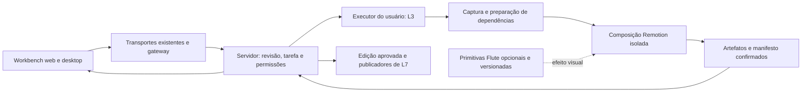

# Flute: análise e proposta de aproveitamento no marketing

Data: 15/10/2026. Revisão 2, após revisão de coerência, contratos, colaboração, execução e critérios de liberação. Objeto: cópia local de `C:\Users\tocha\Downloads\flute-main\flute-main`, cujo manifesto informa `@webprodigies/flute` 0.1.2. Este documento detalha o aproveitamento dentro da reestruturação em curso; não substitui a proposta principal nem modifica o estado dos lotes. [Achados e correções desta revisão](2026-10-15-flute-aproveitamento-marketing-review.md).

**Recomendação: aproveitar o Flute como referência e possível componente especializado de demonstrações visuais dentro da produção existente.** O maior valor está em três coisas: demonstrar o produto real, tornar as cenas editáveis por receitas e fornecer à IA instruções verificáveis sobre como produzir e revisar essas cenas. Remotion continua responsável pela montagem, pelo tempo do vídeo, pelo áudio e pela entrega final.

**Decisão de implementação proposta:** entregar as demonstrações com composições Remotion mantidas em `marketing-production`, usando as fontes reais e os contratos já previstos. Aproveitar do Flute o método de receitas, instruções de produção e verificação. A adoção de `Scene`/`Surface` fica condicionada a uma comparação técnica em L6C, com escopo e condição de encerramento definidos na seção 9. Não existe troca automática de motor por falha nem obrigação de instalar Flute para liberar L9.

As três receitas descritas abaixo são uma seleção inicial para demonstrar os efeitos básicos e as composições híbridas já exigidos em L6. Não acrescentam três entregas comerciais obrigatórias nem substituem gravação, cortes, áudio, legendas, sincronização ou importação do acervo.

## 1. O que foi analisado e qual é o estado do nosso app

Inventariei os 40 arquivos TypeScript/TSX de `src` do Flute, com 3.897 linhas, e os 29 arquivos de teste. A leitura aprofundou contratos, movimento, câmera/foco, integração React, catálogo, instruções para agentes, captura, exportação, integração com projetos e verificações de arquitetura. Também examinei exemplos, documentação, manifesto, licença e publicação. Trata-se de análise de adequação e reaproveitamento; não de certificação de segurança nem auditoria exaustiva de cada exportação.

No Sistema Zero, cruzei essa leitura com:

- [Proposta consolidada da reestruturação](2026-10-15-marketing-app-fluxo-editorial-proposta.md).
- [Plano de implementação em lotes](../superpowers/plans/2026-10-15-marketing-desktop-colaborativo-lotes.md).
- [Evidências e pendências de L0](2026-10-15-marketing-desktop-l0-evidencias.md).
- Código de `marketing-production`, executor e ponte de `marketing-desktop`, estrutura de `marketing`/`marketing-app` e referências editoriais P07/P08.

**O estado observado é L0 implementado como bancada e ainda em validação; L1–L11 permanecem pendentes.** Há código real para composição Remotion, prévia, render local e execução dos provedores. As evidências de L0 registram provas reais de texto, imagem e vídeo, mas não demonstram colaboração, biblioteca durável, importação integral ou operação cotidiana. As caixas abertas de L0 abrangem provas adicionais às execuções já registradas; uma prova parcial não encerra o item.

Precedência documental: a proposta consolidada governa o comportamento do produto; o plano governa dependências e critérios por lote; as evidências registram o que foi executado; este documento especifica uma aplicação desse desenho à produção de demonstrações. Contratos ainda inexistentes são requisitos propostos, não APIs disponíveis. Quando L1 materializar os contratos, os detalhes daqui devem ser acomodados neles, sem criar versões concorrentes dos mesmos conceitos.

Os contratos de L0 são de uma bancada: `story.ts` ainda usa URL de clipe e fps inteiro, e a ponte desktop recebe `StoryProps` diretamente. Não promover essas formas a protocolo colaborativo. L1/L3 já precisam estabelecer identidade durável de assets, revisão, fps racional, execução e resolução de arquivos; esta proposta consome esse trabalho.

As decisões existentes continuam fazendo sentido: Electron, componentes compartilhados com a web, servidor como registro oficial, execução pessoal de IA e Remotion incorporado. O Flute não resolve sincronização, contas, publicação, pesquisa ou métricas e não justifica reabrir essas decisões.

[Registro técnico, resultados dos testes e mapa das fontes](../../.audits/flute-marketing-2026-10-15/README.md).

## 2. O que o Flute realmente entrega

O Flute coloca subárvores reais de React em planos com posição, rotação e profundidade. Uma câmera percorre esses planos; o foco simula profundidade de campo usando transformações CSS e filtros SVG. A cena pode ser reproduzida, inspecionada em um instante específico, fotografada ou exportada em MP4. A descrição pública confirma esse foco em interfaces React existentes. [Repositório oficial](https://github.com/webprodigies-org/flute).

O fluxo implementado é:

1. Um agente externo lê o guia correspondente à versão instalada.
2. Produz um arquivo JSON com a receita e um componente TSX/JSX que referencia componentes do aplicativo.
3. Schemas validam câmera, superfícies, movimento e identidade dos arquivos.
4. A prévia usa um único tempo explícito para avaliar a cena.
5. Playwright captura os quadros no Chromium; FFmpeg os transforma em vídeo.

Ele não fornece o agente de IA nem faz autenticação no Codex/Claude. A biblioteca também não é um editor completo de filmagem: o exportador analisado usa `-an`, portanto a saída desse percurso não contém áudio. Não há nele o fluxo de transcrição, legendas, trilhas e cortes que o nosso L6 exige.

| Parte do repositório | O que há de concreto | Valor para nós |
| --- | --- | --- |
| `core/scene.ts`, `motion.ts`, `spatial.ts` | Schemas, interpolação por tempo, hierarquia espacial e cálculo de foco | Vocabulário e possível implementação de cenas de demonstração |
| `react/index.tsx`, `registry.ts`, `FocusFilter.tsx` | Associação de componentes vivos às superfícies e diagnóstico de composição | Preservar interface real e detectar enquadramentos tecnicamente inválidos |
| `core/recipes.ts`, `project/discovery.ts` | Receita versionada, ID estável, componente correspondente e erros de recuperação | Estruturar receitas reproduzíveis e editáveis |
| `core/authoring.ts` | Conceitos, capacidades, exemplo executável e critérios de revisão | Melhorar a produção assistida pela IA sem depender de prompts soltos |
| `preview/session.ts` | Última configuração válida, pausa após alterações, reprodução e busca temporal | Revisões que não destroem imediatamente a prévia utilizável |
| `export/commands.ts`, `services.ts` | Captura por quadro, espera por recursos, cancelamento e saída sem sobrescrita | Referência para contratos e testes de produção |
| `scripts/check-architecture.mjs` | Verificação de dependências e responsáveis por funções centrais | Proteger a divisão entre contratos, UI, processos locais e efeitos externos |

São soluções concretas, com testes relevantes. A estética de dashboard escuro das cenas locais, entretanto, é material de demonstração do Flute, sem relação direta com a identidade e a mensagem da Comunidade.

## 3. Onde está a oportunidade de marketing

Nossa oportunidade principal é **explicar melhor o que a criança faz e como uma decisão muda o jogo**. Perspectiva, aproximação e destaque devem dirigir a atenção para essa relação. Um vídeo que mostra apenas painéis girando tem pouco valor para um responsável que ainda não entendeu a atividade.

O acervo já contém uma base mais valiosa do que uma biblioteca genérica de efeitos: demonstrações reais, parâmetros registrados, copy revisada e composição visual. O Flute inspira a transformação desse trabalho em receitas que permitem produzir mais formatos e revisar detalhes com menos repetição.

| Prioridade | Aplicação | Como produzir | O que deve ficar claro |
| --- | --- | --- | --- |
| Alta | **“Uma mudança na regra, outro resultado”**, a partir de P07 | Mostrar a plataforma, aproximar a alteração e comparar as duas execuções verificadas | A criança observa, modifica e testa uma decisão concreta |
| Alta | **“Por trás do jogo”**, a partir de P08 | Relacionar a barra de vida, a condição do bloco e a ação registrada | O comportamento do jogo corresponde a uma regra criada |
| Alta | **Uma peça aprovada em novos formatos** | Reutilizar captura, copy e fontes em story animado, vídeo curto e capa | Continuidade da mensagem com menos remontagem manual |
| Média | **Um percurso curto pelo produto** | Escolher uma experiência disponível, mostrar ação no editor e resultado em execução | O que vem preparado e o que a criança modifica |
| Média | **Explicação visual na oferta e nos destaques** | Entregar vídeo/poster exportados com controles adequados ao destino | O visitante compreende uma capacidade específica antes de decidir |
| Posterior | **Demonstrações para o produto adulto** | Escolher atividades verificadas do curso e mostrar o processo real | A utilidade da atividade, sem simular resultados de alunos |

Essas aplicações são hipóteses de comunicação. A análise não demonstra aumento de conversão, retenção ou vendas.

### Primeiro piloto editorial: P07

Produzir uma representação derivada de um trecho de P07, mantendo intactos o carrossel original e sua copy. Selecionar a comparação que explica a mudança; ajustar o roteiro derivado à direção e ao CTA da pauta. A duração resulta da leitura e dos acontecimentos necessários, em vez de comprimir os sete slides em um prazo arbitrário. O roteiro adaptado passa pela revisão editorial prevista em L5/L6.

| Trecho sugerido | Conteúdo visual | Função |
| --- | --- | --- |
| Abertura | Recorte real do jogo com contexto suficiente para reconhecer a dificuldade | Apresentar a situação rapidamente |
| Observação | Destaque da distância da plataforma, com pausa para leitura | Mostrar o que merece ser investigado |
| Alteração | Aproximação do parâmetro ou bloco real; indicação editorial da mudança | Tornar a decisão visível |
| Comparação | Antes/depois, mantendo controles e enquadramento comparáveis | Mostrar o resultado observado |
| Encerramento | Mensagem e CTA aprovados para a pauta | Conectar a demonstração ao objetivo editorial |

O registro de P07 informa que a diferença entre as variantes é o `x` da segunda plataforma, 12 ou 7; pulo, velocidade e sequência de teclas foram mantidos. Essa evidência permite uma comparação mais forte do que uma animação inventada do efeito. Se houver apenas capturas, elas servem como estados comparados. Para mostrar o salto em movimento, é necessário obter uma gravação verificada da execução; interpolar os dois prints não prova a trajetória do jogo. Antes da produção, conferir a revisão vigente da copy, os arquivos disponíveis e o retrato congelado em L8A. [Produção de P07](../marketing/kids/comunidade-dos-criadores/instagram/producao/postagens/p07-primeira-dificuldade/apoio/v3/fontes-e-producao.md).

### Segundo piloto editorial: P08

Usar o material que já distingue asset gerado, runtime executado e bloco real. O foco visual pode passar da vida do Dragão para a condição do bloco. Mostrar a resposta em movimento exige gravação verificada desse momento; o registro textual da execução é evidência do comportamento, mas não é um clipe disponível. Manter o objetivo de atração e o convite para seguir da pauta, salvo nova decisão editorial explícita.

Preservar fatos: 70 de 160 está abaixo da metade; o dano-base do ataque é 22; a execução registrada terminou com derrota do herói naquela tentativa. O vídeo não deve criar uma vitória, mudar a comparação para “menor ou igual” nem apresentar o exemplo da equipe como resultado de aluno. O benefício de marketing é a inteligibilidade da regra. [Produção de P08](../marketing/kids/comunidade-dos-criadores/instagram/producao/postagens/p08-uma-derrota-nao-conta-tudo/apoio/fontes-e-producao.md).

## 4. O que aproveitar primeiro

### A. Guia de produção gerado a partir das capacidades reais

O guia do Flute descreve conceitos, mecanismos, escolhas, erros comuns e verificação, além de expor schemas e um exemplo executável. O agente recebe uma linguagem operacional correspondente à versão instalada.

Adaptar esse padrão à execução já prevista no marketing: o montador de contexto de L4 combina contratos e metadados das receitas com a disponibilidade real do executor de L3. Codex ou Claude recebe apenas as receitas relevantes, parâmetros aceitos, referências autorizadas, alvos protegidos e limites da tarefa, com suas versões. A capacidade deve ser verificada antes da execução; o guia não concede permissão, instala ferramenta ou habilita um recurso indisponível. As partes estruturadas vêm dos mesmos schemas usados na validação; as orientações editoriais mantidas acompanham a versão da receita. Não anexar todo o acervo nem duplicar o registro de capacidades.

Exemplos de intenções úteis: “aproxime o bloco sem mudar o jogo”, “deixe o texto imóvel e anime somente a captura”, “mude o encerramento”, “use o mesmo antes/depois em formato vertical”. O guia também deve explicar o que é referência real, material gerado e informação ainda não verificada.

Isso complementa os atalhos Ajustar, Gerar alternativas e Adaptar formato. Não exige um novo framework de agentes nem oferece geração ilimitada.

### B. Receitas com parâmetros separados do conteúdo

Uma receita deve identificar a composição e sua versão. A revisão da peça fornece copy, assets, enquadramento, tempos e referências. Alterar uma frase não exige recriar a imagem; trocar a imagem não deve apagar o roteiro.

O Flute tem receita JSON mais componente. No nosso produto, os parâmetros pertencem à revisão confirmada pelo servidor; código, dependências e bundle possuem identidade imutável. Ajustar parâmetros de uma receita conhecida e alterar seu código são operações diferentes. Ambas podem ser conduzidas pela IA, como exige L6C, mas uma mudança de código passa por preparação, validação e execução isolada antes de se tornar uma versão utilizável. A seção 6 define esse percurso, inclusive a retomada em outro computador.

Começar com três receitas mantidas:

- **Detalhe → contexto:** aproximar um bloco ou controle e revelar onde ele atua.
- **Regra → resultado:** relacionar uma decisão com o estado ou trecho de execução correspondente.
- **Antes → alteração → depois:** comparar mudanças verificadas, preservando o restante.

As três podem usar imagens, vídeo capturado ou componentes reais. Não precisam ter perspectiva 3D para serem úteis. O recurso visual mais complexo só entra quando melhora a leitura.

### C. Câmera e foco como ferramentas de explicação

Aproveitar enquadramento deliberado, movimento suave, entrada de elementos em sequência e passagem de foco. Adaptar a intensidade à leitura em celular e à paleta azul, branca e amarela usada nas referências.

O Flute fixa fundo preto em `Scene`, inclusive sobrescrevendo o fundo fornecido por estilo. A receita de marca decide se uma área preta faz sentido; ela não será introduzida para esconder uma incompatibilidade da biblioteca. Se a cena exigir fundo transparente, claro ou azul, o renderer só pode ser escolhido se oferecer essa capacidade por API pública compatível. No snapshot analisado isso não foi demonstrado. Usar a composição Remotion adequada à direção visual, sem CSS forçado sobre internals, alteração de globais ou fork incidental.

### D. Verificação visual e técnica como parte da receita

O Flute separa validação técnica de julgamento artístico. Essa distinção serve muito bem ao marketing: passar no schema não comprova legibilidade, fidelidade, força da mensagem ou benefício comercial.

Cada receita deve ter amostras de início, meio, fim e momentos críticos; teste do tamanho de saída; checagem de fonte, área segura, conteúdo protegido e correspondência com a fonte real. Se a revisão for inválida, preservar a última prévia válida e identificar claramente que ela pertence à revisão anterior. Não aprovar uma versão nova usando uma prévia velha.

### E. Miniaturas estáticas e reutilização

A biblioteca do Flute usa snapshots em vez de executar uma cena inteira em cada cartão. Aproveitar esse princípio na biblioteca do marketing, com miniaturas geradas por revisão e carregadas sob demanda.

Não copiar sua persistência de PNG em base64 dentro do JSON: o nosso acervo usa assets, hashes, R2/Drive e sincronização. A miniatura deve ser um derivado identificado, invalidado quando os insumos mudarem. A chave precisa considerar também fonte, componente, mídia e versão do motor; comparar apenas o JSON não comprova que os pixels continuam atuais.

## 5. Três caminhos e a decisão recomendada

| Caminho | Vantagem | Custo e limitação | Decisão |
| --- | --- | --- | --- |
| Incorporar o aplicativo Flute completo, com catálogo, prévia e CLI | Aproveita rapidamente o fluxo original para desenvolvedores | Acrescenta catálogo em arquivos, exportador sem áudio, comandos e outro controle de reprodução; não atende colaboração e operação sem terminal | Não adotar como fluxo do marketing |
| **Aproveitamento seletivo dentro de `marketing-production`** | Reutiliza ideias e, se comprovado, `Scene`/`Surface` sob o tempo do Remotion | Exige adapter pequeno, controle de recursos, prova visual e compatibilidade dos bundles | **Recomendado** |
| Usar apenas a inspiração e criar os efeitos necessários em Remotion | Menos dependências, identidade visual livre, aproveita a base já existente | Perspectiva e foco progressivo sofisticados exigiriam mais trabalho próprio | Preferível para cenas simples e se a prova do renderer não compensar |

O caminho recomendado começa pelo valor editorial e pelos contratos. A base de produção usa Remotion; a dependência Flute só entra em uma receita identificada se demonstrar vantagem e passar pelos critérios da seção 9. A decisão ocorre antes de confirmar aquela versão da receita. Depois disso, trocar o renderer exige uma nova versão/revisão e nova conferência; uma falha nunca dispara substituição visual silenciosa. Não recomendo copiar todo o código, manter um fork completo ou tornar esse pacote requisito transversal do monorepositório.

A licença presente é MIT, com exigência de preservação do aviso de copyright e da licença em cópias ou partes substanciais. Qualquer código efetivamente incorporado deve manter a atribuição. Licenças de fontes, imagens e demais materiais são tratadas separadamente conforme sua origem.

## 6. Integração com contratos, execução e colaboração

### 6.1. Responsabilidades e direção das dependências

As setas para o executor representam uma tarefa destinada à própria identidade e autorizada por ela, não controle remoto de qualquer computador da equipe. O executor usa a fila, concessão temporária e eventos de L3.

| Área | Responsabilidade neste aproveitamento | Dependências permitidas |
| --- | --- | --- |
| `marketing-contracts`, previsto em L1 | Envelope de operação, identidade de revisão/asset, versões e parâmetros serializáveis publicados das receitas | Schemas puros; sem React, Flute, Electron, DOM ou Node |
| `marketing-production` | Composições, metadados das receitas, validação visual específica e tradução interna para eventual Flute | Consome contratos; composições compartilháveis não importam serviços nativos |
| `marketing` | Autorização, validação de entrada, revisões, dependências, tentativa e confirmação de artefatos | Consome contratos puros; não importa o renderer para decidir acesso ou gravar dados |
| `marketing-workbench`, web e renderer desktop | Pedidos, diferenças, prévias, seleção e estados de sincronização | Consomem contratos e componentes seguros; código de renderização Node fica fora do bundle |
| Executor/media de `marketing-desktop` | Workspace, captura, build isolado, render, cancelamento, cache e transferência | Usa serviços locais restritos e gateway; sem shell genérico na ponte |

Os schemas de transporte têm um dono em `marketing-contracts`. O pacote de produção os importa e associa à implementação; validações específicas do Flute permanecem privadas ao adapter. Não duplicar schemas em backend, preload, guia e UI. O catálogo é uma lista mantida de receitas suportadas, não um registro extensível de plugins, esquemas executáveis enviados pela IA ou workflows configuráveis.

### 6.2. Identidade e dependências de uma demonstração

Usar os objetos já definidos em L1: peça → representação → revisão; rascunho aponta para a revisão corrente; edição aprovada fixa a entrega; publicação registra o envio. Receita, captura e tarefa não criam identidades editoriais concorrentes.

| Informação necessária | Objeto existente que a recebe | Regra |
| --- | --- | --- |
| Produto/exemplo, versão e hash do snapshot executado, parâmetros, ações e quadro/intervalo observado | Evidência e referência da demonstração | Registrar adaptações e distinguir estado observado de hipótese; commit sozinho não identifica arquivos locais alterados |
| Receita, versão do schema, código/bundle e renderer | Representação/revisão e dependências da produção | Referências imutáveis; nunca “última receita” |
| Textos, cenas, intervalos e elementos selecionáveis | Componentes e projeto de vídeo | IDs estáveis; sequência e efeitos dependentes participam do controle de conflito |
| Original, proxy, captura, fontes, miniatura e final | Assets e grafo de dependências | IDs e hashes; caminhos locais e URLs assinadas são resolvidos no ambiente, não persistidos como identidade |
| Base, intenção, escopo protegido, capacidade e limites | Solicitação/tentativa de L3 | Autor e dispositivo vêm da autenticação; a tentativa não altera sua base em andamento |
| Timeline, parâmetros, fontes, assets, bundle, motores e configuração de saída | Manifesto de render | Uma chave identifica insumos; o hash do arquivo final identifica os bytes efetivamente aprovados |

Todo acesso a um asset exige autorização no projeto, mesmo quando o hash já existe no armazenamento. Artefatos compartilhados conservam vínculo ao conteúdo conforme o serviço de mídia; deduplicação de bytes não transfere permissão nem autoria.

### 6.3. Percurso de um pedido, sem confirmação redundante

1. A pessoa seleciona a peça/componente e pede Ajustar, Gerar alternativas ou Adaptar formato. O cliente inclui o rascunho recém-editado. Na passagem web → desktop, confirma a base pelo protocolo existente antes de iniciar a execução; o link carrega referência opaca, sem comando, arquivo ou token.
2. O serviço verifica projeto, papel, dependências, versão e disponibilidade. Cria a operação idempotente e a tentativa para o executor autorizado, congelando contexto e limites. Pedido apenas preparado pode aguardar desktop; isso não equivale a execução iniciada.
3. O executor resolve arquivos autorizados e versões, reaproveita capturas/bundles válidos e executa somente as etapas necessárias. Preserva artefatos concluídos e manifesto antes de avançar. Um ajuste de texto não recaptura o jogo nem chama geração de imagem.
4. Parâmetros ou código alterado passam pelo percurso de validação correspondente. O progresso distingue preparação, geração, captura, build, prévia/render e upload. Um arquivo pronto só localmente é mostrado como pendente.
5. O serviço confirma artefatos e valida o resultado contra a revisão-base. Ajuste explícito produz nova revisão aplicada ao rascunho com Desfazer; alternativas aguardam escolha; adaptação cria representação derivada. A operação de aplicar e seu evento são transacionais.
6. Resultado atrasado fica ligado à base original. Conciliar apenas alterações semanticamente compatíveis; cenas distintas ainda podem conflitar se uma alteração mudar duração, ordem ou fonte compartilhada. Nunca sobrescrever o rascunho mais recente por horário de chegada.
7. A revisão confirmada pode ser consultada pelo colega. Prévia e manifesto não constituem aprovação final: L7 fixa os arquivos finais conferidos, legenda, ordem, alt e revisão exatos.

Uma revisão de parâmetros pode ser sincronizada após validação, sem esperar exportação final. O estado dos arquivos é independente: indicar prévia pendente, prévia disponível ou final confirmado, conforme o que existe. Renderizar o final quando solicitado ou ao preparar aprovação/distribuição; editar texto ou abrir a prévia não dispara obrigatoriamente um MP4 novo. Um resultado só é anunciado como integralmente disponível quando suas dependências exigidas estiverem confirmadas.

Falha de rede, cota, fechamento e retomada usam as regras de L3. Uma tentativa sem concessão válida não confirma efeito sobre a nova tentativa; timeout após commit é reconciliado pelo mesmo ID de operação. Não iniciar novas etapas sem coordenação quando o servidor estiver indisponível; uma etapa local já iniciada pode terminar e preservar seu resultado. Cancelamento conserva originais e resultados aproveitáveis, interrompe novas etapas e não publica automaticamente o que terminou. Uma falha determinística permite correção limitada pelos limites da tentativa, sem loop de inferência, troca silenciosa de provedor ou novo renderer.

### 6.4. Código de receita, isolamento e continuidade

Uma alteração apenas de parâmetros usa a composição validada da receita. Uma alteração de código autorizada pelo pedido é produzida em workspace de tarefa, preserva a fonte anterior e passa por schemas, typecheck/build, verificação de dependências e teste da composição. Mudança compatível pode gerar nova versão de receita; mudança no schema compartilhado exige um contrato versionado suportado pelo servidor e pelos clientes. Não aceitar um schema executável definido pela resposta do modelo.

Código recebido ou produzido pela IA continua sendo conteúdo a isolar, mesmo após compilação. O build usa as ferramentas locais preparadas, com acesso restrito ao workspace e às dependências declaradas; não recebe credenciais do app, sessões de provedores nem acesso ao repositório inteiro. A composição executada no navegador não recebe Node, IPC ou ponte nativa. Importações ficam limitadas às dependências permitidas; não instalar pacotes sugeridos livremente durante uma tarefa. Conteúdo e referências não concedem novas ferramentas ao agente. Separar um processo ou fazer typecheck não substitui isolamento e controle de acesso. A implementação dessa fronteira precisa de prova em L6C; o protótipo L0 não a demonstra.

Composições empacotadas e confiáveis podem usar o Player do workbench. Uma receita modificada dinamicamente não é importada no renderer privilegiado: usar a fronteira de preview isolada prevista no produto, sem ponte Electron, ou a mídia de revisão daquela composição. Falta de prévia interativa não impede revisar por proxy; ausência do isolamento necessário impede executar código novo e deve ser resolvida em L6C, sem adiar a capacidade exigida para L11. O isolamento é consistente com as fronteiras do plano principal e as [orientações do Electron](https://www.electronjs.org/docs/latest/tutorial/security).

Persistir pelo fluxo de assets as fontes necessárias da receita, manifesto de dependências e artefatos de build, com hash, versão e compatibilidade. Preservar a origem e restringir acesso aos mesmos projetos autorizados. L3 transfere somente esse conjunto declarado, sem cache de CLI, credenciais, `node_modules` ou pastas pessoais. O segundo desktop usa o bundle compatível ou reconstrói a mesma fonte no ambiente isolado e versionado; se não conseguir, conserva a prévia e informa a capacidade ausente. Reconstrução registra o artefato obtido; não presumir bytes idênticos entre ambientes nem substituir o final aprovado. Um hash comprova integridade, não segurança do código.

A preparação é automática dentro da operação solicitada, com falhas acionáveis no app. Não exigir que o usuário rode `npx flute init`, mantenha um dev server aberto, copie TSX ou aprove cada ferramenta. Os wrappers de desenvolvimento do Flute não são a integração de produção proposta.

### 6.5. Tempo, prontidão e fidelidade da composição

Remotion continua dono do tempo e da montagem. Eventual adapter usa `Scene`/`Surface` pela exportação pública da biblioteca, sem `ScenePreview`, catálogo, captura global ou relógio próprio do Flute. A fórmula de referência é `timeMs = 1000 × frameLocal / fps`; `frameLocal` é relativo ao início da cena, não necessariamente o frame absoluto do vídeo. Dentro de componentes temporalmente deslocados, o hook já pode devolver tempo relativo; não subtrair o deslocamento duas vezes. [Referência de frame](https://www.remotion.dev/docs/use-current-frame).

O contrato conserva fps racional e duração em unidades de L1/L6B, com conversão explícita e arredondamento definido nas fronteiras. O adapter inicial fixa `speed: 1` no Flute; a velocidade da cena é resolvida pelo projeto de vídeo, evitando aplicar uma segunda escala. O padrão 0,5 da biblioteca não pode mudar silenciosamente a duração. Cortes, velocidade de filmagem, áudio e timestamps de legenda continuam no mesmo mapeamento temporal de L6B, sem implementações paralelas no Flute.

Fontes, imagens, mídia e medidas necessárias ao registro das superfícies precisam atingir condições verificáveis antes de capturar o frame. Usar a coordenação de prontidão do renderer e os estados de carregamento da prévia, com timeout diagnóstico e cancelamento; falhas de fonte/asset não são ignoradas. Não inserir um atraso fixo para “estabilizar o DOM”. O Remotion oferece mecanismos para aguardar recursos antes da captura, mas a integração com o registro de superfícies precisa ser demonstrada. [Prontidão do render](https://www.remotion.dev/docs/delay-render).

Testar frames iniciais, finais, intermediários e fora de ordem, remontagem e execução em mais de uma página de render. Não depender de um frame anterior para obter o seguinte. Animações próprias do conteúdo devem consumir o tempo explícito ou entrar como mídia previamente capturada. [Animação orientada a frame](https://www.remotion.dev/docs/animating-properties).

Prévia e final usam a mesma composição, parâmetros e dependências. Resolução de proxy pode diferir, mas tempos, textos, enquadramento e fontes devem corresponder. Configurações de bundler e suporte a CSS, SVG, fontes e imagens precisam ser verificadas no web, Electron e renderizador instalado. A biblioteca ser compatível com React 19 não comprova esses caminhos. [Compartilhamento de composição](https://www.remotion.dev/docs/player/integration).

### 6.6. Fonte real: captura e componente vivo

**Captura verificada como mídia é o percurso inicial.** Executar exemplo/runtime por versão, preservar as entradas e registrar o resultado. Para P07/P08, aproveitar primeiro os arquivos elegíveis reconciliados em L8A. Um script ou HTML importado é uma fonte a classificar; transformá-lo em receita executável exige preparação no ambiente isolado de L6A/L6C. Importação não executa código nem concede privilégios.

O módulo de captura registra o snapshot efetivamente usado, parâmetros, ações, condições de prontidão, viewport, instante/intervalo e resultados observados. Se runtime ou dependência estiver ausente, conservar a captura existente e informar que nova captura está indisponível. Uma atualização do produto não substitui silenciosamente a versão da demonstração. Recaptura gera outro asset/evidência e passa pela conferência da alteração.

**Componente React vivo só entra quando sua fronteira é adequada.** Reutilizar componentes do produto com dados controlados e providers mínimos, sem duplicar sua aparência em uma implementação paralela. O módulo de produção não importa indiscriminadamente todo o app, autenticação ou componentes server-only. Se não houver fronteira reutilizável segura, usar captura real; eventual extração de componente deve ter escopo próprio, sem reformar pedagogia ou runtime para satisfazer uma peça.

O runtime 2D do Studio usa tempo próprio e `requestAnimationFrame`. Gravá-lo e usar a gravação como mídia preserva a execução observada. Controlar sua simulação por frame é outra capacidade, não fornecida pelo Flute. Sincronização profunda de aplicativos completos pode ser expansão de L11; executar e capturar exemplos reais continua obrigatório em L6A.

### 6.7. Compatibilidade, revisão no web e atualização

Antes de montar ou renderizar, resolver compatibilidade entre schema, receita, bundle, renderer, dependências e cliente. Registrar a decisão de capacidade no mecanismo existente. Falta de versão compatível nunca troca a receita por outra ou transforma edição limitada em edição completa.

| Condição | Comportamento no web/desktop |
| --- | --- |
| Receita conhecida e dependências prontas | Prévia interativa pela composição correspondente |
| Prévia interativa indisponível, mídia confirmada disponível | Mostrar proxy/final da revisão identificada; manter comentários e pedidos suportados |
| Última prévia pertence a outra revisão | Identificar revisão antiga e pendência; não apresentá-la como resultado do ajuste atual |
| Schema/receita não suportado pelo cliente | Consultar mídia disponível; indicar atualização/capacidade requerida antes de editar campos desconhecidos |
| Nova captura ou render exige execução local | Abrir a mesma peça/revisão/seleção pelo mecanismo web → desktop de L2/L3 |
| Fonte/asset foi invalidado ou perdeu autorização | Bloquear operações dependentes no serviço e oferecer diagnóstico; não contornar pelo cache |

Atualização de biblioteca/receita preserva as versões referenciadas por revisões existentes e ocorre após checkpoint, conforme L2/L3. Migração gera nova revisão explícita. Se uma versão não puder mais ser executada com segurança, bloquear sua execução, conservar artefatos autorizados e oferecer migração; não chamar isso de reprodução equivalente. Retirar o Flute de uma versão futura não muda o render aprovado de uma versão anterior.

### 6.8. Cache, retenção e publicação

A chave de cache inclui revisão de timeline, parâmetros, hashes de assets/fontes/código/bundle, versões do renderer e perfil de saída. Reusar um resultado exige autorização vigente e verificação de integridade. Alterar uma dependência invalida os derivados que a usam, sem apagar originais. Preservar insumos enquanto houver referência ativa; restauração deve recuperar bytes utilizáveis, não apenas um link do Drive.

Uma mudança de legenda pode dispensar render; uma mudança de texto na imagem exige render da composição afetada, mas não nova imagem de IA. Identificar a menor dependência alterada não garante render parcial do arquivo final: se o encoder precisar reconstruir todo o MP4, fazê-lo com os insumos já reaproveitados. Não inventar um cache de segmentos ou segundo motor de timeline para prometer uma economia não medida.

L7 fixa o final confirmado, suas dependências, texto, legenda, ordem, alt e verificações. Criar rascunho novo não invalida automaticamente edição antiga válida; invalidar evidência factual ou retirar aprovação bloqueia o envio dependente, inclusive na tomada da tarefa pelo publicador. Revalidar também acesso e arquivos. Publicação externa incerta segue a reconciliação existente, sem repetição cega.

Adaptação cria representação, não postagem automática. Story de imagem para vídeo mantém o conceito story/`ig_story`, com mídia e validações diferentes. Nova postagem no mesmo formato de conteúdo já publicado respeita o conteúdo derivado e as restrições de unicidade atuais; não cancelar histórico para contorná-las. Gerar derivados compatíveis com cada destino, incluindo JPEG quando requerido pelo publicador de imagem atual. Uma peça pode ser conferida no formato 4:5 sem que todo destino aceite seu vídeo. A entrega obedece às regras do publicador, não aos limites do CLI Flute.

O executor começa com um trabalho pesado de captura, transcrição ou render por dispositivo, conforme o plano. Paralelismo interno de frames é uma configuração desse trabalho, não autorização para vários jobs pesados. Medir fila, preparação, captura, render, upload, RAM/disco, responsividade e intervenções humanas em L3/L6/L9. Priorizar texto e miniaturas na sincronização; cache não remove pendências ou arquivos irrecuperáveis.

## 7. Limitações relevantes para decidir o reaproveitamento

| Evidência encontrada | Implicação concreta |
| --- | --- |
| Exportador usa screenshots PNG sequenciais e FFmpeg com `-an` | Não substitui o pipeline de áudio/vídeo do marketing; não presumir export rápido em resolução alta |
| Captura limitada a 120 segundos, 30/60/120 fps e dimensões pares até 3840 por lado | São limites do exportador CLI do Flute, não limites a impor ao nosso contrato de vídeo |
| Prévia usa escala `cover` e recorta excedentes | Trocar 16:9 por 9:16 exige reenquadramento editorial; um crop automático pode esconder o fato demonstrado |
| `Scene` força fundo preto | Se a direção exigir outro fundo, usar composição nativa; não corrigir internals com CSS forçado |
| CLI abre página nova e não transfere cookies/sessão do navegador do usuário | Uma tela autenticada disponível ao operador pode não aparecer no exportador |
| Guarda de rede impede navegação externa, mas não todos os subrecursos/requisições | Não usar esse código como sandbox de receitas geradas ou conteúdo não confiável |
| Espera por imagens ignora erro de `decode`; não existe prontidão semântica genérica do produto | Um quadro pode estar tecnicamente capturável e ainda conter mídia faltando ou estado incompleto |
| Catálogo de desenvolvimento carrega os módulos fornecidos e tem teto de 128 pares | Serve a um projeto de código; não é arquitetura para todo o acervo editorial compartilhado |
| Receita tem versão de schema; estado de reprodução é em memória | Não equivale ao histórico de revisão, retomada e colaboração exigidos pelo marketing |
| GitHub Actions publica/builda, mas não executa as suítes de verificação | Fixar versão e validar atualizações; publicação de pacote não prova testes aprovados |

O repositório tem proteções úteis de caminhos, escrita e exportação. Elas foram construídas para um agente operando código local confiável e não substituem isolamento de execução, permissões por usuário e validação de origem do nosso produto.

## 8. Ajustes propostos aos lotes existentes

Esta tabela localiza os refinamentos nas responsabilidades existentes; não altera dependências, caixas de conclusão ou critérios de liberação. As garantias de contratos, código isolado, colaboração e publicação já pertencem à reforma. A investigação adicional é a comparação opcional do renderer Flute.

| Lote | Refinamento sugerido | Relação com o plano atual |
| --- | --- | --- |
| L0 | Nenhuma nova obrigação | Fechar as provas já pendentes; Flute não resolve nem bloqueia assinaturas |
| L1 | Incluir referências de demonstração, receita/bundle e dependências nos schemas puros compartilhados | Concretiza proveniência, revisão e projeto de vídeo, sem protocolo concorrente |
| L2 | Provisionar capacidades suportadas no app instalado e manter a abertura da peça/revisão/seleção | Usa identidade, compatibilidade e atualização existentes; nenhum CLI exigido do usuário |
| L3 | Aplicar limites, checkpoints, estados, manifesto e transferência às fontes e composições | Reutiliza executor/sync e começa a medição de produção |
| L4 | Montar guia a partir de schemas, receitas disponíveis, fontes e direção vigente | Contexto versionado e autorizado, ligado à hipótese da pauta |
| L5 | Preservar alvos e base; diferenciar ajuste, alternativas, adaptação e conflito | Mesmas operações para copy, cena e receita, sem confirmação extra de ajuste explícito |
| L6A | Conferir P07/P08 e preparar capturas/fontes reutilizáveis, com origem e estado real | Usa a amostra de L8A; imagens existentes não viram gravações fictícias |
| L6B | Manter Remotion como composição e tempo únicos, com áudio, cortes e legendas | Não importar o exportador do Flute nem um segundo controle de reprodução |
| L6C | Usar as receitas como exemplos dos efeitos/híbridos previstos; validar código isolado; comparar Flute somente se útil | As capacidades básicas continuam obrigatórias; a biblioteca é opcional |
| L7 | Fixar edição/final/dependências e disponibilizar as métricas existentes confiáveis | Validação no envio, retenção e distinção entre dado ausente e zero |
| L8A | Inventariar, congelar origem/hash, classificar e preparar amostra de P07/P08 | Começa após L1/L3/L4; não espera L6 pronto nem executa scripts importados |
| L8B | Reconciliar montagens/fontes e todo o acervo elegível após L5–L7 | Preserva originais, limitações e conflitos; não atribui aprovação fictícia |
| L9 | Exercitar demonstração, ajuste, continuidade e análise no piloto já requerido | Continua exigindo L0–L7/L8A/L8B; P07/P08 não substituem as outras amostras do plano |
| L10 | Expandir fontes, comparações e acompanhamento recorrente dos resultados | A primeira leitura de métricas e próxima hipótese ocorrem em L7/L9 |
| L11 | Avaliar controle por frame de runtime completo e outras expansões quando houver demanda | Não adia captura real, edição de código isolado, vídeo ou efeitos básicos de L6 |

As três receitas podem compartilhar a mesma composição parametrizada quando isso bastar; não criar três motores ou abstração genérica para preservar os nomes. P07/P08 são candidatos a exercitar a produção existente, não razão para exigir três novas campanhas antes de L9. O roteiro completo do piloto, incluindo P01/P34 e a conferência de P29, permanece vigente.

## 9. Prova técnica pequena e decisão de adoção

### 9.1. Comparação opcional em L6C

Depois de existir a composição básica, comparar uma cena em duas implementações: Remotion nativo e a mesma composição com as primitivas públicas do Flute. Usar a mesma captura verificada, detalhe de bloco, texto, duração, direção visual e perfil de saída, em 9:16 e 4:5. A dimensão 4:5 testa adaptação; não constitui garantia de publicação em qualquer canal. Não acrescentar outra geração de imagem, autenticação social, publicação ou alteração do runtime.

Registrar versões, hardware, arquivos de entrada e limite de tempo/reparos antes da prova, conforme os limites de L1/L3. Encerrar ao alcançar esse limite; não expandir o ensaio para corrigir o Flute inteiro. Se houver bloqueio estrutural, como fundo incompatível que só se resolveria alterando internals, encerrar esse caminho. A composição Remotion permanece a entrega prevista, sem troca de motor escondida durante uma tarefa.

| Critério eliminatório | Evidência esperada da comparação |
| --- | --- |
| Tempo e determinismo de composição | Mesmos estados nos frames de início/fim/instantes críticos, busca fora de ordem e remontagem; duração correta e um único relógio |
| Prévia e final | Composição correspondente no Player do web/desktop e render local; mesmos textos, fontes, enquadramento e temporização |
| Fontes e medidas prontas | Fontes/imagens carregadas e superfícies medidas antes da captura; erro acionável quando falta dependência, sem espera fixa |
| Marca e conteúdo | Leitura em celular, áreas seguras, ausência de corte relevante e correspondência aos fatos/copy protegidos; sem coerção da marca ao fundo preto |
| Dependências e instalação | Apenas API pública, versão fixada e dependências provisionadas; fluxo do app instalado sem terminal, CDN ou dev server manual |
| Operação e desempenho | Cancelamento, diagnóstico e responsividade; registrar preparação/render, RAM, tamanho do bundle e trabalho manual nas duas implementações |

A adoção exige todos os critérios acima e uma vantagem descrita com evidência: melhorar a compreensão da comparação na revisão editorial ou reduzir trabalho de produção com qualidade equivalente. Registrar também o custo adicional de render, memória, pacote e manutenção. A preferência estética isolada não demonstra ganho de marketing. Aplicar os limites operacionais medidos em L3/L6; não inventar um limite universal de render nesta análise. Sem vantagem clara ou com evidência incompleta, manter a composição nativa. Havendo vantagem, incorporar a dependência apenas à versão daquela receita e manter sua atribuição/licença.

### 9.2. Validação integrada nos lotes já obrigatórios

Os cenários abaixo valem também para receitas sem Flute. Não são pré-requisitos para iniciar o ensaio de renderer nem um novo lote; são a aplicação dos critérios atuais às demonstrações.

| Lotes | Cenário | Resultado exigido |
| --- | --- | --- |
| L1/L3/L5 | “Mude só o encerramento”, repetição da operação e edição concorrente | Nova revisão com Desfazer, insumos protegidos preservados, sem duplicação e sem sobrescrever conflito |
| L6C | IA ajusta código da cena e tenta usar recurso não permitido | Receita válida passa pelo isolamento; acesso proibido é bloqueado; build não torna código confiável |
| L3/L6/L9 | Interromper upload, fechar/reabrir e continuar em outro computador | Retomar artefatos e revisão confirmados, sem repetir inferência desnecessária nem transferir sessão privada |
| L2/L3/L6/L9 | Segundo cliente sem versão ou dependência suficiente | Diagnóstico de capacidade; mídia da revisão correta quando disponível; nenhum renderer alternativo silencioso |
| L7/L9 | Aprovar final, gerar outro rascunho e depois invalidar fonte | Rascunho não substitui edição; invalidação factual bloqueia o envio dependente, inclusive na tomada pelo worker |
| L8A/L8B/L9 | Importar P07/P08 e retomar sua produção | Originais preservados, limitações declaradas e nenhuma execução/aprovação criada pela importação |
| L7/L9 | Consultar resultados disponíveis e propor a próxima pauta | Edição publicada/objetivo rastreáveis; dado ausente distinto de zero; hipótese com limites explícitos |

Na carga do piloto, manter as metas propostas no plano: resposta de UI p95 ≤100 ms e revisão pequena confirmada visível ao colega p95 ≤3 s em conexão saudável. Registrar hardware/rede e medir inferência, upload e render separadamente; essas metas não são prazo de geração. Se o Flute for incluído, ele participa dessa validação na mesma composição adotada. Se não for, nada deste cenário obrigatório desaparece.

Esforço incremental esperado: baixo para guia/critério de revisão; médio para as primeiras receitas e adaptação de assets; médio e ainda incerto para integração das primitivas; alto para controlar ao mesmo tempo renderização, estado e relógio de aplicativos completos. Não há base nesta análise para prometer um número de dias ou economia percentual.

## 10. Como avaliar se melhorou o marketing

Separar produção de efeito comercial. L3 instrumenta a produção; L7 disponibiliza métricas existentes/importadas confiáveis; L9 fecha uma primeira leitura e próxima hipótese. L10 amplia esse ciclo com novas fontes e monitoramento recorrente. Reutilizar a estrutura de métricas atual, sem segundo coletor.

| Pergunta | Evidência proposta |
| --- | --- |
| Produzimos mais facilmente? | Tempo humano até aprovação, número de revisões, intervenções fora do app e reutilização de assets |
| A explicação ficou compreensível? | Em uma revisão com responsáveis, verificar se conseguem dizer o que foi alterado e o que aconteceu |
| O vídeo funciona no destino? | Legibilidade, compreensão sem áudio, áreas seguras, ritmo e consistência da mensagem |
| O criativo melhorou o resultado? | Comparar variantes com objetivo, público e distribuição comparáveis; usar métricas disponíveis vinculadas à edição efetivamente enviada |

Priorizar o antes/depois de P07; P08 e outra adaptação são próximos candidatos conforme a pauta, não um pacote obrigatório de publicações. Registrar a hipótese visual antes de produzir e manter gancho, CTA e distribuição tão comparáveis quanto possível ao avaliar variantes. A revisão de compreensão deve pedir ao avaliador que descreva a mudança e o resultado, sem antecipar a resposta. Não confundir a opinião da equipe com validação do público-alvo.

Registrar origem, período, denominador, cobertura e ausência de métricas. Retenção, clique e conversão só entram quando a fonte as oferece e a associação é válida para o objetivo; não criar atribuição de venda para um conteúdo sem rastreamento. Para P08, preservar o objetivo de atração. O plano já exige corrigir zeros artificiais e dados legados ambíguos em L7. Comparações observacionais geram hipóteses, não prova causal de que “3D converte melhor”.

## 11. Resultado da verificação e limites desta proposta

Na análise técnica original, executei typecheck, builds da biblioteca e dos fixtures, verificação de arquitetura, uma bateria de 429 testes Vitest e oito testes reais de navegador. A bateria inicial teve 408 aprovações e 21 falhas, investigadas em rodadas dirigidas. Após instalar o Chromium exigido, os testes de exportação tiveram 15 aprovações em 17; as duas falhas restantes aconteceram na criação de links simbólicos, recusada pelo Windows. Os oito testes de navegador passaram. Esses resultados pertencem às execuções registradas na auditoria; a revisão 2 é documental e não representa nova execução das suítes.

A arquitetura estática passou; sua suíte teve 141 aprovações e uma falha pelo mesmo impedimento de symlink. A repetição de dois arquivos de projeto teve 88 aprovações em 98, com nove falhas de symlink e uma falha de recuperação que passou isoladamente. Houve também timeout na primeira bateria que não se repetiu nessa execução dirigida. Não atribuo uma causa definitiva às ocorrências transitórias nem declaro a suíte inteira aprovada.

Essas evidências sustentam que há implementação funcional para estudar e aproveitar seletivamente. Não comprovam integração Flute–Remotion–Electron, desempenho com o Studio/Molda, ganho de marketing ou qualificação de todos os caminhos de instalação. A suíte de desempenho em GPU, a matriz de instalação Next/React e o processo completo de release não foram executados.

**Decisão proposta:** produzir demonstrações em Remotion com fontes verificadas, receitas versionadas, guia de capacidades e revisão visual; priorizar P07 e usar P08 como próximo exemplo. Considerar o renderer Flute somente na comparação opcional de L6C. Contratos, isolamento, colaboração, aprovação e primeira análise seguem os lotes existentes. A revisão fecha ambiguidades de desenho identificadas; compatibilidade operacional será comprovada nas implementações e validações correspondentes, sem declarar integrado algo que ainda não foi construído.
