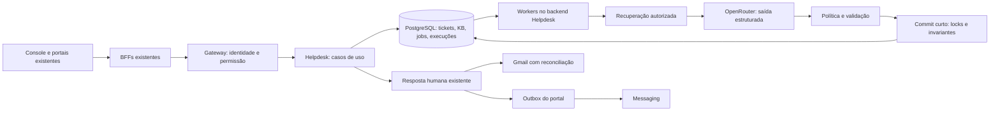

# Helpdesk do Sistema Zero: conhecimento confiável e automação gradual

> Implementação iniciada por autorização posterior do usuário, com atualização conjunta dos consumidores (Helpdesk ainda sem usuários). O texto abaixo preserva a análise original. Consulte o [registro dos lotes e revisão final](../superpowers/plans/2026-10-15-helpdesk-ia-kb-implementacao.md) e o [guia operacional](../helpdesk/operacao-ia.md) para o estado implementado.

Data: 15/10/2026. Revisão 2. **Proposta de evolução; não implementada.**

Esta é a proposta vigente. Substitui o desenho e as estimativas iniciais da [análise do Echo](../../.audits/architectural-analysis-2026-10-15-echo-helpdesk.md). A prioridade é automatizar atendimento com IA e conhecimento aprovado, mantendo o Helpdesk como sistema responsável pelo chamado.

## 1. Decisão e resultado esperado

Evoluir o backend, o console e o portal existentes. Primeiro, corrigir o contexto e entregar uma KB com revisões, recuperação por trechos, evidências e avaliação. Depois, habilitar respostas automáticas em assuntos delimitados no portal autenticado, com transferência para a equipe na mesma conversa.

O Echo serve como referência de experiência, não como dependência de execução. Não incorporar Convex, Clerk, outro cadastro, outro histórico ou outro console. Manter Bun/Elysia, Drizzle/PostgreSQL, OpenRouter, Next.js, gateway, sessão HttpOnly, componentes compartilhados e entrega Gmail existentes.

O sucesso tem três dimensões: resposta sustentada por conteúdo vigente; cliente que confirma solução ou consegue chegar à equipe; operação que consegue explicar, interromper e auditar a automação. Uma resposta gerada não equivale a um problema resolvido.

**Primeiro incremento utilizável:** contexto do portal corrigido + KB por trechos + rascunho com fontes + avaliação interna, ainda com envio humano. **Primeiro piloto autônomo:** apenas novos tickets nativos do portal, em clientes atualizados, de temas aprovados e sem ações sobre a conta.

Ficam fora desse piloto: autoenvio Gmail, voz/Vapi, WhatsApp, atendimento anônimo, acesso por perfil infantil, cobrança/reembolso executados pelo modelo, ferramentas de escrita em Auth/Payments/Members, indexação indiscriminada de aulas, OCR, crawler de URLs arbitrárias e migração de stack. Busca vetorial e importação de arquivos são incrementos condicionais, não pré-requisitos artificiais.

## 2. Review: lacunas da primeira proposta e decisões que as fecham

| ID | Lacuna ou incompatibilidade encontrada | Decisão desta revisão | Como comprovar na implementação |
|---|---|---|---|
| R01 | A recuperação melhorava sem definir uma revisão publicável e autorizada | Separar edição, revisão imutável, índice pronto e publicação; público validado no servidor | Alterar rascunho não muda a resposta publicada; retirar publicação bloqueia novos commits |
| R02 | A mesma fila de IA poderia servir a rascunho e envio; `summarize` hoje marca IA concluída | Job de resposta automática separado de `ai_status`, compartilhando o motor de inferência | Resumir/regenerar não envia nem consome job autônomo |
| R03 | `appendPortalReply` atual exige notificação e muda o ticket para `waiting` | Política explícita de autoria, status, SLA e notificação; comando próprio para publicação automática | Bot não aparece como humano, não dispara aviso humano e não conta como resolução |
| R04 | `source='portal'` não determina o canal real | Só automatizar quando `source='portal' AND gmailThreadId IS NULL` | Ticket legado com thread Gmail permanece no fluxo Gmail humano |
| R05 | “Revalidar antes de enviar” deixava janela entre checagem e gravação | Revalidação e publicação em transação curta, com locks compartilhados com retirada/takeover | Corridas reais no PostgreSQL demonstram exclusão e ausência de duplicação |
| R06 | Takeover não especificava atribuição, notas e versões | Toda intervenção operacional de staff invalida autonomia atomicamente; simples leitura não | Nota, reply e atribuição concorrentes impedem resposta posterior do bot |
| R07 | Contratos do portal não carregam autoria nem evidências | Projeções públicas próprias, distintas das internas; capability de interface só controla adesão ao piloto | Nenhuma nota, e-mail interno, prompt ou fonte restrita chega ao cliente |
| R08 | Copiar upload/streaming do Echo não funciona com BFF JSON | Texto/Markdown via JSON e atualização periódica no início | Caminho completo funciona pelos dois BFFs e pelo gateway existentes |
| R09 | KB de suporte poderia duplicar a ajuda e o Zappy | Dono editorial por fonte; reutilização de padrões puros, sem leitura entre schemas | Origem e revisão rastreáveis; conteúdo de aula continua protegido por Members |
| R10 | Feedback e custo eram metas sem persistência definida | Execução identificada, referências, desfechos e uso por tentativa | Resposta/edit/rejeição ligados à execução correta; custo ausente não vira zero |
| R11 | Migração e versões antigas de UI/backend não estavam delimitadas | Expansão de schema, backend compatível, leitores atualizados, bloqueio de escritores antigos e só então ativação | Ensaio de implantação mista e reversão em staging |
| R12 | A estimativa misturava KB, semântica e autonomia sem incluir integração completa | Lotes com dependências, critérios e esforço próprio; semântica opcional | Cada lote entrega valor e pode terminar com autonomia desligada |
| R13 | CAS de ticket era tratado como suficiente para todos os campos | Atualizações por intenção; não regravar snapshot antigo de campos assíncronos | Patch humano concorrente não apaga resumo/rascunho/estado de execução |
| R14 | Retry do cliente podia criar outro inbound e outro job | Chave de idempotência persistida com hash do pedido e resultado | Mesmo pedido repetido produz uma mensagem, uma geração e um job |

R13 deriva da leitura de `updateTicketRow`, que grava campos de IA do agregado, enquanto as gravações de IA não incrementam `tickets.version`. É uma condição a cobrir com teste de concorrência; esta revisão não executou uma corrida real no banco. Os três achados reproduzidos na auditoria inicial continuam reproduzíveis.

## 3. Integração com o que existe

| Área | Responsabilidade preservada | Evolução necessária |
|---|---|---|
| `packages/helpdesk` | Agregados, casos de uso, autorização, persistência e workers | Conhecimento, execuções, política e publicação transacional |
| `packages/helpdesk-contracts` | Contratos puros compartilhados | DTOs distintos de staff/cliente, autoria, evidências, capacidades e estados públicos |
| `packages/helpdesk-app` | Console Next.js, BFF e identidade da equipe | Operação da KB, evidências, takeover, acompanhamento e avaliação |
| `packages/member-shell` | BFF e componentes de atendimento dos portais | Novos handlers compartilhados, conversa atualizada, fontes, feedback e handoff |
| `packages/community` / `community-kids` | Sessão e integração da vitrine | Wrappers finos; `/ajuda` e `/pais/ajuda/atendimento`; manter gate parental |
| `packages/api-gateway` | JWT, status de conta, RBAC, limites e identidade interna | Regras específicas para publicação, política e novas rotas; auditoria |
| `packages/messaging` | Entrega de avisos | Continuar recebendo a outbox humana; nenhum envio direto pelo browser/modelo |
| `packages/members` | Ajuda publicada, acesso a aulas e conhecimento do Zappy | Referência de padrões; integração futura por contrato autorizado |
| CI e `.railway` | Build, testes, migrations e deploy | Cobrir todos os consumidores e ensaiar ativação/reversão |

Regras que não podem ser reinterpretadas:

- `triage='human'` significa demanda real de suporte. Não significa mensagem escrita por pessoa. O filtro `automated` atual esconde e-mails de sistema; não deve virar a fila de conversas com IA. Criar filtro próprio de modo de atendimento.
- `status` representa andamento do chamado; `handlingMode` representa quem atende; estado do job representa execução técnica. São três dimensões independentes.
- `tickets.version` continua protegendo comandos humanos. `aiGeneration` identifica a geração do contexto. Acrescentar `handlingEpoch` para invalidar autorização de autoenvio; nenhum deles substitui os outros.
- A identidade vem do gateway e da sessão existente. Nunca aceitar `accountId`, papel, público de conhecimento ou portal livremente do corpo do browser. O BFF continua injetando `portal` a partir do app compilado.
- Não criar FKs para tabelas de outros domínios. Manter referências e snapshots autorizados, como o produto já faz.
- `pending/unknown` do Gmail mantém a reconciliação por Message-ID. Nenhum retry automático cego, mesmo em ticket originalmente criado no portal.

## 4. Experiência de produto

**Console.** KB com Artigos, Fontes, Lacunas e Testar resposta. Mostrar responsável, público, revisão publicada, validade, indexação e erros acionáveis. Testar resposta nunca cria mensagem no ticket e não publica conteúdo. Ações de editor e publicador têm permissões diferentes.

**Copiloto.** Resumo, proposta de resposta e fontes com revisão/trecho. O operador pode inserir a sugestão, editar, rejeitar com motivo e sugerir um artigo a partir de uma solução. Conteúdo de ticket vira rascunho editorial com remoção de dados pessoais, nunca publicação automática. Nova sugestão aparece como disponível e não substitui texto digitado. O envio registra o `draftRunId` efetivamente utilizado e se o texto foi alterado.

**Cliente.** O mesmo histórico recebe mensagens identificadas como “Assistente virtual do Sistema Zero”. Fontes aprovadas podem ser abertas dentro da área autenticada. Sempre há “Falar com a equipe”; “Resolveu meu problema” confirma resolução de forma explícita. “Não ajudou” transfere para humano. Um pedido textual inequívoco de atendimento humano também transfere; a ação não depende de acertar uma classificação do LLM.

**Equipe.** Takeover mantém a pergunta, as respostas já vistas, os trechos e o motivo da transferência. O resumo é auxiliar; o histórico é a fonte. A fila distingue “Com assistente”, “Aguardando cliente” e “Aguardando equipe”, sem confundir isso com triagem de e-mails automatizados.

Usar `packages/ui` e o tema atual do console. Painéis de fila/conversa/contexto são melhoria posterior; responsividade, teclado, foco, anúncios de novas mensagens e preservação do editor pertencem à primeira interface funcional. Não redesenhar o app inteiro para introduzir IA.

## 5. Modelo de dados e autoridade

Os nomes abaixo são proposta de contrato, não tabelas já existentes. As migrations devem seguir o padrão Drizzle do pacote.

| Entidade | Conteúdo e invariantes |
|---|---|
| Artigo existente `kb_articles` | Mantém ID estável e versão de edição; acrescenta origem, produto, público, responsável, validade, `draftRevisionId` e `publishedRevisionId` |
| `kb_revisions` | Conteúdo e título imutáveis, hash, número da revisão, autor e metadados editoriais. Revisão não é `kb_articles.version` |
| `kb_chunks` | Revisão, posição/seção, texto normalizado e índice textual. Único `(revisionId, position, indexVersion)` |
| `kb_index_jobs` | Revisão/indexVersion, tentativas, lease com token de posse, vencimento, próximo processamento e erro tipado. Único trabalho lógico por revisão/índice |
| `ai_runs` | Ticket ou sessão de teste, geração, inbound de origem, finalidade, modelo, versões de prompt/política/índice, trechos consultados, saída, resultado, timings e uso por tentativa |
| `automation_jobs` | Ticket + geração + finalidade, estado, lease/token, deadline e tentativa. Unicidade da resposta automática por geração; reexecução não cria novo efeito |
| `ai_feedback` / lacunas | Execução, ator autorizado, motivo, avaliação e artigo sugerido; agrupamento de lacunas sem publicar o texto bruto do cliente |
| Ticket existente | `handlingMode`, `handlingEpoch`, `supportCycleId`, `automationCycleStartedAt`, contador de respostas do ciclo, `humanSlaAnchorAt`, motivo/data do handoff e referência da resolução confirmada |
| Mensagem existente | Autoria explícita e referência à execução quando IA; mesma tabela e mesma ordenação. Referências de fonte persistidas de modo consultável |
| Política de automação | Registro versionado: desligado/sombra/piloto, temas, públicos, limites, coorte e orçamento. Auditado, admin+ |
| Idempotência de comandos | Principal + operação + chave, hash do payload e resultado/IDs persistidos junto ao efeito |
| Eventos de atendimento | Transições de controle, handoff e confirmação de resolução com horário/ator/motivo; base de métricas, sem transformar o app em event sourcing |

Não manter duas KBs editáveis. `publishedRevisionId` vira a autoridade de publicação; `published` pode permanecer como projeção temporária de compatibilidade, atualizada na mesma transação, com retirada planejada. Não usar sincronização eventual entre essas duas representações.

O histórico auditável guarda versões de conteúdo e IDs das evidências. Não é necessário guardar um segundo histórico integral de mensagens dentro de cada execução. Para depuração, guardar o mínimo de contexto necessário com retenção definida e acesso de staff; métricas e logs técnicos não recebem corpos de tickets.

## 6. Publicação, acesso e integração do conhecimento

### 6.1 Ciclo editorial

Edição cria revisão imutável e job na mesma transação. Estados de índice: `pending → processing → ready`, com `failed` e retry limitado. Resultado de worker só vale com token de lease vigente e revisão correta. Trechos são gravados integralmente antes de marcar a revisão pronta; não expor índice parcial.

Publicar exige permissão, versão esperada, revisão pronta, produto/público definidos, responsável e validade. A transação aponta `publishedRevisionId` para a revisão aprovada. Uma edição nova não derruba a revisão anterior publicada. Despublicar/arquivar remove o ponteiro autorizado imediatamente, preservando histórico. Retenção/expurgo é operação posterior; não apagar em cascata evidências necessárias à auditoria por um DELETE comum do editor.

Falha de indexação mantém o artigo anterior utilizável e mostra a causa ao editor. Não publicar silenciosamente só o título, o início do artigo ou extração vazia. Limites de conteúdo são validados antes de enfileirar.

### 6.2 Público e uso no modelo

Separar **produto** de **público**. Inicialmente: `staff_only`, `customer_adult`, `customer_parent` e `customer_all`; todos sob autenticação, sem implicar publicação na web. Fonte pode atender ambos os públicos de cliente quando explicitamente aprovada.

O contexto externo recebe somente conhecimento permitido ao cliente daquele atendimento. Procedimentos `staff_only` podem alimentar uma sugestão interna separada, nunca o prompt da resposta externa nem as citações do cliente. Isso também vale para rascunho de e-mail: revisão humana não autoriza colocar segredos no contexto que gera a resposta ao cliente.

Público desconhecido usa apenas `customer_all` ou encaminha. Ticket legado sem portal não recebe acesso presumido ao conhecimento parental. Informações de identidade, matrícula, pagamento e permissões não são inferidas pelo LLM. O piloto só explica procedimentos gerais aprovados.

Citações externas mostram título e trecho seguro por endpoint vinculado ao ticket e à mensagem. Rechecar posse do ticket, audiência, publicação e revisão permitida em cada acesso. Uma fonte retirada aparece indisponível; sua revisão histórica continua acessível apenas à equipe autorizada. Não retornar URLs assinadas permanentes ou dados internos escondidos por CSS.

### 6.3 Relação com a ajuda existente

`Members` já possui tutoriais com rascunho/publicação e `publishedSearchText`; Zappy já recupera conhecimento autorizado. Eles não são uma KB pública universal. Não importar o serviço Members para Helpdesk, ler seu schema diretamente ou replicar cursos inteiros.

No primeiro incremento, os artigos de atendimento são editados na KB do Helpdesk. A ajuda parental em código serve como referência editorial com origem/hash e revisão humana. Instruções específicas para a criança continuam pertencendo à ajuda do Kids; suporte aos responsáveis possui escopo editorial próprio. Evitar duas cópias com o mesmo propósito mantidas manualmente.

Para consumir automaticamente tutoriais de Members no futuro, criar contrato de leitura publicado e autorizado, revisão estável, retirada e reconciliação. O Helpdesk mantém uma projeção de busca não editável com origem explícita. **Essas fontes externas ficam fora do autoenvio inicial:** revalidar uma API remota antes do commit não torna sua retirada atômica com uma transação local. A garantia de revogação entre serviços precisa de desenho próprio antes de liberar esse uso. Links existentes podem continuar orientando o usuário ao produto correto, com acesso validado no destino.

## 7. Busca e geração de resposta

1. Montar contexto com mensagens `email` e `portal` visíveis ao cliente, mantendo ordem e autoria; excluir notas e ruído de triagem. Preservar a pergunta recente e o histórico relevante sob orçamento explícito.
2. Determinar produto/público pelo servidor; aplicar publicação, revisão atual, validade e audiência **antes** de ranquear.
3. Consultar trechos de toda a base elegível com busca textual PostgreSQL em português, incluindo títulos/seções. Não limitar candidatos pelos 100 artigos mais recentes. Recuperar trechos adjacentes quando necessários à instrução.
4. Fornecer ao modelo IDs de trechos e orçamento de resposta. Validar saída estruturada: resposta, referências, necessidade de esclarecimento/handoff e motivo. Confiança declarada pelo modelo não autoriza envio.
5. Resolver citações no servidor. Rejeitar IDs inventados, fontes incompatíveis e conclusões sem sustentação. Conteúdo do cliente e da KB são dados, não instruções para executar ferramentas ou ignorar regras.
6. Sem evidência, não completar a resposta usando memória geral como se fosse política do Sistema Zero. Fazer no máximo um esclarecimento por ciclo e depois transferir; contradição relevante transfere imediatamente.

A busca textual por documentos/trechos e ranking é capacidade nativa do PostgreSQL; a escolha de começar nela também aproveita o padrão existente do Zappy. [Documentação de busca textual](https://www.postgresql.org/docs/current/textsearch-intro.html).

Busca híbrida com embeddings só entra se o conjunto de avaliação demonstrar ganho em paráfrases sem piorar precisão, isolamento, custo e latência. Exige validar extensão, dimensão/modelo, versionamento de embeddings e reindexação. Trocar modelo de embedding não mistura vetores incompatíveis no mesmo índice. O pgvector documenta combinação com busca textual e limitações de filtros em índices aproximados. [Busca híbrida](https://github.com/pgvector/pgvector#hybrid-search), [filtros](https://github.com/pgvector/pgvector#filtering).

Manter a porta de recuperação desacoplada do mecanismo. A busca é feita pelo servidor antes da geração factual; nenhuma ferramenta de busca envia mensagens como efeito colateral. `TicketAiService` continua coordenando resumo/classificação do copiloto e utiliza o mesmo motor de resposta/evidências do piloto, sem acoplar inferência a publicação.

O cliente LLM atual retorna apenas o objeto validado. Evoluir sua porta de forma tipada para resultado + metadados de execução; adaptar chamadores e fakes juntos. Registrar uso, modelo efetivo e tentativas quando o provedor fornecer. Uso não informado permanece desconhecido; estimativa é marcada como estimativa. Manter validação em runtime e erros distinguíveis de configuração, indisponibilidade e saída inválida.

## 8. Processamento durável e concorrência

### 8.1 Agendamento e execução

O POST do cliente confirma a persistência da mensagem, não espera o LLM. Na mesma transação: checar posse, deduplicar a chave do comando, inserir inbound, atualizar geração, invalidar trabalho anterior e criar o trabalho elegível. Falha de IA não desfaz nem perde a mensagem.

`ai_status` e o worker existente permanecem para copiloto. `automation_jobs` governa exclusivamente resposta automática. O escalonamento escolhe a finalidade da geração: automática para ciclo elegível; copiloto para atendimento humano. Não produzir dois rascunhos idênticos em workers concorrentes. Resumo sob demanda não marca job automático como concluído.

Reavaliar elegibilidade em cada turno: canal nativo, capacidade de interface, tema permitido, fontes aprovadas, limites e ausência de intervenção humana. Assunto fora da lista, dado específico de conta, cobrança/reembolso, mudança de dados ou classificação ambígua transfere. Proposta de limite inicial: três respostas automáticas por ciclo, incluindo no máximo uma pergunta de esclarecimento. Esgotar o limite transfere; nova geração não reinicia esse contador.

Job automático: `pending → processing → committed | handed_off | superseded | failed`. Falha transitória pode voltar a `pending`, dentro de tentativas e deadline; lease expirado permite retomada com token novo. Timeout, ausência de modelo, teto de custo ou tentativas esgotadas encerram a execução e transferem para humano; um processo de recuperação de prazos cobre queda do worker. Registrar causa técnica separada do motivo apresentado ao cliente.

Conclusão por falha/handoff e mudança de controle são atômicas e condicionadas à geração/epoch atuais. O recuperador não pode transferir um ticket já resolvido ou sobrescrever o controle de uma geração nova. No piloto, limitar a duas tentativas de job e contabilizar também o retry interno de JSON; nenhum retry ultrapassa o deadline total. Falha de configuração não recebe retry inútil.

Executar LLM e busca fora da transação de publicação. Começar com concorrência limitada e limites por conta/ticket/global. Não reutilizar o backoff de até 30 minutos do copiloto como prazo do chat. Proposta inicial: objetivo p95 de resposta em até 30 segundos sob a carga do piloto e handoff até 60 segundos sem resultado; são metas de validação, não desempenho medido. O limite deve incluir espera na fila, chamadas, retry e validação. Se a capacidade observada não sustentar isso, reduzir a coorte ou ficar em modo humano.

### 8.2 Commit de resposta automática

Criar um caso de uso de publicação automática nativa do portal. Não chamar o método humano com ator fictício, não reativar autoenvio Gmail legado e não duplicar sua lógica de reconciliação.

Em uma transação curta, travar e conferir:

1. Política ainda habilitada, mesma versão elegível e orçamento reservado.
2. Ticket ainda nativo do portal, triagem de suporte, não terminal, sem entrega Gmail incerta, `handlingMode='automatic'`, geração e epoch esperados.
3. Job ainda pertencente ao worker, com token de lease vigente e dentro do prazo.
4. Fontes e revisões locais ainda publicadas, aprovadas e válidas para o público. Reavaliar validade no relógio da transação.
5. Ausência de resposta já publicada para a geração.

Então inserir mensagem com `sentVia='ai'`, autoria e fontes, atualizar ticket/status/contadores, marcar job e execução como publicados e gravar o evento correspondente. Tudo confirma ou tudo desfaz. Unicidade no banco protege o efeito mesmo após crash/retomada; chamadas de modelo podem se repetir e devem ser contabilizadas.

Adotar ordem global de aquisição: política → ticket → job → artigos em ordem de ID. Locks compartilhados nos registros de política/fontes permitem commits concorrentes, mas conflitam com alteração/retirada. Despublicação e mudança de política participam do mesmo protocolo. Workers de claim encerram sua transação antes de iniciar esse commit; não seguram locks durante rede.

`FOR KEY SHARE` não é suficiente para impedir toda mudança de metadados. O modo escolhido precisa conflitar com atualizações de publicação/público. A documentação diferencia esses modos e recomenda ordem consistente para evitar deadlocks. [Locks do PostgreSQL](https://www.postgresql.org/docs/current/explicit-locking.html).

Se o takeover/desligamento/retirada confirmou primeiro, o bot não publica. Se a resposta confirmou primeiro, ela já integra o histórico e não pode ser “desenviada”; a mudança posterior impede respostas seguintes. Essa é a fronteira real da garantia.

### 8.3 Escritas humanas e idempotência

Trocar atualizações amplas por comandos que alteram apenas campos da intenção. Não regravar `aiDraft`, `aiStatus`, geração ou metadados de automação a partir de um ticket lido antes de uma execução assíncrona. CAS de versão continua necessário para edição humana, mas não torna seguro um snapshot desses campos.

Assumir, atribuir, responder, inserir nota, alterar categoria/prioridade/status ou triagem: em ticket automático, transferir para humano e incrementar epoch na mesma transação da ação. A criação de nota atualmente não incrementa versão; precisa participar explicitamente da nova regra. Ler, pesquisar e abrir a conversa não transferem. O editor de resposta permite assumir antes de compor; o backend aplica a mesma proteção se uma UI antiga chamar reply diretamente.

Chaves de idempotência de create/message/handoff/resolve são geradas uma vez por ação e mantidas no retry do cliente. Escopo por principal + operação, hash do corpo, resultado e prazo documentado; mesma chave com corpo distinto devolve conflito. A transação persiste a deduplicação com o efeito. Cliente legado sem chave continua suportado fora da adesão automática; não inventar deduplicação por texto, pois duas mensagens iguais podem ser legítimas.

## 9. Estados de atendimento, SLA e encerramento

`handlingMode` possui `human` ou `automatic`; copiloto é uma capacidade do modo humano. Tickets existentes e clientes sem capacidade nova iniciam humanos. Takeover é definitivo para aquele ticket no piloto; reabrir não devolve controle ao bot. Um novo ticket pode entrar novamente se for elegível.

| Evento | Efeito obrigatório |
|---|---|
| Novo ticket elegível | Modo automático, ciclo iniciado no inbound, job persistido; status `new/open` |
| Novo inbound durante processamento | Nova geração; anterior fica obsoleta; só a atual pode responder |
| Resposta automática publicada | Status `waiting`, autoria IA; aguarda o cliente, não registra resolução nem resposta humana |
| Cliente responde novamente | Status `open`, nova geração; mantém início do ciclo ainda não resolvido |
| Cliente pede equipe, resposta insuficiente ou falha | Modo humano, epoch incrementado, status `open`, motivo e âncora de SLA; fila humana visível |
| Intervenção de staff | Mesmo takeover, sem posterior retomada automática |
| “Resolveu meu problema” | Validar posse e mensagem/geração atuais; `resolved`, desfecho confirmado pelo cliente |
| Cliente retorna após resolver | Reabre no modo humano; preserva o desfecho anterior e registra reabertura |
| Silêncio/aba fechada | Continua aguardando cliente; silêncio não vira resolução nem indicador de sucesso |

**SLA:** o atual para em `waiting`, `resolved` e `closed`. Isso representa espera pelo cliente, mas não comprova atendimento humano. No novo modo, separar tempo até resposta automática, tempo desde pedido de equipe e cumprimento de resposta humana.

No handoff, `humanSlaAnchorAt` recebe o início do ciclo do cliente ainda sem solução, não o instante da transferência; assim a automação não apaga tempo de espera. Se já havia uma âncora mais antiga, preservá-la. Tickets humanos legados mantêm `lastInboundAt ?? firstMessageAt`. Após resposta humana, o ciclo segue as regras existentes; uma nova solicitação inicia novo ciclo humano. Mensagens adicionais durante espera pela equipe não devem empurrar a âncora especial para a frente.

Atualizar juntos função de SLA, expressão SQL de filtros/ordenação/estatísticas, posição de cursor, fakes e contratos. Versionar cursores afetados ou recusá-los com erro recuperável e recarregar a fila; nunca reinterpretar silenciosamente cursor antigo. Exibir totais separados de atendimento automático e humano. Contagens históricas existentes de status podem continuar, com rótulos explícitos; novas métricas de resolução por IA vêm de confirmação, não de `waiting` ou texto gerado.

Sem confirmação, tickets do bot permanecem em uma visão de pendências de cliente, com idade e volume visíveis. Não esconder a fila para melhorar indicadores. Regras futuras de arquivamento podem reduzir ruído, mas devem registrar encerramento administrativo, nunca resolução confirmada.

**Notificações:** no piloto, resposta automática aparece no portal e não gera e-mail. A interface informa isso antes da adesão. Resposta humana continua criando mensagem e aviso `helpdesk-reply` na mesma transação, com chave por mensagem e destino parental/adulto correto. O método existente exige essa outbox: conservar essa garantia para humanos e criar política explícita para a publicação automática, em vez de tornar a notificação opcional em todo envio. Novo template de aviso de IA é incremento posterior, se necessário.

## 10. Contratos HTTP, permissões e compatibilidade de interface

Rotas abaixo são propostas. Preservam os prefixos permitidos no console; contratos finais devem ser exportados por `helpdesk-contracts`, validados na borda e implementados também nos BFFs.

| Família | Operação | Permissão/projeção |
|---|---|---|
| `/helpdesk/kb/:id/revisions` | Editar e consultar revisões | Staff+, conteúdo interno conforme permissão |
| `/helpdesk/kb/:id/publish` e `/unpublish` | Publicar/retirar revisão | Admin+, versão esperada, auditoria no serviço/gateway |
| `/helpdesk/kb/search`, `/test`, `/gaps` | Recuperar, testar e operar lacunas | Staff+, rate limit próprio para geração |
| `/helpdesk/tickets/:id/ai-runs` e `/ai-feedback` | Evidências e avaliação | Staff+; escrita autenticada e validada |
| `/helpdesk/tickets/:id/takeover` | Assumir controle | Staff+, comando idempotente |
| `/helpdesk/settings/automation` | Consultar/alterar política | Admin+, auditado; não reutilizar DTO de settings sem ampliá-lo |
| `/helpdesk/portal/capabilities` | Capacidades do atendimento | Conta ativa autorizada; nunca retorna configuração sensível |
| `/helpdesk/portal/tickets/:id/handoff` e `/resolve` | Pedir equipe/confirmar solução | Dono do ticket; negar impersonação readonly |
| `/helpdesk/portal/tickets/:id/messages` | Inbound atual + idempotência/capacidade | Mesmo ownership e limites existentes |
| `/helpdesk/portal/tickets/:id/sources/:citationId` | Fonte de uma resposta visível | Dono + fonte/revisão/público atualmente autorizados |

Criar regras específicas de publicação/política no gateway e repetir a verificação no serviço; o wildcard de escrita staff não pode conceder publicação administrativa. O matcher atual usa especificidade: testar rotas literais, parâmetros, wildcards, métodos e tentativa de spoof de headers. Manter proteção de sessão infantil e gate parental nos dois apps. Nenhuma rota de fonte vira acesso indireto ao conteúdo de outro ticket.

DTO público de mensagem acrescenta `authorKind` e citações seguras; ticket público recebe estado amigável do assistente, sem run bruto, erros de provedor, e-mails internos ou dados de staff. DTO interno recebe a execução e evidências completas autorizadas. `replyChannel` calculado no backend pode orientar o console sem expor a implementação do Gmail ao cliente. Não decidir canal a partir de `source` na UI.

Usar erros tipados: conflito de versão/idempotência, fonte indisponível, job supersedido, funcionalidade indisponível e falta de permissão. A UI recupera conflitos com nova leitura, preserva texto digitado e informa o estado real. O BFF não pode converter erro ou geração vazia em sucesso.

O BFF do console e o do member-shell atualmente transportam JSON. Manter esse transporte. Para histórico grande, acrescentar leitura paginada por `(createdAt, id)` com limite e busca incremental; manter temporariamente o detalhe antigo para leitores existentes. Poll do assistente e de novas mensagens deve ser pequeno, sem baixar a thread inteira a cada intervalo.

Atualizar enquanto a conversa estiver visível e houver trabalho/atendimento ativo, uma requisição por vez, respeitando `Retry-After`, cancelamento e backoff. Ponto inicial: a cada 3–5 segundos durante geração; reduzir ao aguardar equipe e suspender com aba oculta. Limitar tráfego total da conta para caber no rate limit do gateway. No retorno à aba, reconciliar por IDs; não substituir editor ou mover foco. Não usar `tickets.version` como detector único de rascunho, pois IA hoje escreve sem incrementá-lo.

A capacidade nova, encaminhada e validada pelo BFF, permite apenas aderir à experiência; não é credencial nem permissão. Ativar autonomia somente depois de leitores compatíveis implantados. Clientes antigos continuam abrindo tickets humanos. Mensagens IA usam `fromName='Assistente virtual do Sistema Zero'`, legível também pelo renderizador antigo. Inbound sem a capacidade nova em ticket automático transfere para humano. Adesão do cliente não obriga o servidor a automatizar.

Quem está sem acesso à conta ainda precisa dos canais existentes de atendimento humano. Orientação sobre recuperação de acesso é geral; não transformar o portal autenticado no único caminho para um cliente que não consegue entrar.

## 11. Segurança, limites e operação

Não adicionar ferramentas de alteração de conta ao modelo. Conhecimento não confiável não altera política, destinatário, público, status, modelo ou orçamento. Renderizar Markdown com o pipeline seguro existente; restringir links a esquemas seguros e destinos de produto aprovados para orientações sensíveis.

Aplicar limite por conta, por ticket e global para execuções e tamanho de entrada/saída. Reservar orçamento antes de chamar o provedor, reconciliar com uso real e contar retries; sem reserva, handoff. Política tem limite diário e teto por execução definidos antes da ativação. O número depende do modelo/carga medidos, não foi inventado nesta análise. Alterar modelo/prompt/política exige nova rodada da avaliação congelada.

A reserva de custo também é idempotente por tentativa. Em timeout com consumo desconhecido, conservar a reserva estimada até reconciliação ou fechamento conservador; não liberar saldo imediatamente e permitir gasto ilimitado por chamadas sem confirmação. Explicitar no painel a parcela conhecida e a estimada.

Flags de rollout pertencem ao servidor. Desligamento impede novos commits e encaminha trabalhos pendentes sem perder mensagens. Saúde do banco e do atendimento humano não deve depender de o LLM estar disponível. Mostrar atraso de fila, lease vencido, repetição de falha, indexação pendente e falha de outbox; encaminhar alertas pelo mecanismo operacional existente.

Logs: IDs, estado, motivo tipado, duração, versão e uso. Redigir segredos/PII de erros antes de persistir, inclusive respostas de upstream. Evidências de IA têm acesso de staff, retenção finita e expurgo que alcança contexto derivado, índices e caches. Definir os prazos com o responsável pelos dados antes de coletar tickets reais para avaliação; ausência de prazo não autoriza retenção infinita. Não replicar tokens de sessão ou credenciais em prompts.

Importação de arquivos não é parte do primeiro incremento. Quando entrar: storage privado, autorização por fonte, limite, validação de tipo real, quarentena/verificação, extração determinística, limpeza de órfãos e política de exclusão. PDF escaneado sem OCR não é documento indexado com sucesso. O fluxo precisa de transporte próprio pelos contratos, pois multipart/SSE não são repassados pelo BFF atual.

## 12. Avaliação, métricas e critérios de liberação

Criar conjunto congelado e versionado com pelo menos 100 casos revisados: perguntas frequentes, paráfrases, fonte insuficiente, conteúdo conflitante/retirado, públicos distintos, tentativa de instrução maliciosa, solicitação humana e contexto longo. Separar desenvolvimento e avaliação; tickets reais só entram minimizados e autorizados. Cada caso declara fontes aceitáveis, resposta esperada ou motivo de handoff.

Critérios iniciais de liberação, propostos para o piloto e não resultados já alcançados:

- 100% dos casos determinísticos de isolamento, takeover, duplicação, retirada, pedido humano e limites críticos aprovados.
- Pelo menos 95% das respostas elegíveis corretas e sustentadas na avaliação humana; zero erro crítico no conjunto. Relatar contagem e tamanho da amostra, não só percentual.
- Recall de trecho relevante no top-k medido com o k utilizado; meta inicial ≥90% nos casos respondíveis. Medir também precisão e handoff indevido: responder tudo não é objetivo.
- Nenhuma ação de escrita em conta, inferência de dado privado ou citação inacessível aprovada no conjunto.
- Prazos do §8 atendidos na carga e tamanho de coorte pretendidos; falha de provedor deve resultar em handoff observável.
- Custo por atendimento e teto diário medidos e definidos; equipe responsável disponível para receber e revisar as transferências.

Modo sombra gera/avalia sem publicar. Depois, liberar coorte pequena e estável de contas/temas, revisar todas as respostas iniciais e só ampliar com critérios cumpridos. Se volume for insuficiente, prolongar observação; uma semana sem casos não valida qualidade.

| Indicador | Definição |
|---|---|
| Qualidade sustentada | Respostas corretas com afirmações apoiadas por fontes / respostas revisadas |
| Cobertura | Perguntas respondíveis com fonte adequada / perguntas avaliadas, segmentado por tema/público |
| Resolução confirmada | Ciclos elegíveis com confirmação explícita / ciclos iniciados; sem resposta fica pendente |
| Resolução durável | Confirmações sem reabertura no mesmo ticket em 7 dias, após janela maturada; novo ticket pelo mesmo motivo exige correlação explícita/revisada |
| Handoff | Motivo, tempo até transferência e tempo até primeiro atendimento humano |
| Uso do copiloto | Execuções inseridas/enviadas/editadas/rejeitadas, ligadas ao draft utilizado |
| Latência e custo | Espera de fila + inferência + commit, p50/p95, tentativas, uso conhecido/desconhecido e custo por ciclo |
| Conhecimento | Falhas de índice, fontes vencidas, lacunas frequentes e tempo de correção editorial |

Não prometer economia de equipe ou percentual de resolução antes da linha de base. Não usar ausência de nova mensagem como satisfação. Separar tráfego de teste, sombra, equipe e cliente dos indicadores do piloto.

## 13. Testes necessários para considerar a integração pronta

| Camada | Cenários de aceite |
|---|---|
| Contexto/recuperação | Email e portal entram; notas/ruído ficam fora; resposta no fim do documento; artigo antigo relevante; orçamento; paráfrases; ausência/conflito de fonte |
| Publicação | Nova revisão não altera publicada; job antigo não substitui novo; retry de índice; retirada/expiração/audiência; arquivo parcial nunca pronto |
| PostgreSQL real | Duas réplicas, lease vencido, inbound durante inferência, takeover/nota/reply/retirada/desligamento simultâneos; crash antes/depois de commit; uma mensagem por geração |
| Atualizações | Patch humano concorrente preserva campos assíncronos; draft editado preservado; categoria/prioridade humanas mantidas |
| Gateway/BFF | Papel staff não publica; spoof recusado; conta A não lê ticket/fonte B; readonly não muta; perfil kids recusado; parental gate continua; rotas literais corretas |
| Transporte/portal | Retry de POST sem duplicação, múltiplas abas, nova mensagem durante polling, cursor, foco/teclado, texto preservado e fonte retirada |
| SLA/fila | TS e SQL concordam, espera da IA não apaga tempo, cursor antigo recuperável, auto não vira triagem `automated`, métricas sem falsa resolução |
| Entrega | Portal humano continua mensagem+outbox atômicos; link adulto/pais; auto sem e-mail; portal legado com Gmail usa entrega/reconciliação humanas |
| Implantação | Backfill retomável; versões mistas; leitor antigo; flag desligada; fallback humano; replay seguro; rollback de comportamento sem apagar histórico |

Usar barreiras controladas nos testes de corrida, sem sleeps arbitrários. A CI já possui testes Helpdesk com PostgreSQL real; estender essa infraestrutura. Testes com fakes são úteis, mas não demonstram isolamento transacional, unicidade ou comportamento de locks.

## 14. Implantação e reversão

1. **Linha de base e correções.** Corrigir H01/contexto e preservar comportamento humano; atualizar o teste que hoje exige “só e-mails”. Cobrir R13 antes de apoiar nova concorrência sobre escrita ampla.
2. **Expandir schema.** Colunas/tabelas aditivas, defaults seguros (`human`, política desligada), índices e constraints. Usar migrations versionadas e o predeploy existente; não `db:push` em produção. Dimensionar locks/índices pelo banco real.
3. **Atualizar backend e escritores.** Novas escritas editoriais geram revisões; compatibilidade antiga passa pelo mesmo serviço. Publicação legada pode continuar apenas no domínio de copiloto durante transição; nunca concede elegibilidade automática. Depois da migração editorial, rejeitar comandos antigos de publicação com erro de atualização necessária, em vez de ignorar campos silenciosamente.
4. **Backfill retomável.** Artigos existentes viram revisões com hash/proveniência, sem assumir aprovação para cliente. Verificar contagens e índice. Ticket existente permanece humano; não enfileirar autoenvio retroativo. Preservar IDs, threads, mensagens e outbox.
5. **Implantar contratos e consumidores.** Gateway, console, member-shell, Community e Community Kids; verificar também build de Admin, que consome member-shell. Configuração CI já mapeia mudanças de `helpdesk-contracts` para consumidores: manter esse alcance e conferir watch paths se surgir utilitário compartilhado.
6. **Liberar KB/copiloto.** Manter autonomia desligada. Validar produção humana e operação editorial. Projeção legada da KB tem data/critério de remoção após nenhum escritor antigo permanecer; não virar sincronização permanente.
7. **Sombra e piloto.** Habilitar só após todos os critérios das §§12–13, limites numéricos definidos e conteúdo aprovado. Registrar versão de política e coorte. Staging usa dados sintéticos e nunca a caixa Gmail real.
8. **Reverter comportamento.** Desligar política versionada, invalidar jobs e transferir pendências. Preservar respostas já publicadas, evidências e outbox humana. Não reverter dados com migration destrutiva. Se for necessário rollback de binário, usar versão que entende a expansão e bloqueia escritores antigos; não voltar a código que publica KB sem as novas invariantes.

Os arquivos `.railway/services/helpdesk.json` e `helpdesk-app.json` existem e o backend tem `db:migrate` no predeploy. Isso confirma a configuração versionada, não o estado efetivo de um deploy em produção. Validar variáveis, capacidade e estado do ambiente antes da ativação.

## 15. Lotes, dependências e esforço revisado

Estimativas de planejamento para uma pessoa experiente no repositório, com revisão técnica e editorial disponíveis. Não são orçamento fechado nem prazo de calendário. O intervalo aumentou porque agora inclui contratos, filas, governança, SLA, migração e provas de concorrência.

| Lote | Entrega e dependência | Critério de saída | Dias de engenharia |
|---|---|---|---|
| L0 | Contexto, atualização por intenção, baseline e regressões | Portal entra no contexto; escritas concorrentes protegidas; fluxo humano preservado | 3–5 |
| L1 | Revisões, chunks, busca textual, indexação e publicação; depende L0 | Conteúdo aprovado recuperável com proveniência, retirada e backfill | 8–12 |
| L2 | Copiloto com fontes, feedback, teste de resposta e UI da KB; depende L1 | Primeira entrega utilizável; avaliação congelada, editor preservado, contratos integrados | 6–9 |
| L3 | Estados, jobs, idempotência, takeover e publicação transacional; depende L2 | Corridas e falhas provadas em PostgreSQL; ainda sem liberação pública | 8–12 |
| L4 | Portal compartilhado, fontes públicas, SLA/métricas e migração de leitores; depende L3 | Jornada adulta/parental completa em staging; critérios operacionais verificados | 7–10 |
| L5 | Sombra, piloto, instrumentação final e ensaio de reversão; depende L4 | Critérios de qualidade e operação atingidos para coorte definida | 3–5 |
| **Total** | **KB + copiloto + piloto autônomo integrado** | **Etapas podem permanecer em modo humano** | **35–53** |

L0–L2 somam **17–26 dias** para a primeira entrega de KB/copiloto. Revisão do acervo, coleta de linha de base e tempo de observação do piloto são trabalho adicional de operação e tempo de calendário. Sem conteúdo aprovado, parar no copiloto não é falha de infraestrutura; é limite editorial real.

Busca híbrida, importação de arquivos e conectores de conhecimento externo terão lotes próprios após medição. Não estão escondidos no total. Não contratar nem instalar outro serviço de IA/vector store antes de demonstrar a necessidade.

## 16. Decisões fechadas e pré-condições verificáveis

Estão fechadas nesta proposta: stack e identidade; Helpdesk como dono; KB local com revisões; texto antes de arquivos; recuperação explícita; segregação de público; piloto só portal nativo; takeover definitivo; confirmação explícita; notificações humanas preservadas; autonomia desligada por padrão; entrega gradual e rollback de comportamento.

Antes de ativar o piloto, ainda é necessário medir/definir: volume e temas reais, responsáveis editoriais e de atendimento, modelo escolhido na avaliação, orçamento numérico, retenção, capacidade/prazos do ambiente e tamanho da coorte. São parâmetros operacionais com responsável e teste de saída, não decisões de arquitetura deixadas implicitamente ao implementador.

Não há evidência suficiente nesta revisão para afirmar compatibilidade em execução de funcionalidades que ainda não foram escritas. O desenho está alinhado às fronteiras e contratos inspecionados; a comprovação final depende da implementação e dos testes desta proposta.

## 17. Evidências da revisão

Reexecutados nesta revisão: **35 testes existentes do backend + 6 do member-shell, 41 passaram, 0 falharam, 100 asserções**. Escopo: prompts, recuperação atual, serviço/worker IA, SLA, avisos/outbox e BFF/paginação do portal. O script de reprodução confirmou novamente os três achados iniciais; isso não representa correção.

Não foram executados nesta revisão: banco real, build completo dos apps, navegação de browser, LLM/Gmail reais, migrations ou deploy. Nenhum código de produto foi modificado. [Registro de verificação e integridade](../../.audits/echo-helpdesk-2026-10-15/review-verification.json).

| Evidência local | Implicação para o desenho |
|---|---|
| [Contexto de IA](../../packages/helpdesk/src/application/ai/prompts.ts) | Omissão de portal precisa de correção e mudança do teste atual |
| [Serviço de IA](../../packages/helpdesk/src/application/ai/ticket-ai.service.ts) | `summarize/regenerate` concluem `ai_status`; não podem controlar envio |
| [Persistência do ticket](../../packages/helpdesk/src/infrastructure/persistence/drizzle/ticket.repository.ts) | Atualização ampla, guards IA e SLA SQL precisam evoluir juntos |
| [Entrega](../../packages/helpdesk/src/application/tickets/reply.service.ts) e [repositório](../../packages/helpdesk/src/infrastructure/persistence/drizzle/reply-delivery.repository.ts) | Canal real, outbox obrigatória e transação existentes |
| [SLA](../../packages/helpdesk/src/domain/ticket/ticket-sla.ts) | `waiting` pausa relógio; métricas de humano precisam definição explícita |
| [Projeções](../../packages/helpdesk/src/application/views.ts) e [contratos](../../packages/helpdesk-contracts/src/index.ts) | DTO de cliente não é o DTO interno; autoria/evidências são evolução |
| [BFF do portal](../../packages/member-shell/src/routes/helpdesk.ts) | Schemas estritos, portal compilado e readonly precisam acompanhar contratos |
| [BFF do console](../../packages/helpdesk-app/src/app/api/helpdesk/[...path]/route.ts) | Transporte JSON e allowlist existentes |
| [Gateway](../../packages/api-gateway/gateway.config.ts) | Regras específicas de publicação/política não podem cair no wildcard staff |
| [KB atual](../../packages/helpdesk/src/infrastructure/persistence/drizzle/kb.repository.ts) | Publicação mutável e limite por recência são substituídos explicitamente |
| [Ajuda Members](../../packages/members/src/interfaces/http/routes/help.routes.ts) | Publicado significa acessível sob identidade ativa; não conteúdo público irrestrito |
| [Conhecimento Zappy](../../packages/members/src/application/zappy/zappy-knowledge.service.ts) | Padrões reutilizáveis, sem acoplamento entre serviços |
| [CI](../../.github/workflows/ci.yml) e [deploy Helpdesk](../../.railway/services/helpdesk.json) | Banco real em CI, consumidores e migrations já fazem parte do caminho existente |

