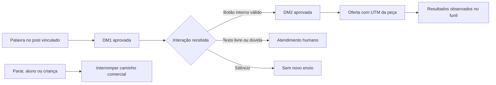

# InstaAuto / insta-p8: proposta revisada de aproveitamento no marketing

15/10/2026, São Paulo · Revisão 2 · **Proposta de complemento, não implementação nem campanha ativada.** Substitui a primeira versão deste documento. A [auditoria do repositório](../../.audits/architectural-analysis-insta-p8-marketing-2026-10-15.md) preserva os achados originais; o [review da proposta](../../.audits/insta-p8-marketing-2026-10-15/review.md) registra lacunas, correções e limites da verificação.

**Recomendação:** aproveitar a experiência de comentário → conversa solicitada → apresentação da oferta, incorporando-a ao marketing do Sistema Zero em um complemento próprio, liberado depois de L9. Reusar publicação, revisões editoriais, autenticação, bancada e medição do funil. O InstaAuto contribui com ideias de interação e casos de teste; seu backend não é uma base adequada para importar.

O benefício esperado é reduzir respostas repetitivas, manter a promessa da publicação coerente com a oferta e identificar peças que trazem interesse comercial. São hipóteses a medir. O snapshot não comprova aumento de conversão nem economia operacional.

## 1. Base, precedência e limites

As referências normativas continuam sendo a [proposta do novo app](2026-10-15-marketing-app-fluxo-editorial-proposta.md) e seu [plano L0–L11](../superpowers/plans/2026-10-15-marketing-desktop-colaborativo-lotes.md). No estado consultado, L0 tem implementação local e validação em andamento; L1–L11 permanecem pendentes. Os contratos compartilhados e a bancada descritos nesses lotes são dependências futuras, não capacidades já entregues.

Esta proposta não muda os critérios de saída desses lotes. Importar material ManyChat em L8 significa incorporar acervo, fontes e pendências; não significa construir nem ativar um motor de DMs. A primeira liberação editorial, L9, continua independente deste complemento. L10 pode consumir seus resultados depois, sem autorizar respostas automáticas.

A direção comercial vem do [README editorial](../marketing/kids/comunidade-dos-criadores/instagram/README.md), das [14 peças MC01–MC14](../marketing/kids/comunidade-dos-criadores/instagram/04-postagens-manychat.md), do [fluxo curto](../marketing/kids/comunidade-dos-criadores/instagram/campanhas/manychat-desafio/fluxo-curto.md) e dos [links de publicação](../marketing/kids/comunidade-dos-criadores/instagram/apoio/links-e-publicacao.md). A instrução explícita de substituição/suspensão prevalece sobre tabelas históricas no mesmo arquivo. As seis entradas PASSO, APOIO, IDEIA, TESTE, CRIAR e ROTINA do [plano substituído](../marketing/kids/comunidade-dos-criadores/instagram/postagens/06-manychat.md) ficam históricas e inativas.

**Escopo inicial:** uma conta profissional, uma peça MC escolhida pela equipe, um post pertencente à conta, duas DMs comerciais aprovadas, recuperação explícita pelo direct, interrupções, atendimento humano mínimo e medição observável. A infraestrutura não deve depender de uma única conta global, embora o piloto use apenas uma.

Ficam fora: editor genérico de fluxos, CRM, publicador paralelo, automação geral de stories, disparos em massa, exigência de seguir, captura de contatos no direct, lembretes por silêncio, identificação de clientes por inferência e IA livre atendendo continuamente. Perguntas iniciais e expansão para outras peças dependem de uso comprovado.

## 2. O que aproveitar do repositório

O InstaAuto é um Next.js/React com Supabase e chamadas à API do Instagram, voltado a comentários e mensagens. A auditoria inventariou 154 arquivos e exercitou sete cenários com dependências externas simuladas. Identificou problemas de autorização, perda de eventos, envios duplicados e ausência de estado confiável de atendimento. Não houve execução contra conta real.

| Elemento | Decisão | Aplicação no Sistema Zero |
| --- | --- | --- |
| Regra por publicação e palavra | Reimplementar a ideia | Elegibilidade por conta, post, revisão e estado da conversa |
| Resumo Quando → Resposta → Revisão | Adaptar a experiência | Ficha dentro da peça, com prévia completa no celular |
| Botões e continuidade solicitada | Usar como referência | Percurso fixo das duas DMs, validado na modalidade Meta existente |
| Duplicação pausada | Adotar o comportamento | Cópia nasce rascunho sem ativação, vínculo externo ou permissão herdada |
| Inbox e respostas salvas | Adaptar ao escopo comercial | Fila por conta, histórico, responsável e interrupção da automação |
| Contexto comercial/FAQ | Reusar direção e fontes de L4 | Nenhuma base independente de personalidade, oferta ou políticas |
| HMAC, timeouts e contadores | Referências de requisitos | Implementação nos contratos do Sistema Zero, com testes de falha |
| Rotas, sessão, schema Supabase e cliente de IA | Não importar | Preservar auth, gateway, tokens selados, Drizzle e execução local |
| Insights e tabelas de agendamento | Não considerar entregues | Placeholders e tabelas sem execução não substituem serviços existentes |
| Prompt que oculta a automação | Rejeitar | A abertura aprovada identifica a resposta automática |

A licença MIT do snapshot permite reaproveitamento sob suas condições; preservar o aviso se houver cópia substancial. Nenhuma cópia de código é necessária para executar esta proposta.

Entre incorporar a capacidade, operar outro aplicativo ou manter uma ponte permanente com ferramenta externa, a escolha proposta é **incorporação nativa**. Operação externa futura exigiria decisão própria sobre responsabilidade, sincronização e desligamento. Não é fallback automático nem dependência deste desenho. Se a Meta não permitir a operação necessária, a capacidade permanece indisponível; o app editorial continua funcionando.

## 3. Experiência de produto

### 3.1. A conversa pertence à peça

Na peça elegível, a área **Conversa no Instagram** mostra objetivo, publicação vinculada, palavra, DM1, botão interno, DM2, destino, respostas de saída e responsável. Exemplo de resumo: “Ao comentar JEITO nesta publicação, a pessoa recebe a abertura. Ao tocar em Ver o projeto, recebe a apresentação do Desafio.”

A prévia usa a edição exata em revisão e apresenta silêncio, dúvida, aluno e encerramento. A equipe vê separadamente **texto aprovado**, **publicação confirmada** e **respostas ativas**, com motivos quando algo impede ativar. A criação não expõe payloads ou IDs técnicos; o diagnóstico restrito pode mostrá-los para suporte.

Reusar Ajustar, Gerar alternativas, Adaptar e Desfazer com a mesma semântica de L5. Ajustar modifica o rascunho por nova revisão; alternativas exigem escolha. Aprovar nova edição não altera mensagens ativas. Mudanças de promessa, oferta, destino ou condições exigem nova revisão e conferência de compatibilidade com o post.

### 3.2. Atendimento comercial mínimo

A fila existe mesmo sem campanha ativa: mensagens espontâneas continuam recebidas e encaminhadas. Exibir origem conhecida ou desconhecida, histórico observado, etapa, responsável, pendência, situação da janela e estado dos envios. Não mostrar “online”, “entregue” ou “lido” sem sinal correspondente.

Ações mínimas: assumir, responder, usar resposta aprovada, encerrar, marcar aluno/criança, suprimir envios e registrar nova solicitação explícita. Assumir ou receber texto livre interrompe o avanço comercial antes de novas decisões automáticas. Resposta humana usa os mesmos controles de elegibilidade, histórico e envio durável.

O marketing responde pela conversa comercial no Instagram. O [messaging atual](../../packages/messaging/src/domain/shared/channel.ts) atende email/WhatsApp; os [contratos do helpdesk](../../packages/helpdesk-contracts/src/index.ts) não oferecem canal Instagram pronto. Não fabricar email para abrir ticket nem copiar cadastros. Dúvidas pedagógicas seguem Preciso de ajuda/Recados; problemas de acesso podem ser encaminhados pela equipe. Vínculo formal futuro com helpdesk exige contrato próprio e identidade confirmada, sem ser requisito deste piloto.

### 3.3. Aprendizado editorial

Registrar categorias de dúvida e desfechos escolhidos pela equipe. Levar ao planejamento apenas sínteses sem dados pessoais, com período, amostra e origem autorizada. Em L10, podem sustentar sugestões de FAQ/pauta. Uma mensagem isolada gera hipótese, não conclusão sobre o público. Conteúdo recebido nunca é instrução para ferramentas ou alteração da campanha.

## 4. Percurso e decisões comerciais

Preservar a direção editorial: DM1 de até 25 palavras, identificada como automática e assinada pela Helena/Júlio; botão interno **Ver o projeto**; DM2 de até 70 palavras, apresentação fiel ao Desafio e botão **Conhecer o Desafio** para a oferta. Os textos concretos continuam nas peças MC; este documento não cria outra versão comercial.

| Entrada ou condição | Comportamento definido |
| --- | --- |
| Palavra no post vinculado, ativação e elegibilidade válidas | Criar uma jornada e uma intenção de DM1; nenhuma regra para todos os posts |
| Botão interno válido da DM1 | Enfileirar DM2 da mesma jornada, após conferir estado, origem e janela |
| Clique em botão de site | Não avançar sequência nem tratar como prova de compra |
| Silêncio | Nenhuma mensagem adicional ou lembrete |
| H01 / Tenho uma dúvida | Pausar o comercial, registrar solicitação e enviar só a confirmação aprovada, quando elegível |
| A01 / Já somos alunos | Encerrar o comercial e orientar pelos caminhos existentes; não oferecer nova compra |
| S01 / Parar | Cancelar pendências comerciais e manter supressão; palavra incidental não reativa |
| C01 / Identificação como criança | Interromper sem link, compra ou remarketing; manter apenas a exclusão necessária para impedir disparos |
| Texto livre enquanto espera pelo botão | Encaminhar à equipe; após triagem liberar continuidade, R01 no máximo uma vez por conversa e somente se existir a abertura a que se refere; não reenviar DM2 |
| D01 / Minecraft-Roblox e D02 / Continuidade | Respostas salvas escolhidas pelo operador para a dúvida correspondente; sem novas etapas automáticas |
| DM espontânea sem percurso | Fila humana; não usar R01 dizendo “mensagem acima” quando ela não existe |
| Palavra explícita no direct | Recuperar origem inequívoca, se elegível e sem bloqueio; ambiguidade vai à equipe, nunca à primeira regra encontrada |
| Story ou anexo sem texto | Uma entrada classificada para atendimento; não acionar também palavra genérica |

Botões e comandos inequívocos podem produzir transições determinísticas. A classificação de texto livre como aluno, criança ou intenção comercial não depende de novo LLM no servidor: texto não reconhecido suspende o avanço e vai à equipe, que confirma a categoria. Não perguntar idade nem inferir identidade familiar pelo perfil.

Essa triagem é uma condição operacional adicional para cumprir as saídas aprovadas sem presumir classificação infalível. Enquanto pendente, um toque em botão fica registrado como solicitação, sem disparar DM2. A equipe pode liberar a continuidade somente se ainda elegível; caso contrário, responde manualmente. R01 não deve convidar a continuar um caminho que permaneça bloqueado ou já tenha terminado.

Normalizar caixa e acentos Unicode, respeitar limites de palavras e evitar substrings acidentais. No direct, exigir mensagem composta pela palavra aprovada, admitindo apenas pontuação/espaços ao redor. No post vinculado, permitir a palavra inteira no comentário. MC07 cobre FERIAS/FÉRIAS. MC08 mantém PRIMEIRO enquanto não houver nova decisão editorial; seu risco de coincidência incidental fica visível na revisão, sem trocar automaticamente por PERCURSO.

Supressão e atendimento precedem gatilhos. Há no máximo uma jornada comercial em andamento por conversa. Nova solicitação explícita pode gerar outra jornada, preservando histórico; duplicações e palavras incidentais não contam como solicitação. Após supressão, a retomada exige conferência humana. Identificação como criança não é revertida por palavra ou botão antigo.

Entradas simultâneas de outras campanhas são registradas sem iniciar segunda sequência. Uma nova solicitação posteriormente confirmada pode encerrar a jornada anterior, desde que não exista envio em execução/incerto. Jornadas sem interação expiram conforme política temporal definida em C0, sem lembrete; expiração não concede permissão de recontato. A chave de idempotência do evento impede que sua repetição seja tratada como nova solicitação.

São duas DMs **comerciais** no percurso. Confirmações de interrupção/atendimento são respostas de serviço aprovadas, não uma terceira apresentação. Suprimir o comercial permite a confirmação específica do pedido de parar quando elegível; indisponibilidade global de envio impede qualquer mensagem. Não responder automaticamente fora do percurso só porque existe uma resposta salva.

## 5. Modelo de domínio e compatibilidade editorial

Os nomes abaixo são propostos. Os schemas integrarão `marketing-contracts`, criado na reforma, sem outro sistema de revisão. A forma final acompanha o contrato efetivamente entregue por L1.

| Objeto | Responsabilidade e vínculo |
| --- | --- |
| Plano de conversa (`ConversationPlan`) | Projeto/conteúdo; DM1, DM2, botões, saídas, palavra, destino, UTM e referências da oferta. Não é novo `ContentType`, estágio do kanban ou rede social |
| Revisão editorial | Edição imutável nos contratos de L1/L5, aprovação exata e histórico. Rascunho pode mudar sem alterar revisão ativa |
| Ativação (`ConversationActivation`) | Revisão aprovada, publicação/edição, conta explícita, post externo comprovado, modalidade de conexão, evidência de capacidade, autor e versão |
| Conversa (`ChannelConversation`) | Conta social + interlocutor no escopo da conta; responsável, estado e versão de concorrência; pode atravessar campanhas |
| Jornada (`ConversationJourney`) | Uma solicitação com origem, ativação/revisão fixadas, etapa, eventos causadores e resultado; preserva origem ao longo da execução |
| Supressão | Controle comercial por conta/interlocutor, motivo, autor/evento e mudança explícita; vale entre campanhas/projetos da mesma conta |
| Entrada (`InboundEvent`) | Provedor, conta, tipo, identidade estável do evento, horários, estado e retenção; unicidade persistente por evento, não só pelo envelope |
| Intenção (`OutboundIntent`) | Jornada/conversa, evento causador, finalidade, conteúdo congelado, revisão, chave lógica, estado, tentativas e ID externo conhecido |

A conversa não é um lead. ID do Instagram não vira email, usuário ou cliente. Não há FK entre schemas; referências externas são opacas e validadas na fronteira responsável.

### Estados separados

| Dimensão | Estados e regras |
| --- | --- |
| Editorial | Rascunho → revisão aprovada; nova edição não sobrescreve aprovação anterior |
| Ativação | Inativa → aguardando vínculo ou ativa; ativa → pausada/bloqueada/encerrada. Retomada explícita repete validações; falha de conta/permissão/oferta bloqueia |
| Jornada | Abertura pendente → aguardando interação → apresentação pendente → apresentação aceita; pode terminar, ser cancelada ou ir à equipe em qualquer etapa |
| Atendimento | Automação permitida, aguardando equipe, em atendimento ou encerrado; encerrar não remove supressão nem reinicia campanha |
| Envio | Pendente → reservado → em execução → aceito, falhou, cancelado ou resultado incerto. Entrega/leitura são sinais separados |

Postbacks resolvem identificador opaco vinculado a destinatário, conta, jornada, ação e revisão. Não aceitar IDs de outra conversa nem usar texto do botão como identidade. Botão antigo só avança sua jornada original ainda válida; nunca migra silenciosamente à campanha mais recente.

Nova revisão pode substituir a ativa por ação explícita. Jornadas iniciadas continuam na revisão fixada somente enquanto válida; revogar/suspender essa revisão cancela pendências. Mudança material da oferta pausa as ativações afetadas até revisão. O complemento precisa de comando de invalidação e revalidação periódica de destinos; não presumir que editar uma página externa gera evento automático.

### Publicar e ativar são operações distintas

Para post existente, confirmar que o ID externo pertence à conta selecionada. Para publicação futura, permitir solicitação explícita de ativação em **aguardando vínculo** até a publicação exata retornar ID confirmado. A confirmação gera reconciliação idempotente daquela publicação, nunca regra vaga de “próximo post”.

O [serviço de publicação atual](../../packages/marketing/src/application/publications/publication.service.ts) aceita marcação manual; isso não prova posse do post. O [vínculo externo atual](../../packages/marketing/src/application/publications/link-external.service.ts) pode escolher a primeira conta conectada. O complemento exige conta explícita e prova de posse para ativação, sem herdar esse fallback.

Não existe transação única entre publicar na Meta e ativar nosso processamento. Mostrar o intervalo pendente e falhas. Eventos já recebidos nesse intervalo ficam retidos para reavaliação por prazo e janela válidos; histórico recuperado não autoriza disparar mensagens antigas. A ativação após o vínculo exige solicitação explícita anterior. Publicar, importar ou aprovar isoladamente nunca ativa.

## 6. Integração técnica no Sistema Zero

| Fronteira | Reuso e alteração necessária neste complemento |
| --- | --- |
| `packages/marketing` | Novo contexto `domain/engagement`, `application/engagement`, portas, repositórios e workers; servidor continua canônico |
| `marketing-contracts` / `marketing-workbench` futuros | Acrescentar contratos e ficha após estabilizar a base; compartilhar UI e protocolo editorial, sem revisão/cache paralelo |
| Web/BFF | Ampliar raiz autorizada e cliente tipado para operações da equipe; o [BFF atual](../../packages/marketing-app/src/app/api/marketing/[...path]/route.ts) tem allowlist e processa JSON |
| Gateway | Rotas de equipe autenticadas/auditadas; folhas públicas GET/POST específicas para webhook, sem retirar JWT do restante do marketing |
| OAuth/contas | Reusar tokens selados/renovação; ampliar capacidades por conta/conexão, sem troca silenciosa de modalidade |
| Publicação | Consumir vínculo confirmado de publicação/edição/conta; acrescentar confirmação durável no mesmo serviço, sem segundo publicador |
| Persistência | Migrações aditivas no schema marketing, índices de unicidade, retenção e concorrência |
| Funil | Leitura agregada autorizada por contrato; funil conserva escrita de sessões, leads e pagamentos |
| Inteligência | Leitura posterior de resultados e sínteses autorizadas; sem acesso irrestrito a DMs pelo acervo |

### Recepção verificável

O webhook público não passa pelo BFF da equipe. Na borda, preservar bytes/headers, limitar tamanho e encaminhar ao handler dedicado com autenticação interna. No serviço, validar assinatura Meta sobre corpo original antes do JSON. Handshake GET e POST têm validações distintas; challenge válido não autentica entregas futuras.

Duas incompatibilidades concretas: o [parser global de marketing](../../packages/marketing/src/interfaces/http/server.ts) consome `request.text()` e interpreta JSON; o [verificador do gateway](../../packages/api-gateway/src/application/transform/transformers/verify-webhook.transformer.ts) trata outro protocolo de assinatura. Não reutilizá-los como se já validassem Meta. Criar parsing específico antes do genérico, com teste através do gateway até o handler e sem mudar as demais rotas. Não reconstruir JSON para conferir HMAC.

Após verificar/limitar o payload, validar conta/destinatário, decompor eventos e persistir a recepção durável antes do ACK. Envelope pode conter múltiplos eventos/contas: item desconhecido não descarta os demais. Payload inválido não é sucesso; evento válido não suportado recebe classificação explícita, sem execução comercial. Falha de persistência retorna falha, sem confirmar trabalho inexistente. Retenção de conteúdo bruto é curta e restrita.

### Processamento e envio duráveis

1. Deduplicar entrada pela identidade específica de provedor/tipo. Para comentários, separar identidade do comentário, mudanças e intenção de primeira resposta; repetição de objeto não cria nova intenção.
2. Serializar decisões por conversa com versão/transação. Conferir conta, ativação, supressão, atendimento, origem e elegibilidade. Criar transição e intenção única na mesma transação.
3. Reservar intenção com lease e token de posse. Antes do despacho, reconferir versões/autorização; só um executor passa para envio. Worker antigo não continua após perder a posse.
4. Chamar o provedor fora de transação longa do banco. Persistir resposta/ID, classificar erro e registrar evento operacional. Envio manual usa a mesma fila.
5. Timeout ou queda após início da chamada produz resultado incerto. Reconciliar com evidência do provedor; se impossível, exigir resolução operacional e bloquear repetição daquela intenção.

Unicidade de entrada/intenção impede duplicação interna; não garante exatamente uma entrega externa. Lease expirado de envio iniciado também produz incerteza, não reenvio. Retentativas automáticas só para falhas comprovadamente seguras, com limite, espera progressiva e quotas por conta. Evento fora de ordem aguarda dependência ou termina com motivo, sem forçar avanço impossível.

Pausa confirmada antes do envio entrar em execução impede despacho; chamada já iniciada pode terminar depois. A UI mostra essa condição. Supressão, tomada humana e reserva de envio compartilham controle de concorrência, sem prometer recolher mensagens enviadas. Confirmação pública só ocorre após aceite da DM; aceite não prova entrega.

Mensagens do app oficial/outra ferramenta entram no histórico quando observáveis e pausam a automação diante de atendimento externo. C0 verifica essa cobertura. Sem observação confiável, a equipe precisa pausar pelo Sistema Zero antes de atender externamente. Não manter duas automações concorrentes nem prometer detecção imediata de ações não expostas pela API.

### Conta e capacidade

O [OAuth atual](../../packages/marketing/src/infrastructure/gateways/meta/meta-oauth-provider.ts) usa Facebook Login com Page token e escopos de publicação/insights; InstaAuto usa outra modalidade. O [serviço de contas](../../packages/marketing/src/application/accounts/account.service.ts) seleciona provedor por rede e oferece seleção da primeira conta conectada. Não constitui suporte pronto a duas modalidades de Instagram nem permissão comprovada para DMs.

Priorizar ampliar a modalidade atual. Registrar por conexão: conta externa, modalidade, permissões, versão da API, subscrições, operações comprovadas, validade da evidência e motivo de indisponibilidade. Publicar e conversar são capacidades distintas. Renovar token não troca, por si, identidade da conexão; reconexão, mudança de modalidade ou perda de permissão invalidam evidência relevante e suspendem envio até revalidar.

`getFreshAccessToken` não substitui status, conta explícita ou permissões, conferidos antes de cada envio. Revogação cancela intenções elegíveis e bloqueia novas. Se outra modalidade for indispensável, seu impacto em cadastro/OAuth/publicador exige decisão técnica própria; não sobrescrever a conexão existente para viabilizar o piloto.

### Desktop, IA e autorização

O servidor executa mensagens determinísticas aprovadas com computadores fechados. Codex/Claude locais ajudam a preparar/revisar por solicitação e assinatura do executor, conforme a reforma. Não hospedar atendimento contínuo em assinatura pessoal nem adicionar fallback pago silencioso.

Editar peça não implica ler DMs. Autorizar separadamente projeto, conta, leitura, resposta, ativação e administração de credencial, mapeando ações à matriz vigente. Conta compartilhada entre projetos exige equipe do canal atribuída explicitamente; ficha editorial mostra agregados, não histórico privado por herança. Identidade/dispositivo vêm da autenticação, nunca do corpo enviado.

Operações editoriais reusam `operationId`, base de revisão e idempotência de L1. Comandos operacionais precisam de versão, escopo, autoria e hash do payload sob o mesmo padrão, mas ativar, assumir e enviar exigem servidor: não ficam em fila offline para execução tardia. Web/desktop recebem estado autorizado e reconciliação por cursor. O cache editorial de L3 não guardará DMs completas; não há persistência local delas no piloto.

## 7. Medição integrada ao funil

O funil já tem [sessões e vínculos com leads](../../packages/funnel/src/analytics/repository.ts), [relatórios](../../packages/funnel/src/analytics/reports.ts), [preferências e coleta](../../packages/funnel/src/analytics/handlers.ts) e [atribuição sanitizada](../../packages/funnel/src/lib/lead-attribution.ts). Reaproveitar essa base. Não criar encurtador/redirecionador, rastreador individual de DM ou cópia de pagamentos.

Preservar `utm_source=instagram`, `utm_medium=dm`, `utm_campaign=instagram_manychat_desafio_14_2026` e o `utm_content` da peça. Recuperação mantém a origem; direct espontâneo sem origem conhecida não recebe crédito inventado. Não adicionar nome, idade, ID do Instagram ou conversa à URL.

| Indicador | Fonte e unidade | Limite de interpretação |
| --- | --- | --- |
| Entradas elegíveis / jornadas | Eventos deduplicados / jornadas no marketing | Evento, conversa e pessoa são unidades distintas |
| DM1 aceita → interação interna → DM2 aceita | Jornadas da mesma coorte/revisão, uma contagem por etapa | Interação exige evento válido; aceite não é entrega/leitura |
| Atendimento, interrupções, falhas, tempo humano | Eventos operacionais e registro da equipe | Informar amostra, período e cobertura |
| Sessões na oferta por campanha/peça | Analytics com UTM | Visita observada, não clique único ou pessoa identificada |
| Sessões com conversão | Relatório atual: sessão iniciada no período e conversão observada em até sete dias | Não é contagem exclusiva de vendas |
| Compras iniciais atribuídas e valor bruto conhecido | Leads/pagamentos no funil, com atribuição registrada do lead | Cada pagamento confirmado conta uma vez; não inclui renovações nem representa receita líquida |

A consulta atual agrega campanha/source, sem filtro/agregação por `utm_content`. C2 precisa acrescentar leitura no domínio do funil, protegida e consumida pelo marketing por contrato autenticado. Marketing não consulta `funil.*` diretamente nem usa cookie administrativo de outra aplicação como credencial de serviço. Esse contrato é trabalho novo, não endpoint já disponível.

Preservar as semânticas existentes: atribuição inicial do visitante, da sessão e do lead são distintas. Sessão recente pode ser reutilizada sem assumir nova UTM; a atribuição existente do lead não será sobrescrita para favorecer a campanha. Informar cobertura, sem novo modelo de atribuição no piloto.

O relatório atual admite vínculos do lead com várias sessões. Não renomear sessões convertidas como “vendas” nem somar receita por sessão sem deduplicar pagamentos. A extensão calcula vendas por `paidPaymentId` confirmado e atribuição do lead; sem chave inequívoca, informar vínculo insuficiente. Coortes de leads e sessões ficam separadas, sem taxas que misturem denominadores.

No recorte de compras iniciais, selecionar leads criados no período e primeira compra confirmada até sete dias após sua criação, deduplicada pelo pagamento. Usar valor congelado da cobrança paga quando disponível. Não misturar essas compras com renovações, outros pagamentos ou vendas por data de caixa. Estornos/descontos não observáveis impedem apresentar valor líquido; sua ausência de cobertura deve aparecer no resultado.

Para DMs, usar jornadas iniciadas no período/revisão e mesmo horizonte de observação explícito. Para o site, manter janela atual de sete dias e indicar coorte incompleta. Respeitar preferência de coleta. Dados ausentes, coleta desativada, indisponibilidade e zero observado são estados distintos.

Sem identidade consentida entre canal/site, não há prova individual de que uma DM causou compra. O piloto oferece agregados por peça, conversões observadas e limites de atribuição. L10 poderá reusar o contrato; dashboard social não receberá conversas como likes ou alcance.

## 8. Operação, dados e continuidade

Antes de habilitar conta, configurar responsável, equipe, limites verificados do provedor, retenção, revisão da oferta, monitoramento e interrupção global. Mostrar fila/responsável ausente, sem prometer atendimento instantâneo.

**Política inicial proposta, sujeita à governança de dados:** payload bruto autenticado até sete dias para diagnóstico restrito; mensagens e metadados operacionais detalhados até 90 dias, com exclusão antecipada quando aplicável. São decisões de produto propostas, não afirmações legais nem herança automática do funil. O responsável por dados deve ratificá-las ou substituí-las antes do piloto.

Conservar exclusão comercial enquanto necessária para impedir disparos naquela conta, sem texto, idade ou perfil desnecessário. Identificador opaco protegido por chave do servidor continua dado restrito. Remover essa proteção exige decisão explícita sobre recontato, nunca efeito da limpeza de histórico. Encerrar definitivamente a conexão inclui política de remoção dessas referências.

Excluir conversa alcança payloads, mensagens, intenções pendentes, projeções e exports. Reter apenas mínimo autorizado para supressão/deduplicação/auditoria, com finalidade/prazo. A limpeza não pode permitir reenvio de evento antigo: usar corte de elegibilidade temporal e identificadores mínimos durante a janela de repetição. Logs não contêm tokens, corpos integrais ou URLs com segredos. Não baixar anexos automaticamente; mostrar tipo/indisponibilidade sem buscar URLs arbitrárias.

Monitorar atraso de ingestão/fila, entradas não processadas, resultados incertos, erros por conta, permissões e pedidos sem responsável. Pausa global, por conta, ativação e conversa. Equipe técnica responde por entrega; comercial, por conteúdo/atendimento/retomada. Falha analítica admite atendimento com aviso, mas impede avaliar/expandir sem evidência; falha de elegibilidade bloqueia envio.

Rollback: impedir novas ativações, suspender workers de envio, cancelar pendências não iniciadas e reconciliar chamadas em execução/incertas. Conservar recepção/histórico quando possível e publicação independente. Não apagar schema/dados. Backup restaurado sobe com envio desabilitado e reaplica exclusões/supressões posteriores antes de retomar; nunca reproduzir automaticamente a fila restaurada.

## 9. Dependências da plataforma e prova de capacidade

A documentação oficial distingue Instagram Login/Facebook Login; validar operações e credenciais na modalidade escolhida. A coleção de conversas distingue acesso a usuários com/sem papel no app. Publicação local funcionando não comprova atendimento ao público. Referências: [Instagram API — Meta](https://www.postman.com/meta/workspace/instagram/documentation/23987686-9386f468-7714-490f-9bfc-9442db5c8f00), [Conversations API — Meta](https://www.postman.com/meta/messenger-platform-api/folder/22794852-255610cd-47f5-4f4d-b3fa-71aec360be9a).

O ManyChat informa que a primeira resposta privada não abre sozinha a janela de 24 horas; requer interação elegível. Botão de site não equivale ao interno. Descreve também limites do primeiro bloco/repetição de comentários. Isso orienta o teste, sem transformar sua implementação no contrato integral do nosso adaptador. [Gatilho oficial de comentários](https://help.manychat.com/hc/en-us/articles/14281316989724-Instagram-Post-and-Reel-Comments-trigger).

Nesta revisão, a página ManyChat foi novamente consultada; páginas Meta tiveram limitações de renderização/429. Não se comprovou permissão real, aprovação, subscrição, quota ou versão apropriada a todas as operações. C0 demonstrará com contas autorizadas: recepção autenticada, comentário no post certo, resposta privada, postback, continuidade, mensagem humana, revogação, janela, ecos e reconciliação possível. Validar acesso ao público pretendido, não apenas administradores.

O perfil de capacidade define elegibilidade por operação/evento; não reduzir regras a “alguma mensagem nas últimas 24 horas”. Operação obrigatória não demonstrada bloqueia o piloto naquela modalidade. Este documento não autoriza enviar mensagens ou configurar contas agora.

## 10. Entregas e dependências

C0–C4 são marcos deste complemento. Não renumeram L0–L11 nem acrescentam critérios ocultos à reforma. Calendário será estimado após C0 e estabilização dos contratos; o esforço envolve operação e integração, não apenas interface.

| Marco | Dependência | Entrega | Evidência de saída |
| --- | --- | --- | --- |
| **C0 — Viabilidade** | Priorização/acesso autorizado; pode ser estudado antes de L9 sem mudar seus critérios | Perfil de capacidade, limitações, contrato de evento/envio e responsabilidade do canal | Percurso real em contas de teste, permissões e ausência de regressão no publicador; decisão continuar/bloquear |
| **C1 — Preparação editorial** | C0 viável; L1/L3/L4/L5/L7/L8 estabilizados; liberação após L9 | Ficha/prévia compartilhadas, revisões, permissões, origem, vínculos e estado inativo | Revisão exata, conflitos/acesso conferidos; salvar/importar nunca envia |
| **C2 — Operação integrada** | C1 e contratos confirmados de conta/publicação | Webhook, fila, supressão, worker, atendimento, diagnóstico e leitura agregada do funil | Matriz abaixo aprovada em teste; retenção/recuperação demonstradas |
| **C3 — Piloto público** | C2 validado, L9 liberado e decisão explícita da equipe | Uma conta, uma peça MC, responsáveis e acompanhamento | Operação observada, nenhum envio indevido conhecido pendente e dados para decisão |
| **C4 — Expansão por resultado** | Review de C3 e prioridade frente a L10/L11 | Outras MC e sínteses para inteligência; adicionais só se justificados | Ganho operacional sustentado e cobertura conhecida |

Reuso: L0/L2 fornecem execução/autenticação desktop; L1/L3, revisão/sync; L4/L5, fontes/edição; L6, mídia sem requisito adicional; L7, publicação exata/métricas existentes; L8, acervo. **Nenhum desses lotes passa a dever ficha de conversa, webhook, fila humana ou métrica de DM.** São incrementos de C1/C2. Antecipá-los exige replanejamento explícito.

## 11. Matriz de aceite e decisão do piloto

| Área | Casos obrigatórios | Resultado esperado |
| --- | --- | --- |
| Editorial/acervo | MC vigente, entradas suspensas, duplicação, copy e oferta alteradas | Histórico preservado, cópia inativa, revisão ativa identificável, incompatibilidade bloqueada |
| Autorização | Outro projeto/conta, acesso só editorial, dispositivo revogado, payload alheio | Sem leitura/envio/ativação fora do escopo, incluindo eventos/métricas |
| Vínculo | Post alheio, marcação manual, publicação futura, troca de ID | Só vínculo comprovado ativa; pendência/conflito visíveis |
| Webhook | Assinatura inválida, bytes alterados, envelope múltiplo, banco indisponível, evento desconhecido | Sem execução não autenticada, ACK durável, isolamento de itens |
| Concorrência | Repetição, ordem invertida, dois workers, lease vencido, crash no envio | Uma intenção lógica; incerteza bloqueia repetição cega |
| Percurso | Post/palavra errados, acentos, MC08, silêncio, botões, postback alheio | Apenas sequência/origem aprovadas; nenhuma DM2 indevida |
| Saídas | H01/A01/S01/C01, R01 repetido, texto livre, story, anexo | Interrupção, serviço e encaminhamento corretos; sem dois gatilhos |
| Atendimento | Assumir durante reserva, resposta externa observável/não observável, retomada | Pausa serializada e envio iniciado visível, sem cancelamento impossível |
| Conta/provedor | Revogação, reconexão, janela, quota, timeout após aceite | Bloqueio/revalidação/retentativa segura/reconciliação conforme causa |
| Paridade | Web/desktop, computador fechado, comando operacional offline | Mesmo estado autorizado; servidor continua; nenhuma ação tardia offline |
| Métricas | Sem UTM/coleta, sessão reutilizada, lead antigo, várias sessões por venda, valor ausente | Cobertura explícita, atribuição preservada, sem dupla venda ou zero fabricado |
| Dados/recuperação | Expurgo, exclusão, evento antigo, backup, pausa global | Pendências canceladas, proteção contra reenvio e retomada controlada |

Antes de C3, comercial confere oferta publicada/textos/botões; técnica demonstra matriz/capacidade externa; operação assume fila/pausa; responsável por dados confirma acesso/retenção. São responsabilidades futuras de liberação, não aprovações solicitadas por esta análise.

Observar inicialmente duas semanas após ativação, com baseline manual e denominadores por etapa; estender se o volume for insuficiente. Não é promessa de significância estatística. Interromper diante de envio indevido, duplicação não explicada, falha de supressão ou perda de elegibilidade. Não expandir com resultados incertos sem tratamento.

Expandir somente com confiabilidade e sinal útil de menos trabalho repetitivo ou mais visitas qualificadas. Vendas isoladas não provam causalidade. Se o ganho não justificar manutenção/atendimento, conservar melhorias editoriais/de medição e encerrar a automação de forma controlada.

**Resultado esperado:** campanha revisável na própria peça, execução determinística com pausa humana, medição integrada e aprendizado editorial. A compatibilidade está especificada; sua comprovação depende dos contratos entregues pela reforma e da prova Meta de C0.
