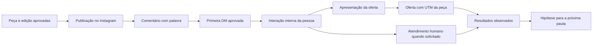

# InstaAuto / insta-p8: proposta de aproveitamento para o marketing

15/10/2026. Proposta para avaliação, baseada no snapshot local fornecido, no código do Sistema Zero e no plano vigente de reestruturação. Não altera o plano aprovado nem autoriza ativar campanhas. [Auditoria técnica e evidências](../../.audits/architectural-analysis-insta-p8-marketing-2026-10-15.md).

**Recomendação:** aproveitar a mecânica de comentário → conversa solicitada → oferta, o resumo simples das regras e a prévia de mensagens. Implementar essas capacidades dentro do produto atual, com textos versionados, vínculo à publicação e medição por campanha. O código do InstaAuto serve principalmente como referência de comportamento e de casos de teste. Adotar o aplicativo inteiro traria uma segunda infraestrutura e falhas que nossa base já evita.

O ganho esperado é reduzir trabalho manual entre uma pessoa demonstrar interesse e encontrar a oferta correta, além de descobrir quais conteúdos geram conversas úteis. Isso é uma hipótese de melhoria; o repositório não apresenta dados que comprovem aumento de conversão, economia operacional ou retorno financeiro.

## 1. O que o repositório realmente entrega

InstaAuto é um aplicativo Next.js/React com Supabase e integração direta à API do Instagram. O centro do produto é responder a comentários, DMs e eventos de stories. Não é um sistema de pesquisa editorial, produção de criativos ou gestão completa de campanhas.

| Capacidade | Evidência no snapshot | Valor para nós |
| --- | --- | --- |
| Comentário com palavra em publicação específica | Matcher por mídia e palavra, resposta pública e resposta privada | Alto: executa a entrada já desenhada para MC01–MC14 |
| Resposta a palavra no direct | Regras por palavra, postback e quick reply | Alto: recuperação quando a pessoa procura o perfil diretamente |
| Cards, botões e escolha do próximo passo | Helpers de mensagens e formulário com prévia | Alto como referência; falta um percurso versionado e confiável |
| Cadastro curto de regra | `QuickAutomationForm`: origem, palavra e resposta | Boa inspiração de simplicidade; nasce ativo e global, comportamento inadequado para nossas campanhas |
| Configuração detalhada | `CreateRuleForm`: Quando → Resposta → Revisão | Aproveitar a explicação e a prévia. O formulário de cerca de mil linhas não é um componente pronto para importar |
| Caixa de entrada e resposta manual | Lista, histórico e envio implementados | Útil como conceito; sem atualização contínua, atribuição a operador ou pausa confiável da automação |
| Perguntas iniciais | Ice Breakers com cadastro e sincronização | Secundário: orientação espontânea para quem abre o direct |
| Contexto comercial para IA | Campos de negócio, políticas, FAQ e histórico recente | Boa necessidade de produto; usar direção e fontes de L4, sem criar outra base de verdade |
| Respostas livres por IA | Fallback para endpoint compatível com OpenAI | Não adotar no piloto; conflita com nossa transparência e com o desenho de assinaturas pessoais |
| Métricas | Contagens básicas; página Insights ainda é placeholder | Não oferece atribuição de vendas nem um motor analítico aproveitável |
| Agendamento, fila e sequências | Há tabelas SQL, mas não encontrei execução correspondente | Não tratar o schema como funcionalidade pronta |

A licença do snapshot é MIT, com aviso de copyright a preservar caso se copiem trechos substanciais. Isso não transfere permissões da Meta nem elimina custos de hospedagem, manutenção e eventual inferência.

## 2. Como isso se encaixa na reforma já em andamento

As referências normativas são a [proposta de produto](2026-10-15-marketing-app-fluxo-editorial-proposta.md) e o [plano L0–L11](../superpowers/plans/2026-10-15-marketing-desktop-colaborativo-lotes.md). As [evidências de L0](2026-10-15-marketing-desktop-l0-evidencias.md) registram execução real de texto, imagem e vídeo no protótipo, com critérios de L0 ainda abertos; L1–L11 continuam pendentes no plano consultado.

O desenho consolidado já resolve pesquisa, direção, calendário, produção por IA, revisões, colaboração, aprovação, publicação e métricas. Electron, Remotion incorporado, gateway e assinaturas individuais permanecem como definidos. O InstaAuto acrescenta uma oportunidade depois da publicação: conduzir o interesse espontâneo até a apresentação da oferta e devolver aprendizados ao planejamento.

Essa etapa não aparece como motor de atendimento/automação no plano atual. A menção a ManyChat em L8 trata da importação do acervo; não equivale à implementação de envio de DMs. L10 também não autoriza envio automático de mensagens. Portanto, proponho um complemento explícito, sem esconder uma nova plataforma de automações dentro desses lotes.

### A direção editorial vigente restringe o piloto

O [README editorial](../marketing/kids/comunidade-dos-criadores/instagram/README.md) separa papéis: feed atrai e convida a seguir; stories educam; destaques e fixados apresentam a oferta; as **14 peças MC01–MC14** têm conversas comerciais solicitadas por palavra.

As seis entradas PASSO, APOIO, IDEIA, TESTE, CRIAR e ROTINA aparecem em documentos e tabelas antigas, mas o [plano dessas entradas](../marketing/kids/comunidade-dos-criadores/instagram/postagens/06-manychat.md) está marcado como substituído. A [tabela de links](../marketing/kids/comunidade-dos-criadores/instagram/apoio/links-e-publicacao.md) também declara sua suspensão. Devem ser preservadas como histórico, sem reativação pela importação.

Há documentos com trechos vigentes e históricos no mesmo arquivo. L8 precisa respeitar essa precedência por bloco, não apenas pela data do arquivo. Esse é um aproveitamento imediato da análise: evitar que a nova biblioteca ressuscite CTAs retirados do calendário comum.

## 3. Três caminhos possíveis

| Caminho | Benefício | Trabalho e restrições | Decisão sugerida |
| --- | --- | --- | --- |
| Incorporar capacidades ao Sistema Zero | Uma operação, revisões coerentes e vínculo com conteúdo/funil | Novo módulo de conversas e prova de permissões; esforço médio/alto | **Destino recomendado**, em entregas delimitadas |
| Preparar no app e operar externamente | Permite validar as campanhas antes de construir o motor próprio | Execução manual ou ferramenta externa; reconciliar configuração e resultados | Ponte opcional se houver necessidade de ativação antes da capacidade nativa; não pressupor conta/plano disponível |
| Instalar/forkar o InstaAuto como outro app | Interface demonstrável já existente | Corrigir autenticação, webhooks, filas e tracking; segundo banco, contas e manutenção | Não recomendado como base de produção |

Mesmo no caminho externo, o Sistema Zero deve guardar a campanha aprovada e o estado real da configuração. Uma ficha preparada não pode aparecer como automação ativa. Não proponho contratar ManyChat agora nem desenvolver um framework multiforncedor por antecipação.

## 4. Melhorias com maior retorno potencial

### 4.1. Uma ficha de conversa dentro da peça de campanha

Adicionar à peça elegível uma área **Conversa no Instagram**, com a publicação de origem, palavra, DM1, botão interno, DM2, destino com UTM e saídas de atendimento. Usar os componentes e a bancada compartilhados em L4/L5. Pedidos como “ajuste só a abertura” devem gerar revisão sem alterar a oferta ou a publicação.

Resumo visível: “Quando alguém comentar JEITO nesta publicação, recebe a abertura. Ao tocar em Ver o projeto, recebe a apresentação do Desafio.” A prévia mostra a sequência exata no celular, incluindo encerramento por silêncio e saídas opcionais. Não expor payloads, IDs ou nomes de API à pessoa que escreve a campanha.

Estados distintos: rascunho, revisado, aprovado, pronto para configurar, ativo, pausado e requer correção. Aprovar copy, publicar a peça e ativar respostas são ações diferentes. Uma alteração de texto cria nova revisão; não modifica silenciosamente o que já está sendo enviado.

**Por que vale:** a campanha deixa de ser um post em um lugar e uma sequência de mensagens sem vínculo em outro. A equipe confere a promessa inteira antes de divulgar a palavra.

### 4.2. Executar primeiro o fluxo que já temos

Começar com uma peça MC escolhida pela prontidão de sua produção. MC01/JEITO é uma candidata concreta; o documento de copy existe, mas esta análise não comprova arte final, publicação ou configuração remota.

Percurso do [fluxo curto vigente](../marketing/kids/comunidade-dos-criadores/instagram/campanhas/manychat-desafio/fluxo-curto.md):

1. Palavra no post correspondente → DM1 aprovada, identificada como automática, com **Ver o projeto**.
2. Sem interação → nenhum novo envio comercial.
3. Clique interno válido → DM2 aprovada sobre o Desafio e o projeto incluído, com **Conhecer o Desafio**.
4. Clique no site → oferta com `utm_source=instagram`, `utm_medium=dm`, `utm_campaign=instagram_manychat_desafio_14_2026` e `utm_content` da peça.
5. Dúvida → pausa comercial e entrada para equipe. Família já participante → fim da oferta automática. Pedido de parar → interrupção. Pessoa que se identifica como criança → encerramento comercial conforme a direção existente.

O piloto preserva as copies existentes. Não acrescenta questionário, captura de telefone/e-mail, exigência de seguir, desconto, diagnóstico ou lembrete por silêncio. Não transforma as 60 publicações comuns em gatilhos comerciais.

**Por que vale:** automatiza uma tarefa repetitiva cujo conteúdo e finalidade já estão desenhados. A hipótese é reduzir demora e perdas operacionais, e deve ser medida.

### 4.3. Atendimento humano com contexto e pausa efetiva

Uma fila enxuta deve mostrar quem escreveu, a publicação/campanha de origem, o que já recebeu, a última interação elegível, o responsável e o próximo passo. “Assumir conversa” precisa suspender respostas comerciais pendentes no servidor. Retomar automação exige ação explícita e nova verificação de elegibilidade.

Reaproveitar padrões do helpdesk para responsável, estados, histórico e rascunhos. O helpdesk atual trabalha com fontes `email` e `portal`; o pacote messaging aceita `email` e `whatsapp`. **Nenhum dos dois é hoje um transporte Instagram pronto.** Não criar e-mail fictício para encaixar um contato Instagram no ticket existente.

Na primeira entrega, a conversa social pode permanecer no contexto de marketing, com encaminhamento humano e referência ao atendimento quando necessário. Uma integração profunda com helpdesk precisa de contrato próprio. A UI do InstaAuto inspira a disposição lista/conversa, mas não contém esse controle operacional.

### 4.4. Medir a passagem da publicação para a oferta

Exibir por peça/campanha o que foi observado, com período e denominador:

| Indicador | Definição sugerida | Limite |
| --- | --- | --- |
| Entradas elegíveis | Pessoas/eventos válidos após regras e deduplicação | Não é alcance do post |
| Primeiras DMs aceitas | Envios confirmados pela API / entradas elegíveis | Aceite da API não comprova entrega ou leitura |
| Continuidade solicitada | Pessoas que interagiram no botão interno / pessoas com DM1 aceita | Comparar coortes e janelas equivalentes |
| Apresentações aceitas | DM2 aceita / continuidades elegíveis | Separar falha, bloqueio por janela e resultado incerto |
| Visitas identificadas à oferta | Sessões/visitas com origem técnica da campanha | Clique de botão não deve ser inventado se não houver observação |
| Leads e compras atribuíveis | Eventos existentes do funil/pagamento com vínculo demonstrado | UTM isolada não identifica uma pessoa nem prova causalidade |
| Trabalho humano | Conversas assumidas, tempo de primeira resposta e pendências | Medir disponibilidade real da equipe |

Já existe sanitização e propagação de UTM em `packages/funnel/src/lib/lead-attribution.ts`, além da atribuição no cadastro de lead. Reusar isso e verificar o percurso até a confirmação de pagamento; esta análise não comprovou um relatório que conecte hoje DM → compra.

Se necessário no futuro, uma URL de redirecionamento própria pode observar clique com identificador opaco. Ela exige desenvolvimento e análise de retenção; não é pré-requisito para o primeiro experimento. Sem dados, mostrar indisponível. Não chamar contagem de conversas de “alcance” nem misturar envio humano com automação.

### 4.5. Transformar dúvidas em material editorial

Registrar temas de dúvida com seleção humana: requisitos do computador, formato das aulas, projeto incluído, acesso e continuidade. Relacionar cada tema à origem e à resposta oficial. Em L10, sugerir uma pauta ou ajuste de FAQ quando houver volume suficiente, mostrando amostra e período.

Uma conversa isolada pode gerar uma hipótese, mas não sustenta uma conclusão sobre o público inteiro. Evitar replicar dados pessoais das mensagens na biblioteca geral de pesquisa. Textos de usuários são dados de entrada, não instruções para ferramentas ou para modificar a campanha.

**Por que vale:** cria um retorno entre conteúdo, dúvidas reais e próxima pauta, além de responder mais rápido.

## 5. O que copiar, adaptar e deixar de fora

| Elemento do InstaAuto | Aproveitamento proposto |
| --- | --- |
| Regra por publicação + palavra | Reimplementar como política tipada, com escopo de conta/projeto, normalização de português e precedência explícita |
| Resumo Quando → Resposta | Adaptar o conceito à bancada; produzir prévia da revisão exata |
| Payloads de texto, card e postback | Consultar como exemplos; implementar no adaptador compatível com nossa modalidade Meta e validar na documentação |
| Duplicação pausada | Bom comportamento para copiar uma campanha sem ligá-la; no snapshot, essa UI está em componente fora do fluxo principal |
| HMAC, timeouts e contador atômico | Referências úteis para requisitos/testes; nossa infraestrutura deve manter seus próprios contratos |
| Tipos de resposta | Usar como checklist de casos, sem importar seus `any` ou considerar interfaces validação de runtime |
| Inbox | Recriar com UI compartilhada e controle humano; não copiar credenciais, sessão nem acesso direto ao banco |
| Perguntas iniciais | Avaliar depois do piloto, reutilizando FAQ vigente e capacidade comprovada da conta |
| Follow gate | Deixar fora: contraria a direção aprovada e adiciona fricção antes da oferta |
| IA livre sempre ligada | Deixar fora do piloto; usar sugestões solicitadas e revisadas, com fontes aprovadas |
| Atraso para parecer humano | Deixar fora; não fingir atendimento humano nem consumir tempo do webhook |
| Tema, primitives e Supabase | Não importar: temos UI compartilhada, autenticação e PostgreSQL/Drizzle |
| Tabelas de publicador/agendador | Não importar: já temos publicadores e o snapshot não entrega execução dessas tabelas |

O prompt de IA do repositório instrui o modelo a nunca revelar que é IA. Nossa direção exige identificar a abertura automática. Copiar o prompt inverteria uma decisão editorial explícita. Também falta no InstaAuto uma vinculação entre resposta, versão da oferta, fonte e aprovação.

## 6. Arquitetura proposta para a capacidade nativa

Criar um contexto delimitado de engajamento/conversas no serviço `packages/marketing`, usando os padrões existentes de domínio, aplicação, portas, persistência e workers. Os caminhos abaixo são propostas, não módulos já implementados.

| Responsabilidade | Local proposto/reutilizado |
| --- | --- |
| Campanha, revisão, regras, elegibilidade e estado da conversa | `marketing/src/domain/engagement/` e `application/engagement/` |
| Interface Meta para comentário, mensagem e postback | Adaptador separado em `marketing/src/infrastructure/gateways/meta/`, com modalidade e versão explícitas |
| Recepção autenticada do webhook | Endpoint público específico na borda, validação da assinatura do corpo bruto e encaminhamento interno; nunca liberar rotas administrativas junto dele |
| Eventos recebidos e envios pendentes | Tabelas aditivas no schema marketing e worker próprio, seguindo padrões de lease/checkpoints da infraestrutura existente |
| Ficha, prévia e fila humana | Workbench compartilhado e BFF web/transportes desktop pelo gateway |
| Links e resultados | Atribuição do funnel e métricas de marketing, com contratos de leitura/eventos, sem FK entre schemas |
| Conhecimento e revisão de texto | L4/L5, por projeto e revisão; nenhuma segunda base independente de “personalidade” |

### Contratos mínimos

- **Campanha:** projeto/produto, conteúdo e publicação, conta social, identificador externo do post, revisão aprovada do percurso, destino e UTM, responsável e estado de ativação.
- **Conversa:** conta social + identificador do interlocutor naquela conta, origem editorial, estado, última interação elegível, responsável, supressão e motivo. ID de Instagram não vira automaticamente ID de cliente/lead.
- **Entrada:** chave do evento definida conforme seu tipo, payload necessário, horário do provedor/recepção, estado de processamento e retenção. Unicidade no banco por provedor/conta/chave.
- **Envio:** identidade da tentativa, conversa, evento causador, revisão da mensagem, elegibilidade, conteúdo congelado, estado, ID externo quando recebido e erro classificado.
- **Ativação:** autor, data, escopo exato, resultado do teste e revisão ligada. Salvar/gerar/importar não ativa.

Estados ilustrativos do percurso: aguardando interação, apresentação enviada, atendimento humano, encerrado e suprimido. Usar transições específicas das duas DMs e saídas existentes; não construir um editor genérico de fluxos.

### Garantias operacionais

Receber → verificar assinatura → persistir entrada de forma durável → confirmar recebimento → processar em worker. A entrada persistida deve poder ficar pendente; “recebido” e “processado” são estados diferentes. Se o banco não confirmou gravação, não responder sucesso como se o trabalho estivesse garantido.

O worker aplica deduplicação/transição e cria uma intenção de envio em transação. Confere novamente a janela, a conta e a pausa humana imediatamente antes do envio. Limita tentativas, distingue falha permanente de transitória e mantém resultado externo incerto para reconciliação. Não prometer exactly-once na API externa: um timeout depois da aceitação exige tratamento próprio, não reenvio cego.

Só confirmar publicamente que a DM foi enviada após o aceite correspondente. Preservar IDs externos e diferenciar aceito, entregue e lido quando o provedor disponibilizar esses sinais. O histórico precisa incluir mensagens automáticas originadas em comentários e stories, não somente DMs de entrada.

Manter tokens no servidor, selados pelo mecanismo atual. Nada de token em URL registrada em log, cookie JSON como identidade confiável ou service role associada ao `userId` fornecido pelo browser. Pausa de campanha e supressão por pessoa têm precedência sobre palavras e postbacks.

### Desktop e IA

O servidor executa a sequência determinística já aprovada mesmo com computadores fechados. Assinaturas de Codex/Claude são usadas para preparar e revisar mensagens por solicitação da equipe no desktop, conforme o plano. Não transformar uma assinatura pessoal em bot de atendimento hospedado e contínuo.

Se depois for desejada resposta livre por IA no servidor, isso será outra decisão de capacidade, custo, controle de qualidade e operação. Não adicionar Groq/OpenAI/OpenRouter como fallback silencioso para cumprir esta proposta.

## 7. Dependências reais da Meta

Nosso `MetaOAuthProvider` utiliza Facebook Login, Page token e escopos de publicação/insights. InstaAuto usa Instagram Login e escopos `instagram_business_*`. A coleção oficial distingue essas modalidades. Não é seguro copiar `graph.instagram.com/me/messages` e presumir compatibilidade com a credencial já armazenada. [Meta: Instagram Login](https://www.postman.com/meta/instagram/folder/1z5vxzu/instagram-api-with-instagram-login), [Meta: Facebook Login](https://www.postman.com/meta/instagram/folder/u4g5a2a/instagram-api-with-facebook-login).

A prova de capacidade deve decidir como ampliar a conexão existente, registrar permissões concedidas e verificar assinatura dos webhooks na aplicação e inscrição da conta. Para conversas via Facebook Login, a documentação oficial consultada lista permissões específicas e requisitos de acesso para pessoas sem papel no app. Conexão apta a publicar não comprova capacidade de atender o público. [Meta: Conversations API](https://www.postman.com/meta/messenger-platform-api/folder/22794852-255610cd-47f5-4f4d-b3fa-71aec360be9a).

A documentação atual do ManyChat confirma que a primeira resposta privada não abre sozinha a janela de 24 horas; é necessária interação elegível. Abrir um site não equivale ao botão interno de continuidade. Ela também documenta restrições do primeiro bloco e repetição de comentários. Esses comportamentos reforçam o fluxo de duas mensagens já proposto e devem ser reproduzidos com contas de teste na modalidade escolhida. [Gatilho oficial de comentários](https://help.manychat.com/hc/en-us/articles/14281316989724-Instagram-Post-and-Reel-Comments-trigger).

As páginas diretas de developers.facebook.com retornaram indisponibilidade/429 nesta consulta. Usei a coleção oficial da Meta no Postman e documentação do próprio ManyChat. Não confirmei permissões reais do nosso app, aprovação, subscrições, versão vigente adequada a todas as operações, quotas ou janela específica de cada tipo de evento. Esses pontos pertencem à prova técnica anterior à ativação; não são motivos para substituir o plano atual.

## 8. Encaixe incremental sem ampliar o caminho crítico

| Etapa existente | Aproveitamento sugerido |
| --- | --- |
| L0–L3 | Preservar o escopo. Reusar depois seus contratos de revisão, identidade e sincronização; não acrescentar um motor de DMs como critério de saída |
| L4 | Manter separação feed/stories/ManyChat e importar a direção correta. Registrar objetivo de conversa só nas peças elegíveis |
| L5 | Tratar DM1/DM2, botões e respostas de saída como componentes editoriais versionados, quando couber no modelo existente |
| L6 | Produzir as peças normalmente. Nenhum novo gerador de mídia é necessário por causa do InstaAuto |
| L7 | Preservar edição/publicação exatas e IDs externos; a ativação de resposta usa revisão própria vinculada à publicação. Não ligar DMs ao publicar por efeito colateral |
| L8A/L8B | Carregar 14 peças MC, mensagens, palavras, UTMs e estado não ativado. Classificar seis entradas antigas como históricas e não importar código do InstaAuto como conhecimento comercial |
| L9 | Manter critérios atuais. A primeira liberação editorial não depende do novo motor de conversas |
| L10 | Incorporar resultados de conversas quando houver fonte confiável, cobertura e vínculos. Não criar zeros ou inferir compras |
| Complemento posterior | Prova de capacidade, execução nativa e fila humana com critérios próprios, sem renumerar nem marcar como cumpridos lotes atuais |

Sequência proposta para esse complemento:

1. **Preparação editorial — esforço pequeno/médio:** ficha e prévia, inicialmente mesmo sem envio nativo; revisar origem, revisão, destino e saídas. Aceite: uma pessoa entende e revisa todo o percurso sem consultar pastas externas.
2. **Prova técnica — esforço médio, duração externa incerta:** demonstrar recepção, primeira resposta privada, postback, continuidade e envio manual em conta autorizada. Aceite: modalidade e capacidades comprovadas, limitações registradas e ausência de interferência no publicador atual.
3. **Piloto controlado — esforço médio/alto:** uma conta, uma peça, duas DMs, interrupções, fila humana mínima e eventos mensuráveis. Aceite: casos de falha abaixo e reconciliação demonstrados; expansão só após observar a operação.
4. **Ampliação — condicionada a uso:** demais peças MC, respostas salvas e aprendizado editorial; perguntas iniciais/stories somente quando houver finalidade e demanda. Não transformar “suporta stories” em obrigação de automatizar os stories educacionais.

São estimativas relativas de escopo, não prazos. Sem volume de mensagens, baseline de tempo, acesso real da Meta e prioridade da equipe, não há base para prometer datas ou redução percentual de custo.

## 9. Piloto, medição e critérios de aceite

O teste operacional começa em contas autorizadas, com campanha inativa para o público. Antes de qualquer ativação, confirmar que a peça e a oferta existem na revisão que será divulgada e que as mensagens representam essa oferta. A análise não realizou envio nem configuração de conta.

| Cenário | Resultado esperado |
| --- | --- |
| Palavra correta no post correto | Uma DM1 vinculada à revisão ativa |
| Palavra em outro post, comentário incidental ou conflito de regra | Não iniciar campanha indevida; conflito visível na configuração |
| FÉRIAS/FERIAS e variações de caixa | Comportamento definido e testado em português; MC08/PRIMEIRO mantém decisão editorial pendente visível |
| Webhook repetido, concorrente ou fora de ordem | Uma transição lógica; sem dois envios por duplicação interna |
| Silêncio após DM1 | Nenhuma DM2 ou lembrete |
| Botão interno válido | DM2 correspondente; não avançar por botão externo |
| Resposta de story | Não acionar também outro caminho de DM por acidente |
| Atendimento, aluno, parar ou identificação como criança | Interromper conforme as saídas aprovadas, inclusive intenções ainda pendentes |
| Janela encerrada, token revogado, quota ou falha | Bloqueio/retentativa/reconciliação apropriados e diagnóstico visível |
| API aceitou, mas houve timeout local | Resultado incerto tratado sem duplicação cega |
| Copy editada depois da aprovação | Nova revisão; campanha ativa permanece identificável |
| Desktop fechado | Recepção e execução determinística continuam no servidor |
| Conversa espontânea sem campanhas ativas | Registro e encaminhamento humano continuam funcionando |
| Falha de mensuração | Exibir ausência/erro; nunca simular entrega, leitura ou compra |

Medir a operação por uma janela inicial de duas semanas após ativação autorizada, estendendo-a se o volume for insuficiente. Registrar números absolutos e taxas por coorte, minutos humanos, falhas e pedidos de interrupção. Esse período é uma proposta de observação, não promessa de significância estatística.

O primeiro critério é confiabilidade: mensagem certa, uma vez no percurso esperado, origem preservada e pausa efetiva. Depois avaliar se houve menos trabalho repetitivo e mais visitas qualificadas à oferta. Comparações antes/depois precisam considerar alcance e diferenças entre peças; crescimento de vendas isolado não comprova efeito da automação.

## 10. Decisão proposta

Preparar o acervo e a revisão das conversas junto da reforma, aproveitando seus componentes e contratos. Priorizar o motor nativo em um complemento próprio após estabilizar a primeira liberação, ou usar execução externa explicitamente delimitada se existir necessidade comercial anterior. Não instalar o InstaAuto como segundo produto de produção.

As primeiras entregas de valor são: **campanha revisável na mesma peça; fluxo MC executável com pausa humana; resultado ligado à publicação; dúvidas reais alimentando a próxima pauta**. O restante deve ser justificado pelo uso, e não pelo tamanho da lista de recursos do repositório.
