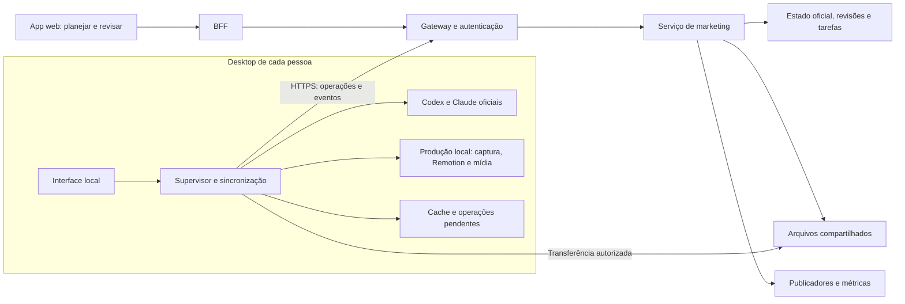

**Proposta revisada — produção de marketing no app web e desktop, com trabalho em equipe**

15/10/2026. Revisão de coerência: edição por IA, Remotion incorporado como biblioteca, Electron colaborativo e entregas incrementais. Baseada nos materiais editoriais, no código atual, nas verificações locais registradas e na documentação oficial. Substitui o desenho anterior; não representa implementação nem medição de desempenho.

Atualização de execução: o usuário autorizou implementar a proposta. A bancada local de L0 e seus resultados reais estão nas [evidências de implementação](2026-10-15-marketing-desktop-l0-evidencias.md); o [plano de lotes](../superpowers/plans/2026-10-15-marketing-desktop-colaborativo-lotes.md) acompanha os critérios comprovados e pendentes. A organização foi confirmada como tendo até três pessoas, permitindo o enquadramento gratuito do Remotion nas condições oficiais registradas. Isso não equivale à conclusão da proposta nem à liberação do produto.

**Decisão central**

Decisão confirmada pelo usuário: um único produto de marketing, com acesso web e aplicativo desktop em Electron, sincronizados com o mesmo servidor. O desktop oferece todas as funcionalidades disponíveis no web para a mesma pessoa e acrescenta execução pessoal de Codex e Claude Code, arquivos locais, capturas e composição. O servidor mantém o trabalho compartilhado e as operações centralizadas.

As duas assinaturas entram na primeira entrega funcional, junto com colaboração entre duas pessoas. Cada participante usa suas próprias contas e seu computador. Compartilhar uma peça não autoriza usar a assinatura ou comandar o computador de outra pessoa.

Este documento define o comportamento e o escopo vigentes. O plano de lotes detalha sua execução; os documentos de evidências e de Fluxo Criativo registram observações e alternativas avaliadas, sem reabrir decisões encerradas.

O processo completo continua sendo pesquisa → direção → planejamento → copy/roteiro → produção de imagem ou vídeo → conferência → aprovação → distribuição → análise/monitoramento → nova pauta. O app deve incorporar o método que produziu o acervo, com referências, revisões e ferramentas adequadas em cada etapa. OpenRouter não é dependência desse fluxo.

A sincronização deve ser automática enquanto houver conexão, com confirmação visível do servidor. Durante falhas, preservar trabalho local e mostrar pendências. “Sempre sincronizado” não pode ser uma promessa de consistência instantânea sem rede; um resultado só fica disponível à equipe quando o servidor confirma seu recebimento.

Instalação, login oficial, pedidos, revisões e recuperação devem ter interface gráfica. O computador executa ferramentas e renderização; a inferência de Codex/Claude continua nos serviços dos provedores e depende de internet, capacidade e limites do plano.

Há uma condição inicial ainda aberta: confirmar o enquadramento admitido da integração de assinaturas, especialmente do Codex com um app desktop colaborativo. Electron não muda as condições de uso. Capacidade local anunciada, permissão de integração e funcionamento completo são três verificações diferentes.

**Decisões consolidadas e limites de escopo**

| Tema | Decisão vigente | Implicação |
| --- | --- | --- |
| Interface | Web e Electron, com todas as funções comuns no desktop | Mesmos componentes, permissões e serviços; capacidades locais adicionais |
| Forma de produzir | Pedidos à IA para copy, arte e vídeo | Nenhuma edição manual de timeline/canvas é requisito |
| Remotion | Biblioteca incorporada à produção | Mesma composição React na prévia e no render; sem app, plugin ou serviço editorial separado |
| Assinaturas | Codex e Claude desde a primeira entrega operacional | Identidade individual, caminho oficial validado e nenhum fallback pago silencioso |
| Ajustes | Alteração pontual, alternativas ou adaptação de formato | Preservar contexto, origem e material fora do escopo |
| Equipe | Servidor mantém revisões e arquivos compartilhados | Execução local tem dono, tentativa, confirmação e recuperação |
| Primeiro uso cotidiano | Copy, arte, vídeo básico, paridade e acervo completo reconciliado | L9 só libera depois dos critérios dos lotes anteriores |
| Métricas | Reusar coleta atual e corrigir disponibilidade antes da liberação | L10 amplia monitoramento e análises; não adia correção de dados existentes |
| Expansões | Efeitos avançados, novos sistemas e serviços externos conforme necessidade | Não bloquear o núcleo com editor manual, framework genérico de agentes ou segunda infraestrutura |

Escolhas de produto encerradas não precisam de nova comparação a cada lote. L0 resolve apenas evidência ainda necessária: enquadramento/funcionamento das assinaturas, empacotamento da execução e limites técnicos medidos. Incorporar Remotion é uma decisão de implementação; a prova verifica seu funcionamento no pacote desktop.

**1. O processo que precisa entrar no app**

O [direcionamento do Instagram](../marketing/kids/comunidade-dos-criadores/instagram/README.md) distingue feed, stories, extras, fixados e peças ManyChat. Cada um cumpre uma função. A integração deve manter essa diferença: sugerir o mesmo encerramento comercial para todas as categorias destruiria parte do trabalho já feito.

O [calendário editorial](../marketing/kids/comunidade-dos-criadores/instagram/03-postagens.md) reúne 60 publicações principais — 30 carrosséis, 18 Reels e 12 imagens únicas — em 20 semanas sugeridas. Existem também seis extras, vinte sequências de quatro stories, três fixados e 14 peças ManyChat. Esses grupos precisam conservar identidade, relação e finalidade; não devem virar uma lista indiferenciada de posts.

O [mapa de cobertura](../marketing/kids/comunidade-dos-criadores/instagram/postagens/12-mapa-cobertura.md) relaciona 30 dores e 30 desejos e diferencia relato, interpretação e hipótese. O [guia de copy](../marketing/kids/comunidade-dos-criadores/instagram/postagens/13-guia-de-copy.md) e a [direção visual](../marketing/kids/comunidade-dos-criadores/instagram/postagens/05-direcao-visual-e-producao.md) fornecem critérios de produção. Essas regras devem chegar a cada tarefa relevante, sem o usuário precisar lembrá-las novamente.

O acervo principal contém 38 pastas de peças, 37 com instruções de publicação e 227 PNGs finais numerados. P29 contém apoio, mas ainda não uma entrega final. A contagem foi refeita nesta análise; não comprova publicação nas redes.

| Caso observado | O que ele exige do produto |
| --- | --- |
| P01 e P34 preservam arte enquanto a copy evolui | Versões independentes de texto, imagem e composição; edição sem regeneração desnecessária |
| P07 usa jogo real e refinamentos visuais na cena | Captura reproduzível, continuidade visual e alteração delimitada |
| P08 combina personagem gerado, jogo executado e bloco real | Ferramentas de execução, captura e composição, além do modelo de IA |
| P29 tem material de apoio e preparação iniciada | Retomada do ponto incompleto, aproveitando o que já existe |
| Revisões abrangem lotes e preservam referências específicas | Escopo explícito, exclusões, comparação e aplicação seletiva |

O resultado desejado é uma peça com texto adequado, arte consistente, evidência de que a demonstração corresponde ao produto e arquivos utilizáveis. Uma resposta bonita em um chat cobre apenas parte desse resultado.

**2. O que aproveitar e o que corrigir no app atual**

A base já inclui conteúdo mestre, publicações por rede, responsáveis, prazos, comentários, etapas, checklist, mídia, Drive/R2, calendário, conexões sociais, publicadores e métricas. A proposta amplia essa base. O serviço de marketing continua dono dos dados editoriais e da publicação.

A inspeção encontrou limitações específicas:

| Situação no código | Consequência | Mudança necessária |
| --- | --- | --- |
| A IA atual recebe poucos campos e devolve texto via OpenRouter | Não reproduz o contexto nem as ferramentas usados no terminal | Execução com contexto, ferramentas, eventos, arquivos e sessões |
| “Gerar” usa o conteúdo salvo; título e briefing podem estar alterados apenas na tela | A geração pode partir de uma orientação anterior | Registrar o rascunho corrente ao iniciar a tarefa |
| O resultado substitui o campo de roteiro/legenda | Comparação e recuperação ficam frágeis | Revisão validada com histórico/Desfazer para ajustes pedidos; comparação e escolha de alternativas |
| Atualizar conteúdo incrementa sua versão, sem vincular a aprovação à revisão textual/visual | A marca de aprovado não identifica exatamente o que foi conferido | Edições imutáveis aprovadas e dependências de revisão |
| O calendário lista publicações por horário agendado | Não representa bem as vinte semanas ainda sem datas reais | Pautas planejadas independentes do agendamento |
| Há etapas genéricas, inclusive gravação | A interface impõe passos inadequados a algumas peças | Visão e checklist por formato, reaproveitando a operação existente |
| A mídia não descreve toda a sua origem e relação com revisões | Reuso e reprodução dependem de pastas e memória | Manifestos, referências e vínculo com a edição |
| O BFF atual retorna JSON | Uma chamada longa de geração não cabe bem no caminho existente | Tarefa durável com consulta incremental de eventos |
| O arquivamento considera conteúdo publicado e idade | Um arquivo antigo pode continuar necessário em uma produção nova | Proteção por dependência e restauração para renderização |

São constatações da leitura do código, não incidentes reproduzidos em produção. Os arquivos e os limites da investigação estão no [caderno de evidências](2026-10-15-marketing-app-fluxo-editorial-evidencias.md).

**3. Assinaturas: capacidades confirmadas e distinções necessárias**

Neste computador, foi confirmado login do Codex por ChatGPT com plano Pro e do Claude Code por claude.ai com assinatura Max. O Codex App Server respondeu a uma consulta de capacidades com geração de imagens e busca habilitadas. A consulta não criou uma tarefa de geração: comprova a capacidade anunciada pela instalação, não a integração completa.

A documentação distingue rotas que a proposta anterior tratava de forma excessivamente ampla:

- A geração nativa de imagens do Codex usa os limites gerais de uso do Codex. Isso sustenta investigar a mesma capacidade na execução local do app. Não equivale a crédito para a Image API. [Documentação de geração de imagens](https://learn.chatgpt.com/docs/image-generation).
- A rota de uso do plano por Sign in with ChatGPT/Responses lista geração de imagens entre as ferramentas não suportadas. Essa limitação não deve ser atribuída automaticamente à execução nativa observada localmente. [Limitações dessa rota](https://developers.openai.com/siwc/token-sharing-open-source/preview-limitations).
- A autenticação nativa do App Server tem restrições para serviços comerciais/hospedados. A documentação encaminha esses casos para Sign in with ChatGPT e seu processo de acesso. O desenho híbrido precisa ser avaliado nesse enquadramento; copiar uma sessão para o servidor não resolve a restrição. [Autenticação do App Server](https://learn.chatgpt.com/docs/app-server).
- Para Claude Code, a documentação admite o binário oficial sem modificações em plataformas, inclusive hospedadas, sob suas condições: termos aplicáveis, autenticação própria de cada usuário e preservação dos métodos nativos de login. Ela distingue isso de coletar sessões claude.ai ou intermediar chamadas usando credenciais de usuários. A proposta usa o binário oficial, com login nativo. [Condições do Claude Code](https://code.claude.com/docs/en/legal-and-compliance).

A integração deve detectar capacidades por usuário e ambiente: texto, pesquisa, imagem, edição de imagem, captura e renderização. “Conectado” não pode significar que todas essas ações estão disponíveis. A interface deve explicar a ação pendente quando faltar login, dispositivo, ferramenta ou cota.

“Usar os tokens do usuário” significa consumir o limite da assinatura na modalidade suportada. Não significa saldo universal, capacidade ilimitada ou transferência de crédito entre API, Codex e Claude. O novo fluxo deve identificar a modalidade selecionada e não recorrer silenciosamente a OpenRouter, API paga, créditos adicionais ou outra conta.

**4. Arquiteturas e escolha do aplicativo instalável**

Existem duas decisões: onde executar o trabalho e como oferecer a interface. Um desktop sincronizado é uma evolução da execução local, sem criar outra base editorial independente.

| Critério | Web + conector em segundo plano | Web + desktop sincronizado | Execução inteiramente hospedada |
| --- | --- | --- | --- |
| Interface | Navegador; conector executa | Navegador e desktop editam/revisam; desktop também produz | Navegador |
| Assinaturas | Clientes oficiais locais por pessoa | Mesmos clientes, com instalação e operação integradas | Modalidades admitidas para execução hospedada |
| Arquivos e ferramentas | Integração indireta com a interface web | Seleção local, prévias, cache e recuperação no mesmo app | Upload e ferramentas provisionadas no servidor |
| Falta de rede | Interface depende mais da web | Consulta em cache e pedidos pendentes; IA e confirmação aguardam conexão | Acesso depende da conexão |
| Computador desligado | Produção local aguarda | Produção local aguarda | Produção pode continuar no servidor |
| Custo operacional | Conector, sincronização e servidor editorial | Acrescenta distribuição desktop; melhora integração da produção | Executores, isolamento, armazenamento e renderização contínuos |
| Principal vantagem | Menor alteração inicial da interface | Adequação a tarefas longas, mídia e trabalho local | Continuidade sem máquina pessoal |
| Principal risco | Software instalado com operação dividida | Sincronização, versões e distribuição | Caminho completo de assinatura/imagens e infraestrutura |
| Indicação | Alternativa avaliada, não adotada | Escolha confirmada: Electron com todas as funções web e capacidades locais | Possível expansão, sem substituir a decisão atual |

O servidor continua disponível quando um desktop fecha: colegas podem consultar o acervo, editar, revisar e publicar entregas sincronizadas. Novas tarefas que dependem daquele executor aguardam. Uma atribuição editorial não é uma autorização remota de execução: quem assume uma tarefa inicia a execução com sua própria identidade.

O caminho hospedado de Claude Code está descrito sob condições do provedor. Para Codex, não foi demonstrado um caminho hospedado que reúna assinatura, imagens nativas e o enquadramento deste produto. A documentação de VM própria trata de um escopo específico de aplicativos de código aberto; não deve ser extrapolada para este app. [Escopo de VMs próprias](https://developers.openai.com/siwc/token-sharing-open-source/self-hosted-vms).

**Electron escolhido**

A escolha do framework está encerrada: Electron. A comparação anterior com Tauri permanece no histórico de evidências; não faz parte dos lotes implementar dois shells nem reabrir essa decisão por padrão.

Usar a separação entre interface e processos de trabalho para manter o app responsivo durante produção. O teste inicial valida empacotamento, integração, consumo de recursos e recuperação dentro dessa escolha. [Processos do Electron](https://www.electronjs.org/docs/latest/tutorial/process-model).

O Chromium da interface não substitui automaticamente o navegador das receitas de captura. O renderizador de produção mantém versão, fontes e condições registradas.

**Reuso real do app existente**

O marketing-app usa Next.js com sessão em cookies, código server-only e BFF. A interface local empacotada não recebe automaticamente essas funções de servidor. A adaptação para Electron conserva a separação entre componentes compartilhados, autenticação e transporte.

Compartilhar progressivamente componentes, prévias, tipos, validações e operações de domínio. A web mantém Next/BFF; o desktop empacota uma interface React local e usa uma camada nativa restrita para sessão do app, sincronização e execução. A implementação pode começar pela peça e pela fila, mas a primeira liberação inclui todas as funções web existentes: painel, ideias, direção, calendário, conteúdo, biblioteca, revisão, conexões, publicação e métricas. Abrir o navegador para terminar uma função comum não conta como paridade; o login oficial de um provedor pode usar o navegador do sistema.

Carregar o site remoto dentro de Electron pode acelerar uma demonstração conectada, mas não entrega a recuperação local proposta. Também exige controle da ponte de privilégios. Não usar esse atalho como evidência de que o produto desktop está pronto.

O framework não altera o contrato editorial nem as entregas. Validar Electron no Windows usado atualmente e nas máquinas do piloto; ampliar suporte a outros sistemas conforme necessidade confirmada.

**5. A experiência de trabalho**

Manter a navegação atual e concentrar o trabalho em direção, planejamento e produção. A peça reúne pedido à IA, copy/roteiro, referências, prévia, diferenças e histórico. Biblioteca, conexões, publicação e métricas continuam no mesmo produto. O usuário não precisa escolher uma skill, motor de vídeo ou etapa técnica para começar.

| Pedido | Resultado |
| --- | --- |
| “Revise o posicionamento com estas entrevistas” | Evidências e proposta de direção, com origem identificada |
| “Organize quatro semanas sem repetir exemplos” | Pautas, objetivos, sequência e pendências |
| “Continue P29 usando o que já está pronto” | Aproveitamento da copy/arte/referências existentes |
| “Troque só o fundo e mantenha os personagens” | Nova revisão visual com escopo limitado |
| “Corte as pausas e coloque animações sobre minha gravação” | Montagem com áudio, legendas e composição |
| “Transforme este story em vídeo” | Representação derivada, com ritmo e entrega adequados |

Projeto, peça, revisão e seleção atuais acompanham o pedido. O app infere alvo e operação, mostra uma síntese curta e usa as preferências já salvas. Uma nova mensagem pode corrigir o pedido. Só perguntar o que falta e muda materialmente o resultado; não repetir entrevista, cadastro de contexto ou escolha de provedor em cada ajuste.

**Aplicação de ajustes e aprovações**

Um pedido explícito como “troque esta frase” autoriza a alteração naquele rascunho. Quando a base ainda é a mesma e as verificações passam, o app cria uma revisão, apresenta a prévia atualizada e permite desfazer. Não exige “confirmar a edição” e depois “salvar” para cada correção.

Pedidos de alternativas mantêm as opções para comparação e escolha. Mudança de formato cria uma representação derivada. Edição aprovada, agendada ou publicada fica preservada; ajustes geram rascunho novo. Conflito, alvo ambíguo ou mudança fora do escopo interrompe a aplicação automática e mostra o ponto a resolver.

Aprovação para distribuição continua explícita e vinculada à edição. Uma pausa antes de gerar mídia é útil quando há decisão criativa pendente; não é obrigatória para toda copy ou cena. O pedido pode cobrir o percurso inteiro: “crie o vídeo com este material e me mostre a versão pronta”. Permissões realmente exigidas pelo cliente oficial são apresentadas na interface.

A preferência por Codex/Claude é persistente. O fluxo usa o provedor escolhido e suas capacidades verificadas; imagem usa Codex quando disponível. Segunda IA revisora só por pedido ou regra editorial aplicável, sem revisão dupla de toda frase. A ferramenta determinística realiza composição/renderização, sem nova inferência quando os parâmetros já estão definidos.

**Disponibilidade de funções e passagem entre web e desktop**

| Ação | Web | Desktop Electron | Execução |
| --- | --- | --- | --- |
| Consultar acervo, preparar pedidos, planejar e revisar | Completo | Completo | Interface e servidor |
| Comentar, comparar, aprovar, conectar redes, publicar e ver métricas | Completo | Completo | Serviços centrais |
| Enviar gravação e acompanhar arquivos/prévias | Completo | Completo | Transferência autorizada para armazenamento |
| Executar IA com assinatura pessoal | Preparar pedido e abrir no desktop | Executar e acompanhar | Cliente oficial local e provedor |
| Preparar/transcrever/renderizar mídia | Pedir, acompanhar e revisar; ação local identificada | Executar e acompanhar | Executor local com bibliotecas incorporadas |
| Importar pastas/repositório | Conferir preparação e resultados | Selecionar origem e processar | Leitura local e persistência central |

O web identifica a ação com “Requer app desktop”, “Abrir no desktop” e “Instalar o app” quando necessário. A fase inteira continua acessível: uma revisão de vídeo não exige renderizar, e comentar uma arte não exige conectar IA. O desktop reúne todas as funções web com as mesmas permissões; login oficial pode usar o navegador do sistema.

A passagem confirma primeiro o rascunho no servidor e abre a mesma peça/revisão/seleção/pedido. Usa referência opaca com validade, sem tokens, comandos ou caminhos na URL. Tratar ausência do app, identidade diferente, expiração, conflito e abertura repetida. Abrir um link não executa trabalho silenciosamente; uma tarefa já iniciada no desktop continua sendo acompanhada pela web.

Na equipe, uma pessoa pode preparar a pauta, outra produzir com sua conta e outra revisar no navegador. Cada executor assume a tarefa e usa sua própria assinatura. Não exigir que o revisor instale desktop ou tenha IA. A tela distingue “concluído neste computador”, “sincronizando”, “pronto para revisão” e “pronto para publicação”; nunca confunde resultado local com entrega confirmada.

**6. Contexto editorial que se mantém entre tarefas**

Criar um conjunto versionado de direção: público, produto, posicionamento, funções dos canais, vocabulário, critérios de copy, identidade visual, referências aprovadas, fontes e decisões. A informação vigente deve ser explícita; ordem de arquivo ou data no nome não resolve precedência.

Cada tarefa recebe um recorte adequado:

- Direção vigente e regras relevantes ao tipo de peça.
- Ficha da peça: necessidade, hipótese, objetivo, formato, CTA e cobertura.
- Rascunho atual, revisões escolhidas e instrução pontual.
- Fontes citáveis com data, origem e distinção entre relato, interpretação e hipótese.
- Imagens de referência e exemplos aprovados, quando a tarefa for visual.
- Artefatos existentes, dependências, itens protegidos e critérios de conclusão.

O contexto é montado por identidade, metadados e busca textual sobre fontes autorizadas, com limite por tarefa e resolução dos trechos necessários. Não enviar os milhares de arquivos do acervo em cada pedido nem exigir uma API de embeddings para a primeira entrega. Resumos apontam para a versão/fonte original; uma correção na fonte invalida o resumo dependente. A conversa ajuda a continuidade, mas não substitui o projeto estruturado.

O app deve mostrar quais referências foram usadas. Mudanças na direção identificam peças potencialmente afetadas; não reescrevem o acervo automaticamente. Pesquisa nova é acionada por necessidade ou pedido, evitando repetir uma investigação inteira em cada legenda.

Os métodos das skills de marketing, conteúdo editorial e revisão devem virar instruções e verificações versionadas, com adaptação a cada cliente. O executor não deve depender incidentalmente de todas as configurações, plugins e arquivos pessoais do computador.

A sessão é vinculada a uma peça ou investigação. Ao trocar de Codex para Claude, transportar texto, evidências, decisões e pendências, preservando a autoria real de cada etapa. Não prometer que o segundo provedor recebe a sessão interna do primeiro.

**7. Edição, regeneração e adaptação de copy, arte e vídeo**

A edição é conduzida por IA do início ao fim. O usuário fornece material, descreve a intenção, aponta detalhes quando útil e avalia versões. Não precisa operar timeline, mover clipes, configurar efeitos ou escrever código. A peça conserva sua identidade editorial, objetivo, contexto e histórico; suas representações podem ser imagem, carrossel, sequência de stories ou vídeo. Slides, cenas, clipes, textos e legendas têm IDs estáveis. O usuário pode escrever livremente; três ações servem apenas como atalhos no mesmo ambiente:

| Ação | Exemplo | Comportamento |
| --- | --- | --- |
| Ajustar | “Troque esta frase”; “mude só o fundo”; “corte as pausas” | IA altera o alvo no rascunho por nova revisão, com prévia e desfazer |
| Gerar alternativas | Outra capa, outro gancho, outra cena ou peça completa | Variantes comparáveis ligadas à origem; a escolhida passa a ser o rascunho atual |
| Adaptar formato | Story de imagem para vídeo; carrossel para Reels | Representação derivada, com roteiro/composição e validação próprios |

A interface oferece comparação de texto, imagens lado a lado e prévias de vídeo. “Usar esta versão” resolve escolhas entre alternativas; ajustes explícitos seguem a aplicação ao rascunho descrita na seção 5. Nenhuma dessas ações modifica a edição aprovada ou publicada. Restaurar cria uma nova revisão; continua possível consultar o caminho anterior. O escopo padrão é o item selecionado; recriar tudo é uma ação explícita. Não exigir briefing completo ou nova pesquisa para corrigir um detalhe.

Na copy, a seleção pode ser gancho, frase, slide, legenda ou roteiro. Na arte, pedidos podem trocar imagem, ajustar recorte, texto, posição, fonte, cor e região marcada. No vídeo, podem alterar um trecho, legenda, efeito, transição ou cena. Selecionar uma região ou indicar um tempo é uma forma opcional de explicar o pedido, não trabalho obrigatório de edição. Cada pedido registra base, alvo, material preservado e resultado. Se outra pessoa alterar a base durante a geração, comparar antes de aplicar.

Textos e composição devem ser editáveis separadamente da imagem. Corrigir uma palavra renderiza o componente afetado e conserva o arquivo visual aprovado. PNG importado sem montagem tem edição limitada: oferecer ajuste assistido da imagem ou reconstrução da composição, mantendo o original. Não anunciar camadas inexistentes. Reutilizar um asset garante seus bytes; uma nova geração precisa de conferência visual e não garante identidade pixel a pixel.

A direção visual permanece um perfil editável de paleta, tipografia, margens e referências. Citações e demonstrações do produto podem ser protegidas. Alterações em lote permitem selecionar peças/componentes, conferir custo/capacidade, acompanhar resultados e aplicar somente as variantes aceitas.

**Story de imagem para story de vídeo**

O usuário abre a peça, escolhe “Adaptar formato → Story em vídeo” e recebe um rascunho com a imagem atual, copy, objetivo e CTA reaproveitados. Pode animar texto/imagem, inserir uma gravação ou combinar ambos. A sequência resultante é conferida na prévia e só depois escolhida para entrega. Um único item de uma sequência pode mudar de mídia sem recriar os demais.

Separar conceito editorial, formato de distribuição e mídia. No domínio atual, os dois stories continuam sendo story/ig_story; muda a representação de image para video e seus requisitos. Não basta renomear um arquivo ou trocar contentType. Adaptações criam variantes editoriais, não publicações automáticas. Versão publicada permanece imutável; nova postagem no mesmo formato pode usar conteúdo derivado ligado à peça/revisão de origem, respeitando a restrição atual de publicação ativa por conteúdo/formato.

**Produção visual e demonstrações**

O percurso estático continua sendo planejamento por slide → imagem/referência → demonstração real quando necessária → composição → conferência → entrega. Capturas do Studio vêm do produto executado, com parâmetros, versão e condições registradas. Não gerar uma imitação da interface como prova.

P08 preserva a distinção: o personagem foi gerado, mas batalha e bloco vieram do runtime e do Blockly. [Registro da produção de P08](../marketing/kids/comunidade-dos-criadores/instagram/producao/postagens/p08-uma-derrota-nao-conta-tudo/apoio/fontes-e-producao.md). Receitas hoje presentes em output precisam virar módulos mantidos, com dependências, fontes e diagnóstico pelo app.

**Vídeos próprios, cortes e animações Remotion**

Remotion entra como biblioteca interna do app. A composição React é compartilhada entre prévia e render; a tela de pedidos/versões continua sendo a do marketing. A documentação descreve esse compartilhamento de componentes. [Integração de composições](https://www.remotion.dev/docs/player/integration).

| Parte | Incorporação proposta |
| --- | --- |
| Composição | Componentes puros em marketing-production, com remotion e módulos de mídia/animação necessários |
| Prévia | @remotion/player no workbench compartilhado por web e Electron |
| Exportação | @remotion/renderer em processo de trabalho local; bundle produzido na construção do app ou de uma receita validada |
| Preparação | FFmpeg/FFprobe para metadados, áudio, conversões/proxies necessários; Whisper.cpp para transcrição |
| Persistência | Projeto, revisões e assets no serviço de marketing já previsto |

Não criar um servidor Remotion, editor paralelo, sistema de plugins ou novo serviço de colaboração. Prévia e exportação usam os mesmos parâmetros, assets, fontes e versão da composição, com caminhos adaptados ao ambiente. Os módulos de renderização/bundling não entram no bundle do navegador. Manter versões compatíveis e testar a configuração de build de cada cliente. [Player](https://www.remotion.dev/docs/player), [renderizador](https://www.remotion.dev/docs/renderer).

FFmpeg complementa o pipeline, sem uma segunda implementação completa da montagem. Cortes não destrutivos, trilhas, cenas e efeitos ficam na composição canônica; transcodificar previamente somente quando necessário. A incorporação da biblioteca é direta; a prova L0 verifica um caso pequeno no pacote Electron e registra dependências.

O fluxo assistido da primeira liberação inclui:

1. Arrastar um vídeo/áudio/imagem para a peça ou fazer upload pelo web. Preservar o original e iniciar sincronização com progresso.
2. O app prepara metadados e miniaturas; extrai/transcreve áudio e cria proxy apenas quando o pedido ou a compatibilidade exigir. A IA recebe contexto temporal do material.
3. Pedir em linguagem natural cortes, remoção de pausas, seleção de melhores trechos, reordenação, junção, velocidade e enquadramento. A IA transforma o pedido em decisões de edição.
4. Pedir ajuste do áudio original, música fornecida, volumes e fades. Transcrição local cria legendas; o usuário pode pedir correções por texto ou fornecer SRT.
5. A IA mistura filmagem com imagens, demonstrações do Studio, texto animado, identificação da pessoa, destaques, contador, lista, CTA e transições, conforme o pedido e a direção da marca.
6. Receber a montagem e pedir ajustes, por exemplo: “mantenha a fala, tire a segunda animação e reduza o encerramento”. O app preserva o que não foi solicitado. Pedidos já claros não exigem aprovar cada corte ou comando intermediário.
7. Conferir a prévia e comparar alternativas quando houver. Exportar na qualidade final quando solicitado ou ao preparar aprovação/distribuição; validar sincronismo, texto, áreas seguras, duração, dimensões, codec e áudio.
8. Sincronizar projeto, dependências e entrega; outra pessoa abre a mesma revisão e continua o trabalho.

A edição é não destrutiva: uma timeline interna versionada referencia originais e intervalos. Ela é uma representação operada pela IA e pelas ferramentas; não uma tela que o usuário precise aprender. Aplicar a decisão de corte validada não modifica o original nem exige inferência por quadro. Cortes precisos exigem tratar quadros, timestamps e formatos corretamente; copiar fluxos comprimidos não garante todo corte arbitrário. [Documentação FFmpeg](https://ffmpeg.org/ffmpeg.html).

O projeto registra formato, fps racional, intervalos de origem, posição na timeline, transformações, trilhas, efeitos, fontes, legendas e versões das receitas. Celular com rotação ou taxa de quadros variável pode exigir derivado normalizado, mantendo o original e o mapeamento temporal. Transcrição fica ligada ao áudio e aos timestamps de origem; a montagem recalcula sua posição sem perder correções aceitas. Para escolher cenas, a IA combina transcrição, frames com timestamps, referências e análise multimodal disponível. A transcrição sozinha não revela o que aparece na tela; uma legenda de post não substitui o vídeo. Registrar limites de análise e não inventar conteúdo ausente.

Whisper.cpp é a opção proposta para transcrição local, com instalação/modelo preparados pela interface e desempenho medido no piloto. Se a máquina não suportar, aceitar SRT/transcrição fornecida e informar a capacidade indisponível; nenhum fallback pago automático. A edição por pedidos continua sem obrigar o usuário a operar uma timeline. [Integração local documentada](https://www.remotion.dev/docs/install-whisper-cpp).

Web e Electron compartilham a bancada de pedidos, referências, prévias e comparação quando o navegador e as mídias disponíveis permitirem. Preparação pesada, transcrição local e render final usam o desktop, com indicação por ação e passagem da mesma seleção. Se a prévia em tempo real não funcionar, mostrar proxy/prévia renderizada com sua revisão. Um proxy enviado não significa que o original ou o projeto completo já estejam sincronizados.

Composições Remotion versionadas e parâmetros validados compõem a primeira versão. IA planeja e executa alterações estruturadas, enquanto operações de mídia e render são determinísticas. Isso evita consumir IA por quadro ou para repetir um render idêntico. O plano usa IDs/intervalos, informa o que será preservado e passa por validação automática; código React arbitrário não é executado no renderer privilegiado do Electron. Novas receitas exigem ambiente isolado, dependências permitidas e validação antes de uso. A IA pode ajustar código dentro desse escopo e executar a validação, sem transferir a programação ao usuário; falhas não passam a receita para produção. Não construir marketplace ou carregador genérico de plugins. Não buscar scripts/fontes de CDN durante o render final.

O [Editor Starter](https://www.remotion.dev/docs/editor-starter) é uma opção para uma futura interface manual avançada, se houver demanda. Não é dependência nem compra recomendada para a primeira entrega orientada por IA. A base é a bancada compartilhada de pedidos e versões; Remotion Studio também não vira interface obrigatória para o usuário. Licença de Remotion depende do enquadramento da organização e da automação; operar localmente não elimina essa verificação nem significa custo zero. [Licenciamento](https://www.remotion.dev/docs/license/pricing).

Vídeo montado com gravações e animações não depende de um modelo generativo de vídeo. Serviços de avatar, voz sintética ou image-to-video do Fluxo Criativo são integrações opcionais com custos próprios; não estão incluídos automaticamente nas assinaturas de Codex/Claude.

**Aproveitamento do Fluxo Criativo**

A [análise complementar](2026-10-15-fluxo-criativo-aproveitamento-marketing.md) registra caminhos, capacidades, lacunas e decisões. Aproveitar os métodos já adaptados, direção por cena, repertório de efeitos, edição seletiva, pesquisas e referências ligadas às peças. O app apresenta essas capacidades como ações do trabalho, sem reproduzir dezenas de comandos e entrevistas do workshop.

**8. Versões, aprovações e publicação coerentes**

Separar três coisas: o estado editorial da peça, o estado de uma tarefa de execução e o estado de uma publicação. “A tarefa terminou” não significa “a peça foi aprovada”; “a peça foi aprovada” não significa “foi publicada”.

Cada edição aprovada fixa texto, legenda, ordem dos slides, arquivos finais e verificações. Uma alteração posterior cria um rascunho. A interface pode mostrar “agendado com edição 3; rascunho da edição 4” e oferecer a substituição após revisão.

| Alteração | Trabalho afetado | O que deve ser preservado |
| --- | --- | --- |
| Só a legenda | Revisão da legenda e edição de publicação | Imagens e composição |
| Texto de um slide | Revisão, composição e conferência desse slide; alt se afetado | Imagens e demais slides |
| Imagem de um slide | Revisão visual, composição e alt desse slide | Copy e demais imagens |
| Ordem dos slides | Encadeamento, manifesto e prévia | Arquivos visuais que continuam válidos |
| Regra ou fonte factual corrigida | Revisão das peças que dependem dela | Materiais sem essa dependência |
| Direção visual nova | Avaliação de impacto e aplicação escolhida | Histórico e publicações anteriores |
| Corte, velocidade ou ordem de cenas | Timeline, áudio, legendas e render afetados | Originais e cenas que continuam válidas |
| Correção de legenda de vídeo | Legenda, prévia/render e nova edição se incorporada ao vídeo | Filmagem e transcrição de origem |
| Mudança de imagem para vídeo | Nova representação, roteiro temporal, exportação e aprovação | Peça de origem, objetivo e assets reutilizados |

A aprovação pertence à edição, não a um checkbox solto. Criar um rascunho não invalida automaticamente uma edição antiga ainda válida. Já marcar uma fonte como incorreta ou retirar uma aprovação exige bloquear a publicação pendente que depende dela. A verificação deve acontecer também quando o publicador assume a tarefa, para não haver uma janela entre revisão e envio.

A aprovação final fixa a revisão e o hash do arquivo final conferido. Um render posterior não substitui esse arquivo automaticamente, mesmo que use os mesmos parâmetros. Aprovação de uma prévia permite avançar a produção, mas não é aprovação automática de um final ainda inexistente.

Trocar arquivos ou legenda de uma publicação deve exigir versão esperada e criar/selecionar uma edição aprovada. Não usar uma referência flutuante para “os arquivos mais recentes”. A confirmação de publicação manual deve identificar a mesma edição entregue. Uma entrega que já começou upload/envio ao provedor não pode trocar de arquivo por baixo da tarefa; exige reconciliação/cancelamento permitido e nova entrega. O código atual força stories para publicação manual; isso descreve a implementação existente, não uma impossibilidade universal das APIs.

A integração reutiliza os publicadores existentes. O adaptador Meta atual espera JPEG para feed/carrossel; o acervo principal contém PNG. Gerar derivados JPEG compatíveis, manter os originais e testar a entrega, sem obrigar o usuário a converter arquivos. Ter o código do publicador não comprova que as contas atuais estejam configuradas.

**9. Calendário, fila de produção e aprendizado**

Uma pauta precisa existir antes de estar pronta ou possuir data exata. Separar semana/posição planejada, prazo de produção e horário real de publicação. P01 é identidade editorial; não significa primeira data disponível. A ordem vigente do calendário deve ser importada explicitamente.

O calendário deve combinar planejamento e publicação com aparência distinta e filtros por série, formato, necessidade e prontidão. Pode mostrar vinte semanas sem criar publicações artificiais no publicador atual. A fila destaca o próximo impedimento acionável: texto em revisão, captação aguardada, imagem faltante ou conta desconectada.

A cobertura de dores/desejos e a variedade de exemplos ajudam a planejar. A capacidade deve considerar gravações, responsáveis, dispositivo e limites das assinaturas. Não assumir que todo o calendário pode ser gerado de uma só vez.

Desde a primeira liberação, as métricas existentes/importadas podem orientar uma análise solicitada à IA, ligada às fontes e à próxima pauta. Depois da publicação, ligar as métricas à peça, ao objetivo e à edição efetivamente enviada. Comparar resultados dentro de contextos compatíveis e registrar hipóteses para o próximo ciclo. Valores indisponíveis devem aparecer como indisponíveis, não como zero. O primeiro benefício mensurável é produtivo: tempo até uma peça aprovada, intervenções manuais, retrabalho e gerações descartadas. Melhora de conversão precisa de observação posterior.

**Inteligência de mercado e monitoramento**

L4 reúne fontes, referências, concorrentes e temas acompanhados, com inclusão manual/CSV/JSON e pesquisa solicitada pela interface. L10 amplia a coleta recorrente para novas fontes e acrescenta alertas. Dados das próprias contas, referências públicas de concorrentes e resultados do funil têm origens e disponibilidade distintas.

O Sistema Zero já possui MetricsWorker, agendamento por idade da publicação, fontes por rede, snapshots e dashboard. Reusar essa base para contas próprias, sem introduzir um segundo coletor sobre as mesmas publicações. Há ajustes locais necessários: o worker preenche shares/saves ausentes com zero e o adaptador Meta registra views=0 no caminho Facebook. A distinção entre ausência e zero precisa atravessar contrato, persistência, agregação e UI em L7, antes da primeira liberação, preservando o sentido incerto dos dados históricos que não possam ser reconstruídos. Esse ajuste não depende dos novos conectores de monitoramento.

Cada observação conserva URL/ID, autor quando pertinente, data da publicação, data da coleta, período, origem, cobertura e vínculo à hipótese. Distinguir observado, inferido, não disponível e desatualizado. Likes ocultos não são zero; uma taxa usa apenas dados compatíveis e informa denominador/cobertura. Não chamar post popular de “validado pelo algoritmo”, nem duração de anúncio de prova de lucro.

A ação “Criar variação a partir desta referência” abre a bancada com referência, hipótese e objetivo, permitindo copy, imagem ou vídeo. Analisar o conteúdo real, quando disponível, não somente legenda truncada; registrar inferência quando a mídia/transcrição faltar. As regras locais de voz, fatos e produto prevalecem.

Coletas recorrentes autorizadas ficam em fila durável no servidor, com frequência, limites, tentativas, deduplicação, última execução e cobertura visíveis. Uma coleta suportada por API pode continuar com computadores desligados. Se exigir execução pessoal/local, fica “aguardando desktop”; análise com assinatura também respeita disponibilidade e cota do dono. Falha de coleta nunca produz alerta de “queda” a partir de zeros artificiais.

Apify e serviços semelhantes são conectores opcionais, avaliados por acesso permitido, cobertura e orçamento. Exportações e referências manuais mantêm o trabalho viável sem eles. Nenhuma coleta, assinatura externa ou envio de relatórios foi ativado por esta proposta. Alertas aparecem no app; publicar, responder comentários/DMs ou alterar orçamento não decorre automaticamente da análise.

**10. Responsabilidades de servidor, web e desktop**

O serviço de marketing permanece dono das regras, revisões, tarefas e publicações. A web o acessa por BFF/gateway; o processo nativo do desktop usa endpoints autorizados no mesmo gateway, com credencial de dispositivo e usuário. O desktop não recebe segredos internos do BFF nem acessa diretamente o banco.

| Responsabilidade | Local principal |
| --- | --- |
| Projetos, direção, pautas, versões, comentários, aprovações e permissões | Servidor |
| Publicação, credenciais sociais, métricas e arquivo compartilhado | Servidor |
| Todas as funções web, incluindo gestão, conexões, publicação e métricas | Web e desktop, com componentes compartilhados e serviços centrais |
| Pedidos por peça/componente, prévia e passagem de contexto | Web e desktop; execução local adicional no Electron |
| Assinaturas, workspace temporário, capturas e composição | Desktop do usuário executor |
| Cache, arquivos ainda não enviados e operações pendentes | Desktop, até confirmação do servidor |
| Credenciais de Codex/Claude | Armazenamento administrado pelos clientes oficiais |
| Credencial do desktop para o Sistema Zero | Armazenamento protegido do sistema operacional |

O servidor guarda contexto compartilhado e resultados necessários à continuidade. Não sincronizar indiscriminadamente pastas pessoais, caches de CLI, credenciais, histórico privado de sessões ou raciocínio interno dos modelos. Registrar instruções de tarefa, decisões, fontes, eventos úteis e proveniência.

Uma peça é a identidade editorial; representação descreve sua forma; revisão registra uma mudança imutável; rascunho aponta para a revisão de trabalho; edição aprovada fixa a entrega; publicação registra o envio externo. Uma tarefa pode criar revisões/artefatos, mas não é nenhum desses objetos. Esses nomes e limites devem ser iguais nos contratos, na UI e nos dois clientes.

O contrato atual de IA, centrado em complete/JSON, é insuficiente. A interface de execução precisa de capacidades, início, eventos, solicitações, cancelamento, retomada e coleta de arquivos. Os adaptadores iniciais são Codex App Server e Claude Code oficial em modo programático.

As responsabilidades de dados incluem direção versionada, fontes, pautas, componentes da peça, usos de assets, execuções, manifestos e aprovações. Acrescentam-se dispositivos, operações idempotentes e fluxo de alterações do servidor. Isso não exige uma tela ou serviço independente por conceito. Manter um executor comum com adaptadores/ferramentas concretos para texto, imagem, captura e mídia; não adicionar outro framework de agentes, workflow configurável ou microsserviço por ferramenta. A migração é aditiva; conteúdo legado não recebe uma aprovação nova fictícia.

A biblioteca compartilha referências, preservando a regra atual de vínculo de mídia ao conteúdo da publicação. Arquivamento passa a verificar dependências ativas e permitir restauração dos bytes, com integridade; a URL de visualização do Drive não basta para reproduzir uma montagem.

Sincronização não substitui backup. Prever cópia recuperável do banco e da mídia, retenção coordenada com os manifestos e ensaio de restauração de uma peça completa. Apagar uma cópia local já sincronizada não pode remover o original compartilhado; exclusão editorial e limpeza de cache são operações diferentes.

**11. Sincronização, colaboração e recuperação**

**Registro oficial e confirmação**

O servidor decide a versão compartilhada. O desktop mantém cache e uma fila local durável, preferencialmente SQLite, com operações pendentes. Não replicar tabelas PostgreSQL diretamente, sincronizar pastas inteiras ou resolver concorrência pelo horário do computador.

Cada alteração carrega ID único, projeto, componente e revisão de origem; autor e dispositivo são resolvidos pela autenticação. Valores de autoria enviados no payload não concedem identidade. O servidor valida acesso e versão esperada; grava alteração e evento na mesma transação. Repetir uma operação após timeout devolve seu resultado anterior, sem aplicar o efeito duas vezes. Reutilizar a mesma chave com outro conteúdo é rejeitado.

Os clientes recebem alterações por cursor, preservam a ordem necessária e toleram eventos repetidos. O cursor só avança após aplicação local durável. Exclusões também geram eventos. Se o cursor expirar, baixar um retrato consistente e reconciliar operações pendentes; não apagar silenciosamente o trabalho local.

O BFF atual é JSON. Consulta incremental com intervalo adaptativo atende ao piloto e à retomada. Notificações podem acelerar atualizações depois; avisam que há novidades, enquanto o fluxo persistido permite recuperá-las.

**Edição por mais de uma pessoa**

Presença e indicação de “em edição” ajudam, mas não garantem exclusividade. Usar controle de versão no servidor. Na primeira entrega, colaborar por peça, slide e revisão, sem construir um editor simultâneo por caractere.

| Concorrência | Comportamento |
| --- | --- |
| Pessoas alteram slides distintos | Mesclar se os componentes de origem permanecem compatíveis; registrar nova revisão |
| Pessoas alteram o mesmo texto | Preservar propostas e mostrar comparação |
| Reordenação simultânea | Resolver conflito da sequência; IDs dos slides permanecem estáveis |
| IA termina após nova revisão, por pessoa ou outra tarefa | Anexar resultado à base original; conciliar componentes compatíveis ou oferecer comparação |
| Aprovação durante nova edição | Aprovar somente a edição explícita e sincronizada |
| Projeto ou acesso removido durante trabalho local | Rejeitar mutações sem autorização e explicar a pendência |

Uma edição final consolida componentes compatíveis. Não basta juntar “a última versão de cada slide” se foram produzidos para direções ou copies diferentes. Coerência do conjunto continua sendo uma verificação editorial.

**Arquivos grandes e retomada**

O desktop grava cada artefato concluído e seu manifesto antes de avançar. O projeto de vídeo inclui originais/proxies/final, fontes, receita/versão e mapeamentos temporais, não apenas MP4. Referências usam IDs de assets; caminhos absolutos da máquina e URLs temporárias não viram dependências permanentes. Envia arquivos por URLs autorizadas, com retomada quando aplicável. O serviço confirma existência, integridade e metadados antes de torná-los disponíveis em uma edição. Hash identifica conteúdo; não concede acesso a arquivo de outro projeto.

Sincronizar metadados e miniaturas primeiro; baixar originais sob demanda ou ao preparar uma tarefa. “Pronto para revisão” pode ter proxy suficiente; “pronto para publicação” exige final confirmado e projeto/dependências obrigatórias recuperáveis. A retenção protege originais, fontes e receitas enquanto houver edição que precise deles. A equipe acompanha progresso sem receber todos os arquivos de apoio. Um arquivo somente local permanece pendente; perder esse computador antes do envio pode perder esse arquivo.

**Execuções e passagem de trabalho**

Toda execução registra quem pediu, quem executa, dispositivo, assinatura selecionada, revisão de entrada e tentativa. Uma tarefa tem uma tentativa ativa, autorizada por uma concessão temporária renovável. O servidor rejeita gravações de tentativa substituída; um resultado tardio pode ser recuperado como candidato, sem aplicar efeitos sobre a tarefa nova.

Queda de heartbeat não dispara outra geração automaticamente: a chamada anterior pode ter consumido cota. Primeiro consultar sessão/artefatos, confirmar interrupção ou solicitar retomada consciente. A proteção também vale para dois computadores da mesma pessoa.

Quando outra pessoa assume, usa contexto e arquivos compartilhados com suas próprias credenciais. Não copiar a sessão autenticada nem presumir retomada da sessão interna do colega. A nova execução registra a passagem e preserva o material aproveitável.

Estados da tarefa distinguem fila, espera por dispositivo, execução, espera por informação/cota, envio de arquivos, resultado para revisão, falha e cancelamento. O início congela contexto/base, operações permitidas, provedor e limite de trabalho. Validadores conferem alvo, dependências e resultado; erro determinístico pode ter correção limitada, nunca loop ilimitado de geração. Mensagem nova altera tarefa ainda não iniciada ou cria pedido dependente de uma tentativa ativa; não muda silenciosamente a base de uma execução em andamento. O progresso mostra etapas reais. Cancelar interrompe o que for suportado e impede novas etapas; não desfaz uso já ocorrido.

**Sem conexão, suspensão e fechamento**

| Situação | Regra |
| --- | --- |
| Rede ausente | Ler cache, preparar pedidos e registrar pendências; IA de assinatura aguarda conexão |
| Servidor indisponível, provedor acessível | Não iniciar novas chamadas/etapas sem coordenação; guardar resultado em andamento |
| Etapa local já iniciada, com arquivos disponíveis | Pode finalizar com segurança; sincronização e aprovação aguardam |
| Fechar a janela | Comportamento claro de permanecer em segundo plano ou pausar |
| Encerrar, suspender ou desligar | Preservar checkpoints; execução contínua não é garantida |
| Reconectar | Atualizar acesso/versões, reenviar operações idempotentes e resolver conflitos |
| Aprovar, agendar ou publicar | Exigir confirmação online do estado e dos arquivos |

O piloto não exige edição offline de todo o sistema. Precisa preservar rascunhos, arquivos e operações interrompidas. A web continua oferecendo revisão sem depender de um desktop específico.

**Identidade, permissões e limites locais**

Usar o cadastro de equipe existente. Diferenciar consultar, editar, executar, aprovar, publicar e administrar conexões; a mesma pessoa pode acumular permissões. A autorização alcança objeto/projeto, além do papel global. O responsável pela peça não ganha controle de uma assinatura ou dispositivo.

O login do desktop no Sistema Zero ocorre pelo navegador oficial do app, com vinculação de uso único e prova ligada à instalação. Emitir credencial revogável e limitada, com renovação protegida e sem segredo de servidor no instalador. Esse fluxo precisa ser implementado no auth/gateway; cookies atuais e dispositivos de estudo infantil não o substituem.

O desktop assume trabalhos destinados à própria identidade e dentro da operação autorizada por seu usuário. Não montar um conjunto de computadores de funcionários para executar pedidos de terceiros indiscriminadamente. Revogar dispositivo/acesso bloqueia novas operações no servidor; o cliente interrompe novas etapas ao detectar a revogação. Não prometer apagar instantaneamente um cache desconectado.

A interface Electron fica isolada de Node e do sistema de arquivos. A ponte nativa expõe operações específicas, valida remetente/argumentos e limita navegação. Prévia HTML gerada e pesquisa são conteúdo não confiável, sem acesso à ponte privilegiada. [Orientações do Electron](https://www.electronjs.org/docs/latest/tutorial/security).

Separar processos evita travar a interface, mas não é uma sandbox para comandos. O supervisor precisa de controle de arquivos, ferramentas e execução. Receitas conhecidas e clientes oficiais operam em workspace delimitado, usando os mecanismos de isolamento aplicáveis. O renderer não recebe shell genérico.

**Instalação e atualização**

Distribuir instalador assinado, atualização verificável, diagnóstico e política de compatibilidade entre cliente, API, protocolos e receitas. Atualizar após checkpoint seguro, sem encerrar geração ativa ou descartar pendências. Migrações do cache preservam recuperação; voltar de versão exige compatibilidade de dados, não apenas substituir o executável. [Distribuição assinada](https://www.electronjs.org/docs/latest/tutorial/code-signing), [atualizações](https://www.electronjs.org/docs/latest/tutorial/updates).

Clientes oficiais mantêm seus binários e métodos de autenticação. A instalação assistida usa fontes oficiais, detecta versões e evita modificar a instalação pessoal silenciosamente. Incompatibilidade suspende a capacidade afetada e oferece correção pelo app; não libera comandos arbitrários como solução.

**12. Alimentar o app com o trabalho já produzido**

A primeira liberação deve trazer o acervo existente e permitir continuar o trabalho de onde parou. A importação é uma entrega obrigatória anterior ao uso cotidiano, não uma expansão futura nem uma pasta de anexos sem estrutura.

O inventário abrange o marketing do repositório por produto/canal: docs/marketing, pesquisas e decisões editoriais em docs/plans e docs/superpowers/plans, produção final e arquivos de apoio referenciados, inclusive os pertinentes em output/instagram. Há material de Comunidade, Desafio Primeiro Jogo, Cadê Todo Mundo e propostas em estudo; manter esses contextos separados. Incluir também os materiais pertinentes de C:/Users/tocha/Documents/fluxo-criativo/meus-produtos, com proveniência de repositório externo.

A varredura encontrou 1.910 arquivos em docs/marketing e mais de 38 mil em output/instagram, incluindo dependências e saídas técnicas. Esses números não são quantidade de peças. O inventário precisa distinguir material criativo de node_modules, caches, compilados redundantes e arquivos sem relação editorial. Propostas de engenharia deste próprio app também não viram posicionamento de marca.

No Fluxo Criativo foram encontrados 561 arquivos em meus-produtos, sendo 558 dentro de três produtos. Uma comparação por hash de 534 candidatos textuais/mídias não encontrou cópia byte a byte nos diretórios editoriais/produção examinados do Sistema Zero; isso não exclui conteúdo já reescrito. Importar por identidade e significado além do hash, propondo correspondências e conservando origens; similaridade por IA nunca autoriza apagar ou fundir peças automaticamente. Materiais de Programando com Diversão, preços históricos, calendários de julho e promessas antigas ficam históricos ou em conferência. O catálogo, a direção vigente e as regras locais atuais prevalecem. Aulas e projetos pedagógicos entram como referência quando úteis, sem criar publicações ou uma segunda base pedagógica.

| Material existente | Como deve entrar no app |
| --- | --- |
| Posicionamento, públicos, oferta e direção | Projeto, versões de direção e decisões, com indicação do vigente |
| Pesquisas, relatos e análises | Fontes/evidências datadas, trechos e relações com hipóteses |
| Calendários e mapas de cobertura | Pautas, semana/posição, formato, necessidade e objetivo |
| Copies, roteiros, legendas e alt | Componentes editáveis ligados à peça e à revisão |
| PNGs, imagens de apoio, montagens e prévias | Biblioteca e entregas, com origem, integridade e vínculo com versões |
| Capturas, projetos e verificações do Studio | Evidências e receitas reproduzíveis, com dependências |
| Prompts, referências e instruções de produção | Contexto da tarefa e proveniência, sem atribuir autoria não comprovada |
| Revisões substituídas e materiais descartados | Histórico consultável, separado do material vigente |
| ManyChat, fixados, destaques e stories | Grupos e sequências próprios, com instruções e pendências de distribuição |
| Material incompleto | Estado real de produção e próxima ação, aproveitando o trabalho válido |

Importar originais para acervo consultável e, quando houver estrutura confiável, convertê-los em objetos operacionais. Uma peça final sem montagem recuperável continua utilizável e fica marcada como edição limitada; não fingir que um PNG importado já possui camadas editáveis.

O processo tem seis passos: inventário com origem/hash → classificação e vínculos → prévia de conflitos → carga em área de preparação → reconciliação e amostra visual → ativação do projeto para continuidade. Preparação é L8A, iniciada quando contratos/sincronização/fontes estiverem disponíveis; L8B conclui reconciliação e ativação depois de produção/aprovação. Assim, o acervo real orienta os lotes de copy e vídeo sem esperar o sistema inteiro ficar pronto. Cada arquivo elegível recebe um destino ou motivo explícito de exclusão/duplicação. Casos ambíguos entram em uma fila de conferência, sem serem promovidos a fatos ou aprovações.

Inventariar/importar não executa scripts nem concede privilégios a HTML encontrado. Montagens importadas são conteúdo isolado; receitas que precisem ser executadas passam pela preparação e verificação da produção.

Preservar IDs editoriais e distinguir identidade de peça, ordem do calendário e data real. A precedência vem dos índices vigentes e relações documentadas, não apenas de datas nos nomes. P01 combina copy em apoio/v4 com arte de apoio/v3; P29 entra como produção iniciada, com arquivos aproveitáveis, sem final fictício. Conferir novamente esse estado no momento da carga.

O inventário principal de 60 pautas, 37 entregas e 227 PNGs serve como referência desta análise; a reconciliação usa o retrato congelado no início da importação. Arquivos publicacao.txt são instruções, não prova de postagem. Importar nunca publica, agenda, ativa ManyChat nem consome IA silenciosamente.

A carga é repetível por projeto/identidade editorial/revisão/hash e registra seu lote de origem. Deve reconciliar dados já existentes no app, conservar proveniência mesmo quando os bytes são deduplicados e detectar mudanças ocorridas no repositório durante a carga. Nenhuma fonte original é removida.

Antes da ativação, demonstrar que o usuário encontra uma peça concluída, edita sua copy sem perder a arte, consulta a pesquisa que a fundamenta e continua uma peça incompleta. Também conferir fixados/stories/ManyChat, histórico e itens de outros produtos. A validação não se resume à contagem de uploads.

Após a conferência, o app torna-se o lugar de operação. Manter originais como referência e oferecer exportação; não criar dois lugares concorrentes de edição entre banco e Markdown. Alterações posteriores no repositório entram por uma nova importação explícita com comparação.

**13. Implementação em lotes e critérios de liberação**

Os lotes são entregas revisáveis com dependências, demonstração e reversão, não semanas nem uma promessa de prazo. O [plano de lotes](../superpowers/plans/2026-10-15-marketing-desktop-colaborativo-lotes.md) detalha áreas e critérios. As decisões de arquitetura já tomadas são mantidas.

| Lote | Entrega | Depende de |
| --- | --- | --- |
| L0 | Prova curta das assinaturas e de uma composição Remotion incorporada ao Electron | Requisitos definidos; verificação da modalidade |
| L1 | Contratos, revisões/representações, operações e permissões | L0 |
| L2 | Electron, identidade, adaptadores oficiais e navegação compartilhada | L0, L1 |
| L3 | Execução comum, sincronização, arquivos, progresso e medição | L1, L2 |
| L4 | Direção, fontes, pesquisa, pauta e contexto recuperável | L1; execução assistida após L3 |
| L5 | Copy por pedidos, ajustes sem confirmação redundante, alternativas e conflitos | L3, L4 |
| L6A | Arte, demonstrações e composição editável por IA | L3, L4, L5 |
| L6B | Biblioteca Remotion, gravação/cortes, áudio, transcrição, prévia e render básicos | L3, L4, L5 |
| L6C | Efeitos, composições híbridas e adaptação de formatos | L6A, L6B |
| L7 | Edição aprovada, publicação/retenção, paridade e correções das métricas existentes | L1, L3, L5, L6A–C |
| L8A | Inventário e carga preparatória dos dois acervos, com amostras reais | L1, L3, L4 |
| L8B | Reconciliação integral, delta e ativação para continuidade | L8A, L5, L6A–C, L7 |
| L9 | Piloto colaborativo e primeira liberação cotidiana | L0–L7, L8A, L8B |
| L10 | Ampliação de monitoramento, alertas e análises por objetivo | L4, L7, L8B; liberação após L9 |
| L11 | Expansões condicionadas ao uso observado | Necessidade e capacidades demonstradas |

L0 verifica um percurso pequeno na arquitetura escolhida, com limites e resultado real. Instalação final em duas máquinas, catálogo completo de efeitos e migração integral pertencem aos lotes posteriores. Se uma assinatura/capacidade obrigatória não funcionar na modalidade admitida, registrar o impedimento sem trocar por API paga. O aplicativo de produção só é liberado com o requisito atendido.

L6A e L6B compartilham a base de L3/L5 e não dependem um do outro para começar; L6C os integra. L8A pode avançar após L4 e alimentar amostras dos lotes seguintes. Essa ordem evita terminar toda a produção antes de descobrir incompatibilidades no acervo. Não implica execução automática de agentes paralelos.

Cada lote demonstra uma fatia utilizável em ambiente controlado. L5 prova ajuste de copy; L6A prova mudança visual; L6B prova edição de gravação; L6C prova story de imagem → vídeo. Isso permite corrigir o desenho cedo, sem apresentar um protótipo parcial como a primeira entrega completa.

L9 exige ambas as assinaturas, todos os recursos web no Electron, vídeo básico por IA, acervo elegível reconciliado e trabalho entre duas pessoas/computadores. Pesquisa → pauta → produção → revisão → preparação da publicação → leitura das métricas existentes forma o ciclo inicial. L10 amplia o acompanhamento recorrente de novas fontes; não adia o básico desse ciclo.

P01, P07, P34 e P08 são referências de qualidade; P29 pode demonstrar continuidade após conferir seu estado no congelamento. Usar também uma gravação de celular e um story estático para os casos de vídeo. Material já válido é reaproveitado, não regenerado para satisfazer um teste.

Aprovação/edição fixa e correção de ausência versus zero entram em L7. O ambiente de demonstração não publica campanha real. Produção cotidiana só é ativada após L8B/L9; importação não publica nem agenda. Nenhum requisito de assinatura, vídeo, sincronização ou acervo pode ser movido para L11 para antecipar essa liberação.

Estimar esforço após a prova L0 e revisar com dados de L3/L6. Editor manual avançado, marketplace, novo framework de agentes e serviço Remotion dedicado não integram o escopo inicial.

**14. Critérios de aceite que comprovam valor**

| Teste | Resultado exigido |
| --- | --- |
| Assinaturas | Texto em Codex e Claude; imagem nativa criada/editada e entregue; modalidade de uso identificada |
| Instalação e operação | Conectar, produzir, revisar, retomar e exportar sem comandos |
| Edição por IA | Copy, arte e vídeo ajustados por pedidos; nenhum passo exige operar timeline, canvas ou código |
| Paridade desktop | Todas as funções web disponíveis no Electron, respeitando as mesmas permissões |
| Indicação no web | Ação local identificada; preparação, revisão e acompanhamento continuam acessíveis |
| Passagem entre clientes | Abrir a mesma peça/revisão/seleção sem perder rascunho ou duplicar execução; tratar falta de instalação, expiração e identidade diferente |
| Duas pessoas e dois computadores | Mesma revisão confirmada, autoria correta e conta individual em cada execução |
| Rascunho atual | Tarefa usa o pedido/contexto recém-editado, ainda que antes estivesse só na tela |
| Ajuste simples | Pedido claro atualiza rascunho por nova revisão com desfazer, sem confirmar cada ferramenta |
| Trabalho limitado | Uma opção por padrão; retries/correções limitados; atingir cota não muda provedor sozinho |
| Remotion incorporado | Mesma composição/parâmetros na prévia e no render; sem aplicativo ou serviço separado |
| Edição concorrente | Alterações compatíveis se conciliam; conflito preserva as duas versões |
| IA atrasada | Resultado não sobrescreve alterações humanas posteriores |
| Revisão pontual | Só componentes solicitados são alterados; referências protegidas permanecem |
| Regeneração e comparação | Outra versão da parte/peça sem substituir a atual; selecionar/restaurar deixa histórico |
| Adaptação de formato | Story de imagem vira vídeo válido, mantendo original, objetivo e CTA; exige nova conferência |
| Gravação própria | Upload, corte preciso, áudio, legendas editáveis e animação sobre filmagem; original intacto |
| Continuidade de vídeo | Segundo computador recupera timeline/fontes/mídias e reproduz a edição confirmada |
| Prévia e render | Mesmos intervalos/textos, sem perda de sincronismo; proxy e final identificados |
| Métricas iniciais, L7/L9 | Ausências identificadas em contrato, banco e UI; análise por IA usa fontes existentes sem inventar resultado |
| Monitoramento ampliado, L10 | Coleta repetida não duplica, falha conserva snapshot e novas fontes respeitam cobertura |
| Passagem entre pessoas/provedores | Contexto e arquivos acompanham o trabalho; credenciais e sessões privadas não |
| Demonstração do Studio | Estado e parâmetros correspondem à execução registrada |
| Queda de rede/cota/processo | Checkpoints recuperados sem repetição cega de geração |
| Timeout após confirmação no servidor | Reenvio não duplica a alteração |
| Upload interrompido | Mesmo arquivo é retomado; conclusão da equipe aguarda confirmação |
| Cursor antigo e exclusão remota | Recuperação respeita exclusões e preserva operações locais para conciliação |
| Dispositivo/acesso revogado | Novas operações recusadas; cache offline não é anunciado como removido instantaneamente |
| Edição agendada | Arquivos e legenda fixados; rascunho novo não altera o envio |
| Final depois da prévia | Aprovação final identifica arquivo confirmado; novo render não substitui edição aprovada |
| Fonte invalidada | Publicação dependente bloqueada antes de assumir/enviar a tarefa |
| Envio externo com resultado incerto | Reconciliar estado/identificador do provedor antes de repetir publicação |
| Arquivo arquivado | Dependências protegidas e restauração íntegra para reprodução |
| Cliente atualizado/antigo | Compatibilidade verificada; pendências preservadas durante atualização |
| Importação repetida | Sem duplicações nem mistura de versões atuais e históricas |
| Entrega visual | Copy, alt, sequência, dimensões, fontes e prévia conferidos |

Qualidade continua sendo julgada pelas referências reais: clareza para pais, exemplo concreto, encadeamento, função do CTA, fidelidade ao produto, leitura no celular e continuidade visual. O linter não substitui essa revisão.

**15. Desempenho, consumo e eficiência**

Não há benchmark do novo desenho. A hipótese é que processamento local, reaproveitamento de arquivos e alterações por componente reduzam transferência e retrabalho. Medir o pacote completo, incluindo Electron, clientes de IA, navegador de captura, cache e ferramentas; comparar apenas o tamanho do shell seria enganoso.

Separar tempo em fila, inferência, captura/renderização, upload e revisão humana. Uma demora do provedor não deve ser confundida com lentidão da interface ou do servidor.

| Área | Decisão inicial |
| --- | --- |
| Interface | Miniaturas, carregamento por necessidade, paginação e atualizações limitadas ao componente alterado |
| Calendário | Consultar janelas de pautas/publicações; não baixar todas as imagens das vinte semanas |
| Recursos locais | Um trabalho pesado de captura, transcrição ou render por dispositivo inicialmente; UI e sincronização permanecem responsivas |
| Assinaturas | Concorrência conservadora por usuário/provedor, lotes pequenos e limites visíveis quando informados |
| Arquivos | Cache com limite configurável; retirar apenas cópias recuperáveis já sincronizadas e fora de tarefas ativas |
| Sincronização | Operações incrementais e prioridade para texto, decisões e prévias; transferência pesada com limite |
| Servidor | Filas/eventos duráveis, índices por projeto/versão, retenção definida e endpoints paginados |
| Economia | Ajuste mínimo, uma variante por padrão, reuso de assets e prévia antes do render final quando o pedido permitir |
| Vídeo | Prévia com proxy, cache de mídia/fontes, render separado e controle de CPU/RAM/disco; sem reencodar a cada edição |
| Pesquisa recorrente | Limites por fonte, deduplicação de observações e transcrição apenas de material selecionado |

O executor usa o menor percurso suficiente: corrigir copy não transcreve vídeo; mudar cor não chama geração de imagem; ajustar legenda não reanalisa toda a pesquisa; gerar preview não exige reexportar MP4 final. Uma variante é o padrão, salvo pedido de opções. Reutilizar transcrição, frames, fontes e bundle por hash/versão; não acumular gerações especulativas.

Definir limites por tentativa, incluindo tempo, número de gerações, ferramentas permitidas e teto de correções automáticas. Limites impedem loops; o progresso mostra o próximo impedimento e conserva resultados. Logs de duração/consumo e intervenções entram em L3, para que L9 tenha dados reais; não dependem de L10.

Não disparar trabalho pesado na interface ou no processo responsável por manter a janela responsiva. Evitar atualização a cada token em toda a árvore de componentes e PNGs completos usados como miniaturas. O usuário pode pausar produção e limitar atividade em segundo plano.

Mostrar consumo e limites quando o provedor os informar, indicando ausência de informação nos demais casos. Contadores parciais de tokens não são saldo exato da assinatura. Ao atingir cota, preservar estado; troca de provedor é explícita. Não recorrer silenciosamente a API paga, créditos extras ou outra conta.

As metas iniciais do piloto são propostas, não resultados: resposta visual da interface ao pedido/navegação em até 100 ms no percentil 95 e revisão pequena confirmada visível ao colega em até 3 s no percentil 95, com conexão saudável e app ativo. Medir com o acervo de 60 pautas/227 arquivos, três sessões de equipe e um trabalho visual ativo, registrando hardware, rede e versões. Essas metas não são prazo de resposta da IA nem de geração de vídeo. Upload de mídia e inferência têm medições separadas. Acrescentar gravação de celular de alguns minutos e story animado curto, medindo tempo de preparação, precisão dos cortes, prévia, render, pico de memória/disco e transferência. Fixar limites de duração/tamanho simultâneos após L0; não prometer que vídeo longo, 4K ou todo codec roda em qualquer computador. Cache de render deve incluir revisão de timeline, assets, fontes e versões do motor, para não reutilizar saída incorreta.

Registrar também tempo humano até aprovação, gerações descartadas, bytes transferidos, cache, recuperação de falhas e intervenções fora do app. A aceitação exige qualidade comparável ao acervo, ausência de perda silenciosa e eliminação do terminal da rotina; redução percentual de custo precisa de dados.

**Limites desta proposta**

Foram feitas inspeção estática, leitura de artefatos, consultas oficiais e, na revisão anterior desta mesma conversa, verificações locais de autenticação/capacidades. Esta revisão acrescentou análise de desktop, colaboração, edição por IA, vídeo, sincronização, desempenho e aproveitamento do Fluxo Criativo.

Não foram implementados o desktop ou seus protocolos, executados benchmarks, repetidas gerações de conteúdo nem testadas contas sociais. O acervo e os estados observados são um retrato da inspeção; o importador deverá conferir novamente sua versão ao iniciar o piloto.

Electron foi escolhido pelo usuário. O teste funcional e de recursos valida a implementação dessa escolha. O enquadramento do Codex e a produção nativa via integração seguem critérios iniciais de viabilidade, não capacidades já entregues. A proposta cobre o fluxo e define como comprovar sua eficiência, sem tratar desenho técnico como funcionamento demonstrado.
