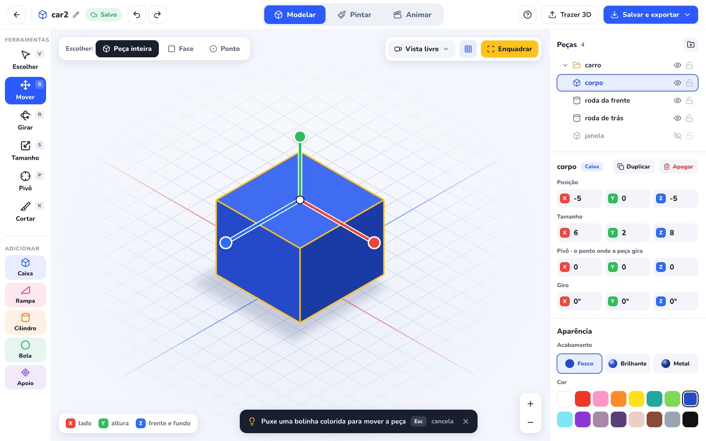

**Molda — proposta de fidelidade aos prints e evolução dos três níveis**

15/10/2026 · Revisão 2 · Referência aprovada para implementação · Identidade visual do Sistema Zero preservada.

Execução e resultados posteriores: [acompanhamento dos oito lotes](2026-10-15-molda-fidelidade-implementacao.md) e [matriz dos 50 critérios, capturas e adaptações](2026-10-15-molda-fidelidade-aceitacao.md). O diagnóstico abaixo registra a situação anterior à implementação.

**Minha recomendação é transformar os cinco prints no contrato da oficina básica e fazer os níveis intermediário e avançado crescerem dentro dessa mesma organização.** Modelar, Pintar e Animar continuam no topo; ferramentas ficam à esquerda; a criação ocupa o centro; peças e propriedades ficam à direita. O nível acrescenta possibilidades, sem obrigar a criança a reaprender onde trabalhar.

A orientação adicional sobre a identidade da plataforma tem prioridade: fontes, cores de interface, botões, ícones, sombras, estados e temas continuam vindo do Sistema Zero. A fidelidade aos prints será cobrada na composição, na hierarquia, nos controles e no comportamento. A identidade não autoriza trocar controles, esconder campos, aumentar regiões ou substituir gestos por formulários. Diferenças necessárias de tokens, geometria e responsividade precisam estar identificadas no contrato visual; não são uma licença geral para aproximar livremente o desenho.

**Esta revisão releu as cinco imagens, os três documentos originais e os trechos de código responsáveis pelos comportamentos propostos.** O último commit do Molda continua sendo `7981caf7a`. Foram executados 62 testes existentes de nove arquivos, com 62 aprovações e zero falhas; eles caracterizam a base atual, não validam recursos propostos. Não houve nova navegação no aplicativo; as capturas existentes continuam sendo evidência da revisão visual anterior. O [registro da revisão](2026-10-15-molda-fidelidade-revisao.md) relaciona achados, fontes e limites da verificação.

**A precedência é: orientação do usuário sobre identidade → regras e correções explícitas dos três documentos → composição dos prints → decisões complementares desta proposta.** Quando os documentos deixam um fluxo em aberto, a proposta o identifica como decisão complementar. Código atual é evidência do ponto de partida, não autoridade para enfraquecer um requisito. Os trechos de código sugeridos nos documentos descrevem intenção; a implementação deve preservar os contratos de dados reais do Molda.

| Referência | Papel na proposta |
|---|---|
| [Modelar — Mover](references/2026-10-15-molda-fidelidade/01-modelar-mover.jpeg) | Composição principal, alças, seleção e propriedades |
| [Modelar — Pivô](references/2026-10-15-molda-fidelidade/02-modelar-pivo.jpeg) | Marcador, prévia, presets e destaque contextual |
| [Modelar — Cortar](references/2026-10-15-molda-fidelidade/03-modelar-cortar.jpeg) | Marcação nas arestas, encaixe, confirmação e cancelamento |
| [Pintar](references/2026-10-15-molda-fidelidade/04-pintar.jpeg) | Escopo da pintura, seletor de cor, paletas e grade |
| [Animar](references/2026-10-15-molda-fidelidade/05-animar.jpeg) | Movimentos, poses, canais e linha do tempo |
| [Especificação do Pivô](references/2026-10-15-molda-fidelidade/molda-ferramenta-pivo-spec.md) | Regras detalhadas de transformação e apresentação |
| [Especificação do Cortar](references/2026-10-15-molda-fidelidade/molda-ferramenta-cortar-spec.md) | Regras detalhadas de interação e divisão em duas peças |
| [Especificação do Animar](references/2026-10-15-molda-fidelidade/molda-animar-spec.md) | Poses, interpolação, reprodução, interação da timeline e altura ajustável obrigatória |

**Há três caminhos possíveis; recomendo o segundo.**

| Abordagem | Resultado | Consequência |
|---|---|---|
| Ajustar apenas o visual atual | Aproxima cores, medidas e espaçamentos | Mantém diferenças importantes: propriedades escondidas, corte com outro resultado e fluxos distintos dos prints |
| **Uma oficina comum, com básico fiel e expansão por nível** | Reorganiza a interface e completa os comportamentos necessários, aproveitando o motor existente | Exige trabalho real em corte, pivô, pintura e animação; é o melhor aproveitamento do que já existe |
| Construir três editores separados | Permite desenhar cada nível isoladamente | Duplica componentes e regras; aumenta o risco de o mesmo projeto se comportar de forma diferente entre níveis |

**O Molda já tem a estrutura geral, mas ainda não reproduz a experiência das referências.** A revisão anterior aproximou a interface da plataforma. O próximo trabalho precisa corrigir composição e comportamento, além de acabamento.

| Área | Evidência atual | Mudança proposta |
|---|---|---|
| Básico | Medidas e pivô dependem de `model.precise`; edição de componentes depende de `model.mesh` | Liberar os controles presentes nos prints com permissões mais específicas |
| Propriedades | Predominam passos −/+; medidas ficam recolhidas e variam com a ferramenta | Exibir Posição, Tamanho, Pivô e Giro juntos, em quatro linhas compactas |
| Seleção | O viewport usa uma caixa envolvente amarela | Mostrar o contorno e as arestas visíveis da geometria escolhida |
| Manipulação | Alças de transformação com desenho convencional da biblioteca | Alças com linhas, borda branca e bolinhas, na linguagem dos prints |
| Pivô | Presets geram uma prévia que exige Aplicar; guias usam rosa e geometria 3D | Pivô roxo, alças X/Z, campos sincronizados e edição direta |
| Referenciais | Presets do pivô usam limites mundiais; campos atuais mostram transformação mundial e escala | Definir base local, dimensões e ponto de manipulação sem misturar referenciais |
| Câmera | Vista livre atual usa perspectiva | Separar orientação livre de projeção; iniciar com projeção ortográfica isométrica |
| Corte | “Criar divisão” exige contexto de malha e vista; subdivide a geometria sem tampas | “Cortar” na barra principal, marcação nas arestas e duas peças fechadas |
| Pintura | Paleta e seletor nativo de cor; painel diferente da referência | Seletor de cor dentro do painel, escopo explícito e “Quadradinhos” |
| Animação | Recursos existem, mas movimentos e ajustes ficam em seleção/recolhimentos | Lista de movimentos, poses e controles visíveis nas posições do print |
| Timeline | Altura Compacta/Ampla por seletor; tiras de poses navegam pelo tempo | Altura por arrasto, seleção de pose por canal e arrasto temporal de losangos |
| Interpolação | O motor guarda o jeito de sair da chave; a especificação define o jeito de chegar | Adaptar a edição por intervalo sem reinterpretar animações existentes |
| Importação e apoio | `files.interop` está no profissional; `model.locator` no intermediário | Separar entrada simples de arquivos e apoio básico das funções especializadas |

As diferenças de interface também aparecem nas capturas armazenadas de [Modelar](img/2026-10-15-molda-direcao-de-arte/depois-modelar-duas-1440.png), [básico no host](img/2026-10-15-molda-direcao-de-arte/depois-host-basico-1172.png), [Pintar](img/2026-10-15-molda-direcao-de-arte/depois-pintar-1440.png) e [Animar](img/2026-10-15-molda-direcao-de-arte/depois-animar-movimento-1440.png).

**A identidade da plataforma deve ser preservada por construção.** O ponto de partida é o [chrome compartilhado das ferramentas](../../packages/ui/src/styles/tool-chrome.css), com seus tokens `--sz-tool-*`, e os [tokens do Molda](../../packages/molda/src/styles/molda.css). As receitas de controles devem continuar compatíveis com Pinta, Pensa, Estúdio e as galerias.

| Elemento | Decisão |
|---|---|
| Tipografia | Nunito para interface; Baloo 2 nos títulos em que a plataforma já usa a fonte. Mesma escala e pesos da casa |
| Superfícies | Fundo claro da plataforma, painéis brancos, divisores discretos, sombras curtas e cantos existentes |
| Ferramenta e aba ativas | Cor de ação do tema da plataforma; no tema padrão, azul |
| Assinatura do Molda | Roxo da marca em sua identificação e nos lugares já previstos pela plataforma |
| Pivô | Roxo semântico próprio da ferramenta, distinguível pelo marcador e pelo texto |
| Cortar | Rosa semântico da ferramenta, distinguível por faca, pontos e linha |
| Eixos e seleção | X vermelho, Y verde, Z azul; seleção amarela. Permanecem estáveis ao trocar o tema |
| Ícones | Mesma família Lucide, espessura coerente e desenho correspondente à ação |
| Mouse e toque | Medidas visuais da referência no desktop; áreas interativas ampliadas conforme a régua de toque da plataforma |

Os valores `#8B3FD9`/`#F2EAFC` e `#E8336F`/`#FDE6EE` são as referências explícitas de pivô e corte. A entrega visual deve registrar, por papel, o token compartilhado utilizado ou o token semântico específico do Molda e seu valor final em cada tema. No tema padrão, conservar esses valores específicos onde forem compatíveis com a identidade e a legibilidade; qualquer substituição precisa estar discriminada. Não espalhar cores literais pelos componentes nem alterar o tema global. Pink e escuro adaptam superfícies e ação geral; eixos, canais, pivô e corte conservam seus significados. Roxo do pivô não deve contaminar controles gerais de Modelar; a assinatura do Molda e Apoio são usos distintos.

**A composição básica deve seguir a régua de 1440 × 900 dos documentos.** Essa medida se refere à área interna da oficina, não à janela inteira incluindo a navegação do Kids.

| Região | Contrato de composição |
|---|---|
| Cabeçalho | Referência de 60 px: voltar, nome editável, salvamento, desfazer/refazer; abas centrais; ajuda, Trazer 3D e Salvar e exportar à direita |
| Barra esquerda | 104 px; ferramentas com referência de 84 × 56 px, nome e atalho; formas abaixo de um divisor |
| Área central | 1016 px de largura nessa resolução; controles flutuam sobre uma superfície visual contínua |
| Painel direito | 320 px; peças acima, propriedades abaixo; rolagem própria para conteúdo excedente |
| Modelar | “Escolher: Peça inteira / Face / Ponto” no alto à esquerda |
| Pintar | “Pintar em: Todas as peças / Só a escolhida” ocupa o mesmo lugar |
| Animar | “Ver pose anterior” ocupa esse lugar; linha do tempo fica abaixo do palco, somente na coluna central |
| Câmera | Vista livre, grade e Enquadrar no alto à direita; zoom no canto inferior direito |
| Orientação | Legenda dos eixos no canto inferior esquerdo; dica contextual escura na base |

Em 1440 × 900, a lista inicial com quatro peças, as quatro linhas de propriedades e Aparência devem caber como na referência. Controles existentes como “Colocar no chão”, “Colocar em cima”, isolar, agrupar e imagem de apoio continuam acessíveis em menus ou ações contextuais; não ocupam a área reservada aos campos dos prints. A barra principal não deve crescer com vários blocos de “Mais ferramentas” e anúncios de recursos futuros.

Em larguras menores, preservar a ordem e a posição relativa das regiões: compactar o cabeçalho, permitir recolher o painel e oferecer suas seções em abas quando necessário. Medir a largura real disponível dentro do host, incluindo o menu do Kids. No toque, ampliar o alvo sem aumentar artificialmente todos os desenhos. A adaptação móvel merece validação própria; comprimir o desktop inteiro até caber não atende ao objetivo.

**No básico, Modelar deve oferecer todos os elementos visíveis na referência.**

- Barra principal: Escolher **V**, Mover **G**, Girar **R**, Tamanho **S**, Pivô **P**, Cortar **K**.
- Adicionar: Caixa, Rampa, Cilindro, Bola e Apoio. Nesta proposta, “Apoio” representa o ponto de apoio existente; imagem de referência continua sendo outra ação.
- Peças: pasta/grupo, nome, tipo, olho e cadeado; seleção sincronizada com o palco; duplicar e apagar junto da peça escolhida.
- Propriedades: Posição, Tamanho, Pivô e Giro, com X/Y/Z coloridos e valores editáveis. Tamanho significa dimensões da peça, não um multiplicador de escala. Giro aparece em graus.
- Aparência: Fosco, Brilhante, Metal e paleta compacta, aproveitando materiais e cores já existentes.
- Face e Ponto: seleção e transformação direta disponíveis no básico. Extrusão, recortes internos e outras operações especializadas entram nos níveis seguintes.

Os campos aceitam edição por teclado, confirmam com Enter e cancelam com Esc. Durante o arrasto, mostram a mesma prévia do palco. Um arrasto ou uma edição confirmada corresponde a uma ação de desfazer. Sem seleção, o painel orienta a escolher/adicionar uma peça; com várias, apresenta propriedades comuns e valores mistos, sem inventar coordenadas de uma peça fictícia.

**Decisão complementar: fixar um contrato de coordenadas antes de desenhar esses campos.** Para uma peça nativa, Posição é o parâmetro de colocação da base da especificação, no referencial do pai; na raiz, esse referencial é o mundo. Tamanho é a dimensão nos eixos locais da peça, contabilizando sua escala local uma única vez e excluindo a escala do pai. Pivô é o deslocamento a partir do centro da base, nas mesmas unidades locais de Tamanho. Giro é a orientação local relativa ao pai, apresentada em graus XYZ, preservando o quaternion internamente. A referência do grupo fica disponível na dica dos campos e identificada ao editar grupos transformados.

Posição não pode ser obtida diretamente do mínimo da caixa envolvente nem confundida com a origem interna do nó após um ajuste de pivô. Ao trocar o pivô de uma peça girada, esse parâmetro pode receber a compensação prevista na especificação, embora a geometria permaneça parada. O adaptador deve demonstrar ida e volta dos quatro grupos: ler → editar → salvar → reabrir conserva os mesmos valores e a geometria esperada. Na peça sem giro, o exemplo dos documentos deve resultar exatamente em dimensões 6 × 2 × 8 e pivô 3, 0, 4. Escalas negativas, matrizes com cisalhamento e grupos transformados não podem ser decompostos aproximadamente: campos que não tenham representação fiel ficam identificados como não editáveis por esse controle, mantendo disponíveis operações que preservem a matriz. Essa limitação específica não pode esconder os quatro grupos de uma peça nativa comum.

Com múltiplas peças, Posição passa a indicar Deslocar seleção e aplica um delta comum no mundo, inclusive quando os pais diferem; não é uma posição absoluta fictícia. Giro e Tamanho usam alças sobre a seleção e não exibem uma falsa medida única. Pai e filho selecionados juntos não recebem a mesma transformação duas vezes. Pivô exige uma peça. Em Face/Ponto, a árvore mantém a peça e o palco destaca seus componentes; o painel identifica a seleção de componentes e mostra seus ajustes. Entrar nesse modo em uma primitiva não a converte só por escolher: a primeira edição confirma conversão e transformação em uma ação reversível, preservando UV e materiais. O código que hoje abre o painel inteiro por `model.mesh` precisa ser separado para que seleção básica não libere extrusão e ferramentas avançadas.

A câmera inicial deve usar projeção ortográfica e orientação isométrica: +X para baixo-direita, +Z para baixo-esquerda e +Y para cima. Hoje [ViewportCamera](../../packages/molda/src/viewport/viewportCamera.ts) associa “livre” à perspectiva; separar projeção e orientação é parte da entrega. “Vista livre” continua significando que se pode orbitar, inclusive em ortográfica. Reenquadrar respeita a orientação/projeção atual e não recoloca automaticamente a peça na vista inicial.

A grade perde intensidade nas bordas; a iluminação distingue topo e laterais; a sombra aproxima a peça do chão. O contorno acompanha as arestas visíveis, sem mostrar diagonais da triangulação nem uma caixa envolvendo o vazio. As alças mantêm tamanho em pixels CSS, independente de zoom e densidade de tela. Mover usa eixos mundiais no básico; a escolha local/mundo é uma ampliação intermediária. O painel converte o resultado para o referencial do pai declarado nos campos. Pivô trabalha nos eixos locais da peça. Portanto, suas direções não são vetores de tela fixos: seguem a projeção dos respectivos eixos. Se um eixo ficar quase alinhado à câmera, orientar a trocar de vista, sem produzir um salto de posição.

Mover usa as três alças da referência, ancoradas no centro do topo da peça; seu centro branco move no plano horizontal do referencial, conservando a altura. Essa âncora visual não redefine o pivô de rotação. Para malhas sem face superior única, usar o centro superior dos limites locais da peça como âncora visual. Girar usa anéis em torno do pivô; Tamanho usa alças nos eixos locais e preserva o pivô. Valores nulos ou negativos de dimensão não são produzidos por esse gesto básico. Girar e Tamanho não têm print próprio: os estados complementares devem seguir a mesma linguagem antes da implementação visual final.

**O Pivô deve cumprir o documento enviado, com edição direta e uma explicação visual permanente.**

Ao ativar P, aparece o marcador roxo de 40 px sobre o ponto de giro, com borda branca e etiqueta. As alças X/Z usam linha com borda branca e bolinha na ponta; Y é ajustado nos campos ou por presets. A prévia é o contorno completo da peça girada aproximadamente 30° em Y, com opacidade de 55%, acompanhado de “Assim ela vai girar”. Ela é temporária e não vai para arquivos, miniaturas ou exportação.

A dica contém “A peça gira em volta do pivô” e os presets Centro, Embaixo e Canto. Canto coloca diretamente no canto local positivo de baixo da frente; a escolha livre entre outros cantos pode ser uma opção intermediária. O preset correspondente fica ativo; um ponto personalizado não ativa nenhum deles. O grupo Pivô do painel recebe destaque roxo somente enquanto essa ferramenta estiver ativa.

Mudar o pivô não desloca a geometria visível, inclusive com rotação, escala ou grupo pai. Na caixa 6 × 2 × 8, os valores exibidos são Centro `(0, 1, 0)`, Embaixo `(0, 0, 0)` e Canto `(3, 0, 4)`, em relação ao centro da base local. Clicar em um preset confirma uma ação; arrastar confirma ao soltar; Esc restaura o estado anterior ao gesto. O passo extra “Aplicar” do fluxo atual deixa de existir para esse ajuste.

Existe uma diferença estrutural importante: hoje o [comando de pivô](../../packages/molda/src/scene/commands.ts) altera a origem do nó, desloca a geometria no sentido oposto e compensa filhos. Seus [presets](../../packages/molda/src/scene/modelGuides.ts) usam limites mundiais; a especificação exige base e cantos locais. Recalcular os presets no espaço da geometria, antes de projetá-los no mundo, é obrigatório. Uma peça girada de lado continua tendo a sua própria base local; “Embaixo” não passa a significar o ponto mais baixo no mundo.

**Recomendação técnica revisada: separar o ponto de manipulação da origem usada pelos dados existentes.** Um pivô de autoria em coordenadas locais, com uma única fonte persistida, pode orientar os próximos gestos sem rebater a geometria, os canais antigos ou a estrutura dos ossos ao ser escolhido. Ausência desse dado em arquivos antigos deve conservar o pivô efetivo anterior, e não forçar todas as peças para Embaixo. Novas formas começam na base. O campo de interface converte essa referência para o deslocamento a partir da base; a referência não é uma segunda transformação a ser multiplicada de novo no renderer.

Essa proposta de representação exige prova na entrega 2: leitor, escritor, validação, histórico, migração e comandos devem compartilhar a mesma interpretação. Se o projeto adotar outro mecanismo, ele precisa atender aos mesmos invariantes antes de avançar. O comando atual de rebater a origem pode continuar atendendo operações internas compatíveis, mas não basta aplicá-lo a todos os casos e retirar suas recusas.

O Pivô de Animar edita a configuração da peça, não cria um quarto canal nem uma chave de pivô. Antes de entrar nele com pose pendente, resolver Marcar/Descartar/Continuar; pausa-se a reprodução. As poses já existentes permanecem visualmente iguais em todos os tempos. Uma rotação posterior usa o novo centro e pode exigir chaves conjugadas de Mover e Girar; elas devem ser gravadas juntas. Trocar apenas os valores nos instantes das chaves não prova preservação entre elas, sobretudo com rotação e escala. Os testes precisam amostrar também os intervalos e verificar filhos, vários movimentos e exportação. Peças vinculadas a ossos não têm sua pose de vínculo alterada implicitamente: operações incompatíveis ganham motivo e caminho específico no avançado.

A prova também deve cobrir o trajeto de uma nova rotação: gravar Mover e Girar nos extremos pode conservar as poses finais e ainda fazer o canto escolhido deslizar entre elas. O modelo de autoria/amostragem dos novos intervalos precisa conservar o centro de giro durante a interpolação, sem reinterpretar os movimentos anteriores. Caso a representação proposta não dê conta desse requisito e da exportação, revisar a representação na entrega 2 antes de implementar o fluxo visual; não substituir a prova por uma aproximação silenciosa.

Decisão complementar de interface para Pivô dentro de Animar, estado sem print próprio: Movimentos e Peças permanecem; o cartão inferior apresenta temporariamente os campos X/Y/Z do pivô, com a explicação correspondente. Ao voltar a Mover/Girar/Tamanho, retorna o cartão de pose. Assim, o ajuste de Y permanece acessível também nessa aba, sem criar uma quarta linha na timeline.

O invariante correto é igualdade dos pontos da geometria e dos filhos no mundo, antes/depois de trocar o pivô. Não exigir igualdade da matriz interna de um nó cuja origem foi rebatida, nem considerar apenas a igualdade dos limites externos como prova suficiente. Se a representação escolhida alterar formato de arquivo, essa migração faz parte da mesma entrega, sem arquivos salvos com um campo que o leitor desconhece.

**Cortar é uma operação nova de produto, embora possa aproveitar partes do motor atual.** O [corte de malha existente](../../packages/molda/src/scene/meshPlaneCut.ts) subdivide superfícies, mantém os dois lados juntos e deliberadamente não cria tampas. Renomear esse comando não produz o resultado especificado.

O fluxo proposto é: ativar K → apontar para uma aresta visível → marcar pontos → conferir o traçado → Cortar. A câmera continua livre; a criança não precisa escolher uma vista ortográfica antes. A ferramenta exige uma única peça editável e o modo Peça inteira. Sem peça, mostra “Escolha uma peça para cortar”; itens ocultos ou travados, inclusive por grupo pai, não são alvos.

Ativar Cortar a partir de Face/Ponto volta a Peça inteira e mantém a peça como alvo. Escolher Face/Ponto novamente encerra o corte. Uma pasta/grupo não é uma peça cortável. Durante a marcação, orbitar/zoom preservam os pontos; alterar a geometria, transformar a peça, desfazer ou substituir o documento invalida a marcação. O resultado é aplicado somente se a revisão e o alvo ainda forem os mesmos.

| Estado | Resposta da interface |
|---|---|
| Zero pontos | Alvos de meio de aresta quando “Grudar no meio” está ligado; Cortar indisponível |
| Ponteiro a até 12 px de uma aresta | Ponto atual branco de 22 px, borda rosa e cursor faca de 34 px |
| Um ponto | Ponto rosa de 16 px, contador e linha branca de prévia para um próximo alvo válido |
| Dois pontos válidos ou mais | Linha rosa de 4 px sobre borda branca de 8 px, contador e Cortar habilitado |
| Corte confirmado | Duas peças na árvore, primeira selecionada, mesma ferramenta ativa e zero pontos |
| Cancelamento | Pontos e prévia desaparecem; a peça original permanece intacta |

“Grudar no meio” ligado fixa o ponto em `t = 0,5`; desligado permite posicioná-lo ao longo da aresta e oculta os alvos de meio. Os pontos guardam a identificação da aresta e a posição local, mantendo-se corretos ao orbitar a câmera. Clique no vazio não marca ponto. Enter corta, Backspace remove o último ponto e Esc cancela. Trocar de peça ou ferramenta descarta a marcação, conforme a especificação, sem abrir uma confirmação desnecessária.

O encaixe considera arestas topológicas da peça, não diagonais criadas só para renderizar triângulos. Em arestas concorrentes, escolher a visível mais próxima do ponteiro, com desempate estável. Trocar Grudar no meio afeta apenas o próximo ponto, sem deslocar os já marcados. Os alvos de 8 px deixam de aparecer sob ponto atual ou marcado. O cursor faca acompanha o ponteiro no viewport e o cursor nativo é restaurado ao sair ou cancelar; fora de aresta válida, não há ponto atual nem linha branca. Etiquetas e contador usam as âncoras dos documentos e se ajustam nos limites do viewport sem mudar o ponto 3D.

Dois pontos distintos em arestas com uma face comum definem o plano perpendicular a essa face. Um terceiro ponto não colinear permite definir um plano inclinado; os seguintes precisam pertencer ao plano. Repetições, combinações ambíguas e cortes que não atravessam o volume não devem habilitar a ação. A linha acompanha a superfície visível; não atravessa o volume como um segmento solto. Os desenhos ficam sobre a peça, com tamanho fixo de tela, mas o cálculo de visibilidade impede que arestas escondidas virem alvos.

O terceiro ponto pode redefinir o plano provisório dos dois primeiros: limitar esse terceiro ponto ao plano antigo impediria o corte inclinado pedido. Do quarto em diante, o plano permanece fixo. Cada trecho precisa atravessar a face comum ao último ponto e ao candidato; sem trajeto superficial válido, não mostrar um segmento atravessando o vazio. Backspace reconstrói o plano a partir dos pontos restantes, voltando à regra de dois pontos quando necessário. Testes geométricos usam tolerâncias relativas ao tamanho da peça, separadas dos limiares de 12 px de interação. Na vista de referência, a barra de corte fica 68 px acima da base, como determina seu documento, enquanto a dica de Pivô usa a posição do seu próprio print.

O resultado deve substituir a peça por `nome (1)` e `nome (2)`, com nomes livres se já existirem, na mesma pasta e ordem. Mantém aparência, orientação e posicionamento; cada resultado recebe pivô no centro de sua base local. O caso 6 × 2 × 8, cortado em Z ao meio, produz duas caixas 6 × 2 × 4, sem buracos e sem deslocar o conjunto. Uma ação de desfazer restaura a peça original inteira.

Começar pelo caminho exato de caixas com plano paralelo a uma face; depois completar planos inclinados, rampa, cilindro, bola e malhas fechadas. O objetivo final inclui esses casos, como pede o documento. A escolha entre ampliar os algoritmos locais e incorporar uma biblioteca de operações geométricas depende de uma prova de fechamento, preservação de UV e desempenho. A biblioteca sugerida no documento é uma opção a avaliar, não uma decisão tomada nesta proposta.

O acabamento das tampas usa o material padrão da peça; pintura das faces antigas permanece no lugar por interpolação dos UVs nas interseções. A tampa recebe UV próprio e uma região de pintura sem reutilizar acidentalmente os pixels de uma face antiga. Se o material tiver mapas adicionais, preservar os mapas existentes e gerar valores neutros compatíveis para a região nova. A decisão é geométrica e de material, não um preenchimento visual que deixa o objeto aberto.

Validar antes de confirmar: dois lados com volume positivo, fronteiras fechadas, orientações consistentes, ausência de faces degeneradas e soma dos volumes compatível com o original. Em formas côncavas, cada lado pode conter mais de um componente fechado dentro de uma peça; não se deve prometer que todo plano produz exatamente dois componentes conectados. Material/geometria/imagem compartilhados usam isolamento ao editar: cortar ou pintar um resultado não altera outra peça que compartilhava o recurso.

O caminho obrigatório cobre caixas, rampas, cilindros, bolas e malhas sólidas editáveis sem vínculo de deformação, inclusive sob pais transformados. Para peças animadas rigidamente, a prova deve preservar os movimentos das duas metades, compensando suas novas origens. Peças que sejam ossos, contenham filhos ou dependam de deformação exigem um tratamento explícito de hierarquia/vínculo; não entram no caminho automático enquanto ele não estiver implementado e verificado. Mostrar a razão e manter a peça intacta é a decisão complementar para esses casos; não converter ou apagar canais, filhos e pesos silenciosamente. Isso deve constar como limite conhecido, não como suporte concluído. Malhas abertas, auto-intersectadas ou acima dos limites do documento também têm recusa atômica e orientação de reparo.

**Pintar deve se organizar ao redor da cor escolhida e do lugar em que se pode pintar.**

À esquerda ficam Pincel, Balde, Borracha e Pegar cor; abaixo, três tamanhos, Espelhar e Quadradinhos. O Pincel passa a usar **B**, como no print; Balde G, Borracha E e Pegar cor I. Atalhos são contextualizados pela aba e ignorados durante digitação. Shift para linha reta e Alt para amostra temporária entram no contrato, com comportamento testado ao soltar a tecla.

À direita, substituir a dependência do seletor nativo por amostra grande, nome/hexadecimal, área de saturação/valor, faixa de matiz, Minhas cores com Guardar, Usadas agora e árvore de peças. O seletor segue os componentes e tokens da plataforma. Nome de cor vem da paleta conhecida; para uma cor arbitrária, usar “Personalizada” e o hexadecimal, sem inventar uma classificação exata.

Escolher cor muda a tinta ativa; não pinta nem altera a cor-base da peça. Guardar adiciona a cor em Minhas cores, sem duplicatas. Hoje favoritas e recentes vivem em estado de sessão em `useScenePaint`; persistir Minhas cores no mesmo escopo local de usuário/host é trabalho adicional, não capacidade já garantida. Usadas agora mostra as cores de ações de pintura confirmadas na sessão, sem registrar cada passo de um arrasto no seletor. Os indicadores da árvore refletem material e pintura reais; são calculados após alterações confirmadas, não por varredura completa de texturas a cada movimento do mouse.

O controle “Todas as peças / Só a escolhida” precisa ter semântica explícita. Em Todas as peças, o pincel atinge a superfície visível sob o cursor, entre peças editáveis; não pinta todas simultaneamente nem atravessa faces. Em Só a escolhida, outras peças deixam de ser alvos. Um traço que cruza peças deve formar uma única ação de histórico; a preparação de suas superfícies precisa acontecer sem transformar o primeiro clique em uma seleção perdida. O Balde continua limitado ao alvo indicado e não vira preenchimento global por causa do nome “Todas”.

Todas as peças é o estado inicial da referência. A seleção da árvore permanece estável durante um traço; o alvo sob o ponteiro pode variar. Em Só a escolhida sem seleção, a dica pede uma peça; selecionar na árvore não pinta. Travas herdadas e visibilidade valem em ambos os escopos. A superfície visível mais próxima é o limite: não pintar uma peça por trás de outra travada como se esta fosse transparente.

O gesto atual de [pintura](../../packages/molda/src/state/scenePaintGesture.ts) tem um único alvo, e retargetar cancela o traço. Portanto, pintura entre peças exige uma transação com vários alvos: preparação de materiais/imagens, pixels e eventuais conversões ficam na mesma prévia; sucesso confirma tudo, Esc ou falha restaura tudo. Ao cruzar o vazio, outra peça ou uma descontinuidade de UV, encerrar o segmento e começar outro sem ligar os pontos por uma faixa indevida de tinta. Não basta alternar a seleção atual a cada amostra. Faces cuja preparação exija adaptação de geometria usam um fluxo de preparação anterior ao traço; a interface explica o impedimento e não confirma metade de um gesto.

Quadradinhos mostra a grade da pintura sobre a superfície, sem gravá-la na textura. Espelhar apresenta prévia do ponto espelhado e identifica o eixo/plano usado. O cursor mostra tamanho e cor antes do gesto. Borracha remove a pintura da camada ativa e revela o que está por baixo, respeitando a estrutura existente. O modo básico oferece essa experiência completa; camadas e controles especializados entram nos próximos níveis.

Decisões complementares: as três espessuras correspondem a 1/2/3 texels, como o motor atual; o cursor projeta essa cobertura na superfície. Quadradinhos acompanha a resolução e o UV da pintura, não a grade do chão. Espelhar no básico reflete em X local pelo meio da peça, independentemente do pivô; em Todas as peças cada alvo usa seu próprio plano. Shift liga pontos na mesma face/região válida; ao mudar de peça, o segmento recomeça, sem desenhar uma reta atravessando o modelo. Alt amostra temporariamente e devolve a ferramenta anterior ao soltar; perda de foco limpa o modificador. Pegar cor lê a composição de pintura e cor-base naquele ponto, antes da iluminação e das guias de seleção; não transforma transparência em tinta invisível nem amostra a sombra como pigmento. O botão de conta-gotas junto da amostra aciona essa mesma ferramenta.

**Animar deve tornar visíveis os conceitos que o print já explica.**

O documento de Animar define o contrato dessa aba. À esquerda ficam somente Escolher V, Mover G, Girar R, Tamanho S e Pivô P, sem Cortar nem Adicionar. À direita: lista Movimentos com Novo, nome, duração, repetição e menu por item; Usar um movimento pronto; árvore de peças; e o cartão da pose escolhida. As referências de altura são 244 px para Movimentos, 240 px para Peças e 205 px para o cartão, admitindo rolagem para listas maiores.

Decisão complementar para começar: sem movimentos, manter a oficina visível, apresentar Novo/Usar um movimento pronto e desabilitar transporte e marcação com uma orientação curta. Novo cria um movimento vazio de 2 s, nome livre e Repetir desligado, como o comando atual; o print de Pular representa um movimento já configurado com Repetir ligado. Criar um movimento não depende de selecionar uma peça nem agrupa o modelo automaticamente. Escolher uma peça passa a ser necessário para marcar seus canais. Isso altera o fluxo atual de criação, que prepara um alvo antes de criar o movimento.

O menu de cada movimento conserva Renomear, Duplicar e Apagar, com desfazer. Usar um movimento pronto conserva a prévia, ajustes de intensidade/ritmo e escolha entre peça/conjunto e modelo inteiro já existentes; confirmar cria o movimento, cancelar restaura o estado anterior. Animar o modelo inteiro pode preparar um grupo raiz, desde que preserve hierarquia, vínculos e movimentos existentes numa transação única; combinações não preserváveis recebem uma explicação. Os nomes Pular, Andar e Girar rodas do print são dados da cena de referência, não uma exigência de inventar três novos geradores.

A árvore de Animar substitui olho/cadeado por “N poses”. Essa contagem soma as chaves dos três canais no movimento aberto: 3 de Mover + 2 de Girar + 3 de Tamanho = 8 poses. Na linha de resumo da timeline, porém, tempos coincidentes aparecem uma única vez. Peças sem poses continuam na lista e na timeline; não devem desaparecer por não terem faixa animada ainda.

Escolher um losango seleciona uma chave específica, identificada por movimento, peça, canal e tempo. O cartão mostra “Pose em 0,5 s”, o chip “Mover · corpo”, Suave/Reto/De uma vez e Copiar/Apagar pose. A cor do chip e do losango segue o canal. Sem chave escolhida, mostra “Escolha uma pose na linha do tempo”. A ferramenta ativa, a peça selecionada e a chave escolhida são estados relacionados, mas não equivalentes: mover a agulha para um instante não pode selecionar arbitrariamente uma chave próxima.

Essa identificação acompanha a chave ao mudar seu tempo; não pode ficar apontando para o instante antigo. Desfazer/refazer e revisão externa revalidam a seleção antes de editar. Decisão complementar para o resumo cinza: clicar nele leva ao tempo e abre os canais da peça; se houver uma única chave nesse instante, pode escolhê-la; se houver várias, destacar as candidatas e pedir a escolha no canal, sem apagar, copiar ou mudar todas implicitamente. Contagem, resumo e cartão são derivados dos canais do movimento aberto, sem fontes paralelas de verdade.

**A prévia de animação deve seguir as regras do documento, inclusive ao abandonar um ajuste.**

Com Marcar sozinho desligado, mexer a peça muda somente a prévia. Marcar pose grava os canais ajustados naquele instante, incluindo os ajustes acumulados de várias peças, em uma ação de histórico. Proponho que, sem ajustes pendentes, o botão marque o canal da ferramenta ativa da peça escolhida no valor atual; em Escolher/Pivô, orientar a escolher Mover, Girar ou Tamanho. Essa regra complementar evita um botão aparentemente sem efeito.

Uma pose com valor igual à anterior pode ser intencional: manter uma posição até certo instante. A marcação explícita precisa criar essa chave; o [merge de prévias atual](../../packages/molda/src/scene/animationDraft.ts) descarta valores inalterados e não atende sozinho a esse caso. Marcar sobre uma chave do mesmo canal e tempo atualiza essa chave, sem duplicar; o jeito de chegada existente é preservado. Essa atualização intencional é diferente de arrastar/copiar uma chave sobre outra, o que fica impedido.

Na primeira edição de um canal ainda vazio em tempo maior que zero, guardar também o valor inicial em 0 s, na mesma ação, para o salto não virar uma peça parada no alto durante o movimento inteiro. Esse comportamento já tem base em `animationDraft.ts` e deve ser preservado. Não inserir automaticamente uma chave de fim. Em canais importados que já tenham chaves, não introduzir uma chave em 0 s só por editar outra: preservar o comportamento anterior à primeira chave definido no documento. A prévia, a contagem e a confirmação mostram todas as chaves que serão criadas, inclusive a inicial; a regra é igual com Marcar sozinho.

Mudar o tempo sem marcar descarta a prévia, como determina a nova especificação, e mostra a pose interpolada no destino. Isso vale para arrastar a régua, clicar em outra pose, Home/End e passos pelas setas. O [guardião atual de transições](../../packages/molda/src/components/editor/scene/useSceneWorkshop.ts) pede uma decisão também na mudança de tempo; precisa distinguir essa navegação das demais transições. Não deve abrir diálogo a cada movimento da agulha nem conservar a prévia descartada como se ainda estivesse ativa.

Marcar sozinho vem desligado e grava ao soltar a alça, uma vez por gesto. Arrasto cancelado não grava. Mudar a ferramenta ou selecionar outra peça no mesmo instante preserva os ajustes pendentes para uma pose composta. Para trocar de atividade, movimento ou sair do projeto, o documento não fixa outra regra: proponho manter a decisão existente de marcar, descartar ou continuar. O selo “Pose por marcar” continua distinto de “Salvo”. A recuperação existente deve respeitar o descarte intencional por mudança de tempo.

Completar a política de transições: Tocar inicia navegação temporal e descarta a prévia pendente, sem gravá-la; ativar Marcar sozinho com uma prévia anterior pede marcar/descartar/continuar, sem gravar retroativamente de modo oculto. Desfazer/refazer mantém a separação existente entre ajustes transitórios e histórico confirmado. Uma atualização interna da agulha após confirmar ou mover uma chave não é navegação do usuário e não pode descartar a própria edição. Durante qualquer arrasto, o gesto é dono do ponteiro; uma mudança incompatível primeiro encerra ou cancela esse gesto, sem deixar transformações parciais. Pivô segue a política específica de configuração descrita acima, sem criar um quarto canal.

O palco mostra a pose interpolada atual, com a sombra no chão. Ver pose anterior começa ligado e usa a última chave estritamente anterior no canal escolhido; sem uma anterior, não desenha fantasma. Proponho usar o canal da ferramenta ativa quando não há chave escolhida, com Mover como padrão inicial. Amostrar a peça completa naquele instante, incluindo seus pais, preserva sua posição real. O fantasma usa arestas visíveis cinza, 2 px e 60% de opacidade, atrás da peça; não reutiliza o fantasma roxo de Pivô. Hoje o cálculo considera tempos de vários canais e o desenho é compartilhado com outras guias: ambos precisam ser ajustados.

As alças de Mover saem do centro da face superior: X/Z com aproximadamente 175 px projetados na vista de referência, Y com 129 px, traço de 5 px sobre branco de 9 px e pontas de 24 px. O centro branco de 16 px permite mover no plano do chão. Ao orbitar, as direções acompanham os eixos projetados. Legenda, dica e zoom ficam a 16 px da base do viewport. Fechar a dica guarda a preferência local; escondê-la temporariamente por falta de altura não equivale a fechá-la.

**“Como a peça chega nessa pose?” exige uma adaptação de semântica, não apenas três botões.** A especificação atribui o jeito à chegada na chave: Suave = ease-in-out, Reto = linear e De uma vez = manter o valor anterior até o instante da próxima pose. Antes da primeira chave vale a primeira; depois da última vale a última.

Hoje [animation.ts](../../packages/molda/src/scene/animation.ts) e [sampleAnimation.ts](../../packages/molda/src/scene/sampleAnimation.ts) armazenam e amostram a interpolação de saída da chave anterior. Recomendo manter o formato de arquivo e a reprodução existentes e fazer a interface editar o intervalo que termina na pose escolhida. Internamente, isso corresponde à interpolação da chave anterior. A primeira pose não tem intervalo de chegada, e a interface deve explicar a ausência de efeito nesse caso.

Essa conversão deve ser centralizada e usada também por copiar, mover, inserir e apagar chaves, para o jeito continuar associado à chegada pretendida. Comparar a reprodução antes/depois de abrir arquivos antigos, inclusive em tempos entre as chaves. Preservar quaternions de rotação, espaços local/relativo e suporte a matrizes já existentes; o `Vec3` simplificado do documento não justifica reduzir o modelo de animação atual.

Decisão complementar: poses novas chegam de modo Suave; cópias carregam o jeito de chegada da origem; mover uma pose mantém seu jeito; inserir/apagar preserva o jeito de chegada de cada destino sobrevivente, embora a duração do intervalo mude. Converter para esse modelo de edição e voltar ao armazenamento de saída em uma operação atômica, sem alterar intervalos não envolvidos. A primeira chave mostra que não há chegada anterior e não modifica o intervalo seguinte ao clicar num jeito. Uma cópia dessa primeira chave usa Suave como padrão explícito. Testar três ou mais chaves com jeitos diferentes é obrigatório: testar apenas um par não detecta a edição do intervalo errado.

**A linha do tempo básica precisa ser editável e ter a geometria especificada.**

| Elemento | Contrato |
|---|---|
| Altura inicial | 306 px: Controles 60 + Régua 30 + seis linhas de 36 |
| Colunas | Nomes 180 px, faixa temporal 812 px e margem final 24 px no centro de 1016 px |
| Escala temporal | Duração inteira visível; na faixa de referência, 0 s em x = 14 e final em x = 798; em outras larguras, recalcular proporcionalmente com margens internas de 14 px |
| Transporte | Ir ao começo, Tocar/Pausar, Ir ao final, tempo com vírgula e uma casa decimal, Repetir, Marcar sozinho e Marcar pose |
| Régua | Marcas principais a cada 0,5 s e menores a cada 0,25 s; rótulo final voltado para dentro |
| Duração | Chip com menu 1 s, 1,5 s, 2 s, 3 s e 5 s |
| Canais | Mover azul, Girar laranja, Tamanho verde; ligações de 2 px com 33% de opacidade |
| Losangos | Resumo cinza 10 px, chave de canal 14 px, chave escolhida 18 px com borda escura |
| Agulha | Linha de 2 px e cabeça 14 × 18; do topo da régua até a base visível da área de linhas, corrigindo o erro do mock indicado no documento |

O valor arredondado no transporte não altera a precisão dos dados: uma chave em 0,05 s continua nesse instante. A posição da agulha e o foco da chave dão a referência exata; tempos importados não devem ser arredondados automaticamente para a grade de autoria.

O tempo exato também aparece na dica e no nome acessível da chave, com casas suficientes para distingui-la. Em durações importadas fora dos cinco atalhos, mostrar o valor real no chip e conservar a duração inteira visível. A densidade dos rótulos pode diminuir em faixas longas/estreitas, sem mudar os tempos; a régua de 0,5/0,25 s permanece obrigatória na cena de 2 s da referência. A precisão de 0,05 s da autoria é independente do FPS armazenado no movimento.

Clique ou arrasto na régua move a agulha; cabeça e linha são arrastáveis, com encaixe a até 6 px de uma pose. Arrastar um losango muda seu tempo com passos de 0,05 s, dentro da duração, sem cruzar ou sobrescrever outra pose do mesmo canal. Um arrasto gera uma ação de desfazer; Esc cancela. Clique no nome sincroniza peça, árvore e viewport; chevron somente abre/fecha os canais.

O arrasto fica entre os vizinhos daquele canal, com intervalo estrito: se não houver instante livre na grade de 0,05 s, a pose não se move. Um clique sem deslocamento conserva o tempo original, inclusive fora da grade. O encaixe da agulha usa os tempos visíveis das linhas e desempate determinístico pelo mais próximo; não confundir seus 6 px com a grade de arrasto das chaves. Rolagem e densidade de tela entram no cálculo de coordenadas, sem alterar a duração. Cada chave precisa ser alcançável por teclado e ter ação equivalente de mover/copiar/apagar, preservando os atalhos globais de navegação quando o foco não estiver numa edição.

Delete/Backspace apagam a pose escolhida, nunca a peça por acidente. Espaço toca/pausa; Home/End vão ao começo/final; setas esquerda/direita avançam 0,05 s. Os atalhos não atuam dentro de campos ou diálogos. Ações dependentes de edição pausam a reprodução antes de operar. Repetir desligado para no final; ligado retorna ao início; Tocar estando no final reinicia em 0 s.

O documento não define o destino de Copiar pose nem a política de encurtamento. Proponho Copiar entrar em posicionamento de uma cópia no mesmo canal: escolher um tempo livre na faixa, conferir a prévia e confirmar; Esc cancela. A duração não muda. No menu Duração, valores menores que a última pose ficam indisponíveis com explicação; Ajustar ritmo, no intermediário, oferece redistribuição explícita. Assim, mudar duração não apaga chaves nem altera o ritmo silenciosamente.

Copiar permite escolher um destino antes ou depois da origem, sem substituir outra chave; ao confirmar, a cópia fica escolhida. Apagar remove somente a chave escolhida; se o canal ficar vazio, ele volta à pose base e a peça continua na timeline. Trocar de peça ou movimento limpa uma chave incompatível com o novo contexto. Mudanças de duração preservam o tempo atual quando couber; se ele ficar depois do novo final, posicionar no final e sincronizar cartão, fantasma e viewport.

**A altura arrastável da timeline é requisito obrigatório do básico e permanece nos outros níveis.** O seletor Compacta/Ampla atual não atende a esse requisito.

| Estado ou gesto | Resultado |
|---|---|
| Primeira abertura | 306 px, limitada apenas se o espaço disponível não comportar a referência |
| Altura mínima aberta | 162 px: controles, régua e duas linhas |
| Altura máxima | Altura da coluna central menos 240 px, preservando o viewport |
| Recolhida | 60 px, somente os controles |
| Soltar abaixo de 120 px | Recolher para 60 px; entre 120 e 162, ajustar para 162 |
| Duplo clique | Se estiver em 306, recolher; caso contrário, restaurar 306, respeitando o espaço |
| Reabrir Animar | Restaurar a preferência local, ajustando ao tamanho atual da janela |

A área de pegar tem 8 px sobre a borda, 4 px de cada lado, e ocupa toda a largura central. No hover, cursor `row-resize` e pegador cinza 36 × 4 a 6 px da borda; durante o gesto, pegador e borda em estado ativo. O painel direito continua com a mesma altura, sem acompanhar o redimensionamento da timeline.

Controles e régua ficam fixos; somente as linhas rolam, com nomes e faixas no mesmo contêiner para não desalinharem. Linhas permanecem com 36 px; espaço excedente fica vazio. A agulha acompanha toda a altura visível. Redimensionar atualiza de verdade renderer e câmera, sem deformar a peça nem reenquadrar automaticamente. Os painéis inferiores acompanham a base do viewport; a dica se esconde temporariamente quando ele fica abaixo de 300 px.

O gesto captura o ponteiro, atualiza no máximo uma vez por quadro e impede seleção de texto, órbita da câmera ou movimento da agulha. Cancelamento de ponteiro e desmontagem devem liberar o gesto; só o término válido grava a preferência. A alça recebe foco como separador horizontal, informa sua altura e limites; ↑/↓ mudam 36 px e Enter repete o duplo clique. No toque, ampliar o alvo seguindo a identidade da plataforma, mantendo o desenho discreto.

Manter separadas a altura desejada e a altura efetivamente limitada pela janela. Encolher a janela não sobrescreve a preferência; ao crescer, ela volta a caber. Quando o padrão de 306 estiver limitado pela janela, o duplo clique reconhece a preferência de 306 e recolhe, evitando um gesto sem efeito. A regra de recolher usa a altura bruta do gesto no momento de soltar, antes de limitar ao mínimo aberto; limitá-la antecipadamente a 162 tornaria impossível atingir o limiar de 120. Testar os limites 119/120/161/162 px e o padrão quando 306 não cabe. Cancelar restaura a altura anterior; nenhuma mudança entra no histórico do projeto.

Altura e fechamento da dica são preferências da interface, fora do histórico e do arquivo exportado. Ler e gravar armazenamento local com tolerância a indisponibilidade e valores inválidos. Em janela tão baixa que não comporta 240 + 162 px, usar a adaptação compacta e a timeline recolhida; em alturas ainda menores, o layout responsivo precisa preservar acesso por rolagem, sem gerar limites negativos. Essa é uma regra complementar para tamanhos não cobertos pelo mock.

**Os níveis devem aumentar o alcance da oficina, mantendo o mesmo mapa de trabalho.** “Avançado” nesta proposta corresponde à faixa interna `professional`; não é necessário renomear o contrato técnico nem criar um seletor de nível que contorne a jornada.

| Capacidade | Básico, fiel aos prints | Intermediário | Avançado |
|---|---|---|---|
| Organização | Modelar/Pintar/Animar e regiões fixas | Mesma organização | Mesma organização |
| Transformação | Alças e quatro linhas de valores | Ajustes de encaixe, alinhamento, distribuição e referência local/mundo | Controle de transformações complexas e hierarquias importadas |
| Seleção | Peça, Face, Ponto e seleção múltipla | Aresta, área, laço e seleção por grupos | Seleção técnica e diagnóstico de topologia |
| Pivô | Campos, alças X/Z e três presets | Alça Y opcional, escolher outros cantos e encaixar em vértices | Ajustes de articulação e suporte a estruturas complexas |
| Cortar | Fluxo completo de pontos e duas peças fechadas | Precisão numérica e posicionamento detalhado do plano | Operações de malha relacionadas, separadas de Cortar |
| Modelagem | Formas, grupos, apoio e edição direta de face/ponto | Extrudar, inset, espelhar em outros eixos e organizar conjuntos | Ferramentas avançadas de malha, reparo, ossos e pesos |
| Cor e pintura | Seletor, paletas, pincel, balde, borracha, espelho e grade | Camadas, formas, degradê, carimbo, folha de pintura e pintura animada | Mapas de relevo/brilho/metal, materiais e UV |
| Animação | Movimentos, três canais, edição de poses individuais, jeitos de chegada e timeline redimensionável | Selecionar, copiar e deslocar lotes de poses; organizar duração e ritmo | Editor de curvas, articulações e edição especializada por canal |
| Arquivos | Salvar, projeto nativo, exportar e entrada 3D simples | Mesmas entradas, com opções pertinentes ao trabalho | Opções especializadas de interoperabilidade e validação |
| Conteúdo já criado | Restrição de nível não remove dados ao abrir, reproduzir, salvar ou exportar; conversões de formato seguem o relatório de compatibilidade | Mesma garantia | Mesma garantia |

**No intermediário, proponho ferramentas contextuais e painéis que abrem no lugar da tarefa.** Ao escolher Face, por exemplo, Extrudar e Criar borda interna aparecem junto das ações dessa seleção; a criança arrasta uma prévia e vê a medida correspondente à direita. Área e laço ficam junto de Escolher. Alinhamento e distribuição aparecem quando há várias peças. Recursos novos dessa matriz devem ser identificados como novos na implementação, sem pressupor que já existem todos no motor.

Em Pintar, Camadas ocupa uma seção do painel direito; Folha de pintura abre uma divisão temporária da área central, conservando a prévia 3D. Em Animar, selecionar várias poses mostra ações de copiar, mover no tempo e ajustar ritmo na própria linha do tempo. Uma tarefa típica passa a ser “selecionar três rodas, alinhar e copiar suas poses”, com os mesmos nomes, cores e controles do básico.

Pintura animada permanece no intermediário, dentro de Pintar, com quadros de textura e prévia no mesmo modelo. Ela não vira um quarto canal de transformação: conservar seu player e sua autoria na pintura. Sincronizar esse player com o transporte de Animar seria uma ampliação específica, não uma capacidade já garantida pelo código atual. No intermediário, o tamanho, o deslocamento, a cópia e o ritmo de um lote de poses mostram uma prévia e confirmam numa única ação. Colisão, trava herdada ou limite de duração invalidam o lote inteiro, sem aplicar somente a parte que coube.

**No avançado, proponho áreas especializadas abertas por intenção.** Editar malha, UV, Ossos e pesos, Materiais e Curvas são entradas nomeadas dentro de Modelar/Pintar/Animar. Cada uma amplia ou substitui temporariamente a área central correspondente, mantendo cabeçalho, seleção, histórico e retorno explícito. O estado relevante do espaço de trabalho pode ser lembrado, sem virar dado do projeto exportado.

Em vez de colocar todos os formulários disponíveis em uma coluna comprida, UV usa editor 2D ao lado da prévia; pesos usa a peça com sobreposição de influência e ferramentas próprias; curvas amplia a região da linha do tempo. Controles técnicos ganham precisão, mas mantêm tipografia, superfícies, botões e linguagem do Sistema Zero. O avançado não ganha uma identidade visual separada.

**A adaptação dos níveis precisa ter um inventário de continuidade.** As 23 famílias atuais de [toolFamilies.ts](../../packages/molda/src/core/toolFamilies.ts) têm o seguinte destino; os nomes técnicos abaixo identificam a origem, não antecipam os nomes das capacidades novas.

| Famílias atuais | Destino e preservação |
|---|---|
| `model.pieces`, `model.finish` | Básico: montagem, grupos, duplicar/apagar, acabamento; ações de chão/sobreposição no contexto da seleção |
| `model.mirror`, `model.reference` | Básico: espelho da modelagem e imagem de apoio em ações próprias; não confundir imagem de apoio com o botão Apoio |
| `model.precise`, `model.locator` | Separar campos, pivô e apoio básicos; conservar ajustes especializados no intermediário |
| `model.mirror-axis`, `model.area-select` | Intermediário: eixos de espelho e seleção por área/laço junto das ferramentas correspondentes |
| `model.mesh` | Face/Ponto e transformação básica acessíveis desde o básico; demais operações de malha no intermediário, inclusive seleção de arestas |
| `model.mesh-pro`, `model.skin` | Avançado: edição/reparo de malha, ossos e pesos; Criar divisão continua distinto do novo Cortar |
| `paint.brush` | Básico: quatro ferramentas do print; girar pintura da face, ver de perto e vestir a peça continuam em ações contextuais adequadas |
| `paint.layers`, `paint.shapes`, `paint.sheet`, `paint.flipbook` | Intermediário: camadas, formas/degradê/carimbo, folha e quadros de pintura animada |
| `paint.maps`, `paint.material`, `paint.uv` | Avançado: mapas, materiais e editor UV com prévia 3D |
| `animate.create` | Básico: movimentos, presets e poses individuais completos, conforme a especificação |
| `animate.pro` | Separar ações individuais básicas, lotes/ritmo intermediários e articulações/edição especializada avançadas |
| `files.export`, `files.interop` | Salvar/reabrir projeto nativo e exportar seguem acessíveis; separar importação simples das opções especializadas |

Esse inventário cobre as famílias, mas a entrega 1 também precisa listar os comandos de cada uma e seu novo ponto de entrada. Formas paramétricas, operações de malha, atalhos, revisões de arquivo e ações contextuais existentes não podem desaparecer por não caberem no print. Controles do mesmo recurso entram em um painel contextual nomeado; não em uma sequência de seções genéricas “Mais”.

Há três categorias de trabalho: **obrigatório da referência**, **preservação/reorganização do existente** e **ampliação proposta**. Alinhamento/distribuição e um editor gráfico de curvas são ampliações a dimensionar; o nome `animate.pro` não prova que esse editor gráfico esteja pronto. A evolução para lotes deve aproveitar comandos já existentes. A aceitação do básico não depende de construir essas ampliações, mas a entrega dos outros níveis exige preservar todas as famílias acima e validar seus novos fluxos. Cada item da execução deve declarar sua categoria para evitar aumento de escopo escondido.

**A distribuição de permissões precisa acompanhar a proposta.** Hoje [toolFamilies.ts](../../packages/molda/src/core/toolFamilies.ts) agrupa recursos que precisam ser separados. Mover uma família inteira para o básico liberaria mais funções do que as mostradas nos prints.

| Alteração proposta | Motivo |
|---|---|
| Separar medidas e pivô básicos dos ajustes de precisão especializados | Os quatro grupos do painel precisam existir desde o básico |
| Separar seleção/transformação de Face e Ponto das operações completas de malha | Os seletores do print precisam funcionar sem liberar todas as operações intermediárias |
| Criar uma capacidade explícita para Cortar em duas peças | “Criar divisão” e “Cortar” têm resultados diferentes |
| Separar apoio simples de funções avançadas de articulação | O botão Apoio aparece na referência básica |
| Separar importação 3D simples das opções de interoperabilidade | Trazer 3D deve estar presente e funcional no básico |
| Separar edição de lotes de poses de curvas e articulações | Dar ao intermediário uma evolução concreta em Animar |

A jornada continua decidindo o acesso; controles, atalhos e comandos consultam a mesma regra. Atualizar também o [adapter do Kids](../../packages/community-kids/src/lib/molda-tool-access.ts), textos de progressão e testes desse contrato. Contas de equipe, que hoje liberam tudo, não servem sozinhas para validar o básico. Ler, reproduzir e exportar um projeto não pode eliminar recursos só porque o nível atual não permite autorá-los.

Novas capacidades usam o mesmo catálogo compartilhado; atualizar o host e o pacote juntos, pois a lista `allow` é fechada. Conferir também comandos disparados sem botão, ações contextuais e atalhos, usando perfis reais dos três níveis. Trocar de nível não migra nem simplifica o documento. Limites de acesso para autoria continuam distintos de peça travada, matriz não editável e operação geometricamente inválida: a interface deve informar a razão correta.

Selecionar, arrastar, copiar, apagar e mudar o jeito de uma pose individual, assim como redimensionar a timeline, fazem parte do básico definido no documento de Animar. Não devem ficar atrás de `animate.pro`; o intermediário amplia a edição para lotes e ritmo, e o avançado acrescenta curvas e articulações.

**Trazer 3D e Salvar e exportar precisam conservar os contratos atuais de arquivo.** Decisão complementar: o caminho simples do básico começa por GLB/glTF, reutilizando o importador, seleção de arquivos associados, prévia e relatório já existentes. OBJ/MTL, Blockbench e configurações especializadas ficam no avançado. Abrir uma criação nativa do Molda é retomada de projeto, não importação avançada.

Hoje a [importação](../../packages/molda/src/core/nativeImportCopy.ts) substitui o conteúdo da criação, conserva seu nome e permite desfazer; ela não acrescenta automaticamente uma peça à cena. Manter essa semântica explícita na proposta: revisar prévia/adaptações e confirmar a substituição, com cancelamento íntegro e invalidação se a revisão do projeto mudou. “Adicionar à cena” seria um recurso adicional, com mesclagem de IDs, materiais e animações, e não está implícito em Trazer 3D. Não modificar os arquivos originais.

O projeto nativo deve conservar todos os dados suportados e o pivô novo ao salvar/reabrir. A exportação para outros formatos tem limites próprios: a [ponte com o Estúdio](../../packages/molda/src/export/studioLibrary.ts) já retorna `needs-review` quando há perdas. Preservar esse relatório e a confirmação vinculada à revisão exportada, em todos os níveis. A garantia é que o nível não filtra conteúdo; não é uma promessa de que qualquer formato externo represente tudo. Fantasmas, guias e preferências de tela não entram na exportação; movimentos, materiais e textura animada seguem a matriz de compatibilidade do formato.

**A implementação pode aproveitar a arquitetura existente, com responsabilidades mais claras.** A [oficina](../../packages/molda/src/components/editor/scene/SceneWorkshop.tsx) já mantém o palco enquanto troca de atividade. Preservar isso evita reiniciar câmera, seleção e recursos gráficos ao abrir painéis.

- Componentes comuns cuidam de cabeçalho, barra, árvore, campos por eixo, seletor de cor, dicas e linha do tempo.
- Um contrato de ferramenta centraliza nome, ícone, atalho, permissão, dica e estado disponível. O [registro existente](../../packages/molda/src/components/editor/scene/sceneCommandRegistry.ts) deve passar a refletir também os novos fluxos.
- O viewport projeta posições 3D para uma camada de interação com medidas em pixels. Marcadores, etiquetas e linhas precisam acompanhar câmera e zoom sem reconstruir o documento a cada movimento.
- Cada gesto mantém uma prévia transitória. Confirmação gera uma operação de domínio e uma entrada no histórico; cancelamento restaura a origem. Salvamento recebe o documento confirmado.
- Corte trabalha sobre a revisão de origem; se a cena mudar durante um processamento, o resultado antigo não substitui a versão nova. Operações maiores devem permitir cancelamento e manter a interface responsiva.
- Persistência, exportação, materiais, UV, animação e a ponte com o Estúdio continuam sendo contratos do projeto, não detalhes que podem ser perdidos na refatoração visual.

Os principais pontos de intervenção são [propriedades](../../packages/molda/src/components/editor/scene/SceneNodeProperties.tsx), [guias de modelagem](../../packages/molda/src/components/editor/scene/useSceneModelGuides.ts), [paleta](../../packages/molda/src/components/editor/scene/ScenePaintPalette.tsx), [movimentos](../../packages/molda/src/components/editor/scene/SceneAnimationClips.tsx), [inspetor de animação](../../packages/molda/src/components/editor/scene/SceneAnimationInspector.tsx), [timeline](../../packages/molda/src/components/editor/scene/SceneAnimationTimeline.tsx), [viewport](../../packages/molda/src/viewport/SceneViewport.ts) e [prévia de guias](../../packages/molda/src/viewport/ScenePreviewGuide.ts).

**Algumas divergências das referências precisam de uma regra explícita.**

| Divergência ou lacuna | Encaminhamento recomendado |
|---|---|
| Cores literais dos documentos versus identidade da plataforma | Tokens da plataforma têm prioridade, mantendo os papéis semânticos e a distinção das ferramentas |
| Dimensões 6 × 2 × 8 versus proporções ilustradas da caixa | A geometria deve respeitar as medidas; usar uma cena de calibração e registrar diferenças inevitáveis da ilustração |
| Documento do Pivô coloca a origem do mundo sob a caixa, mas o painel mostra posição −5, 0, −5 | Manter eixos mundiais honestos e posição real; não deslocar a origem do mundo para imitar o print |
| Descrição do Corte alterna o nome da direção das arestas | O contrato é a linha do topo em Z constante e o plano Z = 0, produzindo frente e fundo |
| “Cortar habilitado com 2+ pontos” | Exigir também pontos válidos e um plano que atravesse o volume |
| Sobreposição das guias “por cima de tudo” | Sobre a geometria, mas sem capturar cliques destinados a painéis e botões; limitar ao espaço do palco |
| Pivô em peça já animada | Provar a referência de autoria independente e a preservação de todos os movimentos; a recusa atual é uma lacuna real |
| Jeito de chegada na especificação versus saída no motor | Adaptar a edição do intervalo anterior, preservando a reprodução de arquivos existentes |
| Mudar o tempo com pose pendente | Seguir o documento novo: descartar a prévia; manter decisões de saída somente nas outras transições previstas |
| Copiar pose, reduzir duração e viewport muito baixo | Aplicar as regras complementares propostas acima, distinguindo-as das regras fornecidas |
| Girar, Tamanho e estados vazios sem prints próprios | Desenhar estados complementares usando a mesma linguagem e os componentes existentes |

As medidas e cores exatas de detalhes do Pivô, Cortar e Animar permanecem nas especificações copiadas, que devem acompanhar o desenvolvimento. Os pontos acima resolvem ambiguidades; não substituem os checklists enviados. Havendo divergência entre o mock e uma correção explícita no documento, vale a correção textual, como no comprimento da agulha.

**Sugiro executar em oito entregas, com a base e os riscos de domínio resolvidos cedo.** São marcos de escopo e dependência, sem duração estimada antes das provas técnicas. Pintar e Animar passam a ter entregas próprias, pois cada um altera transações e estados além da aparência.

| Entrega | Conteúdo | Evidência para avançar |
|---|---|---|
| 1. Contrato visual e de acesso | Tokens por tema, cinco estados de referência, cena de comparação, campos e capacidades por nível | Quadro de diferenças intencionais, inventário dos comandos e rastreabilidade dos checklists |
| 2. Provas de domínio | Referência de pivô persistida, peça girada/animada, corte fechado com UV, traço entre peças e semântica de chegada | Testes demonstrando preservação espacial, reprodução, isolamento de recursos, histórico e arquivo |
| 3. Oficina básica e Modelar | Cabeçalho, barras, painel, câmera, seleção, alças, Face/Ponto e quatro grupos de valores | Comparação visual da tela Mover e fluxo de montagem completo |
| 4. Pivô e Cortar completos | Interações e overlays dos dois documentos; casos inclinados e demais formas | Checklists das especificações atendidos; duas peças reais após o corte |
| 5. Pintar | Seletor, escopos, paletas persistidas, grade/espelho e transação de pintura entre peças | Captura da referência; cancelamento/desfazer de um traço entre peças; materiais compartilhados intactos |
| 6. Animar | Movimentos, chave específica, chegada, primeira pose, prévias e timeline ajustável | Checklist geral e de altura; chaves iguais, colisões, arquivo antigo e reprodução entre chaves |
| 7. Intermediário e avançado | Reorganizar todas as famílias existentes; executar ampliações como itens separados | Jornadas de camadas/quadros/UV, lotes, malha e pesos; critérios próprios para alinhamento e editor de curvas |
| 8. Validação integrada | Host Kids, temas, tamanhos de janela, arquivos antigos, importação e exportação para o Estúdio | Evidências visuais e funcionais associadas a cada critério e às três permissões |

Não recomendo estimar todo o esforço como uma tarefa de CSS. Corte fechado com UV, pivô animado e pintura entre peças são os maiores pontos de incerteza. A entrega 2 deve reduzir essas incertezas antes de fixar prazo para o conjunto. A primeira caixa cortada demonstra viabilidade, mas não encerra o escopo de Cortar.

A entrega 3 depende do contrato e das decisões de representação da entrega 2. As entregas 4, 5 e 6 usam essa base comum; cada uma precisa passar seus critérios antes de integrar. Preservar os recursos dos níveis superiores acompanha as alterações desde o começo, mesmo que a reorganização completa seja validada na entrega 7. A entrega 8 fecha o conjunto; uma captura parecida não encerra uma entrega cujo comando ainda não funciona.

**A aceitação deve combinar as cinco telas com o comportamento real.**

| Referência | Critério visual | Critério funcional |
|---|---|---|
| Mover | Mesmas regiões, quatro grupos de campos, alças com bolinhas, contorno das arestas e aparência compacta | Mover, girar e dimensionar refletem valores reais; Esc e desfazer restauram corretamente |
| Pivô | Marcador, etiquetas, alças X/Z, fantasma roxo, presets e painel em foco | Trocar pivô não desloca peça girada; Girar usa o novo ponto; arquivo e animação preservados |
| Cortar | Pontos e linhas nas medidas especificadas, cursor, contador e barra contextual | Só aceita arestas válidas; gera duas peças fechadas; uma ação de desfazer restaura a original |
| Pintar | Seletor completo, duas opções de escopo, paletas, opções e indicadores reais | Grade não é exportada; espelho tem prévia; borracha respeita camadas; um traço mantém unidade de histórico |
| Animar | Lista de movimentos, ghost cinza, transporte, canais, losangos, agulha inteira e cartão de pose | Contagem de chaves, chegada Suave/Reto/De uma vez, edição temporal, descarte da prévia ao mudar tempo e reprodução corretos |
| Altura da timeline | 306 px inicial, pegador somente no hover/gesto, painel direito independente | Limites, recolher/reabrir, preferência salva, teclado, rolagem alinhada e 3D sem deformação |

Preparar capturas determinísticas em 1440 × 900: mesmo documento, câmera, ferramenta, seleção, tempo da animação e estado do ponteiro. Os prints fornecidos são JPEGs e incluem ilustrações; comparar primeiro composição e medidas, registrando adaptações da identidade. Depois de validada a versão que aplica os tokens da plataforma, suas capturas passam a ser a referência automatizada. Uma média global de semelhança não substitui a conferência de controles ausentes ou comportamentos errados.

Validar também 1366 × 768, 1024 × 600, tablet, largura reduzida pelo menu do Kids e ampliação de interface. Testar tema padrão, Pink e escuro sem reutilizar cores de interface que apaguem o significado dos eixos ou das ferramentas. Conferir foco, teclado, áreas de toque e rótulos dos estados.

Os testes de domínio prioritários são: posições mundiais dos vértices e descendentes antes/depois do pivô, inclusive entre chaves de todos os movimentos; leitura/edição dos quatro grupos de campos; plano de corte em peças giradas e sob grupos; fechamento, volumes e preservação de UV/material; desfazer/refazer; salvar/reabrir; exportação sem guias; e permissões nos três níveis. Igualdade da matriz interna ou da caixa envolvente, isoladamente, não prova que mudar o pivô preservou a geometria.

Em animação, conferir também primeira edição depois de zero, pose igual à anterior, atualização intencional versus colisão de arrasto, chegada com três ou mais chaves, contagem por canal versus resumo, ghost no canal correto e descarte de prévia em navegação/reprodução. Em pintura, conferir um traço entre duas peças com material compartilhado, vazio entre superfícies, travas, cancelamento e um único desfazer. Em layout, testar 119/120/161/162 px, cancelamento da borda, janela que encolhe e volta a crescer, armazenamento indisponível e áreas de interação sobre o canvas.

Na entrega 1, fixar documentos pequeno/denso e dispositivo de medição; medir a base antes das mudanças e comparar as mesmas cenas após cada entrega. Registrar tempo de quadro durante manipulação e latência de confirmação/cancelamento, além de limites de geometria já existentes. A atualização de guias e altura ocorre no máximo uma vez por quadro, sem reconstrução do documento inteiro por evento. Corte acima do orçamento interativo usa processamento cancelável fora do caminho do gesto; não reduzir a correção geométrica para obter uma captura rápida.

O [registro da revisão](2026-10-15-molda-fidelidade-revisao.md) liga as fontes aos casos críticos. Para a execução, cada item dos checklists originais recebe evidência de teste ou captura e um estado: atendido, falhou ou pendente. Decisões complementares têm casos próprios. “100% fiel” só pode ser declarado depois de conferir todos esses itens e registrar as adaptações de identidade, geometria e responsividade; a proposta, por si só, não comprova essa fidelidade.

**A definição de pronto é uma oficina básica com todos os controles e fluxos das cinco referências, vestida com a identidade do Sistema Zero, e dois níveis seguintes que ampliam essa mesma experiência.** A proposta inclui as mudanças de comportamento necessárias para isso; nenhuma delas é apresentada como já implementada ou validada nesta análise.
