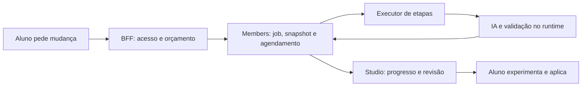

# Estúdio Pro: proposta revisada de editor e aprendizagem

Data: 15/10/2026 · Versão 2 · Público: crianças de 9 a 14 anos.
Status: proposta de produto e arquitetura; implementação e validação com alunos ainda pendentes.

## 1. Direção e resultado esperado

Evoluir o Estúdio Pro como uma oficina de criação com código: a criança encontra a parte do jogo que quer mudar, entende uma regra, experimenta, observa o resultado e consegue continuar sozinha. O Polaris é uma referência de interação; a base permanece o Studio, seus contratos e as integrações do Sistema Zero.

A prioridade muda em relação à primeira proposta: **clareza e organização do editor vêm antes de ampliar a automação por IA**. Ajudar a encontrar `src/config.ts`, entender um erro e recuperar uma experiência malsucedida tem valor mesmo sem o Zappy. A IA participa desse ciclo com pedidos e revisões explícitos.

São três resultados complementares:

1. **Encontrar:** identificar arquivos, regras e materiais sem precisar conhecer a arquitetura inteira do projeto.
2. **Experimentar:** editar, executar, investigar problemas e desfazer sem perder o trabalho.
3. **Aprender:** relacionar uma mudança no código ao comportamento do jogo, com ajuda opcional e progressiva.

A proposta preserva Monaco, os kits, a conversão de blocos, Pensa, Pinta, Molda, tarefas, publicação e os adapters de persistência, assistência e execução. Não pressupõe trocar autenticação, backend, editor ou framework.

| Alternativa | Consequência | Decisão |
| --- | --- | --- |
| Evoluir o Pro por entregas compatíveis | Melhora o editor e preserva contratos e dados existentes | Recomendada |
| Fazer somente ajustes visuais | Ajuda inicialmente, mas não resolve refatoração de arquivos, recuperação e continuidade de execuções | Usar como parte da primeira entrega |
| Adotar Polaris como base | Exige reconstruir as integrações educacionais e de autoria; herda limitações próprias | Descartada para este objetivo |

### Evidência e limites da revisão

Foram examinados o Polaris local, `packages/studio`, contratos de `packages/core`, integração em `packages/member-shell`, construção em Members e runtime remoto. Nesta revisão foram aprofundados layout, árvore de arquivos, Monaco, materiais, tarefas, preferências, autoria e aplicação de revisões. Houve reprodução isolada do comportamento de renomeação de arquivo. Não houve execução completa da interface, teste de produção ou estudo com crianças.

Recursos encontrados no código não são automaticamente recursos liberados em todos os hosts. A [análise comparativa original](../../.audits/architectural-analysis-polaris-estudio-pro-2026-10-15.md) documenta o Polaris; o [review desta proposta](2026-10-15-polaris-estudio-pro-review.md) registra lacunas corrigidas e verificação. Compatibilidade aqui significa contratos e critérios de aceite definidos; a certificação depende da implementação e dos testes indicados na seção 13.

## 2. Desenhar para 9 a 14 anos

A faixa etária não determina experiência. Uma criança de 10 anos pode programar com autonomia; outra de 14 pode estar começando. Oferecer ajuda progressiva e reversível, sem criar níveis por idade, avaliações obrigatórias ou novos bloqueios de acesso.

- Usar instruções concretas: “Mude a velocidade”, “Encontre o arquivo”, “Teste o salto”. Termos reais aparecem com explicação curta: “Importar: usar código de outro arquivo”.
- Preservar nomes e linguagem de programação reais. Explicações ficam ao lado; não traduzir identificadores ou simular uma linguagem diferente.
- Deixar visível a próxima ação e o resultado. Mostrar “O jogo não iniciou. Abra o primeiro problema” com acesso ao erro original.
- Oferecer uma dica, depois uma explicação e, quando solicitado, uma proposta de mudança. A criança pode ir diretamente à ajuda que deseja.
- Permitir fechar dicas, abrir ferramentas avançadas e mudar a disposição dos painéis sem perder o trabalho.
- Evitar excesso de abas, notificações celebratórias, jargão de infraestrutura e conclusões automáticas sobre o aprendizado.
- Não exigir que a criança explique uma mudança para poder continuar. Usar essa explicação como observação de pesquisa ou atividade opcional, sem avaliação automática por IA.

A referência pedagógica é promover autonomia, competência e espaço para exploração, sem afirmar que a interface já demonstrou esses resultados. A base externa é o [RITEC Design Toolbox da UNICEF](https://www.unicef.org/childrightsandbusiness/workstreams/responsible-technology/online-gaming/ritec-design-toolbox). Para compreensão, usar controles familiares, rótulos consistentes e instruções claras, conforme a [orientação cognitiva do W3C](https://www.w3.org/WAI/WCAG2/supplemental/objectives/o1-understandable/).

## 3. O que já existe e o que precisa mudar

| Área | Base encontrada | Evolução proposta |
| --- | --- | --- |
| Código | Monaco, autocomplete, hover, definição, formatação, abas e histórico de edição | Busca no projeto, navegação de volta, mapa do arquivo, abas temporárias seguras e refatoração semântica |
| Arquivos | Árvore real e operações de criar, renomear e excluir | Melhor orientação, estados persistentes e operações estruturais com análise de referências |
| Resultado | Preview, execução local e runtime remoto fornecido por determinados hosts | Disposição mais clara e revisão com mais espaço, respeitando a capacidade de cada host |
| Ajuda | Zappy com Conversar, Investigar e Construir; histórico e seleção | Acesso contextual, contexto compreensível e continuidade de estado ao reorganizar painéis |
| Revisões | Proposta, diff, experimentar, aplicar, descartar e desfazer | Resumo do efeito, diff legível, evidências identificadas e recuperação explícita |
| Materiais | `Project.assets`, biblioteca, Pinta, Molda e bibliotecas autorizadas | Acesso pelo editor, explicação do uso no código e inserção assistida compatível com o kit |
| Aprendizado | Kits, receitas, tarefas e conversão de blocos | Orientação inicial opcional e descrição do papel dos arquivos |
| Preferências | Configurações existentes, estado de abas e algumas proporções de layout | Retomada coerente por escopo/projeto, sem misturar preferência e documento |
| Construção por IA | Jobs persistidos, limites, leases, checkpoints e avanço coordenado pelo painel | Execução independente da aba em uma entrega posterior |

Fontes: [arquitetura do Studio](../../packages/studio/docs/architecture.md), [contratos públicos](../../packages/studio/src/studio/types.ts), [ProCodeMode](../../packages/studio/src/modes/pro/ProCodeMode.tsx), [Monaco](../../packages/studio/src/monaco/MonacoTabs.tsx), [Zappy](../../packages/studio/src/components/tutor/ZappyPanel.tsx) e [construtor](../../packages/studio/src/components/tutor/ProBuilderPanel.tsx).

## 4. Organização da interface

### 4.1 Uma área de trabalho, com painéis ajustáveis

Não acrescentar três novos modos permanentes chamados Programar, Jogar e Revisar. O produto já distingue modos de autoria, tarefas, materiais e modos do Zappy. Usar ações diretas: **Mostrar jogo**, **Ampliar código**, **Ampliar jogo** e **Ver mudanças**. Revisão é uma tarefa temporária, com retorno ao contexto anterior.

Com largura suficiente, a composição proposta é:

```text
Barra atual: projeto · salvamento · executar · desfazer · Zappy · menus existentes
Guia da tarefa, quando fornecido pelo host
┌───────────────────┬─────────────────────────┬────────────────────────┐
│ Arquivos          │ Abas e caminho          │ Jogo                   │
│ Buscar            │                         │ ou Zappy em foco       │
│ Materiais         │ Código                  │                        │
└───────────────────┴─────────────────────────┴────────────────────────┘
Problemas · Console · Terminal: faixa recolhível
```

- **Esquerda:** árvore e busca compartilham a mesma região. Materiais é um acesso à biblioteca existente, não um segundo catálogo.
- **Centro:** código com abas e caminho clicável. O projeto continua editável quando o preview está oculto.
- **Direita:** jogo por padrão. Quando o Zappy ocupa essa região, o jogo pode ser alternado sem reiniciar sua sessão. Ampliar o jogo é uma ação explícita.
- **Embaixo:** problemas e saída de execução. O terminal fica acessível conforme a configuração do host, sem exigir que um iniciante entenda comandos para editar um kit.
- **Revisão:** ocupa temporariamente a área central/lateral, com arquivos alterados, diff e acesso ao jogo candidato. Fechar restaura arquivo, seleção, foco e disposição anteriores.

A barra superior existente continua responsável por salvar, compartilhar, exportar e abrir materiais. Rever duplicações e prioridade dos rótulos dentro dos grupos atuais de menu; não acrescentar uma segunda barra com todas as mesmas ações. O guia de tarefa e o painel de atividade continuam na composição do Shell.

### 4.2 Largura, foco e continuidade

Usar a largura medida do próprio Studio e os breakpoints canônicos, considerando que a comunidade pode ocupar parte da janela. Em espaços estreitos, usar as abas/painéis existentes e o Zappy como diálogo; não espremer quatro colunas. Acesso estreito não significa declarar suporte à autoria Pro em dispositivos hoje bloqueados pelo host.

O Zappy deve ter uma única instância por Studio. Antes de torná-lo acoplável à lateral, separar seu controlador de sessão e de construção da apresentação: trocar de disposição não pode desmontar o controlador, duplicar pedidos ou cancelar uma execução. A mesma regra vale para modelos Monaco e WebContainer. O código atual admite remontagens em certas transições responsivas; eliminar esse efeito no novo fluxo é trabalho necessário, não garantia já existente.

No desktop, o painel lateral é uma região complementar; no modo estreito, o diálogo mantém foco contido e Escape. Restaurar o foco no controle que abriu a região. Não prender foco em um painel lateral permanente. Atalhos só atuam no Studio ativo, não no jogo em foco nem em campos de texto de outro painel.

No Pro, a faixa inferior pode iniciar recolhida quando não houver problema relevante. Erros exibem indicação e acesso, sem roubar foco durante a digitação. Essa mudança é específica do Pro e não altera silenciosamente os padrões dos modos de blocos ou das aulas.

### 4.3 Legibilidade e acessibilidade

Reaproveitar tokens, temas, componentes e ícones do Sistema Zero. Adotar fonte de código inicial de 15 px como hipótese para novos usuários Pro; preservar a preferência já escolhida e permitir ajuste. Validar contraste, foco visível, zoom de 200%, redução de movimento, leitor de tela e navegação completa por teclado.

Buscar controles principais próximos de 44 px quando o espaço permitir. Isso é uma escolha de conforto da proposta; o critério WCAG 2.2 AA de tamanho mínimo é 24 × 24 CSS px, sujeito às exceções previstas. [Referência W3C](https://www.w3.org/WAI/WCAG22/Understanding/target-size-minimum).

A árvore precisa de foco independente da seleção, setas, Home/End e nomes acessíveis. Arrastar nunca será a única maneira de mover um arquivo. [Padrão de treeview do W3C](https://www.w3.org/WAI/ARIA/apg/patterns/treeview/).

Fontes de integração: [Shell](../../packages/studio/src/components/layout/Shell.tsx), [breakpoints](../../packages/studio/src/components/layout/layoutBreakpoints.ts), [painéis estreitos](../../packages/studio/src/components/layout/NarrowPanels.tsx), [UI store](../../packages/studio/src/state/uiStore.ts) e [configurações](../../packages/studio/src/state/settingsStore.ts).

## 5. Arquivos e pastas: orientação sem esconder o projeto real

### 5.1 Uma árvore verdadeira, com explicações opcionais

Manter os caminhos reais e acrescentar descrições breves nos kits conhecidos. Exemplo ilustrativo para um kit compatível:

```text
src/
  main.ts        Começo do jogo
  config.ts      Valores que você pode experimentar
  characters.ts  Personagens
  rules/         Regras do jogo
  render/        Como o jogo aparece
public/          Arquivos públicos, quando existirem na árvore
package.json     Bibliotecas e comandos
```

Isso não é uma migração obrigatória. Projetos React, Three, importados e convertidos de blocos continuam com sua estrutura. Arquivos reais não desaparecem atrás de categorias inventadas. Pastas técnicas podem começar recolhidas; continuam acessíveis e a busca as encontra.

Os papéis e pontos de entrada vêm de metadados opcionais no catálogo confiável de templates, associados à versão do kit e conferidos contra arquivos/símbolos presentes. Não inferir que qualquer `config.ts` seja seguro para iniciantes. Em projetos sem metadados válidos, mostrar a árvore normal. Receitas existentes já verificam compatibilidade com o código e servem de base.

Materiais binários permanecem em `Project.assets`. A projeção de execução usa os caminhos canônicos de `public/studio-assets` e o manifesto existente; ela não cria uma segunda fonte de verdade dentro da árvore textual. Se aparecerem numa visão informativa, serão identificados como materiais gerenciados e abrirão a biblioteca. Não oferecer edição textual ou arraste desses itens como se fossem arquivos comuns.

### 5.2 Navegação cotidiana

- Busca rápida por nome e caminho, com teclado e botão visível; `Ctrl/Cmd+P` somente dentro do Studio ativo e quando o host permitir capturar o atalho.
- Busca literal no conteúdo do projeto, com resultados por arquivo e contexto. Ignorar binários e diretórios fora do snapshot editável; limitar resultados e respeitar os limites de tamanho já configurados. Regex e substituição global ficam para depois.
- Abas temporárias ao explorar; fixar ao editar, duplo clique ou ação explícita. Fixação ocorre antes da primeira alteração para não descartar o modelo e seu histórico.
- Caminho clicável, revelar na árvore, fechar outras abas e retorno à localização anterior.
- Restauração de abas, arquivo ativo, expansão da árvore e disposição dos painéis; filtrar caminhos que deixaram de existir. Não prometer que o undo do Monaco sobreviverá a recarregar a página.
- Criação de arquivo ou pasta com nome, localização e pequeno exemplo compatível. O validador atual não aceita espaços ou acentos em segmentos de caminho; mostrar o motivo e uma sugestão editável antes de criar, sem normalização silenciosa. Rótulos explicativos podem ter acentos.

### 5.3 Corrigir a base antes de oferecer mover e renomear com facilidade

**Problema confirmado:** `renameProNode` move o caminho, mas não reescreve imports. Renomear `src/config.ts` para `src/rules.ts` mantém `import ... from "./config"` no arquivo consumidor. Ampliar arraste ou incentivar reorganização sobre esse comportamento aumentaria a chance de quebrar jogos.

A solução proposta é uma operação de refatoração, com limites claros:

1. Capturar escopo, projeto, revisão e buffers atuais; reconciliar escritores pendentes pelo coordenador existente.
2. Calcular as mudanças de imports JS/TS pelo serviço TypeScript do projeto, incluindo caminhos relativos afetados por mover pastas. Estender o protocolo do worker: os contratos atuais expõem diagnósticos, completions, hover, definição e formatação, não refatoração de nomes/arquivos.
3. Validar colisões, caixa, caminhos, limites, arquivo de entrada e arquivos protegidos pelo template. Referências em HTML/CSS, URLs de materiais e strings dinâmicas não são cobertas automaticamente pelo serviço TypeScript. Usar análise própria do formato quando implementada; enquanto isso, declarar o alcance e apontar revisão manual, sem prometer refatoração segura universal.
4. Mostrar um resumo dos arquivos afetados. Aplicar árvore e edições associadas como uma revisão documental única, condicionada aos hashes/base ainda atuais. Atualizar abas, seleção, modelos e preferências a partir do mesmo mapa de caminhos.
5. Passar pelos fluxos existentes de persistência e sincronização do runtime, distinguindo “alteração no documento”, “salva” e “sincronizada no jogo”. Se persistência falhar, preservar a alteração recuperável e informar a pendência; não alegar atomicidade entre memória, IndexedDB, servidor e WebContainer.
6. Oferecer desfazer com comparação da revisão. Se houve trabalho posterior, resolver o conflito ou produzir uma inversa compatível; nunca restaurar o projeto inteiro apagando alterações posteriores.

Excluir um arquivo/pasta também mostra dependências conhecidas e quantidade de itens, e permite recuperação. Não usar busca e substituição por regex para reescrever imports. Arrastar para mover só entra depois desse serviço; o comando “Mover para…” o utiliza igualmente. Substituição em vários arquivos terá a mesma base de revisão e preview, quando implementada.

As primitivas de snapshot, hash, aplicação e recuperação existentes devem ser reaproveitadas ou extraídas. Operações locais têm origem `editor`; não inventar um job de IA para conseguir aplicar uma renomeação. `flushProjectOperations` é uma barreira de escritores/persistência, não uma transação genérica de várias operações.

Fontes: [árvore documental](../../packages/studio/src/state/proTree.ts), [validação de caminhos](../../packages/studio/src/core/proProject.ts), [coordenação de operações](../../packages/studio/src/state/projectOperations.ts), [revisões](../../packages/studio/src/state/proRevision.ts), [templates](../../packages/core/src/studio/pro-templates.ts) e [receitas](../../packages/studio/src/components/tutor/ProLearningRecipes.tsx).

## 6. Melhorias do editor de código

| Recurso | Desenho para o aluno | Implementação e limite |
| --- | --- | --- |
| Mapa do arquivo | “Ir para movimento”, “Ir para pontuação”, quando esses símbolos existirem | Navegação de símbolos pelo serviço TypeScript; descrição adicional apenas de metadados confiáveis |
| Voltar após navegar | Explorar uma definição e retornar à linha anterior | Histórico de navegação por instância/projeto, separado de desfazer edição |
| Formatar arquivo | Ação acessível “Organizar código” com breve explicação | Reutilizar a formatação existente; sem formatar todo projeto ou alterar comportamento automaticamente |
| Renomear símbolo | Trocar um nome e revisar referências afetadas | Extensão do protocolo do serviço TypeScript; sem substituição textual global |
| Trechos prontos | Pequenos exemplos como contador ou resposta a tecla | Receitas curadas por linguagem/kit, inserção explícita, placeholders e preview; não misturar geração paga à inserção local |
| Ajudar neste trecho | Explicar, investigar ou pedir mudança como ações distintas | Contratos existentes, limites de seleção descritos na seção 8 |
| Problemas compreensíveis | Mensagem curta, arquivo/linha e próximo passo verificável | Reaproveitar diagnósticos e glossário; erro técnico original acessível |
| Busca de ações | “Buscar arquivo”, “Organizar código”, “Abrir materiais” | Paleta do Studio com comandos permitidos; não interceptar indiscriminadamente a paleta nativa do Monaco |

O painel **Problemas** reúne as fontes existentes, identifica sua origem e evita listar o mesmo diagnóstico repetidamente. Tipos e build não são equivalentes a erros durante a partida. Agrupar sem ocultar gravidade; dar prioridade ao primeiro problema que bloqueia a execução, quando essa relação for conhecida.

Uma linha clicável só é oferecida quando houver localização válida para aquela revisão. Logs de runtime nem sempre possuem mapa para o código original: estender o contrato de origem/revisão/localização quando necessário, sem adivinhar posições a partir de qualquer stack. Contador zerado significa “nenhum problema detectado por estas verificações”, não “seu jogo está correto”. Preservar limites e descarte controlado do buffer de logs.

Não criar um painel universal de propriedades que prometa alterar qualquer JavaScript visualmente. Controles para valores conhecidos podem surgir depois como parte de kits com pontos de edição declarados e validados; não por manipulação frágil do texto.

No Monaco, manter a autoridade dos buffers antes do commit React, descarte de modelos fechados, separação por instância/projeto, diagnósticos do projeto completo e dependências reais instaladas. O novo mapa do arquivo não justifica carregar modelos visuais para todos os arquivos. Símbolos, referências e renomeações exigem ampliar worker, protocolo, cliente, sessão e testes em conjunto.

Fontes: [editor Pro](../../packages/studio/src/modes/pro/ProCodeEditor.tsx), [MonacoTabs](../../packages/studio/src/monaco/MonacoTabs.tsx), [protocolo TypeScript](../../packages/studio/src/monaco/pro/protocol.ts), [serviço TypeScript](../../packages/studio/src/monaco/pro/languageService.ts) e [console](../../packages/studio/src/components/console/ConsolePanel.tsx).

## 7. Materiais e jornada de aprendizagem

### 7.1 Encontrar, importar e usar materiais

Abrir a biblioteca existente pelo menu e pela navegação lateral. Manter imagens, sons e modelos 3D nas categorias atuais, com busca, miniaturas, estado de carregamento e identificação compreensível da origem. Pinta, Molda e materiais de equipe continuam passando pelos adapters e permissões do host.

Para cada material, apresentar:

- Nome amigável, tipo, tamanho e propriedades relevantes já disponíveis, como animações ou dimensões.
- **Copiar caminho** e **Copiar identificador**, explicando quando usar cada um.
- **Como usar neste jogo**, com exemplo compatível com o template/engine conhecido.
- **Inserir exemplo**, somente quando houver receita determinística compatível e ponto de inserção revisável. Importar um modelo não o transforma automaticamente no personagem do jogo.
- Renomear o nome de exibição preservando identidade e caminho; excluir com aviso sobre referências conhecidas e recuperação compatível com a persistência de materiais.

Carregar previews maiores e modelos 3D sob demanda. Não iniciar outro runtime de jogo para apresentar uma miniatura. Referências dinâmicas em código não permitem afirmar com certeza que um material está “sem uso”; usar “nenhuma referência encontrada” com alcance explícito.

`Project.assets` continua sendo a fonte durável. Manifesto, URLs e arquivos no ambiente de execução continuam derivados pelo pipeline atual, que também reconcilia arquivos criados pelo terminal em `public`. Não gravar diretamente no WebContainer para contornar o store, duplicar binários no `ProjectTree` ou construir um segundo índice autoritativo. IDs privados de origem não devem vazar por novos metadados em exportações/publicações.

Fontes: [bundle de materiais](../../packages/studio/src/core/proAssets.ts), [caminhos canônicos](../../packages/studio/src/core/proAssetPaths.ts), [sincronização](../../packages/studio/src/modes/pro/proAssetSync.ts) e [ações de materiais Pro](../../packages/studio/src/components/assets/ProAssetPaths.tsx).

### 7.2 Começar e continuar um projeto

Na criação, apresentar os kits liberados com uma imagem/descrição do resultado e poucas escolhas compreensíveis. Framework e dependências podem aparecer nos detalhes; não precisam ser a primeira decisão da criança. Respeitar as allowlists atuais de criação e abertura: um exemplo presente no repositório ou habilitado para QA não é automaticamente um kit público.

Após criar, oferecer uma primeira experiência opcional: localizar um valor, alterá-lo e jogar. Reutilizar receitas compatíveis e guia de tarefa. O host continua dono do progresso curricular: executar, aplicar uma proposta ou abrir um arquivo não conclui automaticamente uma tarefa.

Na conversão de blocos para Pro, preservar a identidade do projeto usada pelo Pensa, a origem e a cópia de blocos já previstas no fluxo. Mostrar uma orientação curta sobre os arquivos gerados, inclusive `src/converted` quando aplicável. Não prometer conversão reversa de qualquer código para blocos; a cópia original e o projeto Pro têm funções distintas.

Objetivos, notas e decisões do Pensa entram pelos contratos atuais, com autoria e confirmação preservadas. Sugestões do Zappy não viram decisões confirmadas silenciosamente. Evitar um segundo sistema de tarefas, progresso, notas ou biblioteca dentro do editor.

## 8. Zappy contextual e revisão das mudanças

### 8.1 Três ações com consequências diferentes

**Explicar** pede uma resposta sobre o código. **Investigar** busca entender um problema. **Pedir mudança** prepara uma proposta pelo construtor. Conversar e investigar continuam sem permissão implícita para modificar o projeto. Uma explicação não dispara construção, consumo adicional ou aplicação por conta própria.

Oferecer essas ações na seleção por botão/menu acessível. `Ctrl/Cmd+K`, quando disponível e sem conflito, abre o mesmo pedido contextual. O campo recebe a seleção, o objetivo e referências disponíveis; mantém o rascunho se faltar conexão, cota ou capacidade do host. O aluno escolhe enviar.

**Compatibilidade de seleção:** o tutor recebe intervalo com colunas e versão; o construtor v1 usa arquivo, linhas e hash do conteúdo. Portanto, a primeira entrega deve mostrar “Pedir mudança nestas linhas”, destacar o intervalo efetivamente capturado e usar o contrato de linhas existente. Não prometer substituição estrita de caracteres selecionados. Precisão por coluna exige versão explícita do schema, validação do servidor e atualização de todos os consumidores; não pode ser um campo extra ignorado pelo parser.

Capturar escopo, projeto, revisão, arquivo e hash no pedido. Ao receber a proposta, comparar a base antes de qualquer aplicação. Se houver mudança fora do alcance apresentado, sinalizar a ampliação, mostrar os arquivos/linhas afetados e exigir que o aluno a aceite na revisão. O botão de aplicação deve permanecer indisponível até essa escolha. O servidor e a validação de aplicação precisam conhecer o alcance; uma instrução ao modelo não constitui uma restrição técnica.

### 8.2 Contexto compreensível e fiel ao que é enviado

Mostrar um resumo simples: trecho escolhido, problema associado, objetivo do projeto e materiais relevantes. Separar **referências incluídas no pedido** de **arquivos consultados durante a execução**. O diário pode apresentar as consultas de maneira resumida, sem revelar raciocínio interno.

Não oferecer “excluir este arquivo do contexto” se as ferramentas ainda puderem ler o snapshot completo. Uma exclusão real exige política aplicada no servidor, leitura das ferramentas, cache e montagem do prompt. Até existir esse contrato, informar o alcance verdadeiro e permitir remover apenas anexos opcionais cuja remoção seja efetivamente respeitada.

Usar os vínculos de mensagem de origem já previstos para conectar conversa e proposta. Primeiro melhorar a retomada e a busca no histórico atual. Conversas separadas por assunto ficam para uma etapa posterior: o adapter atual é paginado por projeto, não por thread; a mudança exige contrato versionado, migração, retenção e exclusão, além da interface.

### 8.3 Revisão clara e confortável

A área **Ver mudanças** contém:

1. Pedido original e efeito esperado em linguagem simples, identificado como intenção até ser verificado.
2. Lista de arquivos criados, alterados e removidos; destaque de alterações fora do escopo inicialmente pedido.
3. Diff com linguagem adequada, altura ajustável e alternativa inline para pouco espaço. O diff continua somente leitura.
4. Verificações automáticas com revisão, resultado e limitações; critérios manuais apresentados separadamente.
5. **Experimentar proposta**, **Aplicar**, **Descartar** e, quando cabível, **Desfazer aplicação**.

Reutilizar a comparação de versão atual e candidata. Avisar quando alternar uma versão reiniciar a partida; não prometer preservar o estado interno de um jogo arbitrário entre builds. A evidência apresentada precisa corresponder ao mesmo snapshot/material do candidato, inclusive quando o código atual avançou.

Aplicar a proposta como unidade na primeira entrega. Selecionar apenas um arquivo ou bloco geraria uma nova revisão que precisaria de análise e validação próprias. A UI não pode descartar metade do patch e reaproveitar o selo de validação da proposta original.

Tratar explicitamente: proposta pronta, base desatualizada, conflito, execução expirada, candidato indisponível, falha ao salvar e aplicação recuperável. “Aplicado no editor”, “salvo localmente”, “salvo na conta” e “publicado” são estados diferentes; preservar os recibos e indicadores existentes. Não marcar sucesso durável ao mudar apenas o store em memória. Desfazer deve preservar mudanças posteriores ou apresentar um conflito resolvível.

Fontes: [tutor e seleção](../../packages/core/src/studio/pro-tutor.ts), [contrato do construtor](../../packages/core/src/studio/pro-assistance.ts), [diff](../../packages/studio/src/components/tutor/ProRevisionDiff.tsx), [aplicação de revisão](../../packages/studio/src/state/proRevision.ts) e [persistência de revisões](../../packages/studio/src/state/projectStorageRevision.ts).

## 9. Arquitetura, estado e compatibilidade com o Sistema Zero

### 9.1 Responsabilidades e fontes de verdade

| Informação/ação | Dono | Regra |
| --- | --- | --- |
| Código e pastas | Documento `ProjectTree` e buffers de edição coordenados | Snapshot incorpora buffers pendentes antes de operação estrutural, validação ou exportação |
| Materiais | `Project.assets` e pipeline de materialização | Manifesto e arquivos de runtime são projeções, não outro documento |
| Abas, pastas abertas, painéis, navegação | Workspace por instância; preferências por escopo/projeto/superfície | Não exportar nem sincronizar como código do jogo |
| Preferência geral de fonte/tema | Configurações atuais do Studio/host | Respeitar escolha anterior; não sobrescrever globalmente ao entrar no Pro |
| Tarefas e progresso | Contrato do host | O editor comunica eventos autorizados; não inventa conclusão curricular |
| Acesso, cota e identidade | Host/BFF/serviços existentes | Cliente apresenta capacidades; servidor autoriza efeitos |
| Conversas e jobs | Adapters existentes e domínio persistido em Members | Sem histórico ou backend paralelo |
| Escrita, save/export/handoff | Coordenação atual de operações e persistência | Reutilizar flush, isolamento de escopo, recibos e recuperação |
| Execução local | `useWebContainerSync` e reconciliação Pro | Um coordenador para filesystem, código e materiais |
| Execução remota | Adapter de runtime, snapshots e catálogo permitido | Sem fallback silencioso que mude compatibilidade ou isolamento |

### 9.2 Estado do workspace

Criar um pequeno schema versionado de preferências: abas fixadas e temporária, arquivo ativo, pastas expandidas e disposição/proporções. Usar identidade estável de escopo + projeto e, quando necessário, superfície fornecida pelo host. Estado vivo continua isolado por instância: duas instâncias abertas não compartilham seleção, callbacks ou job controller.

Capturar o escopo antes de uma operação assíncrona e verificar identidade ao concluir, como o fluxo atual de revisão. Ao trocar perfil, abortar leituras/aplicações antigas e impedir que a resposta do perfil anterior seja aplicada no novo. Preferência inválida ou de versão antiga deve ter migração limitada ou fallback; não impedir abrir o documento.

Armazenar preferências separadamente do conteúdo e da fila crítica de salvamento. Reutilizar a infraestrutura de settings/scopes, com chaves e ownership explícitos. Não acrescentar `localStorage` global por nome de projeto, nem despejar seleção/contexto em `proMeta`. Abas restauradas não implicam restauração do histórico de edição do Monaco.

Para `persistence: 'none'`, o padrão é memória. Para persistência customizada, o host poderá fornecer um adapter opcional de preferências; não presumir que um usuário embutido compartilha a mesma identidade do host principal. Se for necessária uma nova chave de superfície ou adapter, adicioná-lo como opção tipada e retrocompatível na API pública. Props existentes não mudam de significado.

### 9.3 Organização do código do editor

Separar responsabilidades dentro de `packages/studio`, aproveitando os módulos atuais. Os caminhos abaixo representam uma organização proposta, não arquivos já criados:

```text
src/modes/pro/
  ProCodeMode.tsx            composição do modo
  workspace/                controlador, comandos e preferências de apresentação
  useWebContainerSync.ts    coordenação existente do runtime local
  proAssetSync.ts            projeção existente de materiais
src/components/code/
  ...                       árvore, abas, busca e mapa do arquivo
src/components/tutor/
  ...                       apresentação do Zappy e revisão
src/monaco/pro/
  ...                       protocolo, worker e serviços semânticos
src/state/
  ...                       documento, revisões, persistência e operações estruturais
src/studio/
  ...                       API pública e adapters
```

Não mover arquivos apenas para padronizar nomes. Extrair controladores quando isso resolver continuidade, duplicação ou dependência concreta. Componentes mostram estado e disparam comandos; regras de alteração documental não ficam em handlers da árvore nem no painel do Zappy. Metadados compartilhados de kits e schemas ficam em `packages/core` quando forem consumidos por mais de uma camada; preferências visuais continuam no Studio.

Usar um registro pequeno de comandos do Pro para reunir disponibilidade, rótulo, atalho e execução. Árvore, menu e paleta chamam o mesmo comando. Aplicar `editingAccess`, configuração do host e capacidade do runtime em cada comando; desabilitar um botão não substitui as guardas do store e do servidor. Não construir um sistema genérico de plugins para entregar essa organização.

Distinguir três históricos: undo de texto do Monaco, navegação e operações documentais/revisões. A barra deve explicar qual ação será desfeita; operações locais estruturais precisam de uma política ordenada de undo com o editor. Não expor dois botões indistintos que alternem entre restaurar arquivos inteiros e desfazer digitação. Definir essa integração antes de liberar mover/renomear e substituição múltipla.

### 9.4 Matriz de integração

| Superfície | Preservar | Condição da evolução |
| --- | --- | --- |
| Pro completo da comunidade | Gate `canRunProMode`, persistência, autosave, identidade, quotas e publicação | Novos painéis dentro da composição existente; runtime local permanece o caminho atual |
| Modos de blocos e demais editores | Topbar, materiais, temas e fluxos compartilhados | Mudanças de comportamento específicas do Pro; regressão dos componentes comuns obrigatória |
| Aulas/`StudioLesson` | Curadoria, atividade da aula e runtime fornecido | Sem introduzir tutor ou `taskSession`, que pertencem ao `StudioEditor`; controles só quando a capacidade existir |
| Observação e handoff | `editingAccess`, revisão observada e transferência de autoria | Busca/leitura permitidas; criar, renomear, aplicar e inserir material obedecem autoria |
| Pensa | Identidade do projeto, origem de conversão, objetivos/notas/decisões | Sem cópia paralela nem confirmação automática de decisão |
| Pinta, Molda e equipe | Adapters, disponibilidade e permissões atuais | Um catálogo e pipeline de importação; ausência de adapter tem estado explicativo |
| Embeds, admin e playground | Configuração pública, `persistence: none/custom`, múltiplas instâncias | Preferências e comandos respeitam a configuração; nenhum acesso direto ao backend do host |
| Exportação e publicação | Snapshot coerente, materiais, estado de publicação e isolamento do preview | Preferências e histórico privado não entram no artefato; revisão validada não publica automaticamente |

A implementação não importa autenticação, rotas Members ou clientes de cobrança dentro do pacote Studio. BFFs/adapters traduzem o domínio para a interface pública. Recursos opcionais devem falhar de forma localizada e manter edição/salvamento utilizáveis.

Fontes: [escopo de armazenamento](../../packages/studio/src/state/projectStorageRuntime.ts), [store documental](../../packages/studio/src/state/projectStore.ts), [host Pro](../../packages/member-shell/src/components/studio/studio-pro-editor.tsx), [API pública](../../packages/studio/src/studio/types.ts) e [runtime](../../packages/studio-runtime/README.md).

## 10. Execução de IA independente da aba

Essa entrega continua útil, mas não é pré-requisito para melhorar a navegação, a legibilidade ou a biblioteca. O construtor atual persiste jobs e retomada, porém o painel coordena chamadas a `advance`. Fechar ou desmontar a interface não equivale hoje a garantir conclusão autônoma no servidor.

### Contrato proposto

1. O BFF autentica, resolve escopo, verifica autorização/cota e cria pedido idempotente sobre snapshot imutável.
2. Persistir job e intenção de agendamento de forma recuperável. Usar outbox ou mecanismo equivalente: se a gravação funcionar e o envio ao executor falhar, o job não pode ficar eternamente “na fila”; um reconciliador retenta a entrega com a mesma identidade.
3. O executor avança etapas com identidade de serviço e permissões limitadas ao job. Não guardar sessão do navegador ou token pessoal em eventos de fila. Members permanece dono do estado de domínio.
4. Cada etapa tem identidade, lease, prazo, orçamento e registro de efeito. Revalidar cancelamento e autorização aplicável antes de efeitos; credenciais temporárias são renovadas por mecanismo de serviço autorizado, não pela presença da aba.
5. A UI consulta progresso ordenado e recuperável. Começar com polling limitado e cursor/versão; streaming só se a experiência justificar. Exibir fases reais, sem porcentagens inventadas ou raciocínio interno.
6. Fechar a aba não cancela. **Cancelar** é comando de domínio que impede novos efeitos, invalida a execução conforme o protocolo e trata respostas tardias. Aplicar continua exigindo ação do aluno e checagem da revisão local.

Cloudflare Workflows é candidato porque oferece etapas duráveis e retomada; a escolha depende da prova de integração com Members e runtime. Não há justificativa para adicionar também Inngest apenas porque o Polaris o usa. [Documentação oficial](https://developers.cloudflare.com/workflows/get-started/guide/).

### Limites, cobrança e migração

Preservar inicialmente os limites atuais de três chamadas de IA e três validações. A implementação precisa reconciliar os prazos atuais de job, lease e retenção com o executor: hoje há prazo operacional de aproximadamente cinco minutos, lease de 150 segundos e histórico de sete dias com até dez registros por conta. Um executor durável não remove esses limites por si só. Confirmar seus valores no início da implementação e versionar qualquer mudança deliberada.

Fonte dos limites: [contrato do construtor](../../packages/core/src/studio/pro-builder.ts). O estado e os leases são persistidos no [repositório de jobs em Members](../../packages/members/src/infrastructure/persistence/drizzle/studio-builder.repository.ts).

Retries de infraestrutura não provam cobrança única. Identificar chamadas pagas, persistir resultado/estado e reconciliar falhas ambíguas antes de repetir. Cancelamento durante uma chamada não garante estorno de um custo já realizado; a interface deve usar o resultado de cobrança do domínio, sem inventar esse estado.

Não permitir que limpeza por retenção apague a identidade de um job enquanto o executor ainda possa produzir efeitos. Expiração/cancelamento precisam encerrar a execução e conservar o mínimo necessário para rejeitar mensagens tardias. Distinguir histórico operacional transitório de decisões e conteúdo permanente do projeto.

Liberar por flag e versão do protocolo de execução. Jobs antigos terminam pelo controlador antigo; novos jobs usam apenas um executor. Não deixar navegador e worker avançarem o mesmo job sem a regra de ownership/lease. O rollback desativa novos agendamentos e preserva conclusão/cancelamento dos já criados, sem converter silenciosamente a versão no meio da execução.



Critério de saída: fechar/reabrir aba, falhar entrega à fila, repetir pedido, perder lease, expirar job e cancelar durante validação produzem um estado recuperável, sem dupla aplicação nem chamadas pagas repetidas sem reconciliação.

## 11. O que fica fora das primeiras entregas

| Possibilidade | Por que adiar | Condição para retomar |
| --- | --- | --- |
| Conversas por assunto | Mais organização também pode significar mais navegação para uma criança | Evidência de dificuldade de retomada após melhorar o histórico; contrato e retenção definidos |
| Sugestões de IA em linha | Podem competir com autocomplete e reduzir a compreensão do código | Experimento opt-in/manual, limites de consumo e avaliação de autonomia; Monaco permanece |
| GitHub | Acrescenta conta, credenciais e conceitos que não são necessários para criar e publicar no Sistema Zero | Demanda de continuidade/portfólio; capacidades do host, fluxo de destino revisável e snapshot de exportação existente |
| Sincronização Git bidirecional | Conflitos e credenciais ampliam muito a superfície | Iniciativa própria após exportação/importação simples |
| Autoria remota em novos dispositivos | O host Pro completo bloqueia antes de montar o editor em ambientes incompatíveis | Projeto completo de capacidades, teclado, edição, arquivos e runtime; não remover o gate isoladamente |
| Multiplayer de edição | Presença ou biblioteca de equipe não equivalem a edição simultânea | Modelo de concorrência, autoria e produto próprio |
| Editor visual universal de propriedades | Código arbitrário não oferece um contrato confiável de controles | Restringir inicialmente a kits com schema/pontos de edição verificáveis |
| Aceitação parcial de patch | Invalidaria a evidência do candidato completo | Gerar e validar uma nova revisão composta |

A autoria remota deve considerar os requisitos de isolamento do WebContainer e os limites de dependências do runtime remoto. Não assumir equivalência entre ambos. [Documentação de cabeçalhos do WebContainer](https://webcontainers.io/guides/configuring-headers). Sugestões em linha são tecnicamente possíveis pelo provider do Monaco; disponibilidade da API não demonstra benefício pedagógico. [API oficial](https://microsoft.github.io/monaco-editor/typedoc/interfaces/editor_editor_api.languages.InlineCompletionsProvider.html).

## 12. Ordem de entrega e decisões de implementação

Esforços são relativos, sem promessa de prazo: M envolve mudanças locais com contratos estáveis; G atravessa estado, ciclo de vida ou múltiplas camadas. A decomposição em tarefas e estimativas vem após validar o desenho com o time.

| Etapa | Entrega concreta | Dependências e critério de saída | Esforço |
| --- | --- | --- | --- |
| 1 — Encontrar e compreender | Busca por arquivos, caminhos, papéis de arquivos nos kits, acesso à biblioteca, rótulos/fontes, problemas com origem e localização confiável | Medir fluxo atual; reaproveitar comandos/diagnósticos/adapters; não ampliar reorganização insegura | M–G |
| 2 — Organizar com segurança | Renomear/mover com análise de referências, excluir recuperável, mapa de símbolos, navegação de volta e abas temporárias | Protocolo TS, operação documental, política de undo, preservação de buffers e testes de concorrência | G |
| 3 — Retomar e experimentar | Workspace persistente, painéis ajustáveis, controlador único do Zappy e revisão ampliada | Isolamento por escopo/instância, migração de preferências e continuidade de modelos/runtime/jobs | G |
| 4 — Pedir uma mudança no contexto | Acesso contextual com escopo real de linhas, rascunho recuperável, ampliação de alcance explícita | Revisão da etapa 3; limites e schemas atuais; não depende de executor durável | M–G |
| 5 — Continuar mesmo fora da aba | Executor no servidor, agendamento recuperável, progresso e cancelamento | Prova de arquitetura, ownership, orçamento, retenção e integração entre serviços | G |
| 6 — Expandir conforme uso | Threads, sugestões em linha, GitHub ou autoria em novos dispositivos | Evidência de demanda e escopo próprio para cada iniciativa | Separado |

As etapas são marcos de liberação, não proibição de trabalho independente. A correção de renomeação pode ser desenvolvida junto da etapa 1, mas arraste/mover só será liberado quando a etapa 2 cumprir o aceite. A integração aprofundada de materiais acompanha 1–3: primeiro acesso e explicações, depois inserção determinística e recuperação conforme o contrato de operações.

**Primeiro recorte recomendado:** busca de arquivos + orientação dos kits + biblioteca acessível + problemas acionáveis, acompanhado da correção da base de renomeação antes de promover reorganização. Testar esse ciclo com alunos: “encontre a velocidade, altere, jogue, provoque um erro simples e recupere”. Depois integrar abas/layout e a revisão contextual.

### Decisões que não devem ficar implícitas

| Decisão | Proposta | Quando precisa estar fechada |
| --- | --- | --- |
| Papel pedagógico | Ajuda opcional; escolhas por experiência, sem gate por idade | Desde a etapa 1 |
| Fonte de arquivos e materiais | Árvore textual + `Project.assets`, com projeções atuais | Desde a etapa 1 |
| Alcance da refatoração | TS/JS semântico primeiro; formatos adicionais explicitamente cobertos | Antes de liberar etapa 2 |
| Undo entre texto e estrutura | Histórico ordenado/compatível, com conflito e inversa condicionada | Antes de liberar etapa 2 |
| Chave de preferências em embeds | Adapter/chave opcional; memória quando identidade não for fornecida | Antes de liberar etapa 3 |
| Seleção na IA | Linhas na v1; colunas somente em nova versão coordenada | Antes de liberar etapa 4 |
| Executor e autorização de serviço | Spike de integração com Members/runtime; Cloudflare como candidato | Antes de implementar etapa 5 |
| Retenção/expiração | Distinguir jobs, conversas, decisões e artefatos publicados | Antes de ampliar persistência na etapa 5/6 |

Não tratar essas decisões de engenharia como perguntas que a criança precisa responder. Falhas apresentam o efeito sobre seu trabalho e uma ação possível; detalhes técnicos ficam disponíveis para suporte/desenvolvimento.

### Liberação e reversão

Usar flags existentes do host quando se encaixarem, ou capacidades opcionais explícitas. Não sobrecarregar allowlists de kits com decisões de layout. Liberar por recorte com observação de erros, preservando abertura e edição de projetos antigos. Reverter apresentação deve manter os documentos e materiais gravados no formato atual; a preferência versionada pode ser ignorada com segurança. Jobs duráveis têm política própria de migração/rollback descrita na seção 10.

## 13. Critérios de aceite e plano de validação

Os itens abaixo são **testes necessários para a implementação futura**, não testes já aprovados por esta revisão documental. Reaproveitar suites e fixtures existentes; acrescentar testes onde uma nova regra ou regressão real os justificar, evitando testes que apenas reproduzam handlers.

| Área | Cenário e resultado exigido |
| --- | --- |
| Navegação e edição | Abrir resultado temporário, editar, trocar de arquivo e desfazer preserva conteúdo e modelo; localizar símbolo e voltar mantém a seleção esperada |
| Refatoração | Renomear/mover arquivo e pasta com imports relativos, colisão de caixa e edição pendente; imports cobertos atualizados, operação completa ou conflito explícito |
| Concorrência local | Terminal, editor e material em escrita durante salvar/exportar/renomear: o snapshot incorpora escritores autorizados ou bloqueia a operação explicando o motivo; reconciliação não perde alterações |
| Histórico | Digitar, mover arquivo, digitar novamente e desfazer em sequência; nenhuma restauração apaga silenciosamente trabalho posterior |
| Persistência | Falha de storage, reload, preferência corrompida e arquivo removido; documento abre, pendência é visível e recuperação segue o protocolo existente |
| Isolamento | Dois Studios e troca de perfil/projeto durante resposta; seleção, preferência, job e aplicação não atravessam instância/escopo |
| Autoria | Observer não cria/renomeia/aplica/insere; handoff aguarda writers e usa a revisão correta; navegação continua disponível |
| Layout | Redimensionar e abrir/fechar Zappy/revisão preserva editor, preview e execução; foco retorna; ausência de reinício pode ser observada por identidade de runtime/controlador |
| Assistência | Explicar não constrói; seleção parcial informa escopo de linhas; resposta antiga não aplica; expansão de escopo fica bloqueada até revisão explícita |
| Proposta | Candidato, diff e evidência têm mesma identidade; erro de save não vira sucesso; aplicação parcial indisponível; descarte e desfazer corretos |
| Materiais | Importar de Pinta/Molda/equipe, indisponibilidade de adapter, renomear rótulo e excluir material referenciado; sem duplicação nem perda de identidade/permissão |
| Hosts | Pro completo, modo clássico, aula com runtime remoto, embed sem persistência, persistência customizada e observação; sem exigir tutor ou backend nos hosts que não os oferecem |
| Templates | Kit Canvas, kit 3D, React/TS, projeto convertido e projeto sem metadados; orientação só aparece quando válida e cada projeto mantém sua estrutura |
| Saída | Save, exportação ZIP e publicação incluem revisão/material corretos; preferências, conversas e dados privados de origem não entram no artefato |
| Runtime e isolamento | CSP e sandbox atuais preservados; dependência incompatível continua identificada; nenhum fallback silencioso ou ampliação de catálogo |
| Execução durável | Duplicação de eventos, falha ao enfileirar, perda de lease, aba fechada, cancelamento tardio e expiração; ownership e efeito idempotente/reconciliável |
| Acessibilidade | Teclado, leitor de tela, contraste, zoom, foco, árvore e gestos alternativos; testar com largura real do Studio, inclusive barra lateral da comunidade |
| Desempenho | Mesmo conjunto de projetos antes/depois: abertura, busca, digitação e memória após abrir/fechar arquivos; respeitar budgets existentes e não carregar todos os modelos visuais |

Executar checks do pacote e dos contratos modificados, regressões de persistência/sincronização/Monaco e fluxos de navegador afetados. As verificações de bundle/acessibilidade existentes continuam obrigatórias quando a mudança as afetar. Não usar somente screenshot como prova de jogo funcional ou durabilidade de salvamento.

### Avaliação com crianças

Testar qualitativamente com participantes de 9–11 e 12–14 anos, incluindo iniciantes e experientes em ambos os grupos, pelo processo de pesquisa autorizado do produto. Usar projetos equivalentes e tarefas curtas: encontrar a regra de velocidade, adicionar um material, entender um erro, retomar um projeto e revisar uma proposta.

Observar se conseguem realizar a tarefa sem intervenção, onde hesitam, quantos caminhos tentam e se relacionam código e efeito no jogo. Comparar o fluxo atual com a proposta antes de fixar metas numéricas. Não usar a quantidade de ajuda pedida como sinal de fracasso nem acelerar o aluno artificialmente.

Indicadores: sucesso em encontrar o arquivo correto; tempo e passos para experimentar uma alteração; erros de navegação/organização; recuperação sem perda de trabalho; entendimento do efeito da mudança; dependência de ajuda; consumo por mudança aceita quando houver IA. Telemetria operacional não registra código, conversa integral ou classificação individual de capacidade por padrão.

## 14. Conclusão da revisão

A primeira proposta identificava boas interações do Polaris, mas concentrava-se demais no construtor de IA. Esta versão coloca editor, materiais, compreensão e recuperação no centro; explicita mudanças de contrato antes de oferecer refatoração, nova disposição de painéis ou execução independente da aba.

A integração é planejada sobre as fontes de verdade e os adapters do Sistema Zero. Não há motivo identificado para substituir a base atual. Os principais riscos restantes são concretos e localizados: semântica de refatoração além de JS/TS, continuidade de estado ao mudar layout, política de undo estrutural, identidade de preferências em embeds e autorização/cobrança do executor durável. Cada um tem dependência, etapa e aceite definidos acima.

A proposta pode orientar a especificação e o protótipo das primeiras entregas. A afirmação de compatibilidade integral deve ser feita após os testes de integração e a validação de uso, não apenas pela leitura do código.
