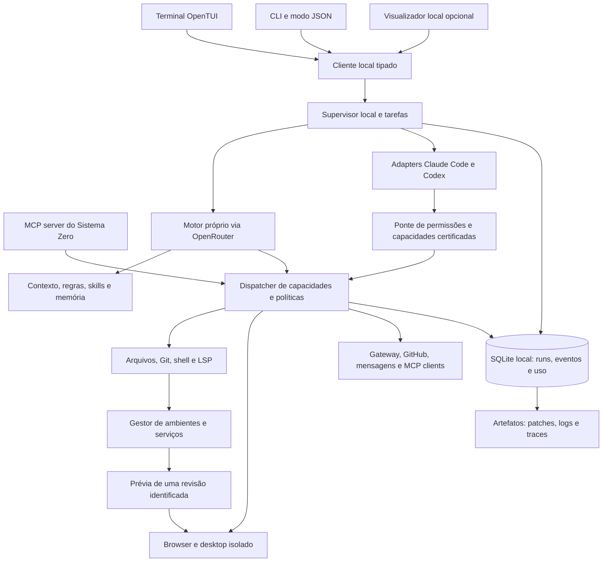

# Proposta integrada para concluir o Sistema Zero TUI

Data: 15/10/2026. **Versão 2, após reanálise dos cinco repositórios.** Documento de decisões aprovado para implementação. O estado executado, as evidências e os critérios ainda pendentes estão no [review de implementação](../tui/implementation-review.md) e na [matriz de suporte](../tui/support.md).

Esta versão substitui a ordem L0–L7 anterior por **B00–B12**, com entregas menores, contratos de recuperação mais precisos e desempenho como critério desde B00. Mantém a direção local e modular. Reunir recursos não demonstra superioridade: exigimos evidência de qualidade, velocidade e custo nas tarefas da equipe.

Documentos de execução: [auditoria V2](../../.audits/architectural-analysis-tui-v2-2026-10-15.md), [plano de lotes](../superpowers/plans/2026-10-15-tui-lotes-v2.md) e [metas, fixtures e protocolo de desempenho](2026-10-15-tui-desempenho.md). Esta proposta é a fonte de decisões; o plano define entregas e o documento de desempenho define medidas e limites.

## 1. Decisões confirmadas e direção recomendada

O produto será uma **ferramenta local para você e a equipe do Sistema Zero**. O motor principal será próprio, com modelos configuráveis. Incorporando a orientação mais recente, **OpenRouter será o primeiro provedor**, com **Claude Code e Codex autenticados pelas assinaturas como opções de execução**.

Recomendo construir um ambiente de trabalho para agentes que reúna desenvolvimento, pesquisa, validação no navegador e operação dos serviços do Sistema Zero. A interface principal continua sendo `packages/tui`, em OpenTUI e React. O que torna o produto consistente é um runtime comum de tarefas, permissões, contexto, evidências e recuperação.

Uma tarefa deve produzir um resultado verificável: patch, testes, trace do navegador, documento, diagnóstico ou ação externa confirmada. Conversas são uma forma de conduzir o trabalho, mas não a unidade suficiente para armazenar sua execução.

**Exemplo central:** “Corrija o problema de login, valide os fluxos afetados e prepare a entrega”. O sistema identifica os pacotes e regras, reproduz o erro, cria uma tarefa com critérios de aceite, usa isolamento apropriado, implementa, roda checks, exercita o navegador, solicita revisão quando útil e apresenta um diff acompanhado de evidências. Publicar ou comunicar a entrega usa as permissões já concedidas para aquele destino e ação; mudanças no conteúdo ou no alcance invalidam uma aprovação antiga.

“Substituir o Claude Code” será um critério de adoção baseado em trabalho real. O TUI pode substituí-lo como ambiente principal e, ao mesmo tempo, utilizá-lo como um executor opcional. Ser independente dele exige que o caminho OpenRouter complete o ciclo inteiro por conta própria.

Fundamentação: [auditoria e achados](../../.audits/architectural-analysis-tui-2026-10-15.md), [inventário local](../../.audits/tui-file-inventory-2026-10-15.csv), [revisões e evidências](../../.audits/tui-research-evidence-2026-10-15.json).

Complemento: [análise Sandbox e adaptação ao TUI](../../.audits/architectural-analysis-sandbox-tui-2026-10-15.md), incluindo evidências reproduzíveis e integração com o Studio Runtime existente.

## 2. Alternativas consideradas

| Caminho | Vantagem | Custo ou limite | Decisão |
|---|---|---|---|
| Runtime local modular, UI existente e adapters | Controle completo no motor próprio; integrações seguem contratos comuns | Exige investir em execução e recuperação | **Recomendado** |
| Completar o Nightcode quase literalmente e anexar os outros apps | Demonstração inicial mais rápida | Herda servidor, login, billing e quatro modelos distintos de estado; portabilidade e concorrência continuam pendentes | Aproveitar padrões, não adotar como arquitetura final |
| Tornar o TUI apenas uma interface de Claude Code/Codex | Usa imediatamente os motores já existentes | Dependência das capacidades dos clientes e pouca autonomia para corrigir seu comportamento | Manter como modo opcional, sem ser a única fundação |

Não há razão observada para trocar OpenTUI, introduzir um novo frontend principal ou substituir a stack do Sistema Zero. Também não há razão para exigir Postgres, Clerk, Polar, Trigger.dev, Liveblocks, Browserbase e Daytona em toda instalação local.

## 3. Como os cinco projetos se encaixam

| Referência | Capacidade pertinente | Adaptação no Sistema Zero |
|---|---|---|
| Nightcode | Chat no terminal, sessões, seleção de modelo, Plan/Build, tools e consumo | TUI conectada ao runtime local; eventos duráveis e política real de execução |
| Browser Automation App | Navegar, observar, agir, extrair, agente de navegador, etapas, outputs e replay | Operações de browser no mesmo registry; receitas versionadas; navegador local e evidências; Browserbase opcional |
| AI Teammates | Especialistas, handoff, memória, ambiente próprio, desktop e tarefas longas | Perfis de agente, subtarefas persistidas, worktrees, scheduler e memória com origem; desktop isolado opcional |
| Sendkit | Uma operação exposta por CLI, MCP e skill; Telegram | Núcleo de capacidades único; TUI/CLI/MCP chamam o mesmo dispatcher; notificação como operação auditável |
| Sandbox | Ambiente persistente por projeto, seed de runtime, prévia executável, pergunta pendente e observabilidade | Gestor de ambientes, templates versionados, prévias vinculadas à revisão e diagnósticos; ciclo de correção/verificação como evolução nossa |

**Autoria visual e colaboração:** no TUI, workflows serão apresentados como lista de etapas/dependências, com edição textual e comando por intenção. Um visualizador web local pode mostrar grafo, screenshots, traces e desktop. Um canvas colaborativo como o original só entra se houver demanda de autoria simultânea; não é necessário para executar as automações.

**SaaS:** assinaturas do próprio produto, cobrança de créditos, organizações Clerk e painéis de upgrade não fazem parte desta entrega interna. Controle de gasto dos provedores permanece essencial, com unidades reais e estimativas identificadas.

**Stack externa:** a estrutura dos projetos serve de referência. Nightcode usa OpenTUI 0.1.x e AI SDK 6; o TUI instalado está em OpenTUI 0.3.0 e AI Teammates usa AI SDK 7. Copiar módulos entre essas versões sem adaptar contratos não é uma integração válida.

Fontes: [Nightcode](https://github.com/code-with-antonio/nightcode), [Browser Automation App](https://github.com/code-with-antonio/browser-automation-app), [AI Teammates](https://github.com/code-with-antonio/ai-teammates), [Sendkit](https://github.com/code-with-antonio/sendkit), [Sandbox](https://github.com/code-with-antonio/sandbox). As revisões exatas estão nas auditorias. O Sandbox registra erros da prévia no Sentry; não devolve esses diagnósticos ao agente para corrigir e verificar automaticamente.

## 4. Arquitetura proposta

A seta dos clientes oficiais para o dispatcher representa **as operações expostas pela nossa ponte**, não uma garantia de interceptar toda ferramenta interna desses clientes. Ferramentas nativas exigem política do próprio backend e isolamento de processo/OS; cada adapter informa a cobertura que consegue provar.

### Limites de pacote

| Unidade | Responsabilidade | Dependências que deve evitar |
|---|---|---|
| `packages/tui` | Terminal, comandos, telas e composição do executável | SQL, chamadas de modelos e regras de negócio nos componentes |
| Novo `packages/agent-core` | Schemas, IDs, eventos, contratos de tarefas/tools, estados e políticas puras | React, OpenTUI, Electron, APIs de provedores |
| Novo `packages/agent-runtime` | Supervisor, persistência local, scheduler, contexto, motores, ferramentas e bridges | Dependência dos componentes de UI e de bancos internos do Sistema Zero |
| Novo `packages/agent-integrations` | Adapters opcionais para browser, MCP e serviços do Sistema Zero | Reimplementar regras de autorização dos serviços |
| Módulo/entrypoint de visualização local | Artefatos visuais e aprovação detalhada quando o terminal não basta | Ser necessário para iniciar uma sessão de código |

Os adapters começam como módulos desses pacotes. Separar um adapter em pacote próprio só quando peso, runtime ou distribuição justificarem. Não criar dezenas de pacotes vazios antecipadamente. O nome `agent-core` evita misturar o motor de agentes com todo o domínio já exportado por `@sistemazero/core`.

`agent-integrations` depende dos contratos de `agent-core` e recebe um host tipado na inicialização; não importa implementações de `agent-runtime`. O runtime carrega factories opcionais sob demanda e injeta dispatcher, artifact store e credenciais por referência. Isso evita dependência circular e permite iniciar headless sem OpenTUI, browser ou SDK remoto. Configuração escolhe adapters instalados, sem executar módulos arbitrários descobertos no repositório.

### Ambientes de execução independentes do modelo

Além de `ModelProvider` e `AgentBackend`, haverá `ExecutionEnvironment`: onde estão arquivos/processos e quais são seus limites. O `EnvironmentManager` pertence ao `agent-runtime`; os contratos são do `agent-core`; adapters remotos opcionais ficam em `agent-integrations`. Daytona é um ambiente, não uma alternativa ao OpenRouter ou às assinaturas Claude/Codex.

O primeiro caminho completo é motor próprio + ambiente local. Container/VM local entra como adapter homologado para tarefas que exigem isolamento; Daytona é opção remota posterior. Worktree e WSL isoladamente não oferecem uma barreira de segurança. Se a tarefa exige isolamento e o adapter está indisponível, a capacidade fica bloqueada; não migrar silenciosamente a execução para a máquina pessoal.

Cada ambiente registra dono, projeto/tarefa, plataforma, template/versão, revisão-base, capabilities, diretório lógico, política de rede/segredos, limites, lease/geração, processos, portas e retenção. Estados de provisionamento e destruição são persistidos. Criar recursos exige intenção registrada e reconciliação após falha; remover exige impedir novos usos e coletar órfãos por identidade da instalação. Exportar patches/artefatos antes de liberar o ambiente.

Um cliente oficial local só opera em ambiente remoto se houver execução ou ponte efetivamente suportada. Validar a combinação backend × ambiente, incluindo ferramentas nativas que não passam pelo dispatcher. Não copiar credenciais pessoais para imagens/snapshots, nem manter árvores local/remota mutáveis sem controle de base e conflitos. Snapshot e fork são capacidades opcionais, não garantias universais.

Templates novos incluem versão/hash, arquivos, dependências fixadas, comandos, documentação curta e critérios de readiness. Para o monorepo existente, usar perfil que descobre scripts e reaproveita `scripts/dev.ts`; não sobrescrever a configuração do projeto com um scaffold. Cache depende de SO/arquitetura, runtime, lockfile e template. A adoção de um template externo não autoriza automaticamente seus scripts.

A UI envia comandos e consome eventos; nunca é dona da execução. A mesma capacidade pode ser chamada pelo chat, por um workflow, por CLI estruturada e pelo MCP server sem duplicar implementação.

### Processo e armazenamento locais

- Supervisor iniciado sob demanda, com um escritor de banco por perfil e tarefas de múltiplos projetos.
- IPC privado por named pipe no Windows e socket Unix nos demais sistemas, com controles de acesso do usuário e negociação de versão. Evitar porta de rede aberta para o motor.
- SQLite transacional, WAL, migrações versionadas, backup antes de migração e rotina de recuperação. O Bun já oferece SQLite; validar opções e driver na prova de fundação. [SQLite no Bun](https://bun.sh/docs/runtime/sqlite).
- Armazenamento por usuário em diretório adequado ao OS. No repositório, `.sistemazero/` guarda apenas configuração e receitas compartilháveis; credenciais e transcrições não vão para Git.
- Logs grandes, imagens e traces em arquivos referenciados por ID/hash, com quota e retenção. Banco guarda metadados e eventos, não base64 duplicado em cada mensagem.
- Duas janelas podem observar uma tarefa; somente uma concessão válida de edição/controle autoriza mutações concorrentes.
- Fechar/desconectar a UI e cancelar a tarefa são operações distintas. Uma tarefa já autorizada continua sob seus limites após a desconexão; `/detach` explicita essa saída e `/cancel` interrompe. O supervisor encerra quando ocioso, salvo modo daemon escolhido para agendas. Sem processo vivo ou máquina ligada, nenhuma execução local continua; na próxima abertura ela deve ser recuperável.

Entidades mínimas: `Workspace`, `Session`, `Task`, `Run`, `Step`, `ToolInvocation`, `Effect`, `Approval`, `PendingQuestion`, `Artifact`, `Checkpoint`, `Environment`, `PreviewSession`, `AgentProfile`, `MemoryRecord`, `UsageEntry`, `BudgetReservation`, `WorkflowVersion` e `Schedule`. Configuração e versões de políticas são referenciadas em cada run. Criar tabelas por capacidade entregue, sem antecipar subsistemas vazios.

O banco usa um worker escritor dedicado. Tabelas atuais são projeções transacionais consultáveis; o journal permite auditoria e retomada de clientes. Não exigir replay integral para abrir a aplicação. Sequência por run e cursores de listagem têm semântica explícita; timestamps não ordenam operações concorrentes. Migrações, protocolo IPC, eventos e receitas têm versões independentes.

## 5. OpenRouter, Claude Code e Codex funcionando juntos

### Duas abstrações, com uma experiência de trabalho

**ModelProvider** oferece inferência, streaming, tool calling e uso ao motor próprio. **AgentBackend** executa uma tarefa por um motor externo e oferece eventos, interrupção, retomada e artefatos conforme sua capacidade. Não colocar os dois em uma função genérica que devolve apenas texto.

| Modo | Controle do ciclo | Autenticação | Medição e limites | Papel recomendado |
|---|---|---|---|---|
| Sistema Zero + OpenRouter | Nosso motor | Chave própria por usuário/perfil; login oficial do OpenRouter pode ser adicionado | Tokens, custo e orçamento do run | Padrão para execução integrada e escolha de modelos |
| Claude Code | Cliente oficial, supervisionado pelo Sistema Zero | Login oficial e assinatura aplicável | Uso/estimativas e limites que o cliente reportar | Coding/revisão como executor alternativo |
| Codex | App Server oficial, supervisionado pelo Sistema Zero | Login ChatGPT pelo fluxo oficial | Uso/limites disponibilizados pelo cliente | Coding/revisão como executor alternativo |

O OpenRouter documenta catálogo e tool calling. A escolha de modelo será filtrada pelas capacidades necessárias; o runtime registra modelo pedido, modelo efetivamente usado, endpoint e versão dos metadados de preço. [Catálogo](https://openrouter.ai/docs/guides/overview/models), [tools](https://openrouter.ai/docs/guides/features/tool-calling).

Para Claude, usar modo programático/streaming e retomada oficiais. Para Codex, App Server via stdio com protocolo tipado, threads, turns e aprovações. Esses caminhos têm documentação própria e devem ser certificados por versão. [Claude programático](https://code.claude.com/docs/en/headless), [Codex App Server](https://learn.chatgpt.com/docs/app-server).

Não reaproveitar tokens privados por scraping nem encaminhar uma credencial de assinatura ao OpenRouter. O login do cliente oficial continua sendo administrado por ele. Uma integração direta futura de Sign in with ChatGPT só será adotada se o projeto e as contas atenderem aos requisitos oficiais; ela não é pré-requisito para esta entrega. [Sign in with ChatGPT](https://developers.openai.com/cookbook/articles/sign-in-with-chatgpt).

### Contrato de backend e prevenção de dois coordenadores concorrentes

Todo backend deve declarar capacidades como: streaming, retomada, interrupção, aprovação por ferramenta, ferramentas MCP, limite de custo, imagens, execução isolada e detalhamento de tool calls. Estados não suportados aparecem como indisponíveis; não são simulados.

O supervisor do Sistema Zero coordena **tarefas**. Quando delega uma tarefa ao Claude/Codex, não tenta simultaneamente dirigir cada decisão interna como se fosse uma chamada de modelo sem estado. Recebe o resultado, reconcilia mudanças e valida os critérios de aceite. IDs nativos de sessão ficam associados ao `runId` interno.

Uma mudança de backend inicia uma nova tentativa/subtarefa com contexto portátil: objetivo, restrições, resumo, artefatos e estado verificado do workspace. Não promete retomar o raciocínio interno de outro motor ou transportar silenciosamente sua sessão.

Ferramentas privilegiadas do Sistema Zero são expostas ao backend via MCP com grants específicos. Se uma ação puder escapar por shell ou browser nativo, a política exige contenção correspondente ou recusa o modo estrito. **Um prompt pedindo cuidado não constitui enforcement.**

### Experiência de conexão

`/connect openrouter`, `/connect claude` e `/connect codex` apresentam estado, conta/modo efetivo e recursos. As credenciais ficam no cofre do sistema ou no armazenamento oficial do cliente. Uma chave de API presente no ambiente não deve substituir inadvertidamente o modo de assinatura.

`/models` escolhe modelo dentro do modo selecionado; `/backend` escolhe motor. `/usage` diferencia custo de API, estimativa reportada e consumo de assinatura. Campo desconhecido aparece como desconhecido, nunca como zero ou ilimitado. Esgotar assinatura não muda automaticamente para uma API cobrada.

É viável combinar, por exemplo, implementação pelo Codex e revisão pelo motor OpenRouter, sempre com resultado intermediário e fronteira de tarefa explícitos. Não é necessário usar três motores em toda solicitação.

## 6. Ferramentas como operações completas

O padrão do Sendkit será ampliado para um contrato comum contendo:

- Nome/versionamento, schemas de entrada e saída e capacidades exigidas.
- Escopo de workspace/arquivo/rede/destino e classificação de efeito.
- Chave de execução, deadline, cancelamento e limite de saída.
- Necessidade de aprovação e digest dos argumentos aprovados.
- Política de retry: leitura repetível, operação idempotente, mutação reconciliável ou efeito externo incerto.
- Referências aos artefatos, resultado estruturado, erro tipado e uso observado.

Exemplos: `workspace.read`, `workspace.search`, `workspace.applyPatch`, `process.start`, `process.output`, `git.diff`, `checks.run`, `browser.observe`, `browser.act`, `browser.extract`, `workflow.run`, `notification.prepare`, `notification.send`, `sistemazero.serviceStatus`.

Fluxo único: **validar → autorizar → reservar recursos → registrar intenção → executar → registrar resultado/evidências → atualizar estado**. CLI, TUI, workflow e MCP percorrem esse fluxo. Skills ensinam a usar as capacidades; não implementam uma segunda versão delas.

Autorizações já concedidas continuam válidas no seu escopo. Não pedir confirmação por toda leitura/edição reversível nem repetir a mesma aprovação. Para efeitos que a exigem, aprovação fica vinculada a operação, destino, conteúdo/hash, ambiente, validade e identidade; alterar esses dados exige reavaliação. Escopo da tarefa e exigências reais dos serviços governam o comportamento.

Dois lados de MCP são necessários: cliente para integrar ferramentas externas e servidor para disponibilizar capacidades do Sistema Zero a Claude/Codex e outros clientes. Descoberta e schemas externos são tratados como entrada não confiável; processo e rede têm escopos específicos. [Práticas oficiais de MCP](https://modelcontextprotocol.io/specification/latest/basic/security_best_practices).

## 7. Execução durável, cancelamento e recuperação

Uma `Task` descreve objetivo, escopo e critérios de aceite; uma `Session` organiza a interação; um `Run` é uma tentativa concreta com backend, orçamento, ambiente e revisão. Repetir uma tentativa cria outro Run, preservando o anterior. `Step` é uma unidade do plano/receita; `ToolInvocation` registra uma chamada; `Effect` registra a mutação que pode sobreviver à perda de resposta.

Estados de Run: `queued`, `running`, `waiting_input`, `waiting_approval`, `blocked`, `paused`, `canceling`, `interrupted`, `succeeded`, `failed`, `canceled`. `blocked` exige motivo como dependência, capability ou orçamento. `paused` só é confirmado num ponto seguro ou por backend que suporte pausa. Run interrompido não volta a rodar por replay: a retomada abre uma tentativa reconciliada. Trocar backend também cria tentativa nova.

`canceling` impede novos dispatches e aguarda recursos em voo; o encerramento registra quais foram finalizados e quais efeitos externos permanecem `unknown`. Efeito tem estados `prepared`, `dispatched`, `confirmed`, `failed`, `unknown`; intenção fica durável antes do dispatch. Step pode ser `skipped` por condição explícita, nunca por tipo desconhecido. Falha de um nó bloqueia dependentes conforme política da receita.

`succeeded` requer os critérios da Task satisfeitos e evidência da revisão final; resposta sem erro do modelo/transporte não basta. Tasks puramente conversacionais têm critério adequado, sem exigir teste de código artificial. O comando de conclusão recebe referências das verificações; não aceita o texto do agente como único atestado de uma alteração.

Resultado de tool é uma união discriminada: `ok` com dado validado/evidências; `failed` com código, mensagem sanitizada e classe de retry; `unknown` com chave de efeito e instrução de reconciliação. Todos os clientes interpretam essa união. Texto como “arquivo não encontrado” não pode aparecer como execução bem-sucedida. Perguntas e aprovações são operações persistentes separadas.

Perguntas são operações persistentes com ID, schema, opções e texto livre. Gravar a resposta antes de retomar; deduplicar reenvios; manter perguntas/rascunhos ao reabrir a TUI. `waiting_input` representa uma decisão que falta, sem equivaler a aprovação de efeito externo. Perguntas já respondidas não se repetem.

Cada transição persistida recebe sequência de evento. Clientes reconectam pelo último cursor e reconstroem a visão sem disparar tools novamente. Tokens podem ser agrupados em pequenos lotes; intenção e conclusão de efeitos são gravadas nos limites operacionais relevantes.

| Falha | Comportamento exigido |
|---|---|
| UI fecha ou reconecta | Run já autorizado continua sob seus limites; UI reanexa pelo cursor; fechar não equivale a cancelar |
| Supervisor/máquina para | Runs em voo viram interrompidos após reconciliação; tarefas recuperáveis retomam com plano explícito |
| Rede cai durante geração | Preservar resposta parcial e causa; nova tentativa tem ID próprio |
| Processo fica preso | Cancelamento cooperativo, prazo de saída e encerramento da árvore supervisionada |
| API externa aceita ação, mas resposta some | Marcar resultado `unknown`; consultar/reconciliar antes de decidir novo envio |
| Tool termina após cancelamento | Registrar resultado tardio sem reabrir tarefa nem iniciar outra ação |
| Dois workers tentam o mesmo step | Claim transacional, lease e geração/fencing para rejeitar resultado obsoleto |
| Disco cheio ou migração inválida | Parar novas mutações, preservar evidência e oferecer recuperação/backup |

Não existe transação atômica geral entre SQLite, filesystem, shell e APIs externas. Portanto, não prometer “exactly once” para qualquer efeito. Usar idempotência quando oferecida, precondições para arquivos, reconciliação e revisão explícita quando o resultado for ambíguo.

Fencing rejeita commits de um dono antigo, mas sozinho não impede que uma API externa aceite uma requisição atrasada. Validar lease/grant novamente antes do dispatch, usar idempotência do destino quando existir e reconciliar após perda de ownership. Cada capacidade declara exatamente qual garantia oferece. Locks de filesystem usam caminho/volume canônicos, considerando case-insensitivity e junctions do Windows.

Cancelamento precisa percorrer supervisor → backend/modelo → tools → subprocessos/browser, com tratamento por plataforma. No Windows, uma solução que só sinaliza o PID pai não atende ao aceite. O supervisor também registra quem possui o processo, para não matar um serviço iniciado pelo usuário.

## 8. Desenvolvimento de código com segurança e eficiência

### Workspace e Git

- Descobrir monorepo, pacotes, scripts, dependências, regras e estado Git antes de planejar a alteração.
- Preservar trabalho existente. Neste workspace há muitas mudanças não commitadas; criar worktree de `HEAD` sozinho perderia o contexto real da tarefa.
- Criar snapshot-base explícito com alterações relevantes rastreadas e arquivos novos selecionados, excluindo segredos/artefatos de build. Aplicar esse snapshot em worktree isolado quando houver agentes escritores.
- Cada tarefa registra base e hashes dos arquivos; patches são aplicados com precondições e conflito explícito se o conteúdo mudou.
- Escritas atômicas por arquivo, tratamento de CRLF, Unicode, arquivos binários e caminhos Windows. Resolver caminhos reais, symlinks e junctions; isolamento forte de processos requer apoio do OS/sandbox.
- Checkpoints incluem mudanças próprias e permitem restauração seletiva sem descartar alterações do usuário. Não usar reset geral como implementação de “desfazer”.
- Integração de patches em fila: revalidar base, aplicar, testar e só então atualizar o candidato de entrega.

### Ferramentas de código

Busca com `rg`, leitura por faixa, listagem com limites, patch multi-arquivo com validação prévia, diff legível, diagnósticos LSP, referências/símbolos e execução de checks do pacote. Não chamar um LLM para substituir operações determinísticas simples.

Executar processos com argumentos estruturados e shell explícito quando necessário. Suportar PowerShell no Windows e shells Unix em seus ambientes, sem assumir Bash. Output incremental com limite em bytes, spool para artefato e metadados de truncamento; jamais carregar toda saída para só depois cortá-la.

Processos longos são objetos rastreáveis com PID, dono, cwd, timeout e canal de logs. PTY é reservado a comandos que realmente precisam de interação; pipelines estruturados não devem depender de um terminal visual.

Modo **Plan** restringe operações no dispatcher, incluindo comandos indiretos, browser e integrações. Modo **Build** permite edição dentro do escopo concedido. Uma operação de teste também pode produzir efeitos; o ambiente de execução deve declarar o que está permitido.

## 9. Contexto, skills e memória úteis

O mecanismo começa com busca lexical, mapa de pacotes e LSP. Indexação semântica entra quando avaliações mostrarem benefício; não será um banco vetorial obrigatório para abrir o app.

Contexto enviado ao modelo contém objetivo, critérios de aceite, regras aplicáveis, plano atual, evidências selecionadas e trechos relevantes. Logs/arquivos completos permanecem como artefatos recuperáveis. Cache usa hash e revisão para invalidar conteúdo alterado.

Regras de projeto: carregar `AGENTS.md` e `CLAUDE.md` aplicáveis por hierarquia de diretório, evitando duplicar instruções iguais. Políticas de execução do runtime permanecem separadas das instruções de texto. Conflitos materiais são visíveis; conteúdo de página, email ou log não pode se promover a instrução privilegiada.

Skills: descobrir metadados em `.agents/skills`, locais configurados e adaptadores de compatibilidade; carregar corpo apenas quando pertinente. Registrar origem, versão e capacidades exigidas. Se uma skill depende de ferramenta indisponível, informar a limitação e adaptar explicitamente, sem declarar execução fictícia.

Memória separada por escopo: usuário, projeto, agente e tarefa. Cada registro tem origem, evidência, data, validade, status e permissão de compartilhamento. Distinguir fato confirmado, preferência e hipótese. Alterações relevantes no código invalidam conclusões dependentes; o usuário pode inspecionar, corrigir, esquecer e exportar memória.

Compactação preserva decisões, restrições, trabalho pendente, resultados e referências. Não resumir removendo o erro que ainda precisa de correção. Resumos de execução são suficientes; o produto não depende de expor raciocínio interno privado de modelos.

Pesquisa web é capacidade explícita: search/fetch com URLs, data de acesso, trechos, limites de tamanho e política de rede. Browser entra quando a página exige interação. O resultado mantém fontes recuperáveis e distingue evidência de inferência. Conteúdo externo não altera políticas nem aciona scripts automaticamente.

LSP começa por TypeScript/JavaScript, sob demanda, com diagnóstico, símbolos e referências; outros servidores são extensões versionadas. Hooks de projeto são declarativos, com timeout/escopo, e passam pelo dispatcher. Configuração baixada não executa comandos ao ser descoberta.

## 10. Navegador, prévias e desktop no mesmo trabalho

Browser oferece abertura/navegação, snapshot semântico, observação, ação, extração com schema, screenshot, downloads, uploads, console, rede e execução de uma tarefa limitada de navegação. Cada ação retorna evidência e o novo estado relevante.

Recomendo duas estratégias sob o mesmo contrato: Playwright para fluxos determinísticos e Stagehand para ações por intenção/extração. Começar por uma combinação mínima homologada; uma troca de motor não pode criar duas sessões com cookies/estado divergentes. Stagehand possui modo local documentado. [Configuração](https://docs.stagehand.dev/v3/configuration/browser).

O browser usa perfil dedicado por workspace/conta, e uma lease de execução por sessão. Agentes que precisam atuar em paralelo recebem contextos separados. Login humano e retomada ficam disponíveis quando houver autenticação interativa.

O TUI mostra etapas, URLs, erros e links para artefatos. O visualizador local abre screenshots, trace e vídeo quando produzidos. Trace Playwright e replay Browserbase são artefatos distintos, não formatos intercambiáveis. O modo local não deve enviar traces para um visualizador hospedado sem escolha do usuário. [Trace Viewer](https://playwright.dev/docs/trace-viewer).

Desktop visual inspirado no AI Teammates é pertinente para aplicações sem API/DOM, mas será um adapter isolado, preferencialmente VM/sandbox local com visualização. Daytona pode ser opção remota. Controlar o desktop pessoal exige escolha explícita e não é dependência para corrigir código. A entrega inicial de browser não deve ser vendida como controle completo de qualquer aplicativo Windows.

Páginas, respostas e imagens são entradas não confiáveis. Concessões de rede distinguem localhost autorizado, destinos externos e recursos internos; redirecionamentos e destinos de upload precisam respeitar a política. Ações externas mantêm as mesmas permissões do restante do runtime.

### Prévias por revisão e ciclo de verificação

`PreviewSession` referencia tarefa, ambiente, processo/artefato, revisão do código e validade. Estados: `starting`, `ready`, `stale`, `failed`, `expired`. Health check confirma serviço disponível; não certifica funcionalidade. Identificar proprietário e revisão antes de reaproveitar um processo. Portas são alocadas pelo gestor, sem assumir 3000 livre ou Bash instalado.

Fluxo: patch com precondições → checks relevantes → prévia identificada → observação pelo browser → diagnóstico estruturado → correção dentro de orçamento → nova verificação → evidência da revisão final. Preservar a última prévia validada quando a candidata falhar. Em dev server mutável, indicar construção e invalidar validações após qualquer alteração. Revalidar o resultado integrado se o merge mudar a árvore testada.

Capturar console, exceções, recursos/requisições que falham e screenshots/traces úteis. Um reporter carregado antes da aplicação ajuda a detectar falhas iniciais, mas Playwright atua como observador independente: código gerado não pode atestar sozinho o próprio sucesso. Diagnósticos carregam run, tentativa, ambiente e revisão; recebem limites, deduplicação e sanitização antes de entrar no contexto. Falta de sinal não é sucesso, e uma mensagem de página não amplia permissões.

Parar a autocorreção por sucesso, falta de progresso, orçamento ou decisão humana necessária. O sistema não deve repetir o mesmo erro indefinidamente. Evidência antiga não valida código novo. Uma sessão de browser remota não alcança automaticamente o `localhost` do usuário; acesso à porta faz parte da capacidade homologada.

O viewer é opcional e separado da origem do conteúdo gerado. URLs de acesso temporário não devem entrar em logs/transcripts exportados, mesmo quando o segredo estiver no hostname ou no path. Renovação/revogação são funções do adapter. O TUI apresenta estado, revisão, diagnósticos e ações de abrir/validar/restaurar conforme o escopo autorizado.

### Integração com Studio Runtime

Reaproveitar os padrões locais de contratos, manifesto/hashes, validade e publicação de artefatos em `packages/studio-runtime` e `packages/core/src/studio`. A ponte de console existente pode alimentar o mesmo formato de diagnóstico. Esses arquivos estão em desenvolvimento; a auditoria Sandbox não certifica sua implantação.

O serviço de build de atividades permanece especializado: não convertê-lo em shell irrestrito nem distribuir seu `INTERNAL_TOKEN` nos desktops. Compilar uma atividade pelo TUI usa uma integração autorizada com o gateway/BFF. O motor Three.js do Sandbox só é pertinente como template opcional de atividade, aproveitando Studio/Molda, sem outra engine no núcleo do terminal.

## 11. Equipe de agentes que realmente coopera

Perfis iniciais: coordenador, implementador, pesquisador e verificador; browser/ops entram conforme a tarefa. Papéis são configuráveis, com ferramentas, modelo/backend, orçamento e escopo. Um perfil não cria um processo ativo permanentemente.

O coordenador decompõe o trabalho em tarefas com entradas, saídas esperadas, dependências e critério de conclusão. O scheduler concede ownership, orçamento e ambiente. Cada agente trabalha em contexto próprio e entrega artefatos, não apenas um texto dizendo que terminou.

Regras de concorrência:

1. Paralelizar pesquisa/leitura e módulos independentes quando isso reduz o caminho crítico.
2. Cada tarefa escritora ganha worktree ou exclusividade explícita; alterações concorrentes no mesmo arquivo exigem serialização/merge.
3. Mensagens entre agentes são persistidas, endereçadas e deduplicadas. Handoff transfere uma tarefa com contexto, pendências e responsabilidade.
4. Limitar profundidade de delegação, número de agentes, tempo e orçamento total. Agente filho não amplia os próprios privilégios.
5. Reviewer não aprova automaticamente o próprio patch. Revisão independente é acionada conforme risco, não como ritual em toda alteração pequena.
6. Todos os checks relevantes são executados no resultado integrado; dois worktrees verdes não provam que a junção está correta.

Começar com concorrência pequena, configurável pela máquina e quotas. “Mais agentes” só é melhoria se elevar taxa de sucesso ou reduzir tempo dentro do orçamento. As equipes documentadas pelo Claude Code também têm custo de coordenação; a diferença pretendida aqui é integrar modelos/backends e artefatos do Sistema Zero sob uma política comum. [Equipes Claude Code](https://code.claude.com/docs/en/agent-teams).

## 12. Workflows reutilizáveis e integrações do Sistema Zero

Workflow é uma receita declarativa versionada, não uma segunda implementação de agente. Cada etapa chama uma capacidade ou uma tarefa de agente já existente. O runtime persiste versão imutável, inputs, dependências, outputs e evidências por run.

Validação antes de executar: IDs únicos, referências existentes, grafo válido, nós alcançáveis, schemas compatíveis, capabilities disponíveis e orçamento. Expressões de dados são caminhos seguros validados; não usar `eval`. Saída ausente não vira string vazia silenciosamente.

Condições, retries limitados, espera por aprovação e ramificações explícitas usam o mesmo scheduler de Tasks; workflow não cria outro motor de execução. `foreach` tem máximo de itens/concorrência; loops têm teto e condição de saída. Paralelismo respeita locks de workspace, browser e destino externo. Compensação só existe quando a operação a oferece; não fingir desfazer um email enviado.

Agenda registra timezone IANA, versão da receita, próxima ocorrência e política `skip`, `coalesce` ou `catch_up` limitada. Por padrão, coalescer ocorrências perdidas em uma execução; horário inexistente em mudança de fuso é pulado, horário repetido executa uma vez por ocorrência lógica. Agendar não implica iniciar serviço permanente: oferecer modo daemon explicitamente; com computador desligado não há execução local. Deduplicar disparo por agenda + ocorrência; mutex e política de sobreposição impedem duas execuções acidentais.

Receitas iniciais que exercitam a integração:

| Receita | Caminho completo | Resultado verificável |
|---|---|---|
| Corrigir bug | Reproduzir → patch → checks → browser quando aplicável → revisão | Diff e evidências ligadas à revisão final |
| Revisar PR | GitHub/read local → análise por áreas → checks necessários → relatório | Achados com arquivo/linha, sem comentários externos automáticos |
| Validar jornada | Subir serviços necessários → navegador → console/rede → relatório | Trace, screenshots e falhas reproduzíveis |
| Diagnosticar serviço | Status/logs → correlação → hipótese → verificação | Diagnóstico e ação proposta ou executada no escopo |
| Preparar comunicação | Obter resultado do run → redigir → resolver destino → enviar se autorizado | Registro de autorização, idempotência e status |
| Apoiar atendimento | Consultar ticket/KB → investigar código → rascunho | Evidências e rascunho; aprovação humana preservada |

Reusar `scripts/dev.ts` por adapter; evoluir seu registro e output estruturado sem dois controladores de processo concorrentes. Inicialmente status e logs; ações de ciclo de vida identificam serviços e propriedade dos processos.

Para serviços de negócio, usar APIs/gateway e identidade apropriada. O auth já expõe `/auth/otp/request`, `/auth/otp/verify`, `/auth/refresh`, `/auth/logout` e `/auth/me`; o caminho inicial do TUI reutiliza login por código de email com `platform: main`, mantém refresh no cofre e confirma papel/permissões. Isso não é OAuth/device flow. Respeitar requisitos de primeiro acesso e limites existentes; não usar a plataforma Kids para contorná-los. O modelo nunca recebe o código ou os tokens.

As rotas atuais `/messaging/send` e consulta de mensagem exigem HMAC de serviço no gateway. Um JWT de usuário não substitui esse requisito. B11 inclui uma operação de backend autenticada por usuário e autorizada por ação/destino, que chama o fluxo S2S existente e audita o autor; segredos HMAC/internos permanecem no servidor. Não ampliar a rota S2S para qualquer staff nem confiar em headers de identidade enviados pelo TUI. Papel staff não implica permissão de todas as mutações administrativas.

Mensagens usam `packages/messaging` quando canal/template forem atendidos por ele. `202` confirma enfileiramento; acompanhar status até entrega/falha quando o serviço oferecer esse dado. Telegram pode ser adapter específico inspirado no Sendkit, seguindo o mesmo contrato de preparação, envio e reconciliação. Sem idempotência/consulta suportada pelo destino, timeout após despacho fica `unknown` e não dispara reenvio automático. Efeitos externos não ficam escondidos em um shell genérico de notificação.

O Helpdesk tem uma regra existente importante: IA prepara e classifica, humano aprova resposta. O novo TUI deve preservar esse contrato. Integrações com marketing e produção podem expor capacidades dos pacotes existentes, sem duplicar seu editor, renderer ou regras de publicação.

## 13. Interface completa, centrada no trabalho

Home mostra workspace, sessões recentes, conexões e tarefas interrompidas. Tela principal combina conversa/linha do tempo, tarefas e inspeção contextual. Em terminal estreito, painéis viram telas alternáveis; navegar e interromper não depende de mouse.

A tela de tarefa mostra objetivo, critérios, plano, agente/backend, arquivos alterados, checks, custo/limite e pendências. Cada tool pode ser expandida com entrada sanitizada, resultado e artefatos. Diff permite revisão e restauração seletiva. Não exibir tool arguments contendo segredos ou sequências de controle capazes de alterar o terminal.

Comandos propostos, agrupados por uso:

- Trabalho: `/new`, `/sessions`, `/resume`, `/tasks`, `/plan`, `/diff`, `/checkpoints`, `/cancel`, `/detach`.
- Inteligência: `/backend`, `/models`, `/agents`, `/context`, `/memory`, `/skills`, `/usage`.
- Integrações: `/connect`, `/mcp`, `/browser`, `/workflows`, `/services`, `/doctor`.
- Preferências: `/theme`, `/settings`, `/help`, `/exit`.

Só aparecem ações implementadas ou claramente indisponíveis. `Build` e modelo na barra vêm do run ativo. A interface será em português inicialmente, com estrutura que permita tradução.

Entrada suporta múltiplas linhas, colagem, histórico, referência a arquivo/trecho e anexos compatíveis. Novas instruções durante execução entram como steering ou tarefa enfileirada, com semântica visível. Falha no envio preserva o texto.

`Ctrl+C`/`Esc` respeitam foco: fechar popover, interromper turno ou sair são ações distintas. Encerrar a UI restaura o terminal. Modo headless com JSON/JSONL e códigos de saída estáveis permite CI e scripts; não importa o renderer nem exige TTY para `--help` ou `doctor`.

Sessões suportam busca, nome, arquivamento, fork de um ponto e exportação redigida; fork não reexecuta efeitos do histórico. Retomar, enfileirar instrução e interromper têm confirmação visual diferente. Editor externo e anexos respeitam MIME/tamanho, revisionamento e capabilities do backend. Links/ANSI/OSC vindos de logs são sanitizados; clipboard só muda por ação explícita. Navegação por teclado, contraste, resize e largura de caracteres são critérios de aceite.

O visualizador local é opcional, autenticado por token efêmero restrito ao processo e vinculado a loopback. Artefatos não viram um servidor genérico de arquivos do usuário.

## 14. Desempenho como contrato desde a fundação

A especificação [Desempenho, limites e avaliação](2026-10-15-tui-desempenho.md) define cenários, budgets e protocolo. As metas são propostas para B00; ainda não foram medidas num produto implementado. Não atribuir latência do provedor ao terminal nem ocultar o custo de retries/agentes auxiliares.

| Dimensão | Decisão | Meta inicial de referência |
|---|---|---|
| Inicialização | Entrada CLI leve, UI/SDKs opcionais carregados sob demanda | Prompt p95 até 1,5 s com supervisor existente; 2,5 s iniciando ambos |
| Interação | Histórico paginado, updates locais, coalescência de streaming | Tecla → frame p95 até 50 ms e p99 até 100 ms |
| Cancelamento | Canal prioritário, nenhum novo dispatch após aceitação | Ack p95 até 100 ms; medir encerramento da árvore separadamente |
| Histórico | Projeções, cursor e artefatos por referência | Exibir 100 mensagens sem carregar 100.000 eventos |
| Memória | Limites antes da leitura/parse e quota de logs | UI + supervisor ociosos até 300 MiB; filhos medidos à parte |
| Concorrência | Inicialmente 2 chamadas de modelo, 8 leitores, 1 build/workspace | Priorizar input humano; sem filas ilimitadas ou starvation |
| Custo | Reservar orçamento antes de paralelizar, reconciliar após uso | Custo por tarefa aceita inclui tentativas, browser e ambiente |
| Qualidade | Checks da revisão final e avaliação independente | Ganho de velocidade não autoriza perder alterações ou duplicar efeitos |

Esses limites ficam configuráveis dentro de tetos e serão calibrados em hardware registrado. Queda de rede, cache frio, importações nativas e histórico longo fazem parte do ensaio. Microbench favorável não basta para declarar a jornada mais rápida.

O runtime usa eventos pequenos e logs/arquivos por streaming. Agrupar tokens até 50 ms/32 KiB não autoriza atrasar a intenção durável de um efeito. Um worker dedicado evita que SQL síncrono prenda o supervisor; queries e transações continuam limitadas. O terminal pode mostrar deltas provisórios, mas só confirma cursores persistidos.

O contexto usa busca lexical, hashes, regras por escopo, LSP e skills por necessidade. Prefixos estáveis podem aproveitar cache do provedor; não incluir texto inútil para atingir um limiar de cache. Uma tool determinística deve resolver busca, filtro ou cálculo quando suficiente. [Prompt caching OpenRouter](https://openrouter.ai/docs/guides/best-practices/prompt-caching).

Selecionar provedores por capacidades obrigatórias, privacidade, custo e avaliações; habilitar parâmetros obrigatórios no roteamento. Retries respeitam prazo, orçamento e classe do erro. Uma troca de modelo não repete uma mutação parcialmente executada. [Roteamento OpenRouter](https://openrouter.ai/docs/guides/routing/provider-selection).

Métricas: startup, fila, contexto, primeira resposta, duração de tool, commit, cancelamento, preview, validação, memória/CPU, bytes, uso, cache e custo por entrega aceita. Conteúdo e segredos ficam fora de métricas. Perfil CPU/heap identifica o gargalo antes da otimização; cada mudança compara comportamento e desempenho.

## 15. Implementação em lotes

O plano detalhado está em [Lotes V2](../superpowers/plans/2026-10-15-tui-lotes-v2.md), com arquivos previstos, contratos, tarefas, falhas de aceite e verificação. B00–B12 é a nomenclatura vigente; referências anteriores a L0–L7 são históricas.

| Lote | Entrega demonstrável | Dependências | Critério decisivo |
|---|---|---|---|
| **B00 — Provas e baseline** | Matriz por versão de Bun/OpenTUI/SQLite/IPC, modelos/clientes e isolamento Windows; fixtures | Nenhuma | Evidências de compatibilidade e custos; riscos classificados antes de adoção |
| **B01 — Núcleo durável** | Executável mínimo, supervisor, IPC, config, cofre, journal, perguntas e recovery | B00 | Reabrir tarefa/pergunta e sobreviver a crash sem repetir efeito |
| **B02 — Agente próprio utilizável** | Chat OpenRouter, ferramentas read-only iniciais, modelo/uso reais na TUI, headless | B01 | Sessão de investigação completa, stream interrompido recuperável, prompt preservado |
| **B03 — Coding confiável** | Arquivos/patch, processo/PTY, Git/WIP, checkpoints, permissões e checks | B02 | Corrigir bug e validar; nenhum WIP perdido; árvore de processos cancelada |
| **B04 — Contexto e pesquisa** | Regras, skills, memória, compactação, LSP, search/fetch e fontes | B03 | Tarefa longa retoma com contexto correto; conteúdo novo recuperável e cache invalidado |
| **B05 — Clientes oficiais** | Claude/Codex por login oficial, contrato de backend e matriz de capacidades | B03 | Coding, retomada e interrupção por cliente homologado, sem confundir assinatura com API |
| **B06 — Extensibilidade MCP** | Cliente e servidor MCP, descoberta progressiva e grants | B04; integração nativa usa B05 | Mesma operação por CLI/TUI/MCP com resultado, política e deduplicação comuns |
| **B07 — Ambientes e serviços** | Manager, templates, adapter local isolado, leases, portas, lifecycle/GC | B03 | Provisionamento concorrente/crash reconciliado; serviço existente não recebe novo dono |
| **B08 — Browser e validação visual** | Playwright, Stagehand homologado, preview por revisão, viewer e autocorreção limitada | B04 + B07 | Reproduzir → corrigir → validar revisão final com evidência independente |
| **B09 — Equipe de agentes** | Task DAG, mailbox, handoff, worktrees, budget compartilhado e merge serial | B04 + B07 | Dois escritores + verificador; conflito e queda não perdem trabalho nem aprovam base antiga |
| **B10 — Workflows e agenda** | Receitas tipadas/versionadas, condições, foreach limitado, calendário e retomada | B06 + B08 + B09 | Execução fixa versão/inputs, sobrevive a falha e não repete efeito incerto |
| **B11 — Operação Sistema Zero** | Dev runner, staff/gateway, GitHub, messaging/Telegram, Helpdesk e Studio | B06 + B10 | Jornada autorizada ponta a ponta; enqueue distinto de entrega; aprovação do Helpdesk preservada |
| **B12 — Homologação diária** | Release instalada, upgrade/migração/rollback, UX, documentação e benchmark comparativo | B01–B11 | Matriz funcional, falhas críticas e budgets aprovados em instalação limpa |

Cada lote inclui observabilidade, limites, recovery e documentação da própria capacidade. B12 consolida a homologação; não é o lugar de começar testes, distribuição ou performance.

**Marcos utilizáveis:** após B03, agente próprio local de coding; após B04–B08, ambiente integrado com clientes oficiais, contexto, MCP e browser; após B09–B12, ferramenta completa para a operação da equipe. Entregar cada marco aos poucos evita meses construindo fundações sem trabalho real executável.

**Extensões planejadas:** E01 — Daytona/Browserbase remotos; E02 — desktop em VM/sandbox isolado. Elas aproveitam B07/B08 e têm lote próprio, inclusive custo, revogação, teardown e evidência. Não são pré-requisitos do agente de código local. E03 — coordenação entre máquinas/canvas colaborativo só se a equipe precisar de autoria simultânea. Billing SaaS, editor de jogos concorrente e controle amplo do desktop pessoal ficam fora do núcleo.

Não fechar prazo total antes de B00. Estimar os lotes com base nas provas, throughput real e disponibilidade de integração. Um lote deve gerar PRs pequenos por capacidade testável, sem um PR gigantesco para toda a plataforma.

## 16. Matriz de cobertura e verificação

| Capacidade pertinente | Origem | Aceite e lote |
|---|---|---|
| Terminal, sessões, modelos, Plan/Build e uso | Nightcode | B01–B03/B12: instalação, teclado, streaming, histórico e políticas reais |
| Busca, edição, shell, Git e validação | Nightcode + necessidade local | B03: literalidade, CAS/hash, WIP, CRLF/Unicode, timeout e processo filho |
| Perfis, memória e handoff | AI Teammates | B04/B09: escopo, relevância, novos registros recuperados, transferência durável |
| Agentes paralelos | Evolução própria sobre AI Teammates | B09: orçamento compartilhado, independência, lease e merge validado |
| Browser observe/act/extract/agent | Browser Automation App | B08: resultado negativo não vira sucesso; login, download/upload e evidência |
| Receitas, outputs e replay | Browser Automation App | B10: versão imutável, referências válidas, falhas tipadas e agenda |
| Core/CLI/MCP/skill sobre operação única | Sendkit | B06: contrato e política idênticos, sem quatro implementações da operação |
| Mensagens e notificações | Sendkit + messaging local | B11: preparo, autorização existente, idempotência/status ou unknown sem retry cego |
| Ambiente, seed, preview e perguntas | Sandbox | B01/B07/B08: pergunta persistida, template/hash, órfãos, revisão e validade |
| Desktop isolado | AI Teammates | E02: VM, coordenadas/screenshot, interrupção e isolamento de credenciais |
| Recursos e custos de sandbox | AI Teammates + Sandbox | B07/E01: tempo observado/estimado versus faturado, orçamento e coleta |
| Código + preview + correção + revalidação | Evolução própria a partir do Sandbox | B08: observador externo e limite por falta de progresso |
| Assinaturas Claude/Codex | Preferência confirmada | B05: modo de conta real, versão, capabilities e fallback explícito |
| Serviços internos e domínio | Sistema Zero | B11: auth staff e APIs existentes, sem chaves de serviço no desktop |
| Desempenho e recuperação | Lacuna transversal das referências | B00–B12: fixtures e budgets por entrega |

Casos críticos obrigatórios:
- Crash antes/depois do efeito, resposta perdida, ack duplicado, lease expirada e resultado tardio.
- Disco cheio, migração interrompida, backup consistente e protocolo incompatível.
- WIP/untracked, symlink/junction, arquivo alterado após leitura, conteúdo literal com $, patch parcialmente aplicável.
- Output ilimitado, comando interativo, timeout e filho/neto; serviço pertencente ao usuário.
- Stream inválido/truncado, 429, modelo sem capability, orçamento simultâneo e credencial de modo incorreto.
- MCP indisponível/schema alterado, skill hostil, logs com instruções ou controles de terminal.
- Browser em disputa, URL de preview expirada, reporter ausente, revisão antiga e tokens em URL.
- Handoff circular, memória de outro projeto, branches falhos/skipped e agenda com horário repetido.
- Efeito aceito sem resposta, aprovação que perdeu validade e envio já enfileirado.
- Terminal pequeno, resize, colagem Unicode, teclado, restauração do terminal e instalação fora do repositório.

A suíte offline usa fixtures e fault injection; smoke de provedores externos é separado e tem orçamento definido. Terminal real e plataforma Windows são obrigatórios. Não anunciar Linux/macOS antes de homologar essas plataformas. Build sem erro não equivale a bin instalado funcionando.

## 17. Critério de adoção e conclusão

Comparar 30 tarefas representativas do Sistema Zero, com snapshots e critérios de qualidade, repetindo casos estocásticos. Separar ganho de modelo e ganho de integração: comparar o TUI usando backend oficial com uso direto do mesmo backend quando possível. Medir sucesso, tempo até entrega aceita, custo total, intervenção humana e preservação de trabalho. O protocolo completo está no documento de desempenho.

A meta é qualidade ao menos equivalente no conjunto essencial e ganho de tempo ou custo em jornadas integradas, com alvo inicial de 20% num subconjunto definido antes do ensaio. Não é promessa nem superioridade já demonstrada. Se multiagente ou automação piorar um tipo de tarefa, usar agente único ou o fluxo mais eficiente naquele caso.

Concluído para uso diário significa: instalar fora do repo; conectar o modo escolhido; investigar e alterar código; recuperar trabalho interrompido; preservar WIP; validar em checks/browser; compartilhar capacidades por MCP; coordenar equipe quando útil; executar receitas e operar integrações autorizadas; inspecionar evidência, gasto e falha. Tudo dentro dos limites e da matriz aprovada.

Cada pessoa usa instalação, credenciais e banco próprios. Configurações, skills, receitas e perfis podem ser versionados no Git; handoff entre pessoas usa patches e pacotes de contexto sanitizados. Não compartilhar SQLite em pasta de rede. Colaboração em tempo real entre máquinas requer serviço opcional separado.

## 18. Decisões operacionais e riscos remanescentes

- **Dependências:** manter Bun/OpenTUI instalados como baseline de prova, fixar versões homologadas e revisar nativos/WASM no empacotamento. A documentação atual pode ser posterior ao Bun 1.3.11/OpenTUI 0.3.0 observados. Um SDK de inferência pode ser usado dentro do adapter, sem exportar seus tipos como contrato de todo o produto.
- **IPC e credenciais:** named pipe/socket privado com ACL/permissão do usuário, negociação de versão, frame limitado e cliente autorizado. Nome aleatório sozinho não é autenticação. Cofre do OS; ausência de cofre não cai silenciosamente em JSON em texto puro.
- **Isolamento:** adapter de container local homologado sobre Docker Desktop/WSL2 no Windows, com mounts/rede/recursos explícitos, é a primeira opção proposta. WSL ou worktree sozinhos não são sandbox. Tarefas que exigem contenção ficam bloqueadas quando ela não está disponível.
- **Autenticação interna:** B11 reutiliza OTP/refresh do auth e inclui as operações de backend que faltam para acesso por usuário às ações hoje S2S. Preservar RBAC, auditabilidade, validade/revogação da sessão e refresh protegido; não presumir que revogar refresh invalida instantaneamente todo JWT emitido. Ações privilegiadas precisam da verificação de sessão/permissão exigida pelo servidor. É dependência de produto, não detalhe de frontend.
- **Mudanças externas:** clientes oficiais e SDKs exigem fixtures de protocolo e versões suportadas. Versão desconhecida opera apenas nas capacidades comprovadas ou informa incompatibilidade. Não liberar escrita por melhor esforço.
- **Atualização:** pacote e manifestos verificáveis, instalação temporária, verificação antes de troca, backup antes de migração e rollback compatível. Upgrade nunca executa migração enquanto há outro escritor ativo. Reversão de binário não implica downgrade seguro de banco.
- **Origem de código:** inventário não encontrou arquivos convencionais de licença nas cinco revisões. Adaptar os padrões por implementação própria; eventual incorporação literal exige verificar autorização aplicável e manter atribuição. Isso não bloqueia o desenho da ferramenta.
- **Telemetria e suporte:** métricas locais, exportação redigida por escolha do usuário, retenção/quotas e diagnóstico reproduzível. Histórico e artifacts podem conter código privado; não enviá-los automaticamente.
- **Escopo:** nenhuma estimativa pressupõe que adapters de marketing já sejam agentes de coding, que um container execute todo backend ou que o Studio Runtime seja um host genérico. B00/B05/B07 resolvem essas capacidades separadamente.

O próximo lote de implementação é B00. A presente entrega é a revisão da arquitetura, das evidências e dos lotes; o código do TUI e o trabalho em andamento dos outros pacotes permanecem fora dessas alterações.
