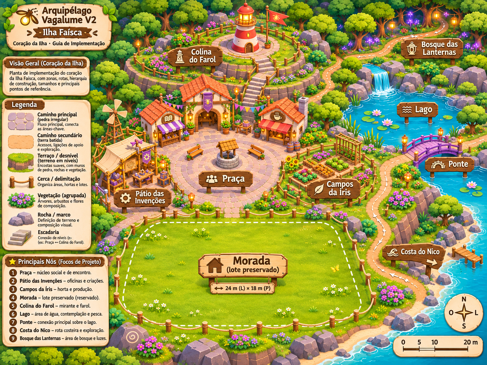
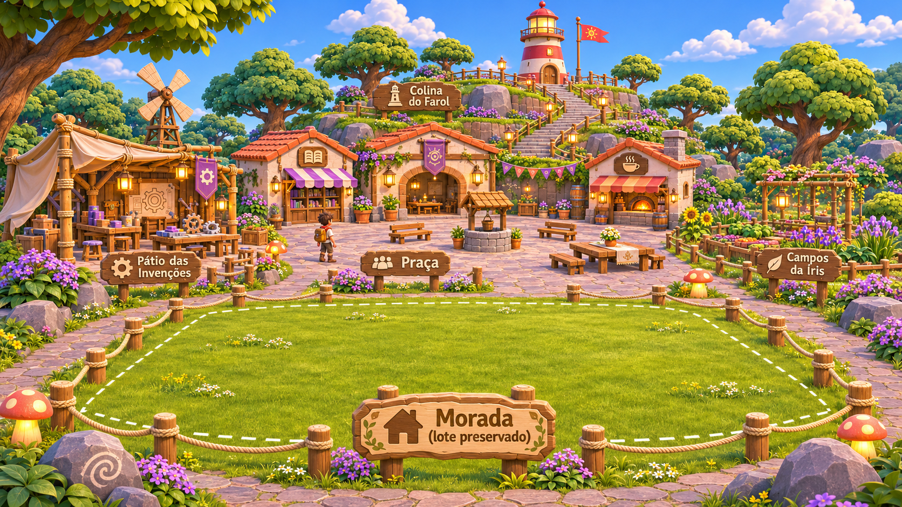
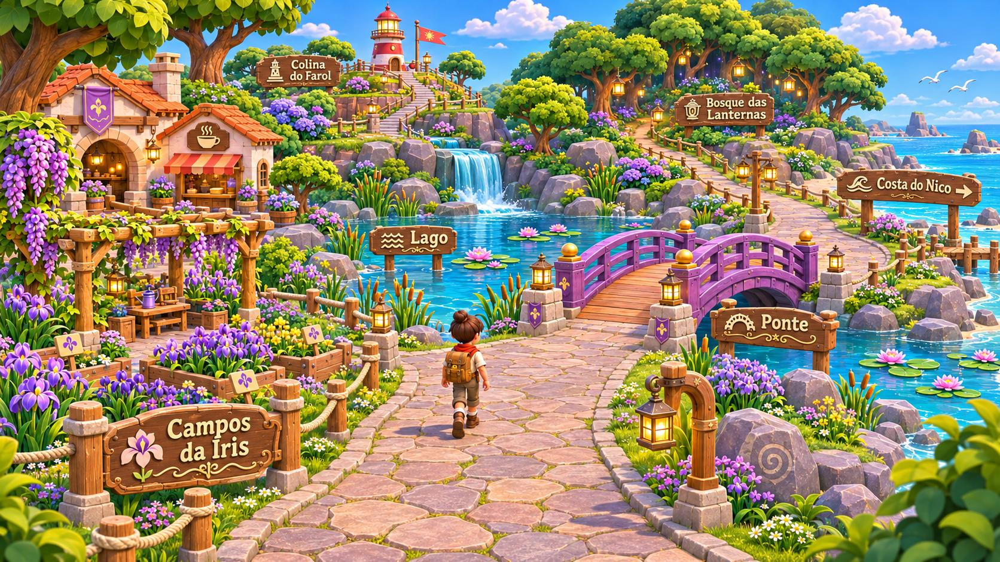

# Faísca V2 — composição pelas imagens e curadoria do acervo

**Estado:** estudo de composição e seleção de candidatas. Não é uma nova implantação no jogo nem um aceite artístico.

**Base conferida:** `staging` e `origin/staging` em `441203f9fcff134ed00c1271a4287fc1e1b1681f`, em 15/11/2026. A alteração preexistente no roteiro da aula dos pais foi preservada e não faz parte deste trabalho.

**Biblioteca consultada:** `informach/artes-3d`, commit `67b72d4a1a90c0e95c6217341dccfc723ebe8c49`. O cenário anterior continua usando os pins registrados no [relatório do Gate 2.1](../qa/2026-11-15-faisca-gate21.md): `7816a7aca0ba6f7d93a90fe4c15f40638b01525f` e, para as peças da Morada, `ec8c27c6013ab0ff6f333e0927c68583df477ec0`. Consultar uma versão mais recente do acervo não atualiza o manifesto do jogo automaticamente.

## 1. O que as imagens passam a orientar

As três imagens fornecidas pela usuária são referências complementares. Foram abertas, examinadas e copiadas sem alteração para este repositório. Os nomes originais, dimensões e SHA-256 estão em [referencias.json](./2026-11-15-faisca-concepts/referencias.json).

### Organização do conjunto

A planta estabelece uma sequência espacial: lote aberto da Morada na frente; praça como centro; construções enquadrando o fundo; oficina à esquerda; cultivo à direita; Farol sobre relevo rochoso atrás; lago e ponte ligados ao jardim. O bosque e a costa completam as vistas. Não é uma determinação de coordenadas, alturas ou escala cartográfica.

### Experiência da praça

O piso da praça forma um espaço contínuo e irregular. O poço organiza o encontro. As fachadas têm uma família arquitetônica comum, mas aberturas, coberturas e usos distintos. A oficina participa da composição lateral; o cultivo é percebido do outro lado. O Farol aparece sobre patamares, com árvores enquadrando sua silhueta. O espaço vazio da Morada é intencional e não deve virar um jardim decorativo ocupado.

### Experiência do cultivo e da água

O caminho tem bordas plantadas e encontros com solo, pedras e cercamento. A ponte tem arco, tábuas, corrimãos e apoios; sua cor violeta é um acento dentro de uma paisagem predominantemente verde, amadeirada e pétrea. Água, margens, queda e vegetação formam um conjunto com profundidade. As árvores de copa larga ajudam a produzir sombra e acolhimento.

**Fidelidade pretendida:** reproduzir a organização, a hierarquia das vistas, o caráter dos materiais e a relação entre os espaços. A aparência pictórica e o nível de detalhe das imagens não são propriedades automáticas dos GLBs disponíveis. Uma peça parecida em miniatura ainda precisa funcionar em escala nativa, no terreno e pela câmera normal.

**Elementos que não viram conteúdo automaticamente:** legendas, rosa dos ventos, cotas e contorno tracejado são anotações da ilustração. Fachadas que lembram comércio não autorizam criar lojas, missões ou serviços. A aparência ilustrada do personagem não substitui o Cute Characters. A oficina continua interrompida pelas ordens de Croakus.

## 2. Alcance real da curadoria

Foi realizada uma primeira triagem visual abrangente das sete coleções ambientais, e uma busca complementar por função no restante da biblioteca. Isso não significa aprovação de todas as peças nem inspeção geométrica de todo o acervo.

| Etapa | Cobertura e evidência | Limite |
|---|---|---|
| Inventário canônico de aventura | 75 catálogos, 2.102 registros, 1.959 conteúdos GLB distintos por blob Git; caminhos normalizados e existência conferida | Inclui avatar e personagens. Registros repetidos não significam modelos diferentes |
| Triagem visual de cenários | 37 pranchas examinadas, cobrindo 1.631 entradas nas sete coleções | Há peças compartilhadas entre coleções; esse número não é de GLBs globalmente únicos |
| Adventure Land / Reino / Templo | 246 / 169 / 184 entradas visuais | Seleção por função, escala e linguagem |
| Faroeste / Inverno / Doce / Estádio | 142 / 209 / 255 / 426 entradas visuais | Não há obrigação de misturar todos esses biomas na Faísca |
| Busca complementar | 141 catálogos canônicos, 6.355 registros de `biblioteca/` e `biblioteca_aventura/`, pesquisados por metadados | Não equivale a exame visual individual dos 6.355 registros |
| Inspeção geométrica dirigida | GLBs de `ponte_02_pacote`, `pontilhao_tabuas` e `ponte_arco_madeira`: limites, materiais, triângulos, eixo e perfil central | Não é teste de travessia, colisão ou câmera |

Os espelhos de publicação não foram contados como novos catálogos. Referências relativas que apontam para peças compartilhadas foram resolvidas antes da verificação. As miniaturas, GLBs e pranchas do acervo comprado permanecem em `output/`, fora do versionamento. Aqui ficam somente as imagens fornecidas pela usuária e o [registro de seleção e procedência](./2026-11-15-faisca-concepts/curadoria.json).

**Regra mantida:** Adventure Land tem preferência quando oferecer equivalente que funcione muito bem na composição. Sem equivalência adequada, comparar as demais coleções e registrar o motivo. A prioridade não justifica uma árvore da silhueta errada, uma ponte desproporcional ou uma casa que descaracterize a referência.

## 3. Estratégia recomendada e alternativas

| Abordagem | Resultado e custo | Parecer |
|---|---|---|
| Recompor o trecho existente pelas imagens, usando uma seleção coerente do acervo | Reorganiza piso, fachadas, relevo e margens; mantém os sistemas e permite avaliar uma região completa | **Recomendada** |
| Manter a implantação atual e acrescentar plantas e objetos semelhantes aos das imagens | Menor alteração inicial, mas deixa sem solução a praça dispersa, o fundo arquitetônico e a relação com o lago | Insuficiente para a referência solicitada |
| Produzir uma coleção nova para reproduzir cada elemento ilustrado | Maior potencial de semelhança de detalhe, com custo de arte, materiais, colisão e desempenho ainda não dimensionado | Reservar para lacunas comprovadas após o uso do acervo |

A recomendação não é recomeçar a macrogeografia nem montar uma cena demonstrativa de um pacote inteiro. É redesenhar a composição local do coração habitado, com limites e evidências claros.

## 4. Proposta de composição local

| Espaço | Relação a construir | O que evitar |
|---|---|---|
| Porta e lote da Morada | Espaço aberto no primeiro plano; vista convidativa para a praça e para o Farol | Troncos, copas, postes ou fundações ocupando a reserva |
| Praça | Piso contínuo de pedra/terra com contorno orgânico, poço como foco social, bancos nas bordas e circulação em volta | Somar pequenos pisos isolados ou preencher o vazio com objetos sem função |
| Fachadas de fundo | Pequeno conjunto voltado à praça, com telhados e proporções relacionados, entradas desobstruídas e usos distinguíveis | Repetir as casas verdes/ciano do Adventure Land ou três caixas iguais com cores diferentes |
| Oficina à esquerda | Estrutura de trabalho reconhecível, cobertura, materiais e projetos interrompidos, lacre integrado | Uma casa residencial com caixa na frente ou oficina narrativamente restaurada |
| Horta à direita | Canteiros legíveis, estrutura vegetal/pergolado se houver peça adequada, transição para jardim e água | Arbustos altos escondendo os cultivos ou cerca fechando o acesso |
| Colina do Farol | Base rochosa e patamares relacionados ao acesso, silhueta inteira vista desde a vila | Pedestal cilíndrico, empilhamento de platôs lisos ou escada monumental sem teste do avatar |
| Lago e ponte | Passagem inserida numa margem estreita plausível; vista de água mais ampla ao lado; fundo, margem e nado correspondentes | Esticar a ponte para caber no vão atual, esconder apoios no ar ou sobrepor um segundo lago |
| Jardins e árvores | Grupos assimétricos: cobertura arbórea, arbustos médios e detalhes baixos, com clareiras e vistas | Distribuição aleatória, repetição em linha e plantas gigantes nas bordas da trilha |
| Costa e bosque | Saídas reconhecíveis pela paisagem, mantendo o núcleo compacto e o distrito distante | Reduzir a ilha para reproduzir a perspectiva ilustrada |

### O que precisa de revisão espacial explícita

O [projeto anterior](./2026-11-15-faisca-projeto-artistico-praca-horta.md) preservava as âncoras locais. As novas imagens pedem avaliar relações que esse arranjo pode não produzir: poço mais central, fachadas formando uma frente de praça e ligação visual mais próxima entre cultivo e água. Esta proposta identifica essa necessidade, sem declarar deslocamentos já executados.

- Referências atuais: porta `(0,150)`, praça `(0,137)`, horta `(20,139)`, Pátio `(-24,132)`, Farol `(-3,100)` e ponte `(58,127)`, em coordenadas X/Z.
- Manter a intenção de deslocamentos cotidianos curtos: aproximadamente 13 m porta–praça, 20 m praça–horta e 25 m praça–Pátio. Conferir novamente as distâncias por percurso na nova composição.
- A reserva vigente da Morada mede **24 × 24 m**, em `x=-12…12, z=154…178`. A ilustração anota **24 × 18 m**. Não reduzir silenciosamente a reserva; manter a proteção atual até uma decisão específica sobre o lote.
- O bosque desenhado próximo pode orientar a entrada paisagística do distrito, sem deslocar automaticamente o Bosque das Lanternas inteiro.
- A proximidade aparente do mar e a escala desenhada do Farol não autorizam diminuir a Faísca, o Farol ou o avatar. Se a vista costeira exigir mudança local de relevo, apresentar essa mudança com seus efeitos físicos.

## 5. Pontes — comparação fundamentada

Dimensões abaixo são **largura X × profundidade Z × altura Y**, em metros, conforme `dims` do catálogo. O comprimento longitudinal pode estar em X ou Z. Não confundir altura, profundidade, comprimento total e vão livre.

| Peça / origem | Envelope aproximado | Adequação à referência | Cuidado decisivo |
|---|---|---|---|
| `ponte_02_pacote` / Adventure Land | 5,60 × 17,20 × 6,67 | Tábuas e estrutura de madeira, mas apoios muito altos e proporção de travessia elevada | Geometria central próxima de 4 m acima da origem. Não é substituição direta de uma ponte de jardim |
| `ponte_04_pacote` / Adventure Land, atual | 4,35 × 12,35 × 1,11 | Cor de destaque e travessia já testada | Não tem a combinação de corrimão e apoios da referência; não preservar somente por ser a peça atual |
| **`pontilhao_tabuas` / Reino** | **7,05 × 2,26 × 1,60** | Arco suave, tábuas, mourões e corrimãos; linguagem discreta de jardim | Travessia nominal de 7 m. Os encaixes em Y=0 não representam necessariamente o piso de passagem |
| **`ponte_arco_madeira` / Templo** | **13,06 × 2,98 × 2,89** | Arco, corrimão, capitéis e apoios pétreos aproximam a estrutura da imagem | Vão livre catalogado de 7 m, largura útil de 2 m e acessos elevados; não confundir 13 m totais com 13 m de água livre |
| `ponte_tabuas_coloridas` / Templo | Consultar registro | Passarela reta de tábuas, útil em outro papel | Não reproduz a silhueta arqueada; não é primeira escolha para este enquadramento |
| `ponte_madeira` / Parque | 2,40 × 8,20 × 2,04 | Alternativa de madeira arqueada com corrimãos | Comparação complementar; conferir piso, acessos e encaixe antes de ampliar a seleção |
| `ponte_arco_jardim` / Cidade, lazer | 4,60 × 1,72 × 1,59 | Corrimãos coloridos e remates dourados próximos da linguagem ilustrada | Muito curta para substituir diretamente a travessia atual |
| `ponte_pedra` / Parque | 2,95 × 9,55 × 2,30 | Arco e parapetos contínuos | Linguagem mais urbana e mineral, menos próxima da ponte de tábuas desejada |

**Seleção para a próxima comparação contextual:** pontilhão do Reino e ponte arqueada do Templo. Adventure Land foi comparado primeiro e permanece disponível, mas não apresenta uma equivalência tão clara para essa função. Não há escolha artística final nesta etapa.

As pontes de chocolate do Doce e a linguagem inflável/esportiva do Estádio não atendem ao material e à função desta passagem. A ponte de cordas compartilhada entre Reino, Faroeste e Inverno é outra tipologia; não são três alternativas diferentes por aparecerem em três catálogos.

### Como comparar sem falsear o resultado

1. Montar cada candidata com as margens, apoios, caminho e avatar em escala real, na mesma posição de observação da referência. Acrescentar vistas próximas de entrada e saída e uma vista lateral.
2. Resolver a posição pelo piso de acesso e pelo apoio estrutural real. O menor Y da caixa não basta para assentar uma ponte.
3. Manter escala uniforme. Se o vão não servir, estudar a geometria local das margens como parte do conjunto água/terreno/física; não alongar tábuas e corrimãos para esconder a diferença.
4. Conferir passagem do avatar, curvas, guarda-corpos, colisão, salto, câmera, nado abaixo e retorno nos dois sentidos. O passo automático nativo medido é de aproximadamente **0,243 m**; o catálogo da ponte do Templo indica níveis de **0,32 / 0,64 / 0,97 m**. O catálogo, sozinho, não comprova travessia nem falha.
5. Avaliar a cor violeta depois da adequação estrutural. Registrar qualquer acabamento aplicado na instância e seus limites; não recolorir indiscriminadamente um atlas compartilhado, deformar o GLB ou anunciar fidelidade exata antecipadamente.

## 6. Seleção por função e limites de uso

IDs, caminhos completos, dimensões originais, procedência de pacote/criação própria e hashes consultados estão no [registro JSON](./2026-11-15-faisca-concepts/curadoria.json). Reino e várias peças complementares são criações do acervo; não devem ser descritos como modelos oficiais comprados do Kingdom.

| Função | Candidatas verificadas visualmente | Decisão de curadoria |
|---|---|---|
| Farol e moinho | `farol_01_pacote`, `moinho_01_pacote` / Adventure Land | Preservar modelos e protagonismo; trabalhar implantação e entorno |
| Oficina | `andaime_bambu_01_pacote`, `plataforma_bambu_01_pacote` / Adventure Land | Estrutura disponível; cobertura e fachada ainda precisam formar uma oficina convincente |
| Poço e horta | `poco_manivela_baixa`, `canteiro_horta` / Reino | Bons pontos de partida; integrar ao piso e às atividades, sem criar outro sistema |
| Caminho de pedra | `caminho_lajes_reto`, `caminho_lajes_curvo` / Templo | Já entram no ensaio anterior. O uso da peça não aprova o desenho, as juntas ou a praça inteira |
| Copas da vila | `arvore_redonda_01/02/03` / Reino | Silhueta mais próxima do acolhimento ilustrado; combinar tamanhos com intenção |
| Fundo vegetal | `arvore_folhas_largas`, `arvore_raizes` / Templo | Candidatas para camadas de fundo; não tropicalizar todo o centro nem esconder o Farol |
| Bordas vegetais | `arbusto_selva_02` (0,842 m de altura), `tufo_selva_03` (0,20 m) / Templo | Melhor escala para camadas baixas que arbustos de 2–3 m junto à circulação |
| Vegetação Adventure Land | `folhagem_03_pacote` e peças de escala compatível | Testar em função específica. Coníferas e copas gigantes coloridas não substituem automaticamente árvores frondosas |
| Flores | `flor_margarida_branca`, campânulas e tulipas / Reino | Detalhes de jardim disponíveis; a flor e densidade exatas da imagem continuam por compor |
| Madeira e cercamento | `guarda_corpo_3_5m`, barris e caixas / Faroeste; cercas adequadas / Adventure Land | Escolher uma família compatível; evitar alternar materiais sem hierarquia |
| Luz pequena | `lampiao` / Faroeste, cerca de 0,63 m de altura | Candidato mais próximo de objeto cotidiano; suporte, vidro, intensidade e luz noturna precisam de avaliação |
| Riacho e margem | `rio_templo_cabeceira`, `rio_templo_reto`, `rio_templo_curva`, `rio_templo_foz` / Templo | Estudar conexão completa e custo, não substituir o lago só por uma miniatura melhor |
| Queda d’água | `bica_agua_templo`, `rio_templo_reto_degrau`; rochas e margem | Componentes para estudo. A bica mede 1,4 × 2,4 × 0,594 m: não é uma cachoeira natural pronta de 2,4 m de altura |
| Terraços e subida | `rocha_larga` / Reino; rochas de selva e `escadaria_pedra_3m` / Templo | Não repetir pilares lisos. A escadaria indica degraus de 0,273 m e colisão de rampa no catálogo; conferir esse contrato no jogo |
| Complementos genéricos | `balde_madeira` / Inverno | Possível pequeno objeto funcional; não transportar neve/gelo para a vila |
| Doce e Estádio | Acervo visualmente examinado | Guardar suas linguagens dominantes para os distritos adequados; não incluir peças só para utilizar todos os pacotes |

### Peças complementares examinadas e não escolhidas automaticamente

- `toldo_janela`, Cidade: toldo listrado vermelho/branco, com aparência de comércio urbano. Pode oferecer uma função, mas não é a cobertura orgânica da oficina ilustrada.
- `praca_elevada_pergola`, Parque: conjunto elevado com escada e guardas brancas, 8 × 13,23 × 4,65 m. Não é um pequeno pergolado solto; não substituir a praça inteira por esse modelo.
- `divisoria_corda_longa_pacote`, Morada: postes laranja, corda vermelha e remates brilhantes. A função é próxima do cercamento, mas a peça não é equivalente à cerca rústica da imagem sem revisão de acabamento.
- `luminaria_chao_lanterna`, Morada: luminária moderna cilíndrica; o nome não corresponde à lanterna de aventura desejada.
- `jardineira_longa_1m` e `jardineira_longa_2m`, Morada: móveis com nichos, vasos ou cactos; não são floreiras de fachada equivalentes às do conceito.
- `fonte_cascata`, Templo, é uma construção monumental de aproximadamente 14 × 14 × 9,76 m. O nome não comprova a existência de uma cachoeira natural pronta.

## 7. Lacunas que permanecem abertas

**Arquitetura acolhedora:** as casas Adventure Land não reproduzem os pequenos telhados e fachadas do conceito; os módulos da Morada já usados também não produziram o conjunto desejado. Fazer uma composição arquitetônica real antes de escolher a solução. Nenhuma casa nova foi declarada necessária sem esse estudo.

**Pergolado, floreiras e jardim:** os complementos examinados não resolvem diretamente as formas ilustradas. Verificar encaixe de componentes de madeira/vegetação existentes e registrar adaptações. Não transformar essa montagem em geometria genérica apresentada como arte pronta.

**Cachoeira e margem rochosa:** há componentes de água, rochas e espuma, mas ainda não foi validado um conjunto natural com a forma e a escala da imagem. A busca por nomes não permite afirmar que nenhuma solução exista no acervo. Se a combinação existente não funcionar, registrar a dependência precisa, sem substituir por uma fonte monumental ou por um plano azul.

**Materiais e acabamento:** definir uma paleta comum entre coleções. Não prometer equivalência de iluminação, densidade de folhas ou pintura somente porque o objeto possui o mesmo nome.

## 8. Próxima execução proposta

1. **Provar a composição local:** reposicionar volumes de estudo em um ensaio separado e reversível, com terreno, frente de fachadas, poço e vistas relacionadas às três imagens. Mostrar o que muda em relação às âncoras anteriores. Volumes são ferramentas de revisão, não entrega artística final.
2. **Comparar as duas pontes no conjunto:** água, margens, jardim, caminho e avatar, com registros das duas aproximações. Escolher por semelhança contextual e funcionamento, sem obrigar a candidata a caber no lago anterior.
3. **Montar o trecho com as peças selecionadas:** substituir superfícies conflitantes por trecho; resolver piso, fundações, entradas, bordas e vegetação antes de aumentar a quantidade de objetos. Tratar praça, horta e lago como partes do mesmo lugar.
4. **Verificar em movimento:** caminhada, corrida, curvas, subida, descida, passagem da ponte e nado, de dia e à noite. Registrar aproximações pela câmera normal, além das vistas comparativas.
5. **Verificar os recursos e regressões:** colisão, reentrada de setores, retomada local, toque, câmera e liberação de geometria/texturas. Comparar renderer e fluidez no mesmo dispositivo; não estender resultados desktop a celulares e Chromebooks sem ensaio físico.

Não ampliar a decoração dos seis distritos antes de comprovar a linguagem do piloto. Patins e mochila continuam no recorte próprio e não substituem essa avaliação ambiental.

## 9. O que permanece protegido e como avaliar

Permanecem a macrogeografia das sete ilhas, Faísca de aproximadamente 520 m, seis distritos/cabeceiras, oceano compartilhado, setores/LOD, Rapier, avatar em escala nativa, controlador, câmera, toque, inventário, equipamentos e salvamento de ensaio. Não alterar velocidades, cálculo dos tempos do mapa, interfaces Kids/adulta, campanha, recompensas ou conta. A Íris continua no sistema de NPC existente. A regra narrativa continua: posto libera a Missão do Núcleo; instalar o Núcleo no Farol reconstrói a ponte.

O resultado deverá ser avaliado pela primeira vista da Morada, pelo centro da praça, pela transição horta–lago e pelas duas aproximações da ponte. Em cada uma, comparar enquadramento, massas, silhuetas, proporções, materiais, profundidade e legibilidade com a referência correspondente. A vista do Farol precisa incluir sua base e a chegada à colina.

- [ ] A praça forma um conjunto habitado e o poço organiza o espaço.
- [ ] Oficina, fachadas e cultivo são reconhecíveis e narrativamente coerentes.
- [ ] Lote da Morada protegido e três saídas legíveis.
- [ ] Caminho, jardim, margens e ponte têm continuidade visual e física.
- [ ] Copas, flores e rochas criam camadas, sem distribuição mecânica nem obstruções.
- [ ] Nenhuma base flutua; nenhuma superfície cintila em movimento.
- [ ] Placas continuam integradas à madeira, legíveis e corretamente orientadas.
- [ ] Câmera e avatar funcionam de perto, com travessia nos dois sentidos.
- [ ] Evidências incluem comparação diurna/noturna e vídeo pela câmera normal.
- [ ] Recursos, carregamento e regressões foram conferidos no cenário montado.

**Entrega desta etapa:** referências preservadas, leitura das imagens, curadoria abrangente, comparação de pontes e proposta concreta de recomposição. Nenhum arquivo do jogo em `packages/` foi alterado nesta etapa. O `/macro` continua mostrando a versão anterior. Não foram repetidos testes do motor para uma alteração documental, e nenhum novo resultado de desempenho ou aceite artístico está sendo anunciado.
