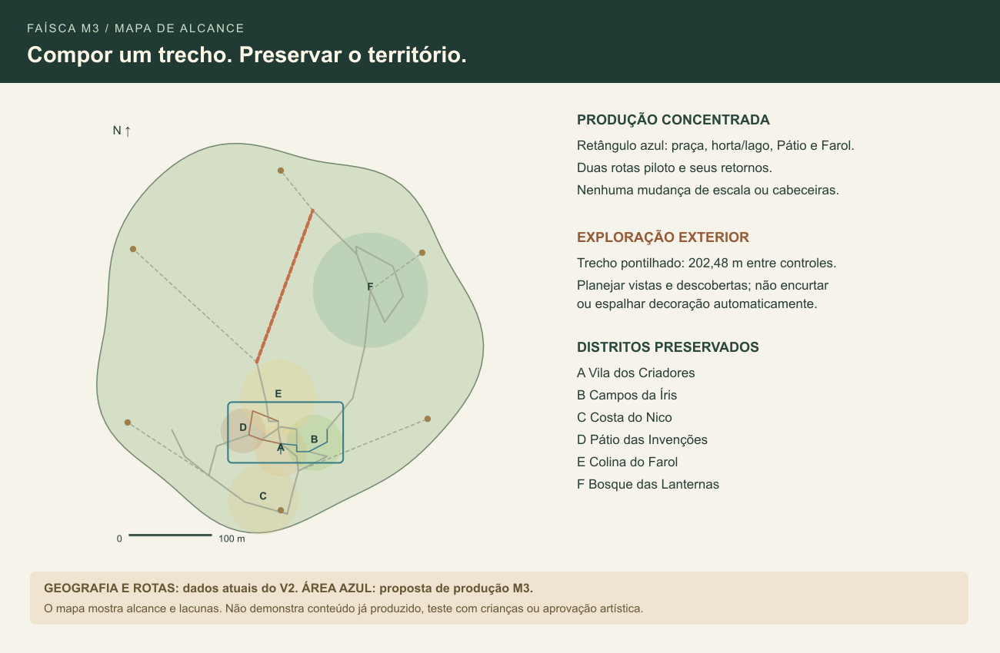
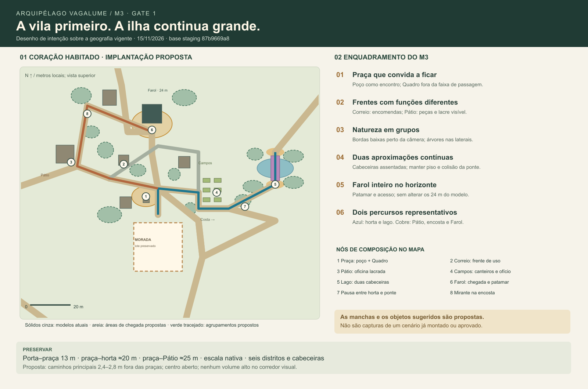
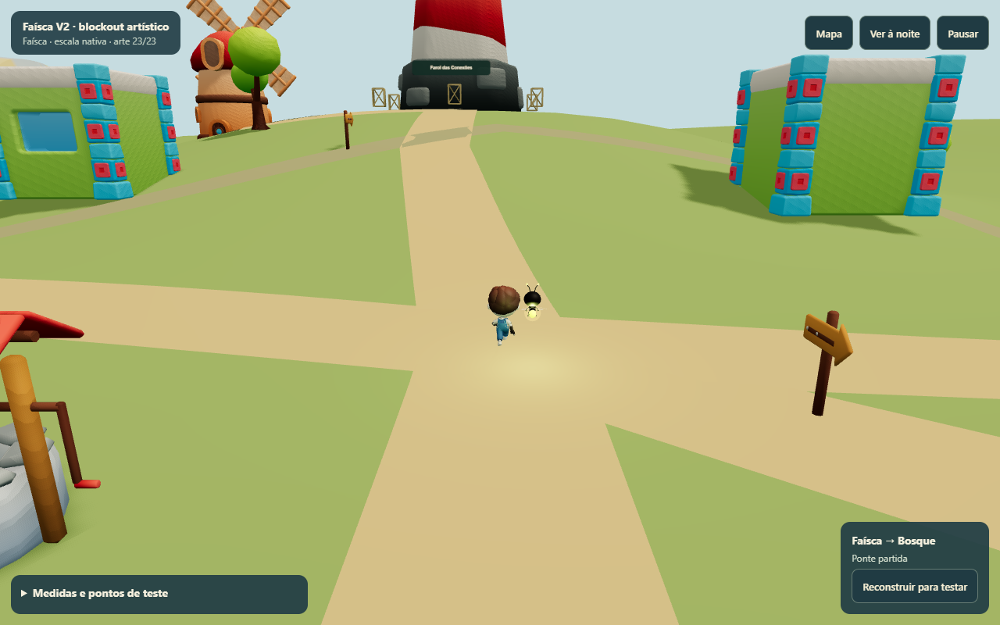
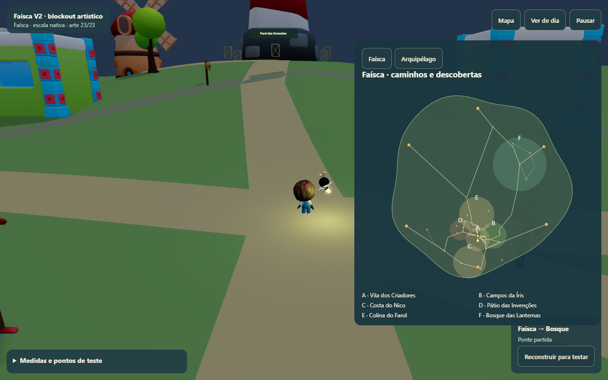
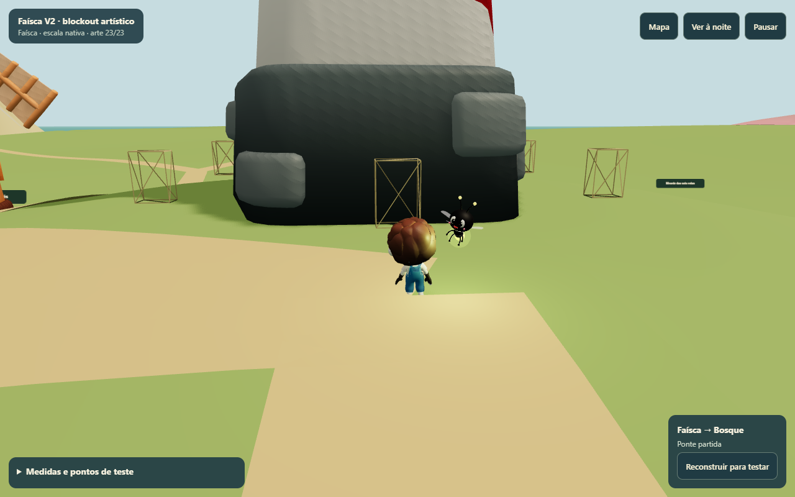
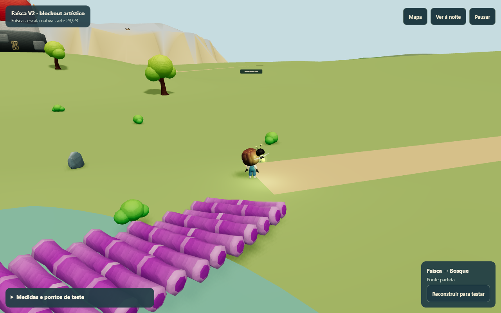

# Faísca M3: proposta de composição para o primeiro aceite

**Estado:** desenho para avaliação, antes da montagem do M3. **Base:** `staging`, commit `87b9669a8`, conferido localmente e com `origin/staging` em 15/11/2026. Nenhum arquivo do jogo foi alterado nesta etapa.

Este documento concretiza o **Gate 1 — Aprovação das intenções artísticas** do [parecer da coordenação](../qa/2026-11-15-faisca-m3-parecer-coordenacao.md). O parecer original foi preservado sem edição. A finalidade é permitir a decisão de composição pelo GitHub, antes de aplicar objetos e acabamento. O aceite da base técnica V2 continua separado do aceite artístico.

Referências: [relatório e capturas V2](../qa/2026-11-15-faisca-blockout-artistico.md), [história da Faísca](./2026-11-15-historia-ilha-faisca.html), [layout real](../../packages/arquipelago/src/sistemas/faisca.ts), [composição atual](../../packages/arquipelago/src/sistemas/composicao-faisca.ts). A história define conteúdo e progressão; este estudo define a implantação visual limitada do próximo trecho.

## 1. Conferência do parecer contra o código

| Observação | Resultado da conferência | Decisão |
|---|---|---|
| Segmento longo no anel Farol–Bosque | Confirmado: `(-30,35)` → `(40,-155)` tem **202,4846 m**, em planta | Marcar como lacuna de experiência. Não reduzir a ilha nem subdividir a linha apenas para aparentar conteúdo |
| Rota da ponte com 16 m para modelo de 12,35 m | Confirmado: peça `ponte_04_pacote`, 4,352 × 12,354 × 1,106 m | Compor as aproximações; preservar inicialmente o assentamento físico testado |
| Possível divergência de tempos do mapa por usar `CORPO.andar` | **Não se confirmou como bug.** O servidor injeta o ritmo antes dos módulos; `MUNDO` aplica o perfil e `corpoDoMundo` usa `mundo.andar` | Preservar o cálculo. Tornar a identificação do perfil explícita na futura apresentação, sem manter uma segunda tabela de velocidades |
| Íris precisa de figurino e ações | O piloto usa clipes `andar` e `parado`, clone de esqueleto, interação e enquadramento existentes | Ampliar esse pipeline. Não prometer que animações humanas ou acessórios de outro rig sirvam na coelha sem aferição |
| Direção de arte ainda não aprovada | As capturas atuais não mostram o Farol inteiro nem a visão completa a partir da porta | Produzir as vistas especificadas na primeira passada jogável e submetê-las à avaliação humana |

Conferência dos três perfis em processos novos, com as mesmas chaves de mundo/ritmo usadas pelo playground:

| Perfil | `CORPO.andar` | `CORPO.correr` | Estimativa de 20 m a pé |
|---|---:|---:|---:|
| Referência | 0,9225 m/s | 2,21485 m/s | 21,68 s |
| Exploração | 1,5 m/s | 3,4 m/s | 13,33 s |
| Ágil | 1,7 m/s | 3,9 m/s | 11,76 s |

São estimativas a velocidade constante, sem humor, curvas ou relevo. A medição do avatar real continua sendo a referência para tempo de experiência. Nenhum perfil recebe aceite perceptivo por essa conferência.

## 2. Abordagens consideradas

| Abordagem | Resultado esperado | Custo e implicação |
|---|---|---|
| **A. Compor o trecho existente — recomendada** | Centro de convívio, frentes distintas, colina e margens articulados por dois percursos | Reaproveita o piloto e permite comparar as mesmas câmeras. Mudanças pequenas de terreno só entram com colisão e regressão verificadas |
| B. Trocar imediatamente construções e ampliar a biblioteca | Mais variedade de silhuetas | Introduz simultaneamente escala, materiais, encaixes e colisores novos; dificulta saber se a composição melhorou |
| C. Redesenhar toda a Faísca antes de compor | Outra geografia e distribuição | Desfaz decisões de circulação já úteis e adia o aceite de um trecho representativo |

A proposta abaixo segue A. Não é uma decisão de finalizar todos os 520 m nem de substituir o visual dos packs.

## 3. Mapa de alcance

[Fonte vetorial do mapa](./2026-11-15-faisca-m3/alcance-m3.svg).

O contorno, as rotas, os seis distritos e as seis saídas vêm dos dados atuais do jogo. O retângulo azul propõe onde concentrar a produção. A linha cobre pontilhada marca o segmento externo de 202,48 m; ela não indica uma nova atividade implementada. O Bosque, a Costa extensa e as cabeceiras continuam fora do acabamento M3.

## 4. Composição proposta para o coração habitado

[Fonte vetorial da composição](./2026-11-15-faisca-m3/composicao-coracao.svg).

Os sólidos cinza representam os volumes catalogados de construções atuais. Areia e verde tracejado representam **intenções novas**, ainda não montadas no jogo. As posições dos grupos são referências de implantação; o tamanho da copa, o acesso e a colisão devem ser conferidos antes de fixar cada instância. Os traçados cinza conservam a largura atual para comparação. A proposta de estreitamento é descrita abaixo, não está disfarçada como alteração já implementada.

### Praça, poço e frentes de uso

**Nó 1:** usar o poço existente em `(-6,143)` como encontro, com uma área orgânica de solo junto a ele, preservando a passagem entre porta, praça e saídas. Reservar a faixa lateral oeste para o Quadro das Conexões e um ponto de descanso, sem colocar um objeto alto no eixo porta–praça–Farol. O Quadro deve ser reconhecido como cavalete/objeto do mundo; não criar um painel de interface nem implementar aqui os seis desafios.

**Nós 2 e 3:** distinguir o correio e o Pátio pelo uso das frentes. Encomendas organizadas e um apoio baixo no correio; peças interrompidas, ferramentas recolhidas e um lacre legível na oficina. As caixas da coroa são sinal ambiental do domínio de Croakus, não concessão de missão. Manter as casas de referência por enquanto; não tentar resolver a semelhança com fileiras de outras casas iguais.

Aproximar arbustos, flores e sombra das laterais de permanência, com centro livre. Não implantar grupos em grade. Repetir espécies em conjuntos assimétricos e variar a distância entre conjuntos. Manter o lote da Morada de 24 × 24 m, em `x=-12…12`, `z=154…178`, livre para a casa crescer, inclusive das novas copas propostas.

### Caminhos e gramática ambiental

Propor larguras de **2,4–2,8 m** para os caminhos principais fora dos locais de encontro, mantendo áreas de cruzamento e aproximação maiores. Atalhos continuam mais estreitos. Os números são hipóteses de composição, sujeitas à passagem do avatar, enquadramento e uso simultâneo por moradores.

Criar borda irregular baixa: transição de terra pisada para grama, pequenos grupos de vegetação, pedras seletivas e sombras. Não usar pedras e cercas como muros contínuos em toda trilha. A leitura dos três rumos deve vir de paisagem e função:

- Campos: cultivo, agrupamentos de árvores e objetos de jardinagem.
- Pátio: materiais de oficina, peças e frente lacrada.
- Costa: abertura, descida e, quando o relevo permitir, vista do mar.

Conservar as cores dos modelos como acentos; a ponte rosa pode permanecer. Trabalhar o chão e a distribuição dos acentos para dar contexto, antes de recolorir a arte de origem. A identidade das interfaces adulta/Kids não faz parte dessas alterações ambientais.

### Campos e duas cabeceiras da ponte

**Nós 4, 5 e 7:** manter os seis canteiros e organizar a leitura de ofício junto à horta; oferecer uma pausa de paisagem entre cultivo e lago. Não converter os seis canteiros de referência em um novo sistema de plantio nesta etapa.

Com a ponte centrada em `z=127`, as projeções das extremidades ficam aproximadamente em `120,823` e `133,177`. Os nós de rota em `119` e `135` incluem cerca de **1,823 m de aproximação em cada lado**. Isso é compatível com margem transitável e não prova um buraco. A proposta é tornar esses encontros visíveis: terra pisada até as tábuas, apoios junto às laterais e vegetação agrupada na borda da água.

Manter inicialmente a altura de origem da ponte em `3,45 m` e a malha de colisão testada. Não esticar a ponte para 16 m nem mover o piso apenas para preencher a linha do mapa. Apoios e rochas ficam fora da faixa caminhável central. Se for necessário alterar a margem, terreno visual, chão físico, área de água e câmeras devem ser verificados em conjunto.

### Colina e Farol

**Nós 6 e 8:** preservar o Farol de aproximadamente 24 m e a elevação atual. Compor o encontro da subida com um patamar de chegada, passagem ao redor e pausa de vista na encosta. Não erguer degraus altos para justificar o patamar nem bloquear o acesso seguro em `(-3,109)`.

Os seis compartimentos continuam provisórios durante o aceite de implantação. As vistas completas devem orientar a proporção, o acesso do avatar e a distribuição antes do acabamento. Melhorar a leitura da base escura primeiro pela relação com chão, luz e entorno, mantendo a origem da arte documentada.

## 5. Dois percursos demonstrativos

| Percurso | Sequência | Descobertas e pausas propostas |
|---|---|---|
| Azul | Porta → praça → horta → aproximação do lago → ponte, ida e volta | Poço e Quadro; leitura do cultivo e regador; pausa de paisagem; duas cabeceiras claras |
| Cobre | Praça → entrada do Pátio → oficina → encosta → Farol; retorno pela descida à praça | Caixas da coroa; peças e lacre; vista da encosta; revelação do Farol e seus seis lugares |

Preservar porta–praça de 13 m, praça–horta de aproximadamente 20 m e praça–Pátio de aproximadamente 25 m. Não afastar funções para acomodar decoração. A diferença entre as rotas deve ser reconhecível no 3D; o mapa apenas a confirma. O percurso exterior de 202 m deve receber um desenho próprio de marcos, aproximações e retorno em outro recorte de produção.

## 6. Folha de referência e vistas a produzir

As imagens abaixo são o **antes**, preservado do V2. Não há imagens do M3 montado nesta entrega. O tratamento indicado pelos mapas é proposta, não simulação de um resultado já existente.

| Referência atual | O que preservar | O que a nova vista precisa mostrar |
|---|---|---|
| [Praça](../qa/2026-11-15-faisca-blockout-artistico/praca-dia.png) | Três rumos e marcos verticais | Centro de convívio, frentes distintas e bordas, sem bloquear circulação |
| [Mapa](../qa/2026-11-15-faisca-blockout-artistico/mapa.png) | Seis distritos, anel e saídas | Alcance do trecho M3 e lacunas exteriores, sem representar região vazia como pronta |
| [Farol](../qa/2026-11-15-faisca-blockout-artistico/farol.png) | Modelo, escala e elevação | Torre inteira, patamar, subida e acesso aos seis lugares |
| [Ponte](../qa/2026-11-15-faisca-blockout-artistico/ponte-campos.png) | Modelo e assentamento físico | Chegada por ambos os lados, margens, apoios e continuidade visual da trilha |

Na primeira passada jogável, fixar posição, alvo, campo de visão, resolução e horário das câmeras para os comparativos. Ocultar somente o HUD técnico na captura; não esconder objetos problemáticos ou mudar a lente apenas no depois. Manter também uma comparação com o enquadramento normal de jogo.

Vistas a entregar:

1. Da porta da Morada e da praça para cada uma das três saídas; superior próxima da praça.
2. Farol inteiro em três-quartos, com avatar ao pé e margem superior livre; repetir de noite.
3. Da praça para Farol/moinho; lateral da subida; superior da colina e dos seis lugares.
4. Farol visto do Bosque e da Costa, sem prometer legibilidade onde a distância/névoa a impedir.
5. Ponte das duas cabeceiras e lateral baixa; repetir caminhada/corrida em vídeo e teste de toque.

## 7. Íris e matriz de arte

| Peças ou ação | Estado real | Tratamento no M3 |
|---|---|---|
| Poço, árvores, arbustos, flores, caixotes, barril, canteiros, ponte, moinho, Farol e casas | No manifesto dos 23 modelos já carregados | Reutilizar com composição e instâncias; preservar rastreabilidade e orçamento |
| Banco, cavalete do Quadro, regador, ferramentas e lacre | Não incluídos no manifesto atual do piloto | Conferir catálogo, escala e origem antes de acrescentar. Não chamar essas propostas de peças já integradas |
| Avental e lanterninha para coelha | Encaixe/figurino da Íris não validado | Conferir rig e produzir/adaptar arte própria se necessário. A existência de uma lanterna para o avatar não comprova encaixe na coelha |
| Jardim, observação e pequena rotina entre horta e oficina | O piloto atual só alterna andar/parado em um trajeto curto | Ampliar clipes e trajeto no pipeline existente, com pausa de conversa, colisão, retomada e liberação dos recursos |

Não criar outro motor de NPC nem aplicar animações humanas à coelha sem validação. A Íris completa depende de arte e movimento, não apenas da troca do texto de conversa. Se um acessório estiver ausente, registrá-lo como pendência explícita; a composição P0 pode ser avaliada antes desse acabamento P1.

## 8. Sequência e evidências de aceite

- [x] Conferir `staging` local e remota, estado dos arquivos e referência do parecer.
- [x] Preservar o parecer original; verificar medidas, tempos e dependências no código.
- [x] Produzir mapa de alcance, mapa de composição e folha de referência do Gate 1.
- [ ] **Gate 1:** coordenação avalia e aprova/ajusta estas intenções de composição.
- [ ] **Gate 2:** montar a primeira passada nas três áreas; comparar câmeras iguais, dia/noite, colisão e retomada.
- [ ] **Gate 3:** produzir vídeos de 20–40 s para plano, curvas, partida/parada, subida/descida, salto, ponte e conversa. Comparar os três perfis e anotar o que exige ajuste.
- [ ] **Gate 4:** teste acompanhado com crianças e aparelhos físicos, documentado por resultados reais.

Para Gate 2/3, reutilizar os verificadores existentes de percurso, ponte, toque, falha de arte e três ciclos de descarga/reentrada. Conferir testes relevantes, tipagem, build e contadores do renderer após mudanças reais. Não atribuir ao M3 os números de teste/desempenho do V2. A meta sugerida de 4 em 5 participantes é hipótese de aceite humano, não resultado observado.

O aceite pretendido é uma vila reconhecível desde a porta, três rumos legíveis sem mapa e pelo menos duas possibilidades perceptíveis, uma ponte que pertença às margens e um Farol cuja silhueta completa possa ser julgada. Animação, câmera e prazer de exploração exigem observação em movimento.

Campanha, Morada integrada, novos sistemas de NPC, população completa, ponte oceânica definitiva e acabamento dos seis distritos permanecem fora deste recorte. Não houve migração espacial, alteração de dados compartilhados ou deploy.

## 9. Verificação desta entrega documental

Os dois diagramas foram renderizados em PNG e inspecionados visualmente; as fontes SVG foram validadas como XML sem scripts. Os 23 links locais dos documentos foram conferidos. A cópia do parecer tem o mesmo SHA-256 do arquivo entregue em Downloads. `git diff --check` passou e não houve alteração em `packages/`. Não foi reexecutada a suíte do jogo para esta entrega documental; os números de testes e FPS do relatório V2 pertencem ao ensaio anterior.
