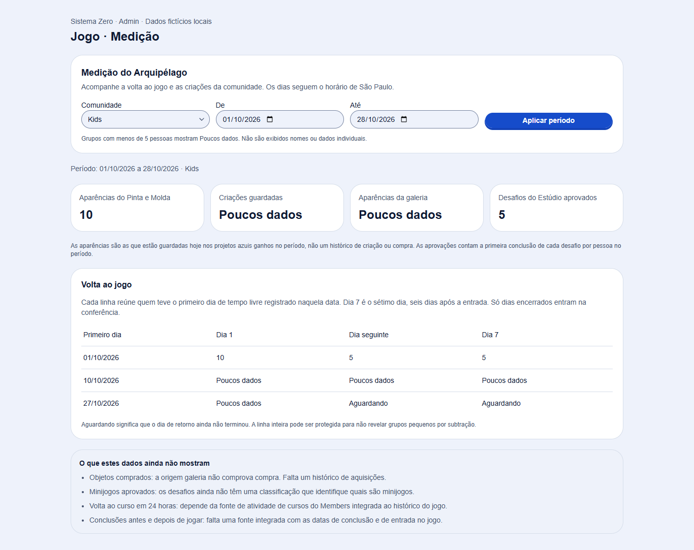
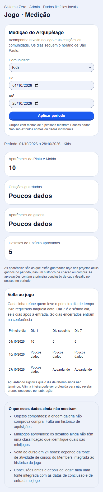

# Medição do Arquipélago no Admin

Item geral-06. A implementação inclui contrato estrito, regra de privacidade, consultas
agregadas, rota de equipe, autorização no gateway, BFF e a aba Medição no Admin.
Não modifica o jogo nem o salvamento. Não exige migração ou variável nova de produção.

## O que os números significam

| Medida | Fonte | Definição e limite |
| --- | --- | --- |
| Volta do Kids | `arquipelago.tempo_diario` | Primeiro dia positivo de tempo livre no histórico completo. D+1 e D+6, o sétimo dia, com o dia civil de São Paulo encerrado. Não mede tempo nos desafios do Estúdio. |
| Aparências Pinta/Molda | `salvamentos.dados.projetos` | Origens Pinta/Molda atuais dos projetos azuis ganhos no período. União das pessoas, sem contá-las duas vezes se usaram as duas ferramentas. |
| Criação guardada e galeria | A mesma fonte | Origem da aparência atual, não prova de autoria, compra ou data de criação. |
| Desafios aprovados | `desafios_concluidos` | Primeira conclusão por pessoa e desafio no período, com o público gravado na própria conclusão. |

O período é inclusivo e limitado a 90 dias. A rota recusa datas inexistentes, invertidas,
futuras e público ausente. Aprovações e projetos usam fronteiras de meia-noite em São Paulo,
não UTC. Retornos posteriores ao fim do período podem ser observados: o período seleciona
quem entrou, e a janela de retorno termina no dia próprio de cada coorte.

## Privacidade

Nenhum ID, nome, salvamento ou atividade individual sai da rota. As consultas já retornam
agregados; não há carregamento de salvamentos individuais para o processo do relatório.
Contagens com menos de cinco pessoas são nulas. Na tabela de volta, a linha inteira é
protegida se um subgrupo positivo de retornos ou não retornos tiver menos de cinco pessoas.
Isso impede descobrir o pequeno complemento por subtração dentro da linha. Não se trata
de uma garantia de privacidade diferencial contra cruzamentos arbitrários entre consultas.

A autorização exige token do gateway, equipe ativa e conta própria, sem contexto de perfil
Kids. O gateway recusa contextos Kids e limita a medição a 12 pedidos por minuto por pessoa.
A resposta tem `private, no-store`. O BFF permite apenas a rota e os filtros explicitados.

## Fontes que ainda faltam

- **Volta dos adultos:** o mecanismo atual de tempo livre registra perfis Kids. Um horário
  de atualização do salvamento adulto não é histórico de sessões. É necessário registrar
  dias de jogo adultos antes de calcular retenção equivalente.
- **Compras:** `aparencia.origem = galeria` não é uma transação. Falta um histórico de
  aquisições de objetos com origem, comunidade e data.
- **Minijogos:** `desafios_concluidos` comprova aprovação de desafio do Estúdio. Os tipos do
  cadastro são quadro das cores, desafio do dia e pedido de morador; não identificam se o
  conteúdo é um minijogo. Não foi inventada essa classificação.
- **Atividade de curso em 24 horas:** a outra sessão está trabalhando no cartão dos pais
  em staging local. A fonte ainda não estava disponível no fechamento deste lote. O
  relatório deve integrar a mesma definição quando ela estiver pronta, por uma porta
  interna agregável do Members, sem expor nomes ou IDs no Admin.
- **Conclusões antes/depois:** o Members já oferece uma linha do tempo pessoal paginada em
  `GET /members/admin/members/:userId/activity` e analytics gerais de cursos. Essas respostas
  não constituem uma coorte agregada de jogadores com janelas comparáveis. A linha do tempo
  usa posições recentes de vídeo, conclusões de aula, quizzes e entregas; não é um histórico
  imutável de cada visita. O serviço do jogo não acessa tabelas do Members diretamente.

O resumo semanal do cartão dos pais e atividade em até 24 horas depois de jogar são medidas
diferentes. A integração deve preservar a mesma regra de evento de curso, mas não reaproveitar
um total semanal como se fosse o indicador de 24 horas. Todas as fontes ausentes aparecem
explicitamente na interface, sem número zero substituto.

## Verificação local

Postgres 17 descartável, container próprio `sz-medicao-20261028`, porta local 55439.
Bancos `arquipelago_test` e `arquipelago_test_medicao`, sem contato com staging ou produção.
As URLs foram passadas somente ao processo, sem editar `.env`.

Comandos executados:

```powershell
# Nos pacotes arquipelago-contracts, arquipelago-api e admin, separadamente:
bun test
bun run typecheck

# Na raiz:
bunx --no-install biome check .
bun test packages/api-gateway/tests/unit/arquipelago-medicao.test.ts packages/api-gateway/tests/unit/arquipelago-config.test.ts packages/api-gateway/tests/unit/kids-access-policy.test.ts

# Com ARQUIPELAGO_MEDICAO_TEST_DATABASE_URL apontando para o banco local descartável:
bun packages/admin/tests/e2e/game-measurement-server.ts
node packages/admin/tests/e2e/game-measurement-browser.mjs
```

Na árvore compartilhada, passaram 68 testes dos contratos, 217 do serviço e 957 do Admin.
O código foi também separado numa cópia de revisão, preservando as alterações de outras
sessões em edição. Nessa base, contratos: 63 testes e tipagem; serviço: 199 testes e tipagem.
As diferenças de contagem são os testes da frente do cartão dos pais, não testes removidos.
Na cópia isolada, o Admin passou em tipagem e na execução serial final: 957 testes, 3.936
asserções, 144 segundos. O gateway passou em tipagem e em 309 testes; dois testes que exigem
Redis dedicado foram pulados. Nenhum teste da medição foi pulado.

Uma execução anterior do Admin teve timeout de cinco segundos no teste preexistente
`studio-python-language-env.test.ts`, que abre cinco subprocessos. O teste passou sozinho
em um segundo e depois na suíte completa serial. Nenhum limite ou código desse teste foi
alterado. A primeira suíte completa na árvore compartilhada também tinha passado.

O Biome da raiz da cópia isolada passou: 12.658 arquivos conferidos. O primeiro check da
árvore compartilhada encontrou dois arquivos preexistentes com CRLF apesar do atributo LF.
As quebras foram normalizadas após conferir identidade com HEAD, sem mudança no diff.
O check seguinte encontrou formatação ainda em edição no cartão dos pais, fora deste lote.
O check de todos os arquivos desta entrega passou. Não foram incluídas correções ou mudanças
de outras frentes no commit da medição.

## Navegador

Chrome instalado no Windows, componente real `GameMeasurement`, CSS real do Admin e BFF
de filtros chamando a rota real do serviço com Postgres local. O host local fornece a
identidade fictícia de equipe; não é prova de login ou de deploy nos ambientes remotos.

Passaram: filtros de período, alternância Kids/Adultos, ausência de dados da lente anterior,
erro de serviço e nova tentativa, tabela com grupos protegidos, larguras 1366, 390 e 320 px
sem rolagem lateral e sem erro JavaScript de página. Celular é emulação de viewport,
não aparelho físico.

A conferência foi repetida na composição isolada final e passou. Na primeira tentativa de
reiniciar o host, a porta ainda estava ocupada pelo processo próprio da execução anterior:
o Ctrl+C do shell não havia encerrado o filho Bun no Windows. A tentativa recusada foi
preservada; o PID e a data de criação foram conferidos antes de encerrar esse processo.
Depois da execução final, o host próprio foi encerrado e a porta 4626 conferida livre.





## Revisão

Conferidos: dependências e fronteiras, autorização por papel/contexto, filtro obrigatório,
meia-noite local, histórico anterior ao período, tempo zero, dia ainda aberto, duplicidade
de pessoas nas origens, isolamento Kids/Adultos, grupos pequenos, formato de resposta,
cancelamento de pedidos de interface e recuperação de erros. Consultas parametrizadas,
três por leitura, numa transação somente leitura com isolamento repeatable read.

Ainda requerem validação posterior: navegação autenticada após o deploy, aparelho físico,
plano e latência das consultas com volume representativo de produção e integração da fonte
de curso que está em outra frente. Nenhum resultado local comprova essas etapas.
