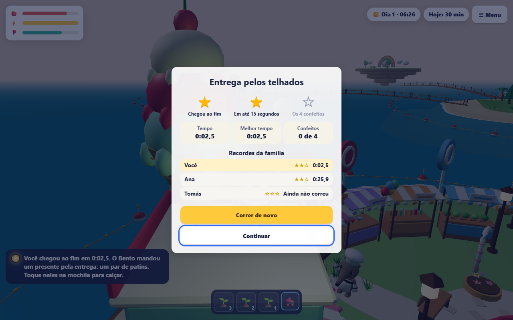
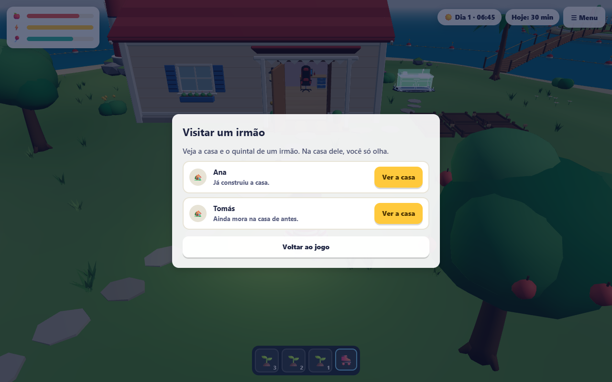
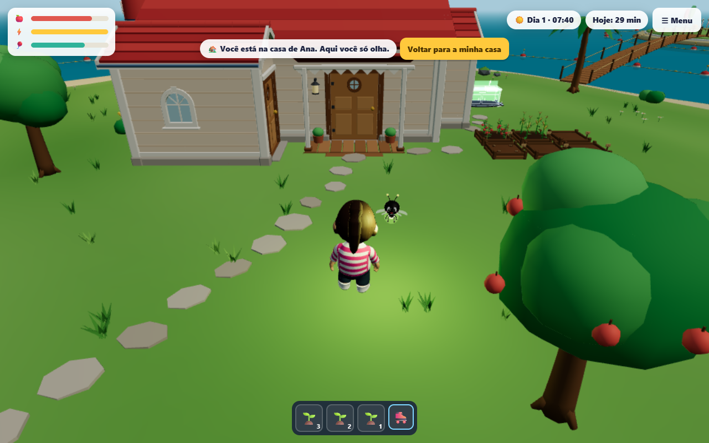
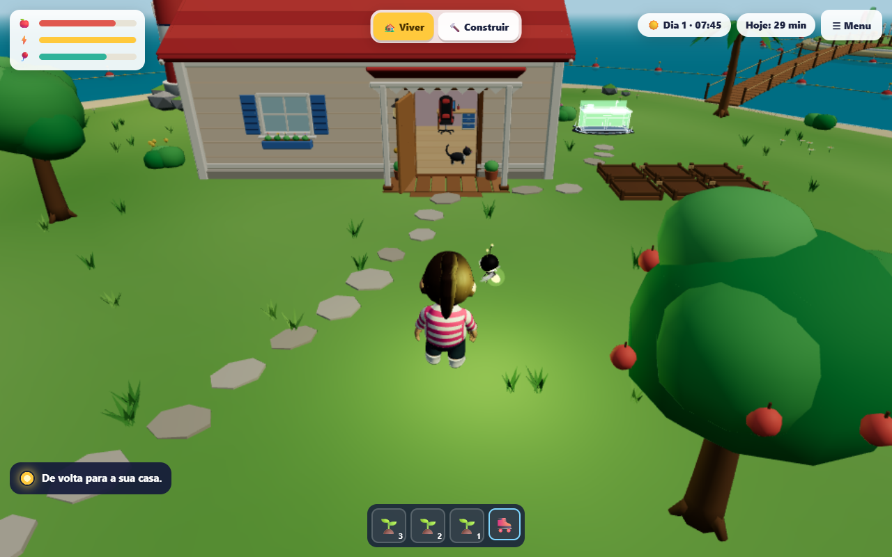
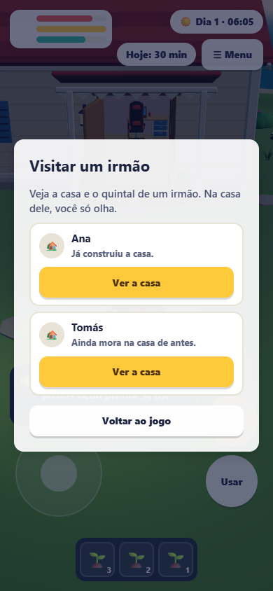
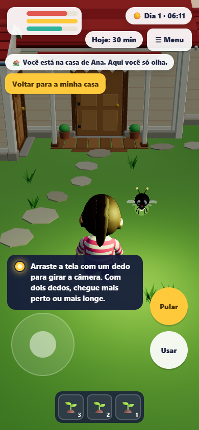
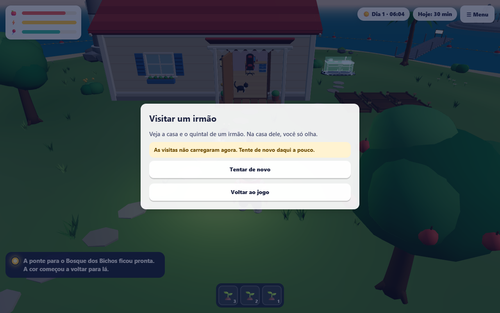
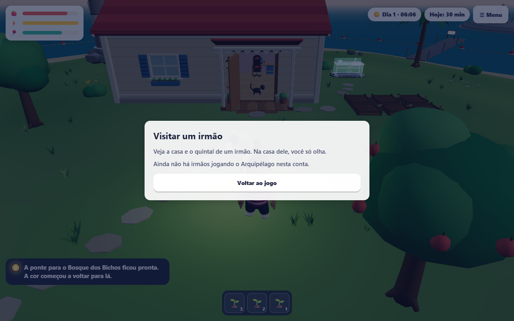

# Recordes da família e visitas, fase3-12

Conferência em 29/10/2026. O navegador usou a plataforma falsa do playground e os testes de banco
um Postgres descartável (`arquipelago_test`, em Docker, apagado no fim). Nenhum banco de staging ou
produção foi usado. Nenhum GLB, script Blender, `.env` ou workflow foi alterado, e o salvamento
continua na V10. Plano: `docs/plans/2026-10-29-arquipelago-recordes-e-visitas.md`; regras:
`docs/arquipelago-regras.md` §6.20.

## Entrega

- Contrato versionado (`VERSAO_DAS_VISITAS = 1`): os irmãos sem nome (serviço), os irmãos com nome
  (jogo) e a casa de um irmão (obra, horta e objetos com aparência, nada mais do salvamento).
- Serviço do jogo: `GET /arquipelago/irmaos` e `GET /arquipelago/irmaos/:perfilId/casa`, só
  leitura. Irmão é quem guardou o jogo na mesma conta (`perfis_da_conta`) e vê o jogo; tudo
  obedece à permissão "Visitas de irmãos". Desligada: lista `desligado` e casa 403; quem não é
  irmão: 404, sem dizer por quê.
- Nomes: o serviço nunca sabe. O BFF pede ao Auth `GET /auth/profile-session/siblings` (rota nova,
  aprovada pela dona: só id e nome, só na sessão de perfil) e põe o nome de cada um.
- Gateway: as três rotas, a régua do jogador e o aluno liberado só no GET dos irmãos.
- Jogo: "Recordes da família" no resultado de cada percurso; "🏡 Visitar um irmão" no menu, a
  casa do irmão só para olhar (nada é gravado) e "Voltar para a minha casa".
- Plataforma falsa com as mesmas recusas: `?familia=irmaos|sozinha|desligada|fora-do-ar`.

## Verificações

| Pacote | Comando | Resultado |
| --- | --- | --- |
| `arquipelago-contracts` | `bun test` | 113 passaram, 0 falhas |
| `arquipelago-api` | `bun test tests/unit tests/integration` | 221 passaram, 0 falhas |
| `arquipelago-api` | `bun test tests/db` (Postgres descartável) | 58 passaram, nenhum pulado |
| `auth` | `bun test` | 302 passaram, 86 de banco pulados, 0 falhas |
| `api-gateway` | `bun test` | 315 passaram, 0 falhas |
| `member-shell` | `bun test` | 1944 passaram, 0 falhas |
| `arquipelago` | `bun test` | 834 passaram, 1 pulado, 0 falhas |
| `arquipelago` | `playground/verificar-visitas-browser.ts` | 5 de 5 (abaixo) |

Typecheck: contratos, serviço, Auth e gateway sem erro. O do member-shell e o do community-kids
acusam só a linha 338 de `member-shell/src/components/arquipelago-host.tsx`, da ferramenta
`rotina-lumi` que outra sessão estava acrescentando no mesmo momento (fora desta entrega). Daqui
em diante, os typechecks ficam com uma sessão só (pedido da dona, pouca memória).

## No navegador

`playground/verificar-visitas-browser.ts`, compilado para Node (`bun build --target=node
--external playwright-core`), Chrome com SwiftShader:

1. Computador (1280 × 800, `?familia=irmaos`): corre a entrega pelos telhados até o resultado e
   confere os recordes (ela, a Ana com 25,9 s e o Tomás com "Ainda não correu"); abre a casa da
   Ana pelo menu, confere a faixa e que o Construir sumiu; espera os 20 s da fila do jogo e mais
   25 s sem a revisão do salvamento mudar; volta e confere que a gravação anda de novo.
2. Celular emulado (390 × 844, toque): visita pelo menu; a faixa não cobre o direcional, Pular,
   Usar, as necessidades nem o relógio; volta.
3. Recusas: `desligada` (o recado dos responsáveis), `fora-do-ar` (o recado e "Tentar de novo") e
   `sozinha` (ainda não há irmãos jogando).

Duas rodadas anteriores pararam por tempo esgotado enquanto outras sessões rodavam testes ao mesmo
tempo; com a máquina livre, passou inteiro.

Prints em `docs/qa/assets/2026-10-29-arquipelago-visitas/`:

## Fica para depois

- O quarto de dentro aparece vazio na visita: o quarto real é da plataforma e o serviço do jogo não
  o lê. Mostrar o quarto do irmão pede uma decisão da dona.
- Abrir a visita no meio de uma corrida leva a criança para a casa do irmão e a corrida desiste sem
  castigo (como sair da ilha).
- Celular físico não foi testado; a emulação prova o funcionamento, não o desempenho.
