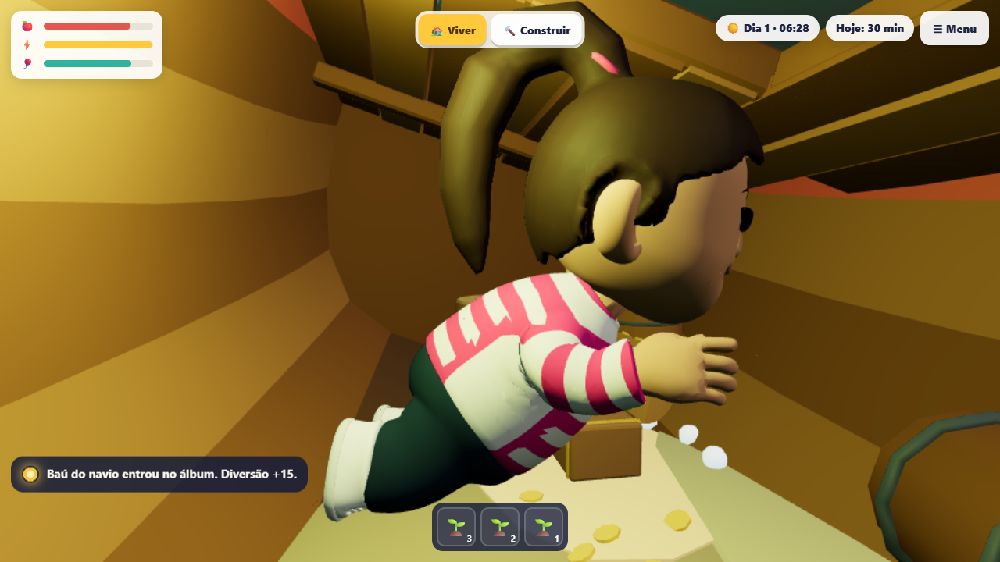
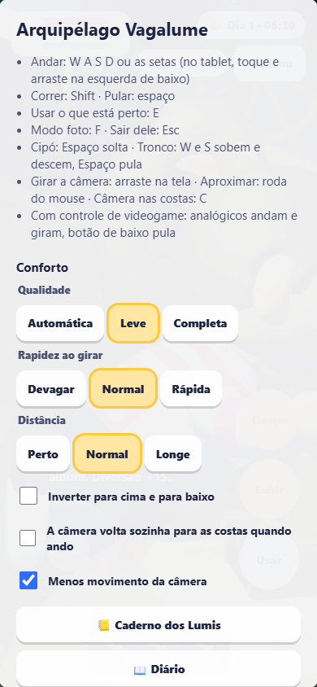

# Mergulho do Recife: conferência local

## Escopo

Fase3-02, com os GLBs existentes do Recife, navio e labirinto. Nenhum arquivo de arte ou gerador
foi modificado. Nenhum banco de staging ou produção foi usado.

O roteiro começa na âncora de mergulho do playground. Depois da preparação, percorre a água
com entradas do gamepad emulado, sem transportar o corpo até os achados. Confere baú, página,
labirinto, tesouro, pausa sem movimento e retorno à superfície. No celular emulado, Usar,
Descer, Menu e Subir também recebem eventos de toque reais do navegador.

A prova de descarte é separada: depois de emergir, o transporte de conferência leva à ilha
central, aguarda zero ilhas completas e mergulho indisponível, volta e confere a remontagem
com as três marcas preservadas. Isso não é contado como uma travessia jogada.

## Reproduzir

No diretório `packages/arquipelago`, com Bun, Node e Playwright disponíveis:

```sh
bun build playground/verificar-mergulho-browser.ts --target=node --external playwright-core --outfile .cache/verificar-mergulho-browser.mjs
node .cache/verificar-mergulho-browser.mjs
```

O script abre seu próprio servidor local em uma porta livre e fecha navegador e servidor ao
terminar. Usa `--use-angle=swiftshader --enable-unsafe-swiftshader`. `ARQUIPELAGO_CHROMIUM`
seleciona o executável; sem ela, usa o Chrome instalado. `ARQUIPELAGO_PRINTS` escolhe a pasta de
saída. `ARQUIPELAGO_TELA=computador` ou `celular` restringe uma repetição; sem ela, roda ambos.
Há um teto global de 15 minutos, além dos limites de cada etapa.

## Resultados

A tentativa final r7 passou nas duas telas em 29/10/2026, com Chrome instalado e SwiftShader:
1280 × 720 no computador, 390 × 844 com toque no celular emulado. Os dois recibos registram
zero erros de página, as três descobertas, saída para `chao`, zero ilhas completas fora do
Recife e remontagem com os achados preservados. O navegador e o servidor foram encerrados.

- [Recibo do computador](resultado-computador.json)
- [Recibo do celular](resultado-celular.json)
- Computador: [baú](computador-bau.png), [página](computador-pagina.png),
  [pausa](computador-pausa.png), [tesouro](computador-tesouro.png), [superfície](computador-superficie.png).
- Celular: [baú](celular-bau.png), [página](celular-pagina.png), [pausa](celular-pausa.png),
  [tesouro](celular-tesouro.png), [superfície](celular-superficie.png).




A execução visual antecede a atualização da base para `76b846c11`, que moveu o editor dos Lumis
entre pacotes e ajustou sua rota de playground. A implementação do mergulho não mudou nessa
conciliação. As verificações finais de código são sobre a base atualizada.

## Verificações de código

- `arquipelago`: `bun test`, 862 passaram, 1 ignorado por exigir Postgres, nenhuma falha;
  `NODE_OPTIONS=--max-old-space-size=8192 bun run typecheck`, exit 0.
- `arquipelago-contracts`: `bun test`, 120 passaram, nenhuma falha; tipagem exit 0.
- `arquipelago-api`: `bun test`, 228 passaram, 77 ignorados por dependerem de Postgres local,
  nenhuma falha. A migração e a concorrência da rota passaram no repositório em memória.
  Tipagem exit 0.
- A tentativa inicial da suíte completa do jogo, concorrendo com SwiftShader, excedeu os 5 s
  do teste pesado de geometria da Vila. A repetição isolada passou sem mudar prazo ou asserções.
- A falha do CI 40869009397 foi reproduzida: o teste da moldura procurava o rótulo antigo de
  reinício nas experiências `coin-counter` e `two-pieces`. Corrigidas apenas as duas expectativas,
  preservando a verificação de som e acessibilidade. O teste focal passou com 67 asserções.

A suíte completa Kids passou: 1.852 testes, nenhuma falha, 10.925 asserções.
`bunx biome check` passou nos 45 arquivos TypeScript/TSX/JSON tocados. A tipagem Kids
também terminou com exit 0, usando o limite de heap de 8192 MB. Os quatro pacotes passaram
na tipagem sobre a base conciliada; `git diff --check` passou.

## Achados corrigidos durante a conferência

- A posição inicial sugerida para o navio invadia a faixa do barco. A posição (18,0,-30) foi
  conferida contra os limites reais do modelo, pontes e boias.
- A câmera mirava alto demais e sua sonda começava no teto do porão. O foco foi baixado; o
  teste com os colisores reais reproduz a interseção antiga e confere a posição nova livre.
- Em um corredor, a câmera chegou ao interior do avatar. O desenho agora se oculta apenas
  nessa aproximação, com histerese para reaparecer, sem mudar a física.
- O Recife ampliado se aproximava da faixa de carga de outra ilha. A escolha única do cenário
  e sua retenção durante o mergulho evitam a disputa pelo cache de uma ilha completa.
- O roteiro de toque procurava o rótulo visual Menu, mas o nome acessível é Abrir o menu.
  A correção foi no roteiro. O piloto também tinha uma faixa sem comando vertical entre
  20 e 22 cm do alvo; a zona de comando agora se sobrepõe à tolerância de chegada. A meta da
  busca também recebeu folga vertical em relação ao alcance da ação, e o roteiro espera o
  rótulo de Guardar na interface antes de usar. A primeira meta ficava perto demais do limite
  de alcance; isso foi corrigido na preparação da prova, sem aumentar o alcance no jogo.

## Limites

SwiftShader e celular emulado conferem funcionamento, layout e imagens. Não medem o desempenho
em GPU de celular ou Chromebook real. Ainda é necessária a prova física de toque prolongado,
orientação da tela, desempenho e aquecimento nesses aparelhos. O percurso guiado usa gamepad
emulado; não substitui uma avaliação de facilidade de navegação por uma criança.

A migração é coberta pelo contrato e por HTTP com repositório em memória. Os testes Postgres
só podem executar com um banco local descartável autorizado pelo próprio conjunto de testes.
Não houve implantação nesta conferência.
