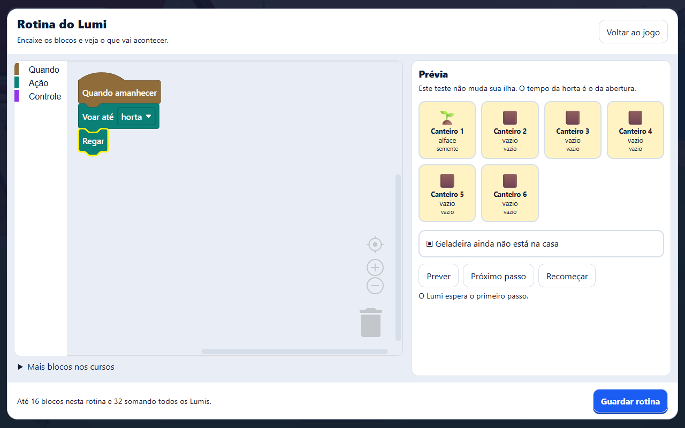
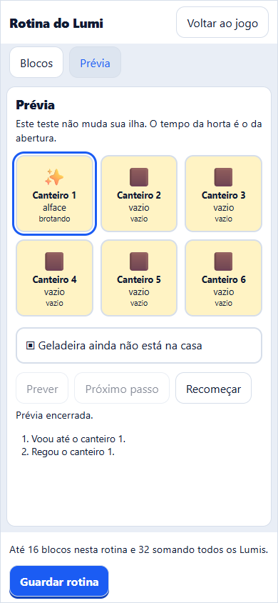

# Mini estúdio dos Lumis: conferência local

Conferência em 29/10/2026, sobre staging com a viagem de barco e as visitas entre irmãos já integradas. Nenhum banco remoto, salvamento versionado, GLB, segredo ou workflow foi alterado por esta entrega.

## Fluxo conferido

O playground abriu o painel da rotina, depois a ferramenta da plataforma. O teste mudou o destino de um bloco pelo menu do Blockly, encaixou Regar, executou a prévia, conferiu que a horta real permanecia intacta, guardou e usou Testar no jogo. O Lumi regou o canteiro e o registro apareceu em Da última vez.

- Computador: Chromium, 1280 × 800, blocos e prévia lado a lado.
- Celular emulado: Chromium, 390 × 844, toque habilitado, abas Blocos e Prévia, sem transbordamento horizontal. O dropdown foi operado por toque; o arrasto automatizado dos blocos usou o ponteiro do Playwright.
- Tema: tokens oficiais Kids, fundo `rgb(233, 238, 246)`, tinta `rgb(15, 26, 51)` e caixa branca. O host fornece Nunito e Baloo 2; o playground usa a reserva de sistema.
- O cenário usa `?lumis=quindim:1&cartas=todas&rotina=editor&qualidade=leve`, dados locais e a ponte falsa com a mesma validação da ponte real.





Os outros oito prints desta pasta mostram abertura, prévia, execução na ilha e registro final nos dois tamanhos.

## Comandos e resultados

Na raiz, o lint `bun run check` identificou formatação pendente no lote do barco; após correção, `bunx biome check . --diagnostic-level=error` passou em 12.911 arquivos.

No pacote do jogo:

```sh
bun test
bun run typecheck
bun build playground/verificar-mini-estudio-browser.ts --target=node --external playwright-core --outfile .cache/verificar-mini-estudio-browser.mjs
node .cache/verificar-mini-estudio-browser.mjs
bun run test:salvamento-browser
```

- Testes: 836 passaram, nenhum falhou, um teste de Postgres local não executado por não haver banco descartável configurado. Foram 77.596 asserções em 95 arquivos.
- Tipagem: passou.
- Mini estúdio: fluxo completo passou nos dois tamanhos, incluindo os menus do Blockly dentro do diálogo modal.
- Salvamento: passou no IndexedDB real, incluindo conflito, isolamento entre abas, liberação da trava, pausa e retomada da física e desfazer da construção.

O build publicado do jogo (`bun run build`) passou. A tipagem integral do Studio (`bun run typecheck`) também passou depois de corrigir a preparação dos sprites no teste de contato com grupo, que tratava o retorno anulável de `spawn` como sempre presente. Seus 6 testes passaram com 13 asserções.

No Studio, `bun test src/lumi/blocks.test.ts` passou: 4 testes e 1.594 asserções. Cobre os cartões, condições, casos, limites e recusas de peças soltas, bloqueadas e inválidas. Os testes do jogo comparam o intérprete compartilhado com a execução real e verificam cancelamento, revogação de conquistas, rotina concorrente e preservação de outras mudanças no salvamento.

Uma rodada ampla do Studio terminou com 11.152 testes aprovados e seis falhas. As verificações isoladas separaram timeouts e mudança de catálogo durante a execução de uma referência realmente desatualizada: o exemplo Mapa do Pinta e duas fases ganhou o evento de recolher moedas. Reverter apenas esse evento, descrição e conceito reproduziu o hash antigo. Após atualizar a referência, os 2 testes de catálogo e os 21 testes de receitas passaram. A rodada ampla não é apresentada como uma suíte integral verde.

No contrato, `bun test` passou com 113 testes e 1.093 asserções; `bun run typecheck` passou.

O member-shell teve 1.944 testes aprovados, nenhum reprovado, com 12.114 asserções. A tipagem integral do member-shell passou após capturar a ferramenta já discriminada antes do callback de criação. A ponte de rotina relê `/cartas` ao abrir e ao guardar; não confia nas conquistas do molde.

## Limites e pendências de validação

Ainda cabe conferir o arrasto em aparelho físico com toque, tecnologias assistivas e o fluxo autenticado no Kids/adulto após implantação. A conferência local valida o editor e o jogo via contrato real com serviço simulado; não comprova a implantação nem as permissões de uma conta remota.

A prévia é uma representação leve da horta e da geladeira. Usa uma cópia do mundo e o mesmo intérprete puro do jogo; não é outra cena 3D. O tempo da horta fica no instante da abertura para tornar a previsão reproduzível.

As primeiras tentativas expuseram o carregamento assíncrono do CSS e os portais globais do Blockly fora do diálogo. Ambos foram corrigidos antes dos prints e do resultado final acima. Não houve teste em banco de staging ou produção.
