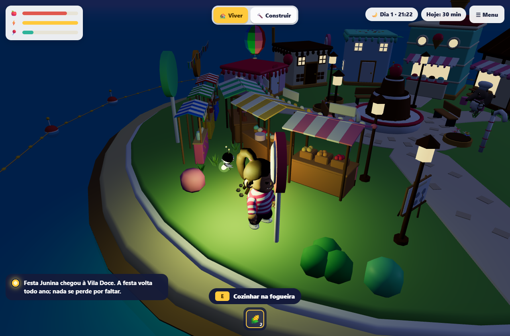
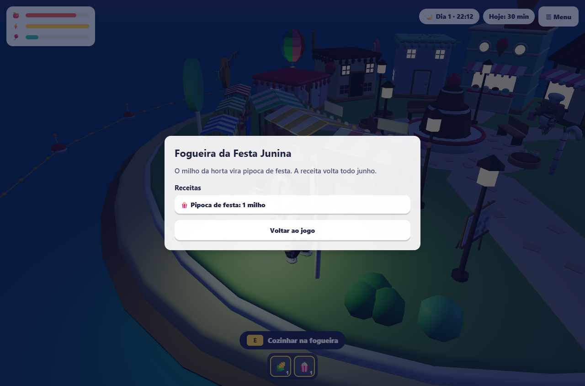
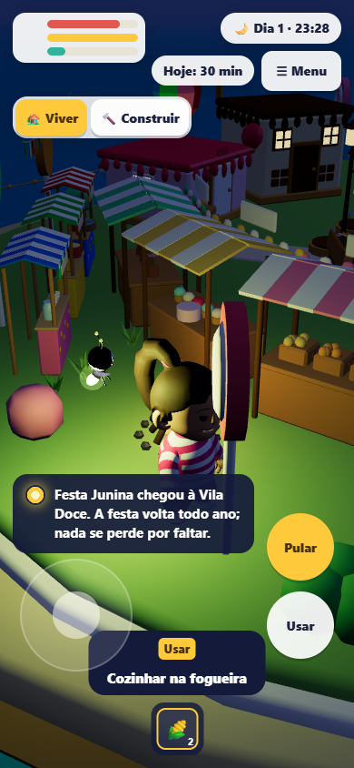

# Primeira festa da estação, fase2-10

Conferência em 29/10/2026, com plataforma falsa e dados locais descartáveis.
Nenhum banco de staging ou produção foi usado. Nenhum GLB, script Blender, contrato
de salvamento, serviço, variável de ambiente ou workflow foi alterado.

## Entrega

- Calendário puro pelo dia de São Paulo: Carnaval na terça calculada 47 dias antes da
  Páscoa; Junina em junho inteiro. Todas as janelas e motivos ficam numa constante.
- Quatro montagens a partir dos nós dos catálogos existentes. Bandeirinhas emendadas
  pelas pontas, três barracas, fogueira animada, materiais luminosos ligados à noite.
- Posições testadas contra os colisores reais, com chegada, lojas e percurso dos telhados livres.
- Receita na fogueira: um milho gera uma pipoca; comer recupera fome 15 e diversão 30,
  respeitando o teto 100. A pipoca não expira ao terminar a festa.
- Aviso do Zappy por perfil, festa e ano, salvo localmente. Desmontagem remove painel,
  interação, animações e recursos gráficos próprios. A festa não entra no salvamento.
- Playground aceita as quatro festas por parâmetro, sem habilitar override na produção.

## Verificações

No pacote `packages/arquipelago`:

| Comando | Resultado |
| --- | --- |
| `bun test` | 728 passaram, 1 teste de Postgres ignorado, 0 falhas |
| `bun test tests/festas.test.ts` | 13 passaram, 683 verificações |
| `bun run typecheck` | passou |
| `bun run check` | passou, 324 arquivos, sem correções |

Na raiz, `bun run lint` passou, com avisos informativos preexistentes. Não equivale a
ausência de avisos em todo o repositório. A primeira execução dos testes identificou
duas expectativas antigas de quantidade de receitas; foram atualizadas para a nova
receita. Um teste pesado de colisores excedeu seu tempo durante execução concorrente
com navegador; a suíte serial passou sem alterar seu limite.

### Navegador

O script `playground/verificar-festa-browser.ts` foi compilado com Bun para Node e
executado no Chrome 156.0.8078.48 do Windows. Usa servidor local próprio, fecha navegador
e servidor no fim, e recusa porta já ocupada. Os dois fluxos passaram:

- 1280 × 844, computador.
- 390 × 844, viewport móvel com toque emulado.

O fluxo observa emissão noturna e mudança real da escala do fogo pelo clipe, abre a
fogueira com E, faz a receita, confere inventário persistido localmente, come a pipoca,
confere diversão e aviso, sai da Vila e volta. A cena deixa de conter a festa ao sair;
o registro do aviso permanece o mesmo ao retornar. Sem erros JavaScript ou rolagem lateral.
O enquadramento espera a câmera estabilizar; a aproximação da fogueira usa o corredor
livre a leste, conferido contra o modelo. Prints capturam a tela de receita após o preparo.

Resultado legível por ferramenta: [resultado.json](assets/2026-10-29-festa/resultado.json).
Os testes de GLBs cobrem também as peças das outras três festas, incluindo clipes,
emendas e descarte. O fluxo gráfico completo desta entrega cobre a Junina.

## Pendências explícitas

- Aprovar ou mudar a **proposta** de fim de ano, 20/12 a 06/01. Continua desativada.
- Definir a data da Noite das Lanternas. Não foi inventada nem ativada uma data.
- Conferir em celular físico: toque em Usar, movimento, desempenho e legibilidade.
  A emulação não comprova essas condições. A interação automatizada usou teclado E.
- Conferir visualmente Carnaval, Lanternas e fim de ano no navegador fora do teste Junina.

O conector Artifact não estava disponível para ler o Canvas. A implementação seguiu
os trechos da proposta fornecidos na tarefa e as regras/arte do repositório. A página
de progresso não foi atualizada diretamente; a dona informou que fará essa atualização.

## Nota para a página de progresso

**fase2-10: implementada e conferida localmente.** Calendário São Paulo, quatro catálogos
de festa, fogueira da Junina e pipoca com milho/diversão +30, aviso por perfil e liberação
dos recursos ao sair. Junina passou no navegador em computador e celular emulado.
Pendentes da dona: janela do fim de ano (proposta 20/12 a 06/01, desativada) e data da
Noite das Lanternas (fora do calendário). Falta teste em celular físico e conferência
visual das outras três festas. Nada se perde por faltar.
