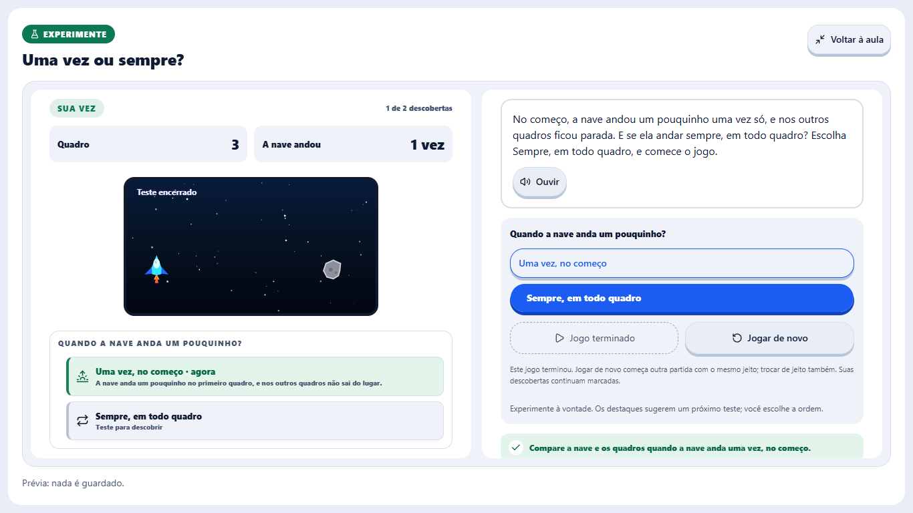
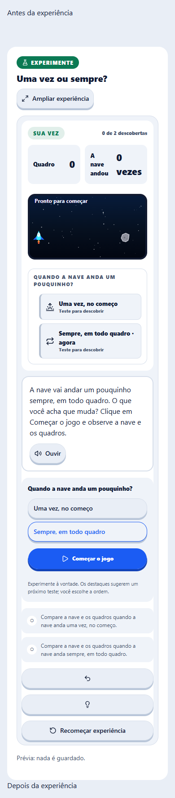

# Revisão da conciliação do Construtor

Base: `52797249a44898375b0f68f6f2baa3d8b22a767c`, com o merge concluído da Nave e de
O Jogo do Meu Jeito e as correções que acompanham esta nota. A revisão incluiu os contratos
de ação, abertura da cena, preservação das descobertas, guias, controles, validação do
Members, manifesto, roteiro, fontes de voz e adaptação do painel.

## Achados corrigidos

1. `restart-case` era aceito em `setup.actions`. Abrir um caso desses chamava o reinício
   do próprio caso até lançar `RangeError`. O RED teve oito falhas nos quatro cenários.
   A régua de ações iniciais agora mora em `scene/actions.ts`, é usada pela validação e
   pelo motor, e recusa reinícios. Chamadas diretas com configuração inválida ignoram
   essas ações. O botão de reinício durante a interação continua preservando descobertas.
2. Dois tipos de gesto agrupavam discriminantes em um mesmo membro da união. Isso impedia
   o compilador de refinar `cor` e `nome` nos testes, embora os valores fossem válidos.
   As variantes agora têm discriminantes individuais, sem cast nem supressão.

Os três erros anteriores dos testes de memória, símbolos e cabana foram corrigidos em
`52797249a`, usando os tipos de gesto no lugar de `string` para os resultados esperados.

## Verificação local

- `bun test packages/core/src/learning/scene packages/core/tests/learning.test.ts`:
  1.778 testes, zero falhas, 86.593 asserções.
- Os 43 arquivos `scene-*.test.tsx` do MemberShell: 521 testes, zero falhas, 5.142 asserções.
- `bun run --filter @sistemazero/core typecheck` e o typecheck completo do MemberShell,
  incluindo testes: código de saída zero, com heap de até 4.096 MiB.
- `validar-manifestos.ts`: 51 válidos, nenhum reprovado ou aviso de convenção.
- `validar-roteiros.py`: 289 clipes em 51 aulas, zero erros.
- `gerar-falas-elevenlabs.ts --check`: derivados conferidos, sem chamadas de geração de voz.
- `sync-arquipelago-repertorio-planejado.mjs --check`: cinco fontes e 92 blocos conferidos.
- Biome dos arquivos corrigidos e `git diff --check`: sem erros.

## Navegador

`scene-workspace.spec.ts` executado com Chromium 1223, um worker, nenhuma repetição,
fixture local em `127.0.0.1:5398`: **30 testes passaram em 1,7 minuto**. Cobriu ampliação,
recolhimento, foco e Escape, preservação da execução e das descobertas, divisão do painel,
palpite, fontes maiores e larguras de 320 a 1.920 px. Porta liberada ao terminar.

Esta é uma prova local com o componente real e dados de exemplo. Não é uma sessão
autenticada de staging ou produção, nem um teste em aparelho físico. Nenhum dado remoto
ou progresso de aluno foi gravado por essas verificações.

As evidências da publicação dos desafios e dos deploys pertencem à operação posterior
ao CI. Esta nota não afirma que a versão já tenha sido implantada.

## Correção do painel em 320 px

O CI da composição `3954bf8ce` encontrou rolagem horizontal em 320 × 568. O HUD
impunha a largura mínima dos filhos flexíveis, que dependia da fonte. A regressão local
com fonte monoespaçada, espaçamento de letras de 0,12 em e de palavras de 0,16 em
reproduziu 330 px de conteúdo numa janela de 320 px. O painel agora permite quebrar
linhas e reduzir a largura mínima. Não corta conteúdo, reduz fonte ou esconde a rolagem.

Após a correção, a suíte completa `e2e-scenes` passou: **86 testes, zero falhas e nenhuma
repetição, em 3,9 minutos**, com um worker e o navegador padrão do Playwright 1.60.0
(Chromium headless shell 1223). A porta local 5398 foi liberada ao terminar. O novo teste
de espaçamento e o caso exato reprovado no CI passaram. Biome e o typecheck focado do
arquivo de testes também passaram. Os typechecks completos de Kids e Members da base
`3954bf8ce` terminaram com código zero.

A primeira tentativa local, com o executável completo do Chrome indicado explicitamente,
parou no arrasto do vídeo: depois de capturar o ponteiro, não recebeu os movimentos nem
a soltura. A investigação preservou o negativo; usando o navegador padrão da configuração,
o teste original e a suíte inteira passaram. Nenhuma alteração no player, espera arbitrária
ou omissão de teste foi necessária. Isso não afirma que todo navegador físico foi validado.

Recibos locais preservados em `.cache/course-audience-sync/`: `hud-wide-font-red-r2.log`,
`hud-wide-font-green-r1.log`, `video-drag-pointer-r1.log`,
`video-drag-default-browser-r1.log` e `hud-default-all-scenes-r1.log`.

## Conciliação posterior do Inventor

O merge `0d860b6ba`, com o lote `c03cb8df0`, entrou em staging local durante a
qualificação anterior. Inclui as experiências livres do Corre Dino e três experiências
de aula. A revisão conferiu os contratos de ação, inicialização e hidratação do estado,
as variantes por cenário, os guias, a seleção de vozes, as telas e o DTO do Members.
Não altera a API, os contratos, as migrações nem os manifestos de desafios do jogo.

Foi corrigido um TS2353 no teste do passinho: `cenario` pertence à atividade, não a
`SceneStart`. O teste agora usa a fábrica `sceneStart`, sem cast ou mudança do contrato.
O Core passou no typecheck e em 2.359 testes, com 90.964 asserções. A seleção posterior
do teste corrigido e do DTO passou em 103 testes e 1.685 asserções, que se sobrepõem à
contagem anterior. O MemberShell passou no typecheck completo e em 665 testes de cenas,
com 5.749 asserções.

Uma execução do navegador expôs a corrida do teste antigo da beirada: ele ligava o
limite a 30 fps e procurava a volta depois de outros gestos, quando o quadro já podia
ter saído da tira de seis quadros. O teste agora escolhe câmera lenta antes de ligar
o limite e observa a volta imediatamente. Mantém as provas da posição 416, das três
descobertas e do limite segurando o personagem, sem aumentar prazos ou mudar o motor.

Os 27 cenários novos passaram também em 320 px, sem erro de página ou rolagem lateral.
A suíte completa ampliada passou: **140 testes, zero falhas, nenhuma repetição, em
4,6 minutos**, com um worker e Chromium headless shell 1223. O typecheck focado dos
dois arquivos de navegador passou. Os 51 manifestos, 292 clipes e derivados ElevenLabs
foram conferidos, sem geração de vozes. Biome dos 143 arquivos do lote: zero erros;
dois avisos de `any` e três informações de estilo de geradores já existentes.

Recibos locais: `inventor0d-core-review-r1.log`, `inventor0d-core-types-r1.log` (negativo),
`inventor0d-core-types-green-r1.log`, `inventor0d-ui-review-r2.log`,
`inventor0d-member-shell-types-r1.log`, `inventor0d-all-scenes-browser-r1.log` (negativo),
`inventor0d-border-green-r1.log` e `inventor0d-final-browser-r1.log`.
Os 12 checks anteriores aprovados pertencem a `6b423961c`. A composição nova exige CI
próprio; a onda anterior foi cancelada antes de acessar provedores ou disparar deployments.

## Correções encontradas no CI da composição `1f19d71b5`

A regra geral de texto encontrou o marcador de ausência `—` no impulso. O HUD passa a
mostrar `nenhuma` para a marca anterior ausente. A varredura passou nos três testes.
Os 1.838 testes do Kids passaram localmente, com 11.043 asserções, em 198 segundos.

No Linux, a tabela da pergunta com o não ocupou 343 px numa janela de 320 px. A
regressão local com fonte monoespaçada e espaçamento de texto reproduziu 366 px. A
tabela agora usa largura fixa das colunas e quebra de palavras quando necessário,
preservando cabeçalhos e respostas. A regressão passou, sem ocultar conteúdo.

O teste da beirada ainda tinha um segundo problema: escolher câmera lenta com o
personagem inteiramente fora e o limite desligado reinicia a caminhada, conforme a
regra do player. Agora ele pausa, liga o limite e só então roda em câmera lenta.
Assim observa a volta real antes de continuar andando. As verificações de posição,
três descobertas e permanência na beirada foram mantidas. O motor não foi alterado.

Após os ajustes, a suíte completa passou novamente: **140 testes, zero falhas,
nenhuma repetição, em 4,9 minutos**. Os 48 testes das duas interfaces afetadas
passaram, com 132 asserções; o typecheck dos testes de navegador, Biome e diffcheck
passaram. Os negativos do CI e o RED de largura foram preservados nos recibos locais
`ci1f1-main-failed-job-r1.log`, `ci1f1-kids-failed-job-r1.log`,
`door-mobile-red-r1.log` e `ci1f1-full-regressions-green-r1.log`.

Houve também uma falha isolada no desktop Windows do PR, na sondagem de versão do
Node, embora o runner tenha configurado Node 24.22.2 e o job Windows do push tenha
passado no mesmo SHA. O negativo `ci1f1-desktop-job-log-r1.txt` fica separado dos
achados confirmados de interface. A sonda local foi recusada pela política de
execução do helper nativo; isso não prova o motivo da falha do runner. Não foram
alterados os limites ou a contenção. A liberação exige CI próprio da versão corrigida.
