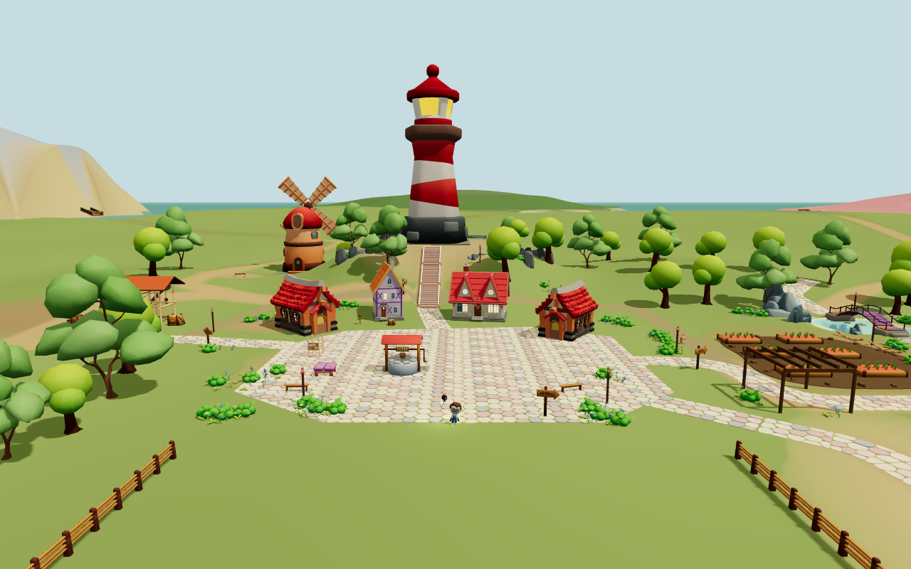
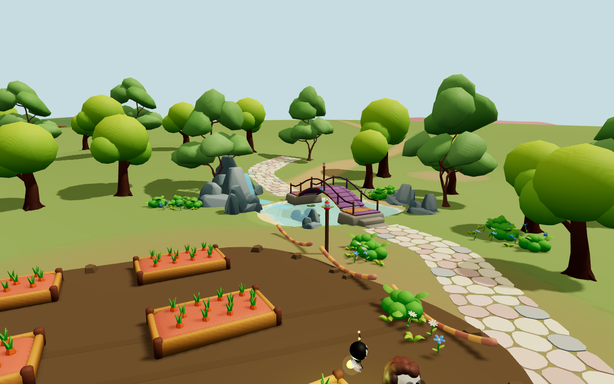
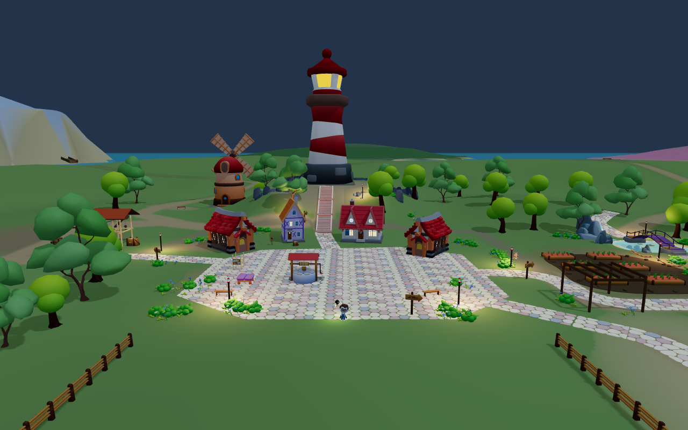

# Faísca V2 — cenário composto pelas imagens

**Entrega executada e verificada em 16/11/2026, na `staging`.** O `/macro` padrão apresenta o conjunto montado para avaliação: vila, praça, caminhos, cultivo, lago, ponte, oficina, chegada ao Farol e leitura inicial da Costa. Não é necessário escolher peças ou aprovar um mapa antes de caminhar pelo resultado. A direção de arte final depende da avaliação da usuária e da coordenação.

Base inicial conferida: `staging` e `origin/staging` em `16c3f719b0930ed568f320595894a9107b115ae9`. Implementação ambiental: `08fa00487`. Preparação GPU: `7d71f4247`. O relatório e as evidências acompanham esses commits na `staging`; não houve publicação do jogo integrado na plataforma. A alteração externa no roteiro da aula dos pais foi preservada e excluída dos commits desta entrega.

Jogar neste computador: **http://127.0.0.1:4530/macro**. O endereço local funciona na máquina que executa o servidor. Em outro computador, usar o código da `staging` e as evidências versionadas abaixo; o push não publica uma instalação acessível por esse endereço.

## O que mudou no cenário

| Parte | Implementado |
|---|---|
| Praça e vila | Praça contínua de pedra, poço como ponto de encontro, mobiliário de catálogo, quatro casas com fachadas/telhados distintos, correio com caixa e frente própria. A organização enquadra a praça e preserva o eixo para o Farol |
| Terreno | Colina mais ampla, patamar do Farol, recortes corretos para lago/escada, afloramentos rochosos, solo cultivado com acabamento próprio e transições por jardins. A base setorizada continua sendo o terreno físico; não foi trocada por uma ilha demonstrativa do pacote |
| Caminhos | Lajes reais do Templo na rede piloto, com curvas, recorte de juntas e continuidade da praça. Render e colisão usam a mesma malha final. A pintura provisória não substitui o revestimento desses passeios |
| Horta | Seis canteiros preservados, solo trabalhado, bordas vegetais, flores e arborização em camadas. Pergolado com peças de madeira existentes, contato e passagem conferidos |
| Lago e ponte | Lago `lago_nadavel` do Reino com margem, fundo e nado correspondentes; ponte arqueada do Templo com corrimãos, apoios de pedra e madeira violeta. Pequena queda de água montada sobre rochas com os recursos do lago |
| Oficina | Estrutura Adventure Land distinta das casas, cobertura, mecanismo/guindaste, madeira, caixas e acesso lacrado. Comunica trabalho interrompido; não concede restauração da campanha |
| Farol | Modelo Adventure Land preservado, três lances de escada de catálogo, implantação na colina e chegada física contínua |
| Costa | Início da saída mantido aberto, caminho e sinalização reconhecíveis. O distrito costeiro completo continua fora do acabamento deste recorte |
| Placas | Texto nas próprias faces de madeira: Costa, Horta, Pátio, Farol, Lago e Píer. Setas derivadas dos destinos/vias; sem etiquetas escuras flutuantes na exploração normal. Nomes do mapa e ferramentas preservados |
| Noite | Oito lanternas pequenas com iluminação local quente; lajes e placas usam a iluminação do ambiente. Preparação de materiais antes de liberar a exploração |

A composição segue as [três referências e a curadoria](../plans/2026-11-15-faisca-concepts-curadoria.md), complementando o [projeto integral](../plans/2026-11-15-faisca-projeto-artistico-praca-horta.md). É uma interpretação jogável com o acervo existente; não se afirma equivalência pixel a pixel à pintura conceitual.

## Imagens do conjunto pronto







### Comparação com a entrega anterior

As sete câmeras abaixo preservam posição, alvo, FOV 55, viewport 1280 × 800 e condição diurna. O cenário e as massas foram recompostos. Os arquivos anteriores já estavam versionados no Gate 2.1.

| Vista | Antes | Depois |
|---|---|---|
| Porta da futura Morada | [Abrir](./2026-11-15-faisca-gate21/depois/porta.png) | [Abrir](./2026-11-15-faisca-concepts/depois/porta.png) |
| Praça | [Abrir](./2026-11-15-faisca-gate21/depois/praca.png) | [Abrir](./2026-11-15-faisca-concepts/depois/praca.png) |
| Horta | [Abrir](./2026-11-15-faisca-gate21/depois/horta.png) | [Abrir](./2026-11-15-faisca-concepts/depois/horta.png) |
| Oficina | [Abrir](./2026-11-15-faisca-gate21/depois/oficina.png) | [Abrir](./2026-11-15-faisca-concepts/depois/oficina.png) |
| Farol inteiro | [Abrir](./2026-11-15-faisca-gate21/depois/farol.png) | [Abrir](./2026-11-15-faisca-concepts/depois/farol.png) |
| Subida | [Abrir](./2026-11-15-faisca-gate21/depois/subida.png) | [Abrir](./2026-11-15-faisca-concepts/depois/subida.png) |
| Costa | [Abrir](./2026-11-15-faisca-gate21/depois/costa.png) | [Abrir](./2026-11-15-faisca-concepts/depois/costa.png) |

A ponte/lago mudaram do centro `(58,127)` para `(39,127)` para compor o conjunto com a horta. Portanto, suas novas fotografias são **vistas contextuais**, não comparação da mesma câmera global: [situação anterior](./2026-11-15-faisca-gate21/depois/ponte-sul.png), [aproximação sul atual](./2026-11-15-faisca-concepts/depois/ponte-proxima.png), [chegada norte atual](./2026-11-15-faisca-concepts/depois/ponte-chegada-norte.png). O deslocamento não altera os seis distritos/cabeceiras nem as âncoras porta–praça–horta–Pátio.

Placas vistas de perto: [Costa](./2026-11-15-faisca-concepts/depois/placa-costa.png), [Horta](./2026-11-15-faisca-concepts/depois/placa-horta.png), [Pátio](./2026-11-15-faisca-concepts/depois/placa-patio.png), [Costa à noite](./2026-11-15-faisca-concepts/depois/placa-costa-noite.png). O antes da sinalização está no [registro anterior](./2026-11-15-faisca-gate21/placas/antes).

### Alternativas no percurso real

As alternativas permanecem reversíveis no playground e não exigem nova escolha antes de avaliar a cena completa. O padrão desta entrega é **Templo + L2**.

T1/T2 e L1 ficam documentados como alternativas de ensaio, sem acabamento artístico aprovado. A linguagem de pedra e o lago com margem própria foram aplicados ao conjunto padrão por se aproximarem melhor das imagens fornecidas.

| Ensaio | Evidência | Acesso local |
|---|---|---|
| T1 — terra Reino | [Junção baixa](./2026-11-15-faisca-concepts/depois/caminho-t1-reino.png) | `/macro?refino=reino` |
| T2 — terra Faroeste | [Junção baixa](./2026-11-15-faisca-concepts/depois/caminho-t2-faroeste.png) | `/macro?refino=faroeste` |
| T3 — lajes Templo | [Junção baixa](./2026-11-15-faisca-concepts/depois/caminho-t3-templo.png) | `/macro?refino=templo` |
| L1 — forma de ensaio com água Adventure Land | [Contexto](./2026-11-15-faisca-concepts/depois/lago-l1-aventura.png) | `/macro?lago=l1&agua=aventura` |
| L2 — lago completo Reino | [Contexto](./2026-11-15-faisca-concepts/depois/lago-l2-reino.png) | `/macro?lago=l2` |

## Vídeos e verificações de movimento

Todos os vídeos usam o controlador real, com teclado e câmera normal. O teste configura o ponto inicial; os deslocamentos gravados são caminhada/corrida, não teleporte. Os atalhos de reposicionamento foram usados separadamente nas medições de renderer e ciclos de recursos.

- [Porta → praça → horta → aproximação do lago](./2026-11-15-faisca-concepts/videos/porta-praca-horta.mp4): percurso contínuo, aproximadamente um minuto.
- [Ponte nos dois sentidos](./2026-11-15-faisca-concepts/videos/ponte-ida-volta.mp4).
- [Escada do Farol: subida e descida](./2026-11-15-faisca-concepts/videos/escadas-subida-descida.mp4).
- [Caminhada, corrida, curva e salto](./2026-11-15-faisca-concepts/videos/avatar-caminhada-corrida-curva-pulo.mp4).
- [Entrada no lago, nado e retomada](./2026-11-15-faisca-concepts/videos/lago-nado-retomada.mp4).
- [Aproximação da placa Costa](./2026-11-15-faisca-concepts/videos/placa-costa-aproximacao.mp4).
- [Caminhada por clique](./2026-11-15-faisca-concepts/videos/caminhada-por-clique.mp4).

Vídeos e imagens são evidências para avaliar contato dos pés, IK, enquadramento e sensação de movimento; os testes numéricos não substituem essa avaliação perceptiva.

## Correções verificadas

- Ponte dimensionada uniformemente em 0,75: degraus de cerca de 0,24 m compatíveis com o controlador nativo. Travessia com retorno comprovada com o GLB real; não foi adicionado um piso invisível plano sobre o arco.
- Escadas dimensionadas em 0,65, com a própria malha física. Corrigida a divergência de até 0,649 m entre o antigo amostrador de grid e os triângulos do contorno recortado: ela criava um bloqueio real na descida. A amostragem local agora usa os mesmos triângulos do terreno físico.
- Praça e cruzamentos recortam os envelopes das peças para evitar faces sobrepostas. A geometria final conserva UVs/materiais e gera a colisão; não houve deslocamento aleatório em Y para esconder cintilação.
- Assentamento considera pivôs, dimensões e apoios das peças. Vigas cuja base nativa estava em Y=2,8 m foram implantadas usando essa medida; caixas empilhadas usam o topo real do apoio. Telhados dos prefabs usam todos os volumes catalogados, além das paredes.
- Postes das placas e madeira do pergolado possuem colisão correspondente, preservando passagem sob vigas e acesso aos canteiros. A placa Horta foi afastada da faixa de circulação.
- Nado, contorno visual, recorte e fundo do lago compartilham a mesma referência; saída pela margem e retomada em terra foram testadas. Chaves de outros ensaios ficaram intactas.
- A pausa de primeiro uso noturno foi diagnosticada por perfil de CPU e tratada com preparação dos materiais. [Medição antes/depois e prova de preservação](./2026-11-15-faisca-concepts/preparacao-gpu.md).

Inspeção visual e vídeos não mostraram cintilação ou bases suspensas nos trechos registrados. Essa afirmação se limita ao recorte e às vistas percorridas; as áreas externas ainda são blockout.

## Resultados técnicos

| Verificação | Resultado |
|---|---|
| Suíte do pacote | **2.134 aprovados, 1 pulado, 0 falhas**; 251 arquivos. O único skip exige Postgres/API de integração externos |
| Tipagem | `bun run typecheck` aprovado |
| Lint/formatação | Arquivos alterados sem erros/avisos. Verificação geral sem erros e com quatro avisos preexistentes em arquivos fora desta alteração |
| Build | `bun run build` aprovado: 188 arquivos, 49,14 MB |
| Controlador real | Ponte ida/volta, escada subida/descida, passeio, caminhada/corrida/curvas/pulo, nado/saída/retomada, aproximação da placa e clique aprovados |
| Toque emulado | Joystick, pulo, conversa Íris, mapa em 390 × 844, erro 503 de arte e nova tentativa aprovados |
| Reentrada e iluminação | Três ciclos: retorno à Vila em 164 geometrias / 38 texturas, sem crescimento contínuo; fora do piloto 65–68 / 14. Duas trocas completas dia/noite sem erros |
| Renderer desktop | 58–60 FPS nas amostras dos três pontos, de dia e à noite, após preparação GPU |

Ambiente do renderer: Chrome headless 157, Windows, NVIDIA RTX 3050 via ANGLE/D3D11, canvas 1280 × 800, DPR 1. Os contadores incluem a cena visível e variam com enquadramento/animados: aproximadamente 318–355 mil triângulos e 84–122 chamadas nos pontos perfilados. Não são orçamento final de produção nem homologação de celulares/Chromebooks. **Aparelhos físicos móveis não foram testados.**

Registros: [movimento](./2026-11-15-faisca-concepts/medicoes/movimento.json), [clique](./2026-11-15-faisca-concepts/medicoes/clique.json), [toque](./2026-11-15-faisca-concepts/toque/toque.json), [renderer](./2026-11-15-faisca-concepts/medicoes/perfil.json), [recursos](./2026-11-15-faisca-concepts/medicoes/recursos.json), [suíte](./2026-11-15-faisca-concepts/medicoes/unitarios.txt), [build](./2026-11-15-faisca-concepts/medicoes/build.txt). Capturas do toque incluem [exploração](./2026-11-15-faisca-concepts/toque/toque.png), [Íris](./2026-11-15-faisca-concepts/toque/iris-toque.png) e [mapa](./2026-11-15-faisca-concepts/toque/mapa-toque.png).

## Procedência, adaptações e limites

O exportador prepara **93 modelos** no acervo privado; a seleção padrão utiliza **44 modelos, aproximadamente 14,67 MB**, distribuídos em **523 instâncias declaradas**, além dos passeios recortados e componentes de água. Arte fixada em `67b72d4a1a90c0e95c6217341dccfc723ebe8c49`; peças Morada em `ec8c27c6013ab0ff6f333e0927c68583df477ec0`. [Tabela de modelos](./2026-11-15-faisca-concepts/arte.md) e [registro completo](./2026-11-15-faisca-concepts/arte-instancias.json) incluem caminhos, origem, hashes, transformações, apoio, acabamentos e colisores. GLBs/texturas licenciados continuam privados em `output/`.

Adventure Land permanece no Farol, moinho, estrutura da oficina e mecanismos adequados. Casas Fantasy/Cidade e copas frondosas foram escolhidas por silhueta/escala mais próximas às referências; caminhos elevados Adventure Land não resolviam a função de piso térreo. Lajes e ponte Templo, poço/horta/lago Reino e lanternas Faroeste atendem funções específicas. Reino e vários complementos são autorais do acervo, sem serem apresentados como arte oficial comprada do Kingdom.

O pergolado é montagem de componentes existentes. A pequena queda de água utiliza malha adaptada ao relevo real das rochas e materiais/texturas clonados do lago; **não existe um GLB de cachoeira pronta sendo declarado nesta entrega**. A ponte mantém malha/UVs, com faces separadas para madeira violeta e pedra; o arquivo original permanece intacto. Essas adaptações são rastreadas, sem substituir o acervo por blocos genéricos.

Permanecem provisórios: seis compartimentos do Farol e a população/campanha; a Íris continua personagem de estudo no sistema existente. O lote de 24 × 24 m da Morada está reservado e livre. Os quilômetros de ilha fora do piloto continuam blockout; não se afirma que todo o gramado do arquipélago recebeu acabamento final.

Continuam fora deste marco, conforme o projeto integral: Morada da conta integrada, Missão do Núcleo, outros moradores em massa, decoração dos seis distritos, pontes oceânicas definitivas, mochila e descoberta dos patins. Inventário, progressão, velocidades 1,5/3,4 m/s, avatar nativo, interfaces Kids/adulta e regra narrativa foram preservados. Nenhum item ou progresso foi concedido à conta.

## Reprodução

No pacote `packages/arquipelago`, com as bibliotecas privadas disponíveis e dependências instaladas:

```powershell
bun scripts/exportar-arte-faisca.ts
bun scripts/registrar-composicao-faisca.ts
bun test
bun run typecheck
bun run check
bun run build
$env:PORTA='4530'
$env:AVATAR_QA_DIR='C:\Users\tocha\projects\sistema-zero\output\morada-avatar-qa'
bun playground/servidor.ts
```

O diretório de avatar precisa conter os arquivos privados preparados no fluxo existente do Cute Characters; adaptar o caminho ao computador. O servidor deve ser reiniciado após uma nova exportação de arte, pois sua lista de arquivos permitidos é carregada na partida.

Com o servidor ativo, executar separadamente `node playground/verificar-faisca-concepts-browser.mjs --parte=fotos|variantes|movimento|clique|perfil|recursos` — uma opção por execução. Toque: `node playground/verificar-faisca-toque-browser.mjs`. Perfil frio: `node playground/perf-frio-faisca-browser.mjs depois`. Saída privada em `output/faisca-concepts/qa`; evidências selecionadas e verificadas estão versionadas neste relatório. Não executar duas medições GPU simultaneamente.

**Próximo aceite:** caminhar pelo conjunto pronto e avaliar composição, materiais, iluminação, legibilidade e conforto. A aprovação técnica deste recorte não declara automaticamente aprovada a direção de arte final.
