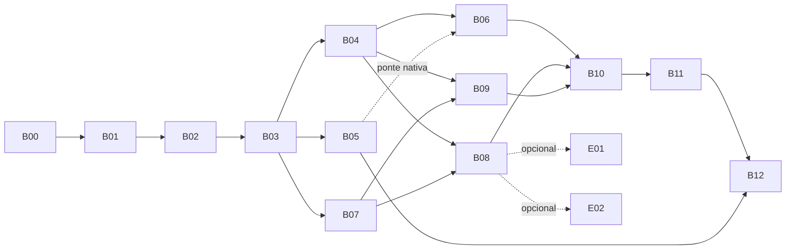

# Sistema Zero TUI — Implementation Plan por lotes, V2

> **For agentic workers:** REQUIRED SUB-SKILL: usar a skill disponível `executing-plans` para executar os lotes tarefa por tarefa. As caixas abaixo acompanham implementação futura; não indicam trabalho já feito. Este documento não autoriza delegação automática nem publicação externa.

**Goal:** concluir uma ferramenta local de coding, pesquisa, browser, equipes e operação do Sistema Zero, com motor próprio e clientes oficiais opcionais, recuperação verificável e desempenho medido.

**Architecture:** OpenTUI é cliente de um supervisor local. Contratos puros, journal/projeções SQLite, dispatcher único e adapters separam inferência, backend de agente e ambiente. Workflows e equipes usam o mesmo scheduler de Tasks.

**Tech Stack:** TypeScript, Bun, OpenTUI/React, SQLite local, Zod para contratos, Git/rg, OpenRouter, clientes oficiais Claude/Codex, MCP, Playwright e Stagehand opcional. Versões serão fixadas por evidência B00; a baseline observada é Bun 1.3.11 e OpenTUI 0.3.0.

**Spec:** [Proposta integrada V2](../../plans/2026-10-15-tui-proposta-integrada.md), [desempenho e fixtures](../../plans/2026-10-15-tui-desempenho.md), [auditoria V2](../../../.audits/architectural-analysis-tui-v2-2026-10-15.md).

## Global Constraints

- Ferramenta local para você e a equipe do Sistema Zero; instalações e credenciais individuais.
- Motor próprio via OpenRouter primeiro; Claude Code/Codex pelo login e interfaces oficiais.
- Nenhum dado de assinatura é extraído para funcionar como chave de API do motor próprio.
- Windows é obrigatório desde B00; Linux/macOS só entram como suportados após homologação.
- Preservar WIP rastreado e untracked relevante; worktree de HEAD sozinha não representa este workspace.
- Um escritor SQLite por perfil, em worker dedicado, com banco em disco local e journal versionado.
- Intenção de efeito durável antes do dispatch; resultado incerto não recebe retry cego.
- Autorizações existentes continuam válidas no escopo; Helpdesk mantém aprovação humana.
- TUI/CLI/MCP/workflow chamam o mesmo dispatcher; instrução textual não amplia capabilities.
- Desempenho, cancelamento, recovery e limites fazem parte de todos os lotes.
- Não presumir interceptação de todas as tools internas de um cliente oficial.
- Nenhuma implementação depende de Clerk/Polar/Trigger/Liveblocks/Daytona obrigatórios.
- Novos pacotes entram com entrega funcional, scripts check/typecheck/test e exports explícitos; não criar esqueletos para todos os subsistemas em B00.
- Os caminhos abaixo são **arquivos planejados**, salvo indicação de modificação. Não afirmar que já existem ou que os comandos de teste futuros já passaram.

## 1. Mapa de responsabilidades antes das tarefas

| Pacote/entrypoint | Responsabilidade | Fronteira |
|---|---|---|
| `packages/agent-core/src/contracts.ts` | IDs, envelopes de comando/evento, referências e resultados | Sem Bun, React, SQL ou SDK de modelo |
| `packages/agent-core/src/{task,policy,capability}.ts` | Estados, transições, decisões puras e capabilities | Schemas e semântica independentes de transporte |
| `packages/agent-runtime/src/{main,supervisor,client}.ts` | Processo, API local e conexão dos clientes | Não importa UI |
| `packages/agent-runtime/src/store/` | Escritor, migrations, journal, consultas e recovery | Único dono de persistência por perfil |
| `packages/agent-runtime/src/execution/` | Dispatcher, scheduler, orçamento, efeitos e cancelamento | Toda mutação passa por aqui no motor próprio |
| `packages/agent-runtime/src/{models,backends,tools,context,environments}/` | Implementações locais por capacidade | Adaptam contratos sem exportar tipos de SDK para UI |
| `packages/agent-integrations/src/{mcp,browser,sistemazero,notifications,remote}/` | Integrações opcionais | Imports dinâmicos; sem dependência de tabelas de negócio |
| `packages/tui/src/{cli,app}.tsx` e `src/index.tsx` | Entrypoint leve e composição da UI | CLI/headless não carregam renderer |
| `packages/tui/src/{screens,state,components}/` | Projeções da UI, interação e renderização | Estado durável pertence ao runtime |
| `packages/agent-integrations/src/viewer/` | Viewer loopback e artefatos autorizados | Sem file server genérico e sem servir conteúdo gerado na origem do controle |
| `packages/agent-runtime/bench/` | Datasets, medições e regressão | Separado de chamadas reais a provedores |

Os módulos podem ser divididos ao crescer. Nenhum arquivo deve acumular supervisor, SQL, provider, ferramentas e renderização. Adapters não se tornam pacotes separados antes de haver necessidade de distribuição/runtime.

## 2. Contratos que conectam os lotes

Esboço normativo de interface pública; B01 materializa schemas de runtime e testes de compatibilidade. IDs são strings opacas; digest é SHA-256 do conteúdo canônico. Campos adicionais devem receber versão/migração, não mudar silenciosamente.

```ts
type Id = string;
type ArtifactRef = { id: Id; sha256: string; mediaType: string; bytes: number };
type RevisionRef = { workspaceId: Id; snapshotId: Id; treeDigest: string };
type ToolOutcome<T> =
  | { kind: 'ok'; value: T; artifacts: ArtifactRef[] }
  | { kind: 'failed'; code: string; message: string; retry: 'never' | 'read' | 'idempotent' }
  | { kind: 'unknown'; effectId: Id; reason: string };
type RuntimeEvent = {
  schemaVersion: 1; runId: Id; sequence: number; id: Id;
  type: string; payload: unknown; occurredAt: string;
};
type Command = {
  protocolVersion: 1; requestId: Id; type: string; payload: unknown;
};
type CommandAck = { requestId: Id; accepted: boolean; durableSequence?: number; errorCode?: string };
type DispatchRequest = {
  runId: Id; invocationId: Id; capability: string;
  input: unknown; inputDigest: string; deadlineAt: string;
};
interface RuntimeClient {
  command(command: Command): Promise<CommandAck>;
  events(runId: Id, after: number, signal: AbortSignal): AsyncIterable<RuntimeEvent>;
}
interface Dispatcher {
  dispatch(request: DispatchRequest, signal: AbortSignal): Promise<ToolOutcome<unknown>>;
}
```

`unknown` é aceito somente na fronteira, validado pelo schema associado ao `type/capability`; handlers recebem tipos discriminados. Sequências persistidas cabem em inteiro seguro; não serializar BigInt de DB diretamente. `requestId` deduplica comando; `invocationId` identifica chamada; `effectId` permite reconciliação da mutação. Não reaproveitar IDs entre tentativas para fingir retomada.

Interfaces de extensão:

- `ModelProvider.stream(ModelRequest, AbortSignal): AsyncIterable<ModelEvent>`: recebe mensagens portáveis, schemas selecionados, limites e credencial referenciada; emite deltas, chamada validável, uso e término. Não executa tools.
- `AgentBackend.start(BackendRequest, AbortSignal): AsyncIterable<BackendEvent>` e `interrupt(runId): Promise<InterruptReceipt>`: backend possui seu loop. Request fixa Task, ambiente, grants e nativeSessionId opcional; eventos informam session/turn, progresso, aprovação, artefato e terminal. Retomada é capability declarada.
- `EnvironmentManager.acquire(EnvironmentRequest): Promise<EnvironmentLease>` e `release(leaseId): Promise<void>`: request contém dono, template/hash, base, capabilities e limites; lease inclui geração, raiz lógica e adapter. Operações verificam geração antes do efeito/commit; revogar lease não desfaz efeito já aceito fora do host.
- `ContextBuilder.build(ContextRequest): Promise<ContextBundle>`: request fixa Task, revisão, modelo e orçamento; bundle contém itens com origem/hash, instruções aplicáveis, tokens estimados e referências omitidas recuperáveis.
- `WorkflowCompiler.compile(WorkflowDocument): CompiledWorkflow`: document tem versão, schema de inputs, nós, edges, limites e agenda opcional; compilado tem digest, schemas resolvidos e dependências válidas. Runner chama dispatcher ou cria Task; não contém segunda implementação das tools.

Cada tipo acima deve ser definido pelo lote produtor antes do consumidor: ModelRequest/Event em B02; BackendRequest/Event/InterruptReceipt em B05; EnvironmentRequest/Lease em B03 mínimo e B07 capabilities adicionais; ContextRequest/Bundle em B04; WorkflowDocument/CompiledWorkflow em B10. Consumidores não inventam variantes locais.

## 3. Regra de conclusão de cada tarefa

Sequência para as tarefas de código: reproduzir o caso de aceite em teste que falhe; implementar a capacidade mínima; executar teste específico; executar typecheck/check e suíte afetada; demonstrar a jornada; medir fixture pertinente; revisar diffs e documentação. Testes avaliam efeitos observáveis e invariantes, não apenas espelham a função.

Comandos previstos após criação dos scripts de cada pacote:

```powershell
bun run --filter '@sistemazero/agent-core' test
bun run --filter '@sistemazero/agent-runtime' test
bun run --filter '@sistemazero/agent-integrations' test
bun run --filter '@sistemazero/tui' test
bun run --filter '@sistemazero/agent-runtime' typecheck
bun run --filter '@sistemazero/tui' check
```

Usar somente os pacotes/casos afetados em cada tarefa, ampliando quando houver risco de integração. Cada PR registra arquivos, resultado, comandos reais, fixture, números e limitações. Commits incluem somente os arquivos da tarefa; nunca `git add .` neste workspace com WIP independente. Aprovar um lote exige capacidades visíveis, falhas tratadas e números; caixas marcadas isoladamente não bastam.

## B00 — Provas de compatibilidade e baseline

**Produz:** matriz de compatibilidade e evidências que fixam versões, transportes, empacotamento e budgets. Nenhuma dependência obrigatória de cloud.

**Arquivos planejados:** `scripts/tui-probes/{ipc,sqlite,process-tree,opentui-package,native-protocol,provider-stream}.ts`, `scripts/tui-probes/fixtures.ts`, `docs/plans/tui-compatibility.json`. Relatórios em `.audits/tui-bench/`; não versionar DBs/binários gerados.

- [ ] **B00.1 — Instalação/terminal:** construir pacote de prova fora do monorepo; iniciar de caminho com espaços/Unicode; carregar assets nativos/WASM; abrir/fechar terminal sem corrompê-lo; testar help sem TTY. Registrar Bun/OpenTUI e arquivo de distribuição efetivamente usado.
- [ ] **B00.2 — Persistência/IPC/processos:** worker SQLite WAL/FULL, commit/kill/reopen; named pipe com ACL do usuário, framing fragmentado e limite; processo com filho/neto e cancelamento. Medir F1/F3/F4. Se a biblioteca não expõe ACL ou encerramento confiável, registrar adapter nativo mínimo necessário e provar essa implementação antes de B01/B03.
- [ ] **B00.3 — Modelos/clientes:** OpenRouter com stream/tool/uso/abort; Claude e Codex com versão/conta/stream/retomada/aprovação/interrupt. Primeiro fixtures locais do protocolo, depois smoke real com orçamento. Detectar flags do executável homologado; não assumir que flags do WIP são atuais.
- [ ] **B00.4 — Isolamento:** Docker Desktop/WSL2 disponível, mount limitado, processo/rede/porta, filesystem e cancelamento. Registrar quais backends realmente operam nesse ambiente; não marcar remoto/isolado como suportado por analogia.
- [ ] **B00.5 — Consolidar:** congelar hardware, versões, fixtures F1–F7, budgets e riscos. Mapear licenças/origem antes de incorporar código literal; padrões podem ser implementados de forma própria.

**Protocolo concreto de execução das provas:**

```powershell
bun scripts/tui-probes/ipc.ts --scenario fragmented-and-oversize
bun scripts/tui-probes/sqlite.ts --scenario commit-kill-reopen
bun scripts/tui-probes/process-tree.ts --scenario child-grandchild
bun scripts/tui-probes/opentui-package.ts --scenario clean-install
bun scripts/tui-probes/native-protocol.ts --fixture-only
bun scripts/tui-probes/provider-stream.ts --fixture-only
```

**Aceite:** relatório por prova com `supported`, `unsupported` ou `unverified`; nenhum campo inferido como suportado. Login/conta indisponível não bloqueia o motor próprio, mas mantém o backend indisponível até homologação. **Desempenho:** baseline observada, inclusive startup e commit síncrono. **Reversão:** provas e temporários isolados; não migrar dados pessoais.

## B01 — Supervisor, armazenamento e aplicação instalável

**Depende:** B00. **Consome:** decisões IPC/SQLite/cofre/distribuição. **Produz:** RuntimeClient, journal, Task/Run, perguntas e controle de execução.

**Criar:** `agent-core/src/{contracts,task,policy,capability}.ts`; `agent-runtime/src/{main,supervisor,client,config,credentials}.ts`; `agent-runtime/src/ipc/{server,protocol}.ts`; `agent-runtime/src/store/{worker,migrations,journal,recovery}.ts`; `agent-runtime/src/execution/{dispatcher,cancellation}.ts`, nos respectivos `packages/`. **Modificar:** `packages/tui/package.json`, `src/index.tsx`, `src/theme.ts`; criar `packages/tui/src/{cli,app}.tsx`, `state/runtime.ts`, `screens/{home,session}.tsx` e bin distribuível.

- [ ] **B01.1 — Contratos e estado:** schemas e transições, idempotência de request, perguntas/respostas e aprovações versionadas; evento/projeção no mesmo commit; estados inválidos rejeitados.
- [ ] **B01.2 — Supervisor:** exclusividade por perfil, IPC privado, worker DB, schema migrations, backup e recuperação; tarefa sintética controlada demonstra crash sem reexecutar uma mutação.
- [ ] **B01.3 — Shell utilizável:** home, sessão, reconexão, erro/rascunho preservado, configuração por OS e cofre; migrar somente preferências reconhecidas de Nightcode sem carregar credenciais desconhecidas.
- [ ] **B01.4 — Distribuição inicial:** bin real, help/doctor/headless, instalação de outro diretório e restauração de terminal. Criar scripts de testes/typecheck/check por pacote.

**Testes:** `agent-core/tests/task.test.ts`, `agent-runtime/tests/{store-recovery,ipc,credentials}.test.ts`, `tui/tests/{session-reconnect,cli}.test.ts`.

Caso normativo: enviar duas vezes a resposta da mesma pergunta → uma resposta persistida e um avanço; encerrar UI → reabrir pelo cursor → pergunta não reaparece respondida como pendente. Crash após commit e antes de ack → reenvio recebe ack anterior, sem novo efeito. Disco cheio → recusa antes do dispatch.

**Desempenho:** F3, startup e cancel ack; queries paginadas e frame limitado. **Reversão:** bin anterior só abre schema compatível; backup consistente antes de migration, sem downgrade destrutivo automático.

## B02 — Motor próprio OpenRouter e primeira jornada completa

**Depende:** B01. **Produz:** ModelProvider, ModelRequest/Event e loop próprio com despacho. Estado/runtime não dependem de AI SDK.

**Criar:** `packages/agent-runtime/src/models/{provider,openrouter,catalog,loop,usage}.ts`, `execution/budget.ts`, `tools/{read,search}.ts`; `packages/tui/src/screens/{connections,models,usage}.tsx`, `components/{timeline,tool-result}.tsx`. **Modificar:** InputBar, StatusBar e command-menu existentes, removendo estados fictícios.

- [ ] **B02.1 — Inferência:** credencial referenciada, stream validado, tool calls completas antes de dispatch, limites de steps/tempo/tokens, erro tipado e retry por classe.
- [ ] **B02.2 — Uso e routing:** modelo pedido/real, capabilities, catálogo em cache, preço datado, reserva transacional; interrupção/usage perdido fica pendente de reconciliação, não custo zero.
- [ ] **B02.3 — Jornada:** investigar fixture usando read/search, mostrar evidências, contexto e uso; headless JSONL e TUI recebem mesma sequência. Entrada adicional pode ser enfileirada; steering só quando suportado.

**Testes:** `packages/agent-runtime/tests/{provider-stream,budget,agent-loop}.test.ts`, `packages/tui/tests/streaming.test.tsx`. Fixtures: JSON de tool incompleto → nenhum dispatch; duas chamadas disputam orçamento → soma reservada não ultrapassa teto; stream cai → texto parcial e tentativa interrompida; resposta com tool inválida não escreve arquivo.

**Desempenho:** F3/F5 com provedor simulado, coalescência de deltas; TTFT real separado do overhead local. **Marco:** investigação local funcional sem cliente oficial.

## B03 — Coding, processos, Git e checkpoints

**Depende:** B02. **Produz:** capacidades workspace/process/git/checks, EnvironmentRequest/Lease local mínimo e checkpoints.

**Criar:** `packages/agent-runtime/src/tools/{paths,read,search,patch,git,checks}.ts`, `process/{manager,streams,pty,windows,unix}.ts`, `environments/{contract,local}.ts`, `workspace/{snapshot,checkpoint,merge}.ts`, `execution/{effects,locks}.ts`; `packages/tui/src/screens/{diff,checkpoints,processes}.tsx`.

- [ ] **B03.1 — Edição:** identidade canônica, faixa/bytes, patch literal, hash esperado, tamanho final, validação de todo patch antes de escrita. Multi-arquivo tem journal por arquivo e recovery; não anunciar atomicidade de filesystem inexistente.
- [ ] **B03.2 — Processos:** args estruturados, shell explícito, env mínimo, spool/ring limitados, timeout, PTY quando necessário e encerramento da árvore com ownership.
- [ ] **B03.3 — Git:** snapshot do WIP relevante, worktree da base correta, checkpoints e restauração seletiva; diff/merge revalidam conteúdo atual e preservam alterações externas.
- [ ] **B03.4 — Entrega:** corrigir bug em fixture, executar checks declarados pelo projeto, apresentar revisão final com patch/logs. Plan recusa escrita direta e indireta; Build respeita grants já concedidos.

**Testes:** `packages/agent-runtime/tests/{patch,workspace-wip,process-tree,output-pressure,effect-recovery}.test.ts`. Casos: `newString='$&'` deve permanecer literal; arquivo mudou desde leitura → conflito sem escrita; `AA` e `BB` concorrentes → serialização/merge ou conflito explícito; shutdown durante patch → recovery descreve cada arquivo; serviço iniciado pelo usuário não é morto.

**Desempenho:** F1/F2/F4/F6, memória limitada antes de truncar; UI responde sob stdout contínuo. **Marco:** agente próprio de coding utilizável. **Reversão:** checkpoints só das mudanças próprias; não `reset --hard` no workspace.

## B04 — Contexto, skills, memória, LSP e pesquisa

**Depende:** B03. **Produz:** ContextBuilder/Bundle e capacidades de pesquisa; modelo consulta recursos sem carregar tudo.

**Criar:** `packages/agent-runtime/src/context/{builder,rules,skills,memory,compaction,index,watcher}.ts`, `tools/{lsp,web-search,web-fetch}.ts`; `packages/tui/src/screens/{context,memory,skills}.tsx`.

- [ ] **B04.1 — Contexto:** hierarquia AGENTS/CLAUDE, skills por metadados, mapa de pacotes e hashes, LSP TS/JS sob demanda; watcher com exclusões e rescan após overflow.
- [ ] **B04.2 — Memória:** escopo, origem, evidência, validade, busca e correção/remoção/exportação. Compactar preserva restrições, erros pendentes e ArtifactRefs; registro novo além do limite continua recuperável.
- [ ] **B04.3 — Pesquisa:** search/fetch com limites, URLs/data, credenciais do adapter e política de rede/redirect; conteúdo externo é dado. Hooks explícitos usam dispatcher e não executam na descoberta.

**Testes:** `packages/agent-runtime/tests/{context-invalidation,memory-scope,compaction,web-policy}.test.ts`. Nota recente em memória extensa → encontrada por consulta; alterar arquivo invalida diagnóstico dependente; conteúdo de página pedindo envio de segredo → não altera grant; tarefa retomada mantém pergunta/resposta e pendência.

**Desempenho:** F2/F3, tokens por tarefa, cache hit, tempo de contexto; nenhuma indexação bloqueia prompt. Embeddings só entram como extensão se avaliação demonstrar ganho.

## B05 — Claude Code e Codex oficiais

**Depende:** B03; usa contratos de contexto de B04 quando disponível. **Produz:** AgentBackend, BackendRequest/Event e matriz por versão/ambiente.

**Criar:** `packages/agent-runtime/src/backends/{contract,native-process,claude,codex,compatibility}.ts`, `backends/protocol/{claude-events,codex-rpc}.ts`; **consultar para reuso, sem assumir pronto:** `packages/marketing-desktop/src/main/{native-client,json-rpc,providers}.ts`. Se extrair transporte comum, preservar consumidores existentes e seus testes.

- [ ] **B05.1 — Conta/transporte:** descobrir executable confiável, versão e auth efetiva, login/logout/status oficiais, stdout estruturado/stderr separado, tamanho máximo e timeout.
- [ ] **B05.2 — Ciclo de tarefa:** native session/turn persistidos, aprovação pendente, interrupt, resultado tardio e retomada certificada; codificação/schema por versão com fixtures.
- [ ] **B05.3 — Coding real:** repetir fixture B03 com cada backend; inspecionar diff e critérios independentemente. Declarar quais ferramentas passam pelo dispatcher e quais dependem de política/isolamento nativos.

**Testes:** `packages/agent-runtime/tests/{native-auth,native-protocol,native-resume,native-interrupt}.test.ts`. Assinatura ativa + API env herdada → modo efetivo não muda silenciosamente; processo encerra antes do resultado final → interrompido/failed, não success; versão desconhecida → capacidade de escrita indisponível até certificação.

**Desempenho:** startup e custo dos filhos relatados separadamente; consumo lento de stdout não perde evento terminal. **Reversão:** desabilitar adapter sem perder Tasks/artefatos; trocar backend cria nova tentativa, sem reconstruir sessão privada de outro motor.

## B06 — MCP nos dois sentidos

**Depende:** B04; ponte para clientes oficiais consome B05. **Produz:** registry único acessível por MCP, CLI e UI.

**Criar:** `packages/agent-integrations/src/mcp/{client,server,registry,auth,transport}.ts`, `packages/agent-runtime/src/execution/grants.ts`, `packages/tui/src/screens/mcp.tsx`.

- [ ] **B06.1 — Consumir:** stdio/HTTP conforme protocolos homologados, descoberta progressiva, schemas versionados, OAuth quando exigido, deadline/abort, reconnect e limites.
- [ ] **B06.2 — Expor:** tools Sistema Zero passam ao dispatcher com identidade, grant e correlação; bridge não aceita IDs arbitrários de run de outra sessão.
- [ ] **B06.3 — Paridade:** executar mesma leitura e mutação controlada via CLI/TUI/MCP; comparar resultados/evidências/decisões. Skills são documentação da mesma capability.

**Testes:** `packages/agent-integrations/tests/{mcp-contract,mcp-auth,mcp-failure}.test.ts`. Server morre → chamada termina com estado definido; schema muda → invalida aprovação incompatível; resultado malformado ou frame grande → recusa antes de alocação ilimitada. Token upstream nunca é repassado cegamente a outro servidor.

**Desempenho:** iniciar app sem conectar todos os MCPs; limites de simultaneidade por servidor; schemas apenas dos tools necessários. **Reversão:** revogar grant, parar processo e preservar efeitos já despachados para reconciliação.

## B07 — Ambientes, templates e serviços

**Depende:** B03. **Produz:** EnvironmentManager completo e propriedade de processos/portas.

**Criar:** `packages/agent-runtime/src/environments/{manager,lifecycle,templates,leases,reconcile,gc,container}.ts`, `services/{registry,ports,readiness}.ts`; `packages/tui/src/screens/environments.tsx`; templates sob `packages/agent-runtime/templates/`. **Adaptar com escopo explícito:** `scripts/dev.ts`, sem dois donos do mesmo processo.

- [ ] **B07.1 — Lifecycle:** intenção antes de criar, labels por instalação/projeto/run, lease/geração, provision/ready/stop/destroy e reconciliação de órfãos. Deleção distingue not-found de transporte indisponível.
- [ ] **B07.2 — Template:** manifesto/hash, dependências fixas, readiness, cache por SO/arquitetura/lockfile e exportação de patch/artefato. Perfil do monorepo descobre scripts sem substituir configuração existente.
- [ ] **B07.3 — Isolamento local:** homologar container e políticas de mount/rede/segredos; sem socket do host amplo ou credenciais na imagem. Compatibilidade backend × ambiente real; unavailable bloqueia requisito de contenção.
- [ ] **B07.4 — Serviços:** status/logs/ports e ciclo de vida autorizado, reuso por proprietário/revisão; tempo de ambiente medido/estimado, orçamento, auto-stop e quota.

**Testes:** `packages/agent-runtime/tests/{environment-race,environment-recovery,environment-gc,service-ownership}.test.ts`. Dois acquire da mesma intenção → uma instância ativa; crash após provision → reconciliada por label; destruir com tool em voo → revoga novos usos e drena; porta ocupada por outro processo → não reaproveita como preview válido.

**Desempenho:** cold/warm startup separado, seed em lote, sem polling constante ou warm pool sem benefício medido. **Reversão:** exportar antes de destruir, manter tombstone e relatório de recursos que não puderam ser removidos.

## B08 — Browser, preview e verificação visual

**Depende:** B04 + B07. **Produz:** BrowserSession, PreviewSession e evidência por revisão.

**Criar:** `packages/agent-integrations/src/browser/{session,playwright,stagehand,tools,artifacts}.ts`, `preview/{manager,diagnostics,verification}.ts`, `viewer/{server,routes}.ts`; `packages/tui/src/screens/{browser,preview}.tsx`.

- [ ] **B08.1 — Navegação:** DOM/snapshot, navigate, observe/act/extract, screenshot, upload/download, login humano e sessão por conta; mutação serial por sessão.
- [ ] **B08.2 — Preview:** revisão/hash, readiness, último candidato validado, captura independente de console/rede; URL temporária por referência, origem separada, autorização loopback e validade.
- [ ] **B08.3 — Verificação:** reproduzir bug visual, patch, checks, browser e evidência final; erro retorna ao agente como dado limitado. Máximo de tentativas e parada por falta de progresso/ orçamento.
- [ ] **B08.4 — Viewer:** abrir traces/screenshots localmente, sem enviar para serviço hospedado; não servir arquivos fora de ArtifactRefs concedidos.

**Testes:** `packages/agent-integrations/tests/{browser-outcome,browser-lease,preview-revision,preview-auth,verification-loop}.test.ts`. `success:false` → etapa falha; mudança após screenshot → evidência stale; reporter ausente → não prova saúde; token em hostname/path → redigido; erro repetido sem progresso → encerra ciclo dentro do teto.

**Desempenho:** browser lazy, screenshots dimensionados e artefatos por referência; memória do browser reportada à parte; medir tempo até primeira preview utilizável e validação final. **Marco:** coding + pesquisa + clientes + MCP + browser integrados.

## B09 — Equipe coordenada

**Depende:** B04 + B07; usa B05/B06/B08 conforme capacidades da tarefa. **Produz:** Task DAG, mailbox/handoff e integração de patches.

**Criar:** `packages/agent-runtime/src/team/{planner,scheduler,mailbox,handoff,profiles,integrator}.ts`; `packages/tui/src/screens/team.tsx`. Scheduler reutiliza execução/budget/locks existentes; não mantém fila invisível própria.

- [ ] **B09.1 — Planejar:** tarefas com entrada/saída/aceite/dependências; detectar independência e evitar agentes extras em tarefa simples; defaults de concorrência/profundidade.
- [ ] **B09.2 — Cooperar:** ownership por lease, mailbox deduplicada, handoff persistente com nota/artefatos/pendências; child não amplia grant nem reserva o mesmo orçamento duas vezes.
- [ ] **B09.3 — Integrar:** escritores em worktrees da base correta, merge serial e nova validação; reviewer inspeciona resultado integrado, não somente branches verdes.

**Testes:** `packages/agent-runtime/tests/{team-budget,team-handoff,team-recovery,team-merge}.test.ts`. Writer atrasado retorna com lease antiga → resultado não aplicado; tarefas editam mesmo arquivo → conflito tratado; filho falha → dependente bloqueado; revisão e patch de bases diferentes → não conclui Task.

**Desempenho:** F5, tempo total/custo versus agente único; habilitar paralelismo somente quando compensa. **Reversão:** pausar novos filhos e reconciliar ativos, preservando worktrees/artefatos; não descartar alterações para simplificar cleanup.

## B10 — Receitas e agendamentos

**Depende:** B06 + B08 + B09. **Produz:** WorkflowDocument/CompiledWorkflow e Schedule persistido.

**Criar:** `packages/agent-runtime/src/workflows/{schema,compiler,runner,expressions,schedule,recipes}.ts`; `packages/tui/src/screens/workflows.tsx`; receitas compartilháveis em `.sistemazero/workflows/`.

- [ ] **B10.1 — Compilar:** IDs únicos, schemas e refs existentes, reachability, ciclos, tipo conhecido e capabilities; expressões de paths sem eval, defaults explícitos e outputs grandes por ArtifactRef.
- [ ] **B10.2 — Executar:** versão/inputs imutáveis, nodes capability/agent/wait/condition/foreach limitado, retries por classe e checkpoints; efeitos incertos exigem reconciliar, não rerun geral.
- [ ] **B10.3 — Agendar:** timezone IANA, DST, coalesce/skip/catch_up limitado, ocorrência idempotente, política de sobreposição e daemon escolhido pelo usuário; laptop desligado não executa.
- [ ] **B10.4 — Receitas úteis:** corrigir bug, revisar PR, validar jornada e diagnosticar serviço com critérios/evidências; integrações de envio só entram por B11.

**Testes:** `packages/agent-runtime/tests/{workflow-compile,workflow-recovery,workflow-outcome,schedule}.test.ts`. Nó desconhecido → erro de compilação; campo ausente → erro antes da chamada; receita editada após disparo → run usa versão anterior; horário repetido → uma ocorrência; timeout após envio → unknown sem nova tentativa automática.

**Desempenho:** F7; eventos incrementais e filas limitadas; workflow determinístico não chama LLM para cada transição. **Reversão:** desabilitar agenda/versionar nova receita; runs existentes continuam fixados à versão original.

## B11 — Integrações reais do Sistema Zero

**Depende:** B06 + B10. **Produz:** operações autorizadas de dev/ops, mensagens, atendimento e artefatos do Studio.

**Criar:** `packages/agent-integrations/src/sistemazero/{auth,client,dev,helpdesk,studio}.ts`, `notifications/{prepare,messaging,telegram,reconcile}.ts`, `github/{client,operations}.ts`. **Fronteiras existentes:** `packages/auth/src/interfaces/http/routes/auth.routes.ts`, `packages/api-gateway/gateway.config.ts`, `packages/messaging/src/interfaces/http/routes/send.routes.ts`, `scripts/dev.ts`, `packages/studio-runtime` e `packages/core/src/studio`. A operação de envio por usuário requer rota de backend dedicada e testes de autorização, antes de expor a capability no TUI; não substituir a autorização HMAC da rota S2S existente.

- [ ] **B11.1 — Identidade:** reutilizar `/auth/otp/request` com purpose `sign_in`/platform `main`, `/auth/otp/verify`, `/auth/refresh`, `/auth/logout` e `/auth/me`. Entrada de código fora do contexto do modelo, refresh no cofre e rotação serializada por conta; respeitar primeiro acesso/RBAC. Operações hoje S2S recebem fachada de backend com autorização por usuário/ação/destino e auditoria; manter HMAC e token interno no servidor. Não criar OAuth novo como pré-requisito.
- [ ] **B11.2 — Operações de leitura:** status/logs, GitHub/PR, KB/tickets e artefatos Studio; contexto traz fontes e respeita permissão efetiva do usuário.
- [ ] **B11.3 — Efeitos:** preparar conteúdo/destino, aproveitar autorização já dada, fixar digest e idempotency key; messaging acompanha enqueue/status; Telegram incerto não reenvia automaticamente. Helpdesk exige aprovação humana do serviço.
- [ ] **B11.4 — Jornada:** bug → checks/browser → relatório → rascunho/ação autorizada; Studio recebe contrato de build/artefato, nunca shell irrestrito nem token interno.

**Testes:** `packages/agent-integrations/tests/{staff-auth,messaging-idempotency,notification-unknown,helpdesk-approval,studio-contract}.test.ts`, mais testes da nova operação de backend e registro no gateway. Refresh revogado → rotação recusada e UI desconectada; ação privilegiada revalida sessão/permissão no servidor, sem supor que JWT anterior desapareceu. Usuário sem papel adequado não envia; JWT comum não chama rota S2S; `202` → queued e não delivered; duplo clique → mesma intenção; destino mudou após aprovação → reavaliar; timeout após aceitação sem consulta → unknown visível.

**Desempenho:** leituras paginadas, backoff bounded e circuit breaker por serviço; nenhum polling de todos os serviços para abrir chat. **Reversão:** revogar credenciais/grants e parar agenda; reconciliação permanece disponível para ações já despachadas.

## B12 — Homologação e entrega para uso diário

**Depende:** B01–B11. **Produz:** release instalada, matriz de suporte e evidência de adoção.

**Criar:** `scripts/tui-release/{package,verify,upgrade}.ts`, `packages/tui/tests/{clean-install,terminal-ux,upgrade}.test.ts`, `packages/agent-runtime/bench/{fixtures,run,report}.ts`, `docs/tui/{getting-started,backends,permissions,recovery,troubleshooting}.md`. **Atualizar:** scripts raiz dev/build/link do TUI e documentação de release.

- [ ] **B12.1 — UX:** teclado/foco/resize, terminal pequeno, Unicode, histórico/fork/export, editor/anexos, erros acionáveis, status real e terminal restaurado; comandos indisponíveis explicados.
- [ ] **B12.2 — Release:** instalar fora do repo, nativos/WASM/rg homologados, verificar manifestos, update interrompido e migration/rollback com backup; sem depender do cwd do monorepo.
- [ ] **B12.3 — Falhas/performance:** executar F1–F7 no hardware fixado e matriz funcional completa, soak e fault injection; medir filhos, disco, CPU e memory leak; corrigir regressões com perfil.
- [ ] **B12.4 — Avaliar adoção:** 30 tarefas, repetições, comparação controlada com fluxo atual e amostra final não usada para ajustes; relatório de qualidade/custo/tempo e limitações.

**Aceite:** todos os invariantes críticos da suíte passam; metas de desempenho congeladas atendidas ou desvio explicitamente decidido com evidência; nenhuma capacidade anunciada permanece apenas mock. Smoke externo não disponível fica marcado e impede anunciar aquela integração como homologada. **Reversão:** reinstalação da versão compatível e restauração testada; nunca apagar banco/artefatos para simular rollback.

## 4. Extensões separadas e completas

**E01 — Daytona/Browserbase remotos.** Depende B07/B08. Criar `agent-integrations/src/remote/{daytona,browserbase,tunnel}.ts`. Implementar labels, provision/reconcile/teardown, preview temporária/redação, custo, rede autorizada e exportação. Testar recurso órfão, credencial revogada, perda de túnel, URL expirada e backend sem acesso remoto. Comparar latência total/custo com local antes de recomendar. Não copiar credenciais de assinatura para imagens.

**E02 — Desktop isolado.** Depende B07/B08; pode usar E01 se escolhido remoto. Criar `agent-integrations/src/desktop/{session,tools,viewer}.ts`. Mouse/teclado/screenshot em VM/sandbox; imagens/escala/display e ownership explícitos. Testar stop em ação, foco errado, mudança de resolução e captura após operação; sem acesso automático ao desktop pessoal. Readiness, orçamento e evidências são iguais aos demais adapters.

**E03 — Coordenação entre máquinas/canvas.** Condicionada à necessidade real de autoria simultânea. Requer serviço autenticado, resolução de conflitos, isolamento entre usuários e fila remota; nunca SQLite compartilhado. Não é dependência nem requisito escondido dos lotes B00–B12.

## 5. Dependências e review da proposta



Paralelismo no roadmap é possibilidade de desenvolvimento depois de estabilizar contratos, não autorização automática para agentes trabalharem em paralelo neste workspace. Integrações independentes não devem gerar quatro loops de execução, quatro bancos ou quatro políticas.

Review efetuado sobre este plano:

- [x] Cinco referências cobertas por capacidade e origem, com diferenças entre original e evolução própria.
- [x] TUI atual, transportes em desenvolvimento, auth/messaging e Studio considerados sem presumir prontidão.
- [x] Contratos produtores/consumidores, dependências e marcos utilizáveis definidos.
- [x] Desempenho antecipado, com limites, fixtures, medição e custo por resultado.
- [x] Falhas, efeitos incertos, WIP, cancelamento e recuperação tratados por lote.
- [x] Extensões remotas/desktop separadas da conclusão local; SaaS fora do núcleo.
- [x] Metas distinguidas de resultados; nenhum ganho percentual declarado como obtido.
- [ ] Homologar decisões de risco em B00 e atualizar a matriz com medições reais.
- [ ] Implementar e demonstrar os lotes B01–B12.

Antes de iniciar cada lote, reler seu contrato, congelar a versão suportada e quebrar as tarefas listadas em PRs que tenham seus próprios testes e demonstração. Este é um plano de entrega de produto com fronteiras explícitas; não é código pronto nem dispensa a prova de APIs e ambientes identificada em B00.
